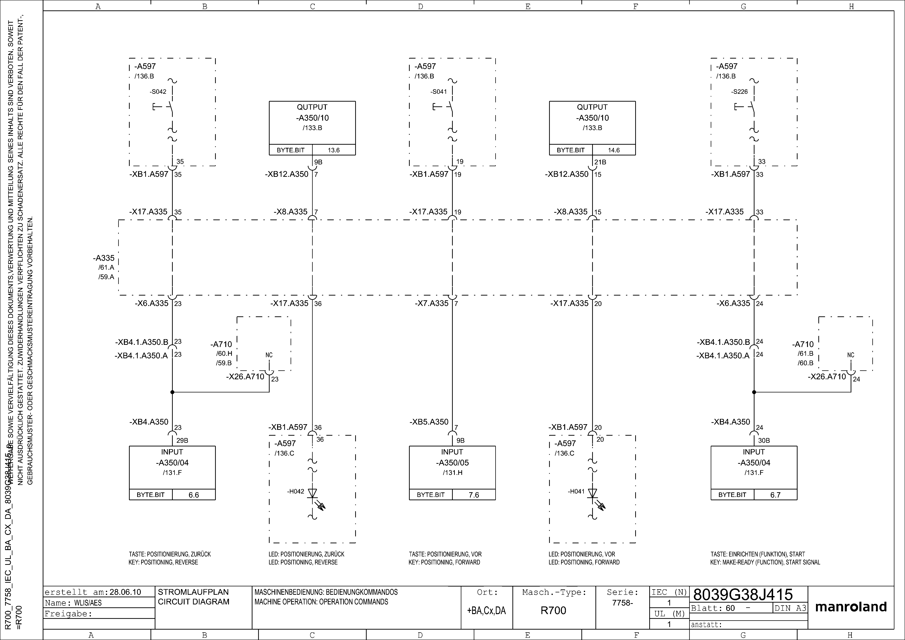

# +BA_Cx_DA — Sheet 60 of 247 — MASCHINENBEDIENUNG: BEDIENUNGKOMMANDOS

**MACHINE OPERATION: OPERATION COMMANDS**

> Part of the manroland **R700** printing press IEC/UL circuit diagrams.
> Drawing class: **Stromlaufplan / Circuit diagram** (DIN A3).
> Document `+BA_Cx_DA` covers the **Printing units / main switch cabinet** machine section.

## At a glance

| Field | Value |
|---|---|
| Document | `+BA_Cx_DA`  (8039G38J415) |
| Sheet | **60** of 247 |
| Section (DE) | MASCHINENBEDIENUNG: BEDIENUNGKOMMANDOS |
| Section (EN) | MACHINE OPERATION: OPERATION COMMANDS |
| Section type | CIRCUIT — Circuit diagram |
| Machine type | `R700` |
| Series | `7758` |
| Created | 28.06.10 |
| Replaces | — |
| Columns used | A, B, C, D, E, F, G, H |
| Path numbers | — |
| Labels on sheet | 123 |
| Cross-refs out | 16 |
| Cross-refs in | 42 |

**Previous:** [+BA_Cx_DA sheet 59](SHEET_0059.md) · **Next:** [+BA_Cx_DA sheet 61](SHEET_0061.md) · **Document TOC:** [_TOC.md](_TOC.md)  (+BA_Cx_DA) · **Master TOC:** [all sheets](../_MASTER_TOC.md)

## Sheet image (300 DPI, exact vector render)



_Rendered directly from the PDF vector layer at 300 DPI (1-bit), no OCR and no resampling. Use it to confirm anything ambiguous in the text below._

## Cross-references on this sheet

Each entry is a wire leaving this sheet. The printed token is `/sheet.column`; the link resolves to that sheet inside the same document.

| Ref | Target sheet | Col | Path | Destination on target | Target section | From col |
|---|---|---|---|---|---|---|
| `/136.B` | [+BA_Cx_DA sheet 136](SHEET_0136.md) | B | — | A597 | REFERENZMODUL | A |
| `/136.B` | [+BA_Cx_DA sheet 136](SHEET_0136.md) | B | — | A597 | REFERENZMODUL | D |
| `/136.B` | [+BA_Cx_DA sheet 136](SHEET_0136.md) | B | — | A597 | REFERENZMODUL | G |
| `/133.B` | [+BA_Cx_DA sheet 133](SHEET_0133.md) | B | — | — | REFERENZMODUL | C |
| `/133.B` | [+BA_Cx_DA sheet 133](SHEET_0133.md) | B | — | — | REFERENZMODUL | F |
| `/61.A` | [+BA_Cx_DA sheet 61](SHEET_0061.md) | A | — | — | MASCHINENBEDIENUNG: BEDIENUNGKOMMANDOS | A |
| `/59.A` | [+BA_Cx_DA sheet 59](SHEET_0059.md) | A | — | — | MASCHINENBEDIENUNG: LAUFKOMMANDOS | A |
| `/61.B` | [+BA_Cx_DA sheet 61](SHEET_0061.md) | B | — | — | MASCHINENBEDIENUNG: BEDIENUNGKOMMANDOS | H |
| `/60.B` | [+BA_Cx_DA sheet 60](SHEET_0060.md) | B | — | — | MASCHINENBEDIENUNG: BEDIENUNGKOMMANDOS | H |
| `/60.H` | [+BA_Cx_DA sheet 60](SHEET_0060.md) | H | — | — | MASCHINENBEDIENUNG: BEDIENUNGKOMMANDOS | B |
| `/59.B` | [+BA_Cx_DA sheet 59](SHEET_0059.md) | B | — | — | MASCHINENBEDIENUNG: LAUFKOMMANDOS | B |
| `/136.C` | [+BA_Cx_DA sheet 136](SHEET_0136.md) | C | — | A597 | REFERENZMODUL | C |
| `/136.C` | [+BA_Cx_DA sheet 136](SHEET_0136.md) | C | — | A597 | REFERENZMODUL | E |
| `/131.F` | [+BA_Cx_DA sheet 131](SHEET_0131.md) | F | — | — | REFERENZMODUL | B |
| `/131.F` | [+BA_Cx_DA sheet 131](SHEET_0131.md) | F | — | — | REFERENZMODUL | G |
| `/131.H` | [+BA_Cx_DA sheet 131](SHEET_0131.md) | H | — | — | REFERENZMODUL | D |

### Incoming references (sheets that point here)

Every other sheet that sends a wire to this one. `Back-ref` is the token printed on *that* sheet; `Path` is its line number.

| From sheet | Cols | Back-ref | Path | Refs | What continues there |
|---|---|---|---|---|---|
| [+BA_Cx_DA#59](SHEET_0059.md) | A, B | `/59.A`, `/59.B` | — | 2 | — |
| [+BA_Cx_DA#60](SHEET_0060.md) | B, H | `/60.B`, `/60.H` | — | 2 | — |
| [+BA_Cx_DA#61](SHEET_0061.md) | A, B | `/61.A`, `/61.B` | — | 2 | — |
| [+BA_Cx_DA#131](SHEET_0131.md) | F, H | `/131.F`, `/131.H` | — | 3 | — |
| [+BA_Cx_DA#133](SHEET_0133.md) | B | `/133.B` | — | 2 | — |
| [+BA_Cx_DA#136](SHEET_0136.md) | B, C | `/136.B`, `/136.C` | — | 5 | — |
| [+BA_Cx_DA#143](SHEET_0143.md) | B, C | `/143.B`, `/143.C` | — | 5 | — |
| [+BA_Cx_DA#159](SHEET_0159.md) | F, G, H | `/159.F`, `/159.G`, `/159.H` | — | 6 | — |
| [+BA_Cx_DA#161](SHEET_0161.md) | F | `/161.F` | — | 1 | — |
| [+BA_Cx_DA#162](SHEET_0162.md) | D | `/162.D` | — | 2 | — |
| [+BA_Cx_DA#163](SHEET_0163.md) | G | `/163.G` | — | 1 | — |
| [+BA_Cx_DA#165](SHEET_0165.md) | E | `/165.E` | — | 2 | — |
| [+BA_Cx_DA#169](SHEET_0169.md) | G | `/169.G` | — | 2 | — |
| [+BA_Cx_DA#173](SHEET_0173.md) | B, C | `/173.B`, `/173.C` | — | 5 | — |
| [+BA_Cx_DA#176](SHEET_0176.md) | E | `/176.E` | — | 2 | — |


## Devices on this sheet

| Tag | Class | Class meaning (IEC) | Col | Sub | Terminal | Sign |
|---|---|---|---|---|---|---|
| `A597` | A | Baugruppe / assembly, module, PC board | C | — | — | — |
| `A597` | A | Baugruppe / assembly, module, PC board | E | — | — | — |
| `A350/05` | A | Baugruppe / assembly, module, PC board | D | 05 | — | — |
| `A350/04` | A | Baugruppe / assembly, module, PC board | B | 04 | — | — |
| `A350/04` | A | Baugruppe / assembly, module, PC board | G | 04 | — | — |
| `S042` | S | Schalter / switch | B | — | — | — |
| `A597` | A | Baugruppe / assembly, module, PC board | A | — | — | — |
| `S041` | S | Schalter / switch | D | — | — | — |
| `A597` | A | Baugruppe / assembly, module, PC board | D | — | — | — |
| `A350/10` | A | Baugruppe / assembly, module, PC board | C | 10 | — | — |
| `A350/10` | A | Baugruppe / assembly, module, PC board | F | 10 | — | — |
| `S226` | S | Schalter / switch | G | — | — | — |
| `A597` | A | Baugruppe / assembly, module, PC board | G | — | — | — |
| `A335` | A | Baugruppe / assembly, module, PC board | A | — | — | — |
| `A710` | A | Baugruppe / assembly, module, PC board | B | — | — | — |
| `A710` | A | Baugruppe / assembly, module, PC board | H | — | — | — |
| `XB1.A597` | — | cross-device reference | C | — | — | — |
| `XB1.A597` | — | cross-device reference | E | — | — | — |
| `7.6` | — | cross-device reference | D | — | — | — |
| `XB5.A350` | — | cross-device reference | D | — | — | — |
| `6.6` | — | cross-device reference | B | — | — | — |
| `XB4.A350` | — | cross-device reference | A | — | — | — |
| `6.7` | — | cross-device reference | G | — | — | — |
| `XB4.A350` | — | cross-device reference | G | — | — | — |
| `XB1.A597` | — | cross-device reference | A | — | — | — |
| `XB1.A597` | — | cross-device reference | D | — | — | — |
| `XB12.A350` | — | cross-device reference | C | — | — | — |
| `13.6` | — | cross-device reference | C | — | — | — |
| `XB12.A350` | — | cross-device reference | E | — | — | — |
| `14.6` | — | cross-device reference | F | — | — | — |
| `XB1.A597` | — | cross-device reference | G | — | — | — |
| `X6.A335` | — | cross-device reference | B | — | — | — |
| `X7.A335` | — | cross-device reference | D | — | — | — |
| `X17.A335` | — | cross-device reference | E | — | — | — |
| `X17.A335` | — | cross-device reference | C | — | — | — |
| `X17.A335` | — | cross-device reference | A | — | — | — |
| `X8.A335` | — | cross-device reference | C | — | — | — |
| `X17.A335` | — | cross-device reference | D | — | — | — |
| `X8.A335` | — | cross-device reference | E | — | — | — |
| `X6.A335` | — | cross-device reference | G | — | — | — |
| `X17.A335` | — | cross-device reference | G | — | — | — |
| `X26.A710` | — | cross-device reference | B | — | — | — |
| `XB4.1.A350.B` | — | cross-device reference | A | — | — | — |
| `XB4.1.A350.A` | — | cross-device reference | A | — | — | — |
| `X26.A710` | — | cross-device reference | H | — | — | — |
| `XB4.1.A350.B` | — | cross-device reference | G | — | — | — |
| `XB4.1.A350.A` | — | cross-device reference | G | — | — | — |

## Potentials / nets

| Potential | Count | Columns | Attached devices | Terminals |
|---|---|---|---|---|
| `H041` | 1 | E | — | — |
| `H042` | 1 | C | — | — |


A potential such as `L24+/4` or `M24+` is a named supply/return rail; every place it appears on this sheet is electrically common.

## Wire-end annotations (grouped as printed)

A wire that continues elsewhere is annotated with a small cluster: the destination description, the path/line number `#NN`, and the `/sheet.column` cross reference. Each row below is one such cluster exactly as it is grouped on the drawing.

| Col | Y | Path | Cross-ref | Text on the wire |
|---|---|---|---|---|
| A | 82.5 | — | `/136.B` | `A597` |
| D | 82.5 | — | `/136.B` | `A597` |
| G | 82.5 | — | `/136.B` | `A597` |
| B | 117.0 | — | — | `S042` |
| D | 117.0 | — | — | `S041` |
| G | 117.0 | — | — | `S226` |
| C | 136.7 | — | — | `QUTPUT` |
| F | 136.7 | — | — | `QUTPUT` |
| C | 150.5 | — | — | `A350/10` |
| F | 150.5 | — | — | `A350/10` |
| C | 164.3 | — | `/133.B` | — |
| F | 164.3 | — | `/133.B` | — |
| C | 193.9 | — | — | `BYTE.BIT 13.6` |
| F | 193.9 | — | — | `BYTE.BIT 14.6` |
| B | 208.7 | — | — | `35` |
| D | 208.7 | — | — | `19` |
| G | 208.7 | — | — | `33` |
| C | 209.3 | — | — | `9B` |
| F | 209.3 | — | — | `21B` |
| B | 224.2 | — | — | `XB1.A597 35` |
| C | 224.2 | — | — | `XB12.A350 7` |
| D | 224.2 | — | — | `XB1.A597 19` |
| E | 224.2 | — | — | `XB12.A350 15` |
| G | 224.2 | — | — | `XB1.A597 33` |
| C | 273.9 | — | — | `X17.A335 35 X8.A335 7 X17.A335 19 X8.A335 15` |
| G | 273.9 | — | — | `X17.A335 33` |
| A | 334.8 | — | — | `A335` |
| A | 347.9 | — | `/61.A`, `/59.A` | — |
| B | 394.3 | — | — | `X6.A335 23` |
| D | 394.3 | — | — | `X17.A335 36 X7.A335 7 X17.A335 20` |
| G | 394.3 | — | — | `X6.A335 24` |
| A | 445.4 | — | — | `XB4.1.A350.B 23` |
| G | 445.4 | — | — | `XB4.1.A350.B 24` |
| B | 448.2 | — | — | `A710` |
| H | 448.2 | — | — | `A710` |
| H | 461.2 | — | `/61.B`, `/60.B` | — |
| B | 461.3 | — | `/60.H`, `/59.B` | — |
| A | 462.4 | — | — | `XB4.1.A350.A 23` |
| E | 462.4 | — | — | `NC XB4.1.A350.A 24 NC` |
| B | 490.7 | — | — | `X26.A710 23` |
| H | 490.7 | — | — | `X26.A710 24` |
| B | 550.2 | — | — | `XB4.A350 23` |
| D | 550.2 | — | — | `XB5.A350 7` |
| G | 550.2 | — | — | `XB4.A350 24` |
| D | 557.3 | — | — | `XB1.A597 36 XB1.A597 20` |
| C | 574.3 | — | — | `36` |
| F | 574.3 | — | — | `20` |
| B | 575.7 | — | — | `29B` |
| D | 575.7 | — | — | `9B` |
| G | 575.7 | — | — | `30B` |
| C | 578.6 | — | `/136.C` | `A597` |
| E | 578.6 | — | `/136.C` | `A597` |
| B | 590.2 | — | — | `INPUT` |
| D | 590.2 | — | — | `INPUT` |
| G | 590.2 | — | — | `INPUT` |
| B | 604.1 | — | — | `A350/04` |
| D | 604.1 | — | — | `A350/05` |
| G | 604.1 | — | — | `A350/04` |
| B | 617.9 | — | `/131.F` | — |
| D | 617.9 | — | `/131.H` | — |
| G | 617.9 | — | `/131.F` | — |
| C | 642.8 | — | — | `H042` |
| E | 642.8 | — | — | `H041` |
| B | 646.9 | — | — | `BYTE.BIT 6.6` |
| D | 646.9 | — | — | `BYTE.BIT 7.6` |
| G | 646.9 | — | — | `BYTE.BIT 6.7` |
| B | 726.3 | — | — | `KEY: POSITIONING, REVERSE TASTE: POSITIONIERUNG, ZURÜCK` |
| C | 726.3 | — | — | `LED: POSITIONIERUNG, ZURÜCK LED: POSITIONING, REVERSE` |
| D | 726.3 | — | — | `KEY: POSITIONING, FORWARD TASTE: POSITIONIERUNG, VOR` |
| F | 726.3 | — | — | `LED: POSITIONIERUNG, VOR LED: POSITIONING, FORWARD` |
| G | 726.3 | — | — | `KEY: MAKE READY (FUNCTION), START SIGNAL TASTE: EINRICHTEN (FUNKTION), START` |


## Reconstructed tables

This sheet carries tabular content (pin map / terminal assignment / index). The grid below was rebuilt from the drawing's own rule lines, so each row is exactly one physical row of the table.

### Table 1 — 7 data rows × 5 columns (at x=170.1, y=76.5) — **A597 /136.B S042**

|  |  |  | QUTPUT | A350/10 /133.B |
|---|---|---|---|---|
|  |  |  | `BYTE.BIT` | `13.6` |
|  | `35` |  |  | `9B` |
| `XB1.A597 X17.A335 X6.A335 XB4.1.A350.B XB4.1.A350.A` | `35 35 23 23 23` | `A710 /60.H NC /59.B X26.A710` | `XB12.A350 X8.A335 X17.A335 23` | `7 7 36` |
| `XB4.A350` | `23` |  | `XB1.A597` | `36` |
|  | `29B` |  | `A597` | `36` |
| `INPUT` | `A350/04 /131.F` |  | `/136.C` |  |
| `BYTE.BIT` | `6.6` |  | `H042` |  |


### Table 2 — 4 data rows × 2 columns (at x=538.6, y=76.5) — **A597 /136.B S041 19**

| XB1.A597 X17.A335 X7.A335 | 19 19 7 |
|---|---|
| `XB5.A350` | `7` |
|  | `9B` |
| `INPUT` | `A350/05 /131.H` |
| `BYTE.BIT` | `7.6` |


### Table 3 — 7 data rows × 2 columns (at x=722.8, y=76.5)

| QUTPUT | A350/10 /133.B |
|---|---|
| `BYTE.BIT` | `14.6` |
|  | `21B` |
| `XB12.A350 X8.A335 X17.A335` | `15 15 20` |
| `XB1.A597` | `20` |
| `A597` | `20` |
| `/136.C` |  |
| `H041` |  |


### Table 4 — 4 data rows × 2 columns (at x=935.4, y=76.5) — **A597 /136.B S226 33**

| XB1.A597 X17.A335 X6.A335 XB4.1.A350.B XB4.1.A350.A | 33 33 24 24 24 |
|---|---|
| `XB4.A350` | `24` |
|  | `30B` |
| `INPUT` | `A350/04 /131.F` |
| `BYTE.BIT` | `6.7` |


## Notes and free text on this sheet

| Text | Col | Y (pt) |
|---|---|---|
| `LED: POSITIONIERUNG, ZURÜCK` | C | 726.3 |
| `LED: POSITIONING, REVERSE` | C | 736.91 |
| `LED: POSITIONIERUNG, VOR` | F | 726.29 |
| `LED: POSITIONING, FORWARD` | F | 736.91 |
| `9B` | D | 575.7 |
| `INPUT` | D | 590.24 |
| `BYTE.BIT` | D | 647.49 |
| `TASTE: POSITIONIERUNG, VOR` | D | 726.29 |
| `KEY: POSITIONING, FORWARD` | D | 736.9 |
| `29B` | B | 575.72 |
| `INPUT` | B | 590.24 |
| `BYTE.BIT` | A | 647.49 |
| `TASTE: POSITIONIERUNG, ZURÜCK` | B | 726.3 |
| `KEY: POSITIONING, REVERSE` | B | 736.9 |
| `30B` | G | 575.72 |
| `INPUT` | G | 590.24 |
| `BYTE.BIT` | G | 647.49 |
| `TASTE: EINRICHTEN (FUNKTION), START` | G | 726.3 |
| `KEY: MAKE READY (FUNCTION), START SIGNAL` | G | 736.93 |
| `9B` | C | 209.32 |
| `QUTPUT` | C | 136.68 |
| `BYTE.BIT` | C | 193.95 |
| `21B` | F | 209.34 |
| `QUTPUT` | F | 136.68 |
| `BYTE.BIT` | E | 193.95 |
| `NC` | C | 464.05 |
| `NC` | H | 464.05 |

## Complete label inventory (exact text from the drawing)

Every text object inside the drawing area of this sheet, in DIN reading order (column A→H, then top→bottom). This is the authoritative list: if a string is not here it is not printed on this sheet.

| Col | Y | X | Dir | Type | Text |
|---|---|---|---|---|---|
| A | 82.5 | 176.9 | → | device tag | `A597` |
| A | 96.3 | 177.2 | → | cross-reference | `/136.B` |
| A | 224.2 | 170.4 | → | device ref | `XB1.A597` |
| A | 273.8 | 170.1 | → | device ref | `X17.A335` |
| A | 334.8 | 122.5 | → | device tag | `A335` |
| A | 347.8 | 129.5 | → | cross-reference | `/61.A` |
| A | 360.2 | 129.5 | → | cross-reference | `/59.A` |
| A | 445.4 | 151.7 | → | device ref | `XB4.1.A350.B` |
| A | 463.1 | 150.8 | → | device ref | `XB4.1.A350.A` |
| A | 550.2 | 170.4 | → | device ref | `XB4.A350` |
| A | 647.5 | 180.0 | → | text | `BYTE.BIT` |
| B | 117.0 | 197.0 | → | device tag | `S042` |
| B | 208.7 | 232.2 | → | number | `35` |
| B | 225.7 | 229.3 | → | number | `35` |
| B | 275.3 | 229.3 | → | number | `35` |
| B | 394.3 | 177.4 | → | device ref | `X6.A335` |
| B | 395.8 | 229.3 | → | number | `23` |
| B | 445.4 | 229.3 | → | number | `23` |
| B | 448.2 | 276.9 | → | device tag | `A710` |
| B | 461.3 | 284.6 | → | cross-reference | `/60.H` |
| B | 462.4 | 229.3 | → | number | `23` |
| B | 473.6 | 284.3 | → | cross-reference | `/59.B` |
| B | 490.7 | 297.6 | → | device ref | `X26.A710` |
| B | 558.7 | 229.3 | → | number | `23` |
| B | 575.7 | 232.2 | → | text | `29B` |
| B | 590.2 | 211.9 | → | text | `INPUT` |
| B | 604.1 | 205.4 | → | device tag | `A350/04` |
| B | 617.9 | 214.4 | → | cross-reference | `/131.F` |
| B | 646.9 | 248.3 | → | device ref | `6.6` |
| B | 726.3 | 169.8 | → | text | `TASTE: POSITIONIERUNG, ZURÜCK` |
| B | 736.9 | 169.2 | → | text | `KEY: POSITIONING, REVERSE` |
| C | 136.7 | 390.8 | → | text | `QUTPUT` |
| C | 150.5 | 389.6 | → | device tag | `A350/10` |
| C | 164.3 | 398.4 | → | cross-reference | `/133.B` |
| C | 194.0 | 364.3 | → | text | `BYTE.BIT` |
| C | 194.0 | 431.1 | → | device ref | `13.6` |
| C | 209.3 | 413.6 | → | text | `9B` |
| C | 224.2 | 348.7 | → | device ref | `XB12.A350` |
| C | 225.7 | 413.6 | → | number | `7` |
| C | 273.9 | 360.3 | → | device ref | `X8.A335` |
| C | 275.3 | 413.6 | → | number | `7` |
| C | 394.3 | 355.7 | → | device ref | `X17.A335` |
| C | 395.8 | 413.6 | → | number | `36` |
| C | 464.0 | 349.5 | → | text | `NC` |
| C | 495.0 | 356.9 | → | number | `23` |
| C | 557.3 | 353.2 | → | device ref | `XB1.A597` |
| C | 558.7 | 413.6 | → | number | `36` |
| C | 574.3 | 416.4 | → | number | `36` |
| C | 578.6 | 361.1 | → | device tag | `A597` |
| C | 592.4 | 361.4 | → | cross-reference | `/136.C` |
| C | 642.8 | 377.9 | → | potential | `H042` |
| C | 726.3 | 353.5 | → | text | `LED: POSITIONIERUNG, ZURÜCK` |
| C | 736.9 | 353.5 | → | text | `LED: POSITIONING, REVERSE` |
| D | 82.5 | 545.4 | → | device tag | `A597` |
| D | 96.3 | 545.7 | → | cross-reference | `/136.B` |
| D | 117.0 | 566.4 | → | device tag | `S041` |
| D | 208.7 | 600.1 | → | number | `19` |
| D | 224.2 | 538.9 | → | device ref | `XB1.A597` |
| D | 225.7 | 597.3 | → | number | `19` |
| D | 273.8 | 538.6 | → | device ref | `X17.A335` |
| D | 275.3 | 597.3 | → | number | `19` |
| D | 394.3 | 546.0 | → | device ref | `X7.A335` |
| D | 395.8 | 597.8 | → | number | `7` |
| D | 550.2 | 538.9 | → | device ref | `XB5.A350` |
| D | 558.7 | 597.8 | → | number | `7` |
| D | 575.7 | 600.7 | → | text | `9B` |
| D | 590.2 | 580.4 | → | text | `INPUT` |
| D | 604.1 | 573.9 | → | device tag | `A350/05` |
| D | 617.9 | 582.8 | → | cross-reference | `/131.H` |
| D | 646.9 | 616.8 | → | device ref | `7.6` |
| D | 647.5 | 548.5 | → | text | `BYTE.BIT` |
| D | 726.3 | 538.3 | → | text | `TASTE: POSITIONIERUNG, VOR` |
| D | 736.9 | 537.7 | → | text | `KEY: POSITIONING, FORWARD` |
| E | 194.0 | 732.8 | → | text | `BYTE.BIT` |
| E | 224.2 | 717.2 | → | device ref | `XB12.A350` |
| E | 273.9 | 728.8 | → | device ref | `X8.A335` |
| E | 394.3 | 724.3 | → | device ref | `X17.A335` |
| E | 557.3 | 721.7 | → | device ref | `XB1.A597` |
| E | 578.6 | 729.6 | → | device tag | `A597` |
| E | 592.4 | 729.9 | → | cross-reference | `/136.C` |
| E | 642.8 | 747.2 | → | potential | `H041` |
| F | 136.7 | 759.3 | → | text | `QUTPUT` |
| F | 150.5 | 758.1 | → | device tag | `A350/10` |
| F | 164.3 | 766.9 | → | cross-reference | `/133.B` |
| F | 194.0 | 799.7 | → | device ref | `14.6` |
| F | 209.3 | 782.1 | → | text | `21B` |
| F | 225.7 | 781.5 | → | number | `15` |
| F | 275.3 | 781.5 | → | number | `15` |
| F | 395.8 | 782.1 | → | number | `20` |
| F | 558.7 | 782.1 | → | number | `20` |
| F | 574.3 | 784.9 | → | number | `20` |
| F | 726.3 | 722.0 | → | text | `LED: POSITIONIERUNG, VOR` |
| F | 736.9 | 722.0 | → | text | `LED: POSITIONING, FORWARD` |
| G | 82.5 | 942.2 | → | device tag | `A597` |
| G | 96.3 | 942.5 | → | cross-reference | `/136.B` |
| G | 117.0 | 962.1 | → | device tag | `S226` |
| G | 208.7 | 997.5 | → | number | `33` |
| G | 224.2 | 935.7 | → | device ref | `XB1.A597` |
| G | 225.7 | 994.7 | → | number | `33` |
| G | 273.8 | 928.3 | → | device ref | `X17.A335` |
| G | 275.3 | 994.7 | → | number | `33` |
| G | 394.3 | 942.8 | → | device ref | `X6.A335` |
| G | 395.8 | 994.7 | → | number | `24` |
| G | 445.4 | 917.0 | → | device ref | `XB4.1.A350.B` |
| G | 445.4 | 994.7 | → | number | `24` |
| G | 462.4 | 994.7 | → | number | `24` |
| G | 463.1 | 916.2 | → | device ref | `XB4.1.A350.A` |
| G | 550.2 | 935.7 | → | device ref | `XB4.A350` |
| G | 558.7 | 994.7 | → | number | `24` |
| G | 575.7 | 997.5 | → | text | `30B` |
| G | 590.2 | 977.2 | → | text | `INPUT` |
| G | 604.1 | 970.7 | → | device tag | `A350/04` |
| G | 617.9 | 979.8 | → | cross-reference | `/131.F` |
| G | 646.9 | 1013.7 | → | device ref | `6.7` |
| G | 647.5 | 945.4 | → | text | `BYTE.BIT` |
| G | 726.3 | 935.1 | → | text | `TASTE: EINRICHTEN (FUNKTION), START` |
| G | 736.9 | 934.6 | → | text | `KEY: MAKE READY (FUNCTION), START SIGNAL` |
| H | 448.2 | 1042.3 | → | device tag | `A710` |
| H | 461.2 | 1049.7 | → | cross-reference | `/61.B` |
| H | 464.0 | 1114.8 | → | text | `NC` |
| H | 473.6 | 1049.7 | → | cross-reference | `/60.B` |
| H | 490.7 | 1063.0 | → | device ref | `X26.A710` |
| H | 495.0 | 1122.2 | → | number | `24` |

## Reading-order text block

The same content as a plain block, grouped by DIN column — convenient to paste or to match against a visual description.

```text
=== Column A ===
  82.5  176.9  devtag       A597
  96.3  177.2  xref         /136.B
 224.2  170.4  devref       XB1.A597
 273.8  170.1  devref       X17.A335
 334.8  122.5  devtag       A335
 347.8  129.5  xref         /61.A
 360.2  129.5  xref         /59.A
 445.4  151.7  devref       XB4.1.A350.B
 463.1  150.8  devref       XB4.1.A350.A
 550.2  170.4  devref       XB4.A350
 647.5  180.0  text         BYTE.BIT
=== Column B ===
 117.0  197.0  devtag       S042
 208.7  232.2  numeric      35
 225.7  229.3  numeric      35
 275.3  229.3  numeric      35
 394.3  177.4  devref       X6.A335
 395.8  229.3  numeric      23
 445.4  229.3  numeric      23
 448.2  276.9  devtag       A710
 461.3  284.6  xref         /60.H
 462.4  229.3  numeric      23
 473.6  284.3  xref         /59.B
 490.7  297.6  devref       X26.A710
 558.7  229.3  numeric      23
 575.7  232.2  text         29B
 590.2  211.9  text         INPUT
 604.1  205.4  devtag       A350/04
 617.9  214.4  xref         /131.F
 646.9  248.3  devref       6.6
 726.3  169.8  text         TASTE: POSITIONIERUNG, ZURÜCK
 736.9  169.2  text         KEY: POSITIONING, REVERSE
=== Column C ===
 136.7  390.8  text         QUTPUT
 150.5  389.6  devtag       A350/10
 164.3  398.4  xref         /133.B
 194.0  364.3  text         BYTE.BIT
 194.0  431.1  devref       13.6
 209.3  413.6  text         9B
 224.2  348.7  devref       XB12.A350
 225.7  413.6  numeric      7
 273.9  360.3  devref       X8.A335
 275.3  413.6  numeric      7
 394.3  355.7  devref       X17.A335
 395.8  413.6  numeric      36
 464.0  349.5  text         NC
 495.0  356.9  numeric      23
 557.3  353.2  devref       XB1.A597
 558.7  413.6  numeric      36
 574.3  416.4  numeric      36
 578.6  361.1  devtag       A597
 592.4  361.4  xref         /136.C
 642.8  377.9  net          H042
 726.3  353.5  text         LED: POSITIONIERUNG, ZURÜCK
 736.9  353.5  text         LED: POSITIONING, REVERSE
=== Column D ===
  82.5  545.4  devtag       A597
  96.3  545.7  xref         /136.B
 117.0  566.4  devtag       S041
 208.7  600.1  numeric      19
 224.2  538.9  devref       XB1.A597
 225.7  597.3  numeric      19
 273.8  538.6  devref       X17.A335
 275.3  597.3  numeric      19
 394.3  546.0  devref       X7.A335
 395.8  597.8  numeric      7
 550.2  538.9  devref       XB5.A350
 558.7  597.8  numeric      7
 575.7  600.7  text         9B
 590.2  580.4  text         INPUT
 604.1  573.9  devtag       A350/05
 617.9  582.8  xref         /131.H
 646.9  616.8  devref       7.6
 647.5  548.5  text         BYTE.BIT
 726.3  538.3  text         TASTE: POSITIONIERUNG, VOR
 736.9  537.7  text         KEY: POSITIONING, FORWARD
=== Column E ===
 194.0  732.8  text         BYTE.BIT
 224.2  717.2  devref       XB12.A350
 273.9  728.8  devref       X8.A335
 394.3  724.3  devref       X17.A335
 557.3  721.7  devref       XB1.A597
 578.6  729.6  devtag       A597
 592.4  729.9  xref         /136.C
 642.8  747.2  net          H041
=== Column F ===
 136.7  759.3  text         QUTPUT
 150.5  758.1  devtag       A350/10
 164.3  766.9  xref         /133.B
 194.0  799.7  devref       14.6
 209.3  782.1  text         21B
 225.7  781.5  numeric      15
 275.3  781.5  numeric      15
 395.8  782.1  numeric      20
 558.7  782.1  numeric      20
 574.3  784.9  numeric      20
 726.3  722.0  text         LED: POSITIONIERUNG, VOR
 736.9  722.0  text         LED: POSITIONING, FORWARD
=== Column G ===
  82.5  942.2  devtag       A597
  96.3  942.5  xref         /136.B
 117.0  962.1  devtag       S226
 208.7  997.5  numeric      33
 224.2  935.7  devref       XB1.A597
 225.7  994.7  numeric      33
 273.8  928.3  devref       X17.A335
 275.3  994.7  numeric      33
 394.3  942.8  devref       X6.A335
 395.8  994.7  numeric      24
 445.4  917.0  devref       XB4.1.A350.B
 445.4  994.7  numeric      24
 462.4  994.7  numeric      24
 463.1  916.2  devref       XB4.1.A350.A
 550.2  935.7  devref       XB4.A350
 558.7  994.7  numeric      24
 575.7  997.5  text         30B
 590.2  977.2  text         INPUT
 604.1  970.7  devtag       A350/04
 617.9  979.8  xref         /131.F
 646.9 1013.7  devref       6.7
 647.5  945.4  text         BYTE.BIT
 726.3  935.1  text         TASTE: EINRICHTEN (FUNKTION), START
 736.9  934.6  text         KEY: MAKE READY (FUNCTION), START SIGNAL
=== Column H ===
 448.2 1042.3  devtag       A710
 461.2 1049.7  xref         /61.B
 464.0 1114.8  text         NC
 473.6 1049.7  xref         /60.B
 490.7 1063.0  devref       X26.A710
 495.0 1122.2  numeric      24
```

---
_Generated from the PDF vector text layer; no OCR. Source: `R700_7758_IEC_UL_BA_CX_DA_8039G38J415_p`, sheet 60._
