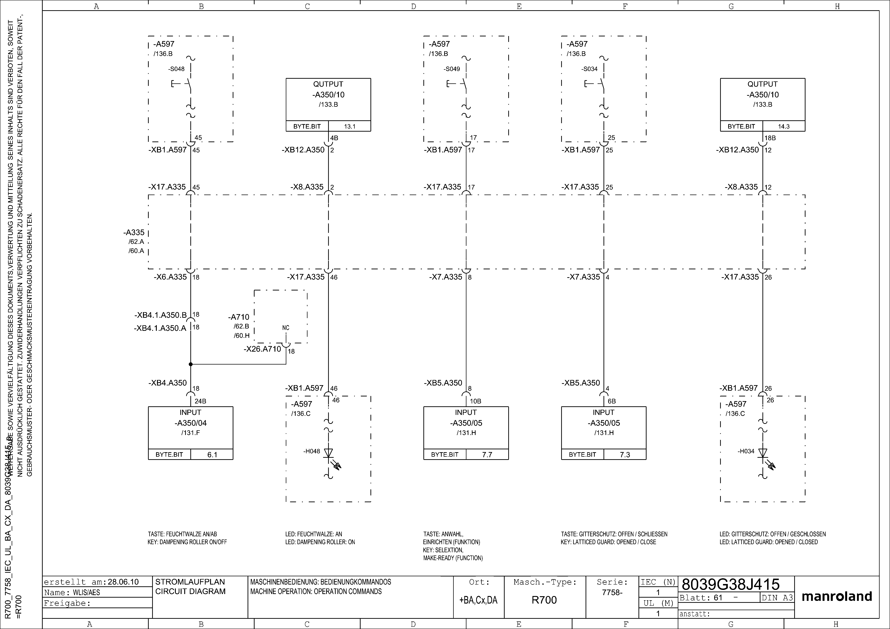

# +BA_Cx_DA — Sheet 61 of 247 — MASCHINENBEDIENUNG: BEDIENUNGKOMMANDOS

**MACHINE OPERATION: OPERATION COMMANDS**

> Part of the manroland **R700** printing press IEC/UL circuit diagrams.
> Drawing class: **Stromlaufplan / Circuit diagram** (DIN A3).
> Document `+BA_Cx_DA` covers the **Printing units / main switch cabinet** machine section.

## At a glance

| Field | Value |
|---|---|
| Document | `+BA_Cx_DA`  (8039G38J415) |
| Sheet | **61** of 247 |
| Section (DE) | MASCHINENBEDIENUNG: BEDIENUNGKOMMANDOS |
| Section (EN) | MACHINE OPERATION: OPERATION COMMANDS |
| Section type | CIRCUIT — Circuit diagram |
| Machine type | `R700` |
| Series | `7758` |
| Created | 28.06.10 |
| Replaces | — |
| Columns used | A, B, C, D, E, F, G |
| Path numbers | — |
| Labels on sheet | 115 |
| Cross-refs out | 14 |
| Cross-refs in | 37 |

**Previous:** [+BA_Cx_DA sheet 60](SHEET_0060.md) · **Next:** [+BA_Cx_DA sheet 62](SHEET_0062.md) · **Document TOC:** [_TOC.md](_TOC.md)  (+BA_Cx_DA) · **Master TOC:** [all sheets](../_MASTER_TOC.md)

## Sheet image (300 DPI, exact vector render)



_Rendered directly from the PDF vector layer at 300 DPI (1-bit), no OCR and no resampling. Use it to confirm anything ambiguous in the text below._

## Cross-references on this sheet

Each entry is a wire leaving this sheet. The printed token is `/sheet.column`; the link resolves to that sheet inside the same document.

| Ref | Target sheet | Col | Path | Destination on target | Target section | From col |
|---|---|---|---|---|---|---|
| `/136.B` | [+BA_Cx_DA sheet 136](SHEET_0136.md) | B | — | A597 | REFERENZMODUL | B |
| `/136.B` | [+BA_Cx_DA sheet 136](SHEET_0136.md) | B | — | A597 | REFERENZMODUL | D |
| `/136.B` | [+BA_Cx_DA sheet 136](SHEET_0136.md) | B | — | A597 | REFERENZMODUL | F |
| `/133.B` | [+BA_Cx_DA sheet 133](SHEET_0133.md) | B | — | — | REFERENZMODUL | C |
| `/133.B` | [+BA_Cx_DA sheet 133](SHEET_0133.md) | B | — | — | REFERENZMODUL | G |
| `/62.A` | [+BA_Cx_DA sheet 62](SHEET_0062.md) | A | — | — | MASCHINENBEDIENUNG: BEDIENUNGKOMMANDOS | A |
| `/60.A` | [+BA_Cx_DA sheet 60](SHEET_0060.md) | A | — | — | MASCHINENBEDIENUNG: BEDIENUNGKOMMANDOS | A |
| `/62.B` | [+BA_Cx_DA sheet 62](SHEET_0062.md) | B | — | — | MASCHINENBEDIENUNG: BEDIENUNGKOMMANDOS | B |
| `/60.H` | [+BA_Cx_DA sheet 60](SHEET_0060.md) | H | — | — | MASCHINENBEDIENUNG: BEDIENUNGKOMMANDOS | B |
| `/136.C` | [+BA_Cx_DA sheet 136](SHEET_0136.md) | C | — | A597 | REFERENZMODUL | C |
| `/136.C` | [+BA_Cx_DA sheet 136](SHEET_0136.md) | C | — | A597 | REFERENZMODUL | G |
| `/131.F` | [+BA_Cx_DA sheet 131](SHEET_0131.md) | F | — | — | REFERENZMODUL | B |
| `/131.H` | [+BA_Cx_DA sheet 131](SHEET_0131.md) | H | — | — | REFERENZMODUL | E |
| `/131.H` | [+BA_Cx_DA sheet 131](SHEET_0131.md) | H | — | — | REFERENZMODUL | F |

### Incoming references (sheets that point here)

Every other sheet that sends a wire to this one. `Back-ref` is the token printed on *that* sheet; `Path` is its line number.

| From sheet | Cols | Back-ref | Path | Refs | What continues there |
|---|---|---|---|---|---|
| [+BA_Cx_DA#60](SHEET_0060.md) | A, H | `/60.A`, `/60.H` | — | 2 | — |
| [+BA_Cx_DA#62](SHEET_0062.md) | A, B | `/62.A`, `/62.B` | — | 2 | — |
| [+BA_Cx_DA#131](SHEET_0131.md) | F, H | `/131.F`, `/131.H` | — | 3 | — |
| [+BA_Cx_DA#133](SHEET_0133.md) | B | `/133.B` | — | 2 | — |
| [+BA_Cx_DA#136](SHEET_0136.md) | B, C | `/136.B`, `/136.C` | — | 5 | — |
| [+BA_Cx_DA#143](SHEET_0143.md) | B, C | `/143.B`, `/143.C` | — | 5 | — |
| [+BA_Cx_DA#159](SHEET_0159.md) | F, G, H | `/159.F`, `/159.G`, `/159.H` | — | 3 | — |
| [+BA_Cx_DA#161](SHEET_0161.md) | F | `/161.F` | — | 2 | — |
| [+BA_Cx_DA#162](SHEET_0162.md) | D | `/162.D` | — | 1 | — |
| [+BA_Cx_DA#163](SHEET_0163.md) | G | `/163.G` | — | 2 | — |
| [+BA_Cx_DA#165](SHEET_0165.md) | E | `/165.E` | — | 2 | — |
| [+BA_Cx_DA#169](SHEET_0169.md) | G | `/169.G` | — | 2 | — |
| [+BA_Cx_DA#173](SHEET_0173.md) | B, C | `/173.B`, `/173.C` | — | 5 | — |
| [+BA_Cx_DA#176](SHEET_0176.md) | E | `/176.E` | — | 1 | — |


## Devices on this sheet

| Tag | Class | Class meaning (IEC) | Col | Sub | Terminal | Sign |
|---|---|---|---|---|---|---|
| `A350/04` | A | Baugruppe / assembly, module, PC board | B | 04 | — | — |
| `A597` | A | Baugruppe / assembly, module, PC board | C | — | — | — |
| `A350/05` | A | Baugruppe / assembly, module, PC board | E | 05 | — | — |
| `A350/05` | A | Baugruppe / assembly, module, PC board | F | 05 | — | — |
| `A597` | A | Baugruppe / assembly, module, PC board | G | — | — | — |
| `S048` | S | Schalter / switch | B | — | — | — |
| `A597` | A | Baugruppe / assembly, module, PC board | B | — | — | — |
| `A350/10` | A | Baugruppe / assembly, module, PC board | C | 10 | — | — |
| `S049` | S | Schalter / switch | D | — | — | — |
| `A597` | A | Baugruppe / assembly, module, PC board | D | — | — | — |
| `S034` | S | Schalter / switch | F | — | — | — |
| `A597` | A | Baugruppe / assembly, module, PC board | F | — | — | — |
| `A350/10` | A | Baugruppe / assembly, module, PC board | G | 10 | — | — |
| `A335` | A | Baugruppe / assembly, module, PC board | A | — | — | — |
| `A710` | A | Baugruppe / assembly, module, PC board | B | — | — | — |
| `6.1` | — | cross-device reference | B | — | — | — |
| `7.7` | — | cross-device reference | E | — | — | — |
| `7.3` | — | cross-device reference | F | — | — | — |
| `XB4.A350` | — | cross-device reference | B | — | — | — |
| `XB1.A597` | — | cross-device reference | C | — | — | — |
| `XB5.A350` | — | cross-device reference | D | — | — | — |
| `XB5.A350` | — | cross-device reference | F | — | — | — |
| `XB1.A597` | — | cross-device reference | G | — | — | — |
| `XB1.A597` | — | cross-device reference | B | — | — | — |
| `13.1` | — | cross-device reference | C | — | — | — |
| `XB12.A350` | — | cross-device reference | C | — | — | — |
| `XB1.A597` | — | cross-device reference | D | — | — | — |
| `XB1.A597` | — | cross-device reference | F | — | — | — |
| `14.3` | — | cross-device reference | G | — | — | — |
| `XB12.A350` | — | cross-device reference | G | — | — | — |
| `X6.A335` | — | cross-device reference | B | — | — | — |
| `X17.A335` | — | cross-device reference | C | — | — | — |
| `X7.A335` | — | cross-device reference | D | — | — | — |
| `X7.A335` | — | cross-device reference | F | — | — | — |
| `X17.A335` | — | cross-device reference | B | — | — | — |
| `X8.A335` | — | cross-device reference | C | — | — | — |
| `X17.A335` | — | cross-device reference | D | — | — | — |
| `X17.A335` | — | cross-device reference | F | — | — | — |
| `X17.A335` | — | cross-device reference | G | — | — | — |
| `X8.A335` | — | cross-device reference | G | — | — | — |
| `X26.A710` | — | cross-device reference | C | — | — | — |
| `XB4.1.A350.B` | — | cross-device reference | B | — | — | — |
| `XB4.1.A350.A` | — | cross-device reference | B | — | — | — |

## Potentials / nets

| Potential | Count | Columns | Attached devices | Terminals |
|---|---|---|---|---|
| `H034` | 1 | G | — | — |
| `H048` | 1 | C | — | — |


A potential such as `L24+/4` or `M24+` is a named supply/return rail; every place it appears on this sheet is electrically common.

## Wire-end annotations (grouped as printed)

A wire that continues elsewhere is annotated with a small cluster: the destination description, the path/line number `#NN`, and the `/sheet.column` cross reference. Each row below is one such cluster exactly as it is grouped on the drawing.

| Col | Y | Path | Cross-ref | Text on the wire |
|---|---|---|---|---|
| B | 54.2 | — | `/136.B` | `A597` |
| D | 54.2 | — | `/136.B` | `A597` |
| F | 54.2 | — | `/136.B` | `A597` |
| B | 88.6 | — | — | `S048` |
| D | 88.6 | — | — | `S049` |
| F | 88.6 | — | — | `S034` |
| C | 108.3 | — | — | `QUTPUT` |
| G | 108.3 | — | — | `QUTPUT` |
| C | 122.2 | — | — | `A350/10` |
| G | 122.2 | — | — | `A350/10` |
| C | 136.0 | — | `/133.B` | — |
| G | 136.0 | — | `/133.B` | — |
| C | 165.6 | — | — | `BYTE.BIT 13.1` |
| G | 165.6 | — | — | `BYTE.BIT 14.3` |
| B | 180.3 | — | — | `45` |
| E | 180.3 | — | — | `17` |
| F | 180.3 | — | — | `25` |
| C | 181.0 | — | — | `4B` |
| G | 181.0 | — | — | `18B` |
| B | 195.9 | — | — | `XB1.A597 45` |
| D | 195.9 | — | — | `XB12.A350 2 XB1.A597 17` |
| F | 195.9 | — | — | `XB1.A597 25` |
| G | 195.9 | — | — | `XB12.A350 12` |
| D | 245.5 | — | — | `X17.A335 45 X8.A335 2 X17.A335 17 X17.A335 25` |
| G | 245.5 | — | — | `X8.A335 12` |
| A | 306.4 | — | — | `A335` |
| A | 319.5 | — | `/62.A`, `/60.A` | — |
| D | 366.0 | — | — | `X6.A335 18 X17.A335 46 X7.A335 8 X7.A335 4` |
| G | 366.0 | — | — | `X17.A335 26` |
| B | 417.0 | — | — | `XB4.1.A350.B 18` |
| B | 419.8 | — | — | `A710` |
| B | 432.9 | — | `/62.B`, `/60.H` | — |
| B | 434.0 | — | — | `XB4.1.A350.A 18 NC` |
| C | 462.4 | — | — | `X26.A710 18` |
| B | 507.7 | — | — | `XB4.A350 18` |
| D | 507.7 | — | — | `XB1.A597 46 XB5.A350 8` |
| F | 507.7 | — | — | `XB5.A350 4` |
| G | 514.8 | — | — | `XB1.A597 26` |
| C | 531.8 | — | — | `46` |
| G | 531.8 | — | — | `26` |
| B | 533.2 | — | — | `24B` |
| E | 533.2 | — | — | `10B` |
| F | 533.2 | — | — | `6B` |
| C | 536.0 | — | `/136.C` | `A597` |
| G | 536.0 | — | `/136.C` | `A597` |
| B | 547.7 | — | — | `INPUT` |
| D | 547.7 | — | — | `INPUT` |
| F | 547.7 | — | — | `INPUT` |
| B | 561.6 | — | — | `A350/04` |
| E | 561.6 | — | — | `A350/05` |
| F | 561.6 | — | — | `A350/05` |
| B | 575.4 | — | `/131.F` | — |
| E | 575.4 | — | `/131.H` | — |
| F | 575.4 | — | `/131.H` | — |
| C | 600.2 | — | — | `H048` |
| G | 600.2 | — | — | `H034` |
| B | 604.4 | — | — | `BYTE.BIT 6.1` |
| D | 604.4 | — | — | `BYTE.BIT 7.7` |
| F | 604.4 | — | — | `BYTE.BIT 7.3` |
| B | 712.1 | — | — | `KEY: DAMPENING ROLLER ON/OFF TASTE: FEUCHTWALZE AN/AB` |
| C | 712.1 | — | — | `LED: FEUCHTWALZE: AN LED: DAMPENING ROLLER: ON` |
| D | 712.1 | — | — | `EINRICHTEN (FUNKTION) KEY: SELEXTION, MAKE READY (FUNCTION) TASTE: ANWAHL,` |
| F | 712.1 | — | — | `KEY: LATTICED GUARD: OPENED / CLOSE TASTE: GITTERSCHUTZ: OFFEN / SCHLIESSEN` |
| G | 712.1 | — | — | `LED: GITTERSCHUTZ: OFFEN / GESCHLOSSEN LED: LATTICED GUARD: OPENED / CLOSED` |


## Reconstructed tables

This sheet carries tabular content (pin map / terminal assignment / index). The grid below was rebuilt from the drawing's own rule lines, so each row is exactly one physical row of the table.

### Table 1 — 7 data rows × 5 columns (at x=198.4, y=48.2) — **A597 /136.B S048**

|  |  |  | QUTPUT | A350/10 /133.B |
|---|---|---|---|---|
|  |  |  | `BYTE.BIT` | `13.1` |
|  | `45` |  |  | `4B` |
| `XB1.A597 X17.A335 X6.A335 XB4.1.A350.B XB4.1.A350.A` | `45 45 18 18 18` | `A710 /62.B NC /60.H X26.A710` | `XB12.A350 X8.A335 X17.A335 18` | `2 2 46` |
| `XB4.A350` | `18` |  | `XB1.A597` | `46` |
|  | `24B` |  | `A597` | `46` |
| `INPUT` | `A350/04 /131.F` |  | `/136.C` |  |
| `BYTE.BIT` | `6.1` |  | `H048` |  |


### Table 2 — 4 data rows × 2 columns (at x=566.9, y=48.2) — **A597 /136.B S049 17**

| XB1.A597 X17.A335 X7.A335 | 17 17 8 |
|---|---|
| `XB5.A350` | `8` |
|  | `10B` |
| `INPUT` | `A350/05 /131.H` |
| `BYTE.BIT` | `7.7` |


### Table 3 — 4 data rows × 2 columns (at x=751.2, y=48.2) — **A597 /136.B S034 25**

| XB1.A597 X17.A335 X7.A335 | 25 25 4 |
|---|---|
| `XB5.A350` | `4` |
|  | `6B` |
| `INPUT` | `A350/05 /131.H` |
| `BYTE.BIT` | `7.3` |


### Table 4 — 7 data rows × 2 columns (at x=963.8, y=48.2)

| QUTPUT | A350/10 /133.B |
|---|---|
| `BYTE.BIT` | `14.3` |
|  | `18B` |
| `XB12.A350 X8.A335 X17.A335` | `12 12 26` |
| `XB1.A597` | `26` |
| `A597` | `26` |
| `/136.C` |  |
| `H034` |  |


## Notes and free text on this sheet

| Text | Col | Y (pt) |
|---|---|---|
| `24B` | B | 533.2 |
| `INPUT` | B | 547.72 |
| `BYTE.BIT` | B | 604.97 |
| `TASTE: FEUCHTWALZE AN/AB` | B | 712.1 |
| `KEY: DAMPENING ROLLER ON/OFF` | B | 722.76 |
| `LED: FEUCHTWALZE: AN` | C | 712.09 |
| `LED: DAMPENING ROLLER: ON` | C | 722.76 |
| `10B` | E | 533.2 |
| `INPUT` | D | 547.72 |
| `BYTE.BIT` | D | 604.97 |
| `TASTE: ANWAHL,` | D | 712.07 |
| `EINRICHTEN (FUNKTION)` | D | 722.76 |
| `KEY: SELEXTION,` | D | 733.34 |
| `MAKE READY (FUNCTION)` | D | 744.03 |
| `6B` | F | 533.18 |
| `INPUT` | F | 547.72 |
| `BYTE.BIT` | F | 604.97 |
| `TASTE: GITTERSCHUTZ: OFFEN / SCHLIESSEN` | F | 712.11 |
| `KEY: LATTICED GUARD: OPENED / CLOSE` | F | 722.75 |
| `LED: GITTERSCHUTZ: OFFEN / GESCHLOSSEN` | G | 712.12 |
| `LED: LATTICED GUARD: OPENED / CLOSED` | G | 722.76 |
| `4B` | C | 180.98 |
| `QUTPUT` | C | 108.33 |
| `BYTE.BIT` | C | 165.6 |
| `18B` | G | 181 |
| `QUTPUT` | G | 108.33 |
| `BYTE.BIT` | G | 165.6 |
| `NC` | C | 435.7 |

## Complete label inventory (exact text from the drawing)

Every text object inside the drawing area of this sheet, in DIN reading order (column A→H, then top→bottom). This is the authoritative list: if a string is not here it is not printed on this sheet.

| Col | Y | X | Dir | Type | Text |
|---|---|---|---|---|---|
| A | 306.4 | 165.0 | → | device tag | `A335` |
| A | 319.5 | 172.1 | → | cross-reference | `/62.A` |
| A | 331.9 | 172.1 | → | cross-reference | `/60.A` |
| B | 54.2 | 205.2 | → | device tag | `A597` |
| B | 67.9 | 205.5 | → | cross-reference | `/136.B` |
| B | 88.6 | 225.1 | → | device tag | `S048` |
| B | 180.3 | 260.5 | → | number | `45` |
| B | 195.9 | 198.7 | → | device ref | `XB1.A597` |
| B | 197.3 | 257.7 | → | number | `45` |
| B | 245.5 | 198.4 | → | device ref | `X17.A335` |
| B | 246.9 | 257.7 | → | number | `45` |
| B | 366.0 | 205.8 | → | device ref | `X6.A335` |
| B | 367.4 | 257.1 | → | number | `18` |
| B | 417.0 | 180.0 | → | device ref | `XB4.1.A350.B` |
| B | 417.0 | 257.1 | → | number | `18` |
| B | 419.8 | 305.3 | → | device tag | `A710` |
| B | 432.9 | 312.7 | → | cross-reference | `/62.B` |
| B | 434.0 | 257.1 | → | number | `18` |
| B | 434.7 | 179.1 | → | device ref | `XB4.1.A350.A` |
| B | 445.3 | 312.9 | → | cross-reference | `/60.H` |
| B | 507.7 | 198.7 | → | device ref | `XB4.A350` |
| B | 516.2 | 257.1 | → | number | `18` |
| B | 533.2 | 260.5 | → | text | `24B` |
| B | 547.7 | 240.2 | → | text | `INPUT` |
| B | 561.6 | 233.7 | → | device tag | `A350/04` |
| B | 575.4 | 242.8 | → | cross-reference | `/131.F` |
| B | 604.4 | 277.5 | → | device ref | `6.1` |
| B | 605.0 | 208.3 | → | text | `BYTE.BIT` |
| B | 712.1 | 198.1 | → | text | `TASTE: FEUCHTWALZE AN/AB` |
| B | 722.8 | 197.6 | → | text | `KEY: DAMPENING ROLLER ON/OFF` |
| C | 108.3 | 419.1 | → | text | `QUTPUT` |
| C | 122.2 | 418.0 | → | device tag | `A350/10` |
| C | 136.0 | 426.8 | → | cross-reference | `/133.B` |
| C | 165.6 | 392.6 | → | text | `BYTE.BIT` |
| C | 165.6 | 460.1 | → | device ref | `13.1` |
| C | 181.0 | 441.9 | → | text | `4B` |
| C | 195.9 | 377.0 | → | device ref | `XB12.A350` |
| C | 197.3 | 441.9 | → | number | `2` |
| C | 245.5 | 388.6 | → | device ref | `X8.A335` |
| C | 246.9 | 441.9 | → | number | `2` |
| C | 366.0 | 384.1 | → | device ref | `X17.A335` |
| C | 367.4 | 441.9 | → | number | `46` |
| C | 435.7 | 377.8 | → | text | `NC` |
| C | 462.4 | 326.0 | → | device ref | `X26.A710` |
| C | 466.6 | 384.7 | → | number | `18` |
| C | 514.8 | 381.5 | → | device ref | `XB1.A597` |
| C | 516.2 | 441.9 | → | number | `46` |
| C | 531.8 | 444.8 | → | number | `46` |
| C | 536.1 | 389.5 | → | device tag | `A597` |
| C | 549.9 | 389.8 | → | cross-reference | `/136.C` |
| C | 600.3 | 405.9 | → | potential | `H048` |
| C | 712.1 | 381.8 | → | text | `LED: FEUCHTWALZE: AN` |
| C | 722.8 | 381.8 | → | text | `LED: DAMPENING ROLLER: ON` |
| D | 54.2 | 573.7 | → | device tag | `A597` |
| D | 67.9 | 574.0 | → | cross-reference | `/136.B` |
| D | 88.6 | 593.6 | → | device tag | `S049` |
| D | 195.9 | 567.2 | → | device ref | `XB1.A597` |
| D | 245.5 | 566.9 | → | device ref | `X17.A335` |
| D | 366.0 | 574.3 | → | device ref | `X7.A335` |
| D | 507.7 | 567.2 | → | device ref | `XB5.A350` |
| D | 547.7 | 608.7 | → | text | `INPUT` |
| D | 605.0 | 576.9 | → | text | `BYTE.BIT` |
| D | 712.1 | 566.6 | → | text | `TASTE: ANWAHL,` |
| D | 722.8 | 566.1 | → | text | `EINRICHTEN (FUNKTION)` |
| D | 733.3 | 566.1 | → | text | `KEY: SELEXTION,` |
| D | 744.0 | 566.4 | → | text | `MAKE READY (FUNCTION)` |
| E | 180.3 | 628.4 | → | number | `17` |
| E | 197.3 | 625.6 | → | number | `17` |
| E | 246.9 | 625.6 | → | number | `17` |
| E | 367.4 | 626.2 | → | number | `8` |
| E | 516.2 | 626.2 | → | number | `8` |
| E | 533.2 | 628.4 | → | text | `10B` |
| E | 561.6 | 602.2 | → | device tag | `A350/05` |
| E | 575.4 | 611.1 | → | cross-reference | `/131.H` |
| E | 604.4 | 645.2 | → | device ref | `7.7` |
| F | 54.2 | 758.0 | → | device tag | `A597` |
| F | 67.9 | 758.3 | → | cross-reference | `/136.B` |
| F | 88.6 | 777.8 | → | device tag | `S034` |
| F | 180.3 | 813.3 | → | number | `25` |
| F | 195.9 | 751.5 | → | device ref | `XB1.A597` |
| F | 197.3 | 810.4 | → | number | `25` |
| F | 245.5 | 751.2 | → | device ref | `X17.A335` |
| F | 246.9 | 810.4 | → | number | `25` |
| F | 366.0 | 758.6 | → | device ref | `X7.A335` |
| F | 367.4 | 810.4 | → | number | `4` |
| F | 507.7 | 751.5 | → | device ref | `XB5.A350` |
| F | 516.2 | 810.4 | → | number | `4` |
| F | 533.2 | 813.3 | → | text | `6B` |
| F | 547.7 | 793.0 | → | text | `INPUT` |
| F | 561.6 | 786.5 | → | device tag | `A350/05` |
| F | 575.4 | 795.4 | → | cross-reference | `/131.H` |
| F | 604.4 | 829.4 | → | device ref | `7.3` |
| F | 605.0 | 761.1 | → | text | `BYTE.BIT` |
| F | 712.1 | 750.9 | → | text | `TASTE: GITTERSCHUTZ: OFFEN / SCHLIESSEN` |
| F | 722.7 | 750.3 | → | text | `KEY: LATTICED GUARD: OPENED / CLOSE` |
| G | 108.3 | 1000.2 | → | text | `QUTPUT` |
| G | 122.2 | 999.1 | → | device tag | `A350/10` |
| G | 136.0 | 1007.9 | → | cross-reference | `/133.B` |
| G | 165.6 | 973.7 | → | text | `BYTE.BIT` |
| G | 165.6 | 1040.6 | → | device ref | `14.3` |
| G | 181.0 | 1022.5 | → | text | `18B` |
| G | 195.9 | 958.1 | → | device ref | `XB12.A350` |
| G | 197.3 | 1022.5 | → | number | `12` |
| G | 245.5 | 969.7 | → | device ref | `X8.A335` |
| G | 246.9 | 1022.5 | → | number | `12` |
| G | 366.0 | 965.2 | → | device ref | `X17.A335` |
| G | 367.4 | 1023.0 | → | number | `26` |
| G | 514.8 | 962.6 | → | device ref | `XB1.A597` |
| G | 516.2 | 1023.0 | → | number | `26` |
| G | 531.8 | 1025.9 | → | number | `26` |
| G | 536.1 | 970.6 | → | device tag | `A597` |
| G | 549.9 | 970.9 | → | cross-reference | `/136.C` |
| G | 600.3 | 987.0 | → | potential | `H034` |
| G | 712.1 | 962.9 | → | text | `LED: GITTERSCHUTZ: OFFEN / GESCHLOSSEN` |
| G | 722.8 | 962.9 | → | text | `LED: LATTICED GUARD: OPENED / CLOSED` |

## Reading-order text block

The same content as a plain block, grouped by DIN column — convenient to paste or to match against a visual description.

```text
=== Column A ===
 306.4  165.0  devtag       A335
 319.5  172.1  xref         /62.A
 331.9  172.1  xref         /60.A
=== Column B ===
  54.2  205.2  devtag       A597
  67.9  205.5  xref         /136.B
  88.6  225.1  devtag       S048
 180.3  260.5  numeric      45
 195.9  198.7  devref       XB1.A597
 197.3  257.7  numeric      45
 245.5  198.4  devref       X17.A335
 246.9  257.7  numeric      45
 366.0  205.8  devref       X6.A335
 367.4  257.1  numeric      18
 417.0  180.0  devref       XB4.1.A350.B
 417.0  257.1  numeric      18
 419.8  305.3  devtag       A710
 432.9  312.7  xref         /62.B
 434.0  257.1  numeric      18
 434.7  179.1  devref       XB4.1.A350.A
 445.3  312.9  xref         /60.H
 507.7  198.7  devref       XB4.A350
 516.2  257.1  numeric      18
 533.2  260.5  text         24B
 547.7  240.2  text         INPUT
 561.6  233.7  devtag       A350/04
 575.4  242.8  xref         /131.F
 604.4  277.5  devref       6.1
 605.0  208.3  text         BYTE.BIT
 712.1  198.1  text         TASTE: FEUCHTWALZE AN/AB
 722.8  197.6  text         KEY: DAMPENING ROLLER ON/OFF
=== Column C ===
 108.3  419.1  text         QUTPUT
 122.2  418.0  devtag       A350/10
 136.0  426.8  xref         /133.B
 165.6  392.6  text         BYTE.BIT
 165.6  460.1  devref       13.1
 181.0  441.9  text         4B
 195.9  377.0  devref       XB12.A350
 197.3  441.9  numeric      2
 245.5  388.6  devref       X8.A335
 246.9  441.9  numeric      2
 366.0  384.1  devref       X17.A335
 367.4  441.9  numeric      46
 435.7  377.8  text         NC
 462.4  326.0  devref       X26.A710
 466.6  384.7  numeric      18
 514.8  381.5  devref       XB1.A597
 516.2  441.9  numeric      46
 531.8  444.8  numeric      46
 536.1  389.5  devtag       A597
 549.9  389.8  xref         /136.C
 600.3  405.9  net          H048
 712.1  381.8  text         LED: FEUCHTWALZE: AN
 722.8  381.8  text         LED: DAMPENING ROLLER: ON
=== Column D ===
  54.2  573.7  devtag       A597
  67.9  574.0  xref         /136.B
  88.6  593.6  devtag       S049
 195.9  567.2  devref       XB1.A597
 245.5  566.9  devref       X17.A335
 366.0  574.3  devref       X7.A335
 507.7  567.2  devref       XB5.A350
 547.7  608.7  text         INPUT
 605.0  576.9  text         BYTE.BIT
 712.1  566.6  text         TASTE: ANWAHL,
 722.8  566.1  text         EINRICHTEN (FUNKTION)
 733.3  566.1  text         KEY: SELEXTION,
 744.0  566.4  text         MAKE READY (FUNCTION)
=== Column E ===
 180.3  628.4  numeric      17
 197.3  625.6  numeric      17
 246.9  625.6  numeric      17
 367.4  626.2  numeric      8
 516.2  626.2  numeric      8
 533.2  628.4  text         10B
 561.6  602.2  devtag       A350/05
 575.4  611.1  xref         /131.H
 604.4  645.2  devref       7.7
=== Column F ===
  54.2  758.0  devtag       A597
  67.9  758.3  xref         /136.B
  88.6  777.8  devtag       S034
 180.3  813.3  numeric      25
 195.9  751.5  devref       XB1.A597
 197.3  810.4  numeric      25
 245.5  751.2  devref       X17.A335
 246.9  810.4  numeric      25
 366.0  758.6  devref       X7.A335
 367.4  810.4  numeric      4
 507.7  751.5  devref       XB5.A350
 516.2  810.4  numeric      4
 533.2  813.3  text         6B
 547.7  793.0  text         INPUT
 561.6  786.5  devtag       A350/05
 575.4  795.4  xref         /131.H
 604.4  829.4  devref       7.3
 605.0  761.1  text         BYTE.BIT
 712.1  750.9  text         TASTE: GITTERSCHUTZ: OFFEN / SCHLIESSEN
 722.7  750.3  text         KEY: LATTICED GUARD: OPENED / CLOSE
=== Column G ===
 108.3 1000.2  text         QUTPUT
 122.2  999.1  devtag       A350/10
 136.0 1007.9  xref         /133.B
 165.6  973.7  text         BYTE.BIT
 165.6 1040.6  devref       14.3
 181.0 1022.5  text         18B
 195.9  958.1  devref       XB12.A350
 197.3 1022.5  numeric      12
 245.5  969.7  devref       X8.A335
 246.9 1022.5  numeric      12
 366.0  965.2  devref       X17.A335
 367.4 1023.0  numeric      26
 514.8  962.6  devref       XB1.A597
 516.2 1023.0  numeric      26
 531.8 1025.9  numeric      26
 536.1  970.6  devtag       A597
 549.9  970.9  xref         /136.C
 600.3  987.0  net          H034
 712.1  962.9  text         LED: GITTERSCHUTZ: OFFEN / GESCHLOSSEN
 722.8  962.9  text         LED: LATTICED GUARD: OPENED / CLOSED
```

---
_Generated from the PDF vector text layer; no OCR. Source: `R700_7758_IEC_UL_BA_CX_DA_8039G38J415_p`, sheet 61._
