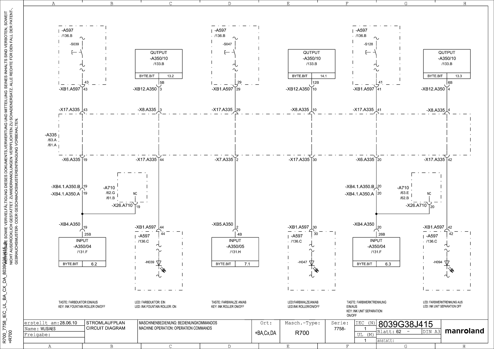

# +BA_Cx_DA — Sheet 62 of 247 — MASCHINENBEDIENUNG: BEDIENUNGKOMMANDOS

**MACHINE OPERATION: OPERATION COMMANDS**

> Part of the manroland **R700** printing press IEC/UL circuit diagrams.
> Drawing class: **Stromlaufplan / Circuit diagram** (DIN A3).
> Document `+BA_Cx_DA` covers the **Printing units / main switch cabinet** machine section.

## At a glance

| Field | Value |
|---|---|
| Document | `+BA_Cx_DA`  (8039G38J415) |
| Sheet | **62** of 247 |
| Section (DE) | MASCHINENBEDIENUNG: BEDIENUNGKOMMANDOS |
| Section (EN) | MACHINE OPERATION: OPERATION COMMANDS |
| Section type | CIRCUIT — Circuit diagram |
| Machine type | `R700` |
| Series | `7758` |
| Created | 28.06.10 |
| Replaces | — |
| Columns used | A, B, C, D, E, F, G, H |
| Path numbers | — |
| Labels on sheet | 145 |
| Cross-refs out | 18 |
| Cross-refs in | 48 |

**Previous:** [+BA_Cx_DA sheet 61](SHEET_0061.md) · **Next:** [+BA_Cx_DA sheet 63](SHEET_0063.md) · **Document TOC:** [_TOC.md](_TOC.md)  (+BA_Cx_DA) · **Master TOC:** [all sheets](../_MASTER_TOC.md)

## Sheet image (300 DPI, exact vector render)



_Rendered directly from the PDF vector layer at 300 DPI (1-bit), no OCR and no resampling. Use it to confirm anything ambiguous in the text below._

## Cross-references on this sheet

Each entry is a wire leaving this sheet. The printed token is `/sheet.column`; the link resolves to that sheet inside the same document.

| Ref | Target sheet | Col | Path | Destination on target | Target section | From col |
|---|---|---|---|---|---|---|
| `/136.B` | [+BA_Cx_DA sheet 136](SHEET_0136.md) | B | — | A597 | REFERENZMODUL | A |
| `/136.B` | [+BA_Cx_DA sheet 136](SHEET_0136.md) | B | — | A597 | REFERENZMODUL | D |
| `/136.B` | [+BA_Cx_DA sheet 136](SHEET_0136.md) | B | — | A597 | REFERENZMODUL | F |
| `/133.B` | [+BA_Cx_DA sheet 133](SHEET_0133.md) | B | — | — | REFERENZMODUL | C |
| `/133.B` | [+BA_Cx_DA sheet 133](SHEET_0133.md) | B | — | — | REFERENZMODUL | E |
| `/133.B` | [+BA_Cx_DA sheet 133](SHEET_0133.md) | B | — | — | REFERENZMODUL | H |
| `/63.A` | [+BA_Cx_DA sheet 63](SHEET_0063.md) | A | — | — | MASCHINENBEDIENUNG: BEDIENUNGKOMMANDOS | A |
| `/61.A` | [+BA_Cx_DA sheet 61](SHEET_0061.md) | A | — | — | MASCHINENBEDIENUNG: BEDIENUNGKOMMANDOS | A |
| `/63.E` | [+BA_Cx_DA sheet 63](SHEET_0063.md) | E | — | — | MASCHINENBEDIENUNG: BEDIENUNGKOMMANDOS | G |
| `/62.B` | [+BA_Cx_DA sheet 62](SHEET_0062.md) | B | — | — | MASCHINENBEDIENUNG: BEDIENUNGKOMMANDOS | G |
| `/62.G` | [+BA_Cx_DA sheet 62](SHEET_0062.md) | G | — | — | MASCHINENBEDIENUNG: BEDIENUNGKOMMANDOS | B |
| `/61.B` | [+BA_Cx_DA sheet 61](SHEET_0061.md) | B | — | — | MASCHINENBEDIENUNG: BEDIENUNGKOMMANDOS | B |
| `/136.C` | [+BA_Cx_DA sheet 136](SHEET_0136.md) | C | — | A597 | REFERENZMODUL | C |
| `/136.C` | [+BA_Cx_DA sheet 136](SHEET_0136.md) | C | — | A597 | REFERENZMODUL | E |
| `/136.C` | [+BA_Cx_DA sheet 136](SHEET_0136.md) | C | — | A597 | REFERENZMODUL | G |
| `/131.F` | [+BA_Cx_DA sheet 131](SHEET_0131.md) | F | — | — | REFERENZMODUL | A |
| `/131.F` | [+BA_Cx_DA sheet 131](SHEET_0131.md) | F | — | — | REFERENZMODUL | G |
| `/131.H` | [+BA_Cx_DA sheet 131](SHEET_0131.md) | H | — | — | REFERENZMODUL | D |

### Incoming references (sheets that point here)

Every other sheet that sends a wire to this one. `Back-ref` is the token printed on *that* sheet; `Path` is its line number.

| From sheet | Cols | Back-ref | Path | Refs | What continues there |
|---|---|---|---|---|---|
| [+BA_Cx_DA#61](SHEET_0061.md) | A, B | `/61.A`, `/61.B` | — | 2 | — |
| [+BA_Cx_DA#62](SHEET_0062.md) | B, G | `/62.B`, `/62.G` | — | 2 | — |
| [+BA_Cx_DA#63](SHEET_0063.md) | A, E | `/63.A`, `/63.E` | — | 2 | — |
| [+BA_Cx_DA#131](SHEET_0131.md) | F, H | `/131.F`, `/131.H` | — | 3 | — |
| [+BA_Cx_DA#133](SHEET_0133.md) | B | `/133.B` | — | 3 | — |
| [+BA_Cx_DA#136](SHEET_0136.md) | B, C | `/136.B`, `/136.C` | — | 6 | — |
| [+BA_Cx_DA#143](SHEET_0143.md) | C | `/143.C` | — | 6 | — |
| [+BA_Cx_DA#159](SHEET_0159.md) | F, G, H | `/159.F`, `/159.G`, `/159.H` | — | 6 | — |
| [+BA_Cx_DA#161](SHEET_0161.md) | F | `/161.F` | — | 1 | — |
| [+BA_Cx_DA#162](SHEET_0162.md) | D | `/162.D` | — | 2 | — |
| [+BA_Cx_DA#163](SHEET_0163.md) | G | `/163.G` | — | 1 | — |
| [+BA_Cx_DA#165](SHEET_0165.md) | E | `/165.E` | — | 3 | — |
| [+BA_Cx_DA#169](SHEET_0169.md) | G | `/169.G` | — | 3 | — |
| [+BA_Cx_DA#173](SHEET_0173.md) | C | `/173.C` | — | 6 | — |
| [+BA_Cx_DA#176](SHEET_0176.md) | E | `/176.E` | — | 2 | — |


## Devices on this sheet

| Tag | Class | Class meaning (IEC) | Col | Sub | Terminal | Sign |
|---|---|---|---|---|---|---|
| `A350/04` | A | Baugruppe / assembly, module, PC board | A | 04 | — | — |
| `A597` | A | Baugruppe / assembly, module, PC board | C | — | — | — |
| `A350/05` | A | Baugruppe / assembly, module, PC board | D | 05 | — | — |
| `A597` | A | Baugruppe / assembly, module, PC board | E | — | — | — |
| `A350/04` | A | Baugruppe / assembly, module, PC board | G | 04 | — | — |
| `S039` | S | Schalter / switch | A | — | — | — |
| `A597` | A | Baugruppe / assembly, module, PC board | A | — | — | — |
| `A350/10` | A | Baugruppe / assembly, module, PC board | C | 10 | — | — |
| `S047` | S | Schalter / switch | D | — | — | — |
| `A597` | A | Baugruppe / assembly, module, PC board | D | — | — | — |
| `A350/10` | A | Baugruppe / assembly, module, PC board | E | 10 | — | — |
| `S128` | S | Schalter / switch | F | — | — | — |
| `A597` | A | Baugruppe / assembly, module, PC board | F | — | — | — |
| `A335` | A | Baugruppe / assembly, module, PC board | A | — | — | — |
| `A710` | A | Baugruppe / assembly, module, PC board | B | — | — | — |
| `A710` | A | Baugruppe / assembly, module, PC board | G | — | — | — |
| `A597` | A | Baugruppe / assembly, module, PC board | G | — | — | — |
| `A350/10` | A | Baugruppe / assembly, module, PC board | H | 10 | — | — |
| `6.2` | — | cross-device reference | B | — | — | — |
| `7.1` | — | cross-device reference | D | — | — | — |
| `XB4.A350` | — | cross-device reference | A | — | — | — |
| `XB1.A597` | — | cross-device reference | C | — | — | — |
| `XB5.A350` | — | cross-device reference | D | — | — | — |
| `XB1.A597` | — | cross-device reference | E | — | — | — |
| `6.3` | — | cross-device reference | G | — | — | — |
| `XB4.A350` | — | cross-device reference | F | — | — | — |
| `XB1.A597` | — | cross-device reference | A | — | — | — |
| `13.2` | — | cross-device reference | C | — | — | — |
| `XB12.A350` | — | cross-device reference | C | — | — | — |
| `XB1.A597` | — | cross-device reference | D | — | — | — |
| `14.1` | — | cross-device reference | F | — | — | — |
| `XB12.A350` | — | cross-device reference | E | — | — | — |
| `XB1.A597` | — | cross-device reference | F | — | — | — |
| `X6.A335` | — | cross-device reference | A | — | — | — |
| `X17.A335` | — | cross-device reference | C | — | — | — |
| `X7.A335` | — | cross-device reference | D | — | — | — |
| `X17.A335` | — | cross-device reference | E | — | — | — |
| `X17.A335` | — | cross-device reference | A | — | — | — |
| `X8.A335` | — | cross-device reference | C | — | — | — |
| `X17.A335` | — | cross-device reference | D | — | — | — |
| `X8.A335` | — | cross-device reference | E | — | — | — |
| `X6.A335` | — | cross-device reference | F | — | — | — |
| `X17.A335` | — | cross-device reference | F | — | — | — |
| `X26.A710` | — | cross-device reference | B | — | — | — |
| `XB4.1.A350.B` | — | cross-device reference | A | — | — | — |
| `XB4.1.A350.A` | — | cross-device reference | A | — | — | — |
| `X26.A710` | — | cross-device reference | G | — | — | — |
| `XB4.1.A350.B` | — | cross-device reference | F | — | — | — |
| `XB4.1.A350.A` | — | cross-device reference | F | — | — | — |
| `XB1.A597` | — | cross-device reference | G | — | — | — |
| `13.3` | — | cross-device reference | H | — | — | — |
| `XB12.A350` | — | cross-device reference | G | — | — | — |
| `X8.A335` | — | cross-device reference | H | — | — | — |
| `X17.A335` | — | cross-device reference | G | — | — | — |

## Potentials / nets

| Potential | Count | Columns | Attached devices | Terminals |
|---|---|---|---|---|
| `H039` | 1 | C | — | — |
| `H047` | 1 | E | — | — |
| `H094` | 1 | H | — | — |


A potential such as `L24+/4` or `M24+` is a named supply/return rail; every place it appears on this sheet is electrically common.

## Wire-end annotations (grouped as printed)

A wire that continues elsewhere is annotated with a small cluster: the destination description, the path/line number `#NN`, and the `/sheet.column` cross reference. Each row below is one such cluster exactly as it is grouped on the drawing.

| Col | Y | Path | Cross-ref | Text on the wire |
|---|---|---|---|---|
| A | 68.3 | — | `/136.B` | `A597` |
| D | 68.3 | — | `/136.B` | `A597` |
| F | 68.3 | — | `/136.B` | `A597` |
| A | 102.8 | — | — | `S039` |
| D | 102.8 | — | — | `S047` |
| F | 102.8 | — | — | `S128` |
| C | 122.5 | — | — | `QUTPUT` |
| E | 122.5 | — | — | `QUTPUT` |
| H | 122.5 | — | — | `QUTPUT` |
| C | 136.4 | — | — | `A350/10` |
| E | 136.4 | — | — | `A350/10` |
| H | 136.4 | — | — | `A350/10` |
| C | 150.2 | — | `/133.B` | — |
| E | 150.2 | — | `/133.B` | — |
| H | 150.2 | — | `/133.B` | — |
| C | 179.8 | — | — | `BYTE.BIT 13.2` |
| E | 179.8 | — | — | `BYTE.BIT 14.1` |
| H | 179.8 | — | — | `BYTE.BIT 13.3` |
| B | 194.5 | — | — | `43` |
| D | 194.5 | — | — | `29` |
| G | 194.5 | — | — | `41` |
| C | 195.2 | — | — | `5B` |
| E | 195.2 | — | — | `12B` |
| H | 195.2 | — | — | `6B` |
| A | 210.1 | — | — | `XB1.A597 43` |
| C | 210.1 | — | — | `XB12.A350 3` |
| D | 210.1 | — | — | `XB1.A597 29` |
| E | 210.1 | — | — | `XB12.A350 10` |
| F | 210.1 | — | — | `XB1.A597 41` |
| H | 210.1 | — | — | `XB12.A350 4` |
| C | 259.7 | — | — | `X17.A335 43 X8.A335 3 X17.A335 29 X8.A335 10` |
| F | 259.7 | — | — | `X17.A335 41` |
| H | 261.1 | — | — | `X8.A335 4` |
| A | 320.6 | — | — | `A335` |
| A | 333.7 | — | `/63.A`, `/61.A` | — |
| C | 380.1 | — | — | `X6.A335 19 X17.A335 44 X7.A335 2 X17.A335 30` |
| F | 380.1 | — | — | `X6.A335 20` |
| H | 380.1 | — | — | `X17.A335 42` |
| A | 445.4 | — | — | `XB4.1.A350.B 19` |
| F | 445.4 | — | — | `XB4.1.A350.B 20` |
| B | 448.2 | — | — | `A710` |
| G | 448.2 | — | — | `A710` |
| B | 461.2 | — | `/62.G` | — |
| G | 461.2 | — | `/63.E`, `/62.B` | — |
| A | 462.4 | — | — | `XB4.1.A350.A 19` |
| F | 462.4 | — | — | `XB4.1.A350.A 20` |
| E | 464.1 | — | — | `NC NC` |
| B | 473.6 | — | `/61.B` | — |
| B | 490.7 | — | — | `X26.A710 19` |
| G | 490.7 | — | — | `X26.A710 20` |
| A | 536.1 | — | — | `XB4.A350 19` |
| C | 536.1 | — | — | `XB1.A597 44 XB5.A350 2` |
| F | 536.1 | — | — | `XB4.A350 20` |
| E | 543.1 | — | — | `XB1.A597 30` |
| H | 543.1 | — | — | `XB1.A597 42` |
| C | 560.2 | — | — | `44` |
| E | 560.2 | — | — | `30` |
| H | 560.2 | — | — | `42` |
| B | 561.5 | — | — | `25B` |
| D | 561.5 | — | — | `4B` |
| G | 561.5 | — | — | `26B` |
| C | 564.4 | — | `/136.C` | `A597` |
| E | 564.4 | — | `/136.C` | `A597` |
| G | 564.4 | — | `/136.C` | `A597` |
| A | 576.1 | — | — | `INPUT` |
| D | 576.1 | — | — | `INPUT` |
| F | 576.1 | — | — | `INPUT` |
| A | 589.9 | — | — | `A350/04` |
| D | 589.9 | — | — | `A350/05` |
| G | 589.9 | — | — | `A350/04` |
| A | 603.7 | — | `/131.F` | — |
| D | 603.7 | — | `/131.H` | — |
| G | 603.7 | — | `/131.F` | — |
| C | 628.6 | — | — | `H039` |
| E | 628.6 | — | — | `H047` |
| H | 628.6 | — | — | `H094` |
| A | 632.7 | — | — | `BYTE.BIT 6.2` |
| D | 632.7 | — | — | `BYTE.BIT 7.1` |
| F | 632.7 | — | — | `BYTE.BIT 6.3` |
| A | 726.3 | — | — | `KEY: INK FOUNTAIN ROLLER ON/OFF TASTE: FARBDUKTOR EIN/AUS` |
| C | 726.3 | — | — | `LED: FARBDUKTOR: EIN LED: INK FOUNTAIN ROLLER: ON` |
| D | 726.3 | — | — | `KEY: INK ROLLER ON/OFF TASTE: FARBWALZE AN/AB` |
| E | 726.3 | — | — | `LED:FARBWALZE/AN/AB LED:INK ROLLER/ON/OFF` |
| F | 726.3 | — | — | `EIN/AUS KEY: INK UNIT SEPARATION TASTE: FARBWERKTRENNUNG` |
| H | 726.4 | — | — | `LED: FARBWERKTRENNUNG AUS LED: INK UNIT SEPARATION OFF` |
| F | 758.2 | — | — | `ON/OFF` |


## Reconstructed tables

This sheet carries tabular content (pin map / terminal assignment / index). The grid below was rebuilt from the drawing's own rule lines, so each row is exactly one physical row of the table.

### Table 1 — 7 data rows × 5 columns (at x=141.7, y=62.4) — **A597 /136.B S039**

|  |  |  | QUTPUT | A350/10 /133.B |
|---|---|---|---|---|
|  |  |  | `BYTE.BIT` | `13.2` |
|  | `43` |  |  | `5B` |
| `XB1.A597 X17.A335 X6.A335 XB4.1.A350.B XB4.1.A350.A` | `43 43 19 19 19` | `A710 /62.G NC /61.B X26.A710` | `XB12.A350 X8.A335 X17.A335 19` | `3 3 44` |
| `XB4.A350` | `19` |  | `XB1.A597` | `44` |
|  | `25B` |  | `A597` | `44` |
| `INPUT` | `A350/04 /131.F` |  | `/136.C` |  |
| `BYTE.BIT` | `6.2` |  | `H039` |  |


### Table 2 — 4 data rows × 2 columns (at x=510.2, y=62.4) — **A597 /136.B S047 29**

| XB1.A597 X17.A335 X7.A335 | 29 29 2 |
|---|---|
| `XB5.A350` | `2` |
|  | `4B` |
| `INPUT` | `A350/05 /131.H` |
| `BYTE.BIT` | `7.1` |


### Table 3 — 7 data rows × 2 columns (at x=694.5, y=62.4)

| QUTPUT | A350/10 /133.B |
|---|---|
| `BYTE.BIT` | `14.1` |
|  | `12B` |
| `XB12.A350 X8.A335 X17.A335` | `10 10 30` |
| `XB1.A597` | `30` |
| `A597` | `30` |
| `/136.C` |  |
| `H047` |  |


### Table 4 — 7 data rows × 5 columns (at x=850.4, y=62.4) — **A597 /136.B S128**

|  |  |  | QUTPUT | A350/10 /133.B |
|---|---|---|---|---|
|  |  |  | `BYTE.BIT` | `13.3` |
|  | `41` |  |  | `6B` |
| `XB1.A597 X17.A335 X6.A335 XB4.1.A350.B XB4.1.A350.A` | `41 41 20 20 20` | `A710 /63.E /62.B X26.A710` | `XB12.A350 X8.A335 X17.A335 NC 20` | `4 4 42` |
| `XB4.A350` | `20` |  | `XB1.A597` | `42` |
|  | `26B` |  | `A597` | `42` |
| `INPUT` | `A350/04 /131.F` |  | `/136.C` |  |
| `BYTE.BIT` | `6.3` |  | `H094` |  |


## Notes and free text on this sheet

| Text | Col | Y (pt) |
|---|---|---|
| `25B` | B | 561.55 |
| `INPUT` | A | 576.07 |
| `BYTE.BIT` | A | 633.32 |
| `TASTE: FARBDUKTOR EIN/AUS` | A | 726.29 |
| `KEY: INK FOUNTAIN ROLLER ON/OFF` | A | 736.93 |
| `LED: FARBDUKTOR: EIN` | C | 726.28 |
| `LED: INK FOUNTAIN ROLLER: ON` | C | 736.93 |
| `4B` | D | 561.53 |
| `INPUT` | D | 576.07 |
| `BYTE.BIT` | D | 633.32 |
| `TASTE: FARBWALZE AN/AB` | D | 726.26 |
| `KEY: INK ROLLER ON/OFF` | D | 736.92 |
| `LED:FARBWALZE/AN/AB` | E | 726.26 |
| `LED:INK ROLLER/ON/OFF` | E | 736.93 |
| `26B` | G | 561.55 |
| `INPUT` | F | 576.07 |
| `BYTE.BIT` | F | 633.32 |
| `TASTE: FARBWERKTRENNUNG` | F | 726.28 |
| `EIN/AUS` | F | 736.87 |
| `KEY: INK UNIT SEPARATION` | F | 747.53 |
| `ON/OFF` | F | 758.19 |
| `5B` | C | 195.15 |
| `QUTPUT` | C | 122.5 |
| `BYTE.BIT` | C | 179.78 |
| `12B` | E | 195.17 |
| `QUTPUT` | E | 122.5 |
| `BYTE.BIT` | E | 179.78 |
| `LED: FARBWERKTRENNUNG AUS` | H | 726.43 |
| `LED: INK UNIT SEPARATION OFF` | H | 736.4 |
| `6B` | H | 195.15 |
| `QUTPUT` | H | 122.5 |
| `BYTE.BIT` | G | 179.78 |
| `NC` | B | 464.05 |
| `NC` | G | 464.05 |

## Complete label inventory (exact text from the drawing)

Every text object inside the drawing area of this sheet, in DIN reading order (column A→H, then top→bottom). This is the authoritative list: if a string is not here it is not printed on this sheet.

| Col | Y | X | Dir | Type | Text |
|---|---|---|---|---|---|
| A | 68.3 | 148.5 | → | device tag | `A597` |
| A | 82.1 | 148.8 | → | cross-reference | `/136.B` |
| A | 102.8 | 168.4 | → | device tag | `S039` |
| A | 210.1 | 142.0 | → | device ref | `XB1.A597` |
| A | 259.7 | 141.7 | → | device ref | `X17.A335` |
| A | 320.6 | 108.3 | → | device tag | `A335` |
| A | 333.7 | 115.4 | → | cross-reference | `/63.A` |
| A | 346.1 | 115.4 | → | cross-reference | `/61.A` |
| A | 380.2 | 149.1 | → | device ref | `X6.A335` |
| A | 445.4 | 123.3 | → | device ref | `XB4.1.A350.B` |
| A | 463.1 | 122.5 | → | device ref | `XB4.1.A350.A` |
| A | 536.1 | 142.0 | → | device ref | `XB4.A350` |
| A | 576.1 | 183.5 | → | text | `INPUT` |
| A | 589.9 | 177.0 | → | device tag | `A350/04` |
| A | 603.7 | 186.1 | → | cross-reference | `/131.F` |
| A | 633.3 | 151.7 | → | text | `BYTE.BIT` |
| A | 726.3 | 141.4 | → | text | `TASTE: FARBDUKTOR EIN/AUS` |
| A | 736.9 | 140.9 | → | text | `KEY: INK FOUNTAIN ROLLER ON/OFF` |
| B | 194.5 | 203.8 | → | number | `43` |
| B | 211.5 | 201.0 | → | number | `43` |
| B | 261.1 | 201.0 | → | number | `43` |
| B | 381.6 | 200.4 | → | number | `19` |
| B | 445.4 | 200.4 | → | number | `19` |
| B | 448.2 | 248.6 | → | device tag | `A710` |
| B | 461.3 | 255.4 | → | cross-reference | `/62.G` |
| B | 462.4 | 200.4 | → | number | `19` |
| B | 464.0 | 321.1 | → | text | `NC` |
| B | 473.6 | 256.0 | → | cross-reference | `/61.B` |
| B | 490.7 | 269.3 | → | device ref | `X26.A710` |
| B | 495.0 | 328.0 | → | number | `19` |
| B | 544.6 | 200.4 | → | number | `19` |
| B | 561.5 | 203.8 | → | text | `25B` |
| B | 632.7 | 220.0 | → | device ref | `6.2` |
| C | 122.5 | 362.4 | → | text | `QUTPUT` |
| C | 136.4 | 361.3 | → | device tag | `A350/10` |
| C | 150.1 | 370.1 | → | cross-reference | `/133.B` |
| C | 179.8 | 335.9 | → | text | `BYTE.BIT` |
| C | 179.8 | 402.9 | → | device ref | `13.2` |
| C | 195.2 | 385.2 | → | text | `5B` |
| C | 210.1 | 320.3 | → | device ref | `XB12.A350` |
| C | 211.5 | 385.2 | → | number | `3` |
| C | 259.7 | 331.9 | → | device ref | `X8.A335` |
| C | 261.1 | 385.2 | → | number | `3` |
| C | 380.1 | 327.4 | → | device ref | `X17.A335` |
| C | 381.6 | 385.2 | → | number | `44` |
| C | 543.1 | 324.9 | → | device ref | `XB1.A597` |
| C | 544.6 | 385.2 | → | number | `44` |
| C | 560.2 | 388.1 | → | number | `44` |
| C | 564.4 | 332.8 | → | device tag | `A597` |
| C | 578.2 | 333.1 | → | cross-reference | `/136.C` |
| C | 628.6 | 349.2 | → | potential | `H039` |
| C | 726.3 | 325.1 | → | text | `LED: FARBDUKTOR: EIN` |
| C | 736.9 | 325.1 | → | text | `LED: INK FOUNTAIN ROLLER: ON` |
| D | 68.3 | 517.0 | → | device tag | `A597` |
| D | 82.1 | 517.3 | → | cross-reference | `/136.B` |
| D | 102.8 | 536.9 | → | device tag | `S047` |
| D | 194.5 | 572.3 | → | number | `29` |
| D | 210.1 | 510.5 | → | device ref | `XB1.A597` |
| D | 211.5 | 569.5 | → | number | `29` |
| D | 259.7 | 510.2 | → | device ref | `X17.A335` |
| D | 261.1 | 569.5 | → | number | `29` |
| D | 380.2 | 517.6 | → | device ref | `X7.A335` |
| D | 381.6 | 569.5 | → | number | `2` |
| D | 536.1 | 510.5 | → | device ref | `XB5.A350` |
| D | 544.6 | 569.5 | → | number | `2` |
| D | 561.5 | 572.3 | → | text | `4B` |
| D | 576.1 | 552.0 | → | text | `INPUT` |
| D | 589.9 | 545.5 | → | device tag | `A350/05` |
| D | 603.7 | 554.5 | → | cross-reference | `/131.H` |
| D | 632.7 | 589.3 | → | device ref | `7.1` |
| D | 633.3 | 520.2 | → | text | `BYTE.BIT` |
| D | 726.3 | 510.0 | → | text | `TASTE: FARBWALZE AN/AB` |
| D | 736.9 | 509.4 | → | text | `KEY: INK ROLLER ON/OFF` |
| E | 122.5 | 730.9 | → | text | `QUTPUT` |
| E | 136.4 | 729.8 | → | device tag | `A350/10` |
| E | 150.1 | 738.6 | → | cross-reference | `/133.B` |
| E | 179.8 | 704.4 | → | text | `BYTE.BIT` |
| E | 195.2 | 753.2 | → | text | `12B` |
| E | 210.1 | 688.8 | → | device ref | `XB12.A350` |
| E | 211.5 | 753.2 | → | number | `10` |
| E | 259.7 | 700.4 | → | device ref | `X8.A335` |
| E | 261.1 | 753.2 | → | number | `10` |
| E | 380.1 | 695.9 | → | device ref | `X17.A335` |
| E | 381.6 | 753.7 | → | number | `30` |
| E | 543.1 | 693.4 | → | device ref | `XB1.A597` |
| E | 544.6 | 753.7 | → | number | `30` |
| E | 560.2 | 756.6 | → | number | `30` |
| E | 564.4 | 701.3 | → | device tag | `A597` |
| E | 578.2 | 701.6 | → | cross-reference | `/136.C` |
| E | 628.6 | 717.7 | → | potential | `H047` |
| E | 726.3 | 693.6 | → | text | `LED:FARBWALZE/AN/AB` |
| E | 736.9 | 693.6 | → | text | `LED:INK ROLLER/ON/OFF` |
| F | 68.3 | 857.2 | → | device tag | `A597` |
| F | 82.1 | 857.5 | → | cross-reference | `/136.B` |
| F | 102.8 | 877.0 | → | device tag | `S128` |
| F | 179.8 | 771.9 | → | device ref | `14.1` |
| F | 210.1 | 850.7 | → | device ref | `XB1.A597` |
| F | 259.7 | 850.4 | → | device ref | `X17.A335` |
| F | 380.2 | 857.8 | → | device ref | `X6.A335` |
| F | 445.4 | 832.0 | → | device ref | `XB4.1.A350.B` |
| F | 463.1 | 831.1 | → | device ref | `XB4.1.A350.A` |
| F | 536.1 | 850.7 | → | device ref | `XB4.A350` |
| F | 576.1 | 892.2 | → | text | `INPUT` |
| F | 633.3 | 860.3 | → | text | `BYTE.BIT` |
| F | 726.3 | 835.9 | → | text | `TASTE: FARBWERKTRENNUNG` |
| F | 736.9 | 835.4 | → | text | `EIN/AUS` |
| F | 747.5 | 835.4 | → | text | `KEY: INK UNIT SEPARATION` |
| F | 758.2 | 835.9 | → | text | `ON/OFF` |
| G | 179.8 | 1030.4 | → | text | `BYTE.BIT` |
| G | 194.5 | 912.5 | → | number | `41` |
| G | 210.1 | 1014.8 | → | device ref | `XB12.A350` |
| G | 211.5 | 909.6 | → | number | `41` |
| G | 261.1 | 909.6 | → | number | `41` |
| G | 380.1 | 1021.9 | → | device ref | `X17.A335` |
| G | 381.6 | 909.6 | → | number | `20` |
| G | 445.4 | 909.6 | → | number | `20` |
| G | 448.2 | 957.3 | → | device tag | `A710` |
| G | 461.2 | 964.9 | → | cross-reference | `/63.E` |
| G | 462.4 | 909.6 | → | number | `20` |
| G | 464.0 | 1029.8 | → | text | `NC` |
| G | 473.6 | 964.6 | → | cross-reference | `/62.B` |
| G | 490.7 | 978.0 | → | device ref | `X26.A710` |
| G | 495.0 | 1037.2 | → | number | `20` |
| G | 543.1 | 1019.3 | → | device ref | `XB1.A597` |
| G | 544.6 | 909.6 | → | number | `20` |
| G | 561.5 | 912.5 | → | text | `26B` |
| G | 564.4 | 1027.3 | → | device tag | `A597` |
| G | 578.2 | 1027.6 | → | cross-reference | `/136.C` |
| G | 589.9 | 885.7 | → | device tag | `A350/04` |
| G | 603.7 | 894.8 | → | cross-reference | `/131.F` |
| G | 632.7 | 928.6 | → | device ref | `6.3` |
| H | 122.5 | 1056.9 | → | text | `QUTPUT` |
| H | 136.4 | 1055.8 | → | device tag | `A350/10` |
| H | 150.1 | 1064.6 | → | cross-reference | `/133.B` |
| H | 179.8 | 1097.3 | → | device ref | `13.3` |
| H | 195.2 | 1079.7 | → | text | `6B` |
| H | 211.5 | 1079.7 | → | number | `4` |
| H | 261.1 | 1027.8 | → | device ref | `X8.A335` |
| H | 261.1 | 1079.7 | → | number | `4` |
| H | 381.6 | 1079.7 | → | number | `42` |
| H | 544.6 | 1079.7 | → | number | `42` |
| H | 560.2 | 1082.6 | → | number | `42` |
| H | 628.6 | 1043.7 | → | potential | `H094` |
| H | 726.4 | 1019.9 | → | text | `LED: FARBWERKTRENNUNG AUS` |
| H | 736.4 | 1019.9 | → | text | `LED: INK UNIT SEPARATION OFF` |

## Reading-order text block

The same content as a plain block, grouped by DIN column — convenient to paste or to match against a visual description.

```text
=== Column A ===
  68.3  148.5  devtag       A597
  82.1  148.8  xref         /136.B
 102.8  168.4  devtag       S039
 210.1  142.0  devref       XB1.A597
 259.7  141.7  devref       X17.A335
 320.6  108.3  devtag       A335
 333.7  115.4  xref         /63.A
 346.1  115.4  xref         /61.A
 380.2  149.1  devref       X6.A335
 445.4  123.3  devref       XB4.1.A350.B
 463.1  122.5  devref       XB4.1.A350.A
 536.1  142.0  devref       XB4.A350
 576.1  183.5  text         INPUT
 589.9  177.0  devtag       A350/04
 603.7  186.1  xref         /131.F
 633.3  151.7  text         BYTE.BIT
 726.3  141.4  text         TASTE: FARBDUKTOR EIN/AUS
 736.9  140.9  text         KEY: INK FOUNTAIN ROLLER ON/OFF
=== Column B ===
 194.5  203.8  numeric      43
 211.5  201.0  numeric      43
 261.1  201.0  numeric      43
 381.6  200.4  numeric      19
 445.4  200.4  numeric      19
 448.2  248.6  devtag       A710
 461.3  255.4  xref         /62.G
 462.4  200.4  numeric      19
 464.0  321.1  text         NC
 473.6  256.0  xref         /61.B
 490.7  269.3  devref       X26.A710
 495.0  328.0  numeric      19
 544.6  200.4  numeric      19
 561.5  203.8  text         25B
 632.7  220.0  devref       6.2
=== Column C ===
 122.5  362.4  text         QUTPUT
 136.4  361.3  devtag       A350/10
 150.1  370.1  xref         /133.B
 179.8  335.9  text         BYTE.BIT
 179.8  402.9  devref       13.2
 195.2  385.2  text         5B
 210.1  320.3  devref       XB12.A350
 211.5  385.2  numeric      3
 259.7  331.9  devref       X8.A335
 261.1  385.2  numeric      3
 380.1  327.4  devref       X17.A335
 381.6  385.2  numeric      44
 543.1  324.9  devref       XB1.A597
 544.6  385.2  numeric      44
 560.2  388.1  numeric      44
 564.4  332.8  devtag       A597
 578.2  333.1  xref         /136.C
 628.6  349.2  net          H039
 726.3  325.1  text         LED: FARBDUKTOR: EIN
 736.9  325.1  text         LED: INK FOUNTAIN ROLLER: ON
=== Column D ===
  68.3  517.0  devtag       A597
  82.1  517.3  xref         /136.B
 102.8  536.9  devtag       S047
 194.5  572.3  numeric      29
 210.1  510.5  devref       XB1.A597
 211.5  569.5  numeric      29
 259.7  510.2  devref       X17.A335
 261.1  569.5  numeric      29
 380.2  517.6  devref       X7.A335
 381.6  569.5  numeric      2
 536.1  510.5  devref       XB5.A350
 544.6  569.5  numeric      2
 561.5  572.3  text         4B
 576.1  552.0  text         INPUT
 589.9  545.5  devtag       A350/05
 603.7  554.5  xref         /131.H
 632.7  589.3  devref       7.1
 633.3  520.2  text         BYTE.BIT
 726.3  510.0  text         TASTE: FARBWALZE AN/AB
 736.9  509.4  text         KEY: INK ROLLER ON/OFF
=== Column E ===
 122.5  730.9  text         QUTPUT
 136.4  729.8  devtag       A350/10
 150.1  738.6  xref         /133.B
 179.8  704.4  text         BYTE.BIT
 195.2  753.2  text         12B
 210.1  688.8  devref       XB12.A350
 211.5  753.2  numeric      10
 259.7  700.4  devref       X8.A335
 261.1  753.2  numeric      10
 380.1  695.9  devref       X17.A335
 381.6  753.7  numeric      30
 543.1  693.4  devref       XB1.A597
 544.6  753.7  numeric      30
 560.2  756.6  numeric      30
 564.4  701.3  devtag       A597
 578.2  701.6  xref         /136.C
 628.6  717.7  net          H047
 726.3  693.6  text         LED:FARBWALZE/AN/AB
 736.9  693.6  text         LED:INK ROLLER/ON/OFF
=== Column F ===
  68.3  857.2  devtag       A597
  82.1  857.5  xref         /136.B
 102.8  877.0  devtag       S128
 179.8  771.9  devref       14.1
 210.1  850.7  devref       XB1.A597
 259.7  850.4  devref       X17.A335
 380.2  857.8  devref       X6.A335
 445.4  832.0  devref       XB4.1.A350.B
 463.1  831.1  devref       XB4.1.A350.A
 536.1  850.7  devref       XB4.A350
 576.1  892.2  text         INPUT
 633.3  860.3  text         BYTE.BIT
 726.3  835.9  text         TASTE: FARBWERKTRENNUNG
 736.9  835.4  text         EIN/AUS
 747.5  835.4  text         KEY: INK UNIT SEPARATION
 758.2  835.9  text         ON/OFF
=== Column G ===
 179.8 1030.4  text         BYTE.BIT
 194.5  912.5  numeric      41
 210.1 1014.8  devref       XB12.A350
 211.5  909.6  numeric      41
 261.1  909.6  numeric      41
 380.1 1021.9  devref       X17.A335
 381.6  909.6  numeric      20
 445.4  909.6  numeric      20
 448.2  957.3  devtag       A710
 461.2  964.9  xref         /63.E
 462.4  909.6  numeric      20
 464.0 1029.8  text         NC
 473.6  964.6  xref         /62.B
 490.7  978.0  devref       X26.A710
 495.0 1037.2  numeric      20
 543.1 1019.3  devref       XB1.A597
 544.6  909.6  numeric      20
 561.5  912.5  text         26B
 564.4 1027.3  devtag       A597
 578.2 1027.6  xref         /136.C
 589.9  885.7  devtag       A350/04
 603.7  894.8  xref         /131.F
 632.7  928.6  devref       6.3
=== Column H ===
 122.5 1056.9  text         QUTPUT
 136.4 1055.8  devtag       A350/10
 150.1 1064.6  xref         /133.B
 179.8 1097.3  devref       13.3
 195.2 1079.7  text         6B
 211.5 1079.7  numeric      4
 261.1 1027.8  devref       X8.A335
 261.1 1079.7  numeric      4
 381.6 1079.7  numeric      42
 544.6 1079.7  numeric      42
 560.2 1082.6  numeric      42
 628.6 1043.7  net          H094
 726.4 1019.9  text         LED: FARBWERKTRENNUNG AUS
 736.4 1019.9  text         LED: INK UNIT SEPARATION OFF
```

---
_Generated from the PDF vector text layer; no OCR. Source: `R700_7758_IEC_UL_BA_CX_DA_8039G38J415_p`, sheet 62._
