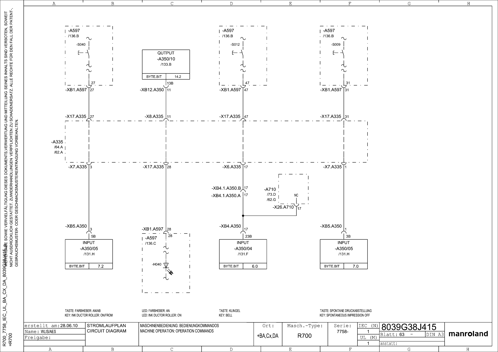

# +BA_Cx_DA — Sheet 63 of 247 — MASCHINENBEDIENUNG: BEDIENUNGKOMMANDOS

**MACHINE OPERATION: OPERATION COMMANDS**

> Part of the manroland **R700** printing press IEC/UL circuit diagrams.
> Drawing class: **Stromlaufplan / Circuit diagram** (DIN A3).
> Document `+BA_Cx_DA` covers the **Printing units / main switch cabinet** machine section.

## At a glance

| Field | Value |
|---|---|
| Document | `+BA_Cx_DA`  (8039G38J415) |
| Sheet | **63** of 247 |
| Section (DE) | MASCHINENBEDIENUNG: BEDIENUNGKOMMANDOS |
| Section (EN) | MACHINE OPERATION: OPERATION COMMANDS |
| Section type | CIRCUIT — Circuit diagram |
| Machine type | `R700` |
| Series | `7758` |
| Created | 28.06.10 |
| Replaces | — |
| Columns used | A, B, C, D, E, F |
| Path numbers | — |
| Labels on sheet | 93 |
| Cross-refs out | 12 |
| Cross-refs in | 31 |

**Previous:** [+BA_Cx_DA sheet 62](SHEET_0062.md) · **Next:** [+BA_Cx_DA sheet 64](SHEET_0064.md) · **Document TOC:** [_TOC.md](_TOC.md)  (+BA_Cx_DA) · **Master TOC:** [all sheets](../_MASTER_TOC.md)

## Sheet image (300 DPI, exact vector render)



_Rendered directly from the PDF vector layer at 300 DPI (1-bit), no OCR and no resampling. Use it to confirm anything ambiguous in the text below._

## Cross-references on this sheet

Each entry is a wire leaving this sheet. The printed token is `/sheet.column`; the link resolves to that sheet inside the same document.

| Ref | Target sheet | Col | Path | Destination on target | Target section | From col |
|---|---|---|---|---|---|---|
| `/136.B` | [+BA_Cx_DA sheet 136](SHEET_0136.md) | B | — | A597 | REFERENZMODUL | A |
| `/136.B` | [+BA_Cx_DA sheet 136](SHEET_0136.md) | B | — | A597 | REFERENZMODUL | D |
| `/136.B` | [+BA_Cx_DA sheet 136](SHEET_0136.md) | B | — | A597 | REFERENZMODUL | F |
| `/133.B` | [+BA_Cx_DA sheet 133](SHEET_0133.md) | B | — | — | REFERENZMODUL | C |
| `/64.A` | [+BA_Cx_DA sheet 64](SHEET_0064.md) | A | — | — | MASCHINENBEDIENUNG: BEDIENUNGKOMMANDOS | A |
| `/62.A` | [+BA_Cx_DA sheet 62](SHEET_0062.md) | A | — | — | MASCHINENBEDIENUNG: BEDIENUNGKOMMANDOS | A |
| `/73.D` | [+BA_Cx_DA sheet 73](SHEET_0073.md) | D | — | — | FEUCHTWERK | E |
| `/62.G` | [+BA_Cx_DA sheet 62](SHEET_0062.md) | G | — | — | MASCHINENBEDIENUNG: BEDIENUNGKOMMANDOS | E |
| `/136.C` | [+BA_Cx_DA sheet 136](SHEET_0136.md) | C | — | A597 | REFERENZMODUL | C |
| `/131.F` | [+BA_Cx_DA sheet 131](SHEET_0131.md) | F | — | — | REFERENZMODUL | D |
| `/131.H` | [+BA_Cx_DA sheet 131](SHEET_0131.md) | H | — | — | REFERENZMODUL | B |
| `/131.H` | [+BA_Cx_DA sheet 131](SHEET_0131.md) | H | — | — | REFERENZMODUL | F |

### Incoming references (sheets that point here)

Every other sheet that sends a wire to this one. `Back-ref` is the token printed on *that* sheet; `Path` is its line number.

| From sheet | Cols | Back-ref | Path | Refs | What continues there |
|---|---|---|---|---|---|
| [+BA_Cx_DA#62](SHEET_0062.md) | A, G | `/62.A`, `/62.G` | — | 2 | — |
| [+BA_Cx_DA#64](SHEET_0064.md) | A | `/64.A` | — | 1 | — |
| [+BA_Cx_DA#73](SHEET_0073.md) | D | `/73.D` | — | 1 | — |
| [+BA_Cx_DA#131](SHEET_0131.md) | F, H | `/131.F`, `/131.H` | — | 3 | — |
| [+BA_Cx_DA#133](SHEET_0133.md) | B | `/133.B` | — | 1 | — |
| [+BA_Cx_DA#136](SHEET_0136.md) | B, C | `/136.B`, `/136.C` | — | 4 | — |
| [+BA_Cx_DA#143](SHEET_0143.md) | C | `/143.C` | — | 4 | — |
| [+BA_Cx_DA#159](SHEET_0159.md) | F, G, H | `/159.F`, `/159.G`, `/159.H` | — | 3 | — |
| [+BA_Cx_DA#161](SHEET_0161.md) | F | `/161.F` | — | 2 | — |
| [+BA_Cx_DA#162](SHEET_0162.md) | D | `/162.D` | — | 1 | — |
| [+BA_Cx_DA#163](SHEET_0163.md) | G | `/163.G` | — | 2 | — |
| [+BA_Cx_DA#165](SHEET_0165.md) | E | `/165.E` | — | 1 | — |
| [+BA_Cx_DA#169](SHEET_0169.md) | G | `/169.G` | — | 1 | — |
| [+BA_Cx_DA#173](SHEET_0173.md) | C | `/173.C` | — | 4 | — |
| [+BA_Cx_DA#176](SHEET_0176.md) | E | `/176.E` | — | 1 | — |


## Devices on this sheet

| Tag | Class | Class meaning (IEC) | Col | Sub | Terminal | Sign |
|---|---|---|---|---|---|---|
| `A350/05` | A | Baugruppe / assembly, module, PC board | B | 05 | — | — |
| `A597` | A | Baugruppe / assembly, module, PC board | C | — | — | — |
| `A350/04` | A | Baugruppe / assembly, module, PC board | D | 04 | — | — |
| `A335` | A | Baugruppe / assembly, module, PC board | A | — | — | — |
| `S040` | S | Schalter / switch | A | — | — | — |
| `A597` | A | Baugruppe / assembly, module, PC board | A | — | — | — |
| `A350/10` | A | Baugruppe / assembly, module, PC board | C | 10 | — | — |
| `S012` | S | Schalter / switch | D | — | — | — |
| `A597` | A | Baugruppe / assembly, module, PC board | D | — | — | — |
| `A350/05` | A | Baugruppe / assembly, module, PC board | F | 05 | — | — |
| `S009` | S | Schalter / switch | F | — | — | — |
| `A597` | A | Baugruppe / assembly, module, PC board | F | — | — | — |
| `A710` | A | Baugruppe / assembly, module, PC board | E | — | — | — |
| `7.2` | — | cross-device reference | B | — | — | — |
| `6.0` | — | cross-device reference | D | — | — | — |
| `XB5.A350` | — | cross-device reference | A | — | — | — |
| `XB1.A597` | — | cross-device reference | C | — | — | — |
| `XB4.A350` | — | cross-device reference | D | — | — | — |
| `X7.A335` | — | cross-device reference | A | — | — | — |
| `X17.A335` | — | cross-device reference | C | — | — | — |
| `X6.A335` | — | cross-device reference | D | — | — | — |
| `X17.A335` | — | cross-device reference | A | — | — | — |
| `X8.A335` | — | cross-device reference | C | — | — | — |
| `X17.A335` | — | cross-device reference | D | — | — | — |
| `XB1.A597` | — | cross-device reference | A | — | — | — |
| `14.2` | — | cross-device reference | C | — | — | — |
| `XB12.A350` | — | cross-device reference | C | — | — | — |
| `XB1.A597` | — | cross-device reference | D | — | — | — |
| `7.0` | — | cross-device reference | F | — | — | — |
| `XB5.A350` | — | cross-device reference | F | — | — | — |
| `X7.A335` | — | cross-device reference | F | — | — | — |
| `X17.A335` | — | cross-device reference | F | — | — | — |
| `XB1.A597` | — | cross-device reference | F | — | — | — |
| `X26.A710` | — | cross-device reference | E | — | — | — |
| `XB4.1.A350.B` | — | cross-device reference | D | — | — | — |
| `XB4.1.A350.A` | — | cross-device reference | D | — | — | — |

## Potentials / nets

| Potential | Count | Columns | Attached devices | Terminals |
|---|---|---|---|---|
| `H040` | 1 | C | — | — |


A potential such as `L24+/4` or `M24+` is a named supply/return rail; every place it appears on this sheet is electrically common.

## Wire-end annotations (grouped as printed)

A wire that continues elsewhere is annotated with a small cluster: the destination description, the path/line number `#NN`, and the `/sheet.column` cross reference. Each row below is one such cluster exactly as it is grouped on the drawing.

| Col | Y | Path | Cross-ref | Text on the wire |
|---|---|---|---|---|
| A | 68.3 | — | `/136.B` | `A597` |
| D | 68.3 | — | `/136.B` | `A597` |
| F | 68.3 | — | `/136.B` | `A597` |
| A | 102.8 | — | — | `S040` |
| D | 102.8 | — | — | `S012` |
| F | 102.8 | — | — | `S009` |
| C | 122.5 | — | — | `QUTPUT` |
| C | 136.4 | — | — | `A350/10` |
| C | 150.2 | — | `/133.B` | — |
| C | 179.8 | — | — | `BYTE.BIT 14.2` |
| B | 194.5 | — | — | `27` |
| D | 194.5 | — | — | `47` |
| F | 194.5 | — | — | `31` |
| C | 195.2 | — | — | `13B` |
| A | 210.1 | — | — | `XB1.A597 27` |
| C | 210.1 | — | — | `XB12.A350 11` |
| D | 210.1 | — | — | `XB1.A597 47` |
| F | 210.1 | — | — | `XB1.A597 31` |
| C | 273.9 | — | — | `X17.A335 27 X8.A335 11 X17.A335 47` |
| F | 273.9 | — | — | `X17.A335 31` |
| A | 334.8 | — | — | `A335` |
| A | 347.9 | — | `/64.A`, `/62.A` | — |
| C | 394.3 | — | — | `X7.A335 3 X17.A335 28 X6.A335 17` |
| F | 394.3 | — | — | `X7.A335 1` |
| D | 445.4 | — | — | `XB4.1.A350.B 17` |
| E | 448.2 | — | — | `A710` |
| E | 461.3 | — | `/73.D`, `/62.G` | — |
| D | 462.4 | — | — | `XB4.1.A350.A 17 NC` |
| E | 490.7 | — | — | `X26.A710 17` |
| A | 536.1 | — | — | `XB5.A350 3` |
| C | 536.1 | — | — | `XB1.A597 28 XB4.A350 17` |
| F | 536.1 | — | — | `XB5.A350 1` |
| C | 560.2 | — | — | `28` |
| B | 561.5 | — | — | `5B` |
| D | 561.5 | — | — | `23B` |
| F | 561.5 | — | — | `3B` |
| C | 564.4 | — | `/136.C` | `A597` |
| B | 576.1 | — | — | `INPUT` |
| D | 576.1 | — | — | `INPUT` |
| F | 576.1 | — | — | `INPUT` |
| B | 589.9 | — | — | `A350/05` |
| D | 589.9 | — | — | `A350/04` |
| F | 589.9 | — | — | `A350/05` |
| B | 603.7 | — | `/131.H` | — |
| D | 603.7 | — | `/131.F` | — |
| F | 603.7 | — | `/131.H` | — |
| C | 628.6 | — | — | `H040` |
| B | 632.7 | — | — | `BYTE.BIT 7.2` |
| D | 632.7 | — | — | `BYTE.BIT 6.0` |
| F | 632.7 | — | — | `BYTE.BIT 7.0` |
| B | 740.5 | — | — | `KEY: INK DUCTOR ROLLER: ON/FROM TASTE: FARBHEBER: AN/AB` |
| C | 740.5 | — | — | `LED: FARBHEBER: AN LED: INK DUCTOR ROLLER: ON` |
| D | 740.5 | — | — | `KEY: BELL TASTE: KLINGEL` |
| F | 740.5 | — | — | `KEY: SPONTANEOUS IMPRESSION OFF TASTE: SPONTANE DRUCKABSTELLUNG` |


## Reconstructed tables

This sheet carries tabular content (pin map / terminal assignment / index). The grid below was rebuilt from the drawing's own rule lines, so each row is exactly one physical row of the table.

### Table 1 — 4 data rows × 2 columns (at x=155.9, y=62.4) — **A597 /136.B S040 27**

| XB1.A597 X17.A335 X7.A335 | 27 27 3 |
|---|---|
| `XB5.A350` | `3` |
|  | `5B` |
| `INPUT` | `A350/05 /131.H` |
| `BYTE.BIT` | `7.2` |


### Table 2 — 7 data rows × 2 columns (at x=340.2, y=62.4)

| QUTPUT | A350/10 /133.B |
|---|---|
| `BYTE.BIT` | `14.2` |
|  | `13B` |
| `XB12.A350 X8.A335 X17.A335` | `11 11 28` |
| `XB1.A597` | `28` |
| `A597` | `28` |
| `/136.C` |  |
| `H040` |  |


### Table 3 — 4 data rows × 2 columns (at x=524.4, y=62.4) — **A597 /136.B S012 47**

| XB1.A597 X17.A335 X6.A335 XB4.1.A350.B XB4.1.A350.A | 47 47 17 17 17 |
|---|---|
| `XB4.A350` | `17` |
|  | `23B` |
| `INPUT` | `A350/04 /131.F` |
| `BYTE.BIT` | `6.0` |


### Table 4 — 3 data rows × 2 columns (at x=765.4, y=62.4)

| A597 /136.B S009 | 31 |
|---|---|
| `XB1.A597 X17.A335 X7.A335 XB5.A350` | `31 31 1 1 3B` |
| `INPUT` | `A350/05 /131.H` |
| `BYTE.BIT` | `7.0` |


## Notes and free text on this sheet

| Text | Col | Y (pt) |
|---|---|---|
| `5B` | B | 561.53 |
| `INPUT` | B | 576.07 |
| `BYTE.BIT` | A | 633.32 |
| `TASTE: FARBHEBER: AN/AB` | A | 740.45 |
| `KEY: INK DUCTOR ROLLER: ON/FROM` | B | 751.11 |
| `LED: FARBHEBER: AN` | C | 740.45 |
| `LED: INK DUCTOR ROLLER: ON` | C | 751.11 |
| `23B` | D | 561.55 |
| `INPUT` | D | 576.07 |
| `BYTE.BIT` | D | 633.32 |
| `TASTE: KLINGEL` | D | 740.45 |
| `KEY: BELL` | D | 751.05 |
| `13B` | C | 195.17 |
| `QUTPUT` | C | 122.5 |
| `BYTE.BIT` | C | 179.78 |
| `3B` | F | 561.53 |
| `INPUT` | F | 576.07 |
| `BYTE.BIT` | F | 633.32 |
| `TASTE: SPONTANE DRUCKABSTELLUNG` | F | 740.47 |
| `KEY: SPONTANEOUS IMPRESSION OFF` | F | 751.09 |
| `NC` | E | 464.05 |

## Complete label inventory (exact text from the drawing)

Every text object inside the drawing area of this sheet, in DIN reading order (column A→H, then top→bottom). This is the authoritative list: if a string is not here it is not printed on this sheet.

| Col | Y | X | Dir | Type | Text |
|---|---|---|---|---|---|
| A | 68.3 | 162.7 | → | device tag | `A597` |
| A | 82.1 | 163.0 | → | cross-reference | `/136.B` |
| A | 102.8 | 182.6 | → | device tag | `S040` |
| A | 210.1 | 156.2 | → | device ref | `XB1.A597` |
| A | 273.8 | 155.9 | → | device ref | `X17.A335` |
| A | 334.8 | 122.5 | → | device tag | `A335` |
| A | 347.8 | 129.5 | → | cross-reference | `/64.A` |
| A | 360.2 | 129.5 | → | cross-reference | `/62.A` |
| A | 394.3 | 163.3 | → | device ref | `X7.A335` |
| A | 536.1 | 156.2 | → | device ref | `XB5.A350` |
| A | 633.3 | 165.8 | → | text | `BYTE.BIT` |
| A | 740.4 | 155.6 | → | text | `TASTE: FARBHEBER: AN/AB` |
| B | 194.5 | 218.0 | → | number | `27` |
| B | 211.5 | 215.1 | → | number | `27` |
| B | 275.3 | 215.1 | → | number | `27` |
| B | 395.8 | 215.1 | → | number | `3` |
| B | 544.6 | 215.1 | → | number | `3` |
| B | 561.5 | 218.0 | → | text | `5B` |
| B | 576.1 | 197.7 | → | text | `INPUT` |
| B | 589.9 | 191.2 | → | device tag | `A350/05` |
| B | 603.7 | 200.1 | → | cross-reference | `/131.H` |
| B | 632.7 | 234.1 | → | device ref | `7.2` |
| B | 751.1 | 155.1 | → | text | `KEY: INK DUCTOR ROLLER: ON/FROM` |
| C | 122.5 | 376.6 | → | text | `QUTPUT` |
| C | 136.4 | 375.4 | → | device tag | `A350/10` |
| C | 150.1 | 384.2 | → | cross-reference | `/133.B` |
| C | 179.8 | 350.1 | → | text | `BYTE.BIT` |
| C | 179.8 | 417.1 | → | device ref | `14.2` |
| C | 195.2 | 398.8 | → | text | `13B` |
| C | 210.1 | 334.5 | → | device ref | `XB12.A350` |
| C | 211.5 | 398.8 | → | number | `11` |
| C | 273.9 | 346.1 | → | device ref | `X8.A335` |
| C | 275.3 | 398.8 | → | number | `11` |
| C | 394.3 | 341.6 | → | device ref | `X17.A335` |
| C | 395.8 | 399.4 | → | number | `28` |
| C | 543.1 | 339.0 | → | device ref | `XB1.A597` |
| C | 544.6 | 399.4 | → | number | `28` |
| C | 560.2 | 402.2 | → | number | `28` |
| C | 564.4 | 347.0 | → | device tag | `A597` |
| C | 578.2 | 347.2 | → | cross-reference | `/136.C` |
| C | 628.6 | 363.4 | → | potential | `H040` |
| C | 740.4 | 339.3 | → | text | `LED: FARBHEBER: AN` |
| C | 751.1 | 339.3 | → | text | `LED: INK DUCTOR ROLLER: ON` |
| D | 68.3 | 531.2 | → | device tag | `A597` |
| D | 82.1 | 531.5 | → | cross-reference | `/136.B` |
| D | 102.8 | 551.3 | → | device tag | `S012` |
| D | 194.5 | 586.5 | → | number | `47` |
| D | 210.1 | 524.7 | → | device ref | `XB1.A597` |
| D | 211.5 | 583.7 | → | number | `47` |
| D | 273.8 | 524.4 | → | device ref | `X17.A335` |
| D | 275.3 | 583.7 | → | number | `47` |
| D | 394.3 | 531.8 | → | device ref | `X6.A335` |
| D | 395.8 | 583.1 | → | number | `17` |
| D | 445.4 | 506.0 | → | device ref | `XB4.1.A350.B` |
| D | 445.4 | 583.1 | → | number | `17` |
| D | 462.4 | 583.1 | → | number | `17` |
| D | 463.1 | 505.1 | → | device ref | `XB4.1.A350.A` |
| D | 536.1 | 524.7 | → | device ref | `XB4.A350` |
| D | 544.6 | 583.1 | → | number | `17` |
| D | 561.5 | 586.5 | → | text | `23B` |
| D | 576.1 | 566.2 | → | text | `INPUT` |
| D | 589.9 | 559.7 | → | device tag | `A350/04` |
| D | 603.7 | 568.8 | → | cross-reference | `/131.F` |
| D | 632.7 | 602.6 | → | device ref | `6.0` |
| D | 633.3 | 534.3 | → | text | `BYTE.BIT` |
| D | 740.5 | 524.1 | → | text | `TASTE: KLINGEL` |
| D | 751.1 | 523.6 | → | text | `KEY: BELL` |
| E | 448.2 | 631.3 | → | device tag | `A710` |
| E | 461.3 | 638.4 | → | cross-reference | `/73.D` |
| E | 464.0 | 703.8 | → | text | `NC` |
| E | 473.7 | 638.1 | → | cross-reference | `/62.G` |
| E | 490.7 | 652.0 | → | device ref | `X26.A710` |
| E | 495.0 | 710.6 | → | number | `17` |
| F | 68.3 | 772.2 | → | device tag | `A597` |
| F | 82.1 | 772.4 | → | cross-reference | `/136.B` |
| F | 102.8 | 792.0 | → | device tag | `S009` |
| F | 194.5 | 827.4 | → | number | `31` |
| F | 210.1 | 765.6 | → | device ref | `XB1.A597` |
| F | 211.5 | 824.6 | → | number | `31` |
| F | 273.8 | 765.4 | → | device ref | `X17.A335` |
| F | 275.3 | 824.6 | → | number | `31` |
| F | 394.3 | 772.7 | → | device ref | `X7.A335` |
| F | 395.8 | 824.0 | → | number | `1` |
| F | 536.1 | 765.6 | → | device ref | `XB5.A350` |
| F | 544.6 | 824.0 | → | number | `1` |
| F | 561.5 | 827.4 | → | text | `3B` |
| F | 576.1 | 807.2 | → | text | `INPUT` |
| F | 589.9 | 800.6 | → | device tag | `A350/05` |
| F | 603.7 | 809.6 | → | cross-reference | `/131.H` |
| F | 632.7 | 843.6 | → | device ref | `7.0` |
| F | 633.3 | 775.3 | → | text | `BYTE.BIT` |
| F | 740.5 | 765.1 | → | text | `TASTE: SPONTANE DRUCKABSTELLUNG` |
| F | 751.1 | 764.5 | → | text | `KEY: SPONTANEOUS IMPRESSION OFF` |

## Reading-order text block

The same content as a plain block, grouped by DIN column — convenient to paste or to match against a visual description.

```text
=== Column A ===
  68.3  162.7  devtag       A597
  82.1  163.0  xref         /136.B
 102.8  182.6  devtag       S040
 210.1  156.2  devref       XB1.A597
 273.8  155.9  devref       X17.A335
 334.8  122.5  devtag       A335
 347.8  129.5  xref         /64.A
 360.2  129.5  xref         /62.A
 394.3  163.3  devref       X7.A335
 536.1  156.2  devref       XB5.A350
 633.3  165.8  text         BYTE.BIT
 740.4  155.6  text         TASTE: FARBHEBER: AN/AB
=== Column B ===
 194.5  218.0  numeric      27
 211.5  215.1  numeric      27
 275.3  215.1  numeric      27
 395.8  215.1  numeric      3
 544.6  215.1  numeric      3
 561.5  218.0  text         5B
 576.1  197.7  text         INPUT
 589.9  191.2  devtag       A350/05
 603.7  200.1  xref         /131.H
 632.7  234.1  devref       7.2
 751.1  155.1  text         KEY: INK DUCTOR ROLLER: ON/FROM
=== Column C ===
 122.5  376.6  text         QUTPUT
 136.4  375.4  devtag       A350/10
 150.1  384.2  xref         /133.B
 179.8  350.1  text         BYTE.BIT
 179.8  417.1  devref       14.2
 195.2  398.8  text         13B
 210.1  334.5  devref       XB12.A350
 211.5  398.8  numeric      11
 273.9  346.1  devref       X8.A335
 275.3  398.8  numeric      11
 394.3  341.6  devref       X17.A335
 395.8  399.4  numeric      28
 543.1  339.0  devref       XB1.A597
 544.6  399.4  numeric      28
 560.2  402.2  numeric      28
 564.4  347.0  devtag       A597
 578.2  347.2  xref         /136.C
 628.6  363.4  net          H040
 740.4  339.3  text         LED: FARBHEBER: AN
 751.1  339.3  text         LED: INK DUCTOR ROLLER: ON
=== Column D ===
  68.3  531.2  devtag       A597
  82.1  531.5  xref         /136.B
 102.8  551.3  devtag       S012
 194.5  586.5  numeric      47
 210.1  524.7  devref       XB1.A597
 211.5  583.7  numeric      47
 273.8  524.4  devref       X17.A335
 275.3  583.7  numeric      47
 394.3  531.8  devref       X6.A335
 395.8  583.1  numeric      17
 445.4  506.0  devref       XB4.1.A350.B
 445.4  583.1  numeric      17
 462.4  583.1  numeric      17
 463.1  505.1  devref       XB4.1.A350.A
 536.1  524.7  devref       XB4.A350
 544.6  583.1  numeric      17
 561.5  586.5  text         23B
 576.1  566.2  text         INPUT
 589.9  559.7  devtag       A350/04
 603.7  568.8  xref         /131.F
 632.7  602.6  devref       6.0
 633.3  534.3  text         BYTE.BIT
 740.5  524.1  text         TASTE: KLINGEL
 751.1  523.6  text         KEY: BELL
=== Column E ===
 448.2  631.3  devtag       A710
 461.3  638.4  xref         /73.D
 464.0  703.8  text         NC
 473.7  638.1  xref         /62.G
 490.7  652.0  devref       X26.A710
 495.0  710.6  numeric      17
=== Column F ===
  68.3  772.2  devtag       A597
  82.1  772.4  xref         /136.B
 102.8  792.0  devtag       S009
 194.5  827.4  numeric      31
 210.1  765.6  devref       XB1.A597
 211.5  824.6  numeric      31
 273.8  765.4  devref       X17.A335
 275.3  824.6  numeric      31
 394.3  772.7  devref       X7.A335
 395.8  824.0  numeric      1
 536.1  765.6  devref       XB5.A350
 544.6  824.0  numeric      1
 561.5  827.4  text         3B
 576.1  807.2  text         INPUT
 589.9  800.6  devtag       A350/05
 603.7  809.6  xref         /131.H
 632.7  843.6  devref       7.0
 633.3  775.3  text         BYTE.BIT
 740.5  765.1  text         TASTE: SPONTANE DRUCKABSTELLUNG
 751.1  764.5  text         KEY: SPONTANEOUS IMPRESSION OFF
```

---
_Generated from the PDF vector text layer; no OCR. Source: `R700_7758_IEC_UL_BA_CX_DA_8039G38J415_p`, sheet 63._
