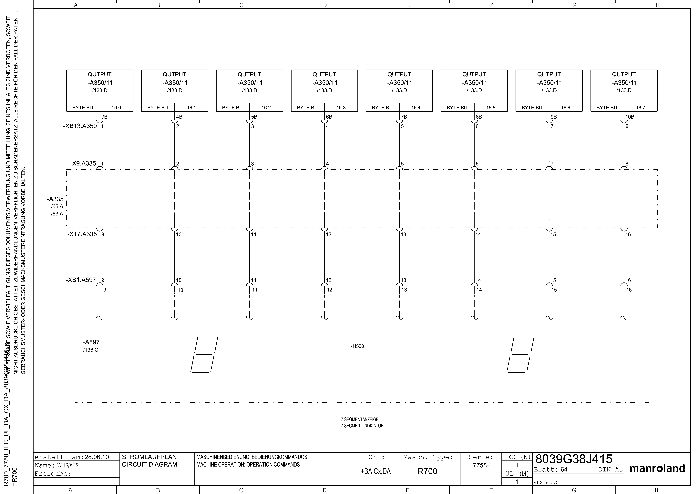

# +BA_Cx_DA — Sheet 64 of 247 — MASCHINENBEDIENUNG: BEDIENUNGKOMMANDOS

**MACHINE OPERATION: OPERATION COMMANDS**

> Part of the manroland **R700** printing press IEC/UL circuit diagrams.
> Drawing class: **Stromlaufplan / Circuit diagram** (DIN A3).
> Document `+BA_Cx_DA` covers the **Printing units / main switch cabinet** machine section.

## At a glance

| Field | Value |
|---|---|
| Document | `+BA_Cx_DA`  (8039G38J415) |
| Sheet | **64** of 247 |
| Section (DE) | MASCHINENBEDIENUNG: BEDIENUNGKOMMANDOS |
| Section (EN) | MACHINE OPERATION: OPERATION COMMANDS |
| Section type | CIRCUIT — Circuit diagram |
| Machine type | `R700` |
| Series | `7758` |
| Created | 28.06.10 |
| Replaces | — |
| Columns used | A, B, C, D, E, F, G, H |
| Path numbers | — |
| Labels on sheet | 100 |
| Cross-refs out | 11 |
| Cross-refs in | 43 |

**Previous:** [+BA_Cx_DA sheet 63](SHEET_0063.md) · **Next:** [+BA_Cx_DA sheet 65](SHEET_0065.md) · **Document TOC:** [_TOC.md](_TOC.md)  (+BA_Cx_DA) · **Master TOC:** [all sheets](../_MASTER_TOC.md)

## Sheet image (300 DPI, exact vector render)



_Rendered directly from the PDF vector layer at 300 DPI (1-bit), no OCR and no resampling. Use it to confirm anything ambiguous in the text below._

## Cross-references on this sheet

Each entry is a wire leaving this sheet. The printed token is `/sheet.column`; the link resolves to that sheet inside the same document.

| Ref | Target sheet | Col | Path | Destination on target | Target section | From col |
|---|---|---|---|---|---|---|
| `/133.D` | [+BA_Cx_DA sheet 133](SHEET_0133.md) | D | — | — | REFERENZMODUL | A |
| `/133.D` | [+BA_Cx_DA sheet 133](SHEET_0133.md) | D | — | — | REFERENZMODUL | B |
| `/133.D` | [+BA_Cx_DA sheet 133](SHEET_0133.md) | D | — | — | REFERENZMODUL | C |
| `/133.D` | [+BA_Cx_DA sheet 133](SHEET_0133.md) | D | — | — | REFERENZMODUL | D |
| `/133.D` | [+BA_Cx_DA sheet 133](SHEET_0133.md) | D | — | — | REFERENZMODUL | E |
| `/133.D` | [+BA_Cx_DA sheet 133](SHEET_0133.md) | D | — | — | REFERENZMODUL | F |
| `/133.D` | [+BA_Cx_DA sheet 133](SHEET_0133.md) | D | — | — | REFERENZMODUL | G |
| `/133.D` | [+BA_Cx_DA sheet 133](SHEET_0133.md) | D | — | — | REFERENZMODUL | H |
| `/65.A` | [+BA_Cx_DA sheet 65](SHEET_0065.md) | A | — | — | DRUCKANSTELLUNG | A |
| `/63.A` | [+BA_Cx_DA sheet 63](SHEET_0063.md) | A | — | — | MASCHINENBEDIENUNG: BEDIENUNGKOMMANDOS | A |
| `/136.C` | [+BA_Cx_DA sheet 136](SHEET_0136.md) | C | — | A597 | REFERENZMODUL | A |

### Incoming references (sheets that point here)

Every other sheet that sends a wire to this one. `Back-ref` is the token printed on *that* sheet; `Path` is its line number.

| From sheet | Cols | Back-ref | Path | Refs | What continues there |
|---|---|---|---|---|---|
| [+BA_Cx_DA#63](SHEET_0063.md) | A | `/63.A` | — | 1 | — |
| [+BA_Cx_DA#65](SHEET_0065.md) | A | `/65.A` | — | 1 | — |
| [+BA_Cx_DA#133](SHEET_0133.md) | D | `/133.D` | — | 8 | — |
| [+BA_Cx_DA#136](SHEET_0136.md) | C | `/136.C` | — | 1 | — |
| [+BA_Cx_DA#143](SHEET_0143.md) | B | `/143.B` | — | 8 | — |
| [+BA_Cx_DA#166](SHEET_0166.md) | C | `/166.C` | — | 8 | — |
| [+BA_Cx_DA#170](SHEET_0170.md) | C | `/170.C` | — | 8 | — |
| [+BA_Cx_DA#173](SHEET_0173.md) | B | `/173.B` | — | 8 | — |


## Devices on this sheet

| Tag | Class | Class meaning (IEC) | Col | Sub | Terminal | Sign |
|---|---|---|---|---|---|---|
| `A335` | A | Baugruppe / assembly, module, PC board | A | — | — | — |
| `A350/11` | A | Baugruppe / assembly, module, PC board | A | 11 | — | — |
| `A350/11` | A | Baugruppe / assembly, module, PC board | B | 11 | — | — |
| `A350/11` | A | Baugruppe / assembly, module, PC board | C | 11 | — | — |
| `A350/11` | A | Baugruppe / assembly, module, PC board | D | 11 | — | — |
| `A350/11` | A | Baugruppe / assembly, module, PC board | E | 11 | — | — |
| `A350/11` | A | Baugruppe / assembly, module, PC board | F | 11 | — | — |
| `A350/11` | A | Baugruppe / assembly, module, PC board | G | 11 | — | — |
| `A350/11` | A | Baugruppe / assembly, module, PC board | H | 11 | — | — |
| `A597` | A | Baugruppe / assembly, module, PC board | A | — | — | — |
| `X17.A335` | — | cross-device reference | A | — | — | — |
| `16.0` | — | cross-device reference | A | — | — | — |
| `16.1` | — | cross-device reference | B | — | — | — |
| `16.2` | — | cross-device reference | C | — | — | — |
| `16.3` | — | cross-device reference | D | — | — | — |
| `16.4` | — | cross-device reference | E | — | — | — |
| `16.5` | — | cross-device reference | F | — | — | — |
| `16.6` | — | cross-device reference | G | — | — | — |
| `16.7` | — | cross-device reference | H | — | — | — |
| `XB13.A350` | — | cross-device reference | A | — | — | — |
| `X9.A335` | — | cross-device reference | A | — | — | — |
| `XB1.A597` | — | cross-device reference | A | — | — | — |

## Potentials / nets

| Potential | Count | Columns | Attached devices | Terminals |
|---|---|---|---|---|
| `H500` | 1 | D | — | — |


A potential such as `L24+/4` or `M24+` is a named supply/return rail; every place it appears on this sheet is electrically common.

## Wire-end annotations (grouped as printed)

A wire that continues elsewhere is annotated with a small cluster: the destination description, the path/line number `#NN`, and the `/sheet.column` cross reference. Each row below is one such cluster exactly as it is grouped on the drawing.

| Col | Y | Path | Cross-ref | Text on the wire |
|---|---|---|---|---|
| A | 122.5 | — | — | `QUTPUT` |
| B | 122.5 | — | — | `QUTPUT` |
| C | 122.5 | — | — | `QUTPUT` |
| D | 122.5 | — | — | `QUTPUT` |
| E | 122.5 | — | — | `QUTPUT` |
| F | 122.5 | — | — | `QUTPUT` |
| G | 122.5 | — | — | `QUTPUT` |
| H | 122.5 | — | — | `QUTPUT` |
| A | 136.4 | — | — | `A350/11` |
| B | 136.4 | — | — | `A350/11` |
| C | 136.4 | — | — | `A350/11` |
| D | 136.4 | — | — | `A350/11` |
| E | 136.4 | — | — | `A350/11` |
| F | 136.4 | — | — | `A350/11` |
| G | 136.4 | — | — | `A350/11` |
| H | 136.4 | — | — | `A350/11` |
| A | 150.2 | — | `/133.D` | — |
| B | 150.2 | — | `/133.D` | — |
| C | 150.2 | — | `/133.D` | — |
| D | 150.2 | — | `/133.D` | — |
| E | 150.2 | — | `/133.D` | — |
| F | 150.2 | — | `/133.D` | — |
| G | 150.2 | — | `/133.D` | — |
| H | 150.2 | — | `/133.D` | — |
| A | 179.8 | — | — | `BYTE.BIT 16.0` |
| B | 179.8 | — | — | `BYTE.BIT 16.1` |
| C | 179.8 | — | — | `BYTE.BIT 16.2` |
| D | 179.8 | — | — | `BYTE.BIT 16.3` |
| E | 179.8 | — | — | `BYTE.BIT 16.4` |
| F | 179.8 | — | — | `BYTE.BIT 16.5` |
| G | 179.8 | — | — | `BYTE.BIT 16.6` |
| H | 179.8 | — | — | `BYTE.BIT 16.7` |
| A | 195.2 | — | — | `3B` |
| B | 195.2 | — | — | `4B` |
| C | 195.2 | — | — | `5B` |
| D | 195.2 | — | — | `6B` |
| E | 195.2 | — | — | `7B` |
| F | 195.2 | — | — | `8B` |
| G | 195.2 | — | — | `9B` |
| H | 195.2 | — | — | `10B` |
| D | 210.1 | — | — | `XB13.A350 1 2 3 4 5 6 7 8` |
| D | 273.9 | — | — | `X9.A335 1 2 3 4 5 6 7 8` |
| A | 334.8 | — | — | `A335` |
| A | 347.9 | — | `/65.A`, `/63.A` | — |
| D | 394.3 | — | — | `X17.A335 9 10 11 12 13 14 15 16` |
| D | 472.3 | — | — | `XB1.A597 9 10 11 12 13 14 15 16` |
| E | 490.0 | — | — | `9 10 11 12 13 14 15 16` |
| A | 578.6 | — | `/136.C` | `A597` |
| D | 586.5 | — | — | `H500` |
| D | 712.1 | — | — | `7 SEGMENTANZEIGE 7 SEGMENT INDICATOR` |


## Reconstructed tables

This sheet carries tabular content (pin map / terminal assignment / index). The grid below was rebuilt from the drawing's own rule lines, so each row is exactly one physical row of the table.

### Table 1 — 1 data rows × 2 columns (at x=113.4, y=119.1)

| QUTPUT | A350/11 /133.D |
|---|---|
| `BYTE.BIT` | `16.0` |


### Table 2 — 1 data rows × 2 columns (at x=240.9, y=119.1)

| QUTPUT | A350/11 /133.D |
|---|---|
| `BYTE.BIT` | `16.1` |


### Table 3 — 1 data rows × 2 columns (at x=368.5, y=119.1)

| QUTPUT | A350/11 /133.D |
|---|---|
| `BYTE.BIT` | `16.2` |


### Table 4 — 1 data rows × 2 columns (at x=496.1, y=119.1)

| QUTPUT | A350/11 /133.D |
|---|---|
| `BYTE.BIT` | `16.3` |


### Table 5 — 1 data rows × 2 columns (at x=623.6, y=119.1)

| QUTPUT | A350/11 /133.D |
|---|---|
| `BYTE.BIT` | `16.4` |


### Table 6 — 1 data rows × 2 columns (at x=751.2, y=119.1)

| QUTPUT | A350/11 /133.D |
|---|---|
| `BYTE.BIT` | `16.5` |


### Table 7 — 1 data rows × 2 columns (at x=878.7, y=119.1)

| QUTPUT | A350/11 /133.D |
|---|---|
| `BYTE.BIT` | `16.6` |


### Table 8 — 1 data rows × 2 columns (at x=1006.3, y=119.1)

| QUTPUT | A350/11 /133.D |
|---|---|
| `BYTE.BIT` | `16.7` |


## Notes and free text on this sheet

| Text | Col | Y (pt) |
|---|---|---|
| `3B` | A | 195.15 |
| `QUTPUT` | A | 122.5 |
| `BYTE.BIT` | A | 179.78 |
| `4B` | B | 195.15 |
| `QUTPUT` | B | 122.5 |
| `BYTE.BIT` | B | 179.78 |
| `5B` | C | 195.15 |
| `QUTPUT` | C | 122.5 |
| `BYTE.BIT` | C | 179.78 |
| `6B` | D | 195.15 |
| `QUTPUT` | D | 122.5 |
| `BYTE.BIT` | D | 179.78 |
| `7B` | E | 195.15 |
| `QUTPUT` | E | 122.5 |
| `BYTE.BIT` | E | 179.78 |
| `8B` | F | 195.15 |
| `QUTPUT` | F | 122.5 |
| `BYTE.BIT` | F | 179.78 |
| `9B` | G | 195.15 |
| `QUTPUT` | G | 122.5 |
| `10B` | H | 195.17 |
| `QUTPUT` | H | 122.5 |
| `BYTE.BIT` | G | 179.78 |
| `7 SEGMENTANZEIGE` | D | 712.13 |
| `7 SEGMENT INDICATOR` | D | 722.78 |

## Complete label inventory (exact text from the drawing)

Every text object inside the drawing area of this sheet, in DIN reading order (column A→H, then top→bottom). This is the authoritative list: if a string is not here it is not printed on this sheet.

| Col | Y | X | Dir | Type | Text |
|---|---|---|---|---|---|
| A | 122.5 | 149.8 | → | text | `QUTPUT` |
| A | 136.4 | 149.4 | → | device tag | `A350/11` |
| A | 150.2 | 157.3 | → | cross-reference | `/133.D` |
| A | 179.8 | 123.3 | → | text | `BYTE.BIT` |
| A | 179.8 | 190.2 | → | device ref | `16.0` |
| A | 195.2 | 172.6 | → | text | `3B` |
| A | 210.1 | 107.7 | → | device ref | `XB13.A350` |
| A | 211.5 | 172.1 | → | number | `1` |
| A | 273.9 | 119.3 | → | device ref | `X9.A335` |
| A | 275.3 | 172.1 | → | number | `1` |
| A | 334.8 | 79.9 | → | device tag | `A335` |
| A | 347.8 | 87.0 | → | cross-reference | `/65.A` |
| A | 360.2 | 87.0 | → | cross-reference | `/63.A` |
| A | 394.3 | 114.8 | → | device ref | `X17.A335` |
| A | 395.8 | 172.6 | → | number | `9` |
| A | 472.3 | 112.3 | → | device ref | `XB1.A597` |
| A | 473.7 | 172.6 | → | number | `9` |
| A | 490.0 | 176.2 | → | number | `9` |
| A | 578.6 | 141.4 | → | device tag | `A597` |
| A | 592.4 | 141.7 | → | cross-reference | `/136.C` |
| B | 122.5 | 277.4 | → | text | `QUTPUT` |
| B | 136.4 | 276.9 | → | device tag | `A350/11` |
| B | 150.2 | 284.9 | → | cross-reference | `/133.D` |
| B | 179.8 | 250.9 | → | text | `BYTE.BIT` |
| B | 179.8 | 318.3 | → | device ref | `16.1` |
| B | 195.2 | 300.2 | → | text | `4B` |
| B | 211.5 | 300.2 | → | number | `2` |
| B | 275.3 | 300.2 | → | number | `2` |
| B | 395.8 | 299.6 | → | number | `10` |
| B | 473.7 | 299.6 | → | number | `10` |
| B | 490.7 | 302.5 | → | number | `10` |
| C | 122.5 | 404.9 | → | text | `QUTPUT` |
| C | 136.4 | 404.5 | → | device tag | `A350/11` |
| C | 150.2 | 412.4 | → | cross-reference | `/133.D` |
| C | 179.8 | 378.4 | → | text | `BYTE.BIT` |
| C | 179.8 | 445.5 | → | device ref | `16.2` |
| C | 195.2 | 427.7 | → | text | `5B` |
| C | 211.5 | 427.7 | → | number | `3` |
| C | 275.3 | 427.7 | → | number | `3` |
| C | 395.8 | 427.2 | → | number | `11` |
| C | 473.7 | 427.2 | → | number | `11` |
| C | 490.0 | 429.3 | → | number | `11` |
| D | 122.5 | 532.5 | → | text | `QUTPUT` |
| D | 136.4 | 532.1 | → | device tag | `A350/11` |
| D | 150.2 | 540.0 | → | cross-reference | `/133.D` |
| D | 179.8 | 506.0 | → | text | `BYTE.BIT` |
| D | 179.8 | 572.9 | → | device ref | `16.3` |
| D | 195.2 | 555.3 | → | text | `6B` |
| D | 211.5 | 555.3 | → | number | `4` |
| D | 275.3 | 555.3 | → | number | `4` |
| D | 395.8 | 554.7 | → | number | `12` |
| D | 473.7 | 554.7 | → | number | `12` |
| D | 490.0 | 556.3 | → | number | `12` |
| D | 586.5 | 597.8 | → | potential | `H500` |
| D | 712.1 | 580.8 | → | text | `7 SEGMENTANZEIGE` |
| D | 722.8 | 580.8 | → | text | `7 SEGMENT INDICATOR` |
| E | 122.5 | 660.0 | → | text | `QUTPUT` |
| E | 136.4 | 659.6 | → | device tag | `A350/11` |
| E | 150.2 | 667.6 | → | cross-reference | `/133.D` |
| E | 179.8 | 633.5 | → | text | `BYTE.BIT` |
| E | 179.8 | 700.4 | → | device ref | `16.4` |
| E | 195.2 | 682.9 | → | text | `7B` |
| E | 211.5 | 682.9 | → | number | `5` |
| E | 275.3 | 682.9 | → | number | `5` |
| E | 395.8 | 682.3 | → | number | `13` |
| E | 473.7 | 682.3 | → | number | `13` |
| E | 490.0 | 683.7 | → | number | `13` |
| F | 122.5 | 787.6 | → | text | `QUTPUT` |
| F | 136.4 | 787.2 | → | device tag | `A350/11` |
| F | 150.2 | 795.1 | → | cross-reference | `/133.D` |
| F | 179.8 | 761.1 | → | text | `BYTE.BIT` |
| F | 179.8 | 828.0 | → | device ref | `16.5` |
| F | 179.8 | 888.7 | → | text | `BYTE.BIT` |
| F | 195.2 | 810.4 | → | text | `8B` |
| F | 211.5 | 810.4 | → | number | `6` |
| F | 275.3 | 810.4 | → | number | `6` |
| F | 395.8 | 809.9 | → | number | `14` |
| F | 473.7 | 809.9 | → | number | `14` |
| F | 490.0 | 811.3 | → | number | `14` |
| G | 122.5 | 915.2 | → | text | `QUTPUT` |
| G | 136.4 | 914.7 | → | device tag | `A350/11` |
| G | 150.2 | 922.7 | → | cross-reference | `/133.D` |
| G | 179.8 | 955.6 | → | device ref | `16.6` |
| G | 179.8 | 1016.2 | → | text | `BYTE.BIT` |
| G | 195.2 | 938.0 | → | text | `9B` |
| G | 211.5 | 938.0 | → | number | `7` |
| G | 275.3 | 938.0 | → | number | `7` |
| G | 395.8 | 937.4 | → | number | `15` |
| G | 473.7 | 937.4 | → | number | `15` |
| G | 490.0 | 938.8 | → | number | `15` |
| H | 122.5 | 1042.7 | → | text | `QUTPUT` |
| H | 136.4 | 1042.3 | → | device tag | `A350/11` |
| H | 150.2 | 1050.2 | → | cross-reference | `/133.D` |
| H | 179.8 | 1083.1 | → | device ref | `16.7` |
| H | 195.2 | 1065.0 | → | text | `10B` |
| H | 211.5 | 1065.5 | → | number | `8` |
| H | 275.3 | 1065.5 | → | number | `8` |
| H | 395.8 | 1065.0 | → | number | `16` |
| H | 473.7 | 1065.0 | → | number | `16` |
| H | 490.0 | 1066.4 | → | number | `16` |

## Reading-order text block

The same content as a plain block, grouped by DIN column — convenient to paste or to match against a visual description.

```text
=== Column A ===
 122.5  149.8  text         QUTPUT
 136.4  149.4  devtag       A350/11
 150.2  157.3  xref         /133.D
 179.8  123.3  text         BYTE.BIT
 179.8  190.2  devref       16.0
 195.2  172.6  text         3B
 210.1  107.7  devref       XB13.A350
 211.5  172.1  numeric      1
 273.9  119.3  devref       X9.A335
 275.3  172.1  numeric      1
 334.8   79.9  devtag       A335
 347.8   87.0  xref         /65.A
 360.2   87.0  xref         /63.A
 394.3  114.8  devref       X17.A335
 395.8  172.6  numeric      9
 472.3  112.3  devref       XB1.A597
 473.7  172.6  numeric      9
 490.0  176.2  numeric      9
 578.6  141.4  devtag       A597
 592.4  141.7  xref         /136.C
=== Column B ===
 122.5  277.4  text         QUTPUT
 136.4  276.9  devtag       A350/11
 150.2  284.9  xref         /133.D
 179.8  250.9  text         BYTE.BIT
 179.8  318.3  devref       16.1
 195.2  300.2  text         4B
 211.5  300.2  numeric      2
 275.3  300.2  numeric      2
 395.8  299.6  numeric      10
 473.7  299.6  numeric      10
 490.7  302.5  numeric      10
=== Column C ===
 122.5  404.9  text         QUTPUT
 136.4  404.5  devtag       A350/11
 150.2  412.4  xref         /133.D
 179.8  378.4  text         BYTE.BIT
 179.8  445.5  devref       16.2
 195.2  427.7  text         5B
 211.5  427.7  numeric      3
 275.3  427.7  numeric      3
 395.8  427.2  numeric      11
 473.7  427.2  numeric      11
 490.0  429.3  numeric      11
=== Column D ===
 122.5  532.5  text         QUTPUT
 136.4  532.1  devtag       A350/11
 150.2  540.0  xref         /133.D
 179.8  506.0  text         BYTE.BIT
 179.8  572.9  devref       16.3
 195.2  555.3  text         6B
 211.5  555.3  numeric      4
 275.3  555.3  numeric      4
 395.8  554.7  numeric      12
 473.7  554.7  numeric      12
 490.0  556.3  numeric      12
 586.5  597.8  net          H500
 712.1  580.8  text         7 SEGMENTANZEIGE
 722.8  580.8  text         7 SEGMENT INDICATOR
=== Column E ===
 122.5  660.0  text         QUTPUT
 136.4  659.6  devtag       A350/11
 150.2  667.6  xref         /133.D
 179.8  633.5  text         BYTE.BIT
 179.8  700.4  devref       16.4
 195.2  682.9  text         7B
 211.5  682.9  numeric      5
 275.3  682.9  numeric      5
 395.8  682.3  numeric      13
 473.7  682.3  numeric      13
 490.0  683.7  numeric      13
=== Column F ===
 122.5  787.6  text         QUTPUT
 136.4  787.2  devtag       A350/11
 150.2  795.1  xref         /133.D
 179.8  761.1  text         BYTE.BIT
 179.8  828.0  devref       16.5
 179.8  888.7  text         BYTE.BIT
 195.2  810.4  text         8B
 211.5  810.4  numeric      6
 275.3  810.4  numeric      6
 395.8  809.9  numeric      14
 473.7  809.9  numeric      14
 490.0  811.3  numeric      14
=== Column G ===
 122.5  915.2  text         QUTPUT
 136.4  914.7  devtag       A350/11
 150.2  922.7  xref         /133.D
 179.8  955.6  devref       16.6
 179.8 1016.2  text         BYTE.BIT
 195.2  938.0  text         9B
 211.5  938.0  numeric      7
 275.3  938.0  numeric      7
 395.8  937.4  numeric      15
 473.7  937.4  numeric      15
 490.0  938.8  numeric      15
=== Column H ===
 122.5 1042.7  text         QUTPUT
 136.4 1042.3  devtag       A350/11
 150.2 1050.2  xref         /133.D
 179.8 1083.1  devref       16.7
 195.2 1065.0  text         10B
 211.5 1065.5  numeric      8
 275.3 1065.5  numeric      8
 395.8 1065.0  numeric      16
 473.7 1065.0  numeric      16
 490.0 1066.4  numeric      16
```

---
_Generated from the PDF vector text layer; no OCR. Source: `R700_7758_IEC_UL_BA_CX_DA_8039G38J415_p`, sheet 64._
