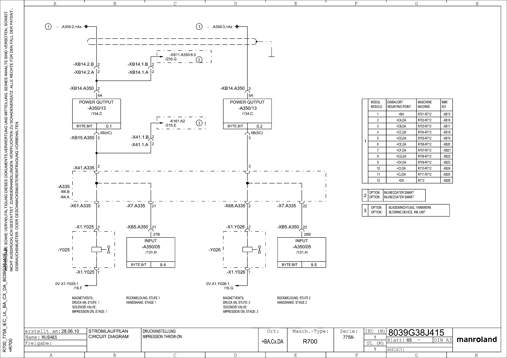

# +BA_Cx_DA — Sheet 65 of 247 — DRUCKANSTELLUNG

**IMPRESSION THROW ON**

> Part of the manroland **R700** printing press IEC/UL circuit diagrams.
> Drawing class: **Stromlaufplan / Circuit diagram** (DIN A3).
> Document `+BA_Cx_DA` covers the **Printing units / main switch cabinet** machine section.

## At a glance

| Field | Value |
|---|---|
| Document | `+BA_Cx_DA`  (8039G38J415) |
| Sheet | **65** of 247 |
| Section (DE) | DRUCKANSTELLUNG |
| Section (EN) | IMPRESSION THROW ON |
| Section type | CIRCUIT — Circuit diagram |
| Machine type | `R700` |
| Series | `7758` |
| Created | 28.06.10 |
| Replaces | — |
| Columns used | A, B, C, D, E, F, G, H |
| Path numbers | — |
| Labels on sheet | 166 |
| Cross-refs out | 10 |
| Cross-refs in | 32 |

**Previous:** [+BA_Cx_DA sheet 64](SHEET_0064.md) · **Next:** [+BA_Cx_DA sheet 66](SHEET_0066.md) · **Document TOC:** [_TOC.md](_TOC.md)  (+BA_Cx_DA) · **Master TOC:** [all sheets](../_MASTER_TOC.md)

## Sheet image (300 DPI, exact vector render)



_Rendered directly from the PDF vector layer at 300 DPI (1-bit), no OCR and no resampling. Use it to confirm anything ambiguous in the text below._

## Cross-references on this sheet

Each entry is a wire leaving this sheet. The printed token is `/sheet.column`; the link resolves to that sheet inside the same document.

| Ref | Target sheet | Col | Path | Destination on target | Target section | From col |
|---|---|---|---|---|---|---|
| `/235.G` | [+BA_Cx_DA sheet 235](SHEET_0235.md) | G | — | — | OPTION: INLINECOATER SMART | C |
| `/134.C` | [+BA_Cx_DA sheet 134](SHEET_0134.md) | C | — | — | REFERENZMODUL | B |
| `/134.C` | [+BA_Cx_DA sheet 134](SHEET_0134.md) | C | — | — | REFERENZMODUL | D |
| `/215.E` | [+BA_Cx_DA sheet 215](SHEET_0215.md) | E | — | — | OPTION: BLASEINRICHTUNG, FARBWERK | C |
| `/66.B` | [+BA_Cx_DA sheet 66](SHEET_0066.md) | B | — | — | TRENNBLÄSER | A |
| `/64.A` | [+BA_Cx_DA sheet 64](SHEET_0064.md) | A | — | — | MASCHINENBEDIENUNG: BEDIENUNGKOMMANDOS | A |
| `/131.H` | [+BA_Cx_DA sheet 131](SHEET_0131.md) | H | — | — | REFERENZMODUL | C |
| `/131.H` | [+BA_Cx_DA sheet 131](SHEET_0131.md) | H | — | — | REFERENZMODUL | E |
| `/16.F` | [+BA_Cx_DA sheet 16](SHEET_0016.md) | F | — | 0V.X1.Y025:1 0V.X1.Y026:1 | SPANNUNGSVERSORGUNG, SCHALTSCHRANKBELÜFTUNG | B |
| `/16.G` | [+BA_Cx_DA sheet 16](SHEET_0016.md) | G | — | 0V.X1.Y025:1 0V.X1.Y026:1 | SPANNUNGSVERSORGUNG, SCHALTSCHRANKBELÜFTUNG | B |

### Incoming references (sheets that point here)

Every other sheet that sends a wire to this one. `Back-ref` is the token printed on *that* sheet; `Path` is its line number.

| From sheet | Cols | Back-ref | Path | Refs | What continues there |
|---|---|---|---|---|---|
| [+BA_Cx_DA#16](SHEET_0016.md) | F, G | `/16.F`, `/16.G` | — | 2 | 0V.X1.Y025:1; 0V.X1.Y026:1 |
| [+BA_Cx_DA#64](SHEET_0064.md) | A | `/64.A` | — | 1 | — |
| [+BA_Cx_DA#66](SHEET_0066.md) | B | `/66.B` | — | 1 | — |
| [+BA_Cx_DA#131](SHEET_0131.md) | H | `/131.H` | — | 2 | — |
| [+BA_Cx_DA#134](SHEET_0134.md) | C | `/134.C` | — | 2 | — |
| [+BA_Cx_DA#150](SHEET_0150.md) | A | `/150.A` | — | 4 | — |
| [+BA_Cx_DA#161](SHEET_0161.md) | F | `/161.F` | — | 2 | — |
| [+BA_Cx_DA#163](SHEET_0163.md) | G | `/163.G` | — | 2 | — |
| [+BA_Cx_DA#170](SHEET_0170.md) | E, F | `/170.E`, `/170.F` | — | 4 | — |
| [+BA_Cx_DA#171](SHEET_0171.md) | B, G | `/171.B`, `/171.G` | — | 4 | — |
| [+BA_Cx_DA#181](SHEET_0181.md) | B, C, F | `/181.B`, `/181.C`, `/181.F` | — | 4 | — |
| [+BA_Cx_DA#183](SHEET_0183.md) | C, H | `/183.C`, `/183.H` | — | 2 | — |
| [+BA_Cx_DA#215](SHEET_0215.md) | E | `/215.E` | — | 1 | K161:A2 |
| [+BA_Cx_DA#235](SHEET_0235.md) | D | `/235.D` | — | 1 | 0V.K617:A1 XB11.A350:6:2 |


## Devices on this sheet

| Tag | Class | Class meaning (IEC) | Col | Sub | Terminal | Sign |
|---|---|---|---|---|---|---|
| `Y025` | Y | Magnetventil / solenoid valve, actuator | A | — | — | — |
| `Y026` | Y | Magnetventil / solenoid valve, actuator | D | — | — | — |
| `A350/05` | A | Baugruppe / assembly, module, PC board | C | 05 | — | — |
| `A350/05` | A | Baugruppe / assembly, module, PC board | E | 05 | — | — |
| `A335` | A | Baugruppe / assembly, module, PC board | A | — | — | — |
| `A350/13` | A | Baugruppe / assembly, module, PC board | B | 13 | — | — |
| `A350/13` | A | Baugruppe / assembly, module, PC board | D | 13 | — | — |
| `K161:A2` | K | Relais / relay, contactor | C | — | A2 | — |
| `XB15` | XB |  | G | — | — | — |
| `XB16` | XB |  | G | — | — | — |
| `XB17` | XB |  | G | — | — | — |
| `XB18` | XB |  | G | — | — | — |
| `XB19` | XB |  | G | — | — | — |
| `XB20` | XB |  | G | — | — | — |
| `XB21` | XB |  | H | — | — | — |
| `XB22` | XB |  | G | — | — | — |
| `XB23` | XB |  | G | — | — | — |
| `XB24` | XB |  | G | — | — | — |
| `XB25` | XB |  | G | — | — | — |
| `XB26` | XB |  | G | — | — | — |
| `R712` | R | Widerstand / resistor | G | — | — | — |
| `X1.Y025` | — | cross-device reference | B | — | — | — |
| `X1.Y025` | — | cross-device reference | A | — | — | — |
| `X1.Y026` | — | cross-device reference | D | — | — | — |
| `X1.Y026` | — | cross-device reference | D | — | — | — |
| `9.4` | — | cross-device reference | C | — | — | — |
| `XB5.A350` | — | cross-device reference | B | — | — | — |
| `9.5` | — | cross-device reference | E | — | — | — |
| `XB5.A350` | — | cross-device reference | E | — | — | — |
| `X61.A335` | — | cross-device reference | A | — | — | — |
| `X41.A335` | — | cross-device reference | A | — | — | — |
| `X68.A335` | — | cross-device reference | D | — | — | — |
| `X7.A335` | — | cross-device reference | B | — | — | — |
| `X7.A335` | — | cross-device reference | E | — | — | — |
| `X41.1.B` | — | cross-device reference | B | — | — | — |
| `X41.1.A` | — | cross-device reference | B | — | — | — |
| `XB14.A350` | — | cross-device reference | A | — | — | — |
| `XB15.A350` | — | cross-device reference | A | — | — | — |
| `0.1` | — | cross-device reference | B | — | — | — |
| `0.2` | — | cross-device reference | D | — | — | — |
| `XB14.A350` | — | cross-device reference | D | — | — | — |
| `XB14.1.B` | — | cross-device reference | B | — | — | — |
| `XB14.1.A` | — | cross-device reference | B | — | — | — |
| `XB14.2.B` | — | cross-device reference | A | — | — | — |
| `XB14.2.A` | — | cross-device reference | A | — | — | — |

## Potentials / nets

| Potential | Count | Columns | Attached devices | Terminals |
|---|---|---|---|---|
| `0V` | 2 | A, D | `X1`, `Y025`, `Y026` | `1` |


A potential such as `L24+/4` or `M24+` is a named supply/return rail; every place it appears on this sheet is electrically common.

## Wire-end annotations (grouped as printed)

A wire that continues elsewhere is annotated with a small cluster: the destination description, the path/line number `#NN`, and the `/sheet.column` cross reference. Each row below is one such cluster exactly as it is grouped on the drawing.

| Col | Y | Path | Cross-ref | Text on the wire |
|---|---|---|---|---|
| B | 59.1 | — | — | `.A359:2,+Ax .A359:3,+Ax` |
| B | 59.3 | — | — | `1 1` |
| C | 125.0 | — | — | `XB11.A350:6:2` |
| C | 134.9 | — | `/235.G` | — |
| C | 137.8 | — | — | `2` |
| B | 146.3 | — | — | `XB14.2.B 2` |
| B | 146.3 | — | — | `XB14.1.B 2` |
| B | 164.7 | — | — | `XB14.2.A 2` |
| B | 164.7 | — | — | `XB14.1.A 2` |
| A | 203.0 | — | — | `XB14.A350 2` |
| D | 203.0 | — | — | `XB14.A350 3` |
| B | 220.7 | — | — | `4A` |
| D | 220.7 | — | — | `5A` |
| B | 235.8 | — | — | `POWER QUTPUT` |
| D | 235.8 | — | — | `POWER QUTPUT` |
| F | 237.3 | — | — | `MODUL MODULE` |
| G | 237.3 | — | — | `EINBAUORT MOUNTING POINT` |
| G | 237.3 | — | — | `MASCHINE MACHINE` |
| G | 237.3 | — | — | `BMK IEE` |
| B | 249.8 | — | — | `A350/13` |
| D | 249.8 | — | — | `A350/13` |
| B | 263.6 | — | `/134.C` | — |
| D | 263.6 | — | `/134.C` | — |
| F | 265.1 | — | — | `1` |
| G | 265.6 | — | — | `+BA` |
| G | 265.7 | — | — | `R701 R712` |
| G | 265.7 | — | — | `XB15` |
| F | 279.7 | — | — | `2` |
| G | 279.8 | — | — | `+CA,DA` |
| G | 279.8 | — | — | `XB16` |
| G | 279.9 | — | — | `R702 R712` |
| C | 280.9 | — | — | `K161:A2` |
| C | 286.6 | — | — | `3` |
| C | 290.8 | — | `/215.E` | — |
| B | 292.6 | — | — | `BYTE.BIT 0.1` |
| D | 292.6 | — | — | `BYTE.BIT 0.2` |
| F | 293.9 | — | — | `3` |
| G | 294.0 | — | — | `+CB,DA` |
| G | 294.0 | — | — | `R703 R712` |
| G | 294.0 | — | — | `XB17` |
| F | 308.1 | — | — | `4` |
| G | 308.2 | — | — | `+CC,DA` |
| G | 308.2 | — | — | `R704 R712` |
| G | 308.2 | — | — | `XB18` |
| B | 308.6 | — | — | `4B(4C)` |
| D | 308.6 | — | — | `5B(5C)` |
| B | 317.8 | — | — | `X41.1.B 2` |
| B | 319.2 | — | — | `XB15.A350 2` |
| D | 320.6 | — | — | `3` |
| F | 322.3 | — | — | `5` |
| G | 322.4 | — | — | `+CD,DA` |
| G | 322.4 | — | — | `R705 R712` |
| G | 322.4 | — | — | `XB19` |
| F | 327.7 | — | — | `1` |
| B | 334.8 | — | — | `X41.1.A 2` |
| F | 336.4 | — | — | `6` |
| G | 336.5 | — | — | `+CE,DA` |
| G | 336.5 | — | — | `XB20` |
| G | 336.6 | — | — | `R706 R712` |
| F | 350.6 | — | — | `7` |
| H | 350.6 | — | — | `XB21` |
| G | 350.7 | — | — | `+CF,DA` |
| G | 350.7 | — | — | `R707 R712` |
| F | 364.8 | — | — | `8` |
| G | 364.9 | — | — | `+CG,DA` |
| G | 364.9 | — | — | `R708 R712` |
| G | 364.9 | — | — | `XB22` |
| F | 379.0 | — | — | `9` |
| G | 379.0 | — | — | `XB23` |
| G | 379.1 | — | — | `+CH,DA` |
| G | 379.1 | — | — | `R709 R712` |
| B | 387.2 | — | — | `X41.A335 2` |
| D | 387.2 | — | — | `3` |
| F | 393.1 | — | — | `10` |
| G | 393.2 | — | — | `+CI,DA` |
| G | 393.2 | — | — | `R710 R712` |
| G | 393.2 | — | — | `XB24` |
| F | 407.1 | — | — | `11` |
| G | 407.4 | — | — | `+CJ,DA` |
| G | 407.4 | — | — | `R711 R712` |
| G | 407.4 | — | — | `XB25` |
| F | 421.5 | — | — | `12` |
| G | 421.6 | — | — | `+DA` |
| G | 421.6 | — | — | `R712` |
| G | 421.6 | — | — | `XB26` |
| A | 434.0 | — | — | `A335` |
| A | 447.1 | — | `/66.B`, `/64.A` | — |
| F | 449.9 | — | — | `2 OPTION OPTION` |
| G | 449.9 | — | — | `INLINECOATER SMART INLINECOATER SMART` |
| A | 479.4 | — | — | `X61.A335 2` |
| D | 479.4 | — | — | `X7.A335 21 X7.A335 22` |
| D | 479.4 | — | — | `X68.A335 2` |
| G | 485.3 | — | — | `3 OPTION OPTION BLASEINRICHTUNG, FARBWERK BLOWING DEVICE, INK UNIT` |
| B | 529.0 | — | — | `X1.Y025 2` |
| B | 529.0 | — | — | `XB5.A350 21` |
| D | 529.0 | — | — | `X1.Y026 2` |
| E | 529.0 | — | — | `XB5.A350 22` |
| C | 547.4 | — | — | `27B` |
| E | 547.4 | — | — | `28B` |
| C | 561.9 | — | — | `INPUT` |
| E | 561.9 | — | — | `INPUT` |
| C | 575.7 | — | — | `A350/05` |
| E | 575.7 | — | — | `A350/05` |
| A | 582.9 | — | — | `Y025` |
| D | 582.9 | — | — | `Y026` |
| C | 589.5 | — | `/131.H` | — |
| E | 589.5 | — | `/131.H` | — |
| C | 618.6 | — | — | `BYTE.BIT 9.4` |
| E | 618.6 | — | — | `BYTE.BIT 9.5` |
| B | 635.3 | — | — | `X1.Y025 1` |
| D | 635.3 | — | — | `X1.Y026 1` |
| B | 663.6 | — | `/16.F`, `/16.G` | `0V.X1.Y025:1 0V.X1.Y026:1` |
| B | 697.9 | — | — | `DRUCK AN, STUFE: 1 MAGNETVENTIL:` |
| D | 697.9 | — | — | `DRUCK AN, STUFE: 2 MAGNETVENTIL:` |
| B | 698.0 | — | — | `RÜCKMELDUNG: STUFE 1 HANDSHAKE: STAGE 1` |
| E | 698.0 | — | — | `RÜCKMELDUNG: STUFE 2 HANDSHAKE: STAGE 2` |
| B | 719.2 | — | — | `IMPRESSION ON, STAGE: 1 SOLENOID VALVE:` |
| D | 719.2 | — | — | `IMPRESSION ON, STAGE: 2 SOLENOID VALVE:` |


## Reconstructed tables

This sheet carries tabular content (pin map / terminal assignment / index). The grid below was rebuilt from the drawing's own rule lines, so each row is exactly one physical row of the table.

### Table 1 — 6 data rows × 2 columns (at x=170.1, y=90.7)

| XB14.2.B XB14.2.A | 2 2 |
|---|---|
| `XB14.A350` | `2 4A` |
| `POWER` | `QUTPUT A350/13 /134.C` |
| `BYTE.BIT` | `0.1` |
| `XB15.A350` | `4B(4C) 2` |
| `X41.A335` | `2` |
| `X61.A335 X1.Y025` | `2 2` |


### Table 2 — 5 data rows × 2 columns (at x=297.6, y=90.7)

| XB14.1.B XB14.1.A | /235.G 2 2 |
|---|---|
|  | `/215.E` |
| `X41.1.B X41.1.A` | `2 2` |
| `X7.A335 XB5.A350` | `21 21 27B` |
| `INPUT` | `A350/05 /131.H` |
| `BYTE.BIT` | `9.4` |


### Table 3 — 4 data rows × 2 columns (at x=524.4, y=90.7)

| XB14.A350 | 3 5A |
|---|---|
| `POWER` | `QUTPUT A350/13 /134.C` |
| `BYTE.BIT` | `0.2` |
|  | `5B(5C) 3 3` |
| `X68.A335 X1.Y026` | `2 2` |


### Table 4 — 2 data rows × 2 columns (at x=652.0, y=90.7)

| X7.A335 XB5.A350 | 22 22 28B |
|---|---|
| `INPUT` | `A350/05 /131.H` |
| `BYTE.BIT` | `9.5` |


## Notes and free text on this sheet

| Text | Col | Y (pt) |
|---|---|---|
| `MAGNETVENTIL:` | A | 697.94 |
| `DRUCK AN, STUFE: 1` | B | 708.56 |
| `SOLENOID VALVE:` | A | 719.2 |
| `IMPRESSION ON, STAGE: 1` | B | 729.82 |
| `MAGNETVENTIL:` | D | 697.94 |
| `DRUCK AN, STUFE: 2` | D | 708.57 |
| `SOLENOID VALVE:` | D | 719.2 |
| `IMPRESSION ON, STAGE: 2` | D | 729.83 |
| `27B` | C | 547.37 |
| `INPUT` | C | 561.9 |
| `BYTE.BIT` | B | 619.15 |
| `RÜCKMELDUNG: STUFE 1` | B | 697.95 |
| `HANDSHAKE: STAGE 1` | B | 708.55 |
| `28B` | E | 547.37 |
| `INPUT` | E | 561.9 |
| `BYTE.BIT` | E | 619.15 |
| `RÜCKMELDUNG: STUFE 2` | E | 697.96 |
| `HANDSHAKE: STAGE 2` | E | 708.56 |
| `4A` | B | 220.66 |
| `4B(4C)` | B | 308.59 |
| `POWER QUTPUT` | B | 235.84 |
| `BYTE.BIT` | A | 293.16 |
| `5A` | D | 220.66 |
| `5B(5C)` | D | 308.59 |
| `POWER QUTPUT` | D | 235.84 |
| `BYTE.BIT` | D | 293.16 |
| `.A359:2,+Ax` | A | 59.1 |
| `.A359:3,+Ax` | D | 59.1 |
| `XB11.A350:6:2` | C | 125 |
| `MODUL` | F | 237.35 |
| `MODULE` | F | 247.97 |
| `EINBAUORT` | G | 237.31 |
| `MOUNTING POINT` | G | 247.97 |
| `+BA` | G | 265.63 |
| `+CA,DA` | G | 279.84 |
| `+CB,DA` | G | 294.01 |
| `+CC,DA` | G | 308.2 |
| `+CD,DA` | G | 322.38 |
| `+CE,DA` | G | 336.53 |
| `+CF,DA` | G | 350.71 |
| `+CG,DA` | G | 364.89 |
| `+CH,DA` | G | 379.07 |
| `+CI,DA` | G | 393.22 |
| `+CJ,DA` | G | 407.39 |
| `+DA` | G | 421.57 |
| `MASCHINE` | G | 237.32 |
| `MACHINE` | G | 247.95 |
| `BMK` | G | 237.29 |
| `IEE` | G | 247.79 |
| `R701 R712` | G | 265.69 |
| `R702 R712` | G | 279.86 |
| `R703 R712` | G | 294.03 |
| `R704 R712` | G | 308.21 |
| `R705 R712` | G | 322.38 |
| `R706 R712` | G | 336.55 |
| `R707 R712` | G | 350.73 |
| `R708 R712` | G | 364.9 |
| `R709 R712` | G | 379.07 |
| `R710 R712` | G | 393.25 |
| `R711 R712` | G | 407.42 |
| `OPTION` | F | 449.89 |
| `INLINECOATER SMART` | G | 449.92 |
| `BLASEINRICHTUNG, FARBWERK` | G | 485.34 |
| `BLOWING DEVICE, INK UNIT` | G | 495.95 |

## Complete label inventory (exact text from the drawing)

Every text object inside the drawing area of this sheet, in DIN reading order (column A→H, then top→bottom). This is the authoritative list: if a string is not here it is not printed on this sheet.

| Col | Y | X | Dir | Type | Text |
|---|---|---|---|---|---|
| A | 59.1 | 132.9 | → | text | `.A359:2,+Ax` |
| A | 59.3 | 111.6 | → | number | `1` |
| A | 146.3 | 172.1 | → | device ref | `XB14.2.B` |
| A | 165.4 | 172.6 | → | device ref | `XB14.2.A` |
| A | 203.0 | 163.0 | → | device ref | `XB14.A350` |
| A | 293.2 | 180.0 | → | text | `BYTE.BIT` |
| A | 319.2 | 164.4 | → | device ref | `XB15.A350` |
| A | 390.1 | 171.5 | → | device ref | `X41.A335` |
| A | 434.0 | 135.2 | → | device tag | `A335` |
| A | 447.1 | 142.6 | → | cross-reference | `/66.B` |
| A | 459.5 | 142.3 | → | cross-reference | `/64.A` |
| A | 479.4 | 163.0 | → | device ref | `X61.A335` |
| A | 529.0 | 176.6 | → | device ref | `X1.Y025` |
| A | 582.9 | 135.8 | → | device tag | `Y025` |
| A | 663.6 | 130.1 | → | potential | `0V.X1.Y025:1` |
| A | 673.5 | 172.9 | → | cross-reference | `/16.F` |
| A | 697.9 | 169.5 | → | text | `MAGNETVENTIL:` |
| A | 719.2 | 169.8 | → | text | `SOLENOID VALVE:` |
| B | 146.3 | 299.6 | → | device ref | `XB14.1.B` |
| B | 147.7 | 229.3 | → | number | `2` |
| B | 164.7 | 229.3 | → | number | `2` |
| B | 165.4 | 300.2 | → | device ref | `XB14.1.A` |
| B | 204.4 | 229.3 | → | number | `2` |
| B | 220.7 | 229.3 | → | text | `4A` |
| B | 235.8 | 186.0 | → | text | `POWER QUTPUT` |
| B | 249.8 | 205.4 | → | device tag | `A350/13` |
| B | 263.6 | 214.0 | → | cross-reference | `/134.C` |
| B | 292.6 | 249.2 | → | device ref | `0.1` |
| B | 308.6 | 235.0 | → | text | `4B(4C)` |
| B | 317.8 | 308.1 | → | device ref | `X41.1.B` |
| B | 320.6 | 229.3 | → | number | `2` |
| B | 335.5 | 307.3 | → | device ref | `X41.1.A` |
| B | 387.3 | 229.3 | → | number | `2` |
| B | 479.4 | 296.5 | → | device ref | `X7.A335` |
| B | 480.8 | 229.3 | → | number | `2` |
| B | 529.0 | 296.5 | → | device ref | `XB5.A350` |
| B | 530.4 | 229.3 | → | number | `2` |
| B | 619.1 | 307.6 | → | text | `BYTE.BIT` |
| B | 635.3 | 178.0 | → | device ref | `X1.Y025` |
| B | 636.7 | 228.8 | → | number | `1` |
| B | 697.9 | 296.8 | → | text | `RÜCKMELDUNG: STUFE 1` |
| B | 708.5 | 296.8 | → | text | `HANDSHAKE: STAGE 1` |
| B | 708.6 | 169.2 | → | text | `DRUCK AN, STUFE: 1` |
| B | 729.8 | 169.2 | → | text | `IMPRESSION ON, STAGE: 1` |
| C | 59.3 | 466.0 | → | number | `1` |
| C | 125.0 | 398.0 | → | text | `XB11.A350:6:2` |
| C | 134.9 | 388.3 | → | cross-reference | `/235.G` |
| C | 137.8 | 465.7 | → | number | `2` |
| C | 147.7 | 356.9 | → | number | `2` |
| C | 164.7 | 356.9 | → | number | `2` |
| C | 280.9 | 398.0 | → | device tag | `K161:A2` |
| C | 286.6 | 465.7 | → | number | `3` |
| C | 290.8 | 388.3 | → | cross-reference | `/215.E` |
| C | 317.8 | 356.9 | → | number | `2` |
| C | 334.8 | 356.9 | → | number | `2` |
| C | 480.8 | 356.9 | → | number | `21` |
| C | 530.4 | 356.9 | → | number | `21` |
| C | 547.4 | 359.7 | → | text | `27B` |
| C | 561.9 | 339.4 | → | text | `INPUT` |
| C | 575.7 | 332.9 | → | device tag | `A350/05` |
| C | 589.5 | 341.9 | → | cross-reference | `/131.H` |
| C | 618.6 | 375.9 | → | device ref | `9.4` |
| D | 59.1 | 487.3 | → | text | `.A359:3,+Ax` |
| D | 203.0 | 517.3 | → | device ref | `XB14.A350` |
| D | 204.4 | 583.7 | → | number | `3` |
| D | 220.7 | 583.7 | → | text | `5A` |
| D | 235.8 | 540.3 | → | text | `POWER QUTPUT` |
| D | 249.8 | 559.7 | → | device tag | `A350/13` |
| D | 263.6 | 568.3 | → | cross-reference | `/134.C` |
| D | 292.6 | 602.6 | → | device ref | `0.2` |
| D | 293.2 | 534.3 | → | text | `BYTE.BIT` |
| D | 308.6 | 589.3 | → | text | `5B(5C)` |
| D | 320.6 | 583.7 | → | number | `3` |
| D | 387.3 | 583.7 | → | number | `3` |
| D | 479.4 | 525.8 | → | device ref | `X68.A335` |
| D | 480.8 | 583.7 | → | number | `2` |
| D | 529.0 | 530.9 | → | device ref | `X1.Y026` |
| D | 530.4 | 583.7 | → | number | `2` |
| D | 582.9 | 490.1 | → | device tag | `Y026` |
| D | 635.3 | 532.3 | → | device ref | `X1.Y026` |
| D | 636.7 | 583.1 | → | number | `1` |
| D | 663.6 | 484.4 | → | potential | `0V.X1.Y026:1` |
| D | 673.5 | 526.1 | → | cross-reference | `/16.G` |
| D | 697.9 | 523.8 | → | text | `MAGNETVENTIL:` |
| D | 708.6 | 523.6 | → | text | `DRUCK AN, STUFE: 2` |
| D | 719.2 | 524.1 | → | text | `SOLENOID VALVE:` |
| D | 729.8 | 523.6 | → | text | `IMPRESSION ON, STAGE: 2` |
| E | 479.4 | 650.8 | → | device ref | `X7.A335` |
| E | 480.8 | 711.2 | → | number | `22` |
| E | 529.0 | 650.8 | → | device ref | `XB5.A350` |
| E | 530.4 | 711.2 | → | number | `22` |
| E | 547.4 | 714.0 | → | text | `28B` |
| E | 561.9 | 693.8 | → | text | `INPUT` |
| E | 575.7 | 687.3 | → | device tag | `A350/05` |
| E | 589.5 | 696.2 | → | cross-reference | `/131.H` |
| E | 618.6 | 730.2 | → | device ref | `9.5` |
| E | 619.1 | 661.9 | → | text | `BYTE.BIT` |
| E | 698.0 | 651.1 | → | text | `RÜCKMELDUNG: STUFE 2` |
| E | 708.6 | 651.1 | → | text | `HANDSHAKE: STAGE 2` |
| F | 237.4 | 871.1 | → | text | `MODUL` |
| F | 248.0 | 871.1 | → | text | `MODULE` |
| F | 265.1 | 885.0 | → | number | `1` |
| F | 279.7 | 885.5 | → | number | `2` |
| F | 293.9 | 885.5 | → | number | `3` |
| F | 308.1 | 885.5 | → | number | `4` |
| F | 322.3 | 885.5 | → | number | `5` |
| F | 327.7 | 854.9 | → | number | `1` |
| F | 336.5 | 885.5 | → | number | `6` |
| F | 350.6 | 885.5 | → | number | `7` |
| F | 364.8 | 885.5 | → | number | `8` |
| F | 379.0 | 885.5 | → | number | `9` |
| F | 393.1 | 885.0 | → | number | `10` |
| F | 407.2 | 885.0 | → | number | `11` |
| F | 421.5 | 885.0 | → | number | `12` |
| F | 449.9 | 867.1 | → | text | `OPTION` |
| F | 455.2 | 854.6 | → | number | `2` |
| F | 460.5 | 867.1 | → | text | `OPTION` |
| F | 485.3 | 871.4 | → | text | `OPTION` |
| F | 490.7 | 854.5 | → | number | `3` |
| F | 496.0 | 871.4 | → | text | `OPTION` |
| G | 237.3 | 909.8 | → | text | `EINBAUORT` |
| G | 237.3 | 980.9 | → | text | `MASCHINE` |
| G | 237.3 | 1037.3 | → | text | `BMK` |
| G | 247.8 | 1037.3 | → | text | `IEE` |
| G | 248.0 | 910.1 | → | text | `MOUNTING POINT` |
| G | 248.0 | 980.9 | → | text | `MACHINE` |
| G | 265.6 | 936.3 | → | text | `+BA` |
| G | 265.7 | 981.4 | → | text | `R701 R712` |
| G | 265.7 | 1040.1 | → | device tag | `XB15` |
| G | 279.8 | 931.0 | → | text | `+CA,DA` |
| G | 279.8 | 1040.1 | → | device tag | `XB16` |
| G | 279.9 | 981.4 | → | text | `R702 R712` |
| G | 294.0 | 931.0 | → | text | `+CB,DA` |
| G | 294.0 | 981.4 | → | text | `R703 R712` |
| G | 294.0 | 1040.1 | → | device tag | `XB17` |
| G | 308.2 | 930.9 | → | text | `+CC,DA` |
| G | 308.2 | 981.4 | → | text | `R704 R712` |
| G | 308.2 | 1040.1 | → | device tag | `XB18` |
| G | 322.4 | 930.9 | → | text | `+CD,DA` |
| G | 322.4 | 981.4 | → | text | `R705 R712` |
| G | 322.4 | 1040.1 | → | device tag | `XB19` |
| G | 336.5 | 931.0 | → | text | `+CE,DA` |
| G | 336.5 | 1040.1 | → | device tag | `XB20` |
| G | 336.6 | 981.4 | → | text | `R706 R712` |
| G | 350.7 | 931.2 | → | text | `+CF,DA` |
| G | 350.7 | 981.4 | → | text | `R707 R712` |
| G | 364.9 | 930.7 | → | text | `+CG,DA` |
| G | 364.9 | 981.4 | → | text | `R708 R712` |
| G | 364.9 | 1040.2 | → | device tag | `XB22` |
| G | 379.0 | 1040.1 | → | device tag | `XB23` |
| G | 379.1 | 930.9 | → | text | `+CH,DA` |
| G | 379.1 | 981.4 | → | text | `R709 R712` |
| G | 393.2 | 932.2 | → | text | `+CI,DA` |
| G | 393.2 | 981.4 | → | text | `R710 R712` |
| G | 393.2 | 1040.1 | → | device tag | `XB24` |
| G | 407.4 | 931.5 | → | text | `+CJ,DA` |
| G | 407.4 | 981.4 | → | text | `R711 R712` |
| G | 407.4 | 1040.1 | → | device tag | `XB25` |
| G | 421.5 | 981.4 | → | device tag | `R712` |
| G | 421.6 | 936.2 | → | text | `+DA` |
| G | 421.6 | 1040.1 | → | device tag | `XB26` |
| G | 449.9 | 902.0 | → | text | `INLINECOATER SMART` |
| G | 460.6 | 902.0 | → | text | `INLINECOATER SMART` |
| G | 485.3 | 913.3 | → | text | `BLASEINRICHTUNG, FARBWERK` |
| G | 496.0 | 913.3 | → | text | `BLOWING DEVICE, INK UNIT` |
| H | 350.6 | 1040.6 | → | device tag | `XB21` |

## Reading-order text block

The same content as a plain block, grouped by DIN column — convenient to paste or to match against a visual description.

```text
=== Column A ===
  59.1  132.9  text         .A359:2,+Ax
  59.3  111.6  numeric      1
 146.3  172.1  devref       XB14.2.B
 165.4  172.6  devref       XB14.2.A
 203.0  163.0  devref       XB14.A350
 293.2  180.0  text         BYTE.BIT
 319.2  164.4  devref       XB15.A350
 390.1  171.5  devref       X41.A335
 434.0  135.2  devtag       A335
 447.1  142.6  xref         /66.B
 459.5  142.3  xref         /64.A
 479.4  163.0  devref       X61.A335
 529.0  176.6  devref       X1.Y025
 582.9  135.8  devtag       Y025
 663.6  130.1  net          0V.X1.Y025:1
 673.5  172.9  xref         /16.F
 697.9  169.5  text         MAGNETVENTIL:
 719.2  169.8  text         SOLENOID VALVE:
=== Column B ===
 146.3  299.6  devref       XB14.1.B
 147.7  229.3  numeric      2
 164.7  229.3  numeric      2
 165.4  300.2  devref       XB14.1.A
 204.4  229.3  numeric      2
 220.7  229.3  text         4A
 235.8  186.0  text         POWER QUTPUT
 249.8  205.4  devtag       A350/13
 263.6  214.0  xref         /134.C
 292.6  249.2  devref       0.1
 308.6  235.0  text         4B(4C)
 317.8  308.1  devref       X41.1.B
 320.6  229.3  numeric      2
 335.5  307.3  devref       X41.1.A
 387.3  229.3  numeric      2
 479.4  296.5  devref       X7.A335
 480.8  229.3  numeric      2
 529.0  296.5  devref       XB5.A350
 530.4  229.3  numeric      2
 619.1  307.6  text         BYTE.BIT
 635.3  178.0  devref       X1.Y025
 636.7  228.8  numeric      1
 697.9  296.8  text         RÜCKMELDUNG: STUFE 1
 708.5  296.8  text         HANDSHAKE: STAGE 1
 708.6  169.2  text         DRUCK AN, STUFE: 1
 729.8  169.2  text         IMPRESSION ON, STAGE: 1
=== Column C ===
  59.3  466.0  numeric      1
 125.0  398.0  text         XB11.A350:6:2
 134.9  388.3  xref         /235.G
 137.8  465.7  numeric      2
 147.7  356.9  numeric      2
 164.7  356.9  numeric      2
 280.9  398.0  devtag       K161:A2
 286.6  465.7  numeric      3
 290.8  388.3  xref         /215.E
 317.8  356.9  numeric      2
 334.8  356.9  numeric      2
 480.8  356.9  numeric      21
 530.4  356.9  numeric      21
 547.4  359.7  text         27B
 561.9  339.4  text         INPUT
 575.7  332.9  devtag       A350/05
 589.5  341.9  xref         /131.H
 618.6  375.9  devref       9.4
=== Column D ===
  59.1  487.3  text         .A359:3,+Ax
 203.0  517.3  devref       XB14.A350
 204.4  583.7  numeric      3
 220.7  583.7  text         5A
 235.8  540.3  text         POWER QUTPUT
 249.8  559.7  devtag       A350/13
 263.6  568.3  xref         /134.C
 292.6  602.6  devref       0.2
 293.2  534.3  text         BYTE.BIT
 308.6  589.3  text         5B(5C)
 320.6  583.7  numeric      3
 387.3  583.7  numeric      3
 479.4  525.8  devref       X68.A335
 480.8  583.7  numeric      2
 529.0  530.9  devref       X1.Y026
 530.4  583.7  numeric      2
 582.9  490.1  devtag       Y026
 635.3  532.3  devref       X1.Y026
 636.7  583.1  numeric      1
 663.6  484.4  net          0V.X1.Y026:1
 673.5  526.1  xref         /16.G
 697.9  523.8  text         MAGNETVENTIL:
 708.6  523.6  text         DRUCK AN, STUFE: 2
 719.2  524.1  text         SOLENOID VALVE:
 729.8  523.6  text         IMPRESSION ON, STAGE: 2
=== Column E ===
 479.4  650.8  devref       X7.A335
 480.8  711.2  numeric      22
 529.0  650.8  devref       XB5.A350
 530.4  711.2  numeric      22
 547.4  714.0  text         28B
 561.9  693.8  text         INPUT
 575.7  687.3  devtag       A350/05
 589.5  696.2  xref         /131.H
 618.6  730.2  devref       9.5
 619.1  661.9  text         BYTE.BIT
 698.0  651.1  text         RÜCKMELDUNG: STUFE 2
 708.6  651.1  text         HANDSHAKE: STAGE 2
=== Column F ===
 237.4  871.1  text         MODUL
 248.0  871.1  text         MODULE
 265.1  885.0  numeric      1
 279.7  885.5  numeric      2
 293.9  885.5  numeric      3
 308.1  885.5  numeric      4
 322.3  885.5  numeric      5
 327.7  854.9  numeric      1
 336.5  885.5  numeric      6
 350.6  885.5  numeric      7
 364.8  885.5  numeric      8
 379.0  885.5  numeric      9
 393.1  885.0  numeric      10
 407.2  885.0  numeric      11
 421.5  885.0  numeric      12
 449.9  867.1  text         OPTION
 455.2  854.6  numeric      2
 460.5  867.1  text         OPTION
 485.3  871.4  text         OPTION
 490.7  854.5  numeric      3
 496.0  871.4  text         OPTION
=== Column G ===
 237.3  909.8  text         EINBAUORT
 237.3  980.9  text         MASCHINE
 237.3 1037.3  text         BMK
 247.8 1037.3  text         IEE
 248.0  910.1  text         MOUNTING POINT
 248.0  980.9  text         MACHINE
 265.6  936.3  text         +BA
 265.7  981.4  text         R701 R712
 265.7 1040.1  devtag       XB15
 279.8  931.0  text         +CA,DA
 279.8 1040.1  devtag       XB16
 279.9  981.4  text         R702 R712
 294.0  931.0  text         +CB,DA
 294.0  981.4  text         R703 R712
 294.0 1040.1  devtag       XB17
 308.2  930.9  text         +CC,DA
 308.2  981.4  text         R704 R712
 308.2 1040.1  devtag       XB18
 322.4  930.9  text         +CD,DA
 322.4  981.4  text         R705 R712
 322.4 1040.1  devtag       XB19
 336.5  931.0  text         +CE,DA
 336.5 1040.1  devtag       XB20
 336.6  981.4  text         R706 R712
 350.7  931.2  text         +CF,DA
 350.7  981.4  text         R707 R712
 364.9  930.7  text         +CG,DA
 364.9  981.4  text         R708 R712
 364.9 1040.2  devtag       XB22
 379.0 1040.1  devtag       XB23
 379.1  930.9  text         +CH,DA
 379.1  981.4  text         R709 R712
 393.2  932.2  text         +CI,DA
 393.2  981.4  text         R710 R712
 393.2 1040.1  devtag       XB24
 407.4  931.5  text         +CJ,DA
 407.4  981.4  text         R711 R712
 407.4 1040.1  devtag       XB25
 421.5  981.4  devtag       R712
 421.6  936.2  text         +DA
 421.6 1040.1  devtag       XB26
 449.9  902.0  text         INLINECOATER SMART
 460.6  902.0  text         INLINECOATER SMART
 485.3  913.3  text         BLASEINRICHTUNG, FARBWERK
 496.0  913.3  text         BLOWING DEVICE, INK UNIT
=== Column H ===
 350.6 1040.6  devtag       XB21
```

---
_Generated from the PDF vector text layer; no OCR. Source: `R700_7758_IEC_UL_BA_CX_DA_8039G38J415_p`, sheet 65._
