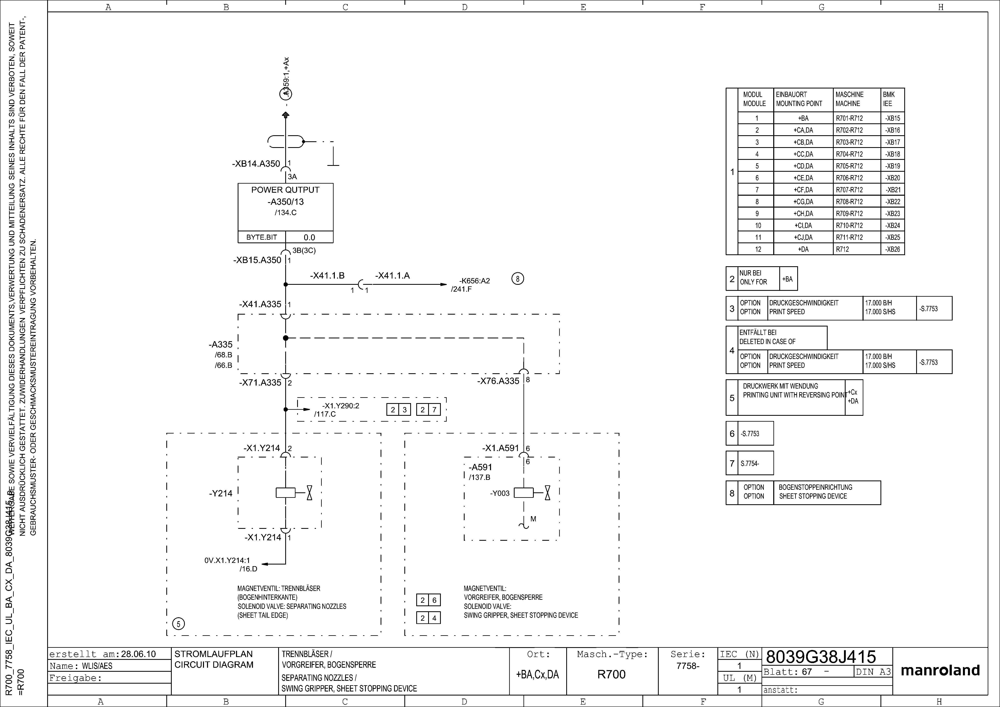

# +BA_Cx_DA — Sheet 67 of 247 — TRENNBLÄSER /

**VORGREIFER, BOGENSPERRE**

> Part of the manroland **R700** printing press IEC/UL circuit diagrams.
> Drawing class: **Stromlaufplan / Circuit diagram** (DIN A3).
> Document `+BA_Cx_DA` covers the **Printing units / main switch cabinet** machine section.

## At a glance

| Field | Value |
|---|---|
| Document | `+BA_Cx_DA`  (8039G38J415) |
| Sheet | **67** of 247 |
| Section (DE) | TRENNBLÄSER / |
| Section (EN) | VORGREIFER, BOGENSPERRE |
| Section type | CIRCUIT — Circuit diagram |
| Machine type | `R700` |
| Series | `7758` |
| Created | 28.06.10 |
| Replaces | — |
| Columns used | B, C, D, E, F, G, H |
| Path numbers | — |
| Labels on sheet | 155 |
| Cross-refs out | 7 |
| Cross-refs in | 17 |

**Previous:** [+BA_Cx_DA sheet 66](SHEET_0066.md) · **Next:** [+BA_Cx_DA sheet 68](SHEET_0068.md) · **Document TOC:** [_TOC.md](_TOC.md)  (+BA_Cx_DA) · **Master TOC:** [all sheets](../_MASTER_TOC.md)

## Sheet image (300 DPI, exact vector render)



_Rendered directly from the PDF vector layer at 300 DPI (1-bit), no OCR and no resampling. Use it to confirm anything ambiguous in the text below._

## Cross-references on this sheet

Each entry is a wire leaving this sheet. The printed token is `/sheet.column`; the link resolves to that sheet inside the same document.

| Ref | Target sheet | Col | Path | Destination on target | Target section | From col |
|---|---|---|---|---|---|---|
| `/134.C` | [+BA_Cx_DA sheet 134](SHEET_0134.md) | C | — | — | REFERENZMODUL | B |
| `/241.F` | [+BA_Cx_DA sheet 241](SHEET_0241.md) | F | — | — | OPTION: BOGENSTOPPEINRICHTUNG | D |
| `/68.B` | [+BA_Cx_DA sheet 68](SHEET_0068.md) | B | — | — | SEITENMARKEN: ZIEHEN | B |
| `/66.B` | [+BA_Cx_DA sheet 66](SHEET_0066.md) | B | — | — | TRENNBLÄSER | B |
| `/117.C` | [+BA_Cx_DA sheet 117](SHEET_0117.md) | C | — | — | DRUCKGESCHWINDIGKEIT 17.000 B/H | C |
| `/137.B` | [+BA_Cx_DA sheet 137](SHEET_0137.md) | B | — | A591 | REFERENZMODUL | D |
| `/16.D` | [+BA_Cx_DA sheet 16](SHEET_0016.md) | D | — | 0V.X1.Y214:1 | SPANNUNGSVERSORGUNG, SCHALTSCHRANKBELÜFTUNG | B |

### Incoming references (sheets that point here)

Every other sheet that sends a wire to this one. `Back-ref` is the token printed on *that* sheet; `Path` is its line number.

| From sheet | Cols | Back-ref | Path | Refs | What continues there |
|---|---|---|---|---|---|
| [+BA_Cx_DA#16](SHEET_0016.md) | D | `/16.D` | — | 1 | — |
| [+BA_Cx_DA#66](SHEET_0066.md) | B | `/66.B` | — | 1 | — |
| [+BA_Cx_DA#68](SHEET_0068.md) | A | `/68.A` | — | 1 | — |
| [+BA_Cx_DA#117](SHEET_0117.md) | C | `/117.C` | — | 1 | X1.Y290:2 |
| [+BA_Cx_DA#134](SHEET_0134.md) | C | `/134.C` | — | 1 | — |
| [+BA_Cx_DA#137](SHEET_0137.md) | B | `/137.B` | — | 1 | — |
| [+BA_Cx_DA#142](SHEET_0142.md) | B | `/142.B` | — | 1 | — |
| [+BA_Cx_DA#150](SHEET_0150.md) | B | `/150.B` | — | 2 | — |
| [+BA_Cx_DA#171](SHEET_0171.md) | B, G | `/171.B`, `/171.G` | — | 2 | — |
| [+BA_Cx_DA#181](SHEET_0181.md) | B, C, F | `/181.B`, `/181.C`, `/181.F` | — | 3 | — |
| [+BA_Cx_DA#184](SHEET_0184.md) | E | `/184.E` | — | 1 | — |
| [+BA_Cx_DA#185](SHEET_0185.md) | C | `/185.C` | — | 1 | — |
| [+BA_Cx_DA#241](SHEET_0241.md) | E | `/241.E` | — | 1 | K656:A2 |


## Devices on this sheet

| Tag | Class | Class meaning (IEC) | Col | Sub | Terminal | Sign |
|---|---|---|---|---|---|---|
| `Y214` | Y | Magnetventil / solenoid valve, actuator | B | — | — | — |
| `A335` | A | Baugruppe / assembly, module, PC board | B | — | — | — |
| `A350/13` | A | Baugruppe / assembly, module, PC board | B | 13 | — | — |
| `Y003` | Y | Magnetventil / solenoid valve, actuator | D | — | — | — |
| `A591` | A | Baugruppe / assembly, module, PC board | D | — | — | — |
| `K656:A2` | K | Relais / relay, contactor | D | — | A2 | — |
| `XB15` | XB |  | H | — | — | — |
| `XB16` | XB |  | H | — | — | — |
| `XB17` | XB |  | H | — | — | — |
| `XB18` | XB |  | H | — | — | — |
| `XB19` | XB |  | H | — | — | — |
| `XB20` | XB |  | H | — | — | — |
| `XB21` | XB |  | H | — | — | — |
| `XB22` | XB |  | H | — | — | — |
| `XB23` | XB |  | H | — | — | — |
| `XB24` | XB |  | H | — | — | — |
| `XB25` | XB |  | H | — | — | — |
| `XB26` | XB |  | H | — | — | — |
| `R712` | R | Widerstand / resistor | G | — | — | — |
| `X1.Y214` | — | cross-device reference | B | — | — | — |
| `X1.Y214` | — | cross-device reference | B | — | — | — |
| `X41.A335` | — | cross-device reference | B | — | — | — |
| `X71.A335` | — | cross-device reference | B | — | — | — |
| `0.0` | — | cross-device reference | C | — | — | — |
| `XB14.A350` | — | cross-device reference | B | — | — | — |
| `XB15.A350` | — | cross-device reference | B | — | — | — |
| `X1.A591` | — | cross-device reference | D | — | — | — |
| `X76.A335` | — | cross-device reference | D | — | — | — |
| `X41.1.B` | — | cross-device reference | C | — | — | — |
| `X41.1.A` | — | cross-device reference | C | — | — | — |
| `X1.Y290:2` | — | cross-device reference | C | — | 2 | — |
| `S.7753` | — | cross-device reference | F | — | — | — |
| `S.7754` | — | cross-device reference | F | — | — | — |
| `S.7753` | — | cross-device reference | H | — | — | — |
| `S.7753` | — | cross-device reference | H | — | — | — |

## Potentials / nets

| Potential | Count | Columns | Attached devices | Terminals |
|---|---|---|---|---|
| `0V` | 1 | B | `X1`, `Y214` | `1` |


A potential such as `L24+/4` or `M24+` is a named supply/return rail; every place it appears on this sheet is electrically common.

## Wire-end annotations (grouped as printed)

A wire that continues elsewhere is annotated with a small cluster: the destination description, the path/line number `#NN`, and the `/sheet.column` cross reference. Each row below is one such cluster exactly as it is grouped on the drawing.

| Col | Y | Path | Cross-ref | Text on the wire |
|---|---|---|---|---|
| C | 68.0 | — | — | `.A359:1,+Ax` |
| C | 109.1 | — | — | `1` |
| H | 109.7 | — | — | `BMK IEE` |
| F | 109.8 | — | — | `MODUL MODULE` |
| G | 109.8 | — | — | `EINBAUORT MOUNTING POINT` |
| G | 109.8 | — | — | `MASCHINE MACHINE` |
| F | 137.6 | — | — | `1` |
| G | 138.1 | — | — | `+BA` |
| G | 138.1 | — | — | `R701 R712` |
| H | 138.1 | — | — | `XB15` |
| F | 152.1 | — | — | `2` |
| G | 152.3 | — | — | `+CA,DA` |
| G | 152.3 | — | — | `R702 R712` |
| H | 152.3 | — | — | `XB16` |
| F | 166.4 | — | — | `3` |
| G | 166.4 | — | — | `+CB,DA` |
| H | 166.4 | — | — | `XB17` |
| G | 166.5 | — | — | `R703 R712` |
| F | 180.5 | — | — | `4` |
| G | 180.6 | — | — | `+CC,DA` |
| H | 180.6 | — | — | `XB18` |
| G | 180.7 | — | — | `R704 R712` |
| B | 190.2 | — | — | `XB14.A350 1` |
| F | 194.7 | — | — | `5` |
| G | 194.8 | — | — | `+CD,DA` |
| G | 194.8 | — | — | `R705 R712` |
| H | 194.8 | — | — | `XB19` |
| F | 200.1 | — | — | `1` |
| C | 206.5 | — | — | `3A` |
| F | 208.9 | — | — | `6` |
| G | 209.0 | — | — | `+CE,DA` |
| G | 209.0 | — | — | `R706 R712` |
| H | 209.0 | — | — | `XB20` |
| B | 221.7 | — | — | `POWER QUTPUT` |
| F | 223.1 | — | — | `7` |
| H | 223.1 | — | — | `XB21` |
| G | 223.2 | — | — | `+CF,DA` |
| G | 223.2 | — | — | `R707 R712` |
| B | 235.6 | — | — | `A350/13` |
| F | 237.2 | — | — | `8` |
| G | 237.3 | — | — | `+CG,DA` |
| G | 237.3 | — | — | `R708 R712` |
| H | 237.3 | — | — | `XB22` |
| B | 249.4 | — | `/134.C` | — |
| F | 251.4 | — | — | `9` |
| G | 251.5 | — | — | `+CH,DA` |
| G | 251.5 | — | — | `R709 R712` |
| H | 251.5 | — | — | `XB23` |
| F | 265.6 | — | — | `10` |
| G | 265.7 | — | — | `+CI,DA` |
| G | 265.7 | — | — | `R710 R712` |
| H | 265.7 | — | — | `XB24` |
| B | 278.4 | — | — | `BYTE.BIT 0.0` |
| F | 279.6 | — | — | `11` |
| G | 279.8 | — | — | `+CJ,DA` |
| H | 279.8 | — | — | `XB25` |
| G | 279.9 | — | — | `R711 R712` |
| F | 293.9 | — | — | `12` |
| G | 294.0 | — | — | `+DA` |
| G | 294.0 | — | — | `R712` |
| H | 294.0 | — | — | `XB26` |
| C | 294.4 | — | — | `3B(3C)` |
| B | 305.0 | — | — | `XB15.A350 1` |
| F | 322.3 | — | — | `2 NUR BEI` |
| C | 323.5 | — | — | `X41.1.B` |
| C | 323.5 | — | — | `X41.1.A` |
| D | 329.1 | — | — | `8` |
| G | 329.4 | — | — | `ONLY FOR +BA` |
| D | 330.5 | — | — | `K656:A2` |
| D | 340.4 | — | `/241.F` | — |
| C | 341.9 | — | — | `1` |
| C | 341.9 | — | — | `1` |
| B | 357.5 | — | — | `X41.A335 1` |
| F | 357.8 | — | — | `3 OPTION OPTION` |
| G | 357.8 | — | — | `DRUCKGESCHWINDIGKEIT PRINT SPEED` |
| G | 357.8 | — | — | `17.000 B/H 17.000 S/HS` |
| H | 364.9 | — | — | `S.7753` |
| G | 393.2 | — | — | `ENTFÄLLT BEI DELETED IN CASE OF` |
| B | 405.7 | — | — | `A335` |
| F | 412.7 | — | — | `4` |
| B | 418.7 | — | `/68.B`, `/66.B` | — |
| F | 421.5 | — | — | `OPTION OPTION` |
| G | 421.5 | — | — | `17.000 B/H 17.000 S/HS` |
| G | 421.6 | — | — | `DRUCKGESCHWINDIGKEIT PRINT SPEED` |
| H | 428.7 | — | — | `S.7753` |
| D | 448.2 | — | — | `X76.A335 8` |
| B | 451.0 | — | — | `X71.A335 2` |
| G | 457.0 | — | — | `5 DRUCKWERK MIT WENDUNG PRINTING UNIT WITH REVERSING POINT` |
| G | 464.2 | — | — | `+Cx +DA` |
| C | 479.3 | — | — | `X1.Y290:2` |
| C | 484.3 | — | — | `2 3` |
| D | 484.3 | — | — | `2 7` |
| C | 489.3 | — | `/117.C` | — |
| F | 511.9 | — | — | `6 S.7753` |
| B | 529.0 | — | — | `X1.Y214 2` |
| D | 529.0 | — | — | `X1.A591 6` |
| E | 546.0 | — | — | `6` |
| F | 547.4 | — | — | `7 S.7754` |
| D | 551.6 | — | `/137.B` | `A591` |
| G | 577.5 | — | — | `8 OPTION OPTION BOGENSTOPPEINRICHTUNG` |
| B | 582.9 | — | — | `Y214` |
| D | 583.5 | — | — | `Y003` |
| G | 588.1 | — | — | `SHEET STOPPING DEVICE` |
| E | 614.1 | — | — | `M` |
| B | 635.3 | — | — | `X1.Y214 1` |
| B | 663.6 | — | `/16.D` | `0V.X1.Y214:1` |
| D | 697.9 | — | — | `MAGNETVENTIL:` |
| C | 698.0 | — | — | `MAGNETVENTIL: TRENNBLÄSER (BOGENHINTERKANTE) (SHEET TAIL EDGE) SOLENOID VALVE: SEPARATING NOZZLES` |
| D | 708.6 | — | — | `SOLENOID VALVE: SWING GRIPPER, SHEET STOPPING DEVICE VORGREIFER, BOGENSPERRE` |
| D | 711.1 | — | — | `2 6` |
| C | 732.4 | — | — | `5 2 4` |


## Reconstructed tables

This sheet carries tabular content (pin map / terminal assignment / index). The grid below was rebuilt from the drawing's own rule lines, so each row is exactly one physical row of the table.

### Table 1 — 3 data rows × 2 columns (at x=283.5, y=218.3)

| POWER | QUTPUT A350/13 /134.C |
|---|---|
| `BYTE.BIT` | `0.0` |
| `XB15.A350` | `3B(3C) 1 X41.1.B` |
| `X41.A335` | `1` |


## Notes and free text on this sheet

| Text | Col | Y (pt) |
|---|---|---|
| `MAGNETVENTIL: TRENNBLÄSER` | B | 697.95 |
| `(BOGENHINTERKANTE)` | B | 708.59 |
| `SOLENOID VALVE: SEPARATING NOZZLES` | C | 719.21 |
| `(SHEET TAIL EDGE)` | B | 729.83 |
| `3A` | C | 206.49 |
| `3B(3C)` | C | 294.41 |
| `POWER QUTPUT` | B | 221.66 |
| `BYTE.BIT` | B | 278.99 |
| `.A359:1,+Ax` | C | 68.03 |
| `MAGNETVENTIL:` | D | 697.94 |
| `VORGREIFER, BOGENSPERRE` | D | 708.58 |
| `SOLENOID VALVE:` | D | 719.2 |
| `SWING GRIPPER, SHEET STOPPING DEVICE` | D | 729.82 |
| `M` | E | 614.09 |
| `MODUL` | F | 109.79 |
| `MODULE` | F | 120.41 |
| `EINBAUORT` | G | 109.75 |
| `MOUNTING POINT` | G | 120.41 |
| `+BA` | G | 138.08 |
| `+CA,DA` | G | 152.28 |
| `+CB,DA` | G | 166.45 |
| `+CC,DA` | G | 180.64 |
| `+CD,DA` | G | 194.82 |
| `+CE,DA` | G | 208.97 |
| `+CF,DA` | G | 223.15 |
| `+CG,DA` | G | 237.33 |
| `+CH,DA` | G | 251.51 |
| `+CI,DA` | G | 265.66 |
| `+CJ,DA` | G | 279.83 |
| `+DA` | G | 294.01 |
| `MASCHINE` | G | 109.76 |
| `MACHINE` | G | 120.39 |
| `BMK` | H | 109.73 |
| `IEE` | H | 120.23 |
| `R701 R712` | G | 138.13 |
| `R702 R712` | G | 152.3 |
| `R703 R712` | G | 166.48 |
| `R704 R712` | G | 180.65 |
| `R705 R712` | G | 194.82 |
| `R706 R712` | G | 209 |
| `R707 R712` | G | 223.17 |
| `R708 R712` | G | 237.34 |
| `R709 R712` | G | 251.52 |
| `R710 R712` | G | 265.69 |
| `R711 R712` | G | 279.86 |
| `NUR BEI` | F | 322.31 |
| `ONLY FOR` | F | 333 |
| `OPTION` | F | 357.76 |
| `DRUCKGESCHWINDIGKEIT` | G | 357.78 |
| `PRINT SPEED` | G | 368.4 |
| `17.000 B/H` | G | 357.76 |
| `17.000 S/HS` | G | 368.4 |
| `ENTFÄLLT BEI` | F | 393.19 |
| `DELETED IN CASE OF` | G | 403.84 |
| `DRUCKWERK MIT WENDUNG` | G | 456.98 |
| `PRINTING UNIT WITH REVERSING POINT` | G | 467.62 |
| `BOGENSTOPPEINRICHTUNG` | G | 577.48 |
| `SHEET STOPPING DEVICE` | G | 588.09 |
| `+Cx` | G | 464.19 |

## Complete label inventory (exact text from the drawing)

Every text object inside the drawing area of this sheet, in DIN reading order (column A→H, then top→bottom). This is the authoritative list: if a string is not here it is not printed on this sheet.

| Col | Y | X | Dir | Type | Text |
|---|---|---|---|---|---|
| B | 190.2 | 276.4 | → | device ref | `XB14.A350` |
| B | 221.7 | 299.3 | → | text | `POWER QUTPUT` |
| B | 235.6 | 318.8 | → | device tag | `A350/13` |
| B | 249.4 | 327.4 | → | cross-reference | `/134.C` |
| B | 279.0 | 293.4 | → | text | `BYTE.BIT` |
| B | 305.0 | 277.8 | → | device ref | `XB15.A350` |
| B | 357.5 | 284.9 | → | device ref | `X41.A335` |
| B | 405.7 | 248.6 | → | device tag | `A335` |
| B | 418.7 | 256.0 | → | cross-reference | `/68.B` |
| B | 431.1 | 256.0 | → | cross-reference | `/66.B` |
| B | 451.0 | 284.9 | → | device ref | `X71.A335` |
| B | 529.0 | 290.0 | → | device ref | `X1.Y214` |
| B | 582.9 | 249.2 | → | device tag | `Y214` |
| B | 635.3 | 291.4 | → | device ref | `X1.Y214` |
| B | 663.6 | 243.5 | → | potential | `0V.X1.Y214:1` |
| B | 673.5 | 285.4 | → | cross-reference | `/16.D` |
| B | 698.0 | 282.9 | → | text | `MAGNETVENTIL: TRENNBLÄSER` |
| B | 708.6 | 282.9 | → | text | `(BOGENHINTERKANTE)` |
| B | 729.8 | 282.9 | → | text | `(SHEET TAIL EDGE)` |
| B | 740.1 | 210.6 | → | number | `5` |
| C | 68.0 | 336.9 | ↕ | text | `.A359:1,+Ax` |
| C | 109.1 | 337.1 | ↕ | number | `1` |
| C | 190.2 | 342.1 | → | number | `1` |
| C | 206.5 | 342.7 | → | text | `3A` |
| C | 278.4 | 361.7 | → | device ref | `0.0` |
| C | 294.4 | 348.4 | → | text | `3B(3C)` |
| C | 306.5 | 342.1 | → | number | `1` |
| C | 323.5 | 369.4 | → | device ref | `X41.1.B` |
| C | 323.5 | 446.9 | → | device ref | `X41.1.A` |
| C | 341.9 | 417.3 | → | number | `1` |
| C | 341.9 | 434.3 | → | number | `1` |
| C | 358.9 | 342.1 | → | number | `1` |
| C | 452.5 | 342.7 | → | number | `2` |
| C | 479.3 | 383.8 | → | device ref | `X1.Y290:2` |
| C | 484.3 | 465.4 | → | number | `2` |
| C | 484.3 | 479.5 | → | number | `3` |
| C | 489.3 | 374.2 | → | cross-reference | `/117.C` |
| C | 530.4 | 342.7 | → | number | `2` |
| C | 636.7 | 342.1 | → | number | `1` |
| C | 719.2 | 283.2 | → | text | `SOLENOID VALVE: SEPARATING NOZZLES` |
| D | 329.1 | 614.5 | → | number | `8` |
| D | 330.5 | 546.8 | → | device tag | `K656:A2` |
| D | 340.4 | 537.2 | → | cross-reference | `/241.F` |
| D | 448.9 | 568.3 | → | device ref | `X76.A335` |
| D | 484.3 | 500.9 | → | number | `2` |
| D | 484.3 | 514.9 | → | number | `7` |
| D | 529.0 | 574.3 | → | device ref | `X1.A591` |
| D | 551.6 | 558.1 | → | device tag | `A591` |
| D | 564.7 | 558.4 | → | cross-reference | `/137.B` |
| D | 583.5 | 583.7 | → | device tag | `Y003` |
| D | 697.9 | 552.2 | → | text | `MAGNETVENTIL:` |
| D | 708.6 | 552.8 | → | text | `VORGREIFER, BOGENSPERRE` |
| D | 711.1 | 500.9 | → | number | `2` |
| D | 711.1 | 514.9 | → | number | `6` |
| D | 719.2 | 552.5 | → | text | `SOLENOID VALVE:` |
| D | 729.8 | 552.5 | → | text | `SWING GRIPPER, SHEET STOPPING DEVICE` |
| D | 732.4 | 500.9 | → | number | `2` |
| D | 732.4 | 514.9 | → | number | `4` |
| E | 448.2 | 626.2 | → | number | `8` |
| E | 530.4 | 626.2 | → | number | `6` |
| E | 546.0 | 626.2 | → | number | `6` |
| E | 614.1 | 631.6 | → | text | `M` |
| F | 109.8 | 885.3 | → | text | `MODUL` |
| F | 120.4 | 885.3 | → | text | `MODULE` |
| F | 137.6 | 899.1 | → | number | `1` |
| F | 152.1 | 899.7 | → | number | `2` |
| F | 166.4 | 899.7 | → | number | `3` |
| F | 180.5 | 899.7 | → | number | `4` |
| F | 194.7 | 899.7 | → | number | `5` |
| F | 200.1 | 869.1 | → | number | `1` |
| F | 208.9 | 899.7 | → | number | `6` |
| F | 223.1 | 899.7 | → | number | `7` |
| F | 237.2 | 899.7 | → | number | `8` |
| F | 251.4 | 899.7 | → | number | `9` |
| F | 265.6 | 899.1 | → | number | `10` |
| F | 279.6 | 899.1 | → | number | `11` |
| F | 293.9 | 899.1 | → | number | `12` |
| F | 322.3 | 880.7 | → | text | `NUR BEI` |
| F | 327.7 | 868.8 | → | number | `2` |
| F | 333.0 | 881.3 | → | text | `ONLY FOR` |
| F | 357.8 | 881.3 | → | text | `OPTION` |
| F | 363.1 | 868.7 | → | number | `3` |
| F | 368.4 | 881.3 | → | text | `OPTION` |
| F | 393.2 | 880.7 | → | text | `ENTFÄLLT BEI` |
| F | 412.7 | 868.8 | → | number | `4` |
| F | 421.5 | 881.3 | → | text | `OPTION` |
| F | 432.2 | 881.3 | → | text | `OPTION` |
| F | 469.4 | 868.7 | → | number | `5` |
| F | 511.9 | 868.8 | → | number | `6` |
| F | 513.7 | 882.0 | → | device ref | `S.7753` |
| F | 547.4 | 868.8 | → | number | `7` |
| F | 549.1 | 882.0 | → | device ref | `S.7754` |
| F | 577.4 | 885.5 | → | text | `OPTION` |
| F | 582.8 | 868.7 | → | number | `8` |
| F | 588.1 | 885.5 | → | text | `OPTION` |
| G | 109.7 | 924.0 | → | text | `EINBAUORT` |
| G | 109.8 | 995.1 | → | text | `MASCHINE` |
| G | 120.4 | 924.2 | → | text | `MOUNTING POINT` |
| G | 120.4 | 995.1 | → | text | `MACHINE` |
| G | 138.1 | 950.5 | → | text | `+BA` |
| G | 138.1 | 995.5 | → | text | `R701 R712` |
| G | 152.3 | 945.1 | → | text | `+CA,DA` |
| G | 152.3 | 995.5 | → | text | `R702 R712` |
| G | 166.5 | 945.1 | → | text | `+CB,DA` |
| G | 166.5 | 995.5 | → | text | `R703 R712` |
| G | 180.6 | 945.0 | → | text | `+CC,DA` |
| G | 180.6 | 995.5 | → | text | `R704 R712` |
| G | 194.8 | 945.0 | → | text | `+CD,DA` |
| G | 194.8 | 995.5 | → | text | `R705 R712` |
| G | 209.0 | 945.1 | → | text | `+CE,DA` |
| G | 209.0 | 995.5 | → | text | `R706 R712` |
| G | 223.2 | 945.3 | → | text | `+CF,DA` |
| G | 223.2 | 995.5 | → | text | `R707 R712` |
| G | 237.3 | 944.8 | → | text | `+CG,DA` |
| G | 237.3 | 995.5 | → | text | `R708 R712` |
| G | 251.5 | 945.0 | → | text | `+CH,DA` |
| G | 251.5 | 995.5 | → | text | `R709 R712` |
| G | 265.7 | 946.3 | → | text | `+CI,DA` |
| G | 265.7 | 995.5 | → | text | `R710 R712` |
| G | 279.8 | 945.6 | → | text | `+CJ,DA` |
| G | 279.9 | 995.5 | → | text | `R711 R712` |
| G | 294.0 | 950.4 | → | text | `+DA` |
| G | 294.0 | 995.5 | → | device tag | `R712` |
| G | 329.4 | 931.6 | → | text | `+BA` |
| G | 357.8 | 916.2 | → | text | `DRUCKGESCHWINDIGKEIT` |
| G | 357.8 | 1030.3 | → | text | `17.000 B/H` |
| G | 368.4 | 916.2 | → | text | `PRINT SPEED` |
| G | 368.4 | 1030.3 | → | text | `17.000 S/HS` |
| G | 403.8 | 880.7 | → | text | `DELETED IN CASE OF` |
| G | 421.5 | 1030.3 | → | text | `17.000 B/H` |
| G | 421.6 | 916.2 | → | text | `DRUCKGESCHWINDIGKEIT` |
| G | 432.2 | 916.2 | → | text | `PRINT SPEED` |
| G | 432.2 | 1030.3 | → | text | `17.000 S/HS` |
| G | 457.0 | 885.0 | → | text | `DRUCKWERK MIT WENDUNG` |
| G | 464.2 | 1009.6 | → | text | `+Cx` |
| G | 467.6 | 885.0 | → | text | `PRINTING UNIT WITH REVERSING POINT` |
| G | 474.7 | 1009.6 | → | text | `+DA` |
| G | 577.5 | 927.5 | → | text | `BOGENSTOPPEINRICHTUNG` |
| G | 588.1 | 928.1 | → | text | `SHEET STOPPING DEVICE` |
| H | 109.7 | 1051.5 | → | text | `BMK` |
| H | 120.2 | 1051.5 | → | text | `IEE` |
| H | 138.1 | 1054.3 | → | device tag | `XB15` |
| H | 152.3 | 1054.3 | → | device tag | `XB16` |
| H | 166.4 | 1054.3 | → | device tag | `XB17` |
| H | 180.6 | 1054.3 | → | device tag | `XB18` |
| H | 194.8 | 1054.3 | → | device tag | `XB19` |
| H | 209.0 | 1054.3 | → | device tag | `XB20` |
| H | 223.1 | 1054.8 | → | device tag | `XB21` |
| H | 237.3 | 1054.4 | → | device tag | `XB22` |
| H | 251.5 | 1054.3 | → | device tag | `XB23` |
| H | 265.7 | 1054.3 | → | device tag | `XB24` |
| H | 279.8 | 1054.3 | → | device tag | `XB25` |
| H | 294.0 | 1054.3 | → | device tag | `XB26` |
| H | 364.9 | 1094.6 | → | device ref | `S.7753` |
| H | 428.7 | 1094.6 | → | device ref | `S.7753` |

## Reading-order text block

The same content as a plain block, grouped by DIN column — convenient to paste or to match against a visual description.

```text
=== Column B ===
 190.2  276.4  devref       XB14.A350
 221.7  299.3  text         POWER QUTPUT
 235.6  318.8  devtag       A350/13
 249.4  327.4  xref         /134.C
 279.0  293.4  text         BYTE.BIT
 305.0  277.8  devref       XB15.A350
 357.5  284.9  devref       X41.A335
 405.7  248.6  devtag       A335
 418.7  256.0  xref         /68.B
 431.1  256.0  xref         /66.B
 451.0  284.9  devref       X71.A335
 529.0  290.0  devref       X1.Y214
 582.9  249.2  devtag       Y214
 635.3  291.4  devref       X1.Y214
 663.6  243.5  net          0V.X1.Y214:1
 673.5  285.4  xref         /16.D
 698.0  282.9  text         MAGNETVENTIL: TRENNBLÄSER
 708.6  282.9  text         (BOGENHINTERKANTE)
 729.8  282.9  text         (SHEET TAIL EDGE)
 740.1  210.6  numeric      5
=== Column C ===
  68.0  336.9  text         .A359:1,+Ax
 109.1  337.1  numeric      1
 190.2  342.1  numeric      1
 206.5  342.7  text         3A
 278.4  361.7  devref       0.0
 294.4  348.4  text         3B(3C)
 306.5  342.1  numeric      1
 323.5  369.4  devref       X41.1.B
 323.5  446.9  devref       X41.1.A
 341.9  417.3  numeric      1
 341.9  434.3  numeric      1
 358.9  342.1  numeric      1
 452.5  342.7  numeric      2
 479.3  383.8  devref       X1.Y290:2
 484.3  465.4  numeric      2
 484.3  479.5  numeric      3
 489.3  374.2  xref         /117.C
 530.4  342.7  numeric      2
 636.7  342.1  numeric      1
 719.2  283.2  text         SOLENOID VALVE: SEPARATING NOZZLES
=== Column D ===
 329.1  614.5  numeric      8
 330.5  546.8  devtag       K656:A2
 340.4  537.2  xref         /241.F
 448.9  568.3  devref       X76.A335
 484.3  500.9  numeric      2
 484.3  514.9  numeric      7
 529.0  574.3  devref       X1.A591
 551.6  558.1  devtag       A591
 564.7  558.4  xref         /137.B
 583.5  583.7  devtag       Y003
 697.9  552.2  text         MAGNETVENTIL:
 708.6  552.8  text         VORGREIFER, BOGENSPERRE
 711.1  500.9  numeric      2
 711.1  514.9  numeric      6
 719.2  552.5  text         SOLENOID VALVE:
 729.8  552.5  text         SWING GRIPPER, SHEET STOPPING DEVICE
 732.4  500.9  numeric      2
 732.4  514.9  numeric      4
=== Column E ===
 448.2  626.2  numeric      8
 530.4  626.2  numeric      6
 546.0  626.2  numeric      6
 614.1  631.6  text         M
=== Column F ===
 109.8  885.3  text         MODUL
 120.4  885.3  text         MODULE
 137.6  899.1  numeric      1
 152.1  899.7  numeric      2
 166.4  899.7  numeric      3
 180.5  899.7  numeric      4
 194.7  899.7  numeric      5
 200.1  869.1  numeric      1
 208.9  899.7  numeric      6
 223.1  899.7  numeric      7
 237.2  899.7  numeric      8
 251.4  899.7  numeric      9
 265.6  899.1  numeric      10
 279.6  899.1  numeric      11
 293.9  899.1  numeric      12
 322.3  880.7  text         NUR BEI
 327.7  868.8  numeric      2
 333.0  881.3  text         ONLY FOR
 357.8  881.3  text         OPTION
 363.1  868.7  numeric      3
 368.4  881.3  text         OPTION
 393.2  880.7  text         ENTFÄLLT BEI
 412.7  868.8  numeric      4
 421.5  881.3  text         OPTION
 432.2  881.3  text         OPTION
 469.4  868.7  numeric      5
 511.9  868.8  numeric      6
 513.7  882.0  devref       S.7753
 547.4  868.8  numeric      7
 549.1  882.0  devref       S.7754
 577.4  885.5  text         OPTION
 582.8  868.7  numeric      8
 588.1  885.5  text         OPTION
=== Column G ===
 109.7  924.0  text         EINBAUORT
 109.8  995.1  text         MASCHINE
 120.4  924.2  text         MOUNTING POINT
 120.4  995.1  text         MACHINE
 138.1  950.5  text         +BA
 138.1  995.5  text         R701 R712
 152.3  945.1  text         +CA,DA
 152.3  995.5  text         R702 R712
 166.5  945.1  text         +CB,DA
 166.5  995.5  text         R703 R712
 180.6  945.0  text         +CC,DA
 180.6  995.5  text         R704 R712
 194.8  945.0  text         +CD,DA
 194.8  995.5  text         R705 R712
 209.0  945.1  text         +CE,DA
 209.0  995.5  text         R706 R712
 223.2  945.3  text         +CF,DA
 223.2  995.5  text         R707 R712
 237.3  944.8  text         +CG,DA
 237.3  995.5  text         R708 R712
 251.5  945.0  text         +CH,DA
 251.5  995.5  text         R709 R712
 265.7  946.3  text         +CI,DA
 265.7  995.5  text         R710 R712
 279.8  945.6  text         +CJ,DA
 279.9  995.5  text         R711 R712
 294.0  950.4  text         +DA
 294.0  995.5  devtag       R712
 329.4  931.6  text         +BA
 357.8  916.2  text         DRUCKGESCHWINDIGKEIT
 357.8 1030.3  text         17.000 B/H
 368.4  916.2  text         PRINT SPEED
 368.4 1030.3  text         17.000 S/HS
 403.8  880.7  text         DELETED IN CASE OF
 421.5 1030.3  text         17.000 B/H
 421.6  916.2  text         DRUCKGESCHWINDIGKEIT
 432.2  916.2  text         PRINT SPEED
 432.2 1030.3  text         17.000 S/HS
 457.0  885.0  text         DRUCKWERK MIT WENDUNG
 464.2 1009.6  text         +Cx
 467.6  885.0  text         PRINTING UNIT WITH REVERSING POINT
 474.7 1009.6  text         +DA
 577.5  927.5  text         BOGENSTOPPEINRICHTUNG
 588.1  928.1  text         SHEET STOPPING DEVICE
=== Column H ===
 109.7 1051.5  text         BMK
 120.2 1051.5  text         IEE
 138.1 1054.3  devtag       XB15
 152.3 1054.3  devtag       XB16
 166.4 1054.3  devtag       XB17
 180.6 1054.3  devtag       XB18
 194.8 1054.3  devtag       XB19
 209.0 1054.3  devtag       XB20
 223.1 1054.8  devtag       XB21
 237.3 1054.4  devtag       XB22
 251.5 1054.3  devtag       XB23
 265.7 1054.3  devtag       XB24
 279.8 1054.3  devtag       XB25
 294.0 1054.3  devtag       XB26
 364.9 1094.6  devref       S.7753
 428.7 1094.6  devref       S.7753
```

---
_Generated from the PDF vector text layer; no OCR. Source: `R700_7758_IEC_UL_BA_CX_DA_8039G38J415_p`, sheet 67._
