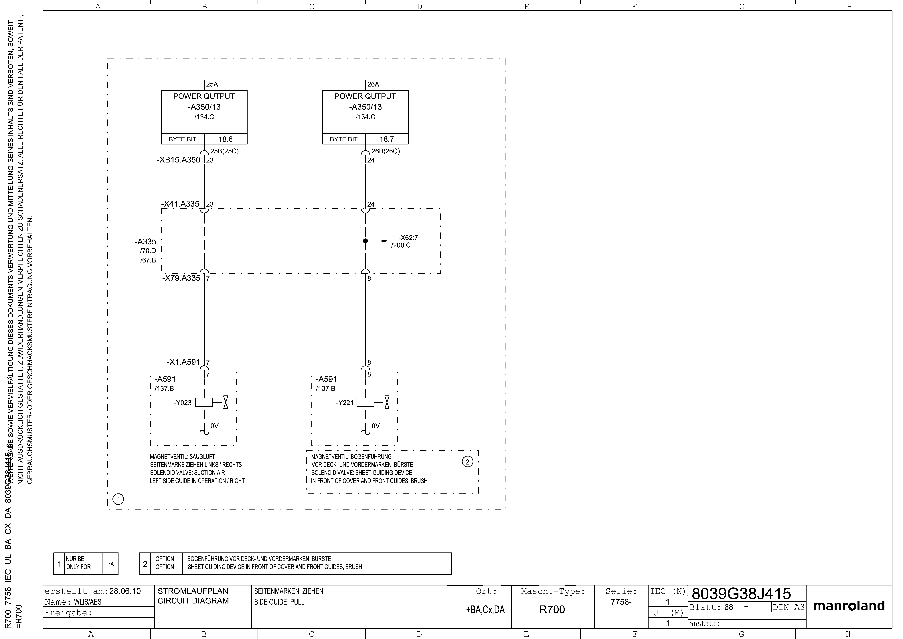

# +BA_Cx_DA — Sheet 68 of 247 — SEITENMARKEN: ZIEHEN

**SIDE GUIDE: PULL**

> Part of the manroland **R700** printing press IEC/UL circuit diagrams.
> Drawing class: **Stromlaufplan / Circuit diagram** (DIN A3).
> Document `+BA_Cx_DA` covers the **Printing units / main switch cabinet** machine section.

## At a glance

| Field | Value |
|---|---|
| Document | `+BA_Cx_DA`  (8039G38J415) |
| Sheet | **68** of 247 |
| Section (DE) | SEITENMARKEN: ZIEHEN |
| Section (EN) | SIDE GUIDE: PULL |
| Section type | CIRCUIT — Circuit diagram |
| Machine type | `R700` |
| Series | `7758` |
| Created | 28.06.10 |
| Replaces | — |
| Columns used | A, B, C, D |
| Path numbers | — |
| Labels on sheet | 60 |
| Cross-refs out | 7 |
| Cross-refs in | 15 |

**Previous:** [+BA_Cx_DA sheet 67](SHEET_0067.md) · **Next:** [+BA_Cx_DA sheet 69](SHEET_0069.md) · **Document TOC:** [_TOC.md](_TOC.md)  (+BA_Cx_DA) · **Master TOC:** [all sheets](../_MASTER_TOC.md)

## Sheet image (300 DPI, exact vector render)



_Rendered directly from the PDF vector layer at 300 DPI (1-bit), no OCR and no resampling. Use it to confirm anything ambiguous in the text below._

## Cross-references on this sheet

Each entry is a wire leaving this sheet. The printed token is `/sheet.column`; the link resolves to that sheet inside the same document.

| Ref | Target sheet | Col | Path | Destination on target | Target section | From col |
|---|---|---|---|---|---|---|
| `/134.C` | [+BA_Cx_DA sheet 134](SHEET_0134.md) | C | — | — | REFERENZMODUL | B |
| `/134.C` | [+BA_Cx_DA sheet 134](SHEET_0134.md) | C | — | — | REFERENZMODUL | C |
| `/200.C` | [+BA_Cx_DA sheet 200](SHEET_0200.md) | C | — | — | OPTION: APL | D |
| `/70.D` | [+BA_Cx_DA sheet 70](SHEET_0070.md) | D | — | — | ÖLUMLAUFSCHMIERUNG | A |
| `/67.B` | [+BA_Cx_DA sheet 67](SHEET_0067.md) | B | — | — | TRENNBLÄSER / | A |
| `/137.B` | [+BA_Cx_DA sheet 137](SHEET_0137.md) | B | — | A591 | REFERENZMODUL | B |
| `/137.B` | [+BA_Cx_DA sheet 137](SHEET_0137.md) | B | — | A591 | REFERENZMODUL | C |

### Incoming references (sheets that point here)

Every other sheet that sends a wire to this one. `Back-ref` is the token printed on *that* sheet; `Path` is its line number.

| From sheet | Cols | Back-ref | Path | Refs | What continues there |
|---|---|---|---|---|---|
| [+BA_Cx_DA#67](SHEET_0067.md) | B | `/67.B` | — | 1 | — |
| [+BA_Cx_DA#70](SHEET_0070.md) | D | `/70.D` | — | 1 | — |
| [+BA_Cx_DA#134](SHEET_0134.md) | C | `/134.C` | — | 2 | — |
| [+BA_Cx_DA#137](SHEET_0137.md) | B | `/137.B` | — | 2 | — |
| [+BA_Cx_DA#142](SHEET_0142.md) | B | `/142.B` | — | 2 | — |
| [+BA_Cx_DA#171](SHEET_0171.md) | G | `/171.G` | — | 2 | — |
| [+BA_Cx_DA#181](SHEET_0181.md) | F | `/181.F` | — | 2 | — |
| [+BA_Cx_DA#186](SHEET_0186.md) | C | `/186.C` | — | 2 | — |
| [+BA_Cx_DA#200](SHEET_0200.md) | B | `/200.B` | — | 1 | X62:7 |


## Devices on this sheet

| Tag | Class | Class meaning (IEC) | Col | Sub | Terminal | Sign |
|---|---|---|---|---|---|---|
| `Y023` | Y | Magnetventil / solenoid valve, actuator | B | — | — | — |
| `A591` | A | Baugruppe / assembly, module, PC board | B | — | — | — |
| `Y221` | Y | Magnetventil / solenoid valve, actuator | C | — | — | — |
| `A591` | A | Baugruppe / assembly, module, PC board | C | — | — | — |
| `A350/13` | A | Baugruppe / assembly, module, PC board | B | 13 | — | — |
| `A350/13` | A | Baugruppe / assembly, module, PC board | C | 13 | — | — |
| `A335` | A | Baugruppe / assembly, module, PC board | A | — | — | — |
| `X62:7` | X | Klemme / terminal, plug connector | D | — | 7 | — |
| `X1.A591` | — | cross-device reference | B | — | — | — |
| `X79.A335` | — | cross-device reference | B | — | — | — |
| `X41.A335` | — | cross-device reference | B | — | — | — |
| `18.6` | — | cross-device reference | B | — | — | — |
| `XB15.A350` | — | cross-device reference | B | — | — | — |
| `18.7` | — | cross-device reference | D | — | — | — |

## Potentials / nets

| Potential | Count | Columns | Attached devices | Terminals |
|---|---|---|---|---|
| `0V` | 2 | B, D | — | — |


A potential such as `L24+/4` or `M24+` is a named supply/return rail; every place it appears on this sheet is electrically common.

## Wire-end annotations (grouped as printed)

A wire that continues elsewhere is annotated with a small cluster: the destination description, the path/line number `#NN`, and the `/sheet.column` cross reference. Each row below is one such cluster exactly as it is grouped on the drawing.

| Col | Y | Path | Cross-ref | Text on the wire |
|---|---|---|---|---|
| B | 107.3 | — | — | `25A` |
| D | 107.3 | — | — | `26A` |
| B | 122.5 | — | — | `POWER QUTPUT` |
| C | 122.5 | — | — | `POWER QUTPUT` |
| B | 136.4 | — | — | `A350/13` |
| C | 136.4 | — | — | `A350/13` |
| B | 150.2 | — | `/134.C` | — |
| C | 150.2 | — | `/134.C` | — |
| B | 179.2 | — | — | `BYTE.BIT 18.6` |
| C | 179.2 | — | — | `BYTE.BIT 18.7` |
| B | 195.2 | — | — | `25B(25C)` |
| D | 195.2 | — | — | `26B(26C)` |
| B | 205.8 | — | — | `XB15.A350 23` |
| D | 207.2 | — | — | `24` |
| B | 263.9 | — | — | `X41.A335 23` |
| D | 265.4 | — | — | `24` |
| D | 309.3 | — | — | `X62:7` |
| A | 313.5 | — | — | `A335` |
| D | 319.2 | — | `/200.C` | — |
| A | 326.6 | — | `/70.D`, `/67.B` | — |
| B | 361.7 | — | — | `X79.A335 7` |
| D | 363.2 | — | — | `8` |
| C | 472.3 | — | — | `X1.A591 7 8` |
| B | 489.3 | — | — | `7` |
| D | 489.3 | — | — | `8` |
| B | 494.9 | — | `/137.B` | `A591` |
| C | 494.9 | — | `/137.B` | `A591` |
| B | 526.8 | — | — | `Y023` |
| C | 526.8 | — | — | `Y221` |
| B | 557.3 | — | — | `0V` |
| D | 557.3 | — | — | `0V` |
| B | 598.7 | — | — | `LEFT SIDE GUIDE IN OPERATION / RIGHT MAGNETVENTIL: SAUGLUFT SEITENMARKE ZIEHEN LINKS / RECHTS SOLENOID VALVE: SUCTION AIR` |
| C | 598.8 | — | — | `MAGNETVENTIL: BOGENFÜHRUNG` |
| D | 605.5 | — | — | `2` |
| D | 609.4 | — | — | `IN FRONT OF COVER AND FRONT GUIDES, BRUSH SOLENOID VALVE: SHEET GUIDING DEVICE VOR DECK UND VORDERMARKEN, BÜRSTE` |
| A | 654.6 | — | — | `1` |
| A | 733.3 | — | — | `1 NUR BEI` |
| B | 733.4 | — | — | `OPTION OPTION` |
| C | 733.4 | — | — | `BOGENFÜHRUNG VOR DECK UND VORDERMARKEN, BÜRSTE` |
| B | 738.7 | — | — | `2 SHEET GUIDING DEVICE IN FRONT OF COVER AND FRONT GUIDES, BRUSH` |
| A | 740.4 | — | — | `ONLY FOR +BA` |


## Reconstructed tables

This sheet carries tabular content (pin map / terminal assignment / index). The grid below was rebuilt from the drawing's own rule lines, so each row is exactly one physical row of the table.

### Table 1 — 1 data rows × 2 columns (at x=212.6, y=119.1)

| POWER | QUTPUT A350/13 /134.C |
|---|---|
| `BYTE.BIT` | `18.6` |


### Table 2 — 1 data rows × 2 columns (at x=425.2, y=119.1)

| POWER | QUTPUT A350/13 /134.C |
|---|---|
| `BYTE.BIT` | `18.7` |


## Notes and free text on this sheet

| Text | Col | Y (pt) |
|---|---|---|
| `MAGNETVENTIL: SAUGLUFT` | B | 598.74 |
| `SEITENMARKE ZIEHEN LINKS / RECHTS` | B | 609.36 |
| `SOLENOID VALVE: SUCTION AIR` | B | 620 |
| `LEFT SIDE GUIDE IN OPERATION / RIGHT` | B | 630.63 |
| `MAGNETVENTIL: BOGENFÜHRUNG` | C | 598.75 |
| `VOR DECK UND VORDERMARKEN, BÜRSTE` | C | 609.38 |
| `SOLENOID VALVE: SHEET GUIDING DEVICE` | C | 620 |
| `IN FRONT OF COVER AND FRONT GUIDES, BRUSH` | D | 630.64 |
| `25A` | B | 107.29 |
| `25B(25C)` | B | 195.2 |
| `POWER QUTPUT` | B | 122.45 |
| `BYTE.BIT` | B | 179.78 |
| `26A` | D | 107.29 |
| `26B(26C)` | D | 195.2 |
| `POWER QUTPUT` | C | 122.45 |
| `BYTE.BIT` | C | 179.78 |
| `NUR BEI` | A | 733.33 |
| `ONLY FOR` | A | 744.02 |
| `+BA` | A | 740.44 |
| `OPTION` | B | 733.35 |
| `BOGENFÜHRUNG VOR DECK UND VORDERMARKEN, BÜRSTE` | C | 733.4 |
| `SHEET GUIDING DEVICE IN FRONT OF COVER AND FRONT GUIDES, BRUSH` | C | 744.02 |

## Complete label inventory (exact text from the drawing)

Every text object inside the drawing area of this sheet, in DIN reading order (column A→H, then top→bottom). This is the authoritative list: if a string is not here it is not printed on this sheet.

| Col | Y | X | Dir | Type | Text |
|---|---|---|---|---|---|
| A | 313.5 | 177.7 | → | device tag | `A335` |
| A | 326.6 | 184.8 | → | cross-reference | `/70.D` |
| A | 339.0 | 185.1 | → | cross-reference | `/67.B` |
| A | 654.6 | 154.1 | → | number | `1` |
| A | 733.3 | 87.0 | → | text | `NUR BEI` |
| A | 738.7 | 75.4 | → | number | `1` |
| A | 738.7 | 188.5 | → | number | `2` |
| A | 740.4 | 137.9 | → | text | `+BA` |
| A | 744.0 | 87.6 | → | text | `ONLY FOR` |
| B | 107.3 | 271.8 | → | text | `25A` |
| B | 122.5 | 228.5 | → | text | `POWER QUTPUT` |
| B | 136.4 | 247.9 | → | device tag | `A350/13` |
| B | 150.2 | 256.5 | → | cross-reference | `/134.C` |
| B | 179.2 | 287.9 | → | device ref | `18.6` |
| B | 179.8 | 222.5 | → | text | `BYTE.BIT` |
| B | 195.2 | 277.5 | → | text | `25B(25C)` |
| B | 205.8 | 206.9 | → | device ref | `XB15.A350` |
| B | 207.3 | 271.8 | → | number | `23` |
| B | 263.9 | 212.6 | → | device ref | `X41.A335` |
| B | 265.4 | 271.8 | → | number | `23` |
| B | 361.7 | 214.0 | → | device ref | `X79.A335` |
| B | 363.2 | 271.8 | → | number | `7` |
| B | 472.3 | 220.0 | → | device ref | `X1.A591` |
| B | 473.7 | 271.8 | → | number | `7` |
| B | 489.3 | 271.8 | → | number | `7` |
| B | 494.9 | 203.8 | → | device tag | `A591` |
| B | 508.0 | 204.1 | → | cross-reference | `/137.B` |
| B | 526.8 | 229.3 | → | device tag | `Y023` |
| B | 557.3 | 277.5 | → | potential | `0V` |
| B | 598.7 | 197.9 | → | text | `MAGNETVENTIL: SAUGLUFT` |
| B | 609.4 | 198.1 | → | text | `SEITENMARKE ZIEHEN LINKS / RECHTS` |
| B | 620.0 | 198.1 | → | text | `SOLENOID VALVE: SUCTION AIR` |
| B | 630.6 | 197.6 | → | text | `LEFT SIDE GUIDE IN OPERATION / RIGHT` |
| B | 733.4 | 205.2 | → | text | `OPTION` |
| B | 744.0 | 205.2 | → | text | `OPTION` |
| C | 122.5 | 441.1 | → | text | `POWER QUTPUT` |
| C | 136.4 | 460.5 | → | device tag | `A350/13` |
| C | 150.2 | 469.1 | → | cross-reference | `/134.C` |
| C | 179.8 | 435.1 | → | text | `BYTE.BIT` |
| C | 494.9 | 416.4 | → | device tag | `A591` |
| C | 508.0 | 416.7 | → | cross-reference | `/137.B` |
| C | 526.8 | 443.3 | → | device tag | `Y221` |
| C | 598.7 | 410.5 | → | text | `MAGNETVENTIL: BOGENFÜHRUNG` |
| C | 609.4 | 411.0 | → | text | `VOR DECK UND VORDERMARKEN, BÜRSTE` |
| C | 620.0 | 410.7 | → | text | `SOLENOID VALVE: SHEET GUIDING DEVICE` |
| C | 733.4 | 247.2 | → | text | `BOGENFÜHRUNG VOR DECK UND VORDERMARKEN, BÜRSTE` |
| C | 744.0 | 247.7 | → | text | `SHEET GUIDING DEVICE IN FRONT OF COVER AND FRONT GUIDES, BRUSH` |
| D | 107.3 | 484.4 | → | text | `26A` |
| D | 179.2 | 500.5 | → | device ref | `18.7` |
| D | 195.2 | 490.1 | → | text | `26B(26C)` |
| D | 207.3 | 484.4 | → | number | `24` |
| D | 265.4 | 484.4 | → | number | `24` |
| D | 309.3 | 525.5 | → | device tag | `X62:7` |
| D | 319.2 | 515.9 | → | cross-reference | `/200.C` |
| D | 363.2 | 484.4 | → | number | `8` |
| D | 473.7 | 484.4 | → | number | `8` |
| D | 489.3 | 484.4 | → | number | `8` |
| D | 557.3 | 490.1 | → | potential | `0V` |
| D | 605.5 | 614.5 | → | number | `2` |
| D | 630.6 | 410.2 | → | text | `IN FRONT OF COVER AND FRONT GUIDES, BRUSH` |

## Reading-order text block

The same content as a plain block, grouped by DIN column — convenient to paste or to match against a visual description.

```text
=== Column A ===
 313.5  177.7  devtag       A335
 326.6  184.8  xref         /70.D
 339.0  185.1  xref         /67.B
 654.6  154.1  numeric      1
 733.3   87.0  text         NUR BEI
 738.7   75.4  numeric      1
 738.7  188.5  numeric      2
 740.4  137.9  text         +BA
 744.0   87.6  text         ONLY FOR
=== Column B ===
 107.3  271.8  text         25A
 122.5  228.5  text         POWER QUTPUT
 136.4  247.9  devtag       A350/13
 150.2  256.5  xref         /134.C
 179.2  287.9  devref       18.6
 179.8  222.5  text         BYTE.BIT
 195.2  277.5  text         25B(25C)
 205.8  206.9  devref       XB15.A350
 207.3  271.8  numeric      23
 263.9  212.6  devref       X41.A335
 265.4  271.8  numeric      23
 361.7  214.0  devref       X79.A335
 363.2  271.8  numeric      7
 472.3  220.0  devref       X1.A591
 473.7  271.8  numeric      7
 489.3  271.8  numeric      7
 494.9  203.8  devtag       A591
 508.0  204.1  xref         /137.B
 526.8  229.3  devtag       Y023
 557.3  277.5  net          0V
 598.7  197.9  text         MAGNETVENTIL: SAUGLUFT
 609.4  198.1  text         SEITENMARKE ZIEHEN LINKS / RECHTS
 620.0  198.1  text         SOLENOID VALVE: SUCTION AIR
 630.6  197.6  text         LEFT SIDE GUIDE IN OPERATION / RIGHT
 733.4  205.2  text         OPTION
 744.0  205.2  text         OPTION
=== Column C ===
 122.5  441.1  text         POWER QUTPUT
 136.4  460.5  devtag       A350/13
 150.2  469.1  xref         /134.C
 179.8  435.1  text         BYTE.BIT
 494.9  416.4  devtag       A591
 508.0  416.7  xref         /137.B
 526.8  443.3  devtag       Y221
 598.7  410.5  text         MAGNETVENTIL: BOGENFÜHRUNG
 609.4  411.0  text         VOR DECK UND VORDERMARKEN, BÜRSTE
 620.0  410.7  text         SOLENOID VALVE: SHEET GUIDING DEVICE
 733.4  247.2  text         BOGENFÜHRUNG VOR DECK UND VORDERMARKEN, BÜRSTE
 744.0  247.7  text         SHEET GUIDING DEVICE IN FRONT OF COVER AND FRONT GUIDES, BRUSH
=== Column D ===
 107.3  484.4  text         26A
 179.2  500.5  devref       18.7
 195.2  490.1  text         26B(26C)
 207.3  484.4  numeric      24
 265.4  484.4  numeric      24
 309.3  525.5  devtag       X62:7
 319.2  515.9  xref         /200.C
 363.2  484.4  numeric      8
 473.7  484.4  numeric      8
 489.3  484.4  numeric      8
 557.3  490.1  net          0V
 605.5  614.5  numeric      2
 630.6  410.2  text         IN FRONT OF COVER AND FRONT GUIDES, BRUSH
```

---
_Generated from the PDF vector text layer; no OCR. Source: `R700_7758_IEC_UL_BA_CX_DA_8039G38J415_p`, sheet 68._
