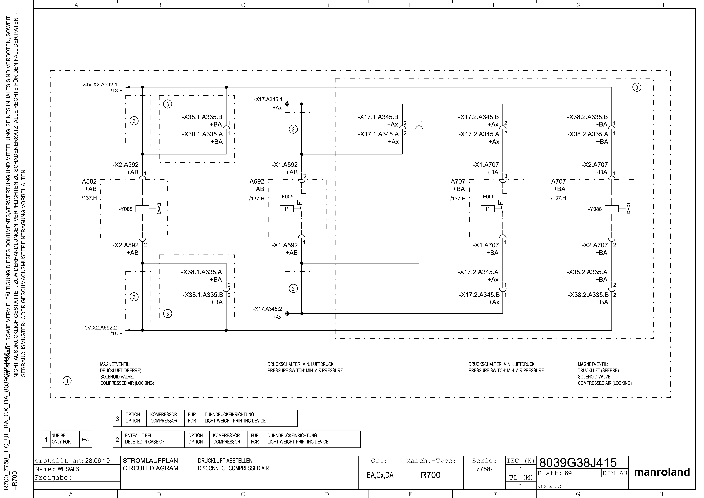

# +BA_Cx_DA — Sheet 69 of 247 — DRUCKLUFT ABSTELLEN

**DISCONNECT COMPRESSED AIR**

> Part of the manroland **R700** printing press IEC/UL circuit diagrams.
> Drawing class: **Stromlaufplan / Circuit diagram** (DIN A3).
> Document `+BA_Cx_DA` covers the **Printing units / main switch cabinet** machine section.

## At a glance

| Field | Value |
|---|---|
| Document | `+BA_Cx_DA`  (8039G38J415) |
| Sheet | **69** of 247 |
| Section (DE) | DRUCKLUFT ABSTELLEN |
| Section (EN) | DISCONNECT COMPRESSED AIR |
| Section type | CIRCUIT — Circuit diagram |
| Machine type | `R700` |
| Series | `7758` |
| Created | 28.06.10 |
| Replaces | — |
| Columns used | A, B, C, D, E, F, G, H |
| Path numbers | — |
| Labels on sheet | 138 |
| Cross-refs out | 6 |
| Cross-refs in | 30 |

**Previous:** [+BA_Cx_DA sheet 68](SHEET_0068.md) · **Next:** [+BA_Cx_DA sheet 70](SHEET_0070.md) · **Document TOC:** [_TOC.md](_TOC.md)  (+BA_Cx_DA) · **Master TOC:** [all sheets](../_MASTER_TOC.md)

## Sheet image (300 DPI, exact vector render)



_Rendered directly from the PDF vector layer at 300 DPI (1-bit), no OCR and no resampling. Use it to confirm anything ambiguous in the text below._

## Cross-references on this sheet

Each entry is a wire leaving this sheet. The printed token is `/sheet.column`; the link resolves to that sheet inside the same document.

| Ref | Target sheet | Col | Path | Destination on target | Target section | From col |
|---|---|---|---|---|---|---|
| `/13.F` | [+BA_Cx_DA sheet 13](SHEET_0013.md) | F | — | 24V.X2.A592:1 | SPANNUNGSVERSORGUNG, SCHALTSCHRANKBELÜFTUNG | A |
| `/137.H` | [+BA_Cx_DA sheet 137](SHEET_0137.md) | H | — | — | REFERENZMODUL | A |
| `/137.H` | [+BA_Cx_DA sheet 137](SHEET_0137.md) | H | — | — | REFERENZMODUL | G |
| `/137.H` | [+BA_Cx_DA sheet 137](SHEET_0137.md) | H | — | — | REFERENZMODUL | C |
| `/137.H` | [+BA_Cx_DA sheet 137](SHEET_0137.md) | H | — | — | REFERENZMODUL | F |
| `/15.E` | [+BA_Cx_DA sheet 15](SHEET_0015.md) | E | — | 0V.X2.A592:2 | SPANNUNGSVERSORGUNG, SCHALTSCHRANKBELÜFTUNG | A |

### Incoming references (sheets that point here)

Every other sheet that sends a wire to this one. `Back-ref` is the token printed on *that* sheet; `Path` is its line number.

| From sheet | Cols | Back-ref | Path | Refs | What continues there |
|---|---|---|---|---|---|
| [+BA_Cx_DA#13](SHEET_0013.md) | F | `/13.F` | — | 1 | — |
| [+BA_Cx_DA#15](SHEET_0015.md) | E | `/15.E` | — | 1 | — |
| [+BA_Cx_DA#137](SHEET_0137.md) | G, H | `/137.G`, `/137.H` | — | 4 | — |
| [+BA_Cx_DA#142](SHEET_0142.md) | C | `/142.C` | — | 2 | — |
| [+BA_Cx_DA#144](SHEET_0144.md) | C | `/144.C` | — | 2 | — |
| [+BA_Cx_DA#154](SHEET_0154.md) | A, C | `/154.A`, `/154.C` | — | 4 | — |
| [+BA_Cx_DA#173](SHEET_0173.md) | A | `/173.A` | — | 8 | — |
| [+BA_Cx_DA#180](SHEET_0180.md) | H | `/180.H` | — | 8 | — |


## Devices on this sheet

| Tag | Class | Class meaning (IEC) | Col | Sub | Terminal | Sign |
|---|---|---|---|---|---|---|
| `Y088` | Y | Magnetventil / solenoid valve, actuator | B | — | — | — |
| `A592` | A | Baugruppe / assembly, module, PC board | A | — | — | — |
| `F005` | F | Schutz / protection device (fuse, circuit breaker) | D | — | — | — |
| `A592` | A | Baugruppe / assembly, module, PC board | C | — | — | — |
| `F005` | F | Schutz / protection device (fuse, circuit breaker) | F | — | — | — |
| `A707` | A | Baugruppe / assembly, module, PC board | F | — | — | — |
| `Y088` | Y | Magnetventil / solenoid valve, actuator | G | — | — | — |
| `A707` | A | Baugruppe / assembly, module, PC board | G | — | — | — |
| `X2.A592` | — | cross-device reference | B | — | — | — |
| `X2.A592` | — | cross-device reference | B | — | — | — |
| `X1.A592` | — | cross-device reference | C | — | — | — |
| `X1.A592` | — | cross-device reference | C | — | — | — |
| `X17.A345:2` | — | cross-device reference | C | — | 2 | — |
| `X17.A345:1` | — | cross-device reference | C | — | 1 | — |
| `X1.A707` | — | cross-device reference | F | — | — | — |
| `X1.A707` | — | cross-device reference | F | — | — | — |
| `X17.2.A345.B` | — | cross-device reference | F | — | — | — |
| `X17.2.A345.A` | — | cross-device reference | F | — | — | — |
| `X17.2.A345.A` | — | cross-device reference | F | — | — | — |
| `X17.2.A345.B` | — | cross-device reference | F | — | — | — |
| `X17.1.A345.A` | — | cross-device reference | E | — | — | — |
| `X17.1.A345.B` | — | cross-device reference | E | — | — | — |
| `X38.1.A335.A` | — | cross-device reference | C | — | — | — |
| `X38.1.A335.B` | — | cross-device reference | C | — | — | — |
| `X38.1.A335.B` | — | cross-device reference | C | — | — | — |
| `X38.1.A335.A` | — | cross-device reference | C | — | — | — |
| `X2.A707` | — | cross-device reference | G | — | — | — |
| `X2.A707` | — | cross-device reference | G | — | — | — |
| `X38.2.A335.B` | — | cross-device reference | G | — | — | — |
| `X38.2.A335.A` | — | cross-device reference | G | — | — | — |
| `X38.2.A335.A` | — | cross-device reference | G | — | — | — |
| `X38.2.A335.B` | — | cross-device reference | G | — | — | — |

## Potentials / nets

| Potential | Count | Columns | Attached devices | Terminals |
|---|---|---|---|---|
| `0V` | 1 | A | `A592`, `X2` | `2` |
| `24V` | 1 | A | `A592`, `X2` | `1` |


A potential such as `L24+/4` or `M24+` is a named supply/return rail; every place it appears on this sheet is electrically common.

## Wire-end annotations (grouped as printed)

A wire that continues elsewhere is annotated with a small cluster: the destination description, the path/line number `#NN`, and the `/sheet.column` cross reference. Each row below is one such cluster exactly as it is grouped on the drawing.

| Col | Y | Path | Cross-ref | Text on the wire |
|---|---|---|---|---|
| A | 139.2 | — | `/13.F` | `24V.X2.A592:1` |
| H | 144.9 | — | — | `3` |
| C | 164.0 | — | — | `X17.A345:1` |
| B | 173.2 | — | — | `3` |
| C | 178.2 | — | — | `+Ax` |
| C | 193.1 | — | — | `X38.1.A335.B 1` |
| E | 193.1 | — | — | `X17.1.A345.B 2` |
| F | 193.1 | — | — | `X17.2.A345.B 2` |
| G | 193.1 | — | — | `X38.2.A335.B 1` |
| B | 201.6 | — | — | `2` |
| E | 204.4 | — | — | `1` |
| C | 205.7 | — | — | `+BA` |
| G | 205.7 | — | — | `+BA` |
| E | 205.8 | — | — | `+Ax` |
| F | 205.8 | — | — | `+Ax` |
| D | 215.7 | — | — | `2` |
| C | 221.4 | — | — | `X38.1.A335.A 1` |
| E | 221.4 | — | — | `X17.1.A345.A 2` |
| E | 221.4 | — | — | `1` |
| F | 221.4 | — | — | `X17.2.A345.A 2` |
| G | 221.4 | — | — | `X38.2.A335.A 1` |
| C | 234.8 | — | — | `+BA` |
| G | 234.8 | — | — | `+BA` |
| E | 234.9 | — | — | `+Ax` |
| F | 234.9 | — | — | `+Ax` |
| B | 273.9 | — | — | `X2.A592 1` |
| C | 273.9 | — | — | `X1.A592` |
| F | 273.9 | — | — | `X1.A707` |
| G | 273.9 | — | — | `X2.A707 1` |
| B | 286.5 | — | — | `+AB` |
| D | 286.5 | — | — | `+AB` |
| F | 286.5 | — | — | `+BA` |
| G | 286.5 | — | — | `+BA` |
| D | 293.7 | — | — | `3` |
| F | 293.7 | — | — | `3` |
| A | 302.2 | — | — | `A592` |
| C | 302.2 | — | — | `A592` |
| F | 302.2 | — | — | `A707` |
| G | 302.2 | — | — | `A707` |
| A | 314.9 | — | — | `+AB` |
| C | 314.9 | — | — | `+AB` |
| F | 314.9 | — | — | `+BA` |
| G | 314.9 | — | — | `+BA` |
| D | 328.4 | — | — | `F005` |
| F | 328.4 | — | — | `F005` |
| A | 330.9 | — | `/137.H` | — |
| G | 330.9 | — | `/137.H` | — |
| C | 331.9 | — | `/137.H` | — |
| F | 331.9 | — | `/137.H` | — |
| D | 349.3 | — | — | `P` |
| F | 349.3 | — | — | `P` |
| B | 349.7 | — | — | `Y088` |
| G | 349.7 | — | — | `Y088` |
| D | 405.7 | — | — | `X1.A592 1` |
| F | 405.7 | — | — | `X1.A707 1` |
| B | 409.9 | — | — | `X2.A592 2` |
| G | 409.9 | — | — | `X2.A707 2` |
| B | 422.6 | — | — | `+AB` |
| D | 422.6 | — | — | `+AB` |
| F | 422.6 | — | — | `+BA` |
| G | 422.6 | — | — | `+BA` |
| C | 455.3 | — | — | `X38.1.A335.A` |
| F | 455.3 | — | — | `X17.2.A345.A` |
| G | 455.3 | — | — | `X38.2.A335.A` |
| C | 467.9 | — | — | `+BA` |
| G | 467.9 | — | — | `+BA` |
| F | 468.1 | — | — | `+Ax` |
| C | 478.0 | — | — | `2` |
| F | 478.0 | — | — | `1` |
| G | 478.0 | — | — | `2` |
| D | 485.0 | — | — | `2` |
| C | 493.5 | — | — | `X38.1.A335.B 2` |
| F | 493.5 | — | — | `X17.2.A345.B 1` |
| G | 493.5 | — | — | `X38.2.A335.B 2` |
| B | 499.2 | — | — | `2` |
| C | 506.2 | — | — | `+BA` |
| G | 506.2 | — | — | `+BA` |
| F | 506.3 | — | — | `+Ax` |
| C | 518.3 | — | — | `X17.A345:2` |
| B | 527.5 | — | — | `3` |
| C | 532.6 | — | — | `+Ax` |
| A | 550.2 | — | `/15.E` | `0V.X2.A592:2` |
| B | 612.9 | — | — | `DRUCKLUFT (SPERRE) MAGNETVENTIL:` |
| D | 612.9 | — | — | `DRUCKSCHALTER: MIN. LUFTDRUCK PRESSURE SWITCH: MIN. AIR PRESSURE` |
| F | 612.9 | — | — | `DRUCKSCHALTER: MIN. LUFTDRUCK PRESSURE SWITCH: MIN. AIR PRESSURE` |
| G | 612.9 | — | — | `DRUCKLUFT (SPERRE) MAGNETVENTIL:` |
| B | 634.2 | — | — | `SOLENOID VALVE: COMPRESSED AIR (LOCKING)` |
| G | 634.2 | — | — | `SOLENOID VALVE: COMPRESSED AIR (LOCKING)` |
| A | 640.4 | — | — | `1` |
| B | 697.9 | — | — | `3 OPTION OPTION` |
| B | 697.9 | — | — | `KOMPRESSOR` |
| B | 697.9 | — | — | `FÜR FOR` |
| C | 698.0 | — | — | `DÜNNDRUCKEINRICHTUNG LIGHT WEIGHT PRINTING DEVICE` |
| B | 708.6 | — | — | `COMPRESSOR` |
| A | 733.3 | — | — | `1 NUR BEI` |
| B | 733.4 | — | — | `2 COMPRESSOR FÜR FOR` |
| B | 733.4 | — | — | `ENTFÄLLT BEI DELETED IN CASE OF` |
| B | 733.4 | — | — | `OPTION OPTION` |
| C | 733.4 | — | — | `KOMPRESSOR` |
| D | 733.4 | — | — | `DÜNNDRUCKEINRICHTUNG LIGHT WEIGHT PRINTING DEVICE` |
| A | 740.4 | — | — | `ONLY FOR +BA` |


## Notes and free text on this sheet

| Text | Col | Y (pt) |
|---|---|---|
| `+AB` | B | 422.59 |
| `MAGNETVENTIL:` | A | 612.9 |
| `DRUCKLUFT (SPERRE)` | B | 623.55 |
| `SOLENOID VALVE:` | A | 634.16 |
| `COMPRESSED AIR (LOCKING)` | B | 644.82 |
| `+AB` | A | 314.88 |
| `+AB` | D | 286.53 |
| `P` | D | 349.28 |
| `DRUCKSCHALTER: MIN. LUFTDRUCK` | D | 612.93 |
| `PRESSURE SWITCH: MIN. AIR PRESSURE` | D | 623.52 |
| `+AB` | C | 314.88 |
| `+Ax` | C | 532.56 |
| `+BA` | F | 286.53 |
| `P` | F | 349.28 |
| `DRUCKSCHALTER: MIN. LUFTDRUCK` | F | 612.93 |
| `PRESSURE SWITCH: MIN. AIR PRESSURE` | F | 623.52 |
| `+Ax` | F | 506.32 |
| `+Ax` | E | 234.91 |
| `+BA` | C | 234.8 |
| `+BA` | G | 422.59 |
| `MAGNETVENTIL:` | G | 612.9 |
| `DRUCKLUFT (SPERRE)` | G | 623.55 |
| `SOLENOID VALVE:` | G | 634.16 |
| `COMPRESSED AIR (LOCKING)` | G | 644.82 |
| `NUR BEI` | A | 733.33 |
| `ONLY FOR` | A | 744.02 |
| `+BA` | A | 740.44 |
| `ENTFÄLLT BEI` | B | 733.35 |
| `DELETED IN CASE OF` | B | 744 |
| `OPTION` | B | 733.35 |
| `KOMPRESSOR` | C | 733.38 |
| `COMPRESSOR` | C | 744.03 |
| `FÜR` | C | 733.35 |
| `FOR` | C | 743.98 |
| `DÜNNDRUCKEINRICHTUNG` | D | 733.41 |
| `LIGHT WEIGHT PRINTING DEVICE` | D | 744 |
| `KOMPRESSOR` | B | 697.94 |
| `COMPRESSOR` | B | 708.6 |
| `FÜR` | B | 697.92 |
| `FOR` | B | 708.54 |
| `DÜNNDRUCKEINRICHTUNG` | C | 697.98 |
| `LIGHT WEIGHT PRINTING DEVICE` | C | 708.56 |

## Complete label inventory (exact text from the drawing)

Every text object inside the drawing area of this sheet, in DIN reading order (column A→H, then top→bottom). This is the authoritative list: if a string is not here it is not printed on this sheet.

| Col | Y | X | Dir | Type | Text |
|---|---|---|---|---|---|
| A | 139.2 | 136.6 | → | potential | `24V.X2.A592:1` |
| A | 149.1 | 187.1 | → | cross-reference | `/13.F` |
| A | 302.2 | 135.2 | → | device tag | `A592` |
| A | 314.9 | 143.1 | → | text | `+AB` |
| A | 330.9 | 138.0 | → | cross-reference | `/137.H` |
| A | 550.2 | 143.1 | → | potential | `0V.X2.A592:2` |
| A | 560.1 | 186.8 | → | cross-reference | `/15.E` |
| A | 612.9 | 169.5 | → | text | `MAGNETVENTIL:` |
| A | 634.2 | 169.8 | → | text | `SOLENOID VALVE:` |
| A | 640.4 | 111.6 | → | number | `1` |
| A | 703.3 | 195.4 | → | number | `3` |
| A | 733.3 | 87.0 | → | text | `NUR BEI` |
| A | 738.7 | 75.4 | → | number | `1` |
| A | 738.7 | 195.6 | → | number | `2` |
| A | 740.4 | 137.9 | → | text | `+BA` |
| A | 744.0 | 87.6 | → | text | `ONLY FOR` |
| B | 173.2 | 281.5 | → | number | `3` |
| B | 201.6 | 224.8 | → | number | `2` |
| B | 273.9 | 190.2 | → | device ref | `X2.A592` |
| B | 286.5 | 214.0 | → | text | `+AB` |
| B | 289.5 | 242.9 | → | number | `1` |
| B | 349.7 | 201.0 | → | device tag | `Y088` |
| B | 409.9 | 190.2 | → | device ref | `X2.A592` |
| B | 409.9 | 243.5 | → | number | `2` |
| B | 422.6 | 214.0 | → | text | `+AB` |
| B | 499.2 | 224.8 | → | number | `2` |
| B | 527.5 | 281.5 | → | number | `3` |
| B | 623.6 | 169.2 | → | text | `DRUCKLUFT (SPERRE)` |
| B | 644.8 | 169.8 | → | text | `COMPRESSED AIR (LOCKING)` |
| B | 697.9 | 212.3 | → | text | `OPTION` |
| B | 697.9 | 254.3 | → | text | `KOMPRESSOR` |
| B | 697.9 | 318.0 | → | text | `FÜR` |
| B | 708.5 | 318.0 | → | text | `FOR` |
| B | 708.6 | 212.3 | → | text | `OPTION` |
| B | 708.6 | 254.8 | → | text | `COMPRESSOR` |
| B | 733.3 | 211.7 | → | text | `ENTFÄLLT BEI` |
| B | 733.4 | 318.6 | → | text | `OPTION` |
| B | 744.0 | 211.7 | → | text | `DELETED IN CASE OF` |
| B | 744.0 | 318.6 | → | text | `OPTION` |
| C | 164.0 | 429.2 | → | device ref | `X17.A345:1` |
| C | 178.2 | 461.2 | → | text | `+Ax` |
| C | 193.1 | 307.3 | → | device ref | `X38.1.A335.B` |
| C | 204.4 | 384.7 | → | number | `1` |
| C | 205.7 | 354.9 | → | text | `+BA` |
| C | 221.4 | 384.7 | → | number | `1` |
| C | 222.1 | 307.8 | → | device ref | `X38.1.A335.A` |
| C | 234.8 | 356.3 | → | text | `+BA` |
| C | 273.9 | 459.5 | → | device ref | `X1.A592` |
| C | 302.2 | 418.7 | → | device tag | `A592` |
| C | 314.9 | 426.6 | → | text | `+AB` |
| C | 331.9 | 421.5 | → | cross-reference | `/137.H` |
| C | 409.9 | 459.5 | → | device ref | `X1.A592` |
| C | 455.3 | 306.4 | → | device ref | `X38.1.A335.A` |
| C | 467.9 | 354.9 | → | text | `+BA` |
| C | 478.0 | 385.2 | → | number | `2` |
| C | 493.5 | 308.7 | → | device ref | `X38.1.A335.B` |
| C | 495.0 | 385.2 | → | number | `2` |
| C | 506.2 | 356.3 | → | text | `+BA` |
| C | 518.3 | 428.0 | → | device ref | `X17.A345:2` |
| C | 532.6 | 461.2 | → | text | `+Ax` |
| C | 698.0 | 346.4 | → | text | `DÜNNDRUCKEINRICHTUNG` |
| C | 708.6 | 346.4 | → | text | `LIGHT WEIGHT PRINTING DEVICE` |
| C | 733.4 | 360.6 | → | text | `KOMPRESSOR` |
| C | 733.4 | 424.3 | → | text | `FÜR` |
| C | 744.0 | 361.1 | → | text | `COMPRESSOR` |
| C | 744.0 | 424.3 | → | text | `FOR` |
| D | 215.7 | 494.1 | → | number | `2` |
| D | 286.5 | 483.3 | → | text | `+AB` |
| D | 293.7 | 512.8 | → | number | `3` |
| D | 328.4 | 473.7 | → | device tag | `F005` |
| D | 349.3 | 481.3 | → | text | `P` |
| D | 405.7 | 512.2 | → | number | `1` |
| D | 422.6 | 483.3 | → | text | `+AB` |
| D | 485.0 | 494.1 | → | number | `2` |
| D | 612.9 | 452.7 | → | text | `DRUCKSCHALTER: MIN. LUFTDRUCK` |
| D | 623.5 | 452.7 | → | text | `PRESSURE SWITCH: MIN. AIR PRESSURE` |
| D | 733.4 | 452.7 | → | text | `DÜNNDRUCKEINRICHTUNG` |
| D | 744.0 | 452.7 | → | text | `LIGHT WEIGHT PRINTING DEVICE` |
| E | 193.1 | 604.9 | → | device ref | `X17.1.A345.B` |
| E | 204.4 | 682.9 | → | number | `2` |
| E | 204.4 | 710.6 | → | number | `1` |
| E | 205.9 | 654.8 | → | text | `+Ax` |
| E | 221.4 | 682.9 | → | number | `2` |
| E | 221.4 | 710.6 | → | number | `1` |
| E | 222.1 | 605.5 | → | device ref | `X17.1.A345.A` |
| E | 234.9 | 656.2 | → | text | `+Ax` |
| F | 193.1 | 775.0 | → | device ref | `X17.2.A345.B` |
| F | 204.4 | 852.9 | → | number | `2` |
| F | 205.9 | 824.9 | → | text | `+Ax` |
| F | 221.4 | 852.9 | → | number | `2` |
| F | 222.1 | 775.6 | → | device ref | `X17.2.A345.A` |
| F | 234.9 | 826.3 | → | text | `+Ax` |
| F | 273.9 | 799.7 | → | device ref | `X1.A707` |
| F | 286.5 | 822.6 | → | text | `+BA` |
| F | 293.7 | 852.9 | → | number | `3` |
| F | 302.2 | 758.8 | → | device tag | `A707` |
| F | 314.9 | 765.9 | → | text | `+BA` |
| F | 328.4 | 813.8 | → | device tag | `F005` |
| F | 331.9 | 761.7 | → | cross-reference | `/137.H` |
| F | 349.3 | 821.5 | → | text | `P` |
| F | 405.7 | 852.4 | → | number | `1` |
| F | 409.9 | 799.7 | → | device ref | `X1.A707` |
| F | 422.6 | 822.6 | → | text | `+BA` |
| F | 455.3 | 774.1 | → | device ref | `X17.2.A345.A` |
| F | 468.1 | 824.9 | → | text | `+Ax` |
| F | 478.0 | 852.4 | → | number | `1` |
| F | 493.5 | 776.4 | → | device ref | `X17.2.A345.B` |
| F | 495.0 | 852.4 | → | number | `1` |
| F | 506.3 | 826.3 | → | text | `+Ax` |
| F | 612.9 | 792.9 | → | text | `DRUCKSCHALTER: MIN. LUFTDRUCK` |
| F | 623.5 | 792.9 | → | text | `PRESSURE SWITCH: MIN. AIR PRESSURE` |
| G | 193.1 | 959.2 | → | device ref | `X38.2.A335.B` |
| G | 204.4 | 1036.6 | → | number | `1` |
| G | 205.7 | 1006.9 | → | text | `+BA` |
| G | 221.4 | 1036.6 | → | number | `1` |
| G | 222.1 | 959.8 | → | device ref | `X38.2.A335.A` |
| G | 234.8 | 1008.3 | → | text | `+BA` |
| G | 273.9 | 983.9 | → | device ref | `X2.A707` |
| G | 286.5 | 1006.9 | → | text | `+BA` |
| G | 289.5 | 1036.6 | → | number | `1` |
| G | 302.2 | 928.9 | → | device tag | `A707` |
| G | 314.9 | 936.0 | → | text | `+BA` |
| G | 330.9 | 931.7 | → | cross-reference | `/137.H` |
| G | 349.7 | 994.7 | → | device tag | `Y088` |
| G | 409.9 | 983.9 | → | device ref | `X2.A707` |
| G | 409.9 | 1037.2 | → | number | `2` |
| G | 422.6 | 1006.9 | → | text | `+BA` |
| G | 455.3 | 958.4 | → | device ref | `X38.2.A335.A` |
| G | 467.9 | 1006.9 | → | text | `+BA` |
| G | 478.0 | 1037.2 | → | number | `2` |
| G | 493.5 | 960.7 | → | device ref | `X38.2.A335.B` |
| G | 495.0 | 1037.2 | → | number | `2` |
| G | 506.2 | 1008.3 | → | text | `+BA` |
| G | 612.9 | 977.4 | → | text | `MAGNETVENTIL:` |
| G | 623.6 | 977.1 | → | text | `DRUCKLUFT (SPERRE)` |
| G | 634.2 | 977.7 | → | text | `SOLENOID VALVE:` |
| G | 644.8 | 977.7 | → | text | `COMPRESSED AIR (LOCKING)` |
| H | 144.9 | 1075.2 | → | number | `3` |

## Reading-order text block

The same content as a plain block, grouped by DIN column — convenient to paste or to match against a visual description.

```text
=== Column A ===
 139.2  136.6  net          24V.X2.A592:1
 149.1  187.1  xref         /13.F
 302.2  135.2  devtag       A592
 314.9  143.1  text         +AB
 330.9  138.0  xref         /137.H
 550.2  143.1  net          0V.X2.A592:2
 560.1  186.8  xref         /15.E
 612.9  169.5  text         MAGNETVENTIL:
 634.2  169.8  text         SOLENOID VALVE:
 640.4  111.6  numeric      1
 703.3  195.4  numeric      3
 733.3   87.0  text         NUR BEI
 738.7   75.4  numeric      1
 738.7  195.6  numeric      2
 740.4  137.9  text         +BA
 744.0   87.6  text         ONLY FOR
=== Column B ===
 173.2  281.5  numeric      3
 201.6  224.8  numeric      2
 273.9  190.2  devref       X2.A592
 286.5  214.0  text         +AB
 289.5  242.9  numeric      1
 349.7  201.0  devtag       Y088
 409.9  190.2  devref       X2.A592
 409.9  243.5  numeric      2
 422.6  214.0  text         +AB
 499.2  224.8  numeric      2
 527.5  281.5  numeric      3
 623.6  169.2  text         DRUCKLUFT (SPERRE)
 644.8  169.8  text         COMPRESSED AIR (LOCKING)
 697.9  212.3  text         OPTION
 697.9  254.3  text         KOMPRESSOR
 697.9  318.0  text         FÜR
 708.5  318.0  text         FOR
 708.6  212.3  text         OPTION
 708.6  254.8  text         COMPRESSOR
 733.3  211.7  text         ENTFÄLLT BEI
 733.4  318.6  text         OPTION
 744.0  211.7  text         DELETED IN CASE OF
 744.0  318.6  text         OPTION
=== Column C ===
 164.0  429.2  devref       X17.A345:1
 178.2  461.2  text         +Ax
 193.1  307.3  devref       X38.1.A335.B
 204.4  384.7  numeric      1
 205.7  354.9  text         +BA
 221.4  384.7  numeric      1
 222.1  307.8  devref       X38.1.A335.A
 234.8  356.3  text         +BA
 273.9  459.5  devref       X1.A592
 302.2  418.7  devtag       A592
 314.9  426.6  text         +AB
 331.9  421.5  xref         /137.H
 409.9  459.5  devref       X1.A592
 455.3  306.4  devref       X38.1.A335.A
 467.9  354.9  text         +BA
 478.0  385.2  numeric      2
 493.5  308.7  devref       X38.1.A335.B
 495.0  385.2  numeric      2
 506.2  356.3  text         +BA
 518.3  428.0  devref       X17.A345:2
 532.6  461.2  text         +Ax
 698.0  346.4  text         DÜNNDRUCKEINRICHTUNG
 708.6  346.4  text         LIGHT WEIGHT PRINTING DEVICE
 733.4  360.6  text         KOMPRESSOR
 733.4  424.3  text         FÜR
 744.0  361.1  text         COMPRESSOR
 744.0  424.3  text         FOR
=== Column D ===
 215.7  494.1  numeric      2
 286.5  483.3  text         +AB
 293.7  512.8  numeric      3
 328.4  473.7  devtag       F005
 349.3  481.3  text         P
 405.7  512.2  numeric      1
 422.6  483.3  text         +AB
 485.0  494.1  numeric      2
 612.9  452.7  text         DRUCKSCHALTER: MIN. LUFTDRUCK
 623.5  452.7  text         PRESSURE SWITCH: MIN. AIR PRESSURE
 733.4  452.7  text         DÜNNDRUCKEINRICHTUNG
 744.0  452.7  text         LIGHT WEIGHT PRINTING DEVICE
=== Column E ===
 193.1  604.9  devref       X17.1.A345.B
 204.4  682.9  numeric      2
 204.4  710.6  numeric      1
 205.9  654.8  text         +Ax
 221.4  682.9  numeric      2
 221.4  710.6  numeric      1
 222.1  605.5  devref       X17.1.A345.A
 234.9  656.2  text         +Ax
=== Column F ===
 193.1  775.0  devref       X17.2.A345.B
 204.4  852.9  numeric      2
 205.9  824.9  text         +Ax
 221.4  852.9  numeric      2
 222.1  775.6  devref       X17.2.A345.A
 234.9  826.3  text         +Ax
 273.9  799.7  devref       X1.A707
 286.5  822.6  text         +BA
 293.7  852.9  numeric      3
 302.2  758.8  devtag       A707
 314.9  765.9  text         +BA
 328.4  813.8  devtag       F005
 331.9  761.7  xref         /137.H
 349.3  821.5  text         P
 405.7  852.4  numeric      1
 409.9  799.7  devref       X1.A707
 422.6  822.6  text         +BA
 455.3  774.1  devref       X17.2.A345.A
 468.1  824.9  text         +Ax
 478.0  852.4  numeric      1
 493.5  776.4  devref       X17.2.A345.B
 495.0  852.4  numeric      1
 506.3  826.3  text         +Ax
 612.9  792.9  text         DRUCKSCHALTER: MIN. LUFTDRUCK
 623.5  792.9  text         PRESSURE SWITCH: MIN. AIR PRESSURE
=== Column G ===
 193.1  959.2  devref       X38.2.A335.B
 204.4 1036.6  numeric      1
 205.7 1006.9  text         +BA
 221.4 1036.6  numeric      1
 222.1  959.8  devref       X38.2.A335.A
 234.8 1008.3  text         +BA
 273.9  983.9  devref       X2.A707
 286.5 1006.9  text         +BA
 289.5 1036.6  numeric      1
 302.2  928.9  devtag       A707
 314.9  936.0  text         +BA
 330.9  931.7  xref         /137.H
 349.7  994.7  devtag       Y088
 409.9  983.9  devref       X2.A707
 409.9 1037.2  numeric      2
 422.6 1006.9  text         +BA
 455.3  958.4  devref       X38.2.A335.A
 467.9 1006.9  text         +BA
 478.0 1037.2  numeric      2
 493.5  960.7  devref       X38.2.A335.B
 495.0 1037.2  numeric      2
 506.2 1008.3  text         +BA
 612.9  977.4  text         MAGNETVENTIL:
 623.6  977.1  text         DRUCKLUFT (SPERRE)
 634.2  977.7  text         SOLENOID VALVE:
 644.8  977.7  text         COMPRESSED AIR (LOCKING)
=== Column H ===
 144.9 1075.2  numeric      3
```

---
_Generated from the PDF vector text layer; no OCR. Source: `R700_7758_IEC_UL_BA_CX_DA_8039G38J415_p`, sheet 69._
