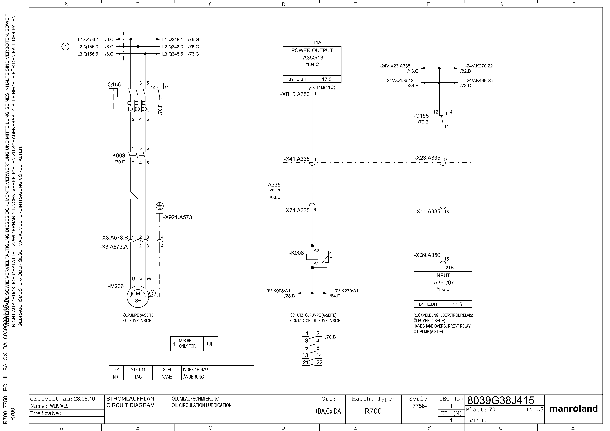

# +BA_Cx_DA — Sheet 70 of 247 — ÖLUMLAUFSCHMIERUNG

**OIL CIRCULATION LUBRICATION**

> Part of the manroland **R700** printing press IEC/UL circuit diagrams.
> Drawing class: **Stromlaufplan / Circuit diagram** (DIN A3).
> Document `+BA_Cx_DA` covers the **Printing units / main switch cabinet** machine section.

## At a glance

| Field | Value |
|---|---|
| Document | `+BA_Cx_DA`  (8039G38J415) |
| Sheet | **70** of 247 |
| Section (DE) | ÖLUMLAUFSCHMIERUNG |
| Section (EN) | OIL CIRCULATION LUBRICATION |
| Section type | CIRCUIT — Circuit diagram |
| Machine type | `R700` |
| Series | `7758` |
| Created | 28.06.10 |
| Replaces | — |
| Columns used | A, B, C, D, E, F, G |
| Path numbers | — |
| Labels on sheet | 129 |
| Cross-refs out | 20 |
| Cross-refs in | 34 |

**Previous:** [+BA_Cx_DA sheet 69](SHEET_0069.md) · **Next:** [+BA_Cx_DA sheet 71](SHEET_0071.md) · **Document TOC:** [_TOC.md](_TOC.md)  (+BA_Cx_DA) · **Master TOC:** [all sheets](../_MASTER_TOC.md)

## Sheet image (300 DPI, exact vector render)



_Rendered directly from the PDF vector layer at 300 DPI (1-bit), no OCR and no resampling. Use it to confirm anything ambiguous in the text below._

## Cross-references on this sheet

Each entry is a wire leaving this sheet. The printed token is `/sheet.column`; the link resolves to that sheet inside the same document.

| Ref | Target sheet | Col | Path | Destination on target | Target section | From col |
|---|---|---|---|---|---|---|
| `/6.C` | [+BA_Cx_DA sheet 6](SHEET_0006.md) | C | — | L1.Q156:1 L1.Q348:1 | SPANNUNGSVERSORGUNG: 400V | B |
| `/76.G` | [+BA_Cx_DA sheet 76](SHEET_0076.md) | G | — | L1.Q156:1 L1.Q348:1 | FARBWERK | B |
| `/6.C` | [+BA_Cx_DA sheet 6](SHEET_0006.md) | C | — | L2.Q156:3 L2.Q348:3 | SPANNUNGSVERSORGUNG: 400V | B |
| `/76.G` | [+BA_Cx_DA sheet 76](SHEET_0076.md) | G | — | L2.Q156:3 L2.Q348:3 | FARBWERK | B |
| `/6.C` | [+BA_Cx_DA sheet 6](SHEET_0006.md) | C | — | L3.Q156:5 L3.Q348:5 | SPANNUNGSVERSORGUNG: 400V | B |
| `/76.G` | [+BA_Cx_DA sheet 76](SHEET_0076.md) | G | — | L3.Q156:5 L3.Q348:5 | FARBWERK | B |
| `/134.C` | [+BA_Cx_DA sheet 134](SHEET_0134.md) | C | — | — | REFERENZMODUL | D |
| `/13.G` | [+BA_Cx_DA sheet 13](SHEET_0013.md) | G | — | 24V.X23.A335:1 | SPANNUNGSVERSORGUNG, SCHALTSCHRANKBELÜFTUNG | F |
| `/82.B` | [+BA_Cx_DA sheet 82](SHEET_0082.md) | B | — | — | FARBWERK | G |
| `/34.E` | [+BA_Cx_DA sheet 34](SHEET_0034.md) | E | — | 24V.Q156:12 | BUSVERBINDUNGEN: RESERVE SIGNALE | F |
| `/73.C` | [+BA_Cx_DA sheet 73](SHEET_0073.md) | C | — | — | FEUCHTWERK | G |
| `/70.F` | [+BA_Cx_DA sheet 70](SHEET_0070.md) | F | — | — | ÖLUMLAUFSCHMIERUNG | B |
| `/70.B` | [+BA_Cx_DA sheet 70](SHEET_0070.md) | B | — | — | ÖLUMLAUFSCHMIERUNG | F |
| `/70.E` | [+BA_Cx_DA sheet 70](SHEET_0070.md) | E | — | — | ÖLUMLAUFSCHMIERUNG | B |
| `/71.B` | [+BA_Cx_DA sheet 71](SHEET_0071.md) | B | — | — | ÖLUMLAUFSCHMIERUNG | D |
| `/68.B` | [+BA_Cx_DA sheet 68](SHEET_0068.md) | B | — | — | SEITENMARKEN: ZIEHEN | D |
| `/132.B` | [+BA_Cx_DA sheet 132](SHEET_0132.md) | B | — | — | REFERENZMODUL | F |
| `/28.B` | [+BA_Cx_DA sheet 28](SHEET_0028.md) | B | — | 0V.K008:A1 0V.K270:A1 | BUSVERBINDUNGEN: STOP SICHERN | D |
| `/84.F` | [+BA_Cx_DA sheet 84](SHEET_0084.md) | F | — | — | FARBWERK | E |
| `/70.B` | [+BA_Cx_DA sheet 70](SHEET_0070.md) | B | — | — | ÖLUMLAUFSCHMIERUNG | E |

### Incoming references (sheets that point here)

Every other sheet that sends a wire to this one. `Back-ref` is the token printed on *that* sheet; `Path` is its line number.

| From sheet | Cols | Back-ref | Path | Refs | What continues there |
|---|---|---|---|---|---|
| [+BA_Cx_DA#6](SHEET_0006.md) | C | `/6.C` | — | 3 | L1.Q156:1; L2.Q156:3; L3.Q156:5 |
| [+BA_Cx_DA#13](SHEET_0013.md) | G | `/13.G` | — | 1 | 24V.X23.A335:1 |
| [+BA_Cx_DA#28](SHEET_0028.md) | C | `/28.C` | — | 1 | — |
| [+BA_Cx_DA#34](SHEET_0034.md) | E | `/34.E` | — | 1 | — |
| [+BA_Cx_DA#68](SHEET_0068.md) | A | `/68.A` | — | 1 | — |
| [+BA_Cx_DA#70](SHEET_0070.md) | B, E, F | `/70.B`, `/70.E`, `/70.F` | — | 4 | — |
| [+BA_Cx_DA#71](SHEET_0071.md) | B | `/71.B` | — | 1 | — |
| [+BA_Cx_DA#73](SHEET_0073.md) | B | `/73.B` | — | 1 | 24V.K488:23 |
| [+BA_Cx_DA#76](SHEET_0076.md) | F | `/76.F` | — | 3 | L1.Q348:1; L2.Q348:3; L3.Q348:5 |
| [+BA_Cx_DA#82](SHEET_0082.md) | B | `/82.B` | — | 1 | 24V.K270:22 |
| [+BA_Cx_DA#84](SHEET_0084.md) | F | `/84.F` | — | 1 | 0V.K270:A1 |
| [+BA_Cx_DA#132](SHEET_0132.md) | B | `/132.B` | — | 1 | — |
| [+BA_Cx_DA#134](SHEET_0134.md) | C | `/134.C` | — | 1 | — |
| [+BA_Cx_DA#157](SHEET_0157.md) | H | `/157.H` | — | 8 | — |
| [+BA_Cx_DA#166](SHEET_0166.md) | G | `/166.G` | — | 1 | — |
| [+BA_Cx_DA#168](SHEET_0168.md) | G | `/168.G` | — | 1 | — |
| [+BA_Cx_DA#171](SHEET_0171.md) | G | `/171.G` | — | 1 | — |
| [+BA_Cx_DA#174](SHEET_0174.md) | G | `/174.G` | — | 1 | — |
| [+BA_Cx_DA#181](SHEET_0181.md) | F | `/181.F` | — | 1 | — |
| [+BA_Cx_DA#184](SHEET_0184.md) | F | `/184.F` | — | 1 | — |


## Devices on this sheet

| Tag | Class | Class meaning (IEC) | Col | Sub | Terminal | Sign |
|---|---|---|---|---|---|---|
| `A350/13` | A | Baugruppe / assembly, module, PC board | D | 13 | — | — |
| `Q156` | Q | Leistungsschalter / power switching device | B | — | — | — |
| `K008` | K | Relais / relay, contactor | B | — | — | — |
| `A335` | A | Baugruppe / assembly, module, PC board | D | — | — | — |
| `Q156` | Q | Leistungsschalter / power switching device | F | — | — | — |
| `A2` | A | Baugruppe / assembly, module, PC board | D | — | — | — |
| `A1` | A | Baugruppe / assembly, module, PC board | D | — | — | — |
| `K008` | K | Relais / relay, contactor | D | — | — | — |
| `A350/07` | A | Baugruppe / assembly, module, PC board | F | 07 | — | — |
| `XB15.A350` | — | cross-device reference | D | — | — | — |
| `17.0` | — | cross-device reference | E | — | — | — |
| `X74.A335` | — | cross-device reference | D | — | — | — |
| `X41.A335` | — | cross-device reference | D | — | — | — |
| `X23.A335` | — | cross-device reference | F | — | — | — |
| `X11.A335` | — | cross-device reference | F | — | — | — |
| `11.6` | — | cross-device reference | F | — | — | — |
| `XB9.A350` | — | cross-device reference | F | — | — | — |
| `X3.A573.B` | — | cross-device reference | B | — | — | — |
| `X3.A573.A` | — | cross-device reference | B | — | — | — |
| `NR.` | — | cross-device reference | B | — | — | — |
| `21.01.11` | — | cross-device reference | B | — | — | — |
| `X921.A573` | — | cross-device reference | C | — | — | — |

## Potentials / nets

| Potential | Count | Columns | Attached devices | Terminals |
|---|---|---|---|---|
| `0V` | 2 | D, E | `K008`, `K270` | `A1` |
| `24V` | 4 | F, G | `A335`, `K270`, `K488`, `Q156`, `X23` | `1`, `12`, `22`, `23` |
| `L1` | 2 | A, B | `Q156`, `Q348` | `1` |
| `L2` | 2 | A, B | `Q156`, `Q348` | `3` |
| `L3` | 2 | A, B | `Q156`, `Q348` | `5` |
| `M206` | 1 | B | — | — |


A potential such as `L24+/4` or `M24+` is a named supply/return rail; every place it appears on this sheet is electrically common.

## Wire-end annotations (grouped as printed)

A wire that continues elsewhere is annotated with a small cluster: the destination description, the path/line number `#NN`, and the `/sheet.column` cross reference. Each row below is one such cluster exactly as it is grouped on the drawing.

| Col | Y | Path | Cross-ref | Text on the wire |
|---|---|---|---|---|
| B | 73.3 | — | `/6.C`, `/76.G` | `L1.Q156:1 L1.Q348:1` |
| D | 79.0 | — | — | `11A` |
| B | 87.4 | — | `/6.C`, `/76.G` | `L2.Q156:3 L2.Q348:3` |
| A | 87.7 | — | — | `1` |
| D | 94.1 | — | — | `POWER OUTPUT` |
| B | 101.6 | — | `/6.C`, `/76.G` | `L3.Q156:5 L3.Q348:5` |
| D | 108.0 | — | — | `A350/13` |
| D | 121.8 | — | `/134.C` | — |
| F | 125.0 | — | `/13.G` | `24V.X23.A335:1` |
| G | 125.0 | — | — | `24V.K270:22` |
| G | 134.9 | — | `/82.B` | — |
| D | 150.9 | — | — | `BYTE.BIT 17.0` |
| F | 153.4 | — | `/34.E` | `24V.Q156:12` |
| G | 153.4 | — | — | `24V.K488:23` |
| B | 158.4 | — | — | `1` |
| B | 158.4 | — | — | `3` |
| B | 158.4 | — | — | `5` |
| B | 160.5 | — | — | `Q156` |
| G | 163.3 | — | `/73.C` | — |
| E | 166.9 | — | — | `11B(11C)` |
| B | 167.4 | — | — | `12 14` |
| D | 178.9 | — | — | `XB15.A350 9` |
| B | 190.1 | — | — | `11` |
| B | 203.8 | — | `/70.F` | — |
| F | 215.1 | — | — | `Q156 14` |
| F | 215.1 | — | — | `12` |
| B | 229.2 | — | — | `2` |
| B | 229.2 | — | — | `4` |
| B | 229.2 | — | — | `6` |
| F | 234.5 | — | `/70.B` | — |
| F | 243.4 | — | — | `11` |
| B | 285.9 | — | — | `1` |
| B | 285.9 | — | — | `3` |
| B | 285.9 | — | — | `5` |
| B | 299.4 | — | — | `K008 6` |
| E | 303.6 | — | — | `X41.A335 9 X23.A335 9` |
| B | 312.4 | — | `/70.E` | — |
| B | 314.3 | — | — | `2` |
| B | 314.3 | — | — | `4` |
| D | 356.1 | — | — | `A335` |
| D | 369.1 | — | `/71.B`, `/68.B` | — |
| D | 405.7 | — | — | `X74.A335 6` |
| F | 408.5 | — | — | `X11.A335 15` |
| C | 419.8 | — | — | `X921.A573` |
| B | 459.5 | — | — | `X3.A573.B 1 2 3 4` |
| B | 476.5 | — | — | `X3.A573.A 1 2 3 4` |
| D | 485.7 | — | — | `A2` |
| D | 489.3 | — | — | `K008 U` |
| F | 493.5 | — | — | `XB9.A350 15` |
| D | 511.2 | — | — | `A1` |
| F | 519.0 | — | — | `21B` |
| F | 533.5 | — | — | `INPUT` |
| B | 540.7 | — | — | `U V W` |
| F | 547.4 | — | — | `A350/07` |
| B | 554.5 | — | — | `M206` |
| F | 561.2 | — | `/132.B` | — |
| D | 564.4 | — | `/28.B` | `0V.K008:A1 0V.K270:A1` |
| B | 568.9 | — | — | `3~ M` |
| E | 574.3 | — | `/84.F` | — |
| F | 590.2 | — | — | `BYTE.BIT 11.6` |
| B | 612.9 | — | — | `ÖLPUMPE (A SEITE) OIL PUMP (A SIDE)` |
| D | 612.9 | — | — | `SCHÜTZ: ÖLPUMPE (A SEITE) CONTACTOR: OIL PUMP (A SIDE)` |
| F | 612.9 | — | — | `RÜCKMELDUNG: ÜBERSTROMRELAIS:` |
| F | 623.5 | — | — | `HANDSHAKE OVERCURRENT RELAY: ÖLPUMPE (A SEITE)` |
| F | 644.8 | — | — | `OIL PUMP (A SIDE)` |
| D | 646.6 | — | — | `13 21 3 5 1` |
| D | 646.6 | — | — | `14 2 4 6 22` |
| E | 654.3 | — | `/70.B` | — |
| C | 662.5 | — | — | `1 NUR BEI` |
| C | 667.9 | — | — | `ONLY FOR UL` |
| B | 718.8 | — | — | `001 21.01.11 SLEI INDEX 1HINZU` |
| B | 733.0 | — | — | `NR. TAG NAME ÄNDERUNG` |


## Reconstructed tables

This sheet carries tabular content (pin map / terminal assignment / index). The grid below was rebuilt from the drawing's own rule lines, so each row is exactly one physical row of the table.

### Table 1 — 0 data rows × 2 columns (at x=212.6, y=76.5) — **/6.C /6.C**

_none_


### Table 2 — 1 data rows × 3 columns (at x=552.8, y=90.7)

| POWER | OUTPUT A350/13 /134.C |  |
|---|---|---|
| `BYTE.BIT` |  | `17.0` |


### Table 3 — 1 data rows × 3 columns (at x=807.9, y=530.1)

|  | INPUT | A350/07 /132.B |
|---|---|---|
| `BYTE.BIT` |  | `11.6` |


## Notes and free text on this sheet

| Text | Col | Y (pt) |
|---|---|---|
| `11A` | D | 78.95 |
| `11B(11C)` | E | 166.86 |
| `POWER OUTPUT` | D | 94.1 |
| `BYTE.BIT` | D | 151.43 |
| `U` | E | 497.25 |
| `SCHÜTZ: ÖLPUMPE (A SEITE)` | D | 612.91 |
| `CONTACTOR: OIL PUMP (A SIDE)` | D | 623.55 |
| `21B` | F | 519.03 |
| `INPUT` | F | 533.55 |
| `BYTE.BIT` | F | 590.8 |
| `RÜCKMELDUNG: ÜBERSTROMRELAIS:` | F | 612.92 |
| `ÖLPUMPE (A SEITE)` | F | 623.54 |
| `HANDSHAKE OVERCURRENT RELAY:` | F | 634.18 |
| `OIL PUMP (A SIDE)` | F | 644.81 |
| `U` | B | 541.04 |
| `V` | B | 540.93 |
| `W` | B | 540.67 |
| `M` | B | 568.93 |
| `ÖLPUMPE (A SEITE)` | B | 612.91 |
| `OIL PUMP (A SIDE)` | B | 623.54 |
| `TAG` | B | 733.1 |
| `NAME` | B | 733.08 |
| `ÄNDERUNG` | C | 733.14 |
| `SLEI` | B | 718.93 |
| `INDEX 1HINZU` | C | 718.96 |
| `NUR BEI` | C | 662.47 |
| `ONLY FOR` | C | 673.16 |
| `UL` | C | 667.85 |

## Complete label inventory (exact text from the drawing)

Every text object inside the drawing area of this sheet, in DIN reading order (column A→H, then top→bottom). This is the authoritative list: if a string is not here it is not printed on this sheet.

| Col | Y | X | Dir | Type | Text |
|---|---|---|---|---|---|
| A | 73.3 | 152.2 | → | potential | `L1.Q156:1` |
| A | 87.5 | 150.8 | → | potential | `L2.Q156:3` |
| A | 87.7 | 125.8 | → | number | `1` |
| A | 101.6 | 150.8 | → | potential | `L3.Q156:5` |
| B | 73.3 | 205.2 | → | cross-reference | `/6.C` |
| B | 73.3 | 316.6 | → | potential | `L1.Q348:1` |
| B | 87.4 | 205.2 | → | cross-reference | `/6.C` |
| B | 87.5 | 316.6 | → | potential | `L2.Q348:3` |
| B | 101.6 | 205.2 | → | cross-reference | `/6.C` |
| B | 101.6 | 316.6 | → | potential | `L3.Q348:5` |
| B | 158.4 | 257.1 | → | number | `1` |
| B | 158.4 | 271.8 | → | number | `3` |
| B | 158.4 | 286.0 | → | number | `5` |
| B | 160.5 | 206.4 | → | device tag | `Q156` |
| B | 167.4 | 294.2 | → | number | `12` |
| B | 167.4 | 321.2 | → | number | `14` |
| B | 190.1 | 314.1 | → | number | `11` |
| B | 203.8 | 308.5 | ↕ | cross-reference | `/70.F` |
| B | 229.2 | 257.7 | → | number | `2` |
| B | 229.2 | 271.8 | → | number | `4` |
| B | 229.2 | 286.0 | → | number | `6` |
| B | 285.9 | 257.1 | → | number | `1` |
| B | 285.9 | 271.8 | → | number | `3` |
| B | 285.9 | 286.0 | → | number | `5` |
| B | 299.4 | 216.0 | → | device tag | `K008` |
| B | 312.4 | 223.7 | → | cross-reference | `/70.E` |
| B | 314.3 | 257.7 | → | number | `2` |
| B | 314.3 | 271.8 | → | number | `4` |
| B | 314.3 | 286.0 | → | number | `6` |
| B | 459.5 | 195.9 | → | device ref | `X3.A573.B` |
| B | 459.5 | 257.1 | → | number | `1` |
| B | 459.5 | 271.8 | → | number | `2` |
| B | 459.5 | 286.0 | → | number | `3` |
| B | 459.5 | 314.4 | → | number | `4` |
| B | 476.5 | 257.1 | → | number | `1` |
| B | 476.5 | 271.8 | → | number | `2` |
| B | 476.5 | 286.0 | → | number | `3` |
| B | 476.5 | 314.4 | → | number | `4` |
| B | 477.2 | 195.0 | → | device ref | `X3.A573.A` |
| B | 540.7 | 286.3 | → | text | `W` |
| B | 540.9 | 272.1 | → | text | `V` |
| B | 541.0 | 257.1 | → | text | `U` |
| B | 554.5 | 211.5 | → | potential | `M206` |
| B | 568.9 | 265.2 | → | text | `M` |
| B | 583.2 | 263.9 | → | other | `3~` |
| B | 612.9 | 240.7 | → | text | `ÖLPUMPE (A SEITE)` |
| B | 623.5 | 240.7 | → | text | `OIL PUMP (A SIDE)` |
| B | 718.8 | 221.6 | → | number | `001` |
| B | 718.9 | 256.3 | → | device ref | `21.01.11` |
| B | 718.9 | 318.5 | → | text | `SLEI` |
| B | 733.0 | 220.6 | → | device ref | `NR.` |
| B | 733.1 | 262.2 | → | text | `TAG` |
| B | 733.1 | 315.6 | → | text | `NAME` |
| C | 73.3 | 367.1 | → | cross-reference | `/76.G` |
| C | 87.4 | 367.1 | → | cross-reference | `/76.G` |
| C | 101.6 | 367.1 | → | cross-reference | `/76.G` |
| C | 419.8 | 318.6 | → | device ref | `X921.A573` |
| C | 662.5 | 349.2 | → | text | `NUR BEI` |
| C | 667.8 | 337.6 | → | number | `1` |
| C | 667.9 | 403.9 | → | text | `UL` |
| C | 673.2 | 349.8 | → | text | `ONLY FOR` |
| C | 719.0 | 357.0 | → | text | `INDEX 1HINZU` |
| C | 733.1 | 358.2 | → | text | `ÄNDERUNG` |
| D | 78.9 | 611.4 | → | text | `11A` |
| D | 94.1 | 568.6 | → | text | `POWER OUTPUT` |
| D | 108.0 | 588.0 | → | device tag | `A350/13` |
| D | 121.8 | 596.7 | → | cross-reference | `/134.C` |
| D | 151.4 | 562.7 | → | text | `BYTE.BIT` |
| D | 178.9 | 612.0 | → | number | `9` |
| D | 179.6 | 547.1 | → | device ref | `XB15.A350` |
| D | 305.7 | 554.2 | → | device ref | `X41.A335` |
| D | 307.9 | 612.0 | → | number | `9` |
| D | 356.1 | 519.3 | → | device tag | `A335` |
| D | 369.1 | 526.7 | → | cross-reference | `/71.B` |
| D | 381.5 | 526.7 | → | cross-reference | `/68.B` |
| D | 405.7 | 612.0 | → | number | `6` |
| D | 406.4 | 554.2 | → | device ref | `X74.A335` |
| D | 485.7 | 612.3 | → | device tag | `A2` |
| D | 489.3 | 564.7 | → | device tag | `K008` |
| D | 511.2 | 612.3 | → | device tag | `A1` |
| D | 564.4 | 520.2 | → | potential | `0V.K008:A1` |
| D | 574.3 | 555.0 | → | cross-reference | `/28.B` |
| D | 612.9 | 566.6 | → | text | `SCHÜTZ: ÖLPUMPE (A SEITE)` |
| D | 623.6 | 566.6 | → | text | `CONTACTOR: OIL PUMP (A SIDE)` |
| D | 646.6 | 597.0 | → | number | `1` |
| D | 646.6 | 617.7 | → | number | `2` |
| D | 660.7 | 595.6 | → | number | `3` |
| D | 660.7 | 617.7 | → | number | `4` |
| D | 674.9 | 595.6 | → | number | `5` |
| D | 674.9 | 617.7 | → | number | `6` |
| D | 689.1 | 589.6 | → | number | `13` |
| D | 689.1 | 616.8 | → | number | `14` |
| D | 703.3 | 591.0 | → | number | `21` |
| D | 703.3 | 617.7 | → | number | `22` |
| E | 150.9 | 628.0 | → | device ref | `17.0` |
| E | 166.9 | 617.1 | → | text | `11B(11C)` |
| E | 497.2 | 643.3 | → | text | `U` |
| E | 564.4 | 653.1 | → | potential | `0V.K270:A1` |
| E | 574.3 | 643.5 | → | cross-reference | `/84.F` |
| E | 654.3 | 635.0 | → | cross-reference | `/70.B` |
| F | 125.0 | 741.3 | → | potential | `24V.X23.A335:1` |
| F | 134.9 | 795.4 | → | cross-reference | `/13.G` |
| F | 153.4 | 752.6 | → | potential | `24V.Q156:12` |
| F | 163.2 | 796.3 | → | cross-reference | `/34.E` |
| F | 215.0 | 845.6 | → | number | `12` |
| F | 215.0 | 873.6 | → | number | `14` |
| F | 221.4 | 807.3 | → | device tag | `Q156` |
| F | 234.5 | 815.8 | → | cross-reference | `/70.B` |
| F | 243.4 | 866.6 | → | number | `11` |
| F | 303.6 | 809.3 | → | device ref | `X23.A335` |
| F | 307.9 | 867.1 | → | number | `9` |
| F | 408.5 | 809.3 | → | device ref | `X11.A335` |
| F | 409.9 | 866.6 | → | number | `15` |
| F | 493.5 | 808.2 | → | device ref | `XB9.A350` |
| F | 502.1 | 866.6 | → | number | `15` |
| F | 519.0 | 870.0 | → | text | `21B` |
| F | 533.6 | 849.7 | → | text | `INPUT` |
| F | 547.4 | 843.2 | → | device tag | `A350/07` |
| F | 561.2 | 852.0 | → | cross-reference | `/132.B` |
| F | 590.2 | 883.1 | → | device ref | `11.6` |
| F | 590.8 | 817.8 | → | text | `BYTE.BIT` |
| F | 612.9 | 807.0 | → | text | `RÜCKMELDUNG: ÜBERSTROMRELAIS:` |
| F | 623.5 | 807.6 | → | text | `ÖLPUMPE (A SEITE)` |
| F | 634.2 | 807.0 | → | text | `HANDSHAKE OVERCURRENT RELAY:` |
| F | 644.8 | 807.6 | → | text | `OIL PUMP (A SIDE)` |
| G | 125.0 | 908.2 | → | potential | `24V.K270:22` |
| G | 134.9 | 898.6 | → | cross-reference | `/82.B` |
| G | 153.4 | 908.2 | → | potential | `24V.K488:23` |
| G | 163.3 | 898.6 | → | cross-reference | `/73.C` |

## Reading-order text block

The same content as a plain block, grouped by DIN column — convenient to paste or to match against a visual description.

```text
=== Column A ===
  73.3  152.2  net          L1.Q156:1
  87.5  150.8  net          L2.Q156:3
  87.7  125.8  numeric      1
 101.6  150.8  net          L3.Q156:5
=== Column B ===
  73.3  205.2  xref         /6.C
  73.3  316.6  net          L1.Q348:1
  87.4  205.2  xref         /6.C
  87.5  316.6  net          L2.Q348:3
 101.6  205.2  xref         /6.C
 101.6  316.6  net          L3.Q348:5
 158.4  257.1  numeric      1
 158.4  271.8  numeric      3
 158.4  286.0  numeric      5
 160.5  206.4  devtag       Q156
 167.4  294.2  numeric      12
 167.4  321.2  numeric      14
 190.1  314.1  numeric      11
 203.8  308.5  xref         /70.F
 229.2  257.7  numeric      2
 229.2  271.8  numeric      4
 229.2  286.0  numeric      6
 285.9  257.1  numeric      1
 285.9  271.8  numeric      3
 285.9  286.0  numeric      5
 299.4  216.0  devtag       K008
 312.4  223.7  xref         /70.E
 314.3  257.7  numeric      2
 314.3  271.8  numeric      4
 314.3  286.0  numeric      6
 459.5  195.9  devref       X3.A573.B
 459.5  257.1  numeric      1
 459.5  271.8  numeric      2
 459.5  286.0  numeric      3
 459.5  314.4  numeric      4
 476.5  257.1  numeric      1
 476.5  271.8  numeric      2
 476.5  286.0  numeric      3
 476.5  314.4  numeric      4
 477.2  195.0  devref       X3.A573.A
 540.7  286.3  text         W
 540.9  272.1  text         V
 541.0  257.1  text         U
 554.5  211.5  net          M206
 568.9  265.2  text         M
 583.2  263.9  other        3~
 612.9  240.7  text         ÖLPUMPE (A SEITE)
 623.5  240.7  text         OIL PUMP (A SIDE)
 718.8  221.6  numeric      001
 718.9  256.3  devref       21.01.11
 718.9  318.5  text         SLEI
 733.0  220.6  devref       NR.
 733.1  262.2  text         TAG
 733.1  315.6  text         NAME
=== Column C ===
  73.3  367.1  xref         /76.G
  87.4  367.1  xref         /76.G
 101.6  367.1  xref         /76.G
 419.8  318.6  devref       X921.A573
 662.5  349.2  text         NUR BEI
 667.8  337.6  numeric      1
 667.9  403.9  text         UL
 673.2  349.8  text         ONLY FOR
 719.0  357.0  text         INDEX 1HINZU
 733.1  358.2  text         ÄNDERUNG
=== Column D ===
  78.9  611.4  text         11A
  94.1  568.6  text         POWER OUTPUT
 108.0  588.0  devtag       A350/13
 121.8  596.7  xref         /134.C
 151.4  562.7  text         BYTE.BIT
 178.9  612.0  numeric      9
 179.6  547.1  devref       XB15.A350
 305.7  554.2  devref       X41.A335
 307.9  612.0  numeric      9
 356.1  519.3  devtag       A335
 369.1  526.7  xref         /71.B
 381.5  526.7  xref         /68.B
 405.7  612.0  numeric      6
 406.4  554.2  devref       X74.A335
 485.7  612.3  devtag       A2
 489.3  564.7  devtag       K008
 511.2  612.3  devtag       A1
 564.4  520.2  net          0V.K008:A1
 574.3  555.0  xref         /28.B
 612.9  566.6  text         SCHÜTZ: ÖLPUMPE (A SEITE)
 623.6  566.6  text         CONTACTOR: OIL PUMP (A SIDE)
 646.6  597.0  numeric      1
 646.6  617.7  numeric      2
 660.7  595.6  numeric      3
 660.7  617.7  numeric      4
 674.9  595.6  numeric      5
 674.9  617.7  numeric      6
 689.1  589.6  numeric      13
 689.1  616.8  numeric      14
 703.3  591.0  numeric      21
 703.3  617.7  numeric      22
=== Column E ===
 150.9  628.0  devref       17.0
 166.9  617.1  text         11B(11C)
 497.2  643.3  text         U
 564.4  653.1  net          0V.K270:A1
 574.3  643.5  xref         /84.F
 654.3  635.0  xref         /70.B
=== Column F ===
 125.0  741.3  net          24V.X23.A335:1
 134.9  795.4  xref         /13.G
 153.4  752.6  net          24V.Q156:12
 163.2  796.3  xref         /34.E
 215.0  845.6  numeric      12
 215.0  873.6  numeric      14
 221.4  807.3  devtag       Q156
 234.5  815.8  xref         /70.B
 243.4  866.6  numeric      11
 303.6  809.3  devref       X23.A335
 307.9  867.1  numeric      9
 408.5  809.3  devref       X11.A335
 409.9  866.6  numeric      15
 493.5  808.2  devref       XB9.A350
 502.1  866.6  numeric      15
 519.0  870.0  text         21B
 533.6  849.7  text         INPUT
 547.4  843.2  devtag       A350/07
 561.2  852.0  xref         /132.B
 590.2  883.1  devref       11.6
 590.8  817.8  text         BYTE.BIT
 612.9  807.0  text         RÜCKMELDUNG: ÜBERSTROMRELAIS:
 623.5  807.6  text         ÖLPUMPE (A SEITE)
 634.2  807.0  text         HANDSHAKE OVERCURRENT RELAY:
 644.8  807.6  text         OIL PUMP (A SIDE)
=== Column G ===
 125.0  908.2  net          24V.K270:22
 134.9  898.6  xref         /82.B
 153.4  908.2  net          24V.K488:23
 163.3  898.6  xref         /73.C
```

---
_Generated from the PDF vector text layer; no OCR. Source: `R700_7758_IEC_UL_BA_CX_DA_8039G38J415_p`, sheet 70._
