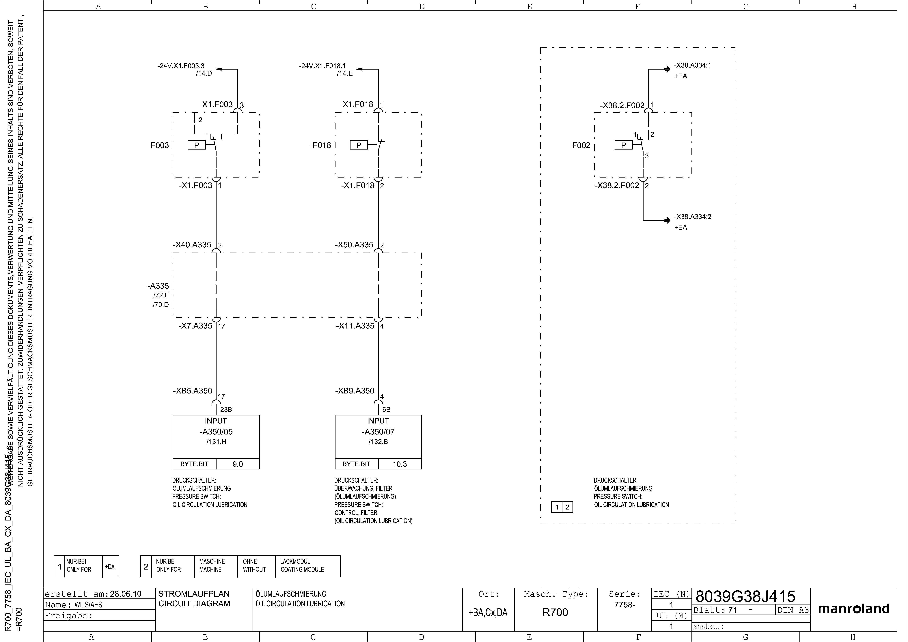

# +BA_Cx_DA — Sheet 71 of 247 — ÖLUMLAUFSCHMIERUNG

**OIL CIRCULATION LUBRICATION**

> Part of the manroland **R700** printing press IEC/UL circuit diagrams.
> Drawing class: **Stromlaufplan / Circuit diagram** (DIN A3).
> Document `+BA_Cx_DA` covers the **Printing units / main switch cabinet** machine section.

## At a glance

| Field | Value |
|---|---|
| Document | `+BA_Cx_DA`  (8039G38J415) |
| Sheet | **71** of 247 |
| Section (DE) | ÖLUMLAUFSCHMIERUNG |
| Section (EN) | OIL CIRCULATION LUBRICATION |
| Section type | CIRCUIT — Circuit diagram |
| Machine type | `R700` |
| Series | `7758` |
| Created | 28.06.10 |
| Replaces | — |
| Columns used | A, B, C, D, E, F, G |
| Path numbers | — |
| Labels on sheet | 86 |
| Cross-refs out | 6 |
| Cross-refs in | 16 |

**Previous:** [+BA_Cx_DA sheet 70](SHEET_0070.md) · **Next:** [+BA_Cx_DA sheet 72](SHEET_0072.md) · **Document TOC:** [_TOC.md](_TOC.md)  (+BA_Cx_DA) · **Master TOC:** [all sheets](../_MASTER_TOC.md)

## Sheet image (300 DPI, exact vector render)



_Rendered directly from the PDF vector layer at 300 DPI (1-bit), no OCR and no resampling. Use it to confirm anything ambiguous in the text below._

## Cross-references on this sheet

Each entry is a wire leaving this sheet. The printed token is `/sheet.column`; the link resolves to that sheet inside the same document.

| Ref | Target sheet | Col | Path | Destination on target | Target section | From col |
|---|---|---|---|---|---|---|
| `/14.E` | [+BA_Cx_DA sheet 14](SHEET_0014.md) | E | — | 24V.X1.F003:3 24V.X1.F018:1 | SPANNUNGSVERSORGUNG, SCHALTSCHRANKBELÜFTUNG | B |
| `/14.D` | [+BA_Cx_DA sheet 14](SHEET_0014.md) | D | — | 24V.X1.F003:3 24V.X1.F018:1 | SPANNUNGSVERSORGUNG, SCHALTSCHRANKBELÜFTUNG | B |
| `/72.F` | [+BA_Cx_DA sheet 72](SHEET_0072.md) | F | — | — | FEUCHTWERK | B |
| `/70.D` | [+BA_Cx_DA sheet 70](SHEET_0070.md) | D | — | — | ÖLUMLAUFSCHMIERUNG | B |
| `/132.B` | [+BA_Cx_DA sheet 132](SHEET_0132.md) | B | — | — | REFERENZMODUL | D |
| `/131.H` | [+BA_Cx_DA sheet 131](SHEET_0131.md) | H | — | — | REFERENZMODUL | B |

### Incoming references (sheets that point here)

Every other sheet that sends a wire to this one. `Back-ref` is the token printed on *that* sheet; `Path` is its line number.

| From sheet | Cols | Back-ref | Path | Refs | What continues there |
|---|---|---|---|---|---|
| [+BA_Cx_DA#14](SHEET_0014.md) | D, E | `/14.D`, `/14.E` | — | 2 | 24V.X1.F003:3; 24V.X1.F018:1 |
| [+BA_Cx_DA#70](SHEET_0070.md) | D | `/70.D` | — | 1 | — |
| [+BA_Cx_DA#72](SHEET_0072.md) | F | `/72.F` | — | 1 | — |
| [+BA_Cx_DA#131](SHEET_0131.md) | H | `/131.H` | — | 1 | — |
| [+BA_Cx_DA#132](SHEET_0132.md) | B | `/132.B` | — | 1 | — |
| [+BA_Cx_DA#147](SHEET_0147.md) | B | `/147.B` | — | 2 | — |
| [+BA_Cx_DA#161](SHEET_0161.md) | F | `/161.F` | — | 1 | — |
| [+BA_Cx_DA#163](SHEET_0163.md) | G | `/163.G` | — | 1 | — |
| [+BA_Cx_DA#166](SHEET_0166.md) | G | `/166.G` | — | 1 | — |
| [+BA_Cx_DA#168](SHEET_0168.md) | G | `/168.G` | — | 1 | — |
| [+BA_Cx_DA#180](SHEET_0180.md) | H | `/180.H` | — | 2 | — |
| [+BA_Cx_DA#181](SHEET_0181.md) | A | `/181.A` | — | 1 | — |
| [+BA_Cx_DA#182](SHEET_0182.md) | E | `/182.E` | — | 1 | — |


## Devices on this sheet

| Tag | Class | Class meaning (IEC) | Col | Sub | Terminal | Sign |
|---|---|---|---|---|---|---|
| `F018` | F | Schutz / protection device (fuse, circuit breaker) | C | — | — | — |
| `F003` | F | Schutz / protection device (fuse, circuit breaker) | B | — | — | — |
| `A335` | A | Baugruppe / assembly, module, PC board | B | — | — | — |
| `A350/07` | A | Baugruppe / assembly, module, PC board | D | 07 | — | — |
| `A350/05` | A | Baugruppe / assembly, module, PC board | B | 05 | — | — |
| `F002` | F | Schutz / protection device (fuse, circuit breaker) | E | — | — | — |
| `X1.F018` | — | cross-device reference | C | — | — | — |
| `X1.F018` | — | cross-device reference | C | — | — | — |
| `X1.F003` | — | cross-device reference | B | — | — | — |
| `X1.F003` | — | cross-device reference | B | — | — | — |
| `X11.A335` | — | cross-device reference | C | — | — | — |
| `X50.A335` | — | cross-device reference | C | — | — | — |
| `X7.A335` | — | cross-device reference | B | — | — | — |
| `X40.A335` | — | cross-device reference | B | — | — | — |
| `10.3` | — | cross-device reference | D | — | — | — |
| `XB9.A350` | — | cross-device reference | C | — | — | — |
| `9.0` | — | cross-device reference | B | — | — | — |
| `XB5.A350` | — | cross-device reference | B | — | — | — |
| `X38.2.F002` | — | cross-device reference | F | — | — | — |
| `X38.2.F002` | — | cross-device reference | F | — | — | — |
| `X38.A334:1` | — | cross-device reference | G | — | 1 | — |
| `X38.A334:2` | — | cross-device reference | G | — | 2 | — |

## Potentials / nets

| Potential | Count | Columns | Attached devices | Terminals |
|---|---|---|---|---|
| `24V` | 2 | B, C | `F003`, `F018`, `X1` | `1`, `3` |


A potential such as `L24+/4` or `M24+` is a named supply/return rail; every place it appears on this sheet is electrically common.

## Wire-end annotations (grouped as printed)

A wire that continues elsewhere is annotated with a small cluster: the destination description, the path/line number `#NN`, and the `/sheet.column` cross reference. Each row below is one such cluster exactly as it is grouped on the drawing.

| Col | Y | Path | Cross-ref | Text on the wire |
|---|---|---|---|---|
| G | 81.8 | — | — | `X38.A334:1` |
| B | 82.5 | — | `/14.E`, `/14.D` | `24V.X1.F003:3 24V.X1.F018:1` |
| F | 95.9 | — | — | `+EA` |
| B | 132.1 | — | — | `X1.F003 3` |
| C | 132.1 | — | — | `X1.F018 1` |
| F | 133.5 | — | — | `X38.2.F002 1` |
| B | 153.4 | — | — | `2` |
| F | 172.5 | — | — | `P 2` |
| F | 172.5 | — | — | `1` |
| B | 186.0 | — | — | `F003` |
| C | 186.0 | — | — | `F018` |
| E | 186.0 | — | — | `F002` |
| B | 186.3 | — | — | `P` |
| C | 186.3 | — | — | `P` |
| F | 200.9 | — | — | `3` |
| B | 238.4 | — | — | `X1.F003 1` |
| C | 238.4 | — | — | `X1.F018 2` |
| F | 238.4 | — | — | `X38.2.F002 2` |
| G | 280.2 | — | — | `X38.A334:2` |
| F | 294.3 | — | — | `+EA` |
| B | 316.4 | — | — | `X40.A335 2` |
| C | 316.4 | — | — | `X50.A335 2` |
| B | 370.2 | — | — | `A335` |
| B | 383.3 | — | `/72.F`, `/70.D` | — |
| B | 422.7 | — | — | `X7.A335 17` |
| C | 422.7 | — | — | `X11.A335 4` |
| B | 507.7 | — | — | `XB5.A350 17` |
| C | 507.7 | — | — | `XB9.A350 4` |
| B | 533.2 | — | — | `23B` |
| D | 533.2 | — | — | `6B` |
| B | 547.7 | — | — | `INPUT` |
| D | 547.7 | — | — | `INPUT` |
| B | 561.6 | — | — | `A350/05` |
| D | 561.6 | — | — | `A350/07` |
| D | 575.3 | — | `/132.B` | — |
| B | 575.4 | — | `/131.H` | — |
| B | 604.4 | — | — | `BYTE.BIT 9.0` |
| D | 604.4 | — | — | `BYTE.BIT 10.3` |
| B | 627.1 | — | — | `DRUCKSCHALTER:` |
| C | 627.1 | — | — | `DRUCKSCHALTER: ÜBERWACHUNG, FILTER PRESSURE SWITCH: (ÖLUMLAUFSCHMIERUNG)` |
| F | 627.1 | — | — | `DRUCKSCHALTER:` |
| B | 637.8 | — | — | `PRESSURE SWITCH: ÖLUMLAUFSCHMIERUNG` |
| F | 637.8 | — | — | `PRESSURE SWITCH: ÖLUMLAUFSCHMIERUNG` |
| B | 659.0 | — | — | `OIL CIRCULATION LUBRICATION` |
| F | 659.0 | — | — | `OIL CIRCULATION LUBRICATION` |
| E | 661.5 | — | — | `1 2` |
| D | 669.6 | — | — | `(OIL CIRCULATION LUBRICATION) CONTROL, FILTER` |
| A | 733.3 | — | — | `1 NUR BEI` |
| B | 733.3 | — | — | `NUR BEI` |
| B | 733.4 | — | — | `2 ONLY FOR MASCHINE MACHINE` |
| B | 733.4 | — | — | `OHNE WITHOUT` |
| C | 733.4 | — | — | `LACKMODUL` |
| A | 740.5 | — | — | `ONLY FOR +DA` |
| C | 744.0 | — | — | `COATING MODULE` |


## Reconstructed tables

This sheet carries tabular content (pin map / terminal assignment / index). The grid below was rebuilt from the drawing's own rule lines, so each row is exactly one physical row of the table.

### Table 1 — 1 data rows × 3 columns (at x=226.8, y=544.3)

| INPUT | A350/05 /131.H |  |
|---|---|---|
| `BYTE.BIT` |  | `9.0` |


### Table 2 — 1 data rows × 2 columns (at x=439.4, y=544.3)

| INPUT | A350/07 /132.B |
|---|---|
| `BYTE.BIT` | `10.3` |


## Notes and free text on this sheet

| Text | Col | Y (pt) |
|---|---|---|
| `P` | C | 186.29 |
| `P` | B | 186.29 |
| `6B` | D | 533.18 |
| `INPUT` | D | 547.72 |
| `BYTE.BIT` | C | 604.97 |
| `DRUCKSCHALTER:` | C | 627.08 |
| `ÜBERWACHUNG, FILTER` | C | 637.7 |
| `(ÖLUMLAUFSCHMIERUNG)` | C | 648.38 |
| `PRESSURE SWITCH:` | C | 658.94 |
| `CONTROL, FILTER` | C | 669.63 |
| `(OIL CIRCULATION LUBRICATION)` | D | 680.26 |
| `23B` | B | 533.2 |
| `INPUT` | B | 547.72 |
| `BYTE.BIT` | B | 604.97 |
| `DRUCKSCHALTER:` | B | 627.08 |
| `ÖLUMLAUFSCHMIERUNG` | B | 637.75 |
| `PRESSURE SWITCH:` | B | 648.3 |
| `OIL CIRCULATION LUBRICATION` | B | 658.99 |
| `P` | F | 186.29 |
| `DRUCKSCHALTER:` | F | 627.08 |
| `ÖLUMLAUFSCHMIERUNG` | F | 637.75 |
| `PRESSURE SWITCH:` | F | 648.3 |
| `OIL CIRCULATION LUBRICATION` | F | 658.99 |
| `+EA` | F | 95.92 |
| `NUR BEI` | A | 733.33 |
| `ONLY FOR` | A | 744.02 |
| `+DA` | A | 740.47 |
| `NUR BEI` | B | 733.33 |
| `ONLY FOR` | B | 744.02 |
| `MASCHINE` | B | 733.38 |
| `MACHINE` | B | 744.02 |
| `OHNE` | B | 733.37 |
| `WITHOUT` | B | 743.97 |
| `LACKMODUL` | C | 733.4 |
| `COATING MODULE` | C | 744.03 |

## Complete label inventory (exact text from the drawing)

Every text object inside the drawing area of this sheet, in DIN reading order (column A→H, then top→bottom). This is the authoritative list: if a string is not here it is not printed on this sheet.

| Col | Y | X | Dir | Type | Text |
|---|---|---|---|---|---|
| A | 733.3 | 87.0 | → | text | `NUR BEI` |
| A | 738.7 | 75.4 | → | number | `1` |
| A | 738.7 | 188.5 | → | number | `2` |
| A | 740.5 | 137.9 | → | text | `+DA` |
| A | 744.0 | 87.6 | → | text | `ONLY FOR` |
| B | 82.5 | 206.6 | → | potential | `24V.X1.F003:3` |
| B | 92.4 | 257.1 | → | cross-reference | `/14.D` |
| B | 132.1 | 261.6 | → | device ref | `X1.F003` |
| B | 133.5 | 314.1 | → | number | `3` |
| B | 153.4 | 260.5 | → | number | `2` |
| B | 186.0 | 193.9 | → | device tag | `F003` |
| B | 186.3 | 254.6 | → | text | `P` |
| B | 238.4 | 234.7 | → | device ref | `X1.F003` |
| B | 238.4 | 285.2 | → | number | `1` |
| B | 316.4 | 226.8 | → | device ref | `X40.A335` |
| B | 317.8 | 286.0 | → | number | `2` |
| B | 370.2 | 193.3 | → | device tag | `A335` |
| B | 383.3 | 201.3 | → | cross-reference | `/72.F` |
| B | 395.7 | 200.4 | → | cross-reference | `/70.D` |
| B | 422.7 | 234.1 | → | device ref | `X7.A335` |
| B | 424.1 | 285.4 | → | number | `17` |
| B | 507.7 | 227.1 | → | device ref | `XB5.A350` |
| B | 516.2 | 285.4 | → | number | `17` |
| B | 533.2 | 288.9 | → | text | `23B` |
| B | 547.7 | 268.6 | → | text | `INPUT` |
| B | 561.6 | 262.1 | → | device tag | `A350/05` |
| B | 575.4 | 271.0 | → | cross-reference | `/131.H` |
| B | 604.4 | 305.0 | → | device ref | `9.0` |
| B | 605.0 | 236.7 | → | text | `BYTE.BIT` |
| B | 627.1 | 225.9 | → | text | `DRUCKSCHALTER:` |
| B | 637.7 | 226.5 | → | text | `ÖLUMLAUFSCHMIERUNG` |
| B | 648.3 | 225.9 | → | text | `PRESSURE SWITCH:` |
| B | 659.0 | 226.5 | → | text | `OIL CIRCULATION LUBRICATION` |
| B | 733.3 | 204.7 | → | text | `NUR BEI` |
| B | 733.4 | 261.6 | → | text | `MASCHINE` |
| B | 733.4 | 318.6 | → | text | `OHNE` |
| B | 744.0 | 205.2 | → | text | `ONLY FOR` |
| B | 744.0 | 261.6 | → | text | `MACHINE` |
| B | 744.0 | 318.9 | → | text | `WITHOUT` |
| C | 82.5 | 392.3 | → | potential | `24V.X1.F018:1` |
| C | 92.4 | 441.9 | → | cross-reference | `/14.E` |
| C | 132.1 | 445.9 | → | device ref | `X1.F018` |
| C | 186.0 | 406.5 | → | device tag | `F018` |
| C | 186.3 | 467.1 | → | text | `P` |
| C | 238.4 | 447.3 | → | device ref | `X1.F018` |
| C | 316.4 | 439.4 | → | device ref | `X50.A335` |
| C | 422.7 | 440.8 | → | device ref | `X11.A335` |
| C | 507.7 | 439.7 | → | device ref | `XB9.A350` |
| C | 605.0 | 449.3 | → | text | `BYTE.BIT` |
| C | 627.1 | 438.5 | → | text | `DRUCKSCHALTER:` |
| C | 637.7 | 438.5 | → | text | `ÜBERWACHUNG, FILTER` |
| C | 648.4 | 438.8 | → | text | `(ÖLUMLAUFSCHMIERUNG)` |
| C | 658.9 | 438.5 | → | text | `PRESSURE SWITCH:` |
| C | 669.6 | 439.1 | → | text | `CONTROL, FILTER` |
| C | 733.4 | 367.7 | → | text | `LACKMODUL` |
| C | 744.0 | 368.2 | → | text | `COATING MODULE` |
| D | 133.6 | 498.0 | → | number | `1` |
| D | 239.9 | 498.6 | → | number | `2` |
| D | 317.8 | 498.6 | → | number | `2` |
| D | 424.1 | 498.6 | → | number | `4` |
| D | 516.2 | 498.6 | → | number | `4` |
| D | 533.2 | 501.4 | → | text | `6B` |
| D | 547.7 | 481.2 | → | text | `INPUT` |
| D | 561.6 | 474.7 | → | device tag | `A350/07` |
| D | 575.3 | 483.4 | → | cross-reference | `/132.B` |
| D | 604.4 | 514.6 | → | device ref | `10.3` |
| D | 680.3 | 438.8 | → | text | `(OIL CIRCULATION LUBRICATION)` |
| E | 186.0 | 746.6 | → | device tag | `F002` |
| E | 661.5 | 727.9 | → | number | `1` |
| E | 661.5 | 741.8 | → | number | `2` |
| F | 95.9 | 884.1 | → | text | `+EA` |
| F | 133.5 | 786.9 | → | device ref | `X38.2.F002` |
| F | 133.6 | 852.4 | → | number | `1` |
| F | 172.5 | 830.3 | → | number | `1` |
| F | 172.5 | 852.9 | → | number | `2` |
| F | 186.3 | 814.4 | → | text | `P` |
| F | 200.9 | 845.9 | → | number | `3` |
| F | 238.4 | 779.8 | → | device ref | `X38.2.F002` |
| F | 239.9 | 845.9 | → | number | `2` |
| F | 294.3 | 884.1 | → | text | `+EA` |
| F | 627.1 | 778.7 | → | text | `DRUCKSCHALTER:` |
| F | 637.7 | 779.2 | → | text | `ÖLUMLAUFSCHMIERUNG` |
| F | 648.3 | 778.7 | → | text | `PRESSURE SWITCH:` |
| F | 659.0 | 779.2 | → | text | `OIL CIRCULATION LUBRICATION` |
| G | 81.8 | 884.1 | → | device ref | `X38.A334:1` |
| G | 280.2 | 884.1 | → | device ref | `X38.A334:2` |

## Reading-order text block

The same content as a plain block, grouped by DIN column — convenient to paste or to match against a visual description.

```text
=== Column A ===
 733.3   87.0  text         NUR BEI
 738.7   75.4  numeric      1
 738.7  188.5  numeric      2
 740.5  137.9  text         +DA
 744.0   87.6  text         ONLY FOR
=== Column B ===
  82.5  206.6  net          24V.X1.F003:3
  92.4  257.1  xref         /14.D
 132.1  261.6  devref       X1.F003
 133.5  314.1  numeric      3
 153.4  260.5  numeric      2
 186.0  193.9  devtag       F003
 186.3  254.6  text         P
 238.4  234.7  devref       X1.F003
 238.4  285.2  numeric      1
 316.4  226.8  devref       X40.A335
 317.8  286.0  numeric      2
 370.2  193.3  devtag       A335
 383.3  201.3  xref         /72.F
 395.7  200.4  xref         /70.D
 422.7  234.1  devref       X7.A335
 424.1  285.4  numeric      17
 507.7  227.1  devref       XB5.A350
 516.2  285.4  numeric      17
 533.2  288.9  text         23B
 547.7  268.6  text         INPUT
 561.6  262.1  devtag       A350/05
 575.4  271.0  xref         /131.H
 604.4  305.0  devref       9.0
 605.0  236.7  text         BYTE.BIT
 627.1  225.9  text         DRUCKSCHALTER:
 637.7  226.5  text         ÖLUMLAUFSCHMIERUNG
 648.3  225.9  text         PRESSURE SWITCH:
 659.0  226.5  text         OIL CIRCULATION LUBRICATION
 733.3  204.7  text         NUR BEI
 733.4  261.6  text         MASCHINE
 733.4  318.6  text         OHNE
 744.0  205.2  text         ONLY FOR
 744.0  261.6  text         MACHINE
 744.0  318.9  text         WITHOUT
=== Column C ===
  82.5  392.3  net          24V.X1.F018:1
  92.4  441.9  xref         /14.E
 132.1  445.9  devref       X1.F018
 186.0  406.5  devtag       F018
 186.3  467.1  text         P
 238.4  447.3  devref       X1.F018
 316.4  439.4  devref       X50.A335
 422.7  440.8  devref       X11.A335
 507.7  439.7  devref       XB9.A350
 605.0  449.3  text         BYTE.BIT
 627.1  438.5  text         DRUCKSCHALTER:
 637.7  438.5  text         ÜBERWACHUNG, FILTER
 648.4  438.8  text         (ÖLUMLAUFSCHMIERUNG)
 658.9  438.5  text         PRESSURE SWITCH:
 669.6  439.1  text         CONTROL, FILTER
 733.4  367.7  text         LACKMODUL
 744.0  368.2  text         COATING MODULE
=== Column D ===
 133.6  498.0  numeric      1
 239.9  498.6  numeric      2
 317.8  498.6  numeric      2
 424.1  498.6  numeric      4
 516.2  498.6  numeric      4
 533.2  501.4  text         6B
 547.7  481.2  text         INPUT
 561.6  474.7  devtag       A350/07
 575.3  483.4  xref         /132.B
 604.4  514.6  devref       10.3
 680.3  438.8  text         (OIL CIRCULATION LUBRICATION)
=== Column E ===
 186.0  746.6  devtag       F002
 661.5  727.9  numeric      1
 661.5  741.8  numeric      2
=== Column F ===
  95.9  884.1  text         +EA
 133.5  786.9  devref       X38.2.F002
 133.6  852.4  numeric      1
 172.5  830.3  numeric      1
 172.5  852.9  numeric      2
 186.3  814.4  text         P
 200.9  845.9  numeric      3
 238.4  779.8  devref       X38.2.F002
 239.9  845.9  numeric      2
 294.3  884.1  text         +EA
 627.1  778.7  text         DRUCKSCHALTER:
 637.7  779.2  text         ÖLUMLAUFSCHMIERUNG
 648.3  778.7  text         PRESSURE SWITCH:
 659.0  779.2  text         OIL CIRCULATION LUBRICATION
=== Column G ===
  81.8  884.1  devref       X38.A334:1
 280.2  884.1  devref       X38.A334:2
```

---
_Generated from the PDF vector text layer; no OCR. Source: `R700_7758_IEC_UL_BA_CX_DA_8039G38J415_p`, sheet 71._
