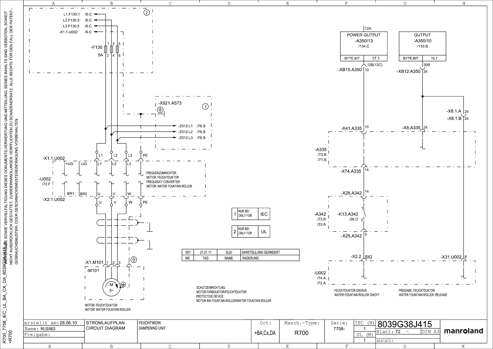

# +BA_Cx_DA — Sheet 72 of 247 — FEUCHTWERK

**DAMPENING UNIT**

> Part of the manroland **R700** printing press IEC/UL circuit diagrams.
> Drawing class: **Stromlaufplan / Circuit diagram** (DIN A3).
> Document `+BA_Cx_DA` covers the **Printing units / main switch cabinet** machine section.

## At a glance

| Field | Value |
|---|---|
| Document | `+BA_Cx_DA`  (8039G38J415) |
| Sheet | **72** of 247 |
| Section (DE) | FEUCHTWERK |
| Section (EN) | DAMPENING UNIT |
| Section type | CIRCUIT — Circuit diagram |
| Machine type | `R700` |
| Series | `7758` |
| Created | 28.06.10 |
| Replaces | — |
| Columns used | A, B, C, D, E, F, G, H |
| Path numbers | — |
| Labels on sheet | 134 |
| Cross-refs out | 17 |
| Cross-refs in | 39 |

**Previous:** [+BA_Cx_DA sheet 71](SHEET_0071.md) · **Next:** [+BA_Cx_DA sheet 73](SHEET_0073.md) · **Document TOC:** [_TOC.md](_TOC.md)  (+BA_Cx_DA) · **Master TOC:** [all sheets](../_MASTER_TOC.md)

## Sheet image (300 DPI, exact vector render)



_Rendered directly from the PDF vector layer at 300 DPI (1-bit), no OCR and no resampling. Use it to confirm anything ambiguous in the text below._

## Cross-references on this sheet

Each entry is a wire leaving this sheet. The printed token is `/sheet.column`; the link resolves to that sheet inside the same document.

| Ref | Target sheet | Col | Path | Destination on target | Target section | From col |
|---|---|---|---|---|---|---|
| `/6.C` | [+BA_Cx_DA sheet 6](SHEET_0006.md) | C | — | L1.F130:1 | SPANNUNGSVERSORGUNG: 400V | A |
| `/6.C` | [+BA_Cx_DA sheet 6](SHEET_0006.md) | C | — | L2.F130:3 | SPANNUNGSVERSORGUNG: 400V | A |
| `/6.C` | [+BA_Cx_DA sheet 6](SHEET_0006.md) | C | — | L3.F130:5 | SPANNUNGSVERSORGUNG: 400V | A |
| `/6.C` | [+BA_Cx_DA sheet 6](SHEET_0006.md) | C | — | X1.1.U002:` | SPANNUNGSVERSORGUNG: 400V | A |
| `/133.B` | [+BA_Cx_DA sheet 133](SHEET_0133.md) | B | — | — | REFERENZMODUL | G |
| `/134.C` | [+BA_Cx_DA sheet 134](SHEET_0134.md) | C | — | — | REFERENZMODUL | F |
| `/76.B` | [+BA_Cx_DA sheet 76](SHEET_0076.md) | B | — | Z012:L1 | FARBWERK | C |
| `/76.B` | [+BA_Cx_DA sheet 76](SHEET_0076.md) | B | — | Z012:L2 | FARBWERK | C |
| `/76.B` | [+BA_Cx_DA sheet 76](SHEET_0076.md) | B | — | Z012:L3 | FARBWERK | C |
| `/73.B` | [+BA_Cx_DA sheet 73](SHEET_0073.md) | B | — | — | FEUCHTWERK | F |
| `/71.B` | [+BA_Cx_DA sheet 71](SHEET_0071.md) | B | — | — | ÖLUMLAUFSCHMIERUNG | F |
| `/72.F` | [+BA_Cx_DA sheet 72](SHEET_0072.md) | F | — | — | FEUCHTWERK | A |
| `/26.D` | [+BA_Cx_DA sheet 26](SHEET_0026.md) | D | — | A342 | BUSVERBINDUNGEN: NOT AUS | F |
| `/73.B` | [+BA_Cx_DA sheet 73](SHEET_0073.md) | B | — | — | FEUCHTWERK | F |
| `/33.A` | [+BA_Cx_DA sheet 33](SHEET_0033.md) | A | — | — | BUSVERBINDUNGEN: RESERVE SIGNALE | F |
| `/74.A` | [+BA_Cx_DA sheet 74](SHEET_0074.md) | A | — | — | FEUCHTWERK | F |
| `/72.A` | [+BA_Cx_DA sheet 72](SHEET_0072.md) | A | — | — | FEUCHTWERK | F |

### Incoming references (sheets that point here)

Every other sheet that sends a wire to this one. `Back-ref` is the token printed on *that* sheet; `Path` is its line number.

| From sheet | Cols | Back-ref | Path | Refs | What continues there |
|---|---|---|---|---|---|
| [+BA_Cx_DA#6](SHEET_0006.md) | C | `/6.C` | — | 4 | L1.F130:1; L2.F130:3; L3.F130:5; X1.1.U002:` |
| [+BA_Cx_DA#26](SHEET_0026.md) | D | `/26.D` | — | 1 | — |
| [+BA_Cx_DA#33](SHEET_0033.md) | A | `/33.A` | — | 1 | — |
| [+BA_Cx_DA#71](SHEET_0071.md) | B | `/71.B` | — | 1 | — |
| [+BA_Cx_DA#72](SHEET_0072.md) | A, F | `/72.A`, `/72.F` | — | 2 | — |
| [+BA_Cx_DA#73](SHEET_0073.md) | B | `/73.B` | — | 2 | — |
| [+BA_Cx_DA#74](SHEET_0074.md) | A | `/74.A` | — | 1 | — |
| [+BA_Cx_DA#76](SHEET_0076.md) | A | `/76.A` | — | 3 | Z012:L1; Z012:L2; Z012:L3 |
| [+BA_Cx_DA#133](SHEET_0133.md) | B | `/133.B` | — | 1 | — |
| [+BA_Cx_DA#134](SHEET_0134.md) | C | `/134.C` | — | 1 | — |
| [+BA_Cx_DA#147](SHEET_0147.md) | G | `/147.G` | — | 4 | — |
| [+BA_Cx_DA#149](SHEET_0149.md) | E | `/149.E` | — | 4 | — |
| [+BA_Cx_DA#155](SHEET_0155.md) | H | `/155.H` | — | 4 | — |
| [+BA_Cx_DA#164](SHEET_0164.md) | E, F | `/164.E`, `/164.F` | — | 2 | — |
| [+BA_Cx_DA#165](SHEET_0165.md) | E | `/165.E` | — | 1 | — |
| [+BA_Cx_DA#169](SHEET_0169.md) | G | `/169.G` | — | 1 | — |
| [+BA_Cx_DA#171](SHEET_0171.md) | G | `/171.G` | — | 1 | — |
| [+BA_Cx_DA#175](SHEET_0175.md) | F | `/175.F` | — | 1 | — |
| [+BA_Cx_DA#178](SHEET_0178.md) | F | `/178.F` | — | 1 | — |
| [+BA_Cx_DA#179](SHEET_0179.md) | G | `/179.G` | — | 1 | — |
| [+BA_Cx_DA#181](SHEET_0181.md) | F | `/181.F` | — | 1 | — |
| [+BA_Cx_DA#184](SHEET_0184.md) | F | `/184.F` | — | 1 | — |


## Devices on this sheet

| Tag | Class | Class meaning (IEC) | Col | Sub | Terminal | Sign |
|---|---|---|---|---|---|---|
| `U002` | U | Umrichter / frequency converter | A | — | — | — |
| `BR2` | BR |  | B | — | — | — |
| `F130` | F | Schutz / protection device (fuse, circuit breaker) | B | — | — | — |
| `A350/10` | A | Baugruppe / assembly, module, PC board | G | 10 | — | — |
| `A350/13` | A | Baugruppe / assembly, module, PC board | F | 13 | — | — |
| `A342` | A | Baugruppe / assembly, module, PC board | F | — | — | — |
| `U002` | U | Umrichter / frequency converter | F | — | — | — |
| `A335` | A | Baugruppe / assembly, module, PC board | F | — | — | — |
| `Z012:L2` | Z |  | C | — | L2 | — |
| `Z012:L1` | Z |  | C | — | L1 | — |
| `Z012:L3` | Z |  | C | — | L3 | — |
| `BR1` | BR |  | A | — | — | — |
| `X1.1.U002` | — | cross-device reference | A | — | — | — |
| `X2.1.U002` | — | cross-device reference | A | — | — | — |
| `X1.M101` | — | cross-device reference | B | — | — | — |
| `X8.A335` | — | cross-device reference | G | — | — | — |
| `X8.1.A` | — | cross-device reference | H | — | — | — |
| `X8.1.B` | — | cross-device reference | H | — | — | — |
| `15.7` | — | cross-device reference | G | — | — | — |
| `XB12.A350` | — | cross-device reference | G | — | — | — |
| `17.1` | — | cross-device reference | G | — | — | — |
| `XB15.A350` | — | cross-device reference | F | — | — | — |
| `X41.A335` | — | cross-device reference | F | — | — | — |
| `X74.A335` | — | cross-device reference | F | — | — | — |
| `X28.A342` | — | cross-device reference | F | — | — | — |
| `X25.A342` | — | cross-device reference | F | — | — | — |
| `K13.A342` | — | cross-device reference | F | — | — | — |
| `X31.U002` | — | cross-device reference | H | — | — | — |
| `X2.2` | — | cross-device reference | F | — | — | — |
| `NR.` | — | cross-device reference | C | — | — | — |
| `21.01.11` | — | cross-device reference | D | — | — | — |
| `X921.A573` | — | cross-device reference | C | — | — | — |

## Potentials / nets

| Potential | Count | Columns | Attached devices | Terminals |
|---|---|---|---|---|
| `L1` | 3 | A, B | `F130` | `1` |
| `L2` | 3 | A, B | `F130` | `3` |
| `L3` | 3 | A, B | `F130` | `5` |
| `M101` | 1 | B | — | — |
| `PE` | 2 | C | — | — |


A potential such as `L24+/4` or `M24+` is a named supply/return rail; every place it appears on this sheet is electrically common.

## Wire-end annotations (grouped as printed)

A wire that continues elsewhere is annotated with a small cluster: the destination description, the path/line number `#NN`, and the `/sheet.column` cross reference. Each row below is one such cluster exactly as it is grouped on the drawing.

| Col | Y | Path | Cross-ref | Text on the wire |
|---|---|---|---|---|
| C | 27.5 | — | — | `2` |
| A | 30.7 | — | `/6.C` | `L1.F130:1` |
| A | 44.9 | — | `/6.C` | `L2.F130:3` |
| A | 59.1 | — | `/6.C` | `L3.F130:5` |
| F | 64.8 | — | — | `12A` |
| A | 73.3 | — | `/6.C` | `X1.1.U002:'` |
| F | 79.9 | — | — | `POWER QUTPUT` |
| G | 80.0 | — | — | `QUTPUT` |
| F | 93.8 | — | — | `A350/13` |
| G | 93.8 | — | — | `A350/10` |
| B | 101.7 | — | — | `1 3` |
| B | 101.7 | — | — | `5` |
| G | 107.6 | — | `/133.B` | — |
| F | 107.7 | — | `/134.C` | — |
| B | 109.4 | — | — | `F130` |
| B | 128.1 | — | — | `5A` |
| B | 130.0 | — | — | `2 4 6` |
| F | 136.7 | — | — | `BYTE.BIT 17.1` |
| G | 137.3 | — | — | `BYTE.BIT 15.7` |
| F | 152.7 | — | — | `12B(12C)` |
| G | 152.7 | — | — | `30B` |
| F | 163.3 | — | — | `XB15.A350 10` |
| G | 167.6 | — | — | `XB12.A350 24` |
| C | 244.1 | — | — | `X921.A573` |
| D | 253.8 | — | — | `1` |
| H | 263.2 | — | — | `X8.1.A 24` |
| H | 281.0 | — | — | `X8.1.B 24` |
| C | 300.0 | — | `/76.B` | `Z012:L1` |
| F | 302.2 | — | — | `X41.A335 10` |
| G | 303.6 | — | — | `X8.A335 24` |
| C | 314.2 | — | `/76.B` | `Z012:L2` |
| C | 328.4 | — | `/76.B` | `Z012:L3` |
| F | 356.1 | — | — | `A335` |
| F | 369.1 | — | `/73.B`, `/71.B` | — |
| A | 370.9 | — | — | `X1.1.U002 L1` |
| B | 370.9 | — | — | `L2` |
| B | 370.9 | — | — | `L3` |
| C | 370.9 | — | — | `PE` |
| A | 391.5 | — | — | `+UG UG` |
| B | 391.5 | — | — | `L1` |
| B | 391.5 | — | — | `L2` |
| B | 391.5 | — | — | `L3` |
| C | 391.6 | — | — | `'` |
| F | 405.7 | — | — | `X74.A335 14` |
| C | 414.5 | — | — | `FREQUENZUMRICHTER: FREQUENCY CONVERTER: MOTOR: FEUCHTDUKTOR MOTOR: WATER FOUNTAIN ROLLER` |
| A | 426.9 | — | — | `U002` |
| A | 440.0 | — | `/72.F` | — |
| F | 458.1 | — | — | `X28.A342 14` |
| A | 463.1 | — | — | `BR1` |
| B | 463.4 | — | — | `U V W '` |
| B | 463.8 | — | — | `BR2` |
| B | 476.5 | — | — | `X2.1.U002 U W PE` |
| B | 484.2 | — | — | `V` |
| F | 498.5 | — | — | `K13.A342 1` |
| D | 506.6 | — | — | `1 NUR BEI` |
| D | 512.0 | — | — | `ONLY FOR IEC` |
| F | 512.0 | — | `/26.D` | `A342` |
| F | 525.0 | — | `/73.B`, `/33.A` | — |
| F | 526.9 | — | — | `2` |
| D | 549.1 | — | — | `2 NUR BEI` |
| D | 554.5 | — | — | `ONLY FOR UL` |
| F | 561.6 | — | — | `X25.A342 5` |
| D | 605.5 | — | — | `001 21.01.11 SLEI DARSTELLUNG GEÄNDERT` |
| G | 614.0 | — | — | `X2.2 SIG X31.U002 8` |
| D | 619.6 | — | — | `NR. TAG NAME ÄNDERUNG` |
| B | 628.2 | — | — | `X1.M101 1 2 3` |
| B | 648.0 | — | — | `M101` |
| F | 653.7 | — | — | `U002` |
| F | 666.7 | — | `/74.A`, `/72.A` | — |
| B | 682.3 | — | — | `3~ M` |
| D | 690.9 | — | — | `PROTECTIVE DEVICE: MOTOR FARBDUKTOR/FEUCHTDUKTOR MOTOR INK FOUNTAIN ROLLER/WATER FOUNTAIN ROLLER SCHUTZEINRICHTUNG:` |
| F | 698.0 | — | — | `FEUCHTDUKTOR EIN/AUS` |
| G | 698.0 | — | — | `FREIGABE: FEUCHTDUKTOR` |
| F | 708.6 | — | — | `WATER FOUNTAIN ROLLER ON/OFF` |
| G | 708.6 | — | — | `WATER FOUNTAIN ROLLER: RELEASE` |
| B | 733.4 | — | — | `MOTOR: FEUCHTDUKTOR MOTOR: WATER FOUNTAIN ROLLER` |


## Reconstructed tables

This sheet carries tabular content (pin map / terminal assignment / index). The grid below was rebuilt from the drawing's own rule lines, so each row is exactly one physical row of the table.

### Table 1 — 3 data rows × 7 columns (at x=205.5, y=62.4) — **/6.C**

| /6.C F130 5A | 1 2 | 3 4 | 5 6 |  |  |  |
|---|---|---|---|---|---|---|
| `L1 L1 U U` |  | `L2 L2 V V` |  | `L3` | `L3 W W` | `' '` |
| `X1.M101` | `1` | `2` | `3` |  |  |  |
| `M101` |  |  |  |  |  |  |


### Table 2 — 2 data rows × 2 columns (at x=822.0, y=76.5)

| POWER | QUTPUT A350/13 /134.C |
|---|---|
| `BYTE.BIT` | `17.1` |
| `XB15.A350` | `12B(12C) 10` |


### Table 3 — 2 data rows × 2 columns (at x=963.8, y=76.5)

| QUTPUT | A350/10 /133.B |
|---|---|
| `BYTE.BIT` | `15.7` |
| `XB12.A350` | `30B 24` |


## Notes and free text on this sheet

| Text | Col | Y (pt) |
|---|---|---|
| `UG` | B | 391.51 |
| `+UG` | A | 391.49 |
| `FREQUENZUMRICHTER:` | C | 414.5 |
| `MOTOR: FEUCHTDUKTOR` | C | 425.14 |
| `FREQUENCY CONVERTER:` | C | 435.75 |
| `MOTOR: WATER FOUNTAIN ROLLER` | C | 446.38 |
| `V` | B | 484.24 |
| `W` | B | 463.43 |
| `U` | B | 463.8 |
| `M` | B | 682.32 |
| `MOTOR: FEUCHTDUKTOR` | B | 733.4 |
| `MOTOR: WATER FOUNTAIN ROLLER` | B | 744.01 |
| `5A` | B | 128.14 |
| `30B` | G | 152.65 |
| `QUTPUT` | G | 79.98 |
| `BYTE.BIT` | G | 137.26 |
| `FREIGABE: FEUCHTDUKTOR` | G | 697.95 |
| `WATER FOUNTAIN ROLLER: RELEASE` | G | 708.57 |
| `12A` | F | 64.77 |
| `12B(12C)` | F | 152.68 |
| `POWER QUTPUT` | F | 79.93 |
| `BYTE.BIT` | F | 137.26 |
| `FEUCHTDUKTOR EIN/AUS` | F | 697.95 |
| `WATER FOUNTAIN ROLLER ON/OFF` | F | 708.58 |
| `SIG` | F | 615.52 |
| `X1.1.U002:'` | A | 73.28 |
| `TAG` | D | 619.71 |
| `NAME` | D | 619.69 |
| `ÄNDERUNG` | D | 619.75 |
| `SLEI` | D | 605.54 |
| `DARSTELLUNG GEÄNDERT` | E | 605.58 |
| `SCHUTZEINRICHTUNG:` | D | 690.88 |
| `MOTOR FARBDUKTOR/FEUCHTDUKTOR` | D | 701.52 |
| `PROTECTIVE DEVICE:` | D | 712.1 |
| `MOTOR INK FOUNTAIN ROLLER/WATER FOUNTAIN ROLLER` | D | 722.77 |
| `NUR BEI` | D | 506.56 |
| `ONLY FOR` | D | 517.25 |
| `IEC` | E | 512.05 |
| `UL` | E | 554.47 |

## Complete label inventory (exact text from the drawing)

Every text object inside the drawing area of this sheet, in DIN reading order (column A→H, then top→bottom). This is the authoritative list: if a string is not here it is not printed on this sheet.

| Col | Y | X | Dir | Type | Text |
|---|---|---|---|---|---|
| A | 30.8 | 153.6 | → | potential | `L1.F130:1` |
| A | 44.9 | 152.2 | → | potential | `L2.F130:3` |
| A | 59.1 | 152.2 | → | potential | `L3.F130:5` |
| A | 73.3 | 142.6 | → | text | `X1.1.U002:'` |
| A | 377.3 | 102.9 | → | device ref | `X1.1.U002` |
| A | 391.5 | 158.5 | → | text | `+UG` |
| A | 426.9 | 93.5 | → | device tag | `U002` |
| A | 440.0 | 102.0 | → | cross-reference | `/72.F` |
| A | 463.1 | 162.1 | → | device tag | `BR1` |
| A | 476.5 | 102.9 | → | device ref | `X2.1.U002` |
| B | 30.7 | 205.2 | → | cross-reference | `/6.C` |
| B | 44.9 | 205.2 | → | cross-reference | `/6.C` |
| B | 59.1 | 205.2 | → | cross-reference | `/6.C` |
| B | 73.3 | 205.2 | → | cross-reference | `/6.C` |
| B | 101.7 | 259.1 | → | number | `1` |
| B | 101.7 | 271.8 | → | number | `3` |
| B | 101.7 | 286.0 | → | number | `5` |
| B | 109.4 | 219.4 | → | device tag | `F130` |
| B | 128.1 | 236.7 | → | text | `5A` |
| B | 130.0 | 258.0 | → | number | `2` |
| B | 130.0 | 271.8 | → | number | `4` |
| B | 130.0 | 286.0 | → | number | `6` |
| B | 371.0 | 238.7 | → | potential | `L1` |
| B | 371.0 | 274.1 | → | potential | `L2` |
| B | 371.0 | 309.5 | → | potential | `L3` |
| B | 391.5 | 193.9 | → | text | `UG` |
| B | 391.5 | 235.8 | → | potential | `L1` |
| B | 391.5 | 271.3 | → | potential | `L2` |
| B | 391.5 | 306.7 | → | potential | `L3` |
| B | 463.4 | 307.6 | → | text | `W` |
| B | 463.7 | 272.1 | → | text | `V` |
| B | 463.8 | 193.3 | → | device tag | `BR2` |
| B | 463.8 | 235.8 | → | text | `U` |
| B | 484.0 | 310.4 | → | text | `W` |
| B | 484.2 | 275.0 | → | text | `V` |
| B | 484.4 | 238.7 | → | text | `U` |
| B | 628.2 | 204.1 | → | device ref | `X1.M101` |
| B | 629.6 | 257.1 | → | number | `1` |
| B | 629.6 | 271.8 | → | number | `2` |
| B | 629.6 | 286.0 | → | number | `3` |
| B | 648.0 | 209.5 | → | potential | `M101` |
| B | 682.3 | 265.2 | → | text | `M` |
| B | 696.6 | 263.9 | → | other | `3~` |
| B | 733.4 | 204.9 | → | text | `MOTOR: FEUCHTDUKTOR` |
| B | 744.0 | 204.9 | → | text | `MOTOR: WATER FOUNTAIN ROLLER` |
| C | 27.5 | 352.3 | → | number | `2` |
| C | 244.1 | 382.4 | → | device ref | `X921.A573` |
| C | 300.1 | 430.6 | → | device tag | `Z012:L1` |
| C | 314.2 | 430.6 | → | device tag | `Z012:L2` |
| C | 328.4 | 430.6 | → | device tag | `Z012:L3` |
| C | 370.9 | 345.0 | → | potential | `PE` |
| C | 391.6 | 342.7 | → | other | `'` |
| C | 414.5 | 353.5 | → | text | `FREQUENZUMRICHTER:` |
| C | 425.1 | 353.8 | → | text | `MOTOR: FEUCHTDUKTOR` |
| C | 435.8 | 353.5 | → | text | `FREQUENCY CONVERTER:` |
| C | 446.4 | 353.8 | → | text | `MOTOR: WATER FOUNTAIN ROLLER` |
| C | 463.8 | 342.7 | → | other | `'` |
| C | 484.2 | 345.0 | → | potential | `PE` |
| C | 605.4 | 448.3 | → | number | `001` |
| C | 619.6 | 447.4 | → | device ref | `NR.` |
| D | 253.8 | 494.3 | → | number | `1` |
| D | 300.0 | 475.5 | → | cross-reference | `/76.B` |
| D | 314.2 | 475.5 | → | cross-reference | `/76.B` |
| D | 328.4 | 475.5 | → | cross-reference | `/76.B` |
| D | 506.6 | 576.0 | → | text | `NUR BEI` |
| D | 511.9 | 564.4 | → | number | `1` |
| D | 517.3 | 576.6 | → | text | `ONLY FOR` |
| D | 549.1 | 576.0 | → | text | `NUR BEI` |
| D | 554.4 | 564.1 | → | number | `2` |
| D | 559.8 | 576.6 | → | text | `ONLY FOR` |
| D | 605.5 | 483.1 | → | device ref | `21.01.11` |
| D | 605.5 | 545.2 | → | text | `SLEI` |
| D | 619.7 | 488.9 | → | text | `TAG` |
| D | 619.7 | 542.3 | → | text | `NAME` |
| D | 619.8 | 584.9 | → | text | `ÄNDERUNG` |
| D | 690.9 | 474.5 | → | text | `SCHUTZEINRICHTUNG:` |
| D | 701.5 | 474.2 | → | text | `MOTOR FARBDUKTOR/FEUCHTDUKTOR` |
| D | 712.1 | 474.0 | → | text | `PROTECTIVE DEVICE:` |
| D | 722.8 | 474.2 | → | text | `MOTOR INK FOUNTAIN ROLLER/WATER FOUNTAIN ROLLER` |
| E | 512.1 | 629.0 | → | text | `IEC` |
| E | 554.5 | 630.7 | → | text | `UL` |
| E | 605.6 | 583.8 | → | text | `DARSTELLUNG GEÄNDERT` |
| F | 64.8 | 880.7 | → | text | `12A` |
| F | 79.9 | 837.9 | → | text | `POWER QUTPUT` |
| F | 93.8 | 857.3 | → | device tag | `A350/13` |
| F | 107.7 | 866.0 | → | cross-reference | `/134.C` |
| F | 137.3 | 832.0 | → | text | `BYTE.BIT` |
| F | 152.7 | 886.4 | → | text | `12B(12C)` |
| F | 163.3 | 816.4 | → | device ref | `XB15.A350` |
| F | 164.7 | 880.7 | → | number | `10` |
| F | 302.2 | 880.7 | → | number | `10` |
| F | 305.0 | 823.5 | → | device ref | `X41.A335` |
| F | 356.1 | 760.3 | → | device tag | `A335` |
| F | 369.1 | 767.6 | → | cross-reference | `/73.B` |
| F | 381.5 | 767.6 | → | cross-reference | `/71.B` |
| F | 405.7 | 880.7 | → | number | `14` |
| F | 408.5 | 822.0 | → | device ref | `X74.A335` |
| F | 458.1 | 880.7 | → | number | `14` |
| F | 460.9 | 823.5 | → | device ref | `X28.A342` |
| F | 498.5 | 872.8 | → | number | `1` |
| F | 512.0 | 758.8 | → | device tag | `A342` |
| F | 512.0 | 815.0 | → | device ref | `K13.A342` |
| F | 525.0 | 766.2 | → | cross-reference | `/73.B` |
| F | 525.0 | 843.9 | → | cross-reference | `/26.D` |
| F | 526.9 | 871.7 | → | number | `2` |
| F | 537.4 | 765.9 | → | cross-reference | `/33.A` |
| F | 561.6 | 881.3 | → | number | `5` |
| F | 564.4 | 823.5 | → | device ref | `X25.A342` |
| F | 614.0 | 847.0 | → | device ref | `X2.2` |
| F | 615.5 | 881.0 | → | text | `SIG` |
| F | 653.7 | 758.3 | → | device tag | `U002` |
| F | 666.7 | 765.9 | → | cross-reference | `/74.A` |
| F | 679.1 | 765.9 | → | cross-reference | `/72.A` |
| F | 698.0 | 807.0 | → | text | `FEUCHTDUKTOR EIN/AUS` |
| F | 708.6 | 807.9 | → | text | `WATER FOUNTAIN ROLLER ON/OFF` |
| G | 80.0 | 1000.2 | → | text | `QUTPUT` |
| G | 93.8 | 999.1 | → | device tag | `A350/10` |
| G | 107.6 | 1007.9 | → | cross-reference | `/133.B` |
| G | 136.7 | 898.2 | → | device ref | `17.1` |
| G | 137.3 | 973.7 | → | text | `BYTE.BIT` |
| G | 137.3 | 1040.6 | → | device ref | `15.7` |
| G | 152.6 | 1023.0 | → | text | `30B` |
| G | 167.5 | 958.1 | → | device ref | `XB12.A350` |
| G | 169.0 | 1023.0 | → | number | `24` |
| G | 303.6 | 971.1 | → | device ref | `X8.A335` |
| G | 303.6 | 1023.0 | → | number | `24` |
| G | 697.9 | 962.9 | → | text | `FREIGABE: FEUCHTDUKTOR` |
| G | 708.6 | 963.8 | → | text | `WATER FOUNTAIN ROLLER: RELEASE` |
| H | 263.2 | 1078.6 | → | device ref | `X8.1.A` |
| H | 265.4 | 1122.2 | → | number | `24` |
| H | 281.0 | 1079.4 | → | device ref | `X8.1.B` |
| H | 282.4 | 1122.2 | → | number | `24` |
| H | 615.4 | 1063.8 | → | device ref | `X31.U002` |
| H | 615.4 | 1122.2 | → | number | `8` |

## Reading-order text block

The same content as a plain block, grouped by DIN column — convenient to paste or to match against a visual description.

```text
=== Column A ===
  30.8  153.6  net          L1.F130:1
  44.9  152.2  net          L2.F130:3
  59.1  152.2  net          L3.F130:5
  73.3  142.6  text         X1.1.U002:`
 377.3  102.9  devref       X1.1.U002
 391.5  158.5  text         +UG
 426.9   93.5  devtag       U002
 440.0  102.0  xref         /72.F
 463.1  162.1  devtag       BR1
 476.5  102.9  devref       X2.1.U002
=== Column B ===
  30.7  205.2  xref         /6.C
  44.9  205.2  xref         /6.C
  59.1  205.2  xref         /6.C
  73.3  205.2  xref         /6.C
 101.7  259.1  numeric      1
 101.7  271.8  numeric      3
 101.7  286.0  numeric      5
 109.4  219.4  devtag       F130
 128.1  236.7  text         5A
 130.0  258.0  numeric      2
 130.0  271.8  numeric      4
 130.0  286.0  numeric      6
 371.0  238.7  net          L1
 371.0  274.1  net          L2
 371.0  309.5  net          L3
 391.5  193.9  text         UG
 391.5  235.8  net          L1
 391.5  271.3  net          L2
 391.5  306.7  net          L3
 463.4  307.6  text         W
 463.7  272.1  text         V
 463.8  193.3  devtag       BR2
 463.8  235.8  text         U
 484.0  310.4  text         W
 484.2  275.0  text         V
 484.4  238.7  text         U
 628.2  204.1  devref       X1.M101
 629.6  257.1  numeric      1
 629.6  271.8  numeric      2
 629.6  286.0  numeric      3
 648.0  209.5  net          M101
 682.3  265.2  text         M
 696.6  263.9  other        3~
 733.4  204.9  text         MOTOR: FEUCHTDUKTOR
 744.0  204.9  text         MOTOR: WATER FOUNTAIN ROLLER
=== Column C ===
  27.5  352.3  numeric      2
 244.1  382.4  devref       X921.A573
 300.1  430.6  devtag       Z012:L1
 314.2  430.6  devtag       Z012:L2
 328.4  430.6  devtag       Z012:L3
 370.9  345.0  net          PE
 391.6  342.7  other        `
 414.5  353.5  text         FREQUENZUMRICHTER:
 425.1  353.8  text         MOTOR: FEUCHTDUKTOR
 435.8  353.5  text         FREQUENCY CONVERTER:
 446.4  353.8  text         MOTOR: WATER FOUNTAIN ROLLER
 463.8  342.7  other        `
 484.2  345.0  net          PE
 605.4  448.3  numeric      001
 619.6  447.4  devref       NR.
=== Column D ===
 253.8  494.3  numeric      1
 300.0  475.5  xref         /76.B
 314.2  475.5  xref         /76.B
 328.4  475.5  xref         /76.B
 506.6  576.0  text         NUR BEI
 511.9  564.4  numeric      1
 517.3  576.6  text         ONLY FOR
 549.1  576.0  text         NUR BEI
 554.4  564.1  numeric      2
 559.8  576.6  text         ONLY FOR
 605.5  483.1  devref       21.01.11
 605.5  545.2  text         SLEI
 619.7  488.9  text         TAG
 619.7  542.3  text         NAME
 619.8  584.9  text         ÄNDERUNG
 690.9  474.5  text         SCHUTZEINRICHTUNG:
 701.5  474.2  text         MOTOR FARBDUKTOR/FEUCHTDUKTOR
 712.1  474.0  text         PROTECTIVE DEVICE:
 722.8  474.2  text         MOTOR INK FOUNTAIN ROLLER/WATER FOUNTAIN ROLLER
=== Column E ===
 512.1  629.0  text         IEC
 554.5  630.7  text         UL
 605.6  583.8  text         DARSTELLUNG GEÄNDERT
=== Column F ===
  64.8  880.7  text         12A
  79.9  837.9  text         POWER QUTPUT
  93.8  857.3  devtag       A350/13
 107.7  866.0  xref         /134.C
 137.3  832.0  text         BYTE.BIT
 152.7  886.4  text         12B(12C)
 163.3  816.4  devref       XB15.A350
 164.7  880.7  numeric      10
 302.2  880.7  numeric      10
 305.0  823.5  devref       X41.A335
 356.1  760.3  devtag       A335
 369.1  767.6  xref         /73.B
 381.5  767.6  xref         /71.B
 405.7  880.7  numeric      14
 408.5  822.0  devref       X74.A335
 458.1  880.7  numeric      14
 460.9  823.5  devref       X28.A342
 498.5  872.8  numeric      1
 512.0  758.8  devtag       A342
 512.0  815.0  devref       K13.A342
 525.0  766.2  xref         /73.B
 525.0  843.9  xref         /26.D
 526.9  871.7  numeric      2
 537.4  765.9  xref         /33.A
 561.6  881.3  numeric      5
 564.4  823.5  devref       X25.A342
 614.0  847.0  devref       X2.2
 615.5  881.0  text         SIG
 653.7  758.3  devtag       U002
 666.7  765.9  xref         /74.A
 679.1  765.9  xref         /72.A
 698.0  807.0  text         FEUCHTDUKTOR EIN/AUS
 708.6  807.9  text         WATER FOUNTAIN ROLLER ON/OFF
=== Column G ===
  80.0 1000.2  text         QUTPUT
  93.8  999.1  devtag       A350/10
 107.6 1007.9  xref         /133.B
 136.7  898.2  devref       17.1
 137.3  973.7  text         BYTE.BIT
 137.3 1040.6  devref       15.7
 152.6 1023.0  text         30B
 167.5  958.1  devref       XB12.A350
 169.0 1023.0  numeric      24
 303.6  971.1  devref       X8.A335
 303.6 1023.0  numeric      24
 697.9  962.9  text         FREIGABE: FEUCHTDUKTOR
 708.6  963.8  text         WATER FOUNTAIN ROLLER: RELEASE
=== Column H ===
 263.2 1078.6  devref       X8.1.A
 265.4 1122.2  numeric      24
 281.0 1079.4  devref       X8.1.B
 282.4 1122.2  numeric      24
 615.4 1063.8  devref       X31.U002
 615.4 1122.2  numeric      8
```

---
_Generated from the PDF vector text layer; no OCR. Source: `R700_7758_IEC_UL_BA_CX_DA_8039G38J415_p`, sheet 72._
