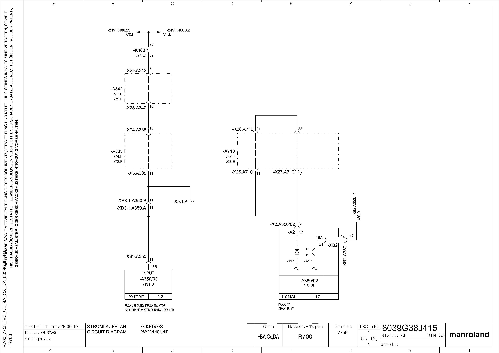

# +BA_Cx_DA — Sheet 73 of 247 — FEUCHTWERK

**DAMPENING UNIT**

> Part of the manroland **R700** printing press IEC/UL circuit diagrams.
> Drawing class: **Stromlaufplan / Circuit diagram** (DIN A3).
> Document `+BA_Cx_DA` covers the **Printing units / main switch cabinet** machine section.

## At a glance

| Field | Value |
|---|---|
| Document | `+BA_Cx_DA`  (8039G38J415) |
| Sheet | **73** of 247 |
| Section (DE) | FEUCHTWERK |
| Section (EN) | DAMPENING UNIT |
| Section type | CIRCUIT — Circuit diagram |
| Machine type | `R700` |
| Series | `7758` |
| Created | 28.06.10 |
| Replaces | — |
| Columns used | B, C, D, E, F |
| Path numbers | — |
| Labels on sheet | 68 |
| Cross-refs out | 12 |
| Cross-refs in | 26 |

**Previous:** [+BA_Cx_DA sheet 72](SHEET_0072.md) · **Next:** [+BA_Cx_DA sheet 74](SHEET_0074.md) · **Document TOC:** [_TOC.md](_TOC.md)  (+BA_Cx_DA) · **Master TOC:** [all sheets](../_MASTER_TOC.md)

## Sheet image (300 DPI, exact vector render)



_Rendered directly from the PDF vector layer at 300 DPI (1-bit), no OCR and no resampling. Use it to confirm anything ambiguous in the text below._

## Cross-references on this sheet

Each entry is a wire leaving this sheet. The printed token is `/sheet.column`; the link resolves to that sheet inside the same document.

| Ref | Target sheet | Col | Path | Destination on target | Target section | From col |
|---|---|---|---|---|---|---|
| `/70.F` | [+BA_Cx_DA sheet 70](SHEET_0070.md) | F | — | 24V.K488:23 | ÖLUMLAUFSCHMIERUNG | B |
| `/74.E` | [+BA_Cx_DA sheet 74](SHEET_0074.md) | E | — | — | FEUCHTWERK | C |
| `/74.E` | [+BA_Cx_DA sheet 74](SHEET_0074.md) | E | — | — | FEUCHTWERK | B |
| `/77.B` | [+BA_Cx_DA sheet 77](SHEET_0077.md) | B | — | — | FARBWERK | B |
| `/72.F` | [+BA_Cx_DA sheet 72](SHEET_0072.md) | F | — | — | FEUCHTWERK | B |
| `/74.F` | [+BA_Cx_DA sheet 74](SHEET_0074.md) | F | — | — | FEUCHTWERK | B |
| `/72.F` | [+BA_Cx_DA sheet 72](SHEET_0072.md) | F | — | — | FEUCHTWERK | B |
| `/77.F` | [+BA_Cx_DA sheet 77](SHEET_0077.md) | F | — | — | FARBWERK | D |
| `/63.E` | [+BA_Cx_DA sheet 63](SHEET_0063.md) | E | — | — | MASCHINENBEDIENUNG: BEDIENUNGKOMMANDOS | D |
| `/20.D` | [+BA_Cx_DA sheet 20](SHEET_0020.md) | D | — | XB2.A350:17 | BUSVERBINDUNGEN: SICHERHEITSBUS | F |
| `/131.D` | [+BA_Cx_DA sheet 131](SHEET_0131.md) | D | — | — | REFERENZMODUL | C |
| `/131.B` | [+BA_Cx_DA sheet 131](SHEET_0131.md) | B | — | — | REFERENZMODUL | E |

### Incoming references (sheets that point here)

Every other sheet that sends a wire to this one. `Back-ref` is the token printed on *that* sheet; `Path` is its line number.

| From sheet | Cols | Back-ref | Path | Refs | What continues there |
|---|---|---|---|---|---|
| [+BA_Cx_DA#20](SHEET_0020.md) | D | `/20.D` | — | 1 | XB2.A350:17 |
| [+BA_Cx_DA#63](SHEET_0063.md) | E | `/63.E` | — | 1 | — |
| [+BA_Cx_DA#70](SHEET_0070.md) | G | `/70.G` | — | 1 | — |
| [+BA_Cx_DA#72](SHEET_0072.md) | F | `/72.F` | — | 2 | — |
| [+BA_Cx_DA#74](SHEET_0074.md) | D, E | `/74.D`, `/74.E` | — | 3 | 24V.K488:A2 |
| [+BA_Cx_DA#77](SHEET_0077.md) | B, E | `/77.B`, `/77.E` | — | 2 | — |
| [+BA_Cx_DA#131](SHEET_0131.md) | B, D | `/131.B`, `/131.D` | — | 2 | — |
| [+BA_Cx_DA#153](SHEET_0153.md) | F | `/153.F` | — | 2 | — |
| [+BA_Cx_DA#157](SHEET_0157.md) | C, D, F | `/157.C`, `/157.D`, `/157.F` | — | 3 | — |
| [+BA_Cx_DA#160](SHEET_0160.md) | C | `/160.C` | — | 1 | — |
| [+BA_Cx_DA#161](SHEET_0161.md) | A | `/161.A` | — | 1 | — |
| [+BA_Cx_DA#175](SHEET_0175.md) | F, H | `/175.F`, `/175.H` | — | 2 | — |
| [+BA_Cx_DA#177](SHEET_0177.md) | E | `/177.E` | — | 1 | — |
| [+BA_Cx_DA#178](SHEET_0178.md) | F, G | `/178.F`, `/178.G` | — | 3 | — |
| [+BA_Cx_DA#184](SHEET_0184.md) | F | `/184.F` | — | 1 | — |


## Devices on this sheet

| Tag | Class | Class meaning (IEC) | Col | Sub | Terminal | Sign |
|---|---|---|---|---|---|---|
| `K488` | K | Relais / relay, contactor | B | — | — | — |
| `A335` | A | Baugruppe / assembly, module, PC board | B | — | — | — |
| `A342` | A | Baugruppe / assembly, module, PC board | B | — | — | — |
| `A710` | A | Baugruppe / assembly, module, PC board | D | — | — | — |
| `A350/03` | A | Baugruppe / assembly, module, PC board | C | 03 | — | — |
| `S17` | S | Schalter / switch | E | — | — | — |
| `A17` | A | Baugruppe / assembly, module, PC board | E | — | — | — |
| `X1` | X | Klemme / terminal, plug connector | E | — | — | — |
| `X2` | X | Klemme / terminal, plug connector | E | — | — | — |
| `XB2` | XB |  | F | — | — | — |
| `A350/02` | A | Baugruppe / assembly, module, PC board | E | 02 | — | — |
| `X74.A335` | — | cross-device reference | B | — | — | — |
| `X5.A335` | — | cross-device reference | B | — | — | — |
| `X25.A342` | — | cross-device reference | B | — | — | — |
| `X28.A342` | — | cross-device reference | B | — | — | — |
| `X25.A710` | — | cross-device reference | D | — | — | — |
| `X28.A710` | — | cross-device reference | D | — | — | — |
| `X27.A710` | — | cross-device reference | E | — | — | — |
| `XB3.1.A350.B` | — | cross-device reference | B | — | — | — |
| `XB3.1.A350.A` | — | cross-device reference | B | — | — | — |
| `XB3.A350` | — | cross-device reference | B | — | — | — |
| `2.2` | — | cross-device reference | C | — | — | — |
| `XB2.A350` | — | cross-device reference | F | — | — | — |
| `X5.1.A` | — | cross-device reference | C | — | — | — |
| `XB2.A350:17` | — | cross-device reference | F | — | 17 | — |

## Potentials / nets

| Potential | Count | Columns | Attached devices | Terminals |
|---|---|---|---|---|
| `24V` | 2 | B, C | `K488` | `23`, `A2` |


A potential such as `L24+/4` or `M24+` is a named supply/return rail; every place it appears on this sheet is electrically common.

## Wire-end annotations (grouped as printed)

A wire that continues elsewhere is annotated with a small cluster: the destination description, the path/line number `#NN`, and the `/sheet.column` cross reference. Each row below is one such cluster exactly as it is grouped on the drawing.

| Col | Y | Path | Cross-ref | Text on the wire |
|---|---|---|---|---|
| B | 68.3 | — | `/70.F` | `24V.K488:23` |
| C | 68.3 | — | — | `24V.K488:A2` |
| C | 78.2 | — | `/74.E` | — |
| C | 101.7 | — | — | `23` |
| C | 115.1 | — | — | `K488 24` |
| B | 128.2 | — | `/74.E` | — |
| B | 160.5 | — | — | `X25.A342 6` |
| B | 207.2 | — | — | `A342` |
| B | 220.3 | — | `/77.B` | — |
| B | 232.7 | — | `/72.F` | — |
| B | 249.8 | — | — | `X28.A342 15` |
| B | 302.2 | — | — | `X74.A335 15` |
| D | 303.6 | — | — | `X28.A710 21` |
| E | 303.6 | — | — | `22` |
| B | 356.1 | — | — | `A335` |
| D | 356.1 | — | — | `A710` |
| B | 369.1 | — | `/74.F`, `/72.F` | — |
| D | 369.1 | — | `/77.F`, `/63.E` | — |
| D | 405.7 | — | — | `X25.A710 11` |
| E | 405.7 | — | — | `X27.A710 17` |
| B | 408.5 | — | — | `X5.A335 11` |
| F | 460.1 | — | `/20.D` | `XB2.A350:17` |
| B | 473.7 | — | — | `XB3.1.A350.B 11` |
| C | 475.9 | — | — | `X5.1.A 11` |
| B | 490.7 | — | — | `XB3.1.A350.A 11` |
| E | 530.4 | — | — | `X2.A350/02 17` |
| E | 548.8 | — | — | `X2` |
| F | 550.2 | — | — | `17 17` |
| F | 558.8 | — | — | `17` |
| E | 563.0 | — | — | `16A` |
| E | 580.0 | — | — | `X1` |
| F | 580.0 | — | — | `XB2` |
| F | 586.2 | — | — | `XB2.A350` |
| B | 606.9 | — | — | `XB3.A350 11` |
| E | 619.0 | — | — | `S17 A17` |
| C | 632.4 | — | — | `13B` |
| C | 646.9 | — | — | `INPUT` |
| C | 660.8 | — | — | `A350/03` |
| E | 665.0 | — | — | `A350/02` |
| C | 674.6 | — | `/131.D` | — |
| E | 677.4 | — | `/131.B` | — |
| E | 703.3 | — | — | `KANAL 17` |
| C | 703.6 | — | — | `BYTE.BIT 2.2` |
| E | 723.6 | — | — | `KANAL 17 CHANNEL 17` |
| C | 726.4 | — | — | `RÜCKMELDUNG, FEUCHTDUKTOR HANDSHAKE, WATER FOUNTAIN ROLLER` |


## Reconstructed tables

This sheet carries tabular content (pin map / terminal assignment / index). The grid below was rebuilt from the drawing's own rule lines, so each row is exactly one physical row of the table.

### Table 1 — 3 data rows × 3 columns (at x=297.6, y=445.0)

| XB3.1.A350.B XB3.1.A350.A | 11 11 | X5.1.A |
|---|---|---|
| `XB3.A350` | `11 13B` |  |
| `INPUT` | `A350/03 /131.D` |  |
| `BYTE.BIT` | `2.2` |  |


### Table 2 — 4 data rows × 6 columns (at x=609.4, y=275.0)

| 21 11 | X27.A710 | 22 17 |  |  | XB2.A350:17 |
|---|---|---|---|---|---|
|  | `X2.A350/02` | `17` |  |  |  |
|  | `X2 S17` | `17 A17` | `16A X1` | `XB2` | `17 17 XB2.A350` |
|  |  | `A350/02 /131.B` |  |  |  |
|  | `KANAL` |  | `17` |  |  |


## Notes and free text on this sheet

| Text | Col | Y (pt) |
|---|---|---|
| `13B` | C | 632.41 |
| `INPUT` | C | 646.94 |
| `BYTE.BIT` | B | 704.19 |
| `RÜCKMELDUNG, FEUCHTDUKTOR` | C | 726.44 |
| `HANDSHAKE, WATER FOUNTAIN ROLLER` | C | 736.38 |
| `KANAL 17` | E | 723.62 |
| `CHANNEL 17` | E | 733.56 |
| `16A` | E | 562.96 |
| `KANAL` | E | 703.29 |
| `X2.A350/02` | E | 530.39 |

## Complete label inventory (exact text from the drawing)

Every text object inside the drawing area of this sheet, in DIN reading order (column A→H, then top→bottom). This is the authoritative list: if a string is not here it is not printed on this sheet.

| Col | Y | X | Dir | Type | Text |
|---|---|---|---|---|---|
| B | 68.3 | 257.1 | → | potential | `24V.K488:23` |
| B | 78.2 | 300.5 | → | cross-reference | `/70.F` |
| B | 115.1 | 318.0 | → | device tag | `K488` |
| B | 128.2 | 325.7 | → | cross-reference | `/74.E` |
| B | 163.3 | 299.1 | → | device ref | `X25.A342` |
| B | 207.2 | 264.2 | → | device tag | `A342` |
| B | 220.3 | 271.6 | → | cross-reference | `/77.B` |
| B | 232.7 | 272.1 | → | cross-reference | `/72.F` |
| B | 252.6 | 299.1 | → | device ref | `X28.A342` |
| B | 305.0 | 299.1 | → | device ref | `X74.A335` |
| B | 356.1 | 264.2 | → | device tag | `A335` |
| B | 369.1 | 272.1 | → | cross-reference | `/74.F` |
| B | 381.5 | 272.1 | → | cross-reference | `/72.F` |
| B | 408.5 | 305.0 | → | device ref | `X5.A335` |
| B | 473.7 | 279.2 | → | device ref | `XB3.1.A350.B` |
| B | 491.4 | 278.4 | → | device ref | `XB3.1.A350.A` |
| B | 606.9 | 297.9 | → | device ref | `XB3.A350` |
| B | 704.2 | 307.6 | → | text | `BYTE.BIT` |
| C | 68.3 | 398.0 | → | potential | `24V.K488:A2` |
| C | 78.2 | 388.3 | → | cross-reference | `/74.E` |
| C | 101.7 | 356.9 | → | number | `23` |
| C | 130.0 | 356.9 | → | number | `24` |
| C | 160.5 | 356.9 | → | number | `6` |
| C | 249.8 | 356.3 | → | number | `15` |
| C | 302.2 | 356.3 | → | number | `15` |
| C | 409.9 | 356.3 | → | number | `11` |
| C | 473.7 | 356.3 | → | number | `11` |
| C | 475.8 | 412.4 | → | device ref | `X5.1.A` |
| C | 478.0 | 455.5 | → | number | `11` |
| C | 490.7 | 356.3 | → | number | `11` |
| C | 615.4 | 356.3 | → | number | `11` |
| C | 632.4 | 359.1 | → | text | `13B` |
| C | 646.9 | 339.4 | → | text | `INPUT` |
| C | 660.8 | 332.9 | → | device tag | `A350/03` |
| C | 674.6 | 341.6 | → | cross-reference | `/131.D` |
| C | 703.6 | 375.9 | → | device ref | `2.2` |
| C | 726.4 | 297.1 | → | text | `RÜCKMELDUNG, FEUCHTDUKTOR` |
| C | 736.4 | 297.1 | → | text | `HANDSHAKE, WATER FOUNTAIN ROLLER` |
| D | 303.6 | 554.2 | → | device ref | `X28.A710` |
| D | 303.6 | 612.0 | → | number | `21` |
| D | 356.1 | 532.1 | → | device tag | `A710` |
| D | 369.1 | 540.0 | → | cross-reference | `/77.F` |
| D | 381.5 | 539.7 | → | cross-reference | `/63.E` |
| D | 405.7 | 552.8 | → | device ref | `X25.A710` |
| D | 409.9 | 611.4 | → | number | `11` |
| E | 303.6 | 711.2 | → | number | `22` |
| E | 405.7 | 652.0 | → | device ref | `X27.A710` |
| E | 409.9 | 710.6 | → | number | `17` |
| E | 530.4 | 644.6 | → | text | `X2.A350/02` |
| E | 530.4 | 710.6 | → | number | `17` |
| E | 548.8 | 687.1 | → | device tag | `X2` |
| E | 550.2 | 713.5 | → | number | `17` |
| E | 563.0 | 754.0 | → | text | `16A` |
| E | 580.0 | 757.7 | → | device tag | `X1` |
| E | 619.0 | 683.4 | → | device tag | `S17` |
| E | 619.0 | 726.0 | → | device tag | `A17` |
| E | 665.0 | 715.6 | → | device tag | `A350/02` |
| E | 677.4 | 724.4 | → | cross-reference | `/131.B` |
| E | 703.3 | 672.4 | → | text | `KANAL` |
| E | 703.3 | 752.0 | → | number | `17` |
| E | 723.6 | 664.2 | → | text | `KANAL 17` |
| E | 733.6 | 664.4 | → | text | `CHANNEL 17` |
| F | 460.1 | 842.2 | ↕ | device ref | `XB2.A350:17` |
| F | 503.4 | 852.1 | ↕ | cross-reference | `/20.D` |
| F | 558.7 | 834.0 | → | number | `17` |
| F | 560.2 | 812.7 | → | number | `17` |
| F | 580.0 | 782.1 | → | device tag | `XB2` |
| F | 586.2 | 818.1 | ↕ | device ref | `XB2.A350` |

## Reading-order text block

The same content as a plain block, grouped by DIN column — convenient to paste or to match against a visual description.

```text
=== Column B ===
  68.3  257.1  net          24V.K488:23
  78.2  300.5  xref         /70.F
 115.1  318.0  devtag       K488
 128.2  325.7  xref         /74.E
 163.3  299.1  devref       X25.A342
 207.2  264.2  devtag       A342
 220.3  271.6  xref         /77.B
 232.7  272.1  xref         /72.F
 252.6  299.1  devref       X28.A342
 305.0  299.1  devref       X74.A335
 356.1  264.2  devtag       A335
 369.1  272.1  xref         /74.F
 381.5  272.1  xref         /72.F
 408.5  305.0  devref       X5.A335
 473.7  279.2  devref       XB3.1.A350.B
 491.4  278.4  devref       XB3.1.A350.A
 606.9  297.9  devref       XB3.A350
 704.2  307.6  text         BYTE.BIT
=== Column C ===
  68.3  398.0  net          24V.K488:A2
  78.2  388.3  xref         /74.E
 101.7  356.9  numeric      23
 130.0  356.9  numeric      24
 160.5  356.9  numeric      6
 249.8  356.3  numeric      15
 302.2  356.3  numeric      15
 409.9  356.3  numeric      11
 473.7  356.3  numeric      11
 475.8  412.4  devref       X5.1.A
 478.0  455.5  numeric      11
 490.7  356.3  numeric      11
 615.4  356.3  numeric      11
 632.4  359.1  text         13B
 646.9  339.4  text         INPUT
 660.8  332.9  devtag       A350/03
 674.6  341.6  xref         /131.D
 703.6  375.9  devref       2.2
 726.4  297.1  text         RÜCKMELDUNG, FEUCHTDUKTOR
 736.4  297.1  text         HANDSHAKE, WATER FOUNTAIN ROLLER
=== Column D ===
 303.6  554.2  devref       X28.A710
 303.6  612.0  numeric      21
 356.1  532.1  devtag       A710
 369.1  540.0  xref         /77.F
 381.5  539.7  xref         /63.E
 405.7  552.8  devref       X25.A710
 409.9  611.4  numeric      11
=== Column E ===
 303.6  711.2  numeric      22
 405.7  652.0  devref       X27.A710
 409.9  710.6  numeric      17
 530.4  644.6  text         X2.A350/02
 530.4  710.6  numeric      17
 548.8  687.1  devtag       X2
 550.2  713.5  numeric      17
 563.0  754.0  text         16A
 580.0  757.7  devtag       X1
 619.0  683.4  devtag       S17
 619.0  726.0  devtag       A17
 665.0  715.6  devtag       A350/02
 677.4  724.4  xref         /131.B
 703.3  672.4  text         KANAL
 703.3  752.0  numeric      17
 723.6  664.2  text         KANAL 17
 733.6  664.4  text         CHANNEL 17
=== Column F ===
 460.1  842.2  devref       XB2.A350:17
 503.4  852.1  xref         /20.D
 558.7  834.0  numeric      17
 560.2  812.7  numeric      17
 580.0  782.1  devtag       XB2
 586.2  818.1  devref       XB2.A350
```

---
_Generated from the PDF vector text layer; no OCR. Source: `R700_7758_IEC_UL_BA_CX_DA_8039G38J415_p`, sheet 73._
