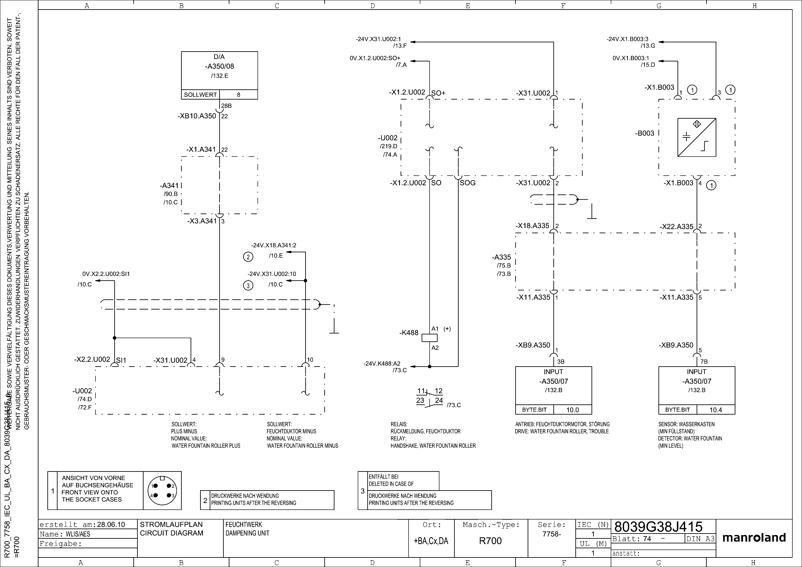

# +BA_Cx_DA — Sheet 74 of 247 — FEUCHTWERK

**DAMPENING UNIT**

> Part of the manroland **R700** printing press IEC/UL circuit diagrams.
> Drawing class: **Stromlaufplan / Circuit diagram** (DIN A3).
> Document `+BA_Cx_DA` covers the **Printing units / main switch cabinet** machine section.

## At a glance

| Field | Value |
|---|---|
| Document | `+BA_Cx_DA`  (8039G38J415) |
| Sheet | **74** of 247 |
| Section (DE) | FEUCHTWERK |
| Section (EN) | DAMPENING UNIT |
| Section type | CIRCUIT — Circuit diagram |
| Machine type | `R700` |
| Series | `7758` |
| Created | 28.06.10 |
| Replaces | — |
| Columns used | A, B, C, D, E, F, G, H |
| Path numbers | — |
| Labels on sheet | 134 |
| Cross-refs out | 20 |
| Cross-refs in | 37 |

**Previous:** [+BA_Cx_DA sheet 73](SHEET_0073.md) · **Next:** [+BA_Cx_DA sheet 75](SHEET_0075.md) · **Document TOC:** [_TOC.md](_TOC.md)  (+BA_Cx_DA) · **Master TOC:** [all sheets](../_MASTER_TOC.md)

## Sheet image (300 DPI, exact vector render)



_Rendered directly from the PDF vector layer at 300 DPI (1-bit), no OCR and no resampling. Use it to confirm anything ambiguous in the text below._

## Cross-references on this sheet

Each entry is a wire leaving this sheet. The printed token is `/sheet.column`; the link resolves to that sheet inside the same document.

| Ref | Target sheet | Col | Path | Destination on target | Target section | From col |
|---|---|---|---|---|---|---|
| `/13.G` | [+BA_Cx_DA sheet 13](SHEET_0013.md) | G | — | 24V.X1.B003:3 | SPANNUNGSVERSORGUNG, SCHALTSCHRANKBELÜFTUNG | G |
| `/13.F` | [+BA_Cx_DA sheet 13](SHEET_0013.md) | F | — | 24V.X31.U002:1 | SPANNUNGSVERSORGUNG, SCHALTSCHRANKBELÜFTUNG | D |
| `/15.D` | [+BA_Cx_DA sheet 15](SHEET_0015.md) | D | — | 0V.X1.B003:1 | SPANNUNGSVERSORGUNG, SCHALTSCHRANKBELÜFTUNG | G |
| `/7.A` | [+BA_Cx_DA sheet 7](SHEET_0007.md) | A | — | 0V.X1.2.U002:SO+ | SPANNUNGSVERSORGUNG, SCHALTSCHRANKBELÜFTUNG | D |
| `/132.E` | [+BA_Cx_DA sheet 132](SHEET_0132.md) | E | — | — | REFERENZMODUL | B |
| `/219.D` | [+BA_Cx_DA sheet 219](SHEET_0219.md) | D | — | — | OPTION: TELEPRESENCE | D |
| `/74.A` | [+BA_Cx_DA sheet 74](SHEET_0074.md) | A | — | — | FEUCHTWERK | D |
| `/90.B` | [+BA_Cx_DA sheet 90](SHEET_0090.md) | B | — | — | BOGENFÜHRUNG | B |
| `/10.C` | [+BA_Cx_DA sheet 10](SHEET_0010.md) | C | — | — | SPANNUNGSVERSORGUNG, SCHALTSCHRANKBELÜFTUNG | B |
| `/10.E` | [+BA_Cx_DA sheet 10](SHEET_0010.md) | E | — | — | SPANNUNGSVERSORGUNG, SCHALTSCHRANKBELÜFTUNG | C |
| `/75.B` | [+BA_Cx_DA sheet 75](SHEET_0075.md) | B | — | — | FEUCHTWERK | E |
| `/73.B` | [+BA_Cx_DA sheet 73](SHEET_0073.md) | B | — | — | FEUCHTWERK | E |
| `/10.C` | [+BA_Cx_DA sheet 10](SHEET_0010.md) | C | — | — | SPANNUNGSVERSORGUNG, SCHALTSCHRANKBELÜFTUNG | A |
| `/10.C` | [+BA_Cx_DA sheet 10](SHEET_0010.md) | C | — | — | SPANNUNGSVERSORGUNG, SCHALTSCHRANKBELÜFTUNG | C |
| `/73.C` | [+BA_Cx_DA sheet 73](SHEET_0073.md) | C | — | 24V.K488:A2 | FEUCHTWERK | D |
| `/132.B` | [+BA_Cx_DA sheet 132](SHEET_0132.md) | B | — | — | REFERENZMODUL | F |
| `/132.B` | [+BA_Cx_DA sheet 132](SHEET_0132.md) | B | — | — | REFERENZMODUL | G |
| `/74.D` | [+BA_Cx_DA sheet 74](SHEET_0074.md) | D | — | — | FEUCHTWERK | A |
| `/73.C` | [+BA_Cx_DA sheet 73](SHEET_0073.md) | C | — | — | FEUCHTWERK | E |
| `/72.F` | [+BA_Cx_DA sheet 72](SHEET_0072.md) | F | — | — | FEUCHTWERK | A |

### Incoming references (sheets that point here)

Every other sheet that sends a wire to this one. `Back-ref` is the token printed on *that* sheet; `Path` is its line number.

| From sheet | Cols | Back-ref | Path | Refs | What continues there |
|---|---|---|---|---|---|
| [+BA_Cx_DA#7](SHEET_0007.md) | A | `/7.A` | — | 1 | — |
| [+BA_Cx_DA#10](SHEET_0010.md) | B, C, E | `/10.B`, `/10.C`, `/10.E` | — | 4 | 0V.X2.2.U002:SI1 |
| [+BA_Cx_DA#13](SHEET_0013.md) | F, G | `/13.F`, `/13.G` | — | 2 | 24V.X1.B003:3; 24V.X31.U002:1 |
| [+BA_Cx_DA#15](SHEET_0015.md) | D | `/15.D` | — | 1 | — |
| [+BA_Cx_DA#72](SHEET_0072.md) | F | `/72.F` | — | 1 | — |
| [+BA_Cx_DA#73](SHEET_0073.md) | B, C | `/73.B`, `/73.C` | — | 3 | — |
| [+BA_Cx_DA#74](SHEET_0074.md) | A, D | `/74.A`, `/74.D` | — | 2 | — |
| [+BA_Cx_DA#75](SHEET_0075.md) | A | `/75.A` | — | 1 | — |
| [+BA_Cx_DA#90](SHEET_0090.md) | B | `/90.B` | — | 1 | — |
| [+BA_Cx_DA#132](SHEET_0132.md) | B, E | `/132.B`, `/132.E` | — | 3 | — |
| [+BA_Cx_DA#141](SHEET_0141.md) | D | `/141.D` | — | 1 | — |
| [+BA_Cx_DA#144](SHEET_0144.md) | E | `/144.E` | — | 3 | — |
| [+BA_Cx_DA#156](SHEET_0156.md) | H | `/156.H` | — | 1 | — |
| [+BA_Cx_DA#166](SHEET_0166.md) | G | `/166.G` | — | 2 | — |
| [+BA_Cx_DA#167](SHEET_0167.md) | C | `/167.C` | — | 1 | — |
| [+BA_Cx_DA#168](SHEET_0168.md) | G | `/168.G` | — | 2 | — |
| [+BA_Cx_DA#173](SHEET_0173.md) | F | `/173.F` | — | 1 | — |
| [+BA_Cx_DA#174](SHEET_0174.md) | E | `/174.E` | — | 1 | — |
| [+BA_Cx_DA#179](SHEET_0179.md) | G | `/179.G` | — | 5 | — |
| [+BA_Cx_DA#219](SHEET_0219.md) | D | `/219.D` | — | 1 | — |


## Devices on this sheet

| Tag | Class | Class meaning (IEC) | Col | Sub | Terminal | Sign |
|---|---|---|---|---|---|---|
| `B003` | B | Umformer / transducer, sensor | G | — | — | — |
| `A335` | A | Baugruppe / assembly, module, PC board | E | — | — | — |
| `U002` | U | Umrichter / frequency converter | D | — | — | — |
| `A350/08` | A | Baugruppe / assembly, module, PC board | B | 08 | — | — |
| `A350/07` | A | Baugruppe / assembly, module, PC board | G | 07 | — | — |
| `A350/07` | A | Baugruppe / assembly, module, PC board | F | 07 | — | — |
| `A341` | A | Baugruppe / assembly, module, PC board | B | — | — | — |
| `A1` | A | Baugruppe / assembly, module, PC board | E | — | — | — |
| `A2` | A | Baugruppe / assembly, module, PC board | E | — | — | — |
| `K488` | K | Relais / relay, contactor | D | — | — | — |
| `U002` | U | Umrichter / frequency converter | A | — | — | — |
| `SI1` | SI |  | A | — | — | — |
| `X1.B003` | — | cross-device reference | G | — | — | — |
| `X22.A335` | — | cross-device reference | G | — | — | — |
| `X11.A335` | — | cross-device reference | G | — | — | — |
| `X1.B003` | — | cross-device reference | G | — | — | — |
| `X31.U002` | — | cross-device reference | F | — | — | — |
| `X31.U002` | — | cross-device reference | F | — | — | — |
| `X18.A335` | — | cross-device reference | F | — | — | — |
| `X11.A335` | — | cross-device reference | F | — | — | — |
| `X1.2.U002` | — | cross-device reference | D | — | — | — |
| `X1.2.U002` | — | cross-device reference | D | — | — | — |
| `XB10.A350` | — | cross-device reference | B | — | — | — |
| `10.4` | — | cross-device reference | H | — | — | — |
| `XB9.A350` | — | cross-device reference | G | — | — | — |
| `10.0` | — | cross-device reference | F | — | — | — |
| `XB9.A350` | — | cross-device reference | F | — | — | — |
| `X1.A341` | — | cross-device reference | B | — | — | — |
| `X3.A341` | — | cross-device reference | B | — | — | — |
| `X2.2.U002` | — | cross-device reference | A | — | — | — |
| `X31.U002` | — | cross-device reference | B | — | — | — |

## Potentials / nets

| Potential | Count | Columns | Attached devices | Terminals |
|---|---|---|---|---|
| `0V` | 2 | A, G | `2`, `B003`, `U002`, `X1`, `X2` | `1`, `SI1` |
| `24V` | 5 | C, D, G | `A341`, `B003`, `K488`, `U002`, `X1`, `X18`, `X31` | `1`, `10`, `2`, `3`, `A2` |


A potential such as `L24+/4` or `M24+` is a named supply/return rail; every place it appears on this sheet is electrically common.

## Wire-end annotations (grouped as printed)

A wire that continues elsewhere is annotated with a small cluster: the destination description, the path/line number `#NN`, and the `/sheet.column` cross reference. Each row below is one such cluster exactly as it is grouped on the drawing.

| Col | Y | Path | Cross-ref | Text on the wire |
|---|---|---|---|---|
| D | 54.1 | — | `/13.F` | `24V.X31.U002:1` |
| G | 54.1 | — | `/13.G` | `24V.X1.B003:3` |
| B | 80.0 | — | — | `D/A` |
| D | 82.5 | — | `/7.A` | `0V.X1.2.U002:SO+` |
| G | 82.5 | — | `/15.D` | `0V.X1.B003:1` |
| B | 93.8 | — | — | `A350/08` |
| B | 108.7 | — | `/132.E` | — |
| G | 125.0 | — | — | `X1.B003 1` |
| H | 130.2 | — | — | `1 1` |
| D | 132.1 | — | — | `X1.2.U002 SO+` |
| F | 133.5 | — | — | `X31.U002 1` |
| H | 133.6 | — | — | `3` |
| B | 137.0 | — | — | `SOLLWERT 8` |
| B | 153.4 | — | — | `28B` |
| B | 167.6 | — | — | `XB10.A350 22` |
| G | 193.1 | — | — | `B003` |
| D | 200.2 | — | — | `U002` |
| D | 213.2 | — | `/219.D` | — |
| B | 217.2 | — | — | `X1.A341 22` |
| D | 225.6 | — | `/74.A` | — |
| E | 266.8 | — | — | `X1.2.U002 SO SOG` |
| F | 266.8 | — | — | `X31.U002 2` |
| G | 266.8 | — | — | `X1.B003 4` |
| B | 271.0 | — | — | `A341` |
| H | 271.9 | — | — | `1` |
| B | 284.1 | — | `/90.B`, `/10.C` | — |
| B | 323.5 | — | — | `X3.A341 3` |
| F | 330.5 | — | — | `X18.A335 2` |
| G | 332.0 | — | — | `X22.A335 2` |
| C | 360.3 | — | — | `24V.X18.A341:2` |
| C | 375.8 | — | `/10.E` | — |
| E | 377.3 | — | — | `A335` |
| C | 378.7 | — | — | `2` |
| E | 390.4 | — | `/75.B`, `/73.B` | — |
| A | 402.8 | — | — | `0V.X2.2.U002:SI1` |
| C | 402.8 | — | — | `24V.X31.U002:10` |
| A | 418.4 | — | `/10.C` | — |
| C | 418.4 | — | `/10.C` | — |
| C | 421.2 | — | — | `3` |
| F | 436.8 | — | — | `X11.A335 1` |
| G | 436.8 | — | — | `X11.A335 5` |
| E | 484.3 | — | — | `A1` |
| E | 484.4 | — | — | `(+)` |
| D | 489.3 | — | — | `K488` |
| F | 507.7 | — | — | `XB9.A350 1` |
| G | 507.7 | — | — | `XB9.A350 5` |
| E | 512.6 | — | — | `A2` |
| B | 529.0 | — | — | `X2.2.U002 SI1 X31.U002 4 9 10` |
| F | 533.2 | — | — | `3B` |
| G | 533.2 | — | — | `7B` |
| D | 536.0 | — | `/73.C` | `24V.K488:A2` |
| F | 547.7 | — | — | `INPUT` |
| G | 547.7 | — | — | `INPUT` |
| F | 561.6 | — | — | `A350/07` |
| G | 561.6 | — | — | `A350/07` |
| F | 575.3 | — | `/132.B` | — |
| G | 575.3 | — | `/132.B` | — |
| A | 575.7 | — | — | `U002` |
| E | 575.7 | — | — | `23 11 12 24` |
| A | 588.8 | — | `/74.D` | — |
| E | 597.7 | — | `/73.C` | — |
| A | 601.2 | — | `/72.F` | — |
| F | 604.4 | — | — | `BYTE.BIT 10.0` |
| G | 604.4 | — | — | `BYTE.BIT 10.4` |
| B | 627.0 | — | — | `PLUS MINUS NOMINAL VALUE: SOLLWERT:` |
| C | 627.0 | — | — | `FEUCHTDUKTOR MINUS NOMINAL VALUE: SOLLWERT:` |
| E | 627.0 | — | — | `RELAIS: RÜCKMELDUNG, FEUCHTDUKTOR RELAY: HANDSHAKE, WATER FOUNTAIN ROLLER` |
| G | 627.0 | — | — | `DETECTOR: WATER FOUNTAIN (MIN FÜLLSTAND) (MIN LEVEL) SENSOR: WASSERKASTEN` |
| F | 627.1 | — | — | `DRIVE: WATER FOUNTAIN ROLLER, TROUBLE ANTRIEB: FEUCHTDUKTORMOTOR, STÖRUNG` |
| B | 659.0 | — | — | `WATER FOUNTAIN ROLLER PLUS` |
| C | 659.0 | — | — | `WATER FOUNTAIN ROLLER MINUS` |
| D | 705.0 | — | — | `ENTFÄLLT BEI DELETED IN CASE OF` |
| A | 706.1 | — | — | `FRONT VIEW ONTO ANSICHT VON VORNE AUF BUCHSENGEHÄUSE` |
| A | 718.8 | — | — | `1 1 2` |
| D | 724.5 | — | — | `3` |
| B | 732.9 | — | — | `4 3` |
| C | 733.4 | — | — | `2 DRUCKWERKE NACH WENDUNG PRINTING UNITS AFTER THE REVERSING` |
| D | 733.4 | — | — | `DRUCKWERKE NACH WENDUNG PRINTING UNITS AFTER THE REVERSING` |
| A | 738.0 | — | — | `THE SOCKET CASES` |


## Reconstructed tables

This sheet carries tabular content (pin map / terminal assignment / index). The grid below was rebuilt from the drawing's own rule lines, so each row is exactly one physical row of the table.

### Table 1 — 4 data rows × 9 columns (at x=70.9, y=76.5)

|  |  |  |  |  | D/A | A350/08 /132.E |  |  |
|---|---|---|---|---|---|---|---|---|
|  |  |  |  |  | `SOLLWERT` | `8` |  |  |
|  | `0V.X2.2.U002:SI1 /10.C` |  | `A341 /90.B /10.C` |  | `XB10.A350 X1.A341 X3.A341` | `28B 22 22 3 2 3` | `24V.X18.A341:2 /10.E 24V.X31.U002:10 /10.C` |  |
|  | `X2.2.U002 U002 /74.D /72.F` | `SI1` | `X31.U002 PLUS NOMINAL WATER` | `SOLLWERT: MINUS` | `4 VALUE: FOUNTAIN ROLLER` | `9 PLUS` | `SOLLWERT: FEUCHTDUKTOR NOMINAL VALUE: WATER FOUNTAIN` | `10 MINUS ROLLER MINUS` |
| `1` | `ANSICHT VON AUF BUCHSENGEHÄUSE FRONT VIEW ONTO THE SOCKET CASES` | `VORNE` | `1 2 4 3` |  | `2` | `DRUCKWERKE NACH PRINTING UNITS AFTER` | `WENDUNG THE REVERSING` |  |


### Table 2 — 5 data rows × 9 columns (at x=637.8, y=62.4)

| SO+ |  | X31.U002 | 1 | /13.G 0V.X1.B003:1 /15.D | X1.B003 | 1 1 |  | 1 3 |
|---|---|---|---|---|---|---|---|---|
|  |  |  |  | `B003` |  |  |  |  |
| `SO` | `SOG` | `X31.U002` | `2` |  |  | `X1.B003` | `4 1` |  |
| `A1 (+) A2` | `A335 /75.B /73.B` | `X18.A335 X11.A335 XB9.A350` | `2 1 1 3B` |  | `X22.A335 X11.A335 XB9.A350` |  | `2 5 5 7B` |  |
| `12 24` |  | `INPUT` | `A350/07 /132.B` |  |  | `INPUT` | `A350/07 /132.B` |  |
| `/73.C` |  | `BYTE.BIT` | `10.0` |  | `BYTE.BIT` |  | `10.4` |  |


## Notes and free text on this sheet

| Text | Col | Y (pt) |
|---|---|---|
| `SO+` | E | 133.53 |
| `SO` | E | 266.77 |
| `SOG` | E | 266.77 |
| `28B` | B | 153.36 |
| `D/A` | B | 79.96 |
| `SOLLWERT` | B | 137 |
| `SOLLWERT:` | B | 627.03 |
| `PLUS MINUS` | B | 637.71 |
| `NOMINAL VALUE:` | B | 648.34 |
| `WATER FOUNTAIN ROLLER PLUS` | B | 658.97 |
| `7B` | G | 533.18 |
| `INPUT` | G | 547.72 |
| `BYTE.BIT` | G | 604.97 |
| `SENSOR: WASSERKASTEN` | G | 627.05 |
| `(MIN FÜLLSTAND)` | G | 637.73 |
| `DETECTOR: WATER FOUNTAIN` | G | 648.33 |
| `(MIN LEVEL)` | G | 658.98 |
| `3B` | F | 533.18 |
| `INPUT` | F | 547.72 |
| `BYTE.BIT` | F | 604.97 |
| `ANTRIEB: FEUCHTDUKTORMOTOR, STÖRUNG` | F | 627.1 |
| `DRIVE: WATER FOUNTAIN ROLLER, TROUBLE` | F | 637.71 |
| `RELAIS:` | D | 627.01 |
| `RÜCKMELDUNG, FEUCHTDUKTOR` | E | 637.74 |
| `RELAY:` | D | 648.28 |
| `HANDSHAKE, WATER FOUNTAIN ROLLER` | E | 658.97 |
| `0V.X1.2.U002:SO+` | D | 82.48 |
| `ANSICHT VON VORNE` | A | 706.1 |
| `AUF BUCHSENGEHÄUSE` | A | 716.73 |
| `FRONT VIEW ONTO` | A | 727.33 |
| `THE SOCKET CASES` | A | 737.98 |
| `SOLLWERT:` | C | 627.03 |
| `FEUCHTDUKTOR MINUS` | C | 637.73 |
| `NOMINAL VALUE:` | C | 648.34 |
| `WATER FOUNTAIN ROLLER MINUS` | C | 658.98 |
| `DRUCKWERKE NACH WENDUNG` | C | 733.36 |
| `PRINTING UNITS AFTER THE REVERSING` | C | 744.01 |
| `ENTFÄLLT BEI` | D | 705 |
| `DELETED IN CASE OF` | D | 715.65 |
| `DRUCKWERKE NACH WENDUNG` | D | 733.36 |
| `PRINTING UNITS AFTER THE REVERSING` | D | 744.01 |

## Complete label inventory (exact text from the drawing)

Every text object inside the drawing area of this sheet, in DIN reading order (column A→H, then top→bottom). This is the authoritative list: if a string is not here it is not printed on this sheet.

| Col | Y | X | Dir | Type | Text |
|---|---|---|---|---|---|
| A | 402.8 | 122.5 | → | potential | `0V.X2.2.U002:SI1` |
| A | 418.4 | 115.4 | → | cross-reference | `/10.C` |
| A | 529.0 | 110.0 | → | device ref | `X2.2.U002` |
| A | 530.5 | 172.3 | → | device tag | `SI1` |
| A | 575.7 | 107.7 | → | device tag | `U002` |
| A | 588.8 | 115.4 | → | cross-reference | `/74.D` |
| A | 601.2 | 116.2 | → | cross-reference | `/72.F` |
| A | 706.1 | 92.1 | → | text | `ANSICHT VON VORNE` |
| A | 716.7 | 92.1 | → | text | `AUF BUCHSENGEHÄUSE` |
| A | 724.5 | 75.4 | → | number | `1` |
| A | 727.3 | 91.3 | → | text | `FRONT VIEW ONTO` |
| A | 738.0 | 91.8 | → | text | `THE SOCKET CASES` |
| B | 80.0 | 317.2 | → | text | `D/A` |
| B | 93.8 | 304.6 | → | device tag | `A350/08` |
| B | 108.7 | 313.5 | → | cross-reference | `/132.E` |
| B | 137.0 | 273.1 | → | text | `SOLLWERT` |
| B | 153.4 | 328.5 | → | text | `28B` |
| B | 167.5 | 263.6 | → | device ref | `XB10.A350` |
| B | 169.0 | 328.5 | → | number | `22` |
| B | 217.2 | 276.7 | → | device ref | `X1.A341` |
| B | 218.6 | 328.5 | → | number | `22` |
| B | 271.0 | 237.3 | → | device tag | `A341` |
| B | 284.1 | 243.2 | → | cross-reference | `/90.B` |
| B | 296.5 | 242.9 | → | cross-reference | `/10.C` |
| B | 323.5 | 278.1 | → | device ref | `X3.A341` |
| B | 324.9 | 328.5 | → | number | `3` |
| B | 530.4 | 227.6 | → | device ref | `X31.U002` |
| B | 530.4 | 286.0 | → | number | `4` |
| B | 530.4 | 328.5 | → | number | `9` |
| B | 627.0 | 254.8 | → | text | `SOLLWERT:` |
| B | 637.7 | 254.3 | → | text | `PLUS MINUS` |
| B | 648.3 | 254.3 | → | text | `NOMINAL VALUE:` |
| B | 659.0 | 255.1 | → | text | `WATER FOUNTAIN ROLLER PLUS` |
| B | 718.8 | 224.2 | → | number | `1` |
| B | 718.8 | 254.8 | → | number | `2` |
| B | 732.9 | 223.1 | → | number | `4` |
| B | 732.9 | 254.8 | → | number | `3` |
| B | 738.7 | 301.9 | → | number | `2` |
| C | 137.1 | 351.9 | → | number | `8` |
| C | 360.3 | 373.0 | → | potential | `24V.X18.A341:2` |
| C | 375.8 | 399.4 | → | cross-reference | `/10.E` |
| C | 378.7 | 366.5 | → | number | `2` |
| C | 402.8 | 367.7 | → | potential | `24V.X31.U002:10` |
| C | 418.4 | 398.8 | → | cross-reference | `/10.C` |
| C | 421.2 | 366.5 | → | number | `3` |
| C | 530.4 | 455.5 | → | number | `10` |
| C | 627.0 | 396.6 | → | text | `SOLLWERT:` |
| C | 637.7 | 396.0 | → | text | `FEUCHTDUKTOR MINUS` |
| C | 648.3 | 396.0 | → | text | `NOMINAL VALUE:` |
| C | 659.0 | 396.9 | → | text | `WATER FOUNTAIN ROLLER MINUS` |
| C | 733.4 | 313.8 | → | text | `DRUCKWERKE NACH WENDUNG` |
| C | 744.0 | 313.8 | → | text | `PRINTING UNITS AFTER THE REVERSING` |
| D | 54.1 | 528.4 | → | potential | `24V.X31.U002:1` |
| D | 64.0 | 583.9 | → | cross-reference | `/13.F` |
| D | 82.5 | 519.3 | → | text | `0V.X1.2.U002:SO+` |
| D | 92.4 | 587.9 | → | cross-reference | `/7.A` |
| D | 132.1 | 577.7 | → | device ref | `X1.2.U002` |
| D | 200.1 | 561.3 | → | device tag | `U002` |
| D | 213.2 | 564.1 | → | cross-reference | `/219.D` |
| D | 225.6 | 568.9 | → | cross-reference | `/74.A` |
| D | 266.8 | 579.1 | → | device ref | `X1.2.U002` |
| D | 489.3 | 593.0 | → | device tag | `K488` |
| D | 536.0 | 539.7 | → | potential | `24V.K488:A2` |
| D | 546.0 | 583.1 | → | cross-reference | `/73.C` |
| D | 627.0 | 580.3 | → | text | `RELAIS:` |
| D | 648.3 | 580.3 | → | text | `RELAY:` |
| D | 705.0 | 547.7 | → | text | `ENTFÄLLT BEI` |
| D | 715.7 | 547.7 | → | text | `DELETED IN CASE OF` |
| D | 724.5 | 535.6 | → | number | `3` |
| D | 733.4 | 547.7 | → | text | `DRUCKWERKE NACH WENDUNG` |
| D | 744.0 | 547.7 | → | text | `PRINTING UNITS AFTER THE REVERSING` |
| E | 133.5 | 640.1 | → | text | `SO+` |
| E | 266.8 | 640.1 | → | text | `SO` |
| E | 266.8 | 682.6 | → | text | `SOG` |
| E | 377.3 | 730.5 | → | device tag | `A335` |
| E | 390.4 | 737.9 | → | cross-reference | `/75.B` |
| E | 402.8 | 737.9 | → | cross-reference | `/73.B` |
| E | 484.3 | 640.6 | → | device tag | `A1` |
| E | 484.4 | 658.5 | → | other | `(+)` |
| E | 512.6 | 640.6 | → | device tag | `A2` |
| E | 575.7 | 619.4 | → | number | `11` |
| E | 575.7 | 645.2 | → | number | `12` |
| E | 589.9 | 618.0 | → | number | `23` |
| E | 589.9 | 646.0 | → | number | `24` |
| E | 597.7 | 663.3 | → | cross-reference | `/73.C` |
| E | 637.7 | 580.3 | → | text | `RÜCKMELDUNG, FEUCHTDUKTOR` |
| E | 659.0 | 580.3 | → | text | `HANDSHAKE, WATER FOUNTAIN ROLLER` |
| F | 133.5 | 766.2 | → | device ref | `X31.U002` |
| F | 133.6 | 824.0 | → | number | `1` |
| F | 266.8 | 766.2 | → | device ref | `X31.U002` |
| F | 268.2 | 824.6 | → | number | `2` |
| F | 330.5 | 765.4 | → | device ref | `X18.A335` |
| F | 332.0 | 824.6 | → | number | `2` |
| F | 436.8 | 766.8 | → | device ref | `X11.A335` |
| F | 438.3 | 824.0 | → | number | `1` |
| F | 507.7 | 765.6 | → | device ref | `XB9.A350` |
| F | 516.2 | 824.0 | → | number | `1` |
| F | 533.2 | 827.4 | → | text | `3B` |
| F | 547.7 | 807.2 | → | text | `INPUT` |
| F | 561.6 | 800.6 | → | device tag | `A350/07` |
| F | 575.3 | 809.4 | → | cross-reference | `/132.B` |
| F | 604.4 | 840.6 | → | device ref | `10.0` |
| F | 605.0 | 775.3 | → | text | `BYTE.BIT` |
| F | 627.1 | 765.4 | → | text | `ANTRIEB: FEUCHTDUKTORMOTOR, STÖRUNG` |
| F | 637.7 | 764.5 | → | text | `DRIVE: WATER FOUNTAIN ROLLER, TROUBLE` |
| G | 54.1 | 900.6 | → | potential | `24V.X1.B003:3` |
| G | 64.0 | 951.3 | → | cross-reference | `/13.G` |
| G | 82.5 | 909.6 | → | potential | `0V.X1.B003:1` |
| G | 92.4 | 951.6 | → | cross-reference | `/15.D` |
| G | 125.0 | 957.0 | → | device ref | `X1.B003` |
| G | 130.2 | 1025.8 | → | number | `1` |
| G | 133.6 | 1008.3 | → | number | `1` |
| G | 193.1 | 943.1 | → | device tag | `B003` |
| G | 266.8 | 985.3 | → | device ref | `X1.B003` |
| G | 268.2 | 1037.2 | → | number | `4` |
| G | 332.0 | 979.4 | → | device ref | `X22.A335` |
| G | 332.0 | 1037.2 | → | number | `2` |
| G | 436.8 | 979.4 | → | device ref | `X11.A335` |
| G | 438.3 | 1037.2 | → | number | `5` |
| G | 507.7 | 978.2 | → | device ref | `XB9.A350` |
| G | 516.2 | 1037.2 | → | number | `5` |
| G | 533.2 | 1040.0 | → | text | `7B` |
| G | 547.7 | 1019.8 | → | text | `INPUT` |
| G | 561.6 | 1013.2 | → | device tag | `A350/07` |
| G | 575.3 | 1022.0 | → | cross-reference | `/132.B` |
| G | 605.0 | 987.9 | → | text | `BYTE.BIT` |
| G | 627.0 | 977.7 | → | text | `SENSOR: WASSERKASTEN` |
| G | 637.7 | 977.4 | → | text | `(MIN FÜLLSTAND)` |
| G | 648.3 | 977.1 | → | text | `DETECTOR: WATER FOUNTAIN` |
| G | 659.0 | 977.4 | → | text | `(MIN LEVEL)` |
| H | 130.2 | 1082.5 | → | number | `1` |
| H | 133.6 | 1065.5 | → | number | `3` |
| H | 271.9 | 1054.1 | → | number | `1` |
| H | 604.4 | 1053.2 | → | device ref | `10.4` |

## Reading-order text block

The same content as a plain block, grouped by DIN column — convenient to paste or to match against a visual description.

```text
=== Column A ===
 402.8  122.5  net          0V.X2.2.U002:SI1
 418.4  115.4  xref         /10.C
 529.0  110.0  devref       X2.2.U002
 530.5  172.3  devtag       SI1
 575.7  107.7  devtag       U002
 588.8  115.4  xref         /74.D
 601.2  116.2  xref         /72.F
 706.1   92.1  text         ANSICHT VON VORNE
 716.7   92.1  text         AUF BUCHSENGEHÄUSE
 724.5   75.4  numeric      1
 727.3   91.3  text         FRONT VIEW ONTO
 738.0   91.8  text         THE SOCKET CASES
=== Column B ===
  80.0  317.2  text         D/A
  93.8  304.6  devtag       A350/08
 108.7  313.5  xref         /132.E
 137.0  273.1  text         SOLLWERT
 153.4  328.5  text         28B
 167.5  263.6  devref       XB10.A350
 169.0  328.5  numeric      22
 217.2  276.7  devref       X1.A341
 218.6  328.5  numeric      22
 271.0  237.3  devtag       A341
 284.1  243.2  xref         /90.B
 296.5  242.9  xref         /10.C
 323.5  278.1  devref       X3.A341
 324.9  328.5  numeric      3
 530.4  227.6  devref       X31.U002
 530.4  286.0  numeric      4
 530.4  328.5  numeric      9
 627.0  254.8  text         SOLLWERT:
 637.7  254.3  text         PLUS MINUS
 648.3  254.3  text         NOMINAL VALUE:
 659.0  255.1  text         WATER FOUNTAIN ROLLER PLUS
 718.8  224.2  numeric      1
 718.8  254.8  numeric      2
 732.9  223.1  numeric      4
 732.9  254.8  numeric      3
 738.7  301.9  numeric      2
=== Column C ===
 137.1  351.9  numeric      8
 360.3  373.0  net          24V.X18.A341:2
 375.8  399.4  xref         /10.E
 378.7  366.5  numeric      2
 402.8  367.7  net          24V.X31.U002:10
 418.4  398.8  xref         /10.C
 421.2  366.5  numeric      3
 530.4  455.5  numeric      10
 627.0  396.6  text         SOLLWERT:
 637.7  396.0  text         FEUCHTDUKTOR MINUS
 648.3  396.0  text         NOMINAL VALUE:
 659.0  396.9  text         WATER FOUNTAIN ROLLER MINUS
 733.4  313.8  text         DRUCKWERKE NACH WENDUNG
 744.0  313.8  text         PRINTING UNITS AFTER THE REVERSING
=== Column D ===
  54.1  528.4  net          24V.X31.U002:1
  64.0  583.9  xref         /13.F
  82.5  519.3  text         0V.X1.2.U002:SO+
  92.4  587.9  xref         /7.A
 132.1  577.7  devref       X1.2.U002
 200.1  561.3  devtag       U002
 213.2  564.1  xref         /219.D
 225.6  568.9  xref         /74.A
 266.8  579.1  devref       X1.2.U002
 489.3  593.0  devtag       K488
 536.0  539.7  net          24V.K488:A2
 546.0  583.1  xref         /73.C
 627.0  580.3  text         RELAIS:
 648.3  580.3  text         RELAY:
 705.0  547.7  text         ENTFÄLLT BEI
 715.7  547.7  text         DELETED IN CASE OF
 724.5  535.6  numeric      3
 733.4  547.7  text         DRUCKWERKE NACH WENDUNG
 744.0  547.7  text         PRINTING UNITS AFTER THE REVERSING
=== Column E ===
 133.5  640.1  text         SO+
 266.8  640.1  text         SO
 266.8  682.6  text         SOG
 377.3  730.5  devtag       A335
 390.4  737.9  xref         /75.B
 402.8  737.9  xref         /73.B
 484.3  640.6  devtag       A1
 484.4  658.5  other        (+)
 512.6  640.6  devtag       A2
 575.7  619.4  numeric      11
 575.7  645.2  numeric      12
 589.9  618.0  numeric      23
 589.9  646.0  numeric      24
 597.7  663.3  xref         /73.C
 637.7  580.3  text         RÜCKMELDUNG, FEUCHTDUKTOR
 659.0  580.3  text         HANDSHAKE, WATER FOUNTAIN ROLLER
=== Column F ===
 133.5  766.2  devref       X31.U002
 133.6  824.0  numeric      1
 266.8  766.2  devref       X31.U002
 268.2  824.6  numeric      2
 330.5  765.4  devref       X18.A335
 332.0  824.6  numeric      2
 436.8  766.8  devref       X11.A335
 438.3  824.0  numeric      1
 507.7  765.6  devref       XB9.A350
 516.2  824.0  numeric      1
 533.2  827.4  text         3B
 547.7  807.2  text         INPUT
 561.6  800.6  devtag       A350/07
 575.3  809.4  xref         /132.B
 604.4  840.6  devref       10.0
 605.0  775.3  text         BYTE.BIT
 627.1  765.4  text         ANTRIEB: FEUCHTDUKTORMOTOR, STÖRUNG
 637.7  764.5  text         DRIVE: WATER FOUNTAIN ROLLER, TROUBLE
=== Column G ===
  54.1  900.6  net          24V.X1.B003:3
  64.0  951.3  xref         /13.G
  82.5  909.6  net          0V.X1.B003:1
  92.4  951.6  xref         /15.D
 125.0  957.0  devref       X1.B003
 130.2 1025.8  numeric      1
 133.6 1008.3  numeric      1
 193.1  943.1  devtag       B003
 266.8  985.3  devref       X1.B003
 268.2 1037.2  numeric      4
 332.0  979.4  devref       X22.A335
 332.0 1037.2  numeric      2
 436.8  979.4  devref       X11.A335
 438.3 1037.2  numeric      5
 507.7  978.2  devref       XB9.A350
 516.2 1037.2  numeric      5
 533.2 1040.0  text         7B
 547.7 1019.8  text         INPUT
 561.6 1013.2  devtag       A350/07
 575.3 1022.0  xref         /132.B
 605.0  987.9  text         BYTE.BIT
 627.0  977.7  text         SENSOR: WASSERKASTEN
 637.7  977.4  text         (MIN FÜLLSTAND)
 648.3  977.1  text         DETECTOR: WATER FOUNTAIN
 659.0  977.4  text         (MIN LEVEL)
=== Column H ===
 130.2 1082.5  numeric      1
 133.6 1065.5  numeric      3
 271.9 1054.1  numeric      1
 604.4 1053.2  devref       10.4
```

---
_Generated from the PDF vector text layer; no OCR. Source: `R700_7758_IEC_UL_BA_CX_DA_8039G38J415_p`, sheet 74._
