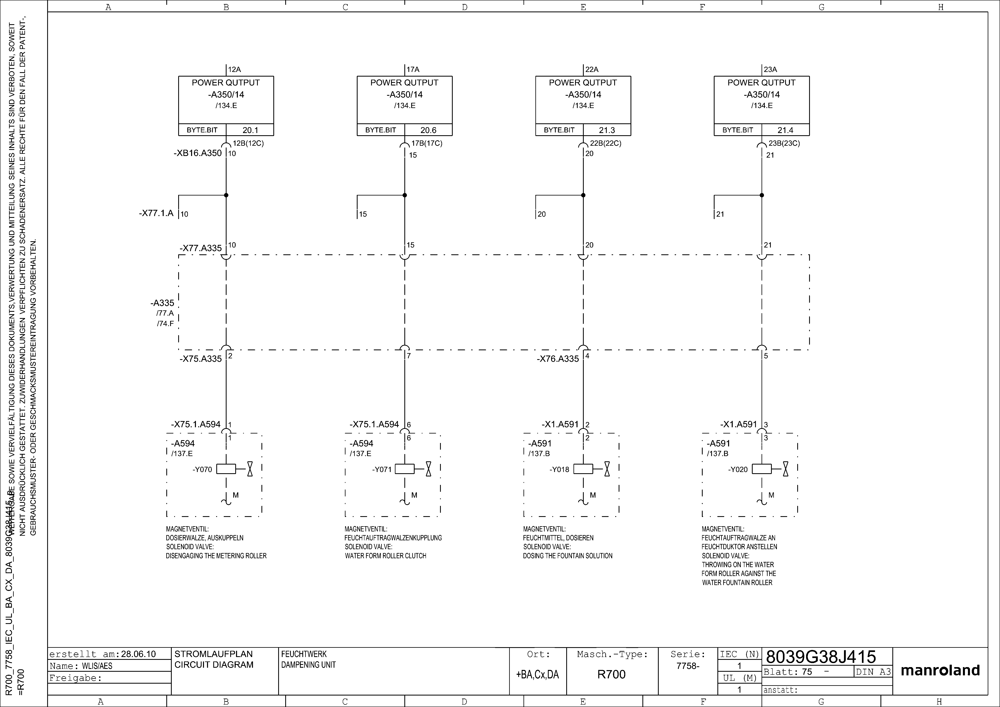

# +BA_Cx_DA — Sheet 75 of 247 — FEUCHTWERK

**DAMPENING UNIT**

> Part of the manroland **R700** printing press IEC/UL circuit diagrams.
> Drawing class: **Stromlaufplan / Circuit diagram** (DIN A3).
> Document `+BA_Cx_DA` covers the **Printing units / main switch cabinet** machine section.

## At a glance

| Field | Value |
|---|---|
| Document | `+BA_Cx_DA`  (8039G38J415) |
| Sheet | **75** of 247 |
| Section (DE) | FEUCHTWERK |
| Section (EN) | DAMPENING UNIT |
| Section type | CIRCUIT — Circuit diagram |
| Machine type | `R700` |
| Series | `7758` |
| Created | 28.06.10 |
| Replaces | — |
| Columns used | A, B, C, D, E, F, G |
| Path numbers | — |
| Labels on sheet | 99 |
| Cross-refs out | 10 |
| Cross-refs in | 30 |

**Previous:** [+BA_Cx_DA sheet 74](SHEET_0074.md) · **Next:** [+BA_Cx_DA sheet 76](SHEET_0076.md) · **Document TOC:** [_TOC.md](_TOC.md)  (+BA_Cx_DA) · **Master TOC:** [all sheets](../_MASTER_TOC.md)

## Sheet image (300 DPI, exact vector render)



_Rendered directly from the PDF vector layer at 300 DPI (1-bit), no OCR and no resampling. Use it to confirm anything ambiguous in the text below._

## Cross-references on this sheet

Each entry is a wire leaving this sheet. The printed token is `/sheet.column`; the link resolves to that sheet inside the same document.

| Ref | Target sheet | Col | Path | Destination on target | Target section | From col |
|---|---|---|---|---|---|---|
| `/134.E` | [+BA_Cx_DA sheet 134](SHEET_0134.md) | E | — | — | REFERENZMODUL | B |
| `/134.E` | [+BA_Cx_DA sheet 134](SHEET_0134.md) | E | — | — | REFERENZMODUL | D |
| `/134.E` | [+BA_Cx_DA sheet 134](SHEET_0134.md) | E | — | — | REFERENZMODUL | E |
| `/134.E` | [+BA_Cx_DA sheet 134](SHEET_0134.md) | E | — | — | REFERENZMODUL | G |
| `/77.A` | [+BA_Cx_DA sheet 77](SHEET_0077.md) | A | — | — | FARBWERK | A |
| `/74.F` | [+BA_Cx_DA sheet 74](SHEET_0074.md) | F | — | — | FEUCHTWERK | A |
| `/137.E` | [+BA_Cx_DA sheet 137](SHEET_0137.md) | E | — | A594 | REFERENZMODUL | B |
| `/137.E` | [+BA_Cx_DA sheet 137](SHEET_0137.md) | E | — | A594 | REFERENZMODUL | C |
| `/137.B` | [+BA_Cx_DA sheet 137](SHEET_0137.md) | B | — | A591 | REFERENZMODUL | E |
| `/137.B` | [+BA_Cx_DA sheet 137](SHEET_0137.md) | B | — | A591 | REFERENZMODUL | F |

### Incoming references (sheets that point here)

Every other sheet that sends a wire to this one. `Back-ref` is the token printed on *that* sheet; `Path` is its line number.

| From sheet | Cols | Back-ref | Path | Refs | What continues there |
|---|---|---|---|---|---|
| [+BA_Cx_DA#74](SHEET_0074.md) | E | `/74.E` | — | 1 | — |
| [+BA_Cx_DA#77](SHEET_0077.md) | A | `/77.A` | — | 1 | — |
| [+BA_Cx_DA#134](SHEET_0134.md) | E | `/134.E` | — | 4 | — |
| [+BA_Cx_DA#137](SHEET_0137.md) | B, E | `/137.B`, `/137.E` | — | 4 | — |
| [+BA_Cx_DA#142](SHEET_0142.md) | B | `/142.B` | — | 2 | — |
| [+BA_Cx_DA#172](SHEET_0172.md) | F | `/172.F` | — | 4 | — |
| [+BA_Cx_DA#184](SHEET_0184.md) | G | `/184.G` | — | 2 | — |
| [+BA_Cx_DA#185](SHEET_0185.md) | A, C, E, G | `/185.A`, `/185.C`, `/185.E`, `/185.G` | — | 12 | — |


## Devices on this sheet

| Tag | Class | Class meaning (IEC) | Col | Sub | Terminal | Sign |
|---|---|---|---|---|---|---|
| `A335` | A | Baugruppe / assembly, module, PC board | A | — | — | — |
| `A350/14` | A | Baugruppe / assembly, module, PC board | E | 14 | — | — |
| `A350/14` | A | Baugruppe / assembly, module, PC board | G | 14 | — | — |
| `A350/14` | A | Baugruppe / assembly, module, PC board | B | 14 | — | — |
| `A350/14` | A | Baugruppe / assembly, module, PC board | C | 14 | — | — |
| `Y070` | Y | Magnetventil / solenoid valve, actuator | B | — | — | — |
| `A594` | A | Baugruppe / assembly, module, PC board | B | — | — | — |
| `Y071` | Y | Magnetventil / solenoid valve, actuator | C | — | — | — |
| `A594` | A | Baugruppe / assembly, module, PC board | C | — | — | — |
| `Y018` | Y | Magnetventil / solenoid valve, actuator | E | — | — | — |
| `A591` | A | Baugruppe / assembly, module, PC board | E | — | — | — |
| `Y020` | Y | Magnetventil / solenoid valve, actuator | F | — | — | — |
| `A591` | A | Baugruppe / assembly, module, PC board | F | — | — | — |
| `X76.A335` | — | cross-device reference | E | — | — | — |
| `X77.A335` | — | cross-device reference | B | — | — | — |
| `X75.A335` | — | cross-device reference | B | — | — | — |
| `21.3` | — | cross-device reference | E | — | — | — |
| `21.4` | — | cross-device reference | G | — | — | — |
| `20.1` | — | cross-device reference | B | — | — | — |
| `XB16.A350` | — | cross-device reference | B | — | — | — |
| `20.6` | — | cross-device reference | D | — | — | — |
| `X77.1.A` | — | cross-device reference | A | — | — | — |
| `X1.A591` | — | cross-device reference | E | — | — | — |
| `X1.A591` | — | cross-device reference | F | — | — | — |
| `X75.1.A594` | — | cross-device reference | B | — | — | — |
| `X75.1.A594` | — | cross-device reference | C | — | — | — |

## Potentials / nets

_No named potentials on this sheet._

## Wire-end annotations (grouped as printed)

A wire that continues elsewhere is annotated with a small cluster: the destination description, the path/line number `#NN`, and the `/sheet.column` cross reference. Each row below is one such cluster exactly as it is grouped on the drawing.

| Col | Y | Path | Cross-ref | Text on the wire |
|---|---|---|---|---|
| B | 79.0 | — | — | `12A` |
| D | 79.0 | — | — | `17A` |
| E | 79.0 | — | — | `22A` |
| G | 79.0 | — | — | `23A` |
| B | 94.1 | — | — | `POWER QUTPUT` |
| C | 94.1 | — | — | `POWER QUTPUT` |
| E | 94.1 | — | — | `POWER QUTPUT` |
| F | 94.1 | — | — | `POWER QUTPUT` |
| B | 108.0 | — | — | `A350/14` |
| C | 108.0 | — | — | `A350/14` |
| E | 108.0 | — | — | `A350/14` |
| G | 108.0 | — | — | `A350/14` |
| B | 121.8 | — | `/134.E` | — |
| D | 121.8 | — | `/134.E` | — |
| E | 121.8 | — | `/134.E` | — |
| G | 121.8 | — | `/134.E` | — |
| B | 150.9 | — | — | `BYTE.BIT 20.1` |
| C | 150.9 | — | — | `BYTE.BIT 20.6` |
| E | 150.9 | — | — | `BYTE.BIT 21.3` |
| F | 150.9 | — | — | `BYTE.BIT 21.4` |
| B | 166.9 | — | — | `12B(12C)` |
| D | 166.9 | — | — | `17B(17C)` |
| E | 166.9 | — | — | `22B(22C)` |
| G | 166.9 | — | — | `23B(23C)` |
| C | 177.5 | — | — | `XB16.A350 10 15` |
| F | 178.9 | — | — | `20 21` |
| D | 249.1 | — | — | `X77.1.A 10 15 20 21` |
| B | 288.0 | — | — | `X77.A335 10` |
| D | 288.0 | — | — | `15` |
| E | 288.0 | — | — | `20` |
| G | 288.0 | — | — | `21` |
| A | 356.1 | — | — | `A335` |
| A | 369.1 | — | `/77.A` | — |
| A | 381.5 | — | `/74.F` | — |
| B | 419.9 | — | — | `X75.A335 2` |
| D | 419.9 | — | — | `7` |
| E | 419.9 | — | — | `X76.A335 4` |
| G | 419.9 | — | — | `5` |
| D | 500.6 | — | — | `X75.1.A594 1 X75.1.A594 6 X1.A591 2 X1.A591 3` |
| B | 517.6 | — | — | `1` |
| D | 517.6 | — | — | `6` |
| E | 517.6 | — | — | `2` |
| G | 517.6 | — | — | `3` |
| B | 523.3 | — | `/137.E` | `A594` |
| C | 523.3 | — | `/137.E` | `A594` |
| E | 523.3 | — | `/137.B` | `A591` |
| F | 523.3 | — | `/137.B` | `A591` |
| B | 555.2 | — | — | `Y070` |
| C | 555.2 | — | — | `Y071` |
| E | 555.2 | — | — | `Y018` |
| F | 555.2 | — | — | `Y020` |
| B | 585.7 | — | — | `M` |
| D | 585.7 | — | — | `M` |
| E | 585.7 | — | — | `M` |
| G | 585.7 | — | — | `M` |
| B | 627.1 | — | — | `DOSIERWALZE, AUSKUPPELN MAGNETVENTIL:` |
| C | 627.1 | — | — | `FEUCHTAUFTRAGWALZENKUPPLUNG MAGNETVENTIL:` |
| E | 627.1 | — | — | `FEUCHTMITTEL, DOSIEREN MAGNETVENTIL:` |
| F | 627.1 | — | — | `FEUCHTAUFTRAGWALZE AN FEUCHTDUKTOR ANSTELLEN MAGNETVENTIL:` |
| B | 648.3 | — | — | `DISENGAGING THE METERING ROLLER SOLENOID VALVE:` |
| C | 648.3 | — | — | `SOLENOID VALVE: WATER FORM ROLLER CLUTCH` |
| E | 648.3 | — | — | `DOSING THE FOUNTAIN SOLUTION SOLENOID VALVE:` |
| F | 659.0 | — | — | `FORM ROLLER AGAINST THE SOLENOID VALVE: THROWING ON THE WATER` |
| F | 690.9 | — | — | `WATER FOUNTAIN ROLLER` |


## Reconstructed tables

This sheet carries tabular content (pin map / terminal assignment / index). The grid below was rebuilt from the drawing's own rule lines, so each row is exactly one physical row of the table.

### Table 1 — 2 data rows × 2 columns (at x=212.6, y=90.7)

| POWER | QUTPUT A350/14 /134.E |
|---|---|
| `BYTE.BIT` | `20.1` |
| `XB16.A350` | `12B(12C) 10` |


### Table 2 — 2 data rows × 2 columns (at x=425.2, y=90.7)

| POWER | QUTPUT A350/14 /134.E |
|---|---|
| `BYTE.BIT` | `20.6` |
|  | `17B(17C) 15` |


### Table 3 — 2 data rows × 2 columns (at x=637.8, y=90.7)

| POWER | QUTPUT A350/14 /134.E |
|---|---|
| `BYTE.BIT` | `21.3` |
|  | `22B(22C) 20` |


### Table 4 — 2 data rows × 2 columns (at x=850.4, y=90.7)

| POWER | QUTPUT A350/14 /134.E |
|---|---|
| `BYTE.BIT` | `21.4` |
|  | `23B(23C) 21` |


## Notes and free text on this sheet

| Text | Col | Y (pt) |
|---|---|---|
| `22A` | E | 78.95 |
| `22B(22C)` | E | 166.86 |
| `POWER QUTPUT` | E | 94.1 |
| `BYTE.BIT` | E | 151.43 |
| `23A` | G | 78.95 |
| `23B(23C)` | G | 166.86 |
| `POWER QUTPUT` | F | 94.1 |
| `BYTE.BIT` | F | 151.43 |
| `12A` | B | 78.95 |
| `12B(12C)` | B | 166.86 |
| `POWER QUTPUT` | B | 94.1 |
| `BYTE.BIT` | B | 151.43 |
| `17A` | D | 78.95 |
| `17B(17C)` | D | 166.86 |
| `POWER QUTPUT` | C | 94.1 |
| `BYTE.BIT` | C | 151.43 |
| `MAGNETVENTIL:` | B | 627.07 |
| `DOSIERWALZE, AUSKUPPELN` | B | 637.68 |
| `SOLENOID VALVE:` | B | 648.33 |
| `DISENGAGING THE METERING ROLLER` | B | 658.99 |
| `M` | B | 585.74 |
| `MAGNETVENTIL:` | C | 627.07 |
| `FEUCHTAUFTRAGWALZENKUPPLUNG` | C | 637.71 |
| `SOLENOID VALVE:` | C | 648.33 |
| `WATER FORM ROLLER CLUTCH` | C | 658.99 |
| `M` | D | 585.74 |
| `MAGNETVENTIL:` | E | 627.07 |
| `FEUCHTMITTEL, DOSIEREN` | E | 637.71 |
| `SOLENOID VALVE:` | E | 648.33 |
| `DOSING THE FOUNTAIN SOLUTION` | E | 658.98 |
| `M` | E | 585.74 |
| `MAGNETVENTIL:` | F | 627.07 |
| `FEUCHTAUFTRAGWALZE AN` | F | 637.7 |
| `FEUCHTDUKTOR ANSTELLEN` | F | 648.35 |
| `SOLENOID VALVE:` | F | 658.96 |
| `THROWING ON THE WATER` | F | 669.59 |
| `FORM ROLLER AGAINST THE` | F | 680.25 |
| `WATER FOUNTAIN ROLLER` | F | 690.87 |
| `M` | G | 585.74 |

## Complete label inventory (exact text from the drawing)

Every text object inside the drawing area of this sheet, in DIN reading order (column A→H, then top→bottom). This is the authoritative list: if a string is not here it is not printed on this sheet.

| Col | Y | X | Dir | Type | Text |
|---|---|---|---|---|---|
| A | 249.1 | 165.5 | → | device ref | `X77.1.A` |
| A | 356.1 | 179.1 | → | device tag | `A335` |
| A | 369.1 | 186.2 | → | cross-reference | `/77.A` |
| A | 381.5 | 187.1 | → | cross-reference | `/74.F` |
| B | 78.9 | 271.3 | → | text | `12A` |
| B | 94.1 | 228.5 | → | text | `POWER QUTPUT` |
| B | 108.0 | 247.9 | → | device tag | `A350/14` |
| B | 121.8 | 256.8 | → | cross-reference | `/134.E` |
| B | 150.9 | 289.0 | → | device ref | `20.1` |
| B | 151.4 | 222.5 | → | text | `BYTE.BIT` |
| B | 166.9 | 276.9 | → | text | `12B(12C)` |
| B | 177.5 | 206.9 | → | device ref | `XB16.A350` |
| B | 178.9 | 271.3 | → | number | `10` |
| B | 251.2 | 214.6 | → | number | `10` |
| B | 288.0 | 271.3 | → | number | `10` |
| B | 290.9 | 214.0 | → | device ref | `X77.A335` |
| B | 419.9 | 271.8 | → | number | `2` |
| B | 422.7 | 214.0 | → | device ref | `X75.A335` |
| B | 500.6 | 203.8 | → | device ref | `X75.1.A594` |
| B | 502.1 | 271.3 | → | number | `1` |
| B | 517.6 | 271.3 | → | number | `1` |
| B | 523.3 | 203.8 | → | device tag | `A594` |
| B | 536.4 | 204.1 | → | cross-reference | `/137.E` |
| B | 555.2 | 229.3 | → | device tag | `Y070` |
| B | 585.7 | 277.2 | → | text | `M` |
| B | 627.1 | 197.9 | → | text | `MAGNETVENTIL:` |
| B | 637.7 | 197.6 | → | text | `DOSIERWALZE, AUSKUPPELN` |
| B | 648.3 | 198.1 | → | text | `SOLENOID VALVE:` |
| B | 659.0 | 197.6 | → | text | `DISENGAGING THE METERING ROLLER` |
| C | 94.1 | 441.1 | → | text | `POWER QUTPUT` |
| C | 108.0 | 460.5 | → | device tag | `A350/14` |
| C | 151.4 | 435.1 | → | text | `BYTE.BIT` |
| C | 251.2 | 427.2 | → | number | `15` |
| C | 500.6 | 416.4 | → | device ref | `X75.1.A594` |
| C | 523.3 | 416.4 | → | device tag | `A594` |
| C | 536.4 | 416.7 | → | cross-reference | `/137.E` |
| C | 555.2 | 443.3 | → | device tag | `Y071` |
| C | 627.1 | 410.5 | → | text | `MAGNETVENTIL:` |
| C | 637.7 | 410.2 | → | text | `FEUCHTAUFTRAGWALZENKUPPLUNG` |
| C | 648.3 | 410.7 | → | text | `SOLENOID VALVE:` |
| C | 659.0 | 411.0 | → | text | `WATER FORM ROLLER CLUTCH` |
| D | 78.9 | 483.9 | → | text | `17A` |
| D | 121.8 | 469.4 | → | cross-reference | `/134.E` |
| D | 150.9 | 500.7 | → | device ref | `20.6` |
| D | 166.9 | 489.5 | → | text | `17B(17C)` |
| D | 181.0 | 486.7 | → | number | `15` |
| D | 288.0 | 483.9 | → | number | `15` |
| D | 419.9 | 484.4 | → | number | `7` |
| D | 502.1 | 484.4 | → | number | `6` |
| D | 517.6 | 484.4 | → | number | `6` |
| D | 585.7 | 489.8 | → | text | `M` |
| E | 78.9 | 697.0 | → | text | `22A` |
| E | 94.1 | 653.7 | → | text | `POWER QUTPUT` |
| E | 108.0 | 673.1 | → | device tag | `A350/14` |
| E | 121.8 | 682.0 | → | cross-reference | `/134.E` |
| E | 150.9 | 713.3 | → | device ref | `21.3` |
| E | 151.4 | 647.7 | → | text | `BYTE.BIT` |
| E | 166.9 | 702.7 | → | text | `22B(22C)` |
| E | 178.9 | 697.0 | → | number | `20` |
| E | 251.2 | 640.3 | → | number | `20` |
| E | 288.0 | 697.0 | → | number | `20` |
| E | 419.9 | 697.0 | → | number | `4` |
| E | 422.7 | 639.2 | → | device ref | `X76.A335` |
| E | 500.6 | 645.2 | → | device ref | `X1.A591` |
| E | 502.1 | 697.0 | → | number | `2` |
| E | 517.6 | 697.0 | → | number | `2` |
| E | 523.3 | 629.0 | → | device tag | `A591` |
| E | 536.4 | 629.3 | → | cross-reference | `/137.B` |
| E | 555.2 | 654.5 | → | device tag | `Y018` |
| E | 585.7 | 702.4 | → | text | `M` |
| E | 627.1 | 623.1 | → | text | `MAGNETVENTIL:` |
| E | 637.7 | 622.8 | → | text | `FEUCHTMITTEL, DOSIEREN` |
| E | 648.3 | 623.3 | → | text | `SOLENOID VALVE:` |
| E | 659.0 | 622.8 | → | text | `DOSING THE FOUNTAIN SOLUTION` |
| F | 94.1 | 866.3 | → | text | `POWER QUTPUT` |
| F | 151.4 | 860.3 | → | text | `BYTE.BIT` |
| F | 251.2 | 852.9 | → | number | `21` |
| F | 500.6 | 857.8 | → | device ref | `X1.A591` |
| F | 523.3 | 841.6 | → | device tag | `A591` |
| F | 536.4 | 841.9 | → | cross-reference | `/137.B` |
| F | 555.2 | 867.1 | → | device tag | `Y020` |
| F | 627.1 | 835.7 | → | text | `MAGNETVENTIL:` |
| F | 637.7 | 835.4 | → | text | `FEUCHTAUFTRAGWALZE AN` |
| F | 648.4 | 835.4 | → | text | `FEUCHTDUKTOR ANSTELLEN` |
| F | 659.0 | 835.9 | → | text | `SOLENOID VALVE:` |
| F | 669.6 | 835.9 | → | text | `THROWING ON THE WATER` |
| F | 680.2 | 835.4 | → | text | `FORM ROLLER AGAINST THE` |
| F | 690.9 | 836.2 | → | text | `WATER FOUNTAIN ROLLER` |
| G | 78.9 | 909.6 | → | text | `23A` |
| G | 108.0 | 885.7 | → | device tag | `A350/14` |
| G | 121.8 | 894.6 | → | cross-reference | `/134.E` |
| G | 150.9 | 925.9 | → | device ref | `21.4` |
| G | 166.9 | 915.3 | → | text | `23B(23C)` |
| G | 181.0 | 912.5 | → | number | `21` |
| G | 288.0 | 909.6 | → | number | `21` |
| G | 419.9 | 909.6 | → | number | `5` |
| G | 502.1 | 909.6 | → | number | `3` |
| G | 517.6 | 909.6 | → | number | `3` |
| G | 585.7 | 915.0 | → | text | `M` |

## Reading-order text block

The same content as a plain block, grouped by DIN column — convenient to paste or to match against a visual description.

```text
=== Column A ===
 249.1  165.5  devref       X77.1.A
 356.1  179.1  devtag       A335
 369.1  186.2  xref         /77.A
 381.5  187.1  xref         /74.F
=== Column B ===
  78.9  271.3  text         12A
  94.1  228.5  text         POWER QUTPUT
 108.0  247.9  devtag       A350/14
 121.8  256.8  xref         /134.E
 150.9  289.0  devref       20.1
 151.4  222.5  text         BYTE.BIT
 166.9  276.9  text         12B(12C)
 177.5  206.9  devref       XB16.A350
 178.9  271.3  numeric      10
 251.2  214.6  numeric      10
 288.0  271.3  numeric      10
 290.9  214.0  devref       X77.A335
 419.9  271.8  numeric      2
 422.7  214.0  devref       X75.A335
 500.6  203.8  devref       X75.1.A594
 502.1  271.3  numeric      1
 517.6  271.3  numeric      1
 523.3  203.8  devtag       A594
 536.4  204.1  xref         /137.E
 555.2  229.3  devtag       Y070
 585.7  277.2  text         M
 627.1  197.9  text         MAGNETVENTIL:
 637.7  197.6  text         DOSIERWALZE, AUSKUPPELN
 648.3  198.1  text         SOLENOID VALVE:
 659.0  197.6  text         DISENGAGING THE METERING ROLLER
=== Column C ===
  94.1  441.1  text         POWER QUTPUT
 108.0  460.5  devtag       A350/14
 151.4  435.1  text         BYTE.BIT
 251.2  427.2  numeric      15
 500.6  416.4  devref       X75.1.A594
 523.3  416.4  devtag       A594
 536.4  416.7  xref         /137.E
 555.2  443.3  devtag       Y071
 627.1  410.5  text         MAGNETVENTIL:
 637.7  410.2  text         FEUCHTAUFTRAGWALZENKUPPLUNG
 648.3  410.7  text         SOLENOID VALVE:
 659.0  411.0  text         WATER FORM ROLLER CLUTCH
=== Column D ===
  78.9  483.9  text         17A
 121.8  469.4  xref         /134.E
 150.9  500.7  devref       20.6
 166.9  489.5  text         17B(17C)
 181.0  486.7  numeric      15
 288.0  483.9  numeric      15
 419.9  484.4  numeric      7
 502.1  484.4  numeric      6
 517.6  484.4  numeric      6
 585.7  489.8  text         M
=== Column E ===
  78.9  697.0  text         22A
  94.1  653.7  text         POWER QUTPUT
 108.0  673.1  devtag       A350/14
 121.8  682.0  xref         /134.E
 150.9  713.3  devref       21.3
 151.4  647.7  text         BYTE.BIT
 166.9  702.7  text         22B(22C)
 178.9  697.0  numeric      20
 251.2  640.3  numeric      20
 288.0  697.0  numeric      20
 419.9  697.0  numeric      4
 422.7  639.2  devref       X76.A335
 500.6  645.2  devref       X1.A591
 502.1  697.0  numeric      2
 517.6  697.0  numeric      2
 523.3  629.0  devtag       A591
 536.4  629.3  xref         /137.B
 555.2  654.5  devtag       Y018
 585.7  702.4  text         M
 627.1  623.1  text         MAGNETVENTIL:
 637.7  622.8  text         FEUCHTMITTEL, DOSIEREN
 648.3  623.3  text         SOLENOID VALVE:
 659.0  622.8  text         DOSING THE FOUNTAIN SOLUTION
=== Column F ===
  94.1  866.3  text         POWER QUTPUT
 151.4  860.3  text         BYTE.BIT
 251.2  852.9  numeric      21
 500.6  857.8  devref       X1.A591
 523.3  841.6  devtag       A591
 536.4  841.9  xref         /137.B
 555.2  867.1  devtag       Y020
 627.1  835.7  text         MAGNETVENTIL:
 637.7  835.4  text         FEUCHTAUFTRAGWALZE AN
 648.4  835.4  text         FEUCHTDUKTOR ANSTELLEN
 659.0  835.9  text         SOLENOID VALVE:
 669.6  835.9  text         THROWING ON THE WATER
 680.2  835.4  text         FORM ROLLER AGAINST THE
 690.9  836.2  text         WATER FOUNTAIN ROLLER
=== Column G ===
  78.9  909.6  text         23A
 108.0  885.7  devtag       A350/14
 121.8  894.6  xref         /134.E
 150.9  925.9  devref       21.4
 166.9  915.3  text         23B(23C)
 181.0  912.5  numeric      21
 288.0  909.6  numeric      21
 419.9  909.6  numeric      5
 502.1  909.6  numeric      3
 517.6  909.6  numeric      3
 585.7  915.0  text         M
```

---
_Generated from the PDF vector text layer; no OCR. Source: `R700_7758_IEC_UL_BA_CX_DA_8039G38J415_p`, sheet 75._
