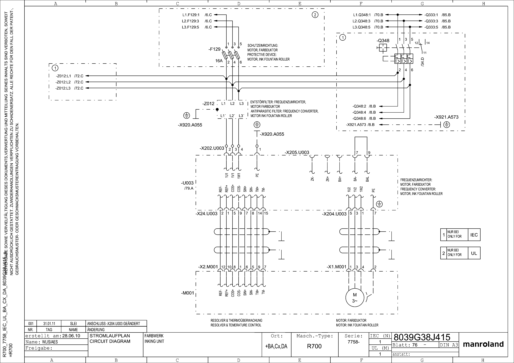

# +BA_Cx_DA — Sheet 76 of 247 — FARBWERK

**INKING UNIT**

> Part of the manroland **R700** printing press IEC/UL circuit diagrams.
> Drawing class: **Stromlaufplan / Circuit diagram** (DIN A3).
> Document `+BA_Cx_DA` covers the **Printing units / main switch cabinet** machine section.

## At a glance

| Field | Value |
|---|---|
| Document | `+BA_Cx_DA`  (8039G38J415) |
| Sheet | **76** of 247 |
| Section (DE) | FARBWERK |
| Section (EN) | INKING UNIT |
| Section type | CIRCUIT — Circuit diagram |
| Machine type | `R700` |
| Series | `7758` |
| Created | 28.06.10 |
| Replaces | — |
| Columns used | A, B, C, D, E, F, G, H |
| Path numbers | — |
| Labels on sheet | 165 |
| Cross-refs out | 18 |
| Cross-refs in | 48 |

**Previous:** [+BA_Cx_DA sheet 75](SHEET_0075.md) · **Next:** [+BA_Cx_DA sheet 77](SHEET_0077.md) · **Document TOC:** [_TOC.md](_TOC.md)  (+BA_Cx_DA) · **Master TOC:** [all sheets](../_MASTER_TOC.md)

## Sheet image (300 DPI, exact vector render)



_Rendered directly from the PDF vector layer at 300 DPI (1-bit), no OCR and no resampling. Use it to confirm anything ambiguous in the text below._

## Cross-references on this sheet

Each entry is a wire leaving this sheet. The printed token is `/sheet.column`; the link resolves to that sheet inside the same document.

| Ref | Target sheet | Col | Path | Destination on target | Target section | From col |
|---|---|---|---|---|---|---|
| `/70.B` | [+BA_Cx_DA sheet 70](SHEET_0070.md) | B | — | L1.Q348:1 | ÖLUMLAUFSCHMIERUNG | F |
| `/85.B` | [+BA_Cx_DA sheet 85](SHEET_0085.md) | B | — | Q333:1 | WASCHVORRICHTUNG | G |
| `/6.C` | [+BA_Cx_DA sheet 6](SHEET_0006.md) | C | — | L1.F129:1 | SPANNUNGSVERSORGUNG: 400V | C |
| `/70.B` | [+BA_Cx_DA sheet 70](SHEET_0070.md) | B | — | L2.Q348:3 | ÖLUMLAUFSCHMIERUNG | F |
| `/85.B` | [+BA_Cx_DA sheet 85](SHEET_0085.md) | B | — | Q333:3 | WASCHVORRICHTUNG | G |
| `/6.C` | [+BA_Cx_DA sheet 6](SHEET_0006.md) | C | — | L2.F129:3 | SPANNUNGSVERSORGUNG: 400V | C |
| `/70.B` | [+BA_Cx_DA sheet 70](SHEET_0070.md) | B | — | L3.Q348:5 | ÖLUMLAUFSCHMIERUNG | F |
| `/85.B` | [+BA_Cx_DA sheet 85](SHEET_0085.md) | B | — | Q333:5 | WASCHVORRICHTUNG | G |
| `/6.C` | [+BA_Cx_DA sheet 6](SHEET_0006.md) | C | — | L3.F129:5 | SPANNUNGSVERSORGUNG: 400V | C |
| `/34.D` | [+BA_Cx_DA sheet 34](SHEET_0034.md) | D | — | — | BUSVERBINDUNGEN: RESERVE SIGNALE | G |
| `/72.C` | [+BA_Cx_DA sheet 72](SHEET_0072.md) | C | — | Z012:L1 | FEUCHTWERK | A |
| `/72.C` | [+BA_Cx_DA sheet 72](SHEET_0072.md) | C | — | Z012:L2 | FEUCHTWERK | A |
| `/72.C` | [+BA_Cx_DA sheet 72](SHEET_0072.md) | C | — | Z012:L3 | FEUCHTWERK | A |
| `/8.B` | [+BA_Cx_DA sheet 8](SHEET_0008.md) | B | — | Q348:2 | SPANNUNGSVERSORGUNG, SCHALTSCHRANKBELÜFTUNG | F |
| `/8.B` | [+BA_Cx_DA sheet 8](SHEET_0008.md) | B | — | Q348:4 | SPANNUNGSVERSORGUNG, SCHALTSCHRANKBELÜFTUNG | F |
| `/8.B` | [+BA_Cx_DA sheet 8](SHEET_0008.md) | B | — | Q348:6 | SPANNUNGSVERSORGUNG, SCHALTSCHRANKBELÜFTUNG | F |
| `/8.B` | [+BA_Cx_DA sheet 8](SHEET_0008.md) | B | — | X921.A573 | SPANNUNGSVERSORGUNG, SCHALTSCHRANKBELÜFTUNG | F |
| `/79.A` | [+BA_Cx_DA sheet 79](SHEET_0079.md) | A | — | — | FARBWERK | C |

### Incoming references (sheets that point here)

Every other sheet that sends a wire to this one. `Back-ref` is the token printed on *that* sheet; `Path` is its line number.

| From sheet | Cols | Back-ref | Path | Refs | What continues there |
|---|---|---|---|---|---|
| [+BA_Cx_DA#6](SHEET_0006.md) | C | `/6.C` | — | 3 | L1.F129:1; L2.F129:3; L3.F129:5 |
| [+BA_Cx_DA#8](SHEET_0008.md) | C | `/8.C` | — | 4 | Q348:2; Q348:4; Q348:6; X921.A573 |
| [+BA_Cx_DA#34](SHEET_0034.md) | D | `/34.D` | — | 1 | — |
| [+BA_Cx_DA#70](SHEET_0070.md) | B | `/70.B` | — | 3 | L1.Q156:1 L1.Q348:1; L2.Q156:3 L2.Q348:3; L3.Q156:5 L3.Q348:5 |
| [+BA_Cx_DA#72](SHEET_0072.md) | C | `/72.C` | — | 3 | Z012:L1; Z012:L2; Z012:L3 |
| [+BA_Cx_DA#79](SHEET_0079.md) | A | `/79.A` | — | 1 | — |
| [+BA_Cx_DA#85](SHEET_0085.md) | A | `/85.A` | — | 3 | Q333:1; Q333:3; Q333:5 |
| [+BA_Cx_DA#147](SHEET_0147.md) | G | `/147.G` | — | 4 | — |
| [+BA_Cx_DA#154](SHEET_0154.md) | F | `/154.F` | — | 8 | — |
| [+BA_Cx_DA#175](SHEET_0175.md) | E | `/175.E` | — | 8 | — |
| [+BA_Cx_DA#188](SHEET_0188.md) | H | `/188.H` | — | 4 | — |
| [+BA_Cx_DA#189](SHEET_0189.md) | H | `/189.H` | — | 4 | — |
| [+BA_Cx_DA#190](SHEET_0190.md) | B | `/190.B` | — | 2 | — |


## Devices on this sheet

| Tag | Class | Class meaning (IEC) | Col | Sub | Terminal | Sign |
|---|---|---|---|---|---|---|
| `U003` | U | Umrichter / frequency converter | C | — | — | — |
| `Z012` | Z |  | D | — | — | — |
| `F129` | F | Schutz / protection device (fuse, circuit breaker) | D | — | — | — |
| `Z012:L1` | Z |  | A | — | L1 | — |
| `Z012:L3` | Z |  | A | — | L3 | — |
| `Z012:L2` | Z |  | A | — | L2 | — |
| `Q348` | Q | Leistungsschalter / power switching device | F | — | — | — |
| `Q333:3` | Q | Leistungsschalter / power switching device | G | — | 3 | — |
| `Q333:5` | Q | Leistungsschalter / power switching device | G | — | 5 | — |
| `Q333:1` | Q | Leistungsschalter / power switching device | G | — | 1 | — |
| `Q348:2` | Q | Leistungsschalter / power switching device | F | — | 2 | — |
| `Q348:4` | Q | Leistungsschalter / power switching device | F | — | 4 | — |
| `Q348:6` | Q | Leistungsschalter / power switching device | F | — | 6 | — |
| `X202.U003` | — | cross-device reference | D | — | — | — |
| `X24.U003` | — | cross-device reference | C | — | — | — |
| `X2.M001` | — | cross-device reference | D | — | — | — |
| `X1.M001` | — | cross-device reference | F | — | — | — |
| `X204.U003` | — | cross-device reference | F | — | — | — |
| `X205.U003` | — | cross-device reference | E | — | — | — |
| `NR.` | — | cross-device reference | A | — | — | — |
| `31.01.11` | — | cross-device reference | A | — | — | — |
| `X921.A573` | — | cross-device reference | F | — | — | — |
| `X920.A055` | — | cross-device reference | E | — | — | — |
| `X920.A055` | — | cross-device reference | C | — | — | — |
| `X921.A573` | — | cross-device reference | G | — | — | — |

## Potentials / nets

| Potential | Count | Columns | Attached devices | Terminals |
|---|---|---|---|---|
| `L1` | 3 | C, D, F | `F129`, `Q348` | `1` |
| `L2` | 3 | C, D, F | `F129`, `Q348` | `3` |
| `L3` | 3 | C, D, F | `F129`, `Q348` | `5` |
| `M001` | 1 | C | — | — |
| `PE` | 2 | D, F | — | — |


A potential such as `L24+/4` or `M24+` is a named supply/return rail; every place it appears on this sheet is electrically common.

## Wire-end annotations (grouped as printed)

A wire that continues elsewhere is annotated with a small cluster: the destination description, the path/line number `#NN`, and the `/sheet.column` cross reference. Each row below is one such cluster exactly as it is grouped on the drawing.

| Col | Y | Path | Cross-ref | Text on the wire |
|---|---|---|---|---|
| C | 30.7 | — | `/6.C` | `L1.F129:1` |
| F | 30.7 | — | `/70.B` | `L1.Q348:1` |
| G | 30.7 | — | `/85.B` | `Q333:1` |
| E | 31.5 | — | — | `2` |
| C | 44.9 | — | `/6.C` | `L2.F129:3` |
| F | 44.9 | — | `/70.B` | `L2.Q348:3` |
| G | 44.9 | — | `/85.B` | `Q333:3` |
| C | 59.1 | — | `/6.C` | `L3.F129:5` |
| F | 59.1 | — | `/70.B` | `L3.Q348:5` |
| G | 59.1 | — | `/85.B` | `Q333:5` |
| F | 83.7 | — | — | `1` |
| G | 87.5 | — | — | `1` |
| G | 87.5 | — | — | `3` |
| G | 87.5 | — | — | `5` |
| F | 89.6 | — | — | `Q348` |
| G | 96.6 | — | — | `12 14` |
| D | 98.1 | — | — | `1` |
| D | 98.1 | — | — | `3` |
| D | 98.1 | — | — | `5` |
| D | 102.7 | — | — | `PROTECTIVE DEVICE: MOTOR, FARBDUKTOR MOTOR, INK FOUNTAIN ROLLER SCHUTZEINRICHTUNG:` |
| D | 109.4 | — | — | `F129` |
| G | 119.2 | — | — | `11` |
| G | 132.9 | — | `/34.D` | — |
| D | 136.7 | — | — | `16A 6` |
| D | 140.6 | — | — | `2` |
| D | 140.6 | — | — | `4` |
| A | 154.6 | — | — | `1` |
| G | 158.4 | — | — | `2` |
| G | 158.4 | — | — | `4` |
| G | 158.4 | — | — | `6` |
| A | 172.5 | — | `/72.C` | `Z012:L1` |
| A | 186.7 | — | `/72.C` | `Z012:L2` |
| A | 200.8 | — | `/72.C` | `Z012:L3` |
| D | 233.8 | — | — | `Z012 ENTSTÖRFILTER: FREQUENZUMRICHTER, MOTOR FARBDUKTOR` |
| D | 236.3 | — | — | `L1 L2 L3` |
| F | 242.6 | — | `/8.B` | `Q348:2` |
| E | 255.0 | — | — | `MOTOR INK FOUNTAIN ROLLER ANTIPARASITIC FILTER: FREQUENCY CONVERTER,` |
| F | 256.8 | — | `/8.B` | `Q348:4` |
| D | 264.7 | — | — | `L1´ L2´ L3´` |
| G | 266.8 | — | — | `X921.A573` |
| F | 270.9 | — | `/8.B` | `Q348:6` |
| F | 285.1 | — | `/8.B` | `X921.A573` |
| C | 285.2 | — | — | `X920.A055` |
| E | 306.4 | — | — | `X920.A055` |
| D | 339.0 | — | — | `X202.U003 2 3 4` |
| D | 342.6 | — | — | `1` |
| E | 349.0 | — | — | `X205.U003 7 9` |
| D | 400.8 | — | — | `1U1` |
| D | 400.8 | — | — | `1V1` |
| D | 400.8 | — | — | `1W1` |
| D | 401.9 | — | — | `PE` |
| E | 409.0 | — | — | `ZK+` |
| F | 409.0 | — | — | `BA+` |
| E | 409.3 | — | — | `ZK` |
| F | 409.3 | — | — | `BA` |
| F | 409.3 | — | — | `BAL` |
| G | 414.5 | — | — | `FREQUENZUMRICHTER: FREQUENCY CONVERTER: MOTOR, FARBDUKTOR MOTOR, INK FOUNTAIN ROLLER` |
| C | 419.8 | — | — | `U003` |
| D | 428.0 | — | — | `COS+` |
| D | 429.4 | — | — | `REF+` |
| D | 429.7 | — | — | `COS` |
| D | 431.0 | — | — | `SIN+` |
| D | 431.1 | — | — | `REF` |
| F | 432.2 | — | — | `1W2` |
| D | 432.6 | — | — | `TM+` |
| D | 432.7 | — | — | `SIN` |
| C | 432.9 | — | `/79.A` | — |
| F | 434.2 | — | — | `1U2` |
| D | 434.3 | — | — | `TM` |
| F | 434.4 | — | — | `1V2` |
| F | 437.0 | — | — | `PE` |
| D | 490.7 | — | — | `X24.U003 2 1 14 15` |
| D | 490.7 | — | — | `5 9 7 8` |
| F | 490.7 | — | — | `X204.U003 5 3 1 7` |
| G | 534.9 | — | — | `1 NUR BEI` |
| H | 540.4 | — | — | `ONLY FOR IEC` |
| G | 577.4 | — | — | `2 NUR BEI` |
| H | 582.8 | — | — | `ONLY FOR UL` |
| E | 614.0 | — | — | `X2.M001 12 10 6 5 9 7 X1.M001 1 3 4 2` |
| D | 615.4 | — | — | `8 1` |
| D | 671.2 | — | — | `REF+` |
| D | 671.2 | — | — | `COS+` |
| D | 671.2 | — | — | `SIN+` |
| D | 671.2 | — | — | `TM+` |
| D | 671.5 | — | — | `REF` |
| D | 671.5 | — | — | `COS` |
| D | 671.5 | — | — | `SIN` |
| D | 671.5 | — | — | `TM` |
| C | 675.0 | — | — | `M001` |
| F | 679.2 | — | — | `3~ M` |
| D | 740.5 | — | — | `RESOLVER & THERMOÜBERWACHUNG RESOLVER & TEMERATURE CONTROL` |
| F | 740.5 | — | — | `MOTOR: FARBDUKTOR MOTOR: INK FOUNTAIN ROLLER` |
| A | 747.2 | — | — | `001 31.01.11 SLEI ANSCHLUSS X204.U003 GEÄNDERT` |
| A | 761.3 | — | — | `NR. TAG NAME ÄNDERUNG` |


## Reconstructed tables

This sheet carries tabular content (pin map / terminal assignment / index). The grid below was rebuilt from the drawing's own rule lines, so each row is exactly one physical row of the table.

### Table 1 — 1 data rows × 7 columns (at x=510.2, y=62.4)

|  | 1 2 | 3 4 | 5 6 |  | MOTOR, PROTECTIVE MOTOR, | SCHUTZEINRICHTUNG: INK |
|---|---|---|---|---|---|---|
| `L1 L1´ REF 2` | `L2 L2´ 2 1U1 REF+ 1` | `3 1V1 COS+ 5` | `L3 L3´ 4 1W1 COS 9` | `SIN+ 7` | `MOTOR MOTOR SIN 8` | `ENTSTÖRFILTER: ANTIPARASITIC 1 PE TM+ 14` |


### Table 2 — 5 data rows × 5 columns (at x=807.9, y=34.0)

|  |  | L1.Q348:1 L2.Q348:3 |  | /70.B /70.B |
|---|---|---|---|---|
|  |  | `L3.Q348:5` |  | `/70.B` |
|  | `Q348:2` |  | `/8.B` |  |
|  | `Q348:4` |  | `/8.B` |  |
|  | `Q348:6` |  | `/8.B` |  |
| `1U2 5` | `X921.A573 7 BA 1V2 3` | `1W2 1` | `/8.B 9 BAL` | `PE 7` |


### Table 3 — 2 data rows × 1 columns (at x=921.3, y=34.0)

| C1 |
|---|
| `1` |
| `2` |


### Table 4 — 2 data rows × 3 columns (at x=935.4, y=34.0)

| 3 |  | 5 |
|---|---|---|
| `4` |  | `6` |
| `MOTOR, MOTOR,` | `FREQUENCY` |  |


## Notes and free text on this sheet

| Text | Col | Y (pt) |
|---|---|---|
| `FREQUENZUMRICHTER:` | G | 414.5 |
| `MOTOR, FARBDUKTOR` | G | 425.13 |
| `FREQUENCY CONVERTER:` | G | 435.75 |
| `MOTOR, INK FOUNTAIN ROLLER` | G | 446.4 |
| `MOTOR: FARBDUKTOR` | F | 740.48 |
| `MOTOR: INK FOUNTAIN ROLLER` | F | 751.11 |
| `ENTSTÖRFILTER: FREQUENZUMRICHTER,` | E | 233.78 |
| `MOTOR FARBDUKTOR` | D | 244.43 |
| `ANTIPARASITIC FILTER: FREQUENCY CONVERTER,` | E | 255.04 |
| `MOTOR INK FOUNTAIN ROLLER` | E | 265.69 |
| `L1´` | D | 264.67 |
| `L2´` | D | 264.67 |
| `L3´` | D | 264.67 |
| `16A` | D | 136.7 |
| `SCHUTZEINRICHTUNG:` | D | 102.69 |
| `MOTOR, FARBDUKTOR` | D | 113.32 |
| `PROTECTIVE DEVICE:` | D | 123.91 |
| `MOTOR, INK FOUNTAIN ROLLER` | D | 134.58 |
| `TAG` | A | 761.44 |
| `NAME` | A | 761.42 |
| `ÄNDERUNG` | B | 761.48 |
| `SLEI` | A | 747.27 |
| `ANSCHLUSS X204.U003 GEÄNDERT` | B | 747.32 |
| `REF` | D | 431.07 |
| `REF+` | D | 429.38 |
| `COS+` | D | 427.97 |
| `COS` | D | 429.66 |
| `SIN+` | D | 430.99 |
| `SIN` | D | 432.68 |
| `1V1` | D | 400.82 |
| `1W1` | D | 400.82 |
| `1U1` | D | 400.82 |
| `RESOLVER & THERMOÜBERWACHUNG` | D | 740.47 |
| `RESOLVER & TEMERATURE CONTROL` | D | 751.11 |
| `TM+` | D | 432.6 |
| `TM` | D | 434.29 |
| `1V2` | F | 434.41 |
| `1W2` | F | 432.2 |
| `1U2` | F | 434.21 |
| `ZK` | E | 409.32 |
| `ZK+` | E | 409.04 |
| `BA+` | F | 409.04 |
| `BA` | F | 409.32 |
| `BAL` | F | 409.32 |
| `M` | F | 679.23 |
| `NUR BEI` | H | 534.91 |
| `ONLY FOR` | H | 545.6 |
| `IEC` | H | 540.4 |
| `UL` | H | 582.81 |

## Complete label inventory (exact text from the drawing)

Every text object inside the drawing area of this sheet, in DIN reading order (column A→H, then top→bottom). This is the authoritative list: if a string is not here it is not printed on this sheet.

| Col | Y | X | Dir | Type | Text |
|---|---|---|---|---|---|
| A | 154.5 | 125.8 | → | number | `1` |
| A | 172.5 | 129.8 | → | device tag | `Z012:L1` |
| A | 172.5 | 172.1 | → | cross-reference | `/72.C` |
| A | 186.7 | 128.7 | → | device tag | `Z012:L2` |
| A | 186.7 | 172.1 | → | cross-reference | `/72.C` |
| A | 200.8 | 172.1 | → | cross-reference | `/72.C` |
| A | 200.9 | 128.4 | → | device tag | `Z012:L3` |
| A | 747.2 | 65.7 | → | number | `001` |
| A | 747.3 | 100.4 | → | device ref | `31.01.11` |
| A | 747.3 | 162.6 | → | text | `SLEI` |
| A | 761.3 | 64.7 | → | device ref | `NR.` |
| A | 761.4 | 106.3 | → | text | `TAG` |
| A | 761.4 | 159.7 | → | text | `NAME` |
| B | 747.3 | 202.3 | → | text | `ANSCHLUSS X204.U003 GEÄNDERT` |
| B | 761.5 | 202.3 | → | text | `ÄNDERUNG` |
| C | 30.8 | 422.9 | → | potential | `L1.F129:1` |
| C | 44.9 | 421.5 | → | potential | `L2.F129:3` |
| C | 59.1 | 421.5 | → | potential | `L3.F129:5` |
| C | 285.2 | 412.2 | → | device ref | `X920.A055` |
| C | 419.8 | 419.5 | → | device tag | `U003` |
| C | 432.9 | 427.2 | → | cross-reference | `/79.A` |
| C | 490.7 | 453.0 | → | device ref | `X24.U003` |
| C | 675.0 | 419.8 | → | potential | `M001` |
| D | 30.7 | 474.5 | → | cross-reference | `/6.C` |
| D | 44.9 | 474.5 | → | cross-reference | `/6.C` |
| D | 59.1 | 474.5 | → | cross-reference | `/6.C` |
| D | 98.1 | 526.4 | → | number | `1` |
| D | 98.1 | 541.1 | → | number | `3` |
| D | 98.1 | 555.3 | → | number | `5` |
| D | 102.7 | 573.7 | → | text | `SCHUTZEINRICHTUNG:` |
| D | 109.4 | 483.0 | → | device tag | `F129` |
| D | 113.3 | 573.4 | → | text | `MOTOR, FARBDUKTOR` |
| D | 123.9 | 573.2 | → | text | `PROTECTIVE DEVICE:` |
| D | 134.6 | 573.4 | → | text | `MOTOR, INK FOUNTAIN ROLLER` |
| D | 136.7 | 498.3 | → | text | `16A` |
| D | 140.6 | 527.0 | → | number | `2` |
| D | 140.6 | 541.1 | → | number | `4` |
| D | 140.6 | 555.3 | → | number | `6` |
| D | 235.6 | 468.9 | → | device tag | `Z012` |
| D | 236.3 | 512.9 | → | potential | `L1` |
| D | 236.3 | 533.6 | → | potential | `L2` |
| D | 236.3 | 554.7 | → | potential | `L3` |
| D | 244.4 | 580.5 | → | text | `MOTOR FARBDUKTOR` |
| D | 264.7 | 510.8 | → | text | `L1´` |
| D | 264.7 | 532.1 | → | text | `L2´` |
| D | 264.7 | 553.3 | → | text | `L3´` |
| D | 339.0 | 462.6 | → | device ref | `X202.U003` |
| D | 342.6 | 529.8 | → | number | `2` |
| D | 342.6 | 544.0 | → | number | `3` |
| D | 342.6 | 558.1 | → | number | `4` |
| D | 342.6 | 600.1 | → | number | `1` |
| D | 400.8 | 522.1 | ↕ | text | `1U1` |
| D | 400.8 | 536.2 | ↕ | text | `1V1` |
| D | 400.8 | 550.3 | ↕ | text | `1W1` |
| D | 402.0 | 592.9 | ↕ | potential | `PE` |
| D | 428.0 | 536.4 | ↕ | text | `COS+` |
| D | 429.4 | 522.1 | ↕ | text | `REF+` |
| D | 429.7 | 550.5 | ↕ | text | `COS` |
| D | 431.0 | 564.7 | ↕ | text | `SIN+` |
| D | 431.1 | 508.0 | ↕ | text | `REF` |
| D | 432.6 | 593.1 | ↕ | text | `TM+` |
| D | 432.7 | 578.9 | ↕ | text | `SIN` |
| D | 434.3 | 607.3 | ↕ | text | `TM` |
| D | 490.7 | 512.8 | → | number | `2` |
| D | 490.7 | 526.4 | → | number | `1` |
| D | 490.7 | 541.1 | → | number | `5` |
| D | 490.7 | 555.3 | → | number | `9` |
| D | 490.7 | 569.5 | → | number | `7` |
| D | 490.7 | 583.7 | → | number | `8` |
| D | 490.7 | 597.3 | → | number | `14 15` |
| D | 614.0 | 459.2 | → | device ref | `X2.M001` |
| D | 615.4 | 512.2 | → | number | `12` |
| D | 615.4 | 526.4 | → | number | `10` |
| D | 615.4 | 541.1 | → | number | `8` |
| D | 615.4 | 554.7 | → | number | `1` |
| D | 615.4 | 569.5 | → | number | `6` |
| D | 615.4 | 583.7 | → | number | `5` |
| D | 615.4 | 597.8 | → | number | `9` |
| D | 615.4 | 612.0 | → | number | `7` |
| D | 671.2 | 522.1 | ↕ | text | `REF+` |
| D | 671.2 | 536.4 | ↕ | text | `COS+` |
| D | 671.2 | 564.7 | ↕ | text | `SIN+` |
| D | 671.2 | 593.1 | ↕ | text | `TM+` |
| D | 671.5 | 508.0 | ↕ | text | `REF` |
| D | 671.5 | 550.5 | ↕ | text | `COS` |
| D | 671.5 | 578.9 | ↕ | text | `SIN` |
| D | 671.5 | 607.3 | ↕ | text | `TM` |
| D | 740.5 | 488.1 | → | text | `RESOLVER & THERMOÜBERWACHUNG` |
| D | 751.1 | 488.1 | → | text | `RESOLVER & TEMERATURE CONTROL` |
| E | 31.5 | 727.9 | → | number | `2` |
| E | 233.8 | 580.3 | → | text | `ENTSTÖRFILTER: FREQUENZUMRICHTER,` |
| E | 255.0 | 581.1 | → | text | `ANTIPARASITIC FILTER: FREQUENCY CONVERTER,` |
| E | 265.7 | 580.5 | → | text | `MOTOR INK FOUNTAIN ROLLER` |
| E | 306.4 | 602.1 | → | device ref | `X920.A055` |
| E | 349.0 | 659.6 | → | device ref | `X205.U003` |
| E | 409.0 | 756.0 | ↕ | text | `ZK+` |
| E | 409.3 | 720.6 | ↕ | text | `ZK` |
| F | 30.7 | 866.8 | → | cross-reference | `/70.B` |
| F | 30.8 | 818.4 | → | potential | `L1.Q348:1` |
| F | 44.9 | 816.9 | → | potential | `L2.Q348:3` |
| F | 44.9 | 866.8 | → | cross-reference | `/70.B` |
| F | 59.1 | 816.9 | → | potential | `L3.Q348:5` |
| F | 59.1 | 866.8 | → | cross-reference | `/70.B` |
| F | 83.7 | 791.9 | → | number | `1` |
| F | 89.6 | 872.5 | → | device tag | `Q348` |
| F | 242.6 | 854.6 | → | cross-reference | `/8.B` |
| F | 242.7 | 816.7 | → | device tag | `Q348:2` |
| F | 256.8 | 816.4 | → | device tag | `Q348:4` |
| F | 256.8 | 854.6 | → | cross-reference | `/8.B` |
| F | 270.9 | 854.6 | → | cross-reference | `/8.B` |
| F | 271.0 | 816.4 | → | device tag | `Q348:6` |
| F | 285.1 | 851.8 | → | cross-reference | `/8.B` |
| F | 285.2 | 801.6 | → | device ref | `X921.A573` |
| F | 350.4 | 824.6 | → | number | `7` |
| F | 350.4 | 852.9 | → | number | `9` |
| F | 409.0 | 784.3 | ↕ | text | `BA+` |
| F | 409.3 | 819.7 | ↕ | text | `BA` |
| F | 409.3 | 848.1 | ↕ | text | `BAL` |
| F | 432.2 | 833.8 | ↕ | text | `1W2` |
| F | 434.2 | 805.6 | ↕ | text | `1U2` |
| F | 434.4 | 819.8 | ↕ | text | `1V2` |
| F | 437.0 | 862.2 | ↕ | potential | `PE` |
| F | 490.7 | 810.4 | → | number | `5` |
| F | 490.7 | 824.6 | → | number | `3` |
| F | 490.7 | 838.2 | → | number | `1` |
| F | 490.7 | 867.1 | → | number | `7` |
| F | 491.4 | 746.1 | → | device ref | `X204.U003` |
| F | 614.0 | 756.9 | → | device ref | `X1.M001` |
| F | 615.4 | 809.9 | → | number | `1` |
| F | 615.4 | 824.6 | → | number | `3` |
| F | 615.4 | 838.8 | → | number | `4` |
| F | 615.4 | 867.1 | → | number | `2` |
| F | 679.2 | 817.7 | → | text | `M` |
| F | 693.3 | 815.8 | → | other | `3~` |
| F | 740.5 | 779.0 | → | text | `MOTOR: FARBDUKTOR` |
| F | 751.1 | 779.0 | → | text | `MOTOR: INK FOUNTAIN ROLLER` |
| G | 30.7 | 1023.3 | → | cross-reference | `/85.B` |
| G | 30.8 | 983.3 | → | device tag | `Q333:1` |
| G | 44.9 | 1023.3 | → | cross-reference | `/85.B` |
| G | 45.0 | 983.3 | → | device tag | `Q333:3` |
| G | 59.1 | 983.3 | → | device tag | `Q333:5` |
| G | 59.1 | 1023.3 | → | cross-reference | `/85.B` |
| G | 87.5 | 923.2 | → | number | `1` |
| G | 87.5 | 938.0 | → | number | `3` |
| G | 87.5 | 952.2 | → | number | `5` |
| G | 96.6 | 960.4 | → | number | `12` |
| G | 96.6 | 987.3 | → | number | `14` |
| G | 119.2 | 980.2 | → | number | `11` |
| G | 132.9 | 974.7 | ↕ | cross-reference | `/34.D` |
| G | 158.4 | 923.8 | → | number | `2` |
| G | 158.4 | 938.0 | → | number | `4` |
| G | 158.4 | 952.2 | → | number | `6` |
| G | 266.8 | 1006.0 | → | device ref | `X921.A573` |
| G | 414.5 | 927.5 | → | text | `FREQUENZUMRICHTER:` |
| G | 425.1 | 927.8 | → | text | `MOTOR, FARBDUKTOR` |
| G | 435.8 | 927.5 | → | text | `FREQUENCY CONVERTER:` |
| G | 446.4 | 927.8 | → | text | `MOTOR, INK FOUNTAIN ROLLER` |
| G | 540.3 | 1025.0 | → | number | `1` |
| G | 582.8 | 1024.7 | → | number | `2` |
| H | 534.9 | 1036.6 | → | text | `NUR BEI` |
| H | 540.4 | 1089.6 | → | text | `IEC` |
| H | 545.6 | 1037.2 | → | text | `ONLY FOR` |
| H | 577.4 | 1036.6 | → | text | `NUR BEI` |
| H | 582.8 | 1091.3 | → | text | `UL` |
| H | 588.1 | 1037.2 | → | text | `ONLY FOR` |

## Reading-order text block

The same content as a plain block, grouped by DIN column — convenient to paste or to match against a visual description.

```text
=== Column A ===
 154.5  125.8  numeric      1
 172.5  129.8  devtag       Z012:L1
 172.5  172.1  xref         /72.C
 186.7  128.7  devtag       Z012:L2
 186.7  172.1  xref         /72.C
 200.8  172.1  xref         /72.C
 200.9  128.4  devtag       Z012:L3
 747.2   65.7  numeric      001
 747.3  100.4  devref       31.01.11
 747.3  162.6  text         SLEI
 761.3   64.7  devref       NR.
 761.4  106.3  text         TAG
 761.4  159.7  text         NAME
=== Column B ===
 747.3  202.3  text         ANSCHLUSS X204.U003 GEÄNDERT
 761.5  202.3  text         ÄNDERUNG
=== Column C ===
  30.8  422.9  net          L1.F129:1
  44.9  421.5  net          L2.F129:3
  59.1  421.5  net          L3.F129:5
 285.2  412.2  devref       X920.A055
 419.8  419.5  devtag       U003
 432.9  427.2  xref         /79.A
 490.7  453.0  devref       X24.U003
 675.0  419.8  net          M001
=== Column D ===
  30.7  474.5  xref         /6.C
  44.9  474.5  xref         /6.C
  59.1  474.5  xref         /6.C
  98.1  526.4  numeric      1
  98.1  541.1  numeric      3
  98.1  555.3  numeric      5
 102.7  573.7  text         SCHUTZEINRICHTUNG:
 109.4  483.0  devtag       F129
 113.3  573.4  text         MOTOR, FARBDUKTOR
 123.9  573.2  text         PROTECTIVE DEVICE:
 134.6  573.4  text         MOTOR, INK FOUNTAIN ROLLER
 136.7  498.3  text         16A
 140.6  527.0  numeric      2
 140.6  541.1  numeric      4
 140.6  555.3  numeric      6
 235.6  468.9  devtag       Z012
 236.3  512.9  net          L1
 236.3  533.6  net          L2
 236.3  554.7  net          L3
 244.4  580.5  text         MOTOR FARBDUKTOR
 264.7  510.8  text         L1´
 264.7  532.1  text         L2´
 264.7  553.3  text         L3´
 339.0  462.6  devref       X202.U003
 342.6  529.8  numeric      2
 342.6  544.0  numeric      3
 342.6  558.1  numeric      4
 342.6  600.1  numeric      1
 400.8  522.1  text         1U1
 400.8  536.2  text         1V1
 400.8  550.3  text         1W1
 402.0  592.9  net          PE
 428.0  536.4  text         COS+
 429.4  522.1  text         REF+
 429.7  550.5  text         COS
 431.0  564.7  text         SIN+
 431.1  508.0  text         REF
 432.6  593.1  text         TM+
 432.7  578.9  text         SIN
 434.3  607.3  text         TM
 490.7  512.8  numeric      2
 490.7  526.4  numeric      1
 490.7  541.1  numeric      5
 490.7  555.3  numeric      9
 490.7  569.5  numeric      7
 490.7  583.7  numeric      8
 490.7  597.3  numeric      14 15
 614.0  459.2  devref       X2.M001
 615.4  512.2  numeric      12
 615.4  526.4  numeric      10
 615.4  541.1  numeric      8
 615.4  554.7  numeric      1
 615.4  569.5  numeric      6
 615.4  583.7  numeric      5
 615.4  597.8  numeric      9
 615.4  612.0  numeric      7
 671.2  522.1  text         REF+
 671.2  536.4  text         COS+
 671.2  564.7  text         SIN+
 671.2  593.1  text         TM+
 671.5  508.0  text         REF
 671.5  550.5  text         COS
 671.5  578.9  text         SIN
 671.5  607.3  text         TM
 740.5  488.1  text         RESOLVER & THERMOÜBERWACHUNG
 751.1  488.1  text         RESOLVER & TEMERATURE CONTROL
=== Column E ===
  31.5  727.9  numeric      2
 233.8  580.3  text         ENTSTÖRFILTER: FREQUENZUMRICHTER,
 255.0  581.1  text         ANTIPARASITIC FILTER: FREQUENCY CONVERTER,
 265.7  580.5  text         MOTOR INK FOUNTAIN ROLLER
 306.4  602.1  devref       X920.A055
 349.0  659.6  devref       X205.U003
 409.0  756.0  text         ZK+
 409.3  720.6  text         ZK
=== Column F ===
  30.7  866.8  xref         /70.B
  30.8  818.4  net          L1.Q348:1
  44.9  816.9  net          L2.Q348:3
  44.9  866.8  xref         /70.B
  59.1  816.9  net          L3.Q348:5
  59.1  866.8  xref         /70.B
  83.7  791.9  numeric      1
  89.6  872.5  devtag       Q348
 242.6  854.6  xref         /8.B
 242.7  816.7  devtag       Q348:2
 256.8  816.4  devtag       Q348:4
 256.8  854.6  xref         /8.B
 270.9  854.6  xref         /8.B
 271.0  816.4  devtag       Q348:6
 285.1  851.8  xref         /8.B
 285.2  801.6  devref       X921.A573
 350.4  824.6  numeric      7
 350.4  852.9  numeric      9
 409.0  784.3  text         BA+
 409.3  819.7  text         BA
 409.3  848.1  text         BAL
 432.2  833.8  text         1W2
 434.2  805.6  text         1U2
 434.4  819.8  text         1V2
 437.0  862.2  net          PE
 490.7  810.4  numeric      5
 490.7  824.6  numeric      3
 490.7  838.2  numeric      1
 490.7  867.1  numeric      7
 491.4  746.1  devref       X204.U003
 614.0  756.9  devref       X1.M001
 615.4  809.9  numeric      1
 615.4  824.6  numeric      3
 615.4  838.8  numeric      4
 615.4  867.1  numeric      2
 679.2  817.7  text         M
 693.3  815.8  other        3~
 740.5  779.0  text         MOTOR: FARBDUKTOR
 751.1  779.0  text         MOTOR: INK FOUNTAIN ROLLER
=== Column G ===
  30.7 1023.3  xref         /85.B
  30.8  983.3  devtag       Q333:1
  44.9 1023.3  xref         /85.B
  45.0  983.3  devtag       Q333:3
  59.1  983.3  devtag       Q333:5
  59.1 1023.3  xref         /85.B
  87.5  923.2  numeric      1
  87.5  938.0  numeric      3
  87.5  952.2  numeric      5
  96.6  960.4  numeric      12
  96.6  987.3  numeric      14
 119.2  980.2  numeric      11
 132.9  974.7  xref         /34.D
 158.4  923.8  numeric      2
 158.4  938.0  numeric      4
 158.4  952.2  numeric      6
 266.8 1006.0  devref       X921.A573
 414.5  927.5  text         FREQUENZUMRICHTER:
 425.1  927.8  text         MOTOR, FARBDUKTOR
 435.8  927.5  text         FREQUENCY CONVERTER:
 446.4  927.8  text         MOTOR, INK FOUNTAIN ROLLER
 540.3 1025.0  numeric      1
 582.8 1024.7  numeric      2
=== Column H ===
 534.9 1036.6  text         NUR BEI
 540.4 1089.6  text         IEC
 545.6 1037.2  text         ONLY FOR
 577.4 1036.6  text         NUR BEI
 582.8 1091.3  text         UL
 588.1 1037.2  text         ONLY FOR
```

---
_Generated from the PDF vector text layer; no OCR. Source: `R700_7758_IEC_UL_BA_CX_DA_8039G38J415_p`, sheet 76._
