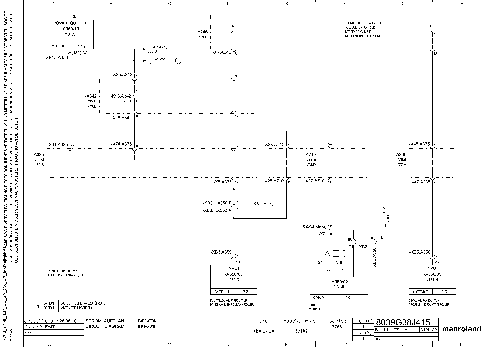

# +BA_Cx_DA — Sheet 77 of 247 — FARBWERK

**INKING UNIT**

> Part of the manroland **R700** printing press IEC/UL circuit diagrams.
> Drawing class: **Stromlaufplan / Circuit diagram** (DIN A3).
> Document `+BA_Cx_DA` covers the **Printing units / main switch cabinet** machine section.

## At a glance

| Field | Value |
|---|---|
| Document | `+BA_Cx_DA`  (8039G38J415) |
| Sheet | **77** of 247 |
| Section (DE) | FARBWERK |
| Section (EN) | INKING UNIT |
| Section type | CIRCUIT — Circuit diagram |
| Machine type | `R700` |
| Series | `7758` |
| Created | 28.06.10 |
| Replaces | — |
| Columns used | A, B, C, D, E, F, G, H |
| Path numbers | — |
| Labels on sheet | 118 |
| Cross-refs out | 17 |
| Cross-refs in | 41 |

**Previous:** [+BA_Cx_DA sheet 76](SHEET_0076.md) · **Next:** [+BA_Cx_DA sheet 78](SHEET_0078.md) · **Document TOC:** [_TOC.md](_TOC.md)  (+BA_Cx_DA) · **Master TOC:** [all sheets](../_MASTER_TOC.md)

## Sheet image (300 DPI, exact vector render)



_Rendered directly from the PDF vector layer at 300 DPI (1-bit), no OCR and no resampling. Use it to confirm anything ambiguous in the text below._

## Cross-references on this sheet

Each entry is a wire leaving this sheet. The printed token is `/sheet.column`; the link resolves to that sheet inside the same document.

| Ref | Target sheet | Col | Path | Destination on target | Target section | From col |
|---|---|---|---|---|---|---|
| `/134.C` | [+BA_Cx_DA sheet 134](SHEET_0134.md) | C | — | — | REFERENZMODUL | A |
| `/78.D` | [+BA_Cx_DA sheet 78](SHEET_0078.md) | D | — | — | FARBWERK | D |
| `/80.B` | [+BA_Cx_DA sheet 80](SHEET_0080.md) | B | — | — | FARBWERK | C |
| `/206.G` | [+BA_Cx_DA sheet 206](SHEET_0206.md) | G | — | — | OPTION: AUTOMATISCHE FARBZUFÜHRUNG | C |
| `/85.D` | [+BA_Cx_DA sheet 85](SHEET_0085.md) | D | — | — | WASCHVORRICHTUNG | B |
| `/73.B` | [+BA_Cx_DA sheet 73](SHEET_0073.md) | B | — | — | FEUCHTWERK | B |
| `/26.D` | [+BA_Cx_DA sheet 26](SHEET_0026.md) | D | — | — | BUSVERBINDUNGEN: NOT AUS | B |
| `/82.E` | [+BA_Cx_DA sheet 82](SHEET_0082.md) | E | — | — | FARBWERK | E |
| `/73.D` | [+BA_Cx_DA sheet 73](SHEET_0073.md) | D | — | — | FEUCHTWERK | E |
| `/78.B` | [+BA_Cx_DA sheet 78](SHEET_0078.md) | B | — | — | FARBWERK | G |
| `/77.A` | [+BA_Cx_DA sheet 77](SHEET_0077.md) | A | — | — | FARBWERK | G |
| `/77.G` | [+BA_Cx_DA sheet 77](SHEET_0077.md) | G | — | — | FARBWERK | A |
| `/75.B` | [+BA_Cx_DA sheet 75](SHEET_0075.md) | B | — | — | FEUCHTWERK | A |
| `/20.D` | [+BA_Cx_DA sheet 20](SHEET_0020.md) | D | — | XB2.A350:18 | BUSVERBINDUNGEN: SICHERHEITSBUS | G |
| `/131.D` | [+BA_Cx_DA sheet 131](SHEET_0131.md) | D | — | — | REFERENZMODUL | D |
| `/131.H` | [+BA_Cx_DA sheet 131](SHEET_0131.md) | H | — | — | REFERENZMODUL | H |
| `/131.B` | [+BA_Cx_DA sheet 131](SHEET_0131.md) | B | — | — | REFERENZMODUL | F |

### Incoming references (sheets that point here)

Every other sheet that sends a wire to this one. `Back-ref` is the token printed on *that* sheet; `Path` is its line number.

| From sheet | Cols | Back-ref | Path | Refs | What continues there |
|---|---|---|---|---|---|
| [+BA_Cx_DA#20](SHEET_0020.md) | D | `/20.D` | — | 1 | XB2.A350:18 |
| [+BA_Cx_DA#26](SHEET_0026.md) | D | `/26.D` | — | 1 | — |
| [+BA_Cx_DA#73](SHEET_0073.md) | B, D | `/73.B`, `/73.D` | — | 2 | — |
| [+BA_Cx_DA#75](SHEET_0075.md) | A | `/75.A` | — | 1 | — |
| [+BA_Cx_DA#77](SHEET_0077.md) | A, G | `/77.A`, `/77.G` | — | 2 | — |
| [+BA_Cx_DA#78](SHEET_0078.md) | B, D | `/78.B`, `/78.D` | — | 2 | — |
| [+BA_Cx_DA#80](SHEET_0080.md) | A | `/80.A` | — | 1 | X7.A246:1 |
| [+BA_Cx_DA#82](SHEET_0082.md) | D | `/82.D` | — | 1 | — |
| [+BA_Cx_DA#85](SHEET_0085.md) | D | `/85.D` | — | 1 | — |
| [+BA_Cx_DA#131](SHEET_0131.md) | B, D, H | `/131.B`, `/131.D`, `/131.H` | — | 3 | — |
| [+BA_Cx_DA#134](SHEET_0134.md) | C | `/134.C` | — | 1 | — |
| [+BA_Cx_DA#153](SHEET_0153.md) | G | `/153.G` | — | 2 | — |
| [+BA_Cx_DA#157](SHEET_0157.md) | C, D, F | `/157.C`, `/157.D`, `/157.F` | — | 3 | — |
| [+BA_Cx_DA#160](SHEET_0160.md) | C | `/160.C` | — | 1 | — |
| [+BA_Cx_DA#161](SHEET_0161.md) | A, F | `/161.A`, `/161.F` | — | 2 | — |
| [+BA_Cx_DA#163](SHEET_0163.md) | C, G | `/163.C`, `/163.G` | — | 3 | — |
| [+BA_Cx_DA#171](SHEET_0171.md) | G | `/171.G` | — | 1 | — |
| [+BA_Cx_DA#175](SHEET_0175.md) | F, H | `/175.F`, `/175.H` | — | 3 | — |
| [+BA_Cx_DA#177](SHEET_0177.md) | F | `/177.F` | — | 1 | — |
| [+BA_Cx_DA#178](SHEET_0178.md) | F, G | `/178.F`, `/178.G` | — | 4 | — |
| [+BA_Cx_DA#181](SHEET_0181.md) | F | `/181.F` | — | 1 | — |
| [+BA_Cx_DA#182](SHEET_0182.md) | B | `/182.B` | — | 1 | — |
| [+BA_Cx_DA#184](SHEET_0184.md) | F | `/184.F` | — | 2 | — |
| [+BA_Cx_DA#206](SHEET_0206.md) | G | `/206.G` | — | 1 | K273:A2 |


## Devices on this sheet

| Tag | Class | Class meaning (IEC) | Col | Sub | Terminal | Sign |
|---|---|---|---|---|---|---|
| `A350/05` | A | Baugruppe / assembly, module, PC board | G | 05 | — | — |
| `A350/03` | A | Baugruppe / assembly, module, PC board | D | 03 | — | — |
| `A246` | A | Baugruppe / assembly, module, PC board | D | — | — | — |
| `A350/13` | A | Baugruppe / assembly, module, PC board | A | 13 | — | — |
| `A342` | A | Baugruppe / assembly, module, PC board | B | — | — | — |
| `A335` | A | Baugruppe / assembly, module, PC board | G | — | — | — |
| `A335` | A | Baugruppe / assembly, module, PC board | A | — | — | — |
| `A710` | A | Baugruppe / assembly, module, PC board | E | — | — | — |
| `S18` | S | Schalter / switch | F | — | — | — |
| `A18` | A | Baugruppe / assembly, module, PC board | F | — | — | — |
| `X1` | X | Klemme / terminal, plug connector | F | — | — | — |
| `X2` | X | Klemme / terminal, plug connector | F | — | — | — |
| `XB2` | XB |  | F | — | — | — |
| `A350/02` | A | Baugruppe / assembly, module, PC board | F | 02 | — | — |
| `K273:A2` | K | Relais / relay, contactor | C | — | A2 | — |
| `9.3` | — | cross-device reference | H | — | — | — |
| `XB5.A350` | — | cross-device reference | G | — | — | — |
| `XB3.A350` | — | cross-device reference | D | — | — | — |
| `2.3` | — | cross-device reference | D | — | — | — |
| `X7.A246` | — | cross-device reference | D | — | — | — |
| `XB15.A350` | — | cross-device reference | A | — | — | — |
| `17.2` | — | cross-device reference | A | — | — | — |
| `X25.A342` | — | cross-device reference | B | — | — | — |
| `K13.A342` | — | cross-device reference | B | — | — | — |
| `X28.A342` | — | cross-device reference | B | — | — | — |
| `X45.A335` | — | cross-device reference | G | — | — | — |
| `X7.A335` | — | cross-device reference | G | — | — | — |
| `X41.A335` | — | cross-device reference | A | — | — | — |
| `X74.A335` | — | cross-device reference | B | — | — | — |
| `X5.A335` | — | cross-device reference | D | — | — | — |
| `X28.A710` | — | cross-device reference | E | — | — | — |
| `XB3.1.A350.B` | — | cross-device reference | D | — | — | — |
| `XB3.1.A350.A` | — | cross-device reference | D | — | — | — |
| `X25.A710` | — | cross-device reference | E | — | — | — |
| `X27.A710` | — | cross-device reference | E | — | — | — |
| `XB2.A350` | — | cross-device reference | G | — | — | — |
| `X5.1.A` | — | cross-device reference | E | — | — | — |
| `XB2.A350:18` | — | cross-device reference | G | — | 18 | — |
| `X7.A246:1` | — | cross-device reference | C | — | 1 | — |

## Potentials / nets

_No named potentials on this sheet._

## Wire-end annotations (grouped as printed)

A wire that continues elsewhere is annotated with a small cluster: the destination description, the path/line number `#NN`, and the `/sheet.column` cross reference. Each row below is one such cluster exactly as it is grouped on the drawing.

| Col | Y | Path | Cross-ref | Text on the wire |
|---|---|---|---|---|
| A | 36.4 | — | — | `13A` |
| A | 51.6 | — | — | `POWER QUTPUT` |
| F | 53.1 | — | — | `FARBDUKTOR, ANTRIEB INTERFACE MODULE: INK FOUNTAIN ROLLER, DRIVE SCHNITTSTELLENBAUGRUPPE:` |
| F | 60.1 | — | — | `SREL OUT 0` |
| A | 65.5 | — | — | `A350/13` |
| D | 72.6 | — | — | `A246` |
| A | 79.3 | — | `/134.C` | — |
| D | 85.7 | — | `/78.D` | — |
| A | 108.3 | — | — | `BYTE.BIT 17.2` |
| C | 110.8 | — | — | `X7.A246:1` |
| C | 120.7 | — | `/80.B` | — |
| F | 122.2 | — | — | `X7.A246 6 13` |
| A | 124.3 | — | — | `13B(13C)` |
| A | 134.9 | — | — | `XB15.A350 11` |
| C | 139.2 | — | — | `K273:A2` |
| C | 144.3 | — | — | `1` |
| C | 149.1 | — | `/206.G` | — |
| C | 176.1 | — | — | `X25.A342 7 8` |
| B | 215.1 | — | — | `7` |
| B | 228.5 | — | — | `A342` |
| B | 228.5 | — | — | `K13.A342 8` |
| B | 241.6 | — | `/85.D`, `/73.B` | — |
| B | 241.6 | — | `/26.D` | — |
| B | 278.1 | — | — | `X28.A342 16` |
| D | 278.1 | — | — | `17` |
| C | 344.7 | — | — | `X74.A335 16 17` |
| G | 344.7 | — | — | `X45.A335 2` |
| A | 346.1 | — | — | `X41.A335 11` |
| E | 346.1 | — | — | `X28.A710 23 24` |
| A | 370.2 | — | — | `A335` |
| E | 370.2 | — | — | `A710` |
| G | 370.2 | — | — | `A335` |
| A | 383.3 | — | `/77.G` | — |
| E | 383.3 | — | `/82.E`, `/73.D` | — |
| G | 383.3 | — | `/78.B`, `/77.A` | — |
| A | 395.7 | — | `/75.B` | — |
| E | 434.0 | — | — | `X25.A710 12 X27.A710 18` |
| D | 436.8 | — | — | `X5.A335 12` |
| G | 436.8 | — | — | `X7.A335 20` |
| G | 474.2 | — | `/20.D` | `XB2.A350:18` |
| D | 487.9 | — | — | `XB3.1.A350.B 12` |
| E | 490.0 | — | — | `X5.1.A 12` |
| D | 504.9 | — | — | `XB3.1.A350.A 12` |
| F | 544.6 | — | — | `X2.A350/02 18` |
| F | 563.0 | — | — | `X2` |
| F | 564.4 | — | — | `18 18` |
| G | 572.9 | — | — | `18` |
| F | 577.2 | — | — | `16C` |
| F | 594.1 | — | — | `X1` |
| F | 594.2 | — | — | `XB2` |
| G | 600.4 | — | — | `XB2.A350` |
| F | 606.9 | — | — | `XB3.A350 12 XB5.A350 20` |
| D | 632.4 | — | — | `18B` |
| H | 632.4 | — | — | `26B` |
| F | 633.1 | — | — | `S18 A18` |
| D | 646.9 | — | — | `INPUT` |
| G | 646.9 | — | — | `INPUT` |
| A | 655.6 | — | — | `FREIGABE: FARBDUKTOR RELEASE INK FOUNTAIN ROLLER` |
| D | 660.8 | — | — | `A350/03` |
| G | 660.8 | — | — | `A350/05` |
| D | 674.6 | — | `/131.D` | — |
| H | 674.6 | — | `/131.H` | — |
| F | 679.2 | — | — | `A350/02` |
| F | 691.6 | — | `/131.B` | — |
| D | 703.6 | — | — | `BYTE.BIT 2.3` |
| G | 703.6 | — | — | `BYTE.BIT 9.3` |
| F | 717.4 | — | — | `KANAL 18` |
| G | 726.4 | — | — | `STÖRUNG: FARBDUKTOR TROUBLE: INK FOUNTAIN ROLLER` |
| D | 726.5 | — | — | `RÜCKMELDUNG: FARBDUKTOR HANDSHAKE: INK FOUNTAIN ROLLER` |
| A | 733.4 | — | — | `1 OPTION OPTION` |
| B | 733.4 | — | — | `AUTOMATISCHE FARBZUFÜHRUNG AUTOMATIC INK SUPPLY` |
| F | 737.8 | — | — | `KANAL 18 CHANNEL 18` |


## Reconstructed tables

This sheet carries tabular content (pin map / terminal assignment / index). The grid below was rebuilt from the drawing's own rule lines, so each row is exactly one physical row of the table.

### Table 1 — 2 data rows × 3 columns (at x=113.4, y=48.2)

| POWER | QUTPUT A350/13 /134.C |  |
|---|---|---|
| `BYTE.BIT` | `17.2` |  |
| `XB15.A350 X41.A335` | `13B(13C) 11 A342 /85.D /73.B 11` | `X25.A342 K13.A342 /26.D X28.A342 X74.A335` |


### Table 2 — 7 data rows × 13 columns (at x=510.2, y=317.5)

| X5.A335 | 17 12 |  | X28.A710 X25.A710 | 23 12 | A710 /82.E /73.D X27.A710 | 24 18 |  |  |  | A335 /78.B /77.A | X45.A335 X7.A335 | 2 20 |
|---|---|---|---|---|---|---|---|---|---|---|---|---|
| `XB3.1.A350.B XB3.1.A350.A` | `12 12` | `X5.1.A` | `12` |  |  |  |  |  | `XB2.A350:18` | `/20.D` |  |  |
|  |  |  |  |  | `X2.A350/02` | `18` |  |  |  |  |  |  |
| `XB3.A350` | `12 18B` |  |  |  | `X2 S18` | `18 A18` | `16C X1` | `XB2` | `18 18 XB2.A350` |  | `XB5.A350` | `20 26B` |
| `INPUT` | `A350/03` |  |  |  |  |  |  |  |  |  | `INPUT` | `A350/05` |
|  | `/131.D` |  |  |  |  | `A350/02 /131.B` |  |  |  |  |  | `/131.H` |
| `BYTE.BIT` | `2.3` |  |  |  |  |  |  |  |  |  | `BYTE.BIT` | `9.3` |
|  |  |  |  |  | `KANAL` |  | `18` |  |  |  |  |  |


## Notes and free text on this sheet

| Text | Col | Y (pt) |
|---|---|---|
| `26B` | H | 632.41 |
| `INPUT` | G | 646.94 |
| `BYTE.BIT` | G | 704.19 |
| `STÖRUNG: FARBDUKTOR` | G | 726.42 |
| `TROUBLE: INK FOUNTAIN ROLLER` | G | 736.39 |
| `18B` | D | 632.41 |
| `INPUT` | D | 646.94 |
| `BYTE.BIT` | D | 704.19 |
| `RÜCKMELDUNG: FARBDUKTOR` | D | 726.45 |
| `HANDSHAKE: INK FOUNTAIN ROLLER` | D | 736.4 |
| `SCHNITTSTELLENBAUGRUPPE:` | F | 53.07 |
| `FARBDUKTOR, ANTRIEB` | F | 63.69 |
| `INTERFACE MODULE:` | F | 74.33 |
| `INK FOUNTAIN ROLLER, DRIVE` | F | 84.96 |
| `13A` | A | 36.43 |
| `13B(13C)` | A | 124.34 |
| `POWER QUTPUT` | A | 51.59 |
| `BYTE.BIT` | A | 108.91 |
| `FREIGABE: FARBDUKTOR` | A | 655.58 |
| `RELEASE INK FOUNTAIN ROLLER` | A | 665.54 |
| `KANAL 18` | E | 737.79 |
| `CHANNEL 18` | F | 747.74 |
| `16C` | F | 577.18 |
| `KANAL` | F | 717.46 |
| `X2.A350/02` | E | 544.56 |
| `OPTION` | A | 733.35 |
| `AUTOMATISCHE FARBZUFÜHRUNG` | B | 733.4 |
| `AUTOMATIC INK SUPPLY` | A | 744.02 |
| `OUT 0` | G | 60.15 |
| `SREL` | D | 60.14 |

## Complete label inventory (exact text from the drawing)

Every text object inside the drawing area of this sheet, in DIN reading order (column A→H, then top→bottom). This is the authoritative list: if a string is not here it is not printed on this sheet.

| Col | Y | X | Dir | Type | Text |
|---|---|---|---|---|---|
| A | 36.4 | 172.1 | → | text | `13A` |
| A | 51.6 | 129.3 | → | text | `POWER QUTPUT` |
| A | 65.5 | 148.7 | → | device tag | `A350/13` |
| A | 79.3 | 157.3 | → | cross-reference | `/134.C` |
| A | 108.3 | 188.6 | → | device ref | `17.2` |
| A | 108.9 | 123.3 | → | text | `BYTE.BIT` |
| A | 124.3 | 177.7 | → | text | `13B(13C)` |
| A | 134.9 | 107.7 | → | device ref | `XB15.A350` |
| A | 136.4 | 172.1 | → | number | `11` |
| A | 346.1 | 114.8 | → | device ref | `X41.A335` |
| A | 350.4 | 172.1 | → | number | `11` |
| A | 370.2 | 78.5 | → | device tag | `A335` |
| A | 383.3 | 85.3 | → | cross-reference | `/77.G` |
| A | 395.7 | 85.9 | → | cross-reference | `/75.B` |
| A | 655.6 | 112.8 | → | text | `FREIGABE: FARBDUKTOR` |
| A | 665.5 | 112.8 | → | text | `RELEASE INK FOUNTAIN ROLLER` |
| A | 733.4 | 106.0 | → | text | `OPTION` |
| A | 738.7 | 89.6 | → | number | `1` |
| A | 744.0 | 106.0 | → | text | `OPTION` |
| A | 744.0 | 148.8 | → | text | `AUTOMATIC INK SUPPLY` |
| B | 176.1 | 270.7 | → | device ref | `X25.A342` |
| B | 180.3 | 328.5 | → | number | `7` |
| B | 215.0 | 328.5 | → | number | `7` |
| B | 228.5 | 206.1 | → | device tag | `A342` |
| B | 228.5 | 267.9 | → | device ref | `K13.A342` |
| B | 241.6 | 213.2 | → | cross-reference | `/85.D` |
| B | 241.6 | 296.8 | → | cross-reference | `/26.D` |
| B | 243.4 | 328.5 | → | number | `8` |
| B | 253.9 | 213.4 | → | cross-reference | `/73.B` |
| B | 278.1 | 328.0 | → | number | `16` |
| B | 280.9 | 269.3 | → | device ref | `X28.A342` |
| B | 344.7 | 269.3 | → | device ref | `X74.A335` |
| B | 350.4 | 328.0 | → | number | `16` |
| B | 733.4 | 148.8 | → | text | `AUTOMATISCHE FARBZUFÜHRUNG` |
| C | 110.8 | 369.6 | → | device ref | `X7.A246:1` |
| C | 120.7 | 360.0 | → | cross-reference | `/80.B` |
| C | 139.2 | 369.6 | → | device tag | `K273:A2` |
| C | 144.3 | 430.5 | → | number | `1` |
| C | 149.1 | 360.0 | → | cross-reference | `/206.G` |
| D | 60.1 | 558.7 | → | text | `SREL` |
| D | 72.6 | 475.4 | → | device tag | `A246` |
| D | 85.7 | 482.5 | → | cross-reference | `/78.D` |
| D | 122.2 | 516.2 | → | device ref | `X7.A246` |
| D | 126.5 | 569.5 | → | number | `6` |
| D | 180.3 | 569.5 | → | number | `8` |
| D | 278.1 | 568.9 | → | number | `17` |
| D | 350.4 | 568.9 | → | number | `17` |
| D | 436.8 | 517.6 | → | device ref | `X5.A335` |
| D | 438.3 | 568.9 | → | number | `12` |
| D | 487.9 | 491.8 | → | device ref | `XB3.1.A350.B` |
| D | 487.9 | 568.9 | → | number | `12` |
| D | 504.9 | 568.9 | → | number | `12` |
| D | 505.6 | 491.0 | → | device ref | `XB3.1.A350.A` |
| D | 606.9 | 510.5 | → | device ref | `XB3.A350` |
| D | 615.4 | 568.9 | → | number | `12` |
| D | 632.4 | 571.7 | → | text | `18B` |
| D | 646.9 | 552.0 | → | text | `INPUT` |
| D | 660.8 | 545.5 | → | device tag | `A350/03` |
| D | 674.6 | 554.2 | → | cross-reference | `/131.D` |
| D | 703.6 | 588.5 | → | device ref | `2.3` |
| D | 704.2 | 520.2 | → | text | `BYTE.BIT` |
| D | 726.4 | 509.7 | → | text | `RÜCKMELDUNG: FARBDUKTOR` |
| D | 736.4 | 509.7 | → | text | `HANDSHAKE: INK FOUNTAIN ROLLER` |
| E | 346.1 | 639.2 | → | device ref | `X28.A710` |
| E | 346.2 | 697.0 | → | number | `23` |
| E | 370.2 | 737.6 | → | device tag | `A710` |
| E | 383.3 | 745.2 | → | cross-reference | `/82.E` |
| E | 395.7 | 744.7 | → | cross-reference | `/73.D` |
| E | 434.0 | 637.8 | → | device ref | `X25.A710` |
| E | 434.0 | 737.0 | → | device ref | `X27.A710` |
| E | 438.3 | 696.5 | → | number | `12` |
| E | 490.0 | 610.9 | → | device ref | `X5.1.A` |
| E | 492.1 | 654.0 | → | number | `12` |
| E | 544.6 | 729.6 | → | text | `X2.A350/02` |
| E | 737.8 | 749.2 | → | text | `KANAL 18` |
| F | 53.1 | 835.9 | → | text | `SCHNITTSTELLENBAUGRUPPE:` |
| F | 63.7 | 835.4 | → | text | `FARBDUKTOR, ANTRIEB` |
| F | 74.3 | 835.4 | → | text | `INTERFACE MODULE:` |
| F | 85.0 | 835.4 | → | text | `INK FOUNTAIN ROLLER, DRIVE` |
| F | 346.2 | 796.3 | → | number | `24` |
| F | 438.3 | 795.7 | → | number | `18` |
| F | 544.6 | 795.7 | → | number | `18` |
| F | 563.0 | 772.2 | → | device tag | `X2` |
| F | 564.4 | 798.5 | → | number | `18` |
| F | 574.3 | 897.7 | → | number | `18` |
| F | 577.2 | 839.1 | → | text | `16C` |
| F | 594.2 | 842.7 | → | device tag | `X1` |
| F | 594.2 | 867.1 | → | device tag | `XB2` |
| F | 633.1 | 768.5 | → | device tag | `S18` |
| F | 633.1 | 811.0 | → | device tag | `A18` |
| F | 679.2 | 800.6 | → | device tag | `A350/02` |
| F | 691.6 | 809.4 | → | cross-reference | `/131.B` |
| F | 717.4 | 837.1 | → | number | `18` |
| F | 717.5 | 757.4 | → | text | `KANAL` |
| F | 747.7 | 749.5 | → | text | `CHANNEL 18` |
| G | 60.2 | 1039.6 | → | text | `OUT 0` |
| G | 344.7 | 992.1 | → | device ref | `X45.A335` |
| G | 370.2 | 957.3 | → | device tag | `A335` |
| G | 383.3 | 964.6 | → | cross-reference | `/78.B` |
| G | 395.7 | 964.3 | → | cross-reference | `/77.A` |
| G | 436.8 | 999.5 | → | device ref | `X7.A335` |
| G | 474.2 | 927.2 | ↕ | device ref | `XB2.A350:18` |
| G | 517.6 | 937.1 | ↕ | cross-reference | `/20.D` |
| G | 572.9 | 919.0 | → | number | `18` |
| G | 600.4 | 903.1 | ↕ | device ref | `XB2.A350` |
| G | 606.9 | 992.4 | → | device ref | `XB5.A350` |
| G | 646.9 | 1033.9 | → | text | `INPUT` |
| G | 660.8 | 1027.4 | → | device tag | `A350/05` |
| G | 704.2 | 1002.0 | → | text | `BYTE.BIT` |
| G | 726.4 | 991.8 | → | text | `STÖRUNG: FARBDUKTOR` |
| G | 736.4 | 991.8 | → | text | `TROUBLE: INK FOUNTAIN ROLLER` |
| H | 126.5 | 1050.8 | → | number | `13` |
| H | 346.2 | 1051.4 | → | number | `2` |
| H | 438.3 | 1051.4 | → | number | `20` |
| H | 615.4 | 1051.4 | → | number | `20` |
| H | 632.4 | 1054.2 | → | text | `26B` |
| H | 674.6 | 1036.3 | → | cross-reference | `/131.H` |
| H | 703.6 | 1070.4 | → | device ref | `9.3` |

## Reading-order text block

The same content as a plain block, grouped by DIN column — convenient to paste or to match against a visual description.

```text
=== Column A ===
  36.4  172.1  text         13A
  51.6  129.3  text         POWER QUTPUT
  65.5  148.7  devtag       A350/13
  79.3  157.3  xref         /134.C
 108.3  188.6  devref       17.2
 108.9  123.3  text         BYTE.BIT
 124.3  177.7  text         13B(13C)
 134.9  107.7  devref       XB15.A350
 136.4  172.1  numeric      11
 346.1  114.8  devref       X41.A335
 350.4  172.1  numeric      11
 370.2   78.5  devtag       A335
 383.3   85.3  xref         /77.G
 395.7   85.9  xref         /75.B
 655.6  112.8  text         FREIGABE: FARBDUKTOR
 665.5  112.8  text         RELEASE INK FOUNTAIN ROLLER
 733.4  106.0  text         OPTION
 738.7   89.6  numeric      1
 744.0  106.0  text         OPTION
 744.0  148.8  text         AUTOMATIC INK SUPPLY
=== Column B ===
 176.1  270.7  devref       X25.A342
 180.3  328.5  numeric      7
 215.0  328.5  numeric      7
 228.5  206.1  devtag       A342
 228.5  267.9  devref       K13.A342
 241.6  213.2  xref         /85.D
 241.6  296.8  xref         /26.D
 243.4  328.5  numeric      8
 253.9  213.4  xref         /73.B
 278.1  328.0  numeric      16
 280.9  269.3  devref       X28.A342
 344.7  269.3  devref       X74.A335
 350.4  328.0  numeric      16
 733.4  148.8  text         AUTOMATISCHE FARBZUFÜHRUNG
=== Column C ===
 110.8  369.6  devref       X7.A246:1
 120.7  360.0  xref         /80.B
 139.2  369.6  devtag       K273:A2
 144.3  430.5  numeric      1
 149.1  360.0  xref         /206.G
=== Column D ===
  60.1  558.7  text         SREL
  72.6  475.4  devtag       A246
  85.7  482.5  xref         /78.D
 122.2  516.2  devref       X7.A246
 126.5  569.5  numeric      6
 180.3  569.5  numeric      8
 278.1  568.9  numeric      17
 350.4  568.9  numeric      17
 436.8  517.6  devref       X5.A335
 438.3  568.9  numeric      12
 487.9  491.8  devref       XB3.1.A350.B
 487.9  568.9  numeric      12
 504.9  568.9  numeric      12
 505.6  491.0  devref       XB3.1.A350.A
 606.9  510.5  devref       XB3.A350
 615.4  568.9  numeric      12
 632.4  571.7  text         18B
 646.9  552.0  text         INPUT
 660.8  545.5  devtag       A350/03
 674.6  554.2  xref         /131.D
 703.6  588.5  devref       2.3
 704.2  520.2  text         BYTE.BIT
 726.4  509.7  text         RÜCKMELDUNG: FARBDUKTOR
 736.4  509.7  text         HANDSHAKE: INK FOUNTAIN ROLLER
=== Column E ===
 346.1  639.2  devref       X28.A710
 346.2  697.0  numeric      23
 370.2  737.6  devtag       A710
 383.3  745.2  xref         /82.E
 395.7  744.7  xref         /73.D
 434.0  637.8  devref       X25.A710
 434.0  737.0  devref       X27.A710
 438.3  696.5  numeric      12
 490.0  610.9  devref       X5.1.A
 492.1  654.0  numeric      12
 544.6  729.6  text         X2.A350/02
 737.8  749.2  text         KANAL 18
=== Column F ===
  53.1  835.9  text         SCHNITTSTELLENBAUGRUPPE:
  63.7  835.4  text         FARBDUKTOR, ANTRIEB
  74.3  835.4  text         INTERFACE MODULE:
  85.0  835.4  text         INK FOUNTAIN ROLLER, DRIVE
 346.2  796.3  numeric      24
 438.3  795.7  numeric      18
 544.6  795.7  numeric      18
 563.0  772.2  devtag       X2
 564.4  798.5  numeric      18
 574.3  897.7  numeric      18
 577.2  839.1  text         16C
 594.2  842.7  devtag       X1
 594.2  867.1  devtag       XB2
 633.1  768.5  devtag       S18
 633.1  811.0  devtag       A18
 679.2  800.6  devtag       A350/02
 691.6  809.4  xref         /131.B
 717.4  837.1  numeric      18
 717.5  757.4  text         KANAL
 747.7  749.5  text         CHANNEL 18
=== Column G ===
  60.2 1039.6  text         OUT 0
 344.7  992.1  devref       X45.A335
 370.2  957.3  devtag       A335
 383.3  964.6  xref         /78.B
 395.7  964.3  xref         /77.A
 436.8  999.5  devref       X7.A335
 474.2  927.2  devref       XB2.A350:18
 517.6  937.1  xref         /20.D
 572.9  919.0  numeric      18
 600.4  903.1  devref       XB2.A350
 606.9  992.4  devref       XB5.A350
 646.9 1033.9  text         INPUT
 660.8 1027.4  devtag       A350/05
 704.2 1002.0  text         BYTE.BIT
 726.4  991.8  text         STÖRUNG: FARBDUKTOR
 736.4  991.8  text         TROUBLE: INK FOUNTAIN ROLLER
=== Column H ===
 126.5 1050.8  numeric      13
 346.2 1051.4  numeric      2
 438.3 1051.4  numeric      20
 615.4 1051.4  numeric      20
 632.4 1054.2  text         26B
 674.6 1036.3  xref         /131.H
 703.6 1070.4  devref       9.3
```

---
_Generated from the PDF vector text layer; no OCR. Source: `R700_7758_IEC_UL_BA_CX_DA_8039G38J415_p`, sheet 77._
