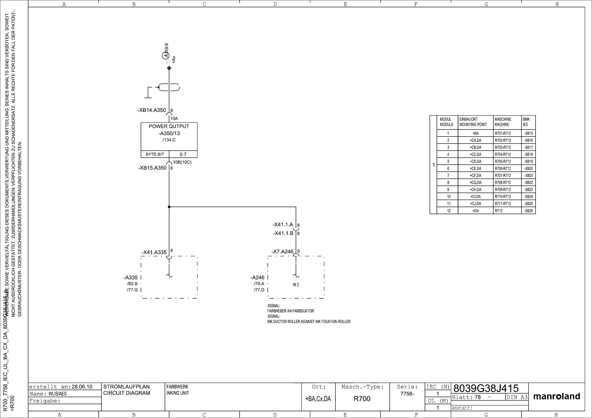

# +BA_Cx_DA — Sheet 78 of 247 — FARBWERK

**INKING UNIT**

> Part of the manroland **R700** printing press IEC/UL circuit diagrams.
> Drawing class: **Stromlaufplan / Circuit diagram** (DIN A3).
> Document `+BA_Cx_DA` covers the **Printing units / main switch cabinet** machine section.

## At a glance

| Field | Value |
|---|---|
| Document | `+BA_Cx_DA`  (8039G38J415) |
| Sheet | **78** of 247 |
| Section (DE) | FARBWERK |
| Section (EN) | INKING UNIT |
| Section type | CIRCUIT — Circuit diagram |
| Machine type | `R700` |
| Series | `7758` |
| Created | 28.06.10 |
| Replaces | — |
| Columns used | B, C, D, F, G, H |
| Path numbers | — |
| Labels on sheet | 90 |
| Cross-refs out | 5 |
| Cross-refs in | 11 |

**Previous:** [+BA_Cx_DA sheet 77](SHEET_0077.md) · **Next:** [+BA_Cx_DA sheet 79](SHEET_0079.md) · **Document TOC:** [_TOC.md](_TOC.md)  (+BA_Cx_DA) · **Master TOC:** [all sheets](../_MASTER_TOC.md)

## Sheet image (300 DPI, exact vector render)



_Rendered directly from the PDF vector layer at 300 DPI (1-bit), no OCR and no resampling. Use it to confirm anything ambiguous in the text below._

## Cross-references on this sheet

Each entry is a wire leaving this sheet. The printed token is `/sheet.column`; the link resolves to that sheet inside the same document.

| Ref | Target sheet | Col | Path | Destination on target | Target section | From col |
|---|---|---|---|---|---|---|
| `/134.C` | [+BA_Cx_DA sheet 134](SHEET_0134.md) | C | — | — | REFERENZMODUL | B |
| `/82.B` | [+BA_Cx_DA sheet 82](SHEET_0082.md) | B | — | — | FARBWERK | B |
| `/77.G` | [+BA_Cx_DA sheet 77](SHEET_0077.md) | G | — | — | FARBWERK | B |
| `/79.A` | [+BA_Cx_DA sheet 79](SHEET_0079.md) | A | — | — | FARBWERK | D |
| `/77.D` | [+BA_Cx_DA sheet 77](SHEET_0077.md) | D | — | — | FARBWERK | D |

### Incoming references (sheets that point here)

Every other sheet that sends a wire to this one. `Back-ref` is the token printed on *that* sheet; `Path` is its line number.

| From sheet | Cols | Back-ref | Path | Refs | What continues there |
|---|---|---|---|---|---|
| [+BA_Cx_DA#77](SHEET_0077.md) | D, G | `/77.D`, `/77.G` | — | 2 | — |
| [+BA_Cx_DA#79](SHEET_0079.md) | A | `/79.A` | — | 1 | — |
| [+BA_Cx_DA#82](SHEET_0082.md) | B | `/82.B` | — | 1 | — |
| [+BA_Cx_DA#134](SHEET_0134.md) | C | `/134.C` | — | 1 | — |
| [+BA_Cx_DA#163](SHEET_0163.md) | C | `/163.C` | — | 1 | — |
| [+BA_Cx_DA#171](SHEET_0171.md) | B, G | `/171.B`, `/171.G` | — | 2 | — |
| [+BA_Cx_DA#181](SHEET_0181.md) | B, C, F | `/181.B`, `/181.C`, `/181.F` | — | 3 | — |


## Devices on this sheet

| Tag | Class | Class meaning (IEC) | Col | Sub | Terminal | Sign |
|---|---|---|---|---|---|---|
| `A350/13` | A | Baugruppe / assembly, module, PC board | B | 13 | — | — |
| `A335` | A | Baugruppe / assembly, module, PC board | B | — | — | — |
| `A246` | A | Baugruppe / assembly, module, PC board | D | — | — | — |
| `XB15` | XB |  | H | — | — | — |
| `XB16` | XB |  | H | — | — | — |
| `XB17` | XB |  | H | — | — | — |
| `XB18` | XB |  | H | — | — | — |
| `XB19` | XB |  | H | — | — | — |
| `XB20` | XB |  | H | — | — | — |
| `XB21` | XB |  | H | — | — | — |
| `XB22` | XB |  | H | — | — | — |
| `XB23` | XB |  | H | — | — | — |
| `XB24` | XB |  | H | — | — | — |
| `XB25` | XB |  | H | — | — | — |
| `XB26` | XB |  | H | — | — | — |
| `R712` | R | Widerstand / resistor | G | — | — | — |
| `0.7` | — | cross-device reference | C | — | — | — |
| `XB14.A350` | — | cross-device reference | B | — | — | — |
| `XB15.A350` | — | cross-device reference | B | — | — | — |
| `X41.A335` | — | cross-device reference | B | — | — | — |
| `X7.A246` | — | cross-device reference | D | — | — | — |
| `X41.1.B` | — | cross-device reference | D | — | — | — |
| `X41.1.A` | — | cross-device reference | D | — | — | — |

## Potentials / nets

_No named potentials on this sheet._

## Wire-end annotations (grouped as printed)

A wire that continues elsewhere is annotated with a small cluster: the destination description, the path/line number `#NN`, and the `/sheet.column` cross reference. Each row below is one such cluster exactly as it is grouped on the drawing.

| Col | Y | Path | Cross-ref | Text on the wire |
|---|---|---|---|---|
| B | 87.0 | — | — | `.A359:8` |
| B | 109.1 | — | — | `1` |
| C | 112.8 | — | — | `+Ax` |
| B | 217.2 | — | — | `XB14.A350 8` |
| C | 234.8 | — | — | `10A` |
| F | 237.3 | — | — | `MODUL MODULE` |
| G | 237.3 | — | — | `EINBAUORT MOUNTING POINT` |
| G | 237.3 | — | — | `MASCHINE MACHINE` |
| H | 237.3 | — | — | `BMK IEE` |
| B | 250.0 | — | — | `POWER QUTPUT` |
| B | 263.9 | — | — | `A350/13` |
| F | 265.1 | — | — | `1` |
| G | 265.6 | — | — | `+BA` |
| G | 265.7 | — | — | `R701 R712` |
| H | 265.7 | — | — | `XB15` |
| B | 277.7 | — | `/134.C` | — |
| F | 279.7 | — | — | `2` |
| G | 279.8 | — | — | `+CA,DA` |
| H | 279.8 | — | — | `XB16` |
| G | 279.9 | — | — | `R702 R712` |
| F | 293.9 | — | — | `3` |
| G | 294.0 | — | — | `+CB,DA` |
| G | 294.0 | — | — | `R703 R712` |
| H | 294.0 | — | — | `XB17` |
| B | 306.8 | — | — | `BYTE.BIT 0.7` |
| F | 308.1 | — | — | `4` |
| G | 308.2 | — | — | `+CC,DA` |
| G | 308.2 | — | — | `R704 R712` |
| H | 308.2 | — | — | `XB18` |
| F | 322.3 | — | — | `5` |
| G | 322.4 | — | — | `+CD,DA` |
| G | 322.4 | — | — | `R705 R712` |
| H | 322.4 | — | — | `XB19` |
| C | 322.8 | — | — | `10B(10C)` |
| F | 327.7 | — | — | `1` |
| B | 333.4 | — | — | `XB15.A350 8` |
| F | 336.4 | — | — | `6` |
| G | 336.5 | — | — | `+CE,DA` |
| H | 336.5 | — | — | `XB20` |
| G | 336.6 | — | — | `R706 R712` |
| F | 350.6 | — | — | `7` |
| H | 350.6 | — | — | `XB21` |
| G | 350.7 | — | — | `+CF,DA` |
| G | 350.7 | — | — | `R707 R712` |
| F | 364.8 | — | — | `8` |
| G | 364.9 | — | — | `+CG,DA` |
| G | 364.9 | — | — | `R708 R712` |
| H | 364.9 | — | — | `XB22` |
| F | 379.0 | — | — | `9` |
| H | 379.0 | — | — | `XB23` |
| G | 379.1 | — | — | `+CH,DA` |
| G | 379.1 | — | — | `R709 R712` |
| F | 393.1 | — | — | `10` |
| G | 393.2 | — | — | `+CI,DA` |
| G | 393.2 | — | — | `R710 R712` |
| H | 393.2 | — | — | `XB24` |
| F | 407.1 | — | — | `11` |
| G | 407.4 | — | — | `+CJ,DA` |
| G | 407.4 | — | — | `R711 R712` |
| H | 407.4 | — | — | `XB25` |
| F | 421.5 | — | — | `12` |
| G | 421.6 | — | — | `+DA` |
| G | 421.6 | — | — | `R712` |
| H | 421.6 | — | — | `XB26` |
| D | 447.5 | — | — | `X41.1.A 8` |
| D | 465.2 | — | — | `X41.1.B 8` |
| B | 500.6 | — | — | `X41.A335 8` |
| D | 502.0 | — | — | `X7.A246 9` |
| B | 554.5 | — | — | `A335` |
| D | 554.5 | — | — | `A246` |
| B | 567.5 | — | `/82.B`, `/77.G` | — |
| D | 567.5 | — | `/79.A`, `/77.D` | — |
| D | 570.3 | — | — | `IN 2` |
| D | 612.9 | — | — | `FARBHEBER AN FARBDUKTOR SIGNAL:` |
| D | 634.1 | — | — | `INK DUCTOR ROLLER AGAINST INK FOUNTAIN ROLLER SIGNAL:` |


## Reconstructed tables

This sheet carries tabular content (pin map / terminal assignment / index). The grid below was rebuilt from the drawing's own rule lines, so each row is exactly one physical row of the table.

### Table 1 — 2 data rows × 2 columns (at x=283.5, y=246.6)

| POWER | QUTPUT A350/13 /134.C |
|---|---|
| `BYTE.BIT` | `0.7` |
| `XB15.A350` | `10B(10C) 8` |


## Notes and free text on this sheet

| Text | Col | Y (pt) |
|---|---|---|
| `.A359:8` | B | 87.03 |
| `+Ax` | C | 112.82 |
| `10A` | C | 234.85 |
| `10B(10C)` | C | 322.76 |
| `POWER QUTPUT` | B | 250.01 |
| `BYTE.BIT` | B | 307.34 |
| `SIGNAL:` | D | 612.87 |
| `FARBHEBER AN FARBDUKTOR` | D | 623.54 |
| `INK DUCTOR ROLLER AGAINST INK FOUNTAIN ROLLER` | D | 644.82 |
| `MODUL` | F | 237.35 |
| `MODULE` | F | 247.97 |
| `EINBAUORT` | G | 237.31 |
| `MOUNTING POINT` | G | 247.97 |
| `+BA` | G | 265.63 |
| `+CA,DA` | G | 279.84 |
| `+CB,DA` | G | 294.01 |
| `+CC,DA` | G | 308.2 |
| `+CD,DA` | G | 322.38 |
| `+CE,DA` | G | 336.53 |
| `+CF,DA` | G | 350.71 |
| `+CG,DA` | G | 364.89 |
| `+CH,DA` | G | 379.07 |
| `+CI,DA` | G | 393.22 |
| `+CJ,DA` | G | 407.39 |
| `+DA` | G | 421.57 |
| `MASCHINE` | G | 237.32 |
| `MACHINE` | G | 247.95 |
| `BMK` | H | 237.29 |
| `IEE` | H | 247.79 |
| `R701 R712` | G | 265.69 |
| `R702 R712` | G | 279.86 |
| `R703 R712` | G | 294.03 |
| `R704 R712` | G | 308.21 |
| `R705 R712` | G | 322.38 |
| `R706 R712` | G | 336.55 |
| `R707 R712` | G | 350.73 |
| `R708 R712` | G | 364.9 |
| `R709 R712` | G | 379.07 |
| `R710 R712` | G | 393.25 |
| `R711 R712` | G | 407.42 |
| `IN 2` | D | 570.3 |

## Complete label inventory (exact text from the drawing)

Every text object inside the drawing area of this sheet, in DIN reading order (column A→H, then top→bottom). This is the authoritative list: if a string is not here it is not printed on this sheet.

| Col | Y | X | Dir | Type | Text |
|---|---|---|---|---|---|
| B | 87.0 | 331.2 | ↕ | text | `.A359:8` |
| B | 109.1 | 330.0 | ↕ | number | `1` |
| B | 217.2 | 276.4 | → | device ref | `XB14.A350` |
| B | 250.0 | 299.3 | → | text | `POWER QUTPUT` |
| B | 263.9 | 318.8 | → | device tag | `A350/13` |
| B | 277.7 | 327.4 | → | cross-reference | `/134.C` |
| B | 307.3 | 293.4 | → | text | `BYTE.BIT` |
| B | 333.4 | 277.8 | → | device ref | `XB15.A350` |
| B | 503.5 | 284.9 | → | device ref | `X41.A335` |
| B | 554.5 | 248.6 | → | device tag | `A335` |
| B | 567.5 | 256.0 | → | cross-reference | `/82.B` |
| B | 580.0 | 255.4 | → | cross-reference | `/77.G` |
| C | 112.8 | 345.5 | ↕ | text | `+Ax` |
| C | 218.6 | 342.7 | → | number | `8` |
| C | 234.9 | 342.1 | → | text | `10A` |
| C | 306.8 | 361.7 | → | device ref | `0.7` |
| C | 322.8 | 347.8 | → | text | `10B(10C)` |
| C | 334.8 | 342.7 | → | number | `8` |
| C | 500.6 | 342.7 | → | number | `8` |
| D | 447.5 | 548.2 | → | device ref | `X41.1.A` |
| D | 449.6 | 597.8 | → | number | `8` |
| D | 465.2 | 549.1 | → | device ref | `X41.1.B` |
| D | 466.6 | 597.8 | → | number | `8` |
| D | 502.0 | 546.0 | → | device ref | `X7.A246` |
| D | 502.1 | 597.8 | → | number | `9` |
| D | 554.5 | 503.7 | → | device tag | `A246` |
| D | 567.5 | 510.8 | → | cross-reference | `/79.A` |
| D | 570.3 | 589.2 | → | text | `IN 2` |
| D | 580.0 | 510.8 | → | cross-reference | `/77.D` |
| D | 612.9 | 538.3 | → | text | `SIGNAL:` |
| D | 623.5 | 537.7 | → | text | `FARBHEBER AN FARBDUKTOR` |
| D | 634.1 | 538.3 | → | text | `SIGNAL:` |
| D | 644.8 | 537.7 | → | text | `INK DUCTOR ROLLER AGAINST INK FOUNTAIN ROLLER` |
| F | 237.4 | 885.3 | → | text | `MODUL` |
| F | 248.0 | 885.3 | → | text | `MODULE` |
| F | 265.1 | 899.1 | → | number | `1` |
| F | 279.7 | 899.7 | → | number | `2` |
| F | 293.9 | 899.7 | → | number | `3` |
| F | 308.1 | 899.7 | → | number | `4` |
| F | 322.3 | 899.7 | → | number | `5` |
| F | 327.7 | 869.1 | → | number | `1` |
| F | 336.5 | 899.7 | → | number | `6` |
| F | 350.6 | 899.7 | → | number | `7` |
| F | 364.8 | 899.7 | → | number | `8` |
| F | 379.0 | 899.7 | → | number | `9` |
| F | 393.1 | 899.1 | → | number | `10` |
| F | 407.2 | 899.1 | → | number | `11` |
| F | 421.5 | 899.1 | → | number | `12` |
| G | 237.3 | 924.0 | → | text | `EINBAUORT` |
| G | 237.3 | 995.1 | → | text | `MASCHINE` |
| G | 248.0 | 924.2 | → | text | `MOUNTING POINT` |
| G | 248.0 | 995.1 | → | text | `MACHINE` |
| G | 265.6 | 950.5 | → | text | `+BA` |
| G | 265.7 | 995.5 | → | text | `R701 R712` |
| G | 279.8 | 945.1 | → | text | `+CA,DA` |
| G | 279.9 | 995.5 | → | text | `R702 R712` |
| G | 294.0 | 945.1 | → | text | `+CB,DA` |
| G | 294.0 | 995.5 | → | text | `R703 R712` |
| G | 308.2 | 945.0 | → | text | `+CC,DA` |
| G | 308.2 | 995.5 | → | text | `R704 R712` |
| G | 322.4 | 945.0 | → | text | `+CD,DA` |
| G | 322.4 | 995.5 | → | text | `R705 R712` |
| G | 336.5 | 945.1 | → | text | `+CE,DA` |
| G | 336.6 | 995.5 | → | text | `R706 R712` |
| G | 350.7 | 945.3 | → | text | `+CF,DA` |
| G | 350.7 | 995.5 | → | text | `R707 R712` |
| G | 364.9 | 944.8 | → | text | `+CG,DA` |
| G | 364.9 | 995.5 | → | text | `R708 R712` |
| G | 379.1 | 945.0 | → | text | `+CH,DA` |
| G | 379.1 | 995.5 | → | text | `R709 R712` |
| G | 393.2 | 946.3 | → | text | `+CI,DA` |
| G | 393.2 | 995.5 | → | text | `R710 R712` |
| G | 407.4 | 945.6 | → | text | `+CJ,DA` |
| G | 407.4 | 995.5 | → | text | `R711 R712` |
| G | 421.5 | 995.5 | → | device tag | `R712` |
| G | 421.6 | 950.4 | → | text | `+DA` |
| H | 237.3 | 1051.5 | → | text | `BMK` |
| H | 247.8 | 1051.5 | → | text | `IEE` |
| H | 265.7 | 1054.3 | → | device tag | `XB15` |
| H | 279.8 | 1054.3 | → | device tag | `XB16` |
| H | 294.0 | 1054.3 | → | device tag | `XB17` |
| H | 308.2 | 1054.3 | → | device tag | `XB18` |
| H | 322.4 | 1054.3 | → | device tag | `XB19` |
| H | 336.5 | 1054.3 | → | device tag | `XB20` |
| H | 350.6 | 1054.8 | → | device tag | `XB21` |
| H | 364.9 | 1054.4 | → | device tag | `XB22` |
| H | 379.0 | 1054.3 | → | device tag | `XB23` |
| H | 393.2 | 1054.3 | → | device tag | `XB24` |
| H | 407.4 | 1054.3 | → | device tag | `XB25` |
| H | 421.6 | 1054.3 | → | device tag | `XB26` |

## Reading-order text block

The same content as a plain block, grouped by DIN column — convenient to paste or to match against a visual description.

```text
=== Column B ===
  87.0  331.2  text         .A359:8
 109.1  330.0  numeric      1
 217.2  276.4  devref       XB14.A350
 250.0  299.3  text         POWER QUTPUT
 263.9  318.8  devtag       A350/13
 277.7  327.4  xref         /134.C
 307.3  293.4  text         BYTE.BIT
 333.4  277.8  devref       XB15.A350
 503.5  284.9  devref       X41.A335
 554.5  248.6  devtag       A335
 567.5  256.0  xref         /82.B
 580.0  255.4  xref         /77.G
=== Column C ===
 112.8  345.5  text         +Ax
 218.6  342.7  numeric      8
 234.9  342.1  text         10A
 306.8  361.7  devref       0.7
 322.8  347.8  text         10B(10C)
 334.8  342.7  numeric      8
 500.6  342.7  numeric      8
=== Column D ===
 447.5  548.2  devref       X41.1.A
 449.6  597.8  numeric      8
 465.2  549.1  devref       X41.1.B
 466.6  597.8  numeric      8
 502.0  546.0  devref       X7.A246
 502.1  597.8  numeric      9
 554.5  503.7  devtag       A246
 567.5  510.8  xref         /79.A
 570.3  589.2  text         IN 2
 580.0  510.8  xref         /77.D
 612.9  538.3  text         SIGNAL:
 623.5  537.7  text         FARBHEBER AN FARBDUKTOR
 634.1  538.3  text         SIGNAL:
 644.8  537.7  text         INK DUCTOR ROLLER AGAINST INK FOUNTAIN ROLLER
=== Column F ===
 237.4  885.3  text         MODUL
 248.0  885.3  text         MODULE
 265.1  899.1  numeric      1
 279.7  899.7  numeric      2
 293.9  899.7  numeric      3
 308.1  899.7  numeric      4
 322.3  899.7  numeric      5
 327.7  869.1  numeric      1
 336.5  899.7  numeric      6
 350.6  899.7  numeric      7
 364.8  899.7  numeric      8
 379.0  899.7  numeric      9
 393.1  899.1  numeric      10
 407.2  899.1  numeric      11
 421.5  899.1  numeric      12
=== Column G ===
 237.3  924.0  text         EINBAUORT
 237.3  995.1  text         MASCHINE
 248.0  924.2  text         MOUNTING POINT
 248.0  995.1  text         MACHINE
 265.6  950.5  text         +BA
 265.7  995.5  text         R701 R712
 279.8  945.1  text         +CA,DA
 279.9  995.5  text         R702 R712
 294.0  945.1  text         +CB,DA
 294.0  995.5  text         R703 R712
 308.2  945.0  text         +CC,DA
 308.2  995.5  text         R704 R712
 322.4  945.0  text         +CD,DA
 322.4  995.5  text         R705 R712
 336.5  945.1  text         +CE,DA
 336.6  995.5  text         R706 R712
 350.7  945.3  text         +CF,DA
 350.7  995.5  text         R707 R712
 364.9  944.8  text         +CG,DA
 364.9  995.5  text         R708 R712
 379.1  945.0  text         +CH,DA
 379.1  995.5  text         R709 R712
 393.2  946.3  text         +CI,DA
 393.2  995.5  text         R710 R712
 407.4  945.6  text         +CJ,DA
 407.4  995.5  text         R711 R712
 421.5  995.5  devtag       R712
 421.6  950.4  text         +DA
=== Column H ===
 237.3 1051.5  text         BMK
 247.8 1051.5  text         IEE
 265.7 1054.3  devtag       XB15
 279.8 1054.3  devtag       XB16
 294.0 1054.3  devtag       XB17
 308.2 1054.3  devtag       XB18
 322.4 1054.3  devtag       XB19
 336.5 1054.3  devtag       XB20
 350.6 1054.8  devtag       XB21
 364.9 1054.4  devtag       XB22
 379.0 1054.3  devtag       XB23
 393.2 1054.3  devtag       XB24
 407.4 1054.3  devtag       XB25
 421.6 1054.3  devtag       XB26
```

---
_Generated from the PDF vector text layer; no OCR. Source: `R700_7758_IEC_UL_BA_CX_DA_8039G38J415_p`, sheet 78._
