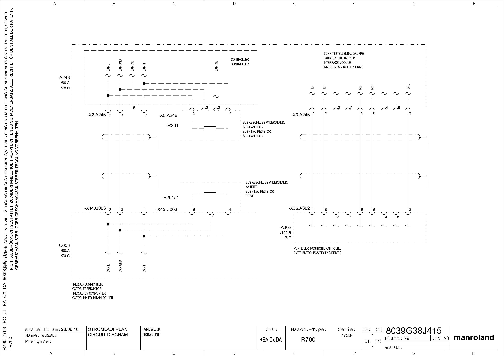

# +BA_Cx_DA — Sheet 79 of 247 — FARBWERK

**INKING UNIT**

> Part of the manroland **R700** printing press IEC/UL circuit diagrams.
> Drawing class: **Stromlaufplan / Circuit diagram** (DIN A3).
> Document `+BA_Cx_DA` covers the **Printing units / main switch cabinet** machine section.

## At a glance

| Field | Value |
|---|---|
| Document | `+BA_Cx_DA`  (8039G38J415) |
| Sheet | **79** of 247 |
| Section (DE) | FARBWERK |
| Section (EN) | INKING UNIT |
| Section type | CIRCUIT — Circuit diagram |
| Machine type | `R700` |
| Series | `7758` |
| Created | 28.06.10 |
| Replaces | — |
| Columns used | A, B, C, D, E, F, G |
| Path numbers | — |
| Labels on sheet | 82 |
| Cross-refs out | 6 |
| Cross-refs in | 31 |

**Previous:** [+BA_Cx_DA sheet 78](SHEET_0078.md) · **Next:** [+BA_Cx_DA sheet 80](SHEET_0080.md) · **Document TOC:** [_TOC.md](_TOC.md)  (+BA_Cx_DA) · **Master TOC:** [all sheets](../_MASTER_TOC.md)

## Sheet image (300 DPI, exact vector render)



_Rendered directly from the PDF vector layer at 300 DPI (1-bit), no OCR and no resampling. Use it to confirm anything ambiguous in the text below._

## Cross-references on this sheet

Each entry is a wire leaving this sheet. The printed token is `/sheet.column`; the link resolves to that sheet inside the same document.

| Ref | Target sheet | Col | Path | Destination on target | Target section | From col |
|---|---|---|---|---|---|---|
| `/80.A` | [+BA_Cx_DA sheet 80](SHEET_0080.md) | A | — | — | FARBWERK | A |
| `/78.D` | [+BA_Cx_DA sheet 78](SHEET_0078.md) | D | — | — | FARBWERK | A |
| `/102.B` | [+BA_Cx_DA sheet 102](SHEET_0102.md) | B | — | — | SCHNITTSTELLE: POSITIONIERANTRIEBE | E |
| `/8.E` | [+BA_Cx_DA sheet 8](SHEET_0008.md) | E | — | — | SPANNUNGSVERSORGUNG, SCHALTSCHRANKBELÜFTUNG | E |
| `/80.A` | [+BA_Cx_DA sheet 80](SHEET_0080.md) | A | — | — | FARBWERK | A |
| `/76.C` | [+BA_Cx_DA sheet 76](SHEET_0076.md) | C | — | — | FARBWERK | A |

### Incoming references (sheets that point here)

Every other sheet that sends a wire to this one. `Back-ref` is the token printed on *that* sheet; `Path` is its line number.

| From sheet | Cols | Back-ref | Path | Refs | What continues there |
|---|---|---|---|---|---|
| [+BA_Cx_DA#8](SHEET_0008.md) | E | `/8.E` | — | 1 | — |
| [+BA_Cx_DA#76](SHEET_0076.md) | C | `/76.C` | — | 1 | — |
| [+BA_Cx_DA#78](SHEET_0078.md) | D | `/78.D` | — | 1 | — |
| [+BA_Cx_DA#80](SHEET_0080.md) | A | `/80.A` | — | 2 | — |
| [+BA_Cx_DA#102](SHEET_0102.md) | B | `/102.B` | — | 1 | — |
| [+BA_Cx_DA#152](SHEET_0152.md) | C | `/152.C` | — | 4 | — |
| [+BA_Cx_DA#156](SHEET_0156.md) | A | `/156.A` | — | 9 | — |
| [+BA_Cx_DA#160](SHEET_0160.md) | F | `/160.F` | — | 4 | — |
| [+BA_Cx_DA#180](SHEET_0180.md) | F | `/180.F` | — | 5 | — |
| [+BA_Cx_DA#182](SHEET_0182.md) | A | `/182.A` | — | 3 | — |


## Devices on this sheet

| Tag | Class | Class meaning (IEC) | Col | Sub | Terminal | Sign |
|---|---|---|---|---|---|---|
| `U003` | U | Umrichter / frequency converter | A | — | — | — |
| `R201/2` | R | Widerstand / resistor | C | 2 | — | — |
| `R201` | R | Widerstand / resistor | C | — | — | — |
| `A246` | A | Baugruppe / assembly, module, PC board | A | — | — | — |
| `A302` | A | Baugruppe / assembly, module, PC board | E | — | — | — |
| `X2.A246` | — | cross-device reference | B | — | — | — |
| `X44.U003` | — | cross-device reference | B | — | — | — |
| `X5.A246` | — | cross-device reference | C | — | — | — |
| `X3.A246` | — | cross-device reference | E | — | — | — |
| `X36.A302` | — | cross-device reference | E | — | — | — |
| `X45.U003` | — | cross-device reference | C | — | — | — |

## Potentials / nets

_No named potentials on this sheet._

## Wire-end annotations (grouped as printed)

A wire that continues elsewhere is annotated with a small cluster: the destination description, the path/line number `#NN`, and the `/sheet.column` cross reference. Each row below is one such cluster exactly as it is grouped on the drawing.

| Col | Y | Path | Cross-ref | Text on the wire |
|---|---|---|---|---|
| F | 123.9 | — | — | `FARBDUKTOR, ANTRIEB INTERFACE MODULE: INK FOUNTAIN ROLLER, DRIVE SCHNITTSTELLENBAUGRUPPE:` |
| D | 138.1 | — | — | `CONTROLLER CONTROLLER` |
| B | 140.2 | — | — | `CAN GND` |
| B | 144.9 | — | — | `CAN OK` |
| D | 144.9 | — | — | `CAN OK` |
| C | 149.3 | — | — | `CAN H` |
| B | 150.5 | — | — | `CAN L` |
| A | 178.9 | — | — | `A246` |
| A | 191.9 | — | `/80.A`, `/78.D` | — |
| G | 197.6 | — | — | `GND` |
| F | 200.8 | — | — | `Rx+` |
| F | 200.9 | — | — | `Tx+` |
| F | 202.4 | — | — | `Rx` |
| E | 202.7 | — | — | `Tx` |
| E | 250.5 | — | — | `2 2 2 7 4 8` |
| B | 251.2 | — | — | `5` |
| C | 263.9 | — | — | `X5.A246 2 7` |
| F | 263.9 | — | — | `X3.A246 1 9 5 6 3` |
| B | 266.8 | — | — | `X2.A246 2 3` |
| C | 268.2 | — | — | `7` |
| D | 286.9 | — | — | `BUS ABSCHLUSS WIDERSTAND:` |
| C | 292.3 | — | — | `R201` |
| D | 297.6 | — | — | `BUS FINAL RESISTOR: SUB CAN BUS 2` |
| D | 318.8 | — | — | `SUB CAN BUS 2` |
| E | 428.6 | — | — | `BUS ABSCHLUSS WIDERSTAND:` |
| D | 439.3 | — | — | `BUS FINAL RESISTOR: DRIVE ANTRIEB` |
| C | 462.4 | — | — | `R201/2` |
| C | 487.9 | — | — | `X44.U003 2 3 1 5 4` |
| E | 487.9 | — | — | `X36.A302 1 9` |
| C | 490.7 | — | — | `X45.U003` |
| F | 492.1 | — | — | `5 6` |
| G | 492.1 | — | — | `3` |
| D | 505.6 | — | — | `7` |
| F | 509.1 | — | — | `2 7` |
| G | 509.1 | — | — | `4 8` |
| E | 533.2 | — | — | `A302` |
| E | 546.3 | — | `/102.B` | — |
| E | 558.6 | — | `/8.E` | — |
| A | 575.7 | — | — | `U003` |
| E | 584.5 | — | — | `DISTRIBUTOR: POSITIONING DRIVES VERTEILER: POSITIONIERANTRIEBE` |
| A | 588.8 | — | `/80.A`, `/76.C` | — |
| B | 615.0 | — | — | `CAN GND` |
| C | 624.1 | — | — | `CAN H` |
| B | 625.3 | — | — | `CAN L` |
| B | 669.6 | — | — | `FREQUENZUMRICHTER: FREQUENCY CONVERTER: MOTOR, FARBDUKTOR MOTOR, INK FOUNTAIN ROLLER` |


## Reconstructed tables

This sheet carries tabular content (pin map / terminal assignment / index). The grid below was rebuilt from the drawing's own rule lines, so each row is exactly one physical row of the table.

### Table 1 — 1 data rows × 3 columns (at x=255.1, y=197.0)

| 2 | 3 | 5 |
|---|---|---|
| `2` | `3` |  |


## Notes and free text on this sheet

| Text | Col | Y (pt) |
|---|---|---|
| `FREQUENZUMRICHTER:` | B | 669.61 |
| `MOTOR, FARBDUKTOR` | B | 680.25 |
| `FREQUENCY CONVERTER:` | B | 690.87 |
| `MOTOR, INK FOUNTAIN ROLLER` | B | 701.51 |
| `BUS ABSCHLUSS WIDERSTAND:` | E | 428.64 |
| `ANTRIEB` | D | 439.28 |
| `BUS FINAL RESISTOR:` | D | 449.9 |
| `DRIVE` | D | 460.5 |
| `BUS ABSCHLUSS WIDERSTAND:` | D | 286.91 |
| `SUB CAN BUS 2` | D | 297.55 |
| `SCHNITTSTELLENBAUGRUPPE:` | F | 123.93 |
| `FARBDUKTOR, ANTRIEB` | F | 134.56 |
| `INTERFACE MODULE:` | F | 145.2 |
| `INK FOUNTAIN ROLLER, DRIVE` | F | 155.83 |
| `VERTEILER: POSITIONIERANTRIEBE` | E | 584.55 |
| `DISTRIBUTOR: POSITIONING DRIVES` | E | 595.19 |
| `CAN GND` | B | 140.2 |
| `CAN L` | B | 150.47 |
| `CAN H` | C | 149.3 |
| `CAN OK` | B | 144.91 |
| `CAN OK` | D | 144.91 |
| `CONTROLLER` | D | 138.13 |
| `Tx+` | F | 200.95 |
| `Tx` | E | 202.65 |
| `Rx+` | F | 200.75 |
| `Rx` | F | 202.45 |
| `GND` | G | 197.62 |

## Complete label inventory (exact text from the drawing)

Every text object inside the drawing area of this sheet, in DIN reading order (column A→H, then top→bottom). This is the authoritative list: if a string is not here it is not printed on this sheet.

| Col | Y | X | Dir | Type | Text |
|---|---|---|---|---|---|
| A | 178.9 | 136.6 | → | device tag | `A246` |
| A | 191.9 | 143.7 | → | cross-reference | `/80.A` |
| A | 204.4 | 143.7 | → | cross-reference | `/78.D` |
| A | 575.7 | 136.1 | → | device tag | `U003` |
| A | 588.8 | 143.7 | → | cross-reference | `/80.A` |
| A | 601.2 | 143.7 | → | cross-reference | `/76.C` |
| B | 140.2 | 281.3 | ↕ | text | `CAN GND` |
| B | 144.9 | 309.6 | ↕ | text | `CAN OK` |
| B | 150.5 | 252.9 | ↕ | text | `CAN L` |
| B | 251.2 | 314.4 | → | number | `5` |
| B | 266.8 | 205.8 | → | device ref | `X2.A246` |
| B | 268.2 | 257.7 | → | number | `2` |
| B | 268.2 | 286.0 | → | number | `3` |
| B | 487.9 | 199.3 | → | device ref | `X44.U003` |
| B | 492.1 | 257.7 | → | number | `2` |
| B | 492.1 | 286.0 | → | number | `3` |
| B | 615.0 | 281.3 | ↕ | text | `CAN GND` |
| B | 625.3 | 252.9 | ↕ | text | `CAN L` |
| B | 669.6 | 169.2 | → | text | `FREQUENZUMRICHTER:` |
| B | 680.2 | 169.5 | → | text | `MOTOR, FARBDUKTOR` |
| B | 690.9 | 169.2 | → | text | `FREQUENCY CONVERTER:` |
| B | 701.5 | 169.5 | → | text | `MOTOR, INK FOUNTAIN ROLLER` |
| C | 149.3 | 337.9 | ↕ | text | `CAN H` |
| C | 263.9 | 456.1 | → | number | `2` |
| C | 268.2 | 342.7 | → | number | `7` |
| C | 268.2 | 374.5 | → | device ref | `X5.A246` |
| C | 292.3 | 392.6 | → | device tag | `R201` |
| C | 462.4 | 382.4 | → | device tag | `R201/2` |
| C | 490.7 | 367.9 | → | device ref | `X45.U003` |
| C | 492.1 | 342.1 | → | number | `1` |
| C | 492.1 | 456.1 | → | number | `5` |
| C | 624.1 | 337.9 | ↕ | text | `CAN H` |
| D | 138.1 | 545.4 | → | text | `CONTROLLER` |
| D | 144.9 | 508.0 | ↕ | text | `CAN OK` |
| D | 148.8 | 545.4 | → | text | `CONTROLLER` |
| D | 250.5 | 486.7 | → | number | `2` |
| D | 250.5 | 515.1 | → | number | `2` |
| D | 263.9 | 541.1 | → | number | `7` |
| D | 286.9 | 573.2 | → | text | `BUS ABSCHLUSS WIDERSTAND:` |
| D | 297.6 | 573.7 | → | text | `SUB CAN BUS 2` |
| D | 308.2 | 573.2 | → | text | `BUS FINAL RESISTOR:` |
| D | 318.8 | 573.7 | → | text | `SUB CAN BUS 2` |
| D | 439.3 | 581.1 | → | text | `ANTRIEB` |
| D | 449.9 | 580.3 | → | text | `BUS FINAL RESISTOR:` |
| D | 460.5 | 580.3 | → | text | `DRIVE` |
| D | 492.1 | 541.1 | → | number | `4` |
| D | 505.6 | 500.7 | → | number | `7` |
| E | 202.6 | 734.9 | ↕ | text | `Tx` |
| E | 263.9 | 739.0 | → | number | `1` |
| E | 266.8 | 687.7 | → | device ref | `X3.A246` |
| E | 428.6 | 580.3 | → | text | `BUS ABSCHLUSS WIDERSTAND:` |
| E | 487.9 | 681.7 | → | device ref | `X36.A302` |
| E | 492.1 | 739.0 | → | number | `1` |
| E | 533.2 | 659.6 | → | device tag | `A302` |
| E | 546.3 | 662.2 | → | cross-reference | `/102.B` |
| E | 558.7 | 672.1 | → | cross-reference | `/8.E` |
| E | 584.6 | 694.5 | → | text | `VERTEILER: POSITIONIERANTRIEBE` |
| E | 595.2 | 693.6 | → | text | `DISTRIBUTOR: POSITIONING DRIVES` |
| F | 123.9 | 765.1 | → | text | `SCHNITTSTELLENBAUGRUPPE:` |
| F | 134.6 | 764.5 | → | text | `FARBDUKTOR, ANTRIEB` |
| F | 145.2 | 764.5 | → | text | `INTERFACE MODULE:` |
| F | 155.8 | 764.5 | → | text | `INK FOUNTAIN ROLLER, DRIVE` |
| F | 200.8 | 876.5 | ↕ | text | `Rx+` |
| F | 201.0 | 763.2 | ↕ | text | `Tx+` |
| F | 202.4 | 848.2 | ↕ | text | `Rx` |
| F | 250.5 | 798.5 | → | number | `2` |
| F | 250.5 | 826.7 | → | number | `7` |
| F | 263.9 | 767.9 | → | number | `9` |
| F | 263.9 | 852.9 | → | number | `5` |
| F | 263.9 | 881.3 | → | number | `6` |
| F | 492.1 | 767.9 | → | number | `9` |
| F | 492.1 | 852.9 | → | number | `5` |
| F | 492.1 | 881.3 | → | number | `6` |
| F | 509.1 | 796.3 | → | number | `2` |
| F | 509.1 | 824.6 | → | number | `7` |
| G | 197.6 | 961.6 | ↕ | text | `GND` |
| G | 250.5 | 911.8 | → | number | `4` |
| G | 250.5 | 940.1 | → | number | `8` |
| G | 263.9 | 966.3 | → | number | `3` |
| G | 492.1 | 966.3 | → | number | `3` |
| G | 509.1 | 909.6 | → | number | `4` |
| G | 509.1 | 938.0 | → | number | `8` |

## Reading-order text block

The same content as a plain block, grouped by DIN column — convenient to paste or to match against a visual description.

```text
=== Column A ===
 178.9  136.6  devtag       A246
 191.9  143.7  xref         /80.A
 204.4  143.7  xref         /78.D
 575.7  136.1  devtag       U003
 588.8  143.7  xref         /80.A
 601.2  143.7  xref         /76.C
=== Column B ===
 140.2  281.3  text         CAN GND
 144.9  309.6  text         CAN OK
 150.5  252.9  text         CAN L
 251.2  314.4  numeric      5
 266.8  205.8  devref       X2.A246
 268.2  257.7  numeric      2
 268.2  286.0  numeric      3
 487.9  199.3  devref       X44.U003
 492.1  257.7  numeric      2
 492.1  286.0  numeric      3
 615.0  281.3  text         CAN GND
 625.3  252.9  text         CAN L
 669.6  169.2  text         FREQUENZUMRICHTER:
 680.2  169.5  text         MOTOR, FARBDUKTOR
 690.9  169.2  text         FREQUENCY CONVERTER:
 701.5  169.5  text         MOTOR, INK FOUNTAIN ROLLER
=== Column C ===
 149.3  337.9  text         CAN H
 263.9  456.1  numeric      2
 268.2  342.7  numeric      7
 268.2  374.5  devref       X5.A246
 292.3  392.6  devtag       R201
 462.4  382.4  devtag       R201/2
 490.7  367.9  devref       X45.U003
 492.1  342.1  numeric      1
 492.1  456.1  numeric      5
 624.1  337.9  text         CAN H
=== Column D ===
 138.1  545.4  text         CONTROLLER
 144.9  508.0  text         CAN OK
 148.8  545.4  text         CONTROLLER
 250.5  486.7  numeric      2
 250.5  515.1  numeric      2
 263.9  541.1  numeric      7
 286.9  573.2  text         BUS ABSCHLUSS WIDERSTAND:
 297.6  573.7  text         SUB CAN BUS 2
 308.2  573.2  text         BUS FINAL RESISTOR:
 318.8  573.7  text         SUB CAN BUS 2
 439.3  581.1  text         ANTRIEB
 449.9  580.3  text         BUS FINAL RESISTOR:
 460.5  580.3  text         DRIVE
 492.1  541.1  numeric      4
 505.6  500.7  numeric      7
=== Column E ===
 202.6  734.9  text         Tx
 263.9  739.0  numeric      1
 266.8  687.7  devref       X3.A246
 428.6  580.3  text         BUS ABSCHLUSS WIDERSTAND:
 487.9  681.7  devref       X36.A302
 492.1  739.0  numeric      1
 533.2  659.6  devtag       A302
 546.3  662.2  xref         /102.B
 558.7  672.1  xref         /8.E
 584.6  694.5  text         VERTEILER: POSITIONIERANTRIEBE
 595.2  693.6  text         DISTRIBUTOR: POSITIONING DRIVES
=== Column F ===
 123.9  765.1  text         SCHNITTSTELLENBAUGRUPPE:
 134.6  764.5  text         FARBDUKTOR, ANTRIEB
 145.2  764.5  text         INTERFACE MODULE:
 155.8  764.5  text         INK FOUNTAIN ROLLER, DRIVE
 200.8  876.5  text         Rx+
 201.0  763.2  text         Tx+
 202.4  848.2  text         Rx
 250.5  798.5  numeric      2
 250.5  826.7  numeric      7
 263.9  767.9  numeric      9
 263.9  852.9  numeric      5
 263.9  881.3  numeric      6
 492.1  767.9  numeric      9
 492.1  852.9  numeric      5
 492.1  881.3  numeric      6
 509.1  796.3  numeric      2
 509.1  824.6  numeric      7
=== Column G ===
 197.6  961.6  text         GND
 250.5  911.8  numeric      4
 250.5  940.1  numeric      8
 263.9  966.3  numeric      3
 492.1  966.3  numeric      3
 509.1  909.6  numeric      4
 509.1  938.0  numeric      8
```

---
_Generated from the PDF vector text layer; no OCR. Source: `R700_7758_IEC_UL_BA_CX_DA_8039G38J415_p`, sheet 79._
