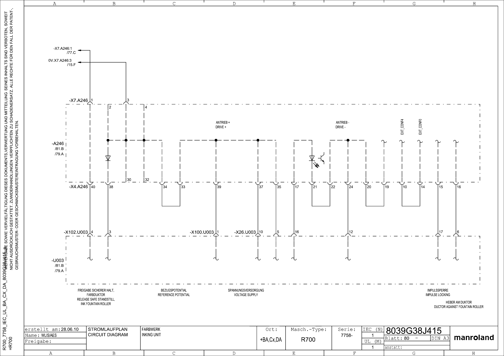

# +BA_Cx_DA — Sheet 80 of 247 — FARBWERK

**INKING UNIT**

> Part of the manroland **R700** printing press IEC/UL circuit diagrams.
> Drawing class: **Stromlaufplan / Circuit diagram** (DIN A3).
> Document `+BA_Cx_DA` covers the **Printing units / main switch cabinet** machine section.

## At a glance

| Field | Value |
|---|---|
| Document | `+BA_Cx_DA`  (8039G38J415) |
| Sheet | **80** of 247 |
| Section (DE) | FARBWERK |
| Section (EN) | INKING UNIT |
| Section type | CIRCUIT — Circuit diagram |
| Machine type | `R700` |
| Series | `7758` |
| Created | 28.06.10 |
| Replaces | — |
| Columns used | A, B, C, D, E, F, G, H |
| Path numbers | — |
| Labels on sheet | 65 |
| Cross-refs out | 6 |
| Cross-refs in | 37 |

**Previous:** [+BA_Cx_DA sheet 79](SHEET_0079.md) · **Next:** [+BA_Cx_DA sheet 81](SHEET_0081.md) · **Document TOC:** [_TOC.md](_TOC.md)  (+BA_Cx_DA) · **Master TOC:** [all sheets](../_MASTER_TOC.md)

## Sheet image (300 DPI, exact vector render)



_Rendered directly from the PDF vector layer at 300 DPI (1-bit), no OCR and no resampling. Use it to confirm anything ambiguous in the text below._

## Cross-references on this sheet

Each entry is a wire leaving this sheet. The printed token is `/sheet.column`; the link resolves to that sheet inside the same document.

| Ref | Target sheet | Col | Path | Destination on target | Target section | From col |
|---|---|---|---|---|---|---|
| `/77.C` | [+BA_Cx_DA sheet 77](SHEET_0077.md) | C | — | X7.A246:1 | FARBWERK | A |
| `/15.F` | [+BA_Cx_DA sheet 15](SHEET_0015.md) | F | — | 0V.X7.A246:3 | SPANNUNGSVERSORGUNG, SCHALTSCHRANKBELÜFTUNG | A |
| `/81.B` | [+BA_Cx_DA sheet 81](SHEET_0081.md) | B | — | — | FARBWERK | A |
| `/79.A` | [+BA_Cx_DA sheet 79](SHEET_0079.md) | A | — | — | FARBWERK | A |
| `/81.B` | [+BA_Cx_DA sheet 81](SHEET_0081.md) | B | — | — | FARBWERK | A |
| `/79.A` | [+BA_Cx_DA sheet 79](SHEET_0079.md) | A | — | — | FARBWERK | A |

### Incoming references (sheets that point here)

Every other sheet that sends a wire to this one. `Back-ref` is the token printed on *that* sheet; `Path` is its line number.

| From sheet | Cols | Back-ref | Path | Refs | What continues there |
|---|---|---|---|---|---|
| [+BA_Cx_DA#15](SHEET_0015.md) | E | `/15.E` | — | 1 | — |
| [+BA_Cx_DA#77](SHEET_0077.md) | C | `/77.C` | — | 1 | — |
| [+BA_Cx_DA#79](SHEET_0079.md) | A | `/79.A` | — | 2 | — |
| [+BA_Cx_DA#81](SHEET_0081.md) | B | `/81.B` | — | 2 | — |
| [+BA_Cx_DA#158](SHEET_0158.md) | E, F | `/158.E`, `/158.F` | — | 18 | — |
| [+BA_Cx_DA#163](SHEET_0163.md) | C | `/163.C` | — | 4 | — |
| [+BA_Cx_DA#176](SHEET_0176.md) | C | `/176.C` | — | 6 | — |
| [+BA_Cx_DA#186](SHEET_0186.md) | E | `/186.E` | — | 1 | — |
| [+BA_Cx_DA#187](SHEET_0187.md) | A | `/187.A` | — | 2 | — |


## Devices on this sheet

| Tag | Class | Class meaning (IEC) | Col | Sub | Terminal | Sign |
|---|---|---|---|---|---|---|
| `A246` | A | Baugruppe / assembly, module, PC board | A | — | — | — |
| `U003` | U | Umrichter / frequency converter | A | — | — | — |
| `X7.A246` | — | cross-device reference | A | — | — | — |
| `X4.A246` | — | cross-device reference | A | — | — | — |
| `X102.U003` | — | cross-device reference | A | — | — | — |
| `X26.U003` | — | cross-device reference | D | — | — | — |
| `X100.U003` | — | cross-device reference | C | — | — | — |
| `X7.A246:1` | — | cross-device reference | A | — | 1 | — |

## Potentials / nets

| Potential | Count | Columns | Attached devices | Terminals |
|---|---|---|---|---|
| `0V` | 1 | A | `A246`, `X7` | `3` |


A potential such as `L24+/4` or `M24+` is a named supply/return rail; every place it appears on this sheet is electrically common.

## Wire-end annotations (grouped as printed)

A wire that continues elsewhere is annotated with a small cluster: the destination description, the path/line number `#NN`, and the `/sheet.column` cross reference. Each row below is one such cluster exactly as it is grouped on the drawing.

| Col | Y | Path | Cross-ref | Text on the wire |
|---|---|---|---|---|
| A | 110.8 | — | `/77.C` | `X7.A246:1` |
| A | 139.2 | — | `/15.F` | `0V.X7.A246:3` |
| B | 232.8 | — | — | `X7.A246 1 3` |
| B | 249.8 | — | — | `2 4` |
| G | 281.4 | — | — | `EXT_CONF4` |
| G | 281.4 | — | — | `EXT_CONF0` |
| D | 286.9 | — | — | `DRIVE + ANTRIEB +` |
| F | 286.9 | — | — | `DRIVE ANTRIEB` |
| A | 334.8 | — | — | `A246` |
| A | 347.9 | — | `/81.B`, `/79.A` | — |
| B | 421.3 | — | — | `30 32` |
| B | 436.8 | — | — | `X4.A246 40 38` |
| C | 438.3 | — | — | `34 33` |
| D | 438.3 | — | — | `39` |
| D | 438.3 | — | — | `37` |
| F | 438.3 | — | — | `35 17 21 22 24 20 19 10 14 15 16` |
| B | 544.5 | — | — | `X102.U003 4 3` |
| D | 544.5 | — | — | `X100.U003 1` |
| D | 544.6 | — | — | `X26.U003 10` |
| F | 544.6 | — | — | `5 16 12 17 6` |
| A | 611.2 | — | — | `U003` |
| A | 624.2 | — | `/81.B`, `/79.A` | — |
| C | 683.8 | — | — | `FREIGABE SICHERER HALT, VOLTAGE SUPPLY` |
| C | 683.8 | — | — | `REFERENCE POTENTIAL BEZUGSPOTENTIAL` |
| D | 683.8 | — | — | `SPANNUNGSVERSORGUNG` |
| G | 683.8 | — | — | `IMPULSE LOCKING IMPULSSPERRE` |
| B | 694.4 | — | — | `RELEASE SAFE STANDSTILL, FARBDUKTOR` |
| H | 712.1 | — | — | `DUCTOR AGAINST FOUNTAIN ROLLER HEBER AM DUKTOR` |
| B | 715.7 | — | — | `INK FOUNTAIN ROLLER` |


## Reconstructed tables

This sheet carries tabular content (pin map / terminal assignment / index). The grid below was rebuilt from the drawing's own rule lines, so each row is exactly one physical row of the table.

### Table 1 — 1 data rows × 18 columns (at x=212.6, y=147.4)

| 1 | 2 | 3 | 4 |  |  | ANTRIEB + DRIVE + |  |  |  |  | ANTRIEB DRIVE |  |  |  | EXT_CONF4 | EXT_CONF0 |  |
|---|---|---|---|---|---|---|---|---|---|---|---|---|---|---|---|---|---|
| `40` | `38` | `30` | `32` | `34` | `33` | `39` | `37` | `35` | `17` | `21` | `22` | `24` | `20` | `19` | `10` | `14` | `15` |


## Notes and free text on this sheet

| Text | Col | Y (pt) |
|---|---|---|
| `ANTRIEB` | F | 286.92 |
| `DRIVE` | F | 297.52 |
| `EXT_CONF4` | G | 281.37 |
| `EXT_CONF0` | G | 281.37 |
| `ANTRIEB +` | D | 286.91 |
| `DRIVE +` | D | 297.51 |
| `IMPULSSPERRE` | G | 683.76 |
| `IMPULSE LOCKING` | G | 694.4 |
| `HEBER AM DUKTOR` | H | 712.12 |
| `DUCTOR AGAINST FOUNTAIN ROLLER` | H | 722.77 |
| `BEZUGSPOTENTIAL` | C | 683.76 |
| `REFERENCE POTENTIAL` | C | 694.4 |
| `SPANNUNGSVERSORGUNG` | D | 683.79 |
| `VOLTAGE SUPPLY` | D | 694.41 |
| `FREIGABE SICHERER HALT,` | B | 683.76 |
| `FARBDUKTOR` | B | 694.41 |
| `RELEASE SAFE STANDSTILL,` | B | 705.02 |
| `INK FOUNTAIN ROLLER` | B | 715.68 |

## Complete label inventory (exact text from the drawing)

Every text object inside the drawing area of this sheet, in DIN reading order (column A→H, then top→bottom). This is the authoritative list: if a string is not here it is not printed on this sheet.

| Col | Y | X | Dir | Type | Text |
|---|---|---|---|---|---|
| A | 110.8 | 126.4 | → | device ref | `X7.A246:1` |
| A | 120.8 | 157.9 | → | cross-reference | `/77.C` |
| A | 139.2 | 114.5 | → | potential | `0V.X7.A246:3` |
| A | 149.1 | 158.7 | → | cross-reference | `/15.F` |
| A | 232.8 | 163.3 | → | device ref | `X7.A246` |
| A | 334.8 | 122.5 | → | device tag | `A246` |
| A | 347.8 | 129.8 | → | cross-reference | `/81.B` |
| A | 360.2 | 129.5 | → | cross-reference | `/79.A` |
| A | 436.8 | 163.3 | → | device ref | `X4.A246` |
| A | 544.6 | 150.8 | → | device ref | `X102.U003` |
| A | 611.2 | 121.9 | → | device tag | `U003` |
| A | 624.2 | 129.8 | → | cross-reference | `/81.B` |
| A | 636.6 | 129.5 | → | cross-reference | `/79.A` |
| B | 232.8 | 214.6 | → | number | `1` |
| B | 232.8 | 300.2 | → | number | `3` |
| B | 249.8 | 257.7 | → | number | `2` |
| B | 421.3 | 300.2 | → | number | `30` |
| B | 438.3 | 215.1 | → | number | `40` |
| B | 438.3 | 257.7 | → | number | `38` |
| B | 544.6 | 215.1 | → | number | `4` |
| B | 544.6 | 257.7 | → | number | `3` |
| B | 683.8 | 183.9 | → | text | `FREIGABE SICHERER HALT,` |
| B | 694.4 | 204.9 | → | text | `FARBDUKTOR` |
| B | 705.0 | 182.1 | → | text | `RELEASE SAFE STANDSTILL,` |
| B | 715.7 | 191.0 | → | text | `INK FOUNTAIN ROLLER` |
| C | 249.8 | 342.7 | → | number | `4` |
| C | 421.3 | 342.7 | → | number | `32` |
| C | 438.3 | 385.2 | → | number | `34` |
| C | 438.3 | 427.7 | → | number | `33` |
| C | 544.6 | 448.4 | → | device ref | `X100.U003` |
| C | 683.8 | 380.3 | → | text | `BEZUGSPOTENTIAL` |
| C | 694.4 | 373.0 | → | text | `REFERENCE POTENTIAL` |
| D | 286.9 | 510.2 | → | text | `ANTRIEB +` |
| D | 297.5 | 509.4 | → | text | `DRIVE +` |
| D | 438.3 | 512.8 | → | number | `39` |
| D | 438.3 | 612.0 | → | number | `37` |
| D | 544.6 | 512.2 | → | number | `1` |
| D | 544.6 | 553.6 | → | device ref | `X26.U003` |
| D | 544.6 | 611.4 | → | number | `10` |
| D | 683.8 | 539.0 | → | text | `SPANNUNGSVERSORGUNG` |
| D | 694.4 | 553.0 | → | text | `VOLTAGE SUPPLY` |
| E | 438.3 | 654.5 | → | number | `35` |
| E | 438.3 | 696.5 | → | number | `17` |
| E | 438.3 | 739.6 | → | number | `21` |
| E | 544.6 | 654.5 | → | number | `5` |
| E | 544.6 | 696.5 | → | number | `16` |
| F | 286.9 | 793.7 | → | text | `ANTRIEB` |
| F | 297.5 | 792.9 | → | text | `DRIVE` |
| F | 438.3 | 782.1 | → | number | `22` |
| F | 438.3 | 824.6 | → | number | `24` |
| F | 438.3 | 867.1 | → | number | `20` |
| F | 544.6 | 824.0 | → | number | `12` |
| G | 281.4 | 947.4 | ↕ | text | `EXT_CONF4` |
| G | 281.4 | 989.9 | ↕ | text | `EXT_CONF0` |
| G | 438.3 | 909.1 | → | number | `19` |
| G | 438.3 | 951.6 | → | number | `10` |
| G | 438.3 | 994.1 | → | number | `14` |
| G | 438.3 | 1036.6 | → | number | `15` |
| G | 544.6 | 1036.6 | → | number | `17` |
| G | 683.8 | 1009.8 | → | text | `IMPULSSPERRE` |
| G | 694.4 | 1005.7 | → | text | `IMPULSE LOCKING` |
| H | 438.3 | 1079.1 | → | number | `16` |
| H | 544.6 | 1079.7 | → | number | `6` |
| H | 712.1 | 1053.5 | → | text | `HEBER AM DUKTOR` |
| H | 722.8 | 1025.8 | → | text | `DUCTOR AGAINST FOUNTAIN ROLLER` |

## Reading-order text block

The same content as a plain block, grouped by DIN column — convenient to paste or to match against a visual description.

```text
=== Column A ===
 110.8  126.4  devref       X7.A246:1
 120.8  157.9  xref         /77.C
 139.2  114.5  net          0V.X7.A246:3
 149.1  158.7  xref         /15.F
 232.8  163.3  devref       X7.A246
 334.8  122.5  devtag       A246
 347.8  129.8  xref         /81.B
 360.2  129.5  xref         /79.A
 436.8  163.3  devref       X4.A246
 544.6  150.8  devref       X102.U003
 611.2  121.9  devtag       U003
 624.2  129.8  xref         /81.B
 636.6  129.5  xref         /79.A
=== Column B ===
 232.8  214.6  numeric      1
 232.8  300.2  numeric      3
 249.8  257.7  numeric      2
 421.3  300.2  numeric      30
 438.3  215.1  numeric      40
 438.3  257.7  numeric      38
 544.6  215.1  numeric      4
 544.6  257.7  numeric      3
 683.8  183.9  text         FREIGABE SICHERER HALT,
 694.4  204.9  text         FARBDUKTOR
 705.0  182.1  text         RELEASE SAFE STANDSTILL,
 715.7  191.0  text         INK FOUNTAIN ROLLER
=== Column C ===
 249.8  342.7  numeric      4
 421.3  342.7  numeric      32
 438.3  385.2  numeric      34
 438.3  427.7  numeric      33
 544.6  448.4  devref       X100.U003
 683.8  380.3  text         BEZUGSPOTENTIAL
 694.4  373.0  text         REFERENCE POTENTIAL
=== Column D ===
 286.9  510.2  text         ANTRIEB +
 297.5  509.4  text         DRIVE +
 438.3  512.8  numeric      39
 438.3  612.0  numeric      37
 544.6  512.2  numeric      1
 544.6  553.6  devref       X26.U003
 544.6  611.4  numeric      10
 683.8  539.0  text         SPANNUNGSVERSORGUNG
 694.4  553.0  text         VOLTAGE SUPPLY
=== Column E ===
 438.3  654.5  numeric      35
 438.3  696.5  numeric      17
 438.3  739.6  numeric      21
 544.6  654.5  numeric      5
 544.6  696.5  numeric      16
=== Column F ===
 286.9  793.7  text         ANTRIEB
 297.5  792.9  text         DRIVE
 438.3  782.1  numeric      22
 438.3  824.6  numeric      24
 438.3  867.1  numeric      20
 544.6  824.0  numeric      12
=== Column G ===
 281.4  947.4  text         EXT_CONF4
 281.4  989.9  text         EXT_CONF0
 438.3  909.1  numeric      19
 438.3  951.6  numeric      10
 438.3  994.1  numeric      14
 438.3 1036.6  numeric      15
 544.6 1036.6  numeric      17
 683.8 1009.8  text         IMPULSSPERRE
 694.4 1005.7  text         IMPULSE LOCKING
=== Column H ===
 438.3 1079.1  numeric      16
 544.6 1079.7  numeric      6
 712.1 1053.5  text         HEBER AM DUKTOR
 722.8 1025.8  text         DUCTOR AGAINST FOUNTAIN ROLLER
```

---
_Generated from the PDF vector text layer; no OCR. Source: `R700_7758_IEC_UL_BA_CX_DA_8039G38J415_p`, sheet 80._
