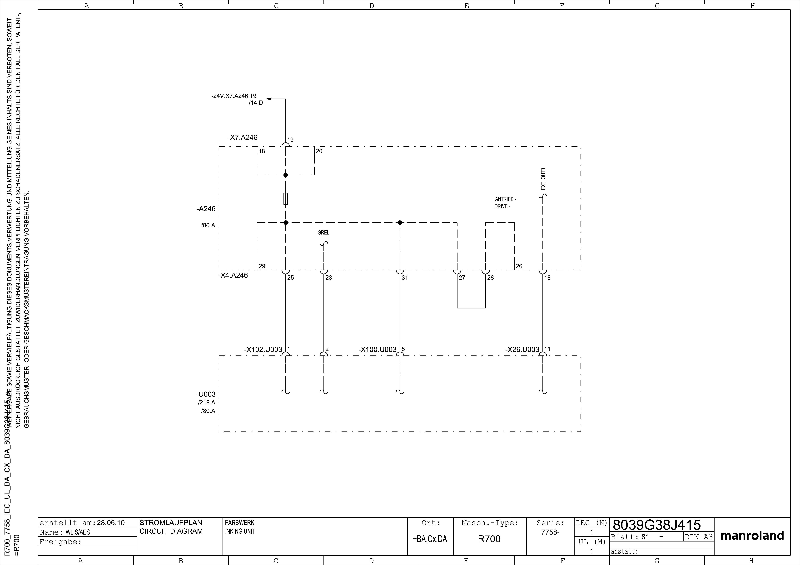

# +BA_Cx_DA — Sheet 81 of 247 — FARBWERK

**INKING UNIT**

> Part of the manroland **R700** printing press IEC/UL circuit diagrams.
> Drawing class: **Stromlaufplan / Circuit diagram** (DIN A3).
> Document `+BA_Cx_DA` covers the **Printing units / main switch cabinet** machine section.

## At a glance

| Field | Value |
|---|---|
| Document | `+BA_Cx_DA`  (8039G38J415) |
| Sheet | **81** of 247 |
| Section (DE) | FARBWERK |
| Section (EN) | INKING UNIT |
| Section type | CIRCUIT — Circuit diagram |
| Machine type | `R700` |
| Series | `7758` |
| Created | 28.06.10 |
| Replaces | — |
| Columns used | B, C, D, E, F |
| Path numbers | — |
| Labels on sheet | 31 |
| Cross-refs out | 4 |
| Cross-refs in | 19 |

**Previous:** [+BA_Cx_DA sheet 80](SHEET_0080.md) · **Next:** [+BA_Cx_DA sheet 82](SHEET_0082.md) · **Document TOC:** [_TOC.md](_TOC.md)  (+BA_Cx_DA) · **Master TOC:** [all sheets](../_MASTER_TOC.md)

## Sheet image (300 DPI, exact vector render)



_Rendered directly from the PDF vector layer at 300 DPI (1-bit), no OCR and no resampling. Use it to confirm anything ambiguous in the text below._

## Cross-references on this sheet

Each entry is a wire leaving this sheet. The printed token is `/sheet.column`; the link resolves to that sheet inside the same document.

| Ref | Target sheet | Col | Path | Destination on target | Target section | From col |
|---|---|---|---|---|---|---|
| `/14.D` | [+BA_Cx_DA sheet 14](SHEET_0014.md) | D | — | 24V.X7.A246:19 | SPANNUNGSVERSORGUNG, SCHALTSCHRANKBELÜFTUNG | C |
| `/80.A` | [+BA_Cx_DA sheet 80](SHEET_0080.md) | A | — | — | FARBWERK | B |
| `/219.A` | [+BA_Cx_DA sheet 219](SHEET_0219.md) | A | — | — | OPTION: TELEPRESENCE | B |
| `/80.A` | [+BA_Cx_DA sheet 80](SHEET_0080.md) | A | — | — | FARBWERK | B |

### Incoming references (sheets that point here)

Every other sheet that sends a wire to this one. `Back-ref` is the token printed on *that* sheet; `Path` is its line number.

| From sheet | Cols | Back-ref | Path | Refs | What continues there |
|---|---|---|---|---|---|
| [+BA_Cx_DA#14](SHEET_0014.md) | D | `/14.D` | — | 1 | 24V.X7.A246:19 |
| [+BA_Cx_DA#80](SHEET_0080.md) | A | `/80.A` | — | 2 | — |
| [+BA_Cx_DA#158](SHEET_0158.md) | E, F | `/158.E`, `/158.F` | — | 8 | — |
| [+BA_Cx_DA#163](SHEET_0163.md) | C | `/163.C` | — | 3 | — |
| [+BA_Cx_DA#176](SHEET_0176.md) | C | `/176.C` | — | 1 | — |
| [+BA_Cx_DA#186](SHEET_0186.md) | E | `/186.E` | — | 1 | — |
| [+BA_Cx_DA#187](SHEET_0187.md) | A | `/187.A` | — | 2 | — |
| [+BA_Cx_DA#219](SHEET_0219.md) | A | `/219.A` | — | 1 | — |


## Devices on this sheet

| Tag | Class | Class meaning (IEC) | Col | Sub | Terminal | Sign |
|---|---|---|---|---|---|---|
| `A246` | A | Baugruppe / assembly, module, PC board | B | — | — | — |
| `U003` | U | Umrichter / frequency converter | B | — | — | — |
| `X7.A246` | — | cross-device reference | C | — | — | — |
| `X4.A246` | — | cross-device reference | C | — | — | — |
| `X102.U003` | — | cross-device reference | C | — | — | — |
| `X26.U003` | — | cross-device reference | F | — | — | — |
| `X100.U003` | — | cross-device reference | D | — | — | — |

## Potentials / nets

| Potential | Count | Columns | Attached devices | Terminals |
|---|---|---|---|---|
| `24V` | 1 | C | `A246`, `X7` | `19` |


A potential such as `L24+/4` or `M24+` is a named supply/return rail; every place it appears on this sheet is electrically common.

## Wire-end annotations (grouped as printed)

A wire that continues elsewhere is annotated with a small cluster: the destination description, the path/line number `#NN`, and the `/sheet.column` cross reference. Each row below is one such cluster exactly as it is grouped on the drawing.

| Col | Y | Path | Cross-ref | Text on the wire |
|---|---|---|---|---|
| C | 139.2 | — | `/14.D` | `24V.X7.A246:19` |
| C | 200.2 | — | — | `X7.A246 19` |
| C | 221.4 | — | — | `18 20` |
| F | 250.4 | — | — | `EXT_OUT0` |
| E | 294.0 | — | — | `DRIVE ANTRIEB` |
| B | 306.4 | — | — | `A246` |
| B | 331.9 | — | `/80.A` | — |
| C | 343.6 | — | — | `SREL` |
| C | 392.9 | — | — | `29` |
| F | 392.9 | — | — | `26` |
| C | 405.7 | — | — | `X4.A246 25` |
| D | 409.9 | — | — | `23` |
| D | 409.9 | — | — | `31` |
| E | 409.9 | — | — | `27 28` |
| F | 409.9 | — | — | `18` |
| C | 516.2 | — | — | `X102.U003 1` |
| D | 516.2 | — | — | `2` |
| D | 516.2 | — | — | `X100.U003 5` |
| F | 516.2 | — | — | `X26.U003 11` |
| B | 582.8 | — | — | `U003` |
| B | 595.9 | — | `/219.A` | — |
| B | 608.3 | — | `/80.A` | — |


## Notes and free text on this sheet

| Text | Col | Y (pt) |
|---|---|---|
| `ANTRIEB` | E | 294.01 |
| `DRIVE` | E | 304.61 |
| `EXT_OUT0` | F | 250.37 |
| `SREL` | C | 343.6 |

## Complete label inventory (exact text from the drawing)

Every text object inside the drawing area of this sheet, in DIN reading order (column A→H, then top→bottom). This is the authoritative list: if a string is not here it is not printed on this sheet.

| Col | Y | X | Dir | Type | Text |
|---|---|---|---|---|---|
| B | 306.4 | 292.5 | → | device tag | `A246` |
| B | 331.9 | 299.6 | → | cross-reference | `/80.A` |
| B | 582.8 | 292.0 | → | device tag | `U003` |
| B | 595.9 | 294.8 | → | cross-reference | `/219.A` |
| B | 608.3 | 299.6 | → | cross-reference | `/80.A` |
| C | 139.2 | 314.6 | → | potential | `24V.X7.A246:19` |
| C | 149.1 | 370.5 | → | cross-reference | `/14.D` |
| C | 200.2 | 339.0 | → | device ref | `X7.A246` |
| C | 204.4 | 427.2 | → | number | `19` |
| C | 221.4 | 384.7 | → | number | `18` |
| C | 221.4 | 470.3 | → | number | `20` |
| C | 343.6 | 473.7 | → | text | `SREL` |
| C | 392.9 | 385.2 | → | number | `29` |
| C | 405.7 | 324.9 | → | device ref | `X4.A246` |
| C | 409.9 | 427.7 | → | number | `25` |
| C | 516.2 | 363.4 | → | device ref | `X102.U003` |
| C | 516.2 | 427.2 | → | number | `1` |
| D | 409.9 | 484.4 | → | number | `23` |
| D | 409.9 | 597.8 | → | number | `31` |
| D | 516.2 | 484.4 | → | number | `2` |
| D | 516.2 | 533.5 | → | device ref | `X100.U003` |
| D | 516.2 | 597.8 | → | number | `5` |
| E | 294.0 | 737.0 | → | text | `ANTRIEB` |
| E | 304.6 | 736.2 | → | text | `DRIVE` |
| E | 409.9 | 682.9 | → | number | `27` |
| E | 409.9 | 725.4 | → | number | `28` |
| F | 250.4 | 805.7 | ↕ | text | `EXT_OUT0` |
| F | 392.9 | 767.9 | → | number | `26` |
| F | 409.9 | 809.9 | → | number | `18` |
| F | 516.2 | 752.0 | → | device ref | `X26.U003` |
| F | 516.2 | 809.9 | → | number | `11` |

## Reading-order text block

The same content as a plain block, grouped by DIN column — convenient to paste or to match against a visual description.

```text
=== Column B ===
 306.4  292.5  devtag       A246
 331.9  299.6  xref         /80.A
 582.8  292.0  devtag       U003
 595.9  294.8  xref         /219.A
 608.3  299.6  xref         /80.A
=== Column C ===
 139.2  314.6  net          24V.X7.A246:19
 149.1  370.5  xref         /14.D
 200.2  339.0  devref       X7.A246
 204.4  427.2  numeric      19
 221.4  384.7  numeric      18
 221.4  470.3  numeric      20
 343.6  473.7  text         SREL
 392.9  385.2  numeric      29
 405.7  324.9  devref       X4.A246
 409.9  427.7  numeric      25
 516.2  363.4  devref       X102.U003
 516.2  427.2  numeric      1
=== Column D ===
 409.9  484.4  numeric      23
 409.9  597.8  numeric      31
 516.2  484.4  numeric      2
 516.2  533.5  devref       X100.U003
 516.2  597.8  numeric      5
=== Column E ===
 294.0  737.0  text         ANTRIEB
 304.6  736.2  text         DRIVE
 409.9  682.9  numeric      27
 409.9  725.4  numeric      28
=== Column F ===
 250.4  805.7  text         EXT_OUT0
 392.9  767.9  numeric      26
 409.9  809.9  numeric      18
 516.2  752.0  devref       X26.U003
 516.2  809.9  numeric      11
```

---
_Generated from the PDF vector text layer; no OCR. Source: `R700_7758_IEC_UL_BA_CX_DA_8039G38J415_p`, sheet 81._
