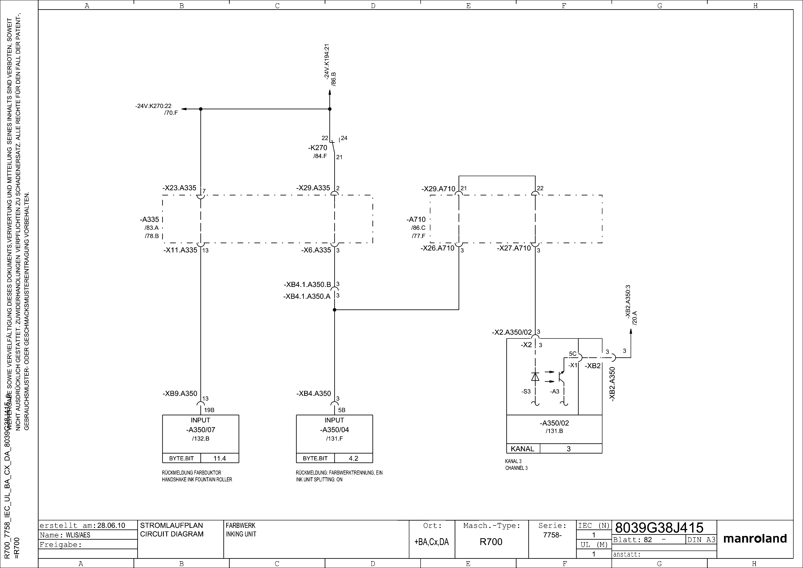

# +BA_Cx_DA — Sheet 82 of 247 — FARBWERK

**INKING UNIT**

> Part of the manroland **R700** printing press IEC/UL circuit diagrams.
> Drawing class: **Stromlaufplan / Circuit diagram** (DIN A3).
> Document `+BA_Cx_DA` covers the **Printing units / main switch cabinet** machine section.

## At a glance

| Field | Value |
|---|---|
| Document | `+BA_Cx_DA`  (8039G38J415) |
| Sheet | **82** of 247 |
| Section (DE) | FARBWERK |
| Section (EN) | INKING UNIT |
| Section type | CIRCUIT — Circuit diagram |
| Machine type | `R700` |
| Series | `7758` |
| Created | 28.06.10 |
| Replaces | — |
| Columns used | B, C, D, E, F, G |
| Path numbers | — |
| Labels on sheet | 74 |
| Cross-refs out | 11 |
| Cross-refs in | 25 |

**Previous:** [+BA_Cx_DA sheet 81](SHEET_0081.md) · **Next:** [+BA_Cx_DA sheet 83](SHEET_0083.md) · **Document TOC:** [_TOC.md](_TOC.md)  (+BA_Cx_DA) · **Master TOC:** [all sheets](../_MASTER_TOC.md)

## Sheet image (300 DPI, exact vector render)



_Rendered directly from the PDF vector layer at 300 DPI (1-bit), no OCR and no resampling. Use it to confirm anything ambiguous in the text below._

## Cross-references on this sheet

Each entry is a wire leaving this sheet. The printed token is `/sheet.column`; the link resolves to that sheet inside the same document.

| Ref | Target sheet | Col | Path | Destination on target | Target section | From col |
|---|---|---|---|---|---|---|
| `/86.B` | [+BA_Cx_DA sheet 86](SHEET_0086.md) | B | — | 24V.K194:21 | WASCHVORRICHTUNG | D |
| `/70.F` | [+BA_Cx_DA sheet 70](SHEET_0070.md) | F | — | 24V.K270:22 | ÖLUMLAUFSCHMIERUNG | B |
| `/84.F` | [+BA_Cx_DA sheet 84](SHEET_0084.md) | F | — | — | FARBWERK | C |
| `/83.A` | [+BA_Cx_DA sheet 83](SHEET_0083.md) | A | — | — | FARBWERK | B |
| `/78.B` | [+BA_Cx_DA sheet 78](SHEET_0078.md) | B | — | — | FARBWERK | B |
| `/86.C` | [+BA_Cx_DA sheet 86](SHEET_0086.md) | C | — | — | WASCHVORRICHTUNG | D |
| `/77.F` | [+BA_Cx_DA sheet 77](SHEET_0077.md) | F | — | — | FARBWERK | D |
| `/20.A` | [+BA_Cx_DA sheet 20](SHEET_0020.md) | A | — | XB2.A350:3 | BUSVERBINDUNGEN: SICHERHEITSBUS | G |
| `/131.B` | [+BA_Cx_DA sheet 131](SHEET_0131.md) | B | — | — | REFERENZMODUL | F |
| `/132.B` | [+BA_Cx_DA sheet 132](SHEET_0132.md) | B | — | — | REFERENZMODUL | B |
| `/131.F` | [+BA_Cx_DA sheet 131](SHEET_0131.md) | F | — | — | REFERENZMODUL | D |

### Incoming references (sheets that point here)

Every other sheet that sends a wire to this one. `Back-ref` is the token printed on *that* sheet; `Path` is its line number.

| From sheet | Cols | Back-ref | Path | Refs | What continues there |
|---|---|---|---|---|---|
| [+BA_Cx_DA#20](SHEET_0020.md) | A | `/20.A` | — | 1 | XB2.A350:3 |
| [+BA_Cx_DA#70](SHEET_0070.md) | G | `/70.G` | — | 1 | — |
| [+BA_Cx_DA#77](SHEET_0077.md) | E | `/77.E` | — | 1 | — |
| [+BA_Cx_DA#78](SHEET_0078.md) | B | `/78.B` | — | 1 | — |
| [+BA_Cx_DA#83](SHEET_0083.md) | A | `/83.A` | — | 1 | — |
| [+BA_Cx_DA#84](SHEET_0084.md) | F | `/84.F` | — | 1 | — |
| [+BA_Cx_DA#86](SHEET_0086.md) | C, D | `/86.C`, `/86.D` | — | 2 | 24V.K194:21 24V.K280:22 |
| [+BA_Cx_DA#131](SHEET_0131.md) | B, F | `/131.B`, `/131.F` | — | 2 | — |
| [+BA_Cx_DA#132](SHEET_0132.md) | B | `/132.B` | — | 1 | — |
| [+BA_Cx_DA#153](SHEET_0153.md) | F | `/153.F` | — | 2 | — |
| [+BA_Cx_DA#159](SHEET_0159.md) | F, G, H | `/159.F`, `/159.G`, `/159.H` | — | 3 | — |
| [+BA_Cx_DA#162](SHEET_0162.md) | D | `/162.D` | — | 1 | — |
| [+BA_Cx_DA#166](SHEET_0166.md) | G | `/166.G` | — | 1 | — |
| [+BA_Cx_DA#168](SHEET_0168.md) | G | `/168.G` | — | 1 | — |
| [+BA_Cx_DA#174](SHEET_0174.md) | G | `/174.G` | — | 1 | — |
| [+BA_Cx_DA#176](SHEET_0176.md) | E | `/176.E` | — | 1 | — |
| [+BA_Cx_DA#177](SHEET_0177.md) | E | `/177.E` | — | 1 | — |
| [+BA_Cx_DA#179](SHEET_0179.md) | A, B | `/179.A`, `/179.B` | — | 3 | — |


## Devices on this sheet

| Tag | Class | Class meaning (IEC) | Col | Sub | Terminal | Sign |
|---|---|---|---|---|---|---|
| `A350/07` | A | Baugruppe / assembly, module, PC board | B | 07 | — | — |
| `A335` | A | Baugruppe / assembly, module, PC board | B | — | — | — |
| `A350/04` | A | Baugruppe / assembly, module, PC board | D | 04 | — | — |
| `K270` | K | Relais / relay, contactor | C | — | — | — |
| `A710` | A | Baugruppe / assembly, module, PC board | D | — | — | — |
| `S3` | S | Schalter / switch | F | — | — | — |
| `A3` | A | Baugruppe / assembly, module, PC board | F | — | — | — |
| `X1` | X | Klemme / terminal, plug connector | F | — | — | — |
| `X2` | X | Klemme / terminal, plug connector | F | — | — | — |
| `XB2` | XB |  | F | — | — | — |
| `A350/02` | A | Baugruppe / assembly, module, PC board | F | 02 | — | — |
| `11.4` | — | cross-device reference | B | — | — | — |
| `XB9.A350` | — | cross-device reference | B | — | — | — |
| `X23.A335` | — | cross-device reference | B | — | — | — |
| `X11.A335` | — | cross-device reference | B | — | — | — |
| `4.2` | — | cross-device reference | D | — | — | — |
| `XB4.A350` | — | cross-device reference | C | — | — | — |
| `X29.A335` | — | cross-device reference | C | — | — | — |
| `X6.A335` | — | cross-device reference | C | — | — | — |
| `X26.A710` | — | cross-device reference | E | — | — | — |
| `X27.A710` | — | cross-device reference | E | — | — | — |
| `XB4.1.A350.B` | — | cross-device reference | C | — | — | — |
| `XB4.1.A350.A` | — | cross-device reference | C | — | — | — |
| `X29.A710` | — | cross-device reference | E | — | — | — |
| `XB2.A350` | — | cross-device reference | G | — | — | — |
| `XB2.A350:3` | — | cross-device reference | G | — | 3 | — |

## Potentials / nets

| Potential | Count | Columns | Attached devices | Terminals |
|---|---|---|---|---|
| `24V` | 2 | B, D | `K194`, `K270` | `21`, `22` |


A potential such as `L24+/4` or `M24+` is a named supply/return rail; every place it appears on this sheet is electrically common.

## Wire-end annotations (grouped as printed)

A wire that continues elsewhere is annotated with a small cluster: the destination description, the path/line number `#NN`, and the `/sheet.column` cross reference. Each row below is one such cluster exactly as it is grouped on the drawing.

| Col | Y | Path | Cross-ref | Text on the wire |
|---|---|---|---|---|
| D | 64.3 | — | `/86.B` | `24V.K194:21` |
| B | 153.4 | — | `/70.F` | `24V.K270:22` |
| D | 200.9 | — | — | `K270 24` |
| C | 200.9 | — | — | `22` |
| C | 227.4 | — | `/84.F` | — |
| D | 229.2 | — | — | `21` |
| B | 273.9 | — | — | `X23.A335 7` |
| C | 273.9 | — | — | `X29.A335 2` |
| E | 275.3 | — | — | `X29.A710 21 22` |
| B | 320.6 | — | — | `A335` |
| D | 320.6 | — | — | `A710` |
| B | 333.7 | — | `/83.A`, `/78.B` | — |
| D | 333.7 | — | `/86.C` | — |
| D | 346.1 | — | `/77.F` | — |
| E | 363.1 | — | — | `X6.A335 3 X26.A710 3 X27.A710 3` |
| B | 366.0 | — | — | `X11.A335 13` |
| C | 417.0 | — | — | `XB4.1.A350.B 3` |
| G | 422.4 | — | `/20.A` | `XB2.A350:3` |
| C | 434.0 | — | — | `XB4.1.A350.A 3` |
| F | 487.9 | — | — | `X2.A350/02 3` |
| F | 506.3 | — | — | `X2` |
| F | 507.7 | — | — | `3 3` |
| G | 516.2 | — | — | `3` |
| F | 520.5 | — | — | `5C` |
| F | 537.5 | — | — | `X1` |
| F | 537.5 | — | — | `XB2` |
| G | 543.7 | — | — | `XB2.A350` |
| F | 576.4 | — | — | `S3 A3` |
| B | 578.6 | — | — | `XB9.A350 13` |
| C | 578.6 | — | — | `XB4.A350 3` |
| D | 604.0 | — | — | `5B` |
| B | 604.1 | — | — | `19B` |
| B | 618.6 | — | — | `INPUT` |
| D | 618.6 | — | — | `INPUT` |
| F | 622.5 | — | — | `A350/02` |
| B | 632.4 | — | — | `A350/07` |
| D | 632.4 | — | — | `A350/04` |
| F | 634.9 | — | `/131.B` | — |
| B | 646.2 | — | `/132.B` | — |
| D | 646.2 | — | `/131.F` | — |
| F | 660.7 | — | — | `KANAL 3` |
| B | 675.3 | — | — | `BYTE.BIT 11.4` |
| D | 675.3 | — | — | `BYTE.BIT 4.2` |
| F | 681.1 | — | — | `KANAL 3 CHANNEL 3` |
| B | 698.1 | — | — | `RÜCKMELDUNG FARBDUKTOR HANDSHAKE INK FOUNTAIN ROLLER` |
| D | 698.1 | — | — | `RÜCKMELDUNG: FARBWERKTRENNUNG, EIN INK UNIT SPLITTING: ON` |


## Reconstructed tables

This sheet carries tabular content (pin map / terminal assignment / index). The grid below was rebuilt from the drawing's own rule lines, so each row is exactly one physical row of the table.

### Table 1 — 3 data rows × 2 columns (at x=240.9, y=161.6)

| /70.F X23.A335 X11.A335 | 7 13 |
|---|---|
| `XB9.A350` | `13 19B` |
| `INPUT` | `A350/07 /132.B` |
| `BYTE.BIT` | `11.4` |


### Table 2 — 3 data rows × 3 columns (at x=439.4, y=161.6)

| 22 K270 /84.F X29.A335 X6.A335 XB4.1.A350.B XB4.1.A350.A |  | 24 21 2 3 3 3 |
|---|---|---|
| `XB4.A350` |  | `3 5B` |
|  | `INPUT` | `A350/04 /131.F` |
| `BYTE.BIT` |  | `4.2` |


### Table 3 — 4 data rows × 6 columns (at x=680.3, y=260.8)

| 21 3 | X27.A710 | 22 3 |  |  | XB2.A350:3 |
|---|---|---|---|---|---|
|  | `X2.A350/02` | `3` |  |  |  |
|  | `X2 S3` | `3 A3` | `5C X1` | `XB2` | `3 3 XB2.A350` |
|  |  | `A350/02 /131.B` |  |  |  |
|  | `KANAL` |  | `3` |  |  |


## Notes and free text on this sheet

| Text | Col | Y (pt) |
|---|---|---|
| `19B` | B | 604.07 |
| `INPUT` | B | 618.59 |
| `BYTE.BIT` | B | 675.84 |
| `RÜCKMELDUNG FARBDUKTOR` | B | 698.1 |
| `HANDSHAKE INK FOUNTAIN ROLLER` | B | 708.06 |
| `5B` | D | 604.05 |
| `INPUT` | D | 618.59 |
| `BYTE.BIT` | C | 675.84 |
| `RÜCKMELDUNG: FARBWERKTRENNUNG, EIN` | D | 698.09 |
| `INK UNIT SPLITTING: ON` | C | 708.04 |
| `X2.A350/02` | E | 487.87 |
| `KANAL 3` | E | 681.1 |
| `CHANNEL 3` | F | 691.04 |
| `5C` | F | 520.49 |
| `KANAL` | F | 660.77 |

## Complete label inventory (exact text from the drawing)

Every text object inside the drawing area of this sheet, in DIN reading order (column A→H, then top→bottom). This is the authoritative list: if a string is not here it is not printed on this sheet.

| Col | Y | X | Dir | Type | Text |
|---|---|---|---|---|---|
| B | 153.4 | 200.7 | → | potential | `24V.K270:22` |
| B | 163.3 | 243.8 | → | cross-reference | `/70.F` |
| B | 273.8 | 240.9 | → | device ref | `X23.A335` |
| B | 279.5 | 300.2 | → | number | `7` |
| B | 320.6 | 207.5 | → | device tag | `A335` |
| B | 333.7 | 214.6 | → | cross-reference | `/83.A` |
| B | 346.1 | 214.9 | → | cross-reference | `/78.B` |
| B | 366.0 | 242.4 | → | device ref | `X11.A335` |
| B | 367.4 | 299.6 | → | number | `13` |
| B | 578.6 | 241.2 | → | device ref | `XB9.A350` |
| B | 587.1 | 299.6 | → | number | `13` |
| B | 604.1 | 302.5 | → | text | `19B` |
| B | 618.6 | 282.8 | → | text | `INPUT` |
| B | 632.4 | 276.2 | → | device tag | `A350/07` |
| B | 646.2 | 285.0 | → | cross-reference | `/132.B` |
| B | 675.3 | 316.2 | → | device ref | `11.4` |
| B | 675.8 | 250.9 | → | text | `BYTE.BIT` |
| B | 698.1 | 240.4 | → | text | `RÜCKMELDUNG FARBDUKTOR` |
| B | 708.1 | 240.4 | → | text | `HANDSHAKE INK FOUNTAIN ROLLER` |
| C | 200.9 | 477.1 | → | number | `22` |
| C | 214.3 | 456.9 | → | device tag | `K270` |
| C | 227.4 | 464.9 | → | cross-reference | `/84.F` |
| C | 273.8 | 439.4 | → | device ref | `X29.A335` |
| C | 366.0 | 446.7 | → | device ref | `X6.A335` |
| C | 417.0 | 420.9 | → | device ref | `XB4.1.A350.B` |
| C | 434.7 | 420.1 | → | device ref | `XB4.1.A350.A` |
| C | 578.6 | 439.7 | → | device ref | `XB4.A350` |
| C | 675.8 | 449.3 | → | text | `BYTE.BIT` |
| C | 708.0 | 438.8 | → | text | `INK UNIT SPLITTING: ON` |
| D | 64.3 | 480.8 | ↕ | potential | `24V.K194:21` |
| D | 106.9 | 490.6 | ↕ | cross-reference | `/86.B` |
| D | 200.9 | 505.7 | → | number | `24` |
| D | 229.2 | 498.6 | → | number | `21` |
| D | 275.3 | 498.6 | → | number | `2` |
| D | 320.6 | 602.9 | → | device tag | `A710` |
| D | 333.7 | 610.0 | → | cross-reference | `/86.C` |
| D | 346.1 | 610.9 | → | cross-reference | `/77.F` |
| D | 367.4 | 498.6 | → | number | `3` |
| D | 417.0 | 498.6 | → | number | `3` |
| D | 434.0 | 498.6 | → | number | `3` |
| D | 587.1 | 498.6 | → | number | `3` |
| D | 604.0 | 501.4 | → | text | `5B` |
| D | 618.6 | 481.2 | → | text | `INPUT` |
| D | 632.4 | 474.7 | → | device tag | `A350/04` |
| D | 646.2 | 483.7 | → | cross-reference | `/131.F` |
| D | 675.3 | 517.6 | → | device ref | `4.2` |
| D | 698.1 | 438.8 | → | text | `RÜCKMELDUNG: FARBWERKTRENNUNG, EIN` |
| E | 275.3 | 625.0 | → | device ref | `X29.A710` |
| E | 275.3 | 682.9 | → | number | `21` |
| E | 363.1 | 623.6 | → | device ref | `X26.A710` |
| E | 363.1 | 737.0 | → | device ref | `X27.A710` |
| E | 367.4 | 682.9 | → | number | `3` |
| E | 487.9 | 729.6 | → | text | `X2.A350/02` |
| E | 681.1 | 749.2 | → | text | `KANAL 3` |
| F | 275.3 | 796.3 | → | number | `22` |
| F | 367.4 | 796.3 | → | number | `3` |
| F | 487.9 | 796.3 | → | number | `3` |
| F | 506.3 | 772.2 | → | device tag | `X2` |
| F | 507.7 | 799.1 | → | number | `3` |
| F | 517.6 | 898.3 | → | number | `3` |
| F | 520.5 | 843.9 | → | text | `5C` |
| F | 537.5 | 842.7 | → | device tag | `X1` |
| F | 537.5 | 867.1 | → | device tag | `XB2` |
| F | 576.4 | 773.3 | → | device tag | `S3` |
| F | 576.4 | 815.8 | → | device tag | `A3` |
| F | 622.5 | 800.6 | → | device tag | `A350/02` |
| F | 634.9 | 809.4 | → | cross-reference | `/131.B` |
| F | 660.7 | 840.3 | → | number | `3` |
| F | 660.8 | 757.4 | → | text | `KANAL` |
| F | 691.0 | 749.5 | → | text | `CHANNEL 3` |
| G | 422.4 | 927.2 | ↕ | device ref | `XB2.A350:3` |
| G | 461.2 | 937.1 | ↕ | cross-reference | `/20.A` |
| G | 516.2 | 923.8 | → | number | `3` |
| G | 543.7 | 903.1 | ↕ | device ref | `XB2.A350` |

## Reading-order text block

The same content as a plain block, grouped by DIN column — convenient to paste or to match against a visual description.

```text
=== Column B ===
 153.4  200.7  net          24V.K270:22
 163.3  243.8  xref         /70.F
 273.8  240.9  devref       X23.A335
 279.5  300.2  numeric      7
 320.6  207.5  devtag       A335
 333.7  214.6  xref         /83.A
 346.1  214.9  xref         /78.B
 366.0  242.4  devref       X11.A335
 367.4  299.6  numeric      13
 578.6  241.2  devref       XB9.A350
 587.1  299.6  numeric      13
 604.1  302.5  text         19B
 618.6  282.8  text         INPUT
 632.4  276.2  devtag       A350/07
 646.2  285.0  xref         /132.B
 675.3  316.2  devref       11.4
 675.8  250.9  text         BYTE.BIT
 698.1  240.4  text         RÜCKMELDUNG FARBDUKTOR
 708.1  240.4  text         HANDSHAKE INK FOUNTAIN ROLLER
=== Column C ===
 200.9  477.1  numeric      22
 214.3  456.9  devtag       K270
 227.4  464.9  xref         /84.F
 273.8  439.4  devref       X29.A335
 366.0  446.7  devref       X6.A335
 417.0  420.9  devref       XB4.1.A350.B
 434.7  420.1  devref       XB4.1.A350.A
 578.6  439.7  devref       XB4.A350
 675.8  449.3  text         BYTE.BIT
 708.0  438.8  text         INK UNIT SPLITTING: ON
=== Column D ===
  64.3  480.8  net          24V.K194:21
 106.9  490.6  xref         /86.B
 200.9  505.7  numeric      24
 229.2  498.6  numeric      21
 275.3  498.6  numeric      2
 320.6  602.9  devtag       A710
 333.7  610.0  xref         /86.C
 346.1  610.9  xref         /77.F
 367.4  498.6  numeric      3
 417.0  498.6  numeric      3
 434.0  498.6  numeric      3
 587.1  498.6  numeric      3
 604.0  501.4  text         5B
 618.6  481.2  text         INPUT
 632.4  474.7  devtag       A350/04
 646.2  483.7  xref         /131.F
 675.3  517.6  devref       4.2
 698.1  438.8  text         RÜCKMELDUNG: FARBWERKTRENNUNG, EIN
=== Column E ===
 275.3  625.0  devref       X29.A710
 275.3  682.9  numeric      21
 363.1  623.6  devref       X26.A710
 363.1  737.0  devref       X27.A710
 367.4  682.9  numeric      3
 487.9  729.6  text         X2.A350/02
 681.1  749.2  text         KANAL 3
=== Column F ===
 275.3  796.3  numeric      22
 367.4  796.3  numeric      3
 487.9  796.3  numeric      3
 506.3  772.2  devtag       X2
 507.7  799.1  numeric      3
 517.6  898.3  numeric      3
 520.5  843.9  text         5C
 537.5  842.7  devtag       X1
 537.5  867.1  devtag       XB2
 576.4  773.3  devtag       S3
 576.4  815.8  devtag       A3
 622.5  800.6  devtag       A350/02
 634.9  809.4  xref         /131.B
 660.7  840.3  numeric      3
 660.8  757.4  text         KANAL
 691.0  749.5  text         CHANNEL 3
=== Column G ===
 422.4  927.2  devref       XB2.A350:3
 461.2  937.1  xref         /20.A
 516.2  923.8  numeric      3
 543.7  903.1  devref       XB2.A350
```

---
_Generated from the PDF vector text layer; no OCR. Source: `R700_7758_IEC_UL_BA_CX_DA_8039G38J415_p`, sheet 82._
