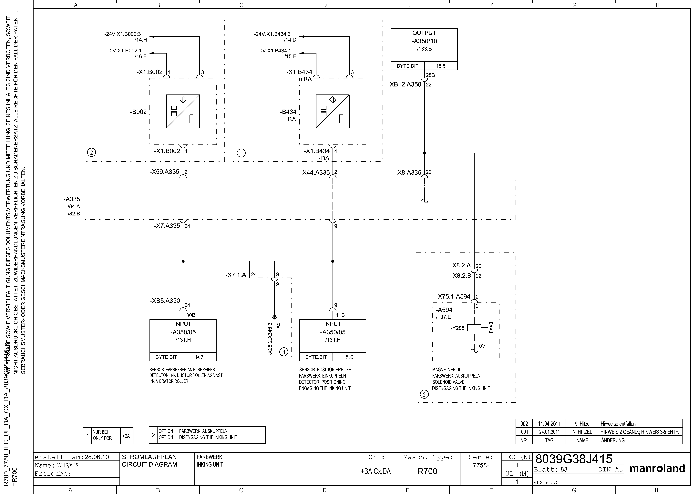

# +BA_Cx_DA — Sheet 83 of 247 — FARBWERK

**INKING UNIT**

> Part of the manroland **R700** printing press IEC/UL circuit diagrams.
> Drawing class: **Stromlaufplan / Circuit diagram** (DIN A3).
> Document `+BA_Cx_DA` covers the **Printing units / main switch cabinet** machine section.

## At a glance

| Field | Value |
|---|---|
| Document | `+BA_Cx_DA`  (8039G38J415) |
| Sheet | **83** of 247 |
| Section (DE) | FARBWERK |
| Section (EN) | INKING UNIT |
| Section type | CIRCUIT — Circuit diagram |
| Machine type | `R700` |
| Series | `7758` |
| Created | 28.06.10 |
| Replaces | — |
| Columns used | A, B, C, D, E, F, G, H |
| Path numbers | — |
| Labels on sheet | 111 |
| Cross-refs out | 10 |
| Cross-refs in | 30 |

**Previous:** [+BA_Cx_DA sheet 82](SHEET_0082.md) · **Next:** [+BA_Cx_DA sheet 84](SHEET_0084.md) · **Document TOC:** [_TOC.md](_TOC.md)  (+BA_Cx_DA) · **Master TOC:** [all sheets](../_MASTER_TOC.md)

## Sheet image (300 DPI, exact vector render)



_Rendered directly from the PDF vector layer at 300 DPI (1-bit), no OCR and no resampling. Use it to confirm anything ambiguous in the text below._

## Cross-references on this sheet

Each entry is a wire leaving this sheet. The printed token is `/sheet.column`; the link resolves to that sheet inside the same document.

| Ref | Target sheet | Col | Path | Destination on target | Target section | From col |
|---|---|---|---|---|---|---|
| `/14.H` | [+BA_Cx_DA sheet 14](SHEET_0014.md) | H | — | 24V.X1.B002:3 | SPANNUNGSVERSORGUNG, SCHALTSCHRANKBELÜFTUNG | B |
| `/14.D` | [+BA_Cx_DA sheet 14](SHEET_0014.md) | D | — | 24V.X1.B434:3 | SPANNUNGSVERSORGUNG, SCHALTSCHRANKBELÜFTUNG | C |
| `/133.B` | [+BA_Cx_DA sheet 133](SHEET_0133.md) | B | — | — | REFERENZMODUL | E |
| `/15.E` | [+BA_Cx_DA sheet 15](SHEET_0015.md) | E | — | 0V.X1.B002:1 0V.X1.B434:1 | SPANNUNGSVERSORGUNG, SCHALTSCHRANKBELÜFTUNG | C |
| `/16.F` | [+BA_Cx_DA sheet 16](SHEET_0016.md) | F | — | 0V.X1.B002:1 0V.X1.B434:1 | SPANNUNGSVERSORGUNG, SCHALTSCHRANKBELÜFTUNG | C |
| `/84.A` | [+BA_Cx_DA sheet 84](SHEET_0084.md) | A | — | — | FARBWERK | A |
| `/82.B` | [+BA_Cx_DA sheet 82](SHEET_0082.md) | B | — | — | FARBWERK | A |
| `/137.E` | [+BA_Cx_DA sheet 137](SHEET_0137.md) | E | — | A594 | REFERENZMODUL | E |
| `/131.H` | [+BA_Cx_DA sheet 131](SHEET_0131.md) | H | — | — | REFERENZMODUL | B |
| `/131.H` | [+BA_Cx_DA sheet 131](SHEET_0131.md) | H | — | — | REFERENZMODUL | D |

### Incoming references (sheets that point here)

Every other sheet that sends a wire to this one. `Back-ref` is the token printed on *that* sheet; `Path` is its line number.

| From sheet | Cols | Back-ref | Path | Refs | What continues there |
|---|---|---|---|---|---|
| [+BA_Cx_DA#14](SHEET_0014.md) | D, H | `/14.D`, `/14.H` | — | 2 | 24V.X1.B002:3; 24V.X1.B434:3 |
| [+BA_Cx_DA#15](SHEET_0015.md) | E | `/15.E` | — | 1 | — |
| [+BA_Cx_DA#16](SHEET_0016.md) | F | `/16.F` | — | 1 | 0V.X1.B002:1 |
| [+BA_Cx_DA#82](SHEET_0082.md) | B | `/82.B` | — | 1 | — |
| [+BA_Cx_DA#84](SHEET_0084.md) | A | `/84.A` | — | 1 | — |
| [+BA_Cx_DA#131](SHEET_0131.md) | H | `/131.H` | — | 2 | — |
| [+BA_Cx_DA#133](SHEET_0133.md) | B | `/133.B` | — | 1 | — |
| [+BA_Cx_DA#137](SHEET_0137.md) | E | `/137.E` | — | 1 | — |
| [+BA_Cx_DA#144](SHEET_0144.md) | E | `/144.E` | — | 3 | — |
| [+BA_Cx_DA#146](SHEET_0146.md) | C | `/146.C` | — | 3 | — |
| [+BA_Cx_DA#161](SHEET_0161.md) | F | `/161.F` | — | 2 | — |
| [+BA_Cx_DA#163](SHEET_0163.md) | A, B, G | `/163.A`, `/163.B`, `/163.G` | — | 5 | — |
| [+BA_Cx_DA#164](SHEET_0164.md) | G, H | `/164.G`, `/164.H` | — | 2 | — |
| [+BA_Cx_DA#165](SHEET_0165.md) | E | `/165.E` | — | 1 | — |
| [+BA_Cx_DA#169](SHEET_0169.md) | G | `/169.G` | — | 1 | — |
| [+BA_Cx_DA#181](SHEET_0181.md) | H | `/181.H` | — | 1 | — |
| [+BA_Cx_DA#183](SHEET_0183.md) | B | `/183.B` | — | 1 | — |
| [+BA_Cx_DA#185](SHEET_0185.md) | A | `/185.A` | — | 1 | — |


## Devices on this sheet

| Tag | Class | Class meaning (IEC) | Col | Sub | Terminal | Sign |
|---|---|---|---|---|---|---|
| `B434` | B | Umformer / transducer, sensor | D | — | — | — |
| `A350/10` | A | Baugruppe / assembly, module, PC board | E | 10 | — | — |
| `A350/05` | A | Baugruppe / assembly, module, PC board | D | 05 | — | — |
| `Y285` | Y | Magnetventil / solenoid valve, actuator | F | — | — | — |
| `A594` | A | Baugruppe / assembly, module, PC board | E | — | — | — |
| `B002` | B | Umformer / transducer, sensor | B | — | — | — |
| `A350/05` | A | Baugruppe / assembly, module, PC board | B | 05 | — | — |
| `A335` | A | Baugruppe / assembly, module, PC board | A | — | — | — |
| `X44.A335` | — | cross-device reference | D | — | — | — |
| `X1.B434` | — | cross-device reference | D | — | — | — |
| `X1.B434` | — | cross-device reference | D | — | — | — |
| `15.5` | — | cross-device reference | E | — | — | — |
| `XB12.A350` | — | cross-device reference | E | — | — | — |
| `X8.A335` | — | cross-device reference | E | — | — | — |
| `8.0` | — | cross-device reference | D | — | — | — |
| `X75.1.A594` | — | cross-device reference | F | — | — | — |
| `X8.2.B` | — | cross-device reference | F | — | — | — |
| `X8.2.A` | — | cross-device reference | F | — | — | — |
| `X7.1.A` | — | cross-device reference | C | — | — | — |
| `X26.2.A346:3` | — | cross-device reference | C | — | 3 | — |
| `X59.A335` | — | cross-device reference | B | — | — | — |
| `X1.B002` | — | cross-device reference | B | — | — | — |
| `X1.B002` | — | cross-device reference | B | — | — | — |
| `9.7` | — | cross-device reference | B | — | — | — |
| `XB5.A350` | — | cross-device reference | B | — | — | — |
| `X7.A335` | — | cross-device reference | B | — | — | — |
| `NR.` | — | cross-device reference | F | — | — | — |
| `24.01.2011` | — | cross-device reference | G | — | — | — |
| `11.04.2011` | — | cross-device reference | G | — | — | — |

## Potentials / nets

| Potential | Count | Columns | Attached devices | Terminals |
|---|---|---|---|---|
| `0V` | 3 | B, C, F | `B002`, `B434`, `X1` | `1` |
| `24V` | 2 | B, C | `B002`, `B434`, `X1` | `3` |


A potential such as `L24+/4` or `M24+` is a named supply/return rail; every place it appears on this sheet is electrically common.

## Wire-end annotations (grouped as printed)

A wire that continues elsewhere is annotated with a small cluster: the destination description, the path/line number `#NN`, and the `/sheet.column` cross reference. Each row below is one such cluster exactly as it is grouped on the drawing.

| Col | Y | Path | Cross-ref | Text on the wire |
|---|---|---|---|---|
| E | 51.6 | — | — | `QUTPUT` |
| B | 54.1 | — | `/14.H` | `24V.X1.B002:3` |
| C | 54.1 | — | `/14.D` | `24V.X1.B434:3` |
| E | 65.5 | — | — | `A350/10` |
| E | 79.3 | — | `/133.B` | — |
| C | 82.5 | — | `/15.E`, `/16.F` | `0V.X1.B002:1 0V.X1.B434:1` |
| E | 108.9 | — | — | `BYTE.BIT 15.5` |
| B | 118.0 | — | — | `X1.B002 1 3` |
| D | 118.0 | — | — | `X1.B434 1` |
| E | 119.4 | — | — | `3 28B` |
| D | 130.6 | — | — | `+BA` |
| E | 139.2 | — | — | `XB12.A350 22` |
| B | 186.0 | — | — | `B002` |
| D | 186.0 | — | — | `B434` |
| D | 198.7 | — | — | `+BA` |
| B | 252.6 | — | — | `X1.B002 4` |
| D | 252.6 | — | — | `X1.B434 4` |
| A | 257.1 | — | — | `2` |
| C | 257.7 | — | — | `1` |
| D | 265.3 | — | — | `+BA` |
| B | 288.0 | — | — | `X59.A335 2` |
| D | 289.4 | — | — | `X44.A335 2` |
| E | 289.4 | — | — | `X8.A335 22` |
| A | 334.8 | — | — | `A335` |
| A | 347.9 | — | `/84.A`, `/82.B` | — |
| B | 380.1 | — | — | `X7.A335 24` |
| D | 381.6 | — | — | `9` |
| F | 447.5 | — | — | `X8.2.A 22` |
| C | 463.8 | — | — | `X7.1.A 24` |
| C | 463.8 | — | — | `9` |
| F | 465.2 | — | — | `X8.2.B 22` |
| C | 480.8 | — | — | `9` |
| F | 500.6 | — | — | `X75.1.A594 2` |
| B | 507.7 | — | — | `XB5.A350 24` |
| D | 516.2 | — | — | `9` |
| F | 517.6 | — | — | `2` |
| E | 523.3 | — | `/137.E` | `A594` |
| B | 533.2 | — | — | `30B` |
| D | 533.2 | — | — | `11B` |
| B | 547.7 | — | — | `INPUT` |
| D | 547.7 | — | — | `INPUT` |
| C | 549.6 | — | — | `X26.2.A346:3` |
| C | 549.9 | — | — | `+Ax` |
| F | 555.2 | — | — | `Y285` |
| B | 561.6 | — | — | `A350/05` |
| D | 561.6 | — | — | `A350/05` |
| B | 575.4 | — | `/131.H` | — |
| D | 575.4 | — | `/131.H` | — |
| F | 585.6 | — | — | `0V` |
| D | 596.5 | — | — | `1` |
| B | 604.4 | — | — | `BYTE.BIT 9.7` |
| D | 604.4 | — | — | `BYTE.BIT 8.0` |
| D | 627.1 | — | — | `FARBWERK, EINKUPPELN DETECTOR: POSITIONING ENGAGING THE INKING UNIT SENSOR: POSITIONIERHILFE` |
| F | 627.1 | — | — | `FARBWERK, AUSKUPPELN MAGNETVENTIL:` |
| B | 627.3 | — | — | `DETECTOR: INK DUCTOR ROLLER AGAINST INK VIBRATOR ROLLER SENSOR: FARBHEBER AN FARBREIBER` |
| F | 648.3 | — | — | `DISENGAGING THE INKING UNIT SOLENOID VALVE:` |
| E | 669.3 | — | — | `2` |
| G | 718.6 | — | — | `002 11.04.2011 N. Hitzel Hinweise entfallen` |
| B | 731.9 | — | — | `ONLY FOR +BA 2 OPTION OPTION` |
| C | 731.9 | — | — | `FARBWERK, AUSKUPPELN DISENGAGING THE INKING UNIT` |
| G | 733.0 | — | — | `001 24.01.2011 N. HITZEL HINWEIS 2 GEÄND.; HINWEIS 3 5 ENTF.` |
| A | 733.3 | — | — | `1 NUR BEI` |
| G | 747.1 | — | — | `NR. TAG NAME ÄNDERUNG` |


## Reconstructed tables

This sheet carries tabular content (pin map / terminal assignment / index). The grid below was rebuilt from the drawing's own rule lines, so each row is exactly one physical row of the table.

### Table 1 — 6 data rows × 10 columns (at x=255.1, y=48.2) — **24V.X1.B434:3 /14.D 0V.X1.B434:1 /15.E**

|  | 1 |  | 3 |  | X1.B434 | +BA | 1 |  | 3 |
|---|---|---|---|---|---|---|---|---|---|
|  |  |  |  |  | `B434 +BA` |  |  |  |  |
|  | `X1.B002` | `4` |  |  |  |  | `X1.B434` | `4` |  |
| `X59.A335` | `X7.A335` | `2 24` |  | `1` |  | `X44.A335` | `+BA` | `2 9` |  |
| `XB5.A350` |  | `24 30B` |  | `24 X7.1.A` | `9 9` |  |  | `9 11B` |  |
|  | `INPUT` | `A350/05 /131.H` |  | `X26.2.A346:3` | `+Ax` |  | `INPUT` | `A350/05 /131.H` |  |
| `BYTE.BIT` |  | `9.7` |  |  | `1` | `BYTE.BIT` |  | `8.0` |  |


### Table 2 — 4 data rows × 3 columns (at x=666.1, y=48.2) — **QUTPUT A350/10 /133.B**

| BYTE.BIT | 15.5 |  |
|---|---|---|
| `XB12.A350` | `28B 22` |  |
| `X8.A335` | `22` |  |
|  | `X75.1.A594 A594 /137.E` | `X8.2.A X8.2.B` |
|  |  | `Y285` |


## Notes and free text on this sheet

| Text | Col | Y (pt) |
|---|---|---|
| `+BA` | D | 265.27 |
| `28B` | E | 124.3 |
| `QUTPUT` | E | 51.64 |
| `BYTE.BIT` | E | 108.91 |
| `11B` | D | 533.2 |
| `INPUT` | D | 547.72 |
| `BYTE.BIT` | D | 604.97 |
| `SENSOR: POSITIONIERHILFE` | D | 627.07 |
| `FARBWERK, EINKUPPELN` | D | 637.68 |
| `DETECTOR: POSITIONING` | D | 648.34 |
| `ENGAGING THE INKING UNIT` | D | 658.98 |
| `MAGNETVENTIL:` | E | 627.07 |
| `FARBWERK, AUSKUPPELN` | F | 637.68 |
| `SOLENOID VALVE:` | E | 648.33 |
| `DISENGAGING THE INKING UNIT` | F | 658.98 |
| `+Ax` | C | 549.92 |
| `30B` | B | 533.2 |
| `INPUT` | B | 547.72 |
| `BYTE.BIT` | B | 604.97 |
| `SENSOR: FARBHEBER AN FARBREIBER` | B | 627.26 |
| `DETECTOR: INK DUCTOR ROLLER AGAINST` | B | 637.17 |
| `INK VIBRATOR ROLLER` | B | 647.14 |
| `TAG` | G | 747.27 |
| `NAME` | G | 747.25 |
| `ÄNDERUNG` | G | 747.31 |
| `N. HITZEL` | G | 733.12 |
| `HINWEIS 2 GEÄND.; HINWEIS 3 5 ENTF.` | H | 733.1 |
| `N. Hitzel` | G | 718.85 |
| `Hinweise entfallen` | H | 718.86 |
| `NUR BEI` | A | 733.33 |
| `ONLY FOR` | A | 744.02 |
| `+BA` | B | 740.44 |
| `OPTION` | B | 731.94 |
| `FARBWERK, AUSKUPPELN` | C | 731.93 |
| `DISENGAGING THE INKING UNIT` | C | 742.59 |

## Complete label inventory (exact text from the drawing)

Every text object inside the drawing area of this sheet, in DIN reading order (column A→H, then top→bottom). This is the authoritative list: if a string is not here it is not printed on this sheet.

| Col | Y | X | Dir | Type | Text |
|---|---|---|---|---|---|
| A | 257.1 | 153.9 | → | number | `2` |
| A | 334.8 | 108.3 | → | device tag | `A335` |
| A | 347.8 | 115.4 | → | cross-reference | `/84.A` |
| A | 360.2 | 115.7 | → | cross-reference | `/82.B` |
| A | 733.3 | 157.9 | → | text | `NUR BEI` |
| A | 738.7 | 146.3 | → | number | `1` |
| A | 744.0 | 158.5 | → | text | `ONLY FOR` |
| B | 54.1 | 177.7 | → | potential | `24V.X1.B002:3` |
| B | 64.1 | 229.3 | → | cross-reference | `/14.H` |
| B | 82.5 | 186.8 | → | potential | `0V.X1.B002:1` |
| B | 92.4 | 229.6 | → | cross-reference | `/16.F` |
| B | 117.9 | 232.7 | → | device ref | `X1.B002` |
| B | 119.4 | 285.4 | → | number | `1` |
| B | 186.0 | 221.7 | → | device tag | `B002` |
| B | 252.6 | 262.5 | → | device ref | `X1.B002` |
| B | 254.0 | 314.4 | → | number | `4` |
| B | 288.0 | 255.1 | → | device ref | `X59.A335` |
| B | 289.5 | 314.4 | → | number | `2` |
| B | 380.2 | 262.5 | → | device ref | `X7.A335` |
| B | 381.6 | 314.4 | → | number | `24` |
| B | 507.7 | 255.4 | → | device ref | `XB5.A350` |
| B | 516.2 | 314.4 | → | number | `24` |
| B | 533.2 | 317.2 | → | text | `30B` |
| B | 547.7 | 296.9 | → | text | `INPUT` |
| B | 561.6 | 290.4 | → | device tag | `A350/05` |
| B | 575.4 | 299.3 | → | cross-reference | `/131.H` |
| B | 604.4 | 333.4 | → | device ref | `9.7` |
| B | 605.0 | 265.0 | → | text | `BYTE.BIT` |
| B | 627.3 | 254.8 | → | text | `SENSOR: FARBHEBER AN FARBREIBER` |
| B | 637.2 | 254.6 | → | text | `DETECTOR: INK DUCTOR ROLLER AGAINST` |
| B | 647.1 | 254.6 | → | text | `INK VIBRATOR ROLLER` |
| B | 731.9 | 270.4 | → | text | `OPTION` |
| B | 737.3 | 258.0 | → | number | `2` |
| B | 740.4 | 208.8 | → | text | `+BA` |
| B | 742.6 | 270.4 | → | text | `OPTION` |
| C | 54.1 | 432.9 | → | potential | `24V.X1.B434:3` |
| C | 82.5 | 441.9 | → | potential | `0V.X1.B434:1` |
| C | 119.4 | 342.7 | → | number | `3` |
| C | 257.7 | 409.3 | → | number | `1` |
| C | 463.8 | 384.1 | → | device ref | `X7.1.A` |
| C | 463.8 | 427.7 | → | number | `24` |
| C | 463.8 | 470.3 | → | number | `9` |
| C | 480.8 | 470.3 | → | number | `9` |
| C | 549.6 | 456.0 | ↕ | device ref | `X26.2.A346:3` |
| C | 549.9 | 470.2 | ↕ | text | `+Ax` |
| C | 731.9 | 305.3 | → | text | `FARBWERK, AUSKUPPELN` |
| C | 742.6 | 305.3 | → | text | `DISENGAGING THE INKING UNIT` |
| D | 64.1 | 483.9 | → | cross-reference | `/14.D` |
| D | 92.4 | 484.4 | → | cross-reference | `/15.E` |
| D | 117.9 | 487.8 | → | device ref | `X1.B434` |
| D | 119.4 | 540.6 | → | number | `1` |
| D | 119.4 | 597.8 | → | number | `3` |
| D | 130.6 | 510.8 | → | text | `+BA` |
| D | 186.0 | 476.8 | → | device tag | `B434` |
| D | 198.7 | 483.9 | → | text | `+BA` |
| D | 252.6 | 517.6 | → | device ref | `X1.B434` |
| D | 254.0 | 569.5 | → | number | `4` |
| D | 265.3 | 540.6 | → | text | `+BA` |
| D | 289.4 | 511.7 | → | device ref | `X44.A335` |
| D | 289.5 | 569.5 | → | number | `2` |
| D | 381.6 | 569.5 | → | number | `9` |
| D | 516.2 | 569.5 | → | number | `9` |
| D | 533.2 | 571.7 | → | text | `11B` |
| D | 547.7 | 552.0 | → | text | `INPUT` |
| D | 561.6 | 545.5 | → | device tag | `A350/05` |
| D | 575.4 | 554.5 | → | cross-reference | `/131.H` |
| D | 596.5 | 481.6 | → | number | `1` |
| D | 604.4 | 588.5 | → | device ref | `8.0` |
| D | 605.0 | 520.2 | → | text | `BYTE.BIT` |
| D | 627.1 | 510.0 | → | text | `SENSOR: POSITIONIERHILFE` |
| D | 637.7 | 509.4 | → | text | `FARBWERK, EINKUPPELN` |
| D | 648.3 | 509.4 | → | text | `DETECTOR: POSITIONING` |
| D | 659.0 | 509.4 | → | text | `ENGAGING THE INKING UNIT` |
| E | 51.6 | 702.6 | → | text | `QUTPUT` |
| E | 65.5 | 701.4 | → | device tag | `A350/10` |
| E | 79.3 | 710.2 | → | cross-reference | `/133.B` |
| E | 108.9 | 676.1 | → | text | `BYTE.BIT` |
| E | 108.9 | 743.0 | → | device ref | `15.5` |
| E | 124.3 | 725.4 | → | text | `28B` |
| E | 139.2 | 660.5 | → | device ref | `XB12.A350` |
| E | 140.6 | 725.4 | → | number | `22` |
| E | 289.4 | 673.5 | → | device ref | `X8.A335` |
| E | 289.5 | 725.4 | → | number | `22` |
| E | 523.3 | 742.4 | → | device tag | `A594` |
| E | 536.4 | 742.7 | → | cross-reference | `/137.E` |
| E | 627.1 | 736.4 | → | text | `MAGNETVENTIL:` |
| E | 648.3 | 736.7 | → | text | `SOLENOID VALVE:` |
| E | 669.3 | 720.8 | → | number | `2` |
| F | 447.5 | 766.8 | → | device ref | `X8.2.A` |
| F | 449.6 | 810.4 | → | number | `22` |
| F | 465.2 | 767.6 | → | device ref | `X8.2.B` |
| F | 466.6 | 810.4 | → | number | `22` |
| F | 500.6 | 742.4 | → | device ref | `X75.1.A594` |
| F | 502.1 | 810.4 | → | number | `2` |
| F | 517.6 | 810.4 | → | number | `2` |
| F | 555.2 | 767.9 | → | device tag | `Y285` |
| F | 585.6 | 816.1 | → | potential | `0V` |
| F | 637.7 | 736.2 | → | text | `FARBWERK, AUSKUPPELN` |
| F | 659.0 | 736.2 | → | text | `DISENGAGING THE INKING UNIT` |
| F | 718.6 | 886.4 | → | number | `002` |
| F | 733.0 | 887.7 | → | number | `001` |
| F | 747.1 | 886.7 | → | device ref | `NR.` |
| G | 718.7 | 916.5 | → | device ref | `11.04.2011` |
| G | 718.8 | 978.1 | → | text | `N. Hitzel` |
| G | 733.1 | 918.6 | → | device ref | `24.01.2011` |
| G | 733.1 | 975.3 | → | text | `N. HITZEL` |
| G | 747.3 | 928.3 | → | text | `TAG` |
| G | 747.3 | 981.7 | → | text | `NAME` |
| G | 747.3 | 1024.3 | → | text | `ÄNDERUNG` |
| H | 718.9 | 1023.3 | → | text | `Hinweise entfallen` |
| H | 733.1 | 1023.2 | → | text | `HINWEIS 2 GEÄND.; HINWEIS 3 5 ENTF.` |

## Reading-order text block

The same content as a plain block, grouped by DIN column — convenient to paste or to match against a visual description.

```text
=== Column A ===
 257.1  153.9  numeric      2
 334.8  108.3  devtag       A335
 347.8  115.4  xref         /84.A
 360.2  115.7  xref         /82.B
 733.3  157.9  text         NUR BEI
 738.7  146.3  numeric      1
 744.0  158.5  text         ONLY FOR
=== Column B ===
  54.1  177.7  net          24V.X1.B002:3
  64.1  229.3  xref         /14.H
  82.5  186.8  net          0V.X1.B002:1
  92.4  229.6  xref         /16.F
 117.9  232.7  devref       X1.B002
 119.4  285.4  numeric      1
 186.0  221.7  devtag       B002
 252.6  262.5  devref       X1.B002
 254.0  314.4  numeric      4
 288.0  255.1  devref       X59.A335
 289.5  314.4  numeric      2
 380.2  262.5  devref       X7.A335
 381.6  314.4  numeric      24
 507.7  255.4  devref       XB5.A350
 516.2  314.4  numeric      24
 533.2  317.2  text         30B
 547.7  296.9  text         INPUT
 561.6  290.4  devtag       A350/05
 575.4  299.3  xref         /131.H
 604.4  333.4  devref       9.7
 605.0  265.0  text         BYTE.BIT
 627.3  254.8  text         SENSOR: FARBHEBER AN FARBREIBER
 637.2  254.6  text         DETECTOR: INK DUCTOR ROLLER AGAINST
 647.1  254.6  text         INK VIBRATOR ROLLER
 731.9  270.4  text         OPTION
 737.3  258.0  numeric      2
 740.4  208.8  text         +BA
 742.6  270.4  text         OPTION
=== Column C ===
  54.1  432.9  net          24V.X1.B434:3
  82.5  441.9  net          0V.X1.B434:1
 119.4  342.7  numeric      3
 257.7  409.3  numeric      1
 463.8  384.1  devref       X7.1.A
 463.8  427.7  numeric      24
 463.8  470.3  numeric      9
 480.8  470.3  numeric      9
 549.6  456.0  devref       X26.2.A346:3
 549.9  470.2  text         +Ax
 731.9  305.3  text         FARBWERK, AUSKUPPELN
 742.6  305.3  text         DISENGAGING THE INKING UNIT
=== Column D ===
  64.1  483.9  xref         /14.D
  92.4  484.4  xref         /15.E
 117.9  487.8  devref       X1.B434
 119.4  540.6  numeric      1
 119.4  597.8  numeric      3
 130.6  510.8  text         +BA
 186.0  476.8  devtag       B434
 198.7  483.9  text         +BA
 252.6  517.6  devref       X1.B434
 254.0  569.5  numeric      4
 265.3  540.6  text         +BA
 289.4  511.7  devref       X44.A335
 289.5  569.5  numeric      2
 381.6  569.5  numeric      9
 516.2  569.5  numeric      9
 533.2  571.7  text         11B
 547.7  552.0  text         INPUT
 561.6  545.5  devtag       A350/05
 575.4  554.5  xref         /131.H
 596.5  481.6  numeric      1
 604.4  588.5  devref       8.0
 605.0  520.2  text         BYTE.BIT
 627.1  510.0  text         SENSOR: POSITIONIERHILFE
 637.7  509.4  text         FARBWERK, EINKUPPELN
 648.3  509.4  text         DETECTOR: POSITIONING
 659.0  509.4  text         ENGAGING THE INKING UNIT
=== Column E ===
  51.6  702.6  text         QUTPUT
  65.5  701.4  devtag       A350/10
  79.3  710.2  xref         /133.B
 108.9  676.1  text         BYTE.BIT
 108.9  743.0  devref       15.5
 124.3  725.4  text         28B
 139.2  660.5  devref       XB12.A350
 140.6  725.4  numeric      22
 289.4  673.5  devref       X8.A335
 289.5  725.4  numeric      22
 523.3  742.4  devtag       A594
 536.4  742.7  xref         /137.E
 627.1  736.4  text         MAGNETVENTIL:
 648.3  736.7  text         SOLENOID VALVE:
 669.3  720.8  numeric      2
=== Column F ===
 447.5  766.8  devref       X8.2.A
 449.6  810.4  numeric      22
 465.2  767.6  devref       X8.2.B
 466.6  810.4  numeric      22
 500.6  742.4  devref       X75.1.A594
 502.1  810.4  numeric      2
 517.6  810.4  numeric      2
 555.2  767.9  devtag       Y285
 585.6  816.1  net          0V
 637.7  736.2  text         FARBWERK, AUSKUPPELN
 659.0  736.2  text         DISENGAGING THE INKING UNIT
 718.6  886.4  numeric      002
 733.0  887.7  numeric      001
 747.1  886.7  devref       NR.
=== Column G ===
 718.7  916.5  devref       11.04.2011
 718.8  978.1  text         N. Hitzel
 733.1  918.6  devref       24.01.2011
 733.1  975.3  text         N. HITZEL
 747.3  928.3  text         TAG
 747.3  981.7  text         NAME
 747.3 1024.3  text         ÄNDERUNG
=== Column H ===
 718.9 1023.3  text         Hinweise entfallen
 733.1 1023.2  text         HINWEIS 2 GEÄND.; HINWEIS 3 5 ENTF.
```

---
_Generated from the PDF vector text layer; no OCR. Source: `R700_7758_IEC_UL_BA_CX_DA_8039G38J415_p`, sheet 83._
