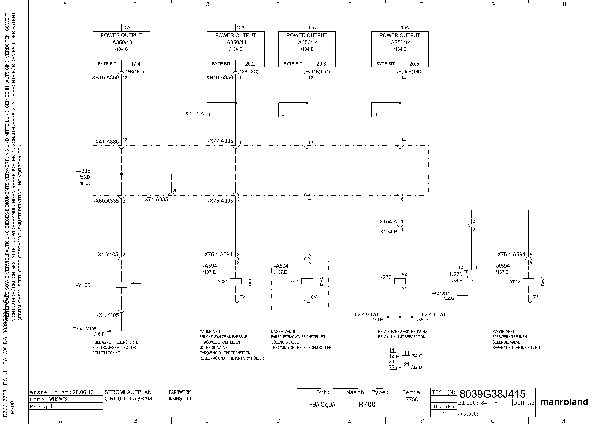

# +BA_Cx_DA — Sheet 84 of 247 — FARBWERK

**INKING UNIT**

> Part of the manroland **R700** printing press IEC/UL circuit diagrams.
> Drawing class: **Stromlaufplan / Circuit diagram** (DIN A3).
> Document `+BA_Cx_DA` covers the **Printing units / main switch cabinet** machine section.

## At a glance

| Field | Value |
|---|---|
| Document | `+BA_Cx_DA`  (8039G38J415) |
| Sheet | **84** of 247 |
| Section (DE) | FARBWERK |
| Section (EN) | INKING UNIT |
| Section type | CIRCUIT — Circuit diagram |
| Machine type | `R700` |
| Series | `7758` |
| Created | 28.06.10 |
| Replaces | — |
| Columns used | A, B, C, D, E, F, G, H |
| Path numbers | — |
| Labels on sheet | 128 |
| Cross-refs out | 15 |
| Cross-refs in | 40 |

**Previous:** [+BA_Cx_DA sheet 83](SHEET_0083.md) · **Next:** [+BA_Cx_DA sheet 85](SHEET_0085.md) · **Document TOC:** [_TOC.md](_TOC.md)  (+BA_Cx_DA) · **Master TOC:** [all sheets](../_MASTER_TOC.md)

## Sheet image (300 DPI, exact vector render)



_Rendered directly from the PDF vector layer at 300 DPI (1-bit), no OCR and no resampling. Use it to confirm anything ambiguous in the text below._

## Cross-references on this sheet

Each entry is a wire leaving this sheet. The printed token is `/sheet.column`; the link resolves to that sheet inside the same document.

| Ref | Target sheet | Col | Path | Destination on target | Target section | From col |
|---|---|---|---|---|---|---|
| `/134.E` | [+BA_Cx_DA sheet 134](SHEET_0134.md) | E | — | — | REFERENZMODUL | C |
| `/134.E` | [+BA_Cx_DA sheet 134](SHEET_0134.md) | E | — | — | REFERENZMODUL | D |
| `/134.E` | [+BA_Cx_DA sheet 134](SHEET_0134.md) | E | — | — | REFERENZMODUL | F |
| `/134.C` | [+BA_Cx_DA sheet 134](SHEET_0134.md) | C | — | — | REFERENZMODUL | B |
| `/85.D` | [+BA_Cx_DA sheet 85](SHEET_0085.md) | D | — | — | WASCHVORRICHTUNG | A |
| `/83.A` | [+BA_Cx_DA sheet 83](SHEET_0083.md) | A | — | — | FARBWERK | A |
| `/137.E` | [+BA_Cx_DA sheet 137](SHEET_0137.md) | E | — | A594 | REFERENZMODUL | C |
| `/137.E` | [+BA_Cx_DA sheet 137](SHEET_0137.md) | E | — | A594 | REFERENZMODUL | D |
| `/137.E` | [+BA_Cx_DA sheet 137](SHEET_0137.md) | E | — | A594 | REFERENZMODUL | G |
| `/84.F` | [+BA_Cx_DA sheet 84](SHEET_0084.md) | F | — | — | FARBWERK | G |
| `/32.G` | [+BA_Cx_DA sheet 32](SHEET_0032.md) | G | — | K270:11 | BUSVERBINDUNGEN: 20 mA SCHLEIFE, BUSFUNKTIONEN | F |
| `/70.E` | [+BA_Cx_DA sheet 70](SHEET_0070.md) | E | — | 0V.K270:A1 | ÖLUMLAUFSCHMIERUNG | F |
| `/85.D` | [+BA_Cx_DA sheet 85](SHEET_0085.md) | D | — | 0V.K270:A1 | WASCHVORRICHTUNG | F |
| `/16.F` | [+BA_Cx_DA sheet 16](SHEET_0016.md) | F | — | 0V.X1.Y105:1 | SPANNUNGSVERSORGUNG, SCHALTSCHRANKBELÜFTUNG | A |
| `/82.D` | [+BA_Cx_DA sheet 82](SHEET_0082.md) | D | — | — | FARBWERK | F |

### Incoming references (sheets that point here)

Every other sheet that sends a wire to this one. `Back-ref` is the token printed on *that* sheet; `Path` is its line number.

| From sheet | Cols | Back-ref | Path | Refs | What continues there |
|---|---|---|---|---|---|
| [+BA_Cx_DA#16](SHEET_0016.md) | F | `/16.F` | — | 1 | 0V.X1.Y105:1 |
| [+BA_Cx_DA#32](SHEET_0032.md) | G | `/32.G` | — | 1 | — |
| [+BA_Cx_DA#70](SHEET_0070.md) | E | `/70.E` | — | 1 | — |
| [+BA_Cx_DA#82](SHEET_0082.md) | C | `/82.C` | — | 1 | — |
| [+BA_Cx_DA#83](SHEET_0083.md) | A | `/83.A` | — | 1 | — |
| [+BA_Cx_DA#84](SHEET_0084.md) | G | `/84.G` | — | 1 | — |
| [+BA_Cx_DA#85](SHEET_0085.md) | D | `/85.D` | — | 2 | 0V.K194:A1 0V.K280:A1 |
| [+BA_Cx_DA#134](SHEET_0134.md) | C, E | `/134.C`, `/134.E` | — | 4 | — |
| [+BA_Cx_DA#137](SHEET_0137.md) | E | `/137.E` | — | 3 | — |
| [+BA_Cx_DA#150](SHEET_0150.md) | A | `/150.A` | — | 2 | — |
| [+BA_Cx_DA#171](SHEET_0171.md) | G | `/171.G` | — | 1 | — |
| [+BA_Cx_DA#172](SHEET_0172.md) | F | `/172.F` | — | 3 | — |
| [+BA_Cx_DA#181](SHEET_0181.md) | F | `/181.F` | — | 1 | — |
| [+BA_Cx_DA#183](SHEET_0183.md) | C | `/183.C` | — | 1 | — |
| [+BA_Cx_DA#184](SHEET_0184.md) | F, G | `/184.F`, `/184.G` | — | 4 | — |
| [+BA_Cx_DA#185](SHEET_0185.md) | A, E, G | `/185.A`, `/185.E`, `/185.G` | — | 9 | — |
| [+BA_Cx_DA#187](SHEET_0187.md) | B | `/187.B` | — | 4 | — |


## Devices on this sheet

| Tag | Class | Class meaning (IEC) | Col | Sub | Terminal | Sign |
|---|---|---|---|---|---|---|
| `Y021` | Y | Magnetventil / solenoid valve, actuator | C | — | — | — |
| `A594` | A | Baugruppe / assembly, module, PC board | C | — | — | — |
| `Y014` | Y | Magnetventil / solenoid valve, actuator | D | — | — | — |
| `A594` | A | Baugruppe / assembly, module, PC board | D | — | — | — |
| `Y105` | Y | Magnetventil / solenoid valve, actuator | A | — | — | — |
| `A335` | A | Baugruppe / assembly, module, PC board | A | — | — | — |
| `A350/14` | A | Baugruppe / assembly, module, PC board | C | 14 | — | — |
| `A350/14` | A | Baugruppe / assembly, module, PC board | D | 14 | — | — |
| `A350/14` | A | Baugruppe / assembly, module, PC board | F | 14 | — | — |
| `A350/13` | A | Baugruppe / assembly, module, PC board | B | 13 | — | — |
| `A2` | A | Baugruppe / assembly, module, PC board | F | — | — | — |
| `A1` | A | Baugruppe / assembly, module, PC board | F | — | — | — |
| `K270` | K | Relais / relay, contactor | E | — | — | — |
| `Y012` | Y | Magnetventil / solenoid valve, actuator | G | — | — | — |
| `A594` | A | Baugruppe / assembly, module, PC board | G | — | — | — |
| `K270` | K | Relais / relay, contactor | F | — | — | — |
| `K270:11` | K | Relais / relay, contactor | F | — | 11 | — |
| `X75.1.A594` | — | cross-device reference | C | — | — | — |
| `X75.A335` | — | cross-device reference | C | — | — | — |
| `X154.A` | — | cross-device reference | F | — | — | — |
| `X154.B` | — | cross-device reference | F | — | — | — |
| `X77.A335` | — | cross-device reference | C | — | — | — |
| `X1.Y105` | — | cross-device reference | B | — | — | — |
| `X1.Y105` | — | cross-device reference | B | — | — | — |
| `X60.A335` | — | cross-device reference | B | — | — | — |
| `X41.A335` | — | cross-device reference | B | — | — | — |
| `20.2` | — | cross-device reference | D | — | — | — |
| `XB16.A350` | — | cross-device reference | C | — | — | — |
| `20.3` | — | cross-device reference | E | — | — | — |
| `20.5` | — | cross-device reference | F | — | — | — |
| `17.4` | — | cross-device reference | B | — | — | — |
| `XB15.A350` | — | cross-device reference | B | — | — | — |
| `X77.1.A` | — | cross-device reference | C | — | — | — |
| `X75.1.A594` | — | cross-device reference | G | — | — | — |
| `X74.A335` | — | cross-device reference | B | — | — | — |

## Potentials / nets

| Potential | Count | Columns | Attached devices | Terminals |
|---|---|---|---|---|
| `0V` | 6 | A, C, D, E, F, H | `K194`, `K270`, `X1`, `Y105` | `1`, `A1` |


A potential such as `L24+/4` or `M24+` is a named supply/return rail; every place it appears on this sheet is electrically common.

## Wire-end annotations (grouped as printed)

A wire that continues elsewhere is annotated with a small cluster: the destination description, the path/line number `#NN`, and the `/sheet.column` cross reference. Each row below is one such cluster exactly as it is grouped on the drawing.

| Col | Y | Path | Cross-ref | Text on the wire |
|---|---|---|---|---|
| B | 50.6 | — | — | `15A` |
| C | 50.6 | — | — | `13A` |
| D | 50.6 | — | — | `14A` |
| F | 50.6 | — | — | `16A` |
| B | 65.8 | — | — | `POWER QUTPUT` |
| C | 65.8 | — | — | `POWER QUTPUT` |
| D | 65.8 | — | — | `POWER QUTPUT` |
| F | 65.8 | — | — | `POWER QUTPUT` |
| B | 79.7 | — | — | `A350/13` |
| C | 79.7 | — | — | `A350/14` |
| D | 79.7 | — | — | `A350/14` |
| F | 79.7 | — | — | `A350/14` |
| B | 93.5 | — | `/134.C` | — |
| C | 93.5 | — | `/134.E` | — |
| D | 93.5 | — | `/134.E` | — |
| F | 93.5 | — | `/134.E` | — |
| B | 122.5 | — | — | `BYTE.BIT 17.4` |
| C | 122.5 | — | — | `BYTE.BIT 20.2` |
| D | 122.5 | — | — | `BYTE.BIT 20.3` |
| F | 122.5 | — | — | `BYTE.BIT 20.5` |
| B | 138.5 | — | — | `15B(15C)` |
| D | 138.5 | — | — | `13B(13C)` |
| E | 138.5 | — | — | `14B(14C)` |
| F | 138.5 | — | — | `16B(16C)` |
| B | 149.1 | — | — | `XB15.A350 13` |
| C | 149.1 | — | — | `XB16.A350 11` |
| D | 150.6 | — | — | `12` |
| F | 150.6 | — | — | `14` |
| D | 220.7 | — | — | `X77.1.A 11 12 14` |
| B | 273.9 | — | — | `X41.A335 13` |
| D | 273.9 | — | — | `X77.A335 11 12 14` |
| A | 334.8 | — | — | `A335` |
| A | 347.9 | — | `/85.D`, `/83.A` | — |
| C | 374.5 | — | — | `20` |
| B | 391.5 | — | — | `X74.A335` |
| D | 391.5 | — | — | `X75.A335 3 4 6` |
| B | 394.3 | — | — | `X60.A335 2` |
| F | 435.4 | — | — | `X154.A 1` |
| G | 435.4 | — | — | `2` |
| F | 452.4 | — | — | `X154.B 1` |
| G | 452.4 | — | — | `2` |
| C | 500.6 | — | — | `X75.1.A594 8` |
| G | 500.6 | — | — | `X75.1.A594 5` |
| B | 500.7 | — | — | `X1.Y105 2` |
| D | 502.1 | — | — | `3` |
| C | 517.6 | — | — | `8` |
| D | 517.6 | — | — | `3` |
| H | 517.6 | — | — | `5` |
| C | 523.3 | — | `/137.E` | `A594` |
| D | 523.3 | — | `/137.E` | `A594` |
| G | 523.3 | — | `/137.E` | `A594` |
| G | 526.9 | — | — | `K270 14` |
| G | 526.9 | — | — | `12` |
| F | 541.0 | — | — | `A2` |
| E | 546.0 | — | — | `K270` |
| G | 553.4 | — | `/84.F` | — |
| C | 555.2 | — | — | `Y021` |
| D | 555.2 | — | — | `Y014` |
| G | 555.2 | — | — | `11` |
| G | 555.2 | — | — | `Y012` |
| A | 561.6 | — | — | `Y105` |
| F | 569.3 | — | — | `A1` |
| F | 578.6 | — | `/32.G` | `K270:11` |
| C | 585.6 | — | — | `0V` |
| D | 585.6 | — | — | `0V` |
| H | 585.6 | — | — | `0V` |
| F | 621.0 | — | `/70.E`, `/85.D` | `0V.K270:A1` |
| F | 621.0 | — | — | `0V.K194:A1` |
| B | 621.1 | — | — | `X1.Y105 1` |
| A | 649.4 | — | `/16.F` | `0V.X1.Y105:1` |
| C | 655.4 | — | — | `BRÜCKENWALZE AN FARBAUF MAGNETVENTIL:` |
| D | 655.4 | — | — | `FARBAUFTRAGWALZE ANSTELLEN MAGNETVENTIL:` |
| F | 655.4 | — | — | `RELAIS: FARBWERKTRENNUNG RELAY: INK UNIT SEPARATION` |
| G | 655.4 | — | — | `FARBWERK TRENNEN MAGNETVENTIL:` |
| B | 676.7 | — | — | `HUBMAGNET: HEBERSPERRE ELECTROMAGNET: DUCTOR ROLLER LOCKING` |
| C | 676.7 | — | — | `ROLLER AGAINST THE INK FORM ROLLER TRAGWALZE, ANSTELLEN SOLENOID VALVE: THROWING ON THE TRANSITION` |
| D | 676.7 | — | — | `SOLENOID VALVE: THROWING ON THE INK FORM ROLLER` |
| G | 676.7 | — | — | `SOLENOID VALVE: SEPARATING THE INKING UNIT` |
| F | 690.5 | — | — | `14 12 24 22 21` |
| F | 696.2 | — | — | `11 /84.G` |
| F | 725.2 | — | `/82.D` | — |


## Reconstructed tables

This sheet carries tabular content (pin map / terminal assignment / index). The grid below was rebuilt from the drawing's own rule lines, so each row is exactly one physical row of the table.

### Table 1 — 4 data rows × 6 columns (at x=184.3, y=62.4)

| POWER | QUTPUT A350/13 /134.C |  |  | POWER | QUTPUT A350/14 /134.E |
|---|---|---|---|---|---|
| `BYTE.BIT` | `17.4` |  |  | `BYTE.BIT` | `20.2` |
| `XB15.A350` | `15B(15C) 13` |  |  | `XB16.A350` | `13B(13C) 11` |
| `X41.A335` | `13` |  | `X77.1.A` | `11 X77.A335` | `11` |
| `X60.A335` | `2` | `X74.A335` | `20` | `X75.A335` | `3` |


### Table 2 — 4 data rows × 2 columns (at x=552.8, y=62.4)

| POWER | QUTPUT A350/14 /134.E |
|---|---|
| `BYTE.BIT` | `20.3` |
|  | `14B(14C) 12` |
| `12` | `12` |
|  | `4` |


### Table 3 — 4 data rows × 2 columns (at x=737.0, y=62.4)

| POWER | QUTPUT A350/14 /134.E |
|---|---|
| `BYTE.BIT` | `20.5` |
|  | `16B(16C) 14` |
| `14` | `14` |
|  | `6` |


## Notes and free text on this sheet

| Text | Col | Y (pt) |
|---|---|---|
| `MAGNETVENTIL:` | C | 655.42 |
| `BRÜCKENWALZE AN FARBAUF` | C | 666.05 |
| `TRAGWALZE, ANSTELLEN` | C | 676.67 |
| `SOLENOID VALVE:` | C | 687.31 |
| `THROWING ON THE TRANSITION` | C | 697.95 |
| `ROLLER AGAINST THE INK FORM ROLLER` | C | 708.6 |
| `MAGNETVENTIL:` | D | 655.42 |
| `FARBAUFTRAGWALZE ANSTELLEN` | D | 666.04 |
| `SOLENOID VALVE:` | D | 676.68 |
| `THROWING ON THE INK FORM ROLLER` | D | 687.33 |
| `HUBMAGNET: HEBERSPERRE` | B | 676.69 |
| `ELECTROMAGNET: DUCTOR` | B | 687.34 |
| `ROLLER LOCKING` | B | 697.96 |
| `13A` | C | 50.6 |
| `13B(13C)` | D | 138.51 |
| `POWER QUTPUT` | C | 65.76 |
| `BYTE.BIT` | C | 123.08 |
| `14A` | D | 50.6 |
| `14B(14C)` | E | 138.51 |
| `POWER QUTPUT` | D | 65.76 |
| `BYTE.BIT` | D | 123.08 |
| `16A` | F | 50.6 |
| `16B(16C)` | F | 138.51 |
| `POWER QUTPUT` | F | 65.76 |
| `BYTE.BIT` | E | 123.08 |
| `15A` | B | 50.6 |
| `15B(15C)` | B | 138.51 |
| `POWER QUTPUT` | B | 65.76 |
| `BYTE.BIT` | B | 123.08 |
| `11 /84.G` | F | 696.18 |
| `RELAIS: FARBWERKTRENNUNG` | F | 655.41 |
| `RELAY: INK UNIT SEPARATION` | F | 666.04 |
| `MAGNETVENTIL:` | G | 655.42 |
| `FARBWERK TRENNEN` | G | 666.03 |
| `SOLENOID VALVE:` | G | 676.68 |
| `SEPARATING THE INKING UNIT` | G | 687.32 |

## Complete label inventory (exact text from the drawing)

Every text object inside the drawing area of this sheet, in DIN reading order (column A→H, then top→bottom). This is the authoritative list: if a string is not here it is not printed on this sheet.

| Col | Y | X | Dir | Type | Text |
|---|---|---|---|---|---|
| A | 334.8 | 150.8 | → | device tag | `A335` |
| A | 347.9 | 157.9 | → | cross-reference | `/85.D` |
| A | 360.2 | 157.9 | → | cross-reference | `/83.A` |
| A | 561.6 | 151.4 | → | device tag | `Y105` |
| A | 649.4 | 144.3 | → | potential | `0V.X1.Y105:1` |
| A | 659.3 | 187.1 | → | cross-reference | `/16.F` |
| B | 50.6 | 242.9 | → | text | `15A` |
| B | 65.8 | 200.1 | → | text | `POWER QUTPUT` |
| B | 79.7 | 219.5 | → | device tag | `A350/13` |
| B | 93.5 | 228.2 | → | cross-reference | `/134.C` |
| B | 122.5 | 259.5 | → | device ref | `17.4` |
| B | 123.1 | 194.2 | → | text | `BYTE.BIT` |
| B | 138.5 | 248.6 | → | text | `15B(15C)` |
| B | 149.1 | 178.6 | → | device ref | `XB15.A350` |
| B | 150.6 | 242.9 | → | number | `13` |
| B | 273.9 | 242.9 | → | number | `13` |
| B | 276.7 | 185.7 | → | device ref | `X41.A335` |
| B | 391.5 | 283.5 | → | device ref | `X74.A335` |
| B | 394.3 | 185.7 | → | device ref | `X60.A335` |
| B | 395.8 | 243.5 | → | number | `2` |
| B | 500.7 | 190.8 | → | device ref | `X1.Y105` |
| B | 502.1 | 243.5 | → | number | `2` |
| B | 621.1 | 192.2 | → | device ref | `X1.Y105` |
| B | 622.5 | 242.9 | → | number | `1` |
| B | 676.7 | 183.4 | → | text | `HUBMAGNET: HEBERSPERRE` |
| B | 687.3 | 183.4 | → | text | `ELECTROMAGNET: DUCTOR` |
| B | 698.0 | 183.4 | → | text | `ROLLER LOCKING` |
| C | 50.6 | 469.7 | → | text | `13A` |
| C | 65.8 | 426.9 | → | text | `POWER QUTPUT` |
| C | 79.7 | 446.3 | → | device tag | `A350/14` |
| C | 93.5 | 455.2 | → | cross-reference | `/134.E` |
| C | 123.1 | 420.9 | → | text | `BYTE.BIT` |
| C | 149.1 | 405.4 | → | device ref | `XB16.A350` |
| C | 150.6 | 469.7 | → | number | `11` |
| C | 220.7 | 364.0 | → | device ref | `X77.1.A` |
| C | 222.8 | 413.0 | → | number | `11` |
| C | 275.3 | 412.4 | → | device ref | `X77.A335` |
| C | 279.5 | 469.7 | → | number | `11` |
| C | 374.5 | 342.7 | → | number | `20` |
| C | 391.5 | 470.3 | → | number | `3` |
| C | 394.3 | 412.4 | → | device ref | `X75.A335` |
| C | 500.6 | 402.2 | → | device ref | `X75.1.A594` |
| C | 502.1 | 470.3 | → | number | `8` |
| C | 517.6 | 470.3 | → | number | `8` |
| C | 523.3 | 402.2 | → | device tag | `A594` |
| C | 536.4 | 402.5 | → | cross-reference | `/137.E` |
| C | 555.2 | 429.2 | → | device tag | `Y021` |
| C | 585.6 | 475.9 | → | potential | `0V` |
| C | 655.4 | 396.3 | → | text | `MAGNETVENTIL:` |
| C | 666.0 | 396.0 | → | text | `BRÜCKENWALZE AN FARBAUF` |
| C | 676.7 | 396.6 | → | text | `TRAGWALZE, ANSTELLEN` |
| C | 687.3 | 396.6 | → | text | `SOLENOID VALVE:` |
| C | 697.9 | 396.6 | → | text | `THROWING ON THE TRANSITION` |
| C | 708.6 | 396.0 | → | text | `ROLLER AGAINST THE INK FORM ROLLER` |
| D | 50.6 | 611.4 | → | text | `14A` |
| D | 65.8 | 568.6 | → | text | `POWER QUTPUT` |
| D | 79.7 | 588.0 | → | device tag | `A350/14` |
| D | 93.5 | 597.0 | → | cross-reference | `/134.E` |
| D | 122.5 | 486.6 | → | device ref | `20.2` |
| D | 123.1 | 562.7 | → | text | `BYTE.BIT` |
| D | 138.5 | 475.4 | → | text | `13B(13C)` |
| D | 150.6 | 611.4 | → | number | `12` |
| D | 222.8 | 554.7 | → | number | `12` |
| D | 279.5 | 611.4 | → | number | `12` |
| D | 391.5 | 612.0 | → | number | `4` |
| D | 502.1 | 612.0 | → | number | `3` |
| D | 517.6 | 612.0 | → | number | `3` |
| D | 523.3 | 544.0 | → | device tag | `A594` |
| D | 536.4 | 544.3 | → | cross-reference | `/137.E` |
| D | 555.2 | 569.5 | → | device tag | `Y014` |
| D | 585.6 | 617.7 | → | potential | `0V` |
| D | 655.4 | 538.0 | → | text | `MAGNETVENTIL:` |
| D | 666.0 | 537.7 | → | text | `FARBAUFTRAGWALZE ANSTELLEN` |
| D | 676.7 | 538.3 | → | text | `SOLENOID VALVE:` |
| D | 687.3 | 538.3 | → | text | `THROWING ON THE INK FORM ROLLER` |
| E | 122.5 | 628.3 | → | device ref | `20.3` |
| E | 123.1 | 746.9 | → | text | `BYTE.BIT` |
| E | 138.5 | 617.1 | → | text | `14B(14C)` |
| E | 222.8 | 739.0 | → | number | `14` |
| E | 546.0 | 748.9 | → | device tag | `K270` |
| E | 621.1 | 704.4 | → | potential | `0V.K270:A1` |
| E | 631.0 | 739.6 | → | cross-reference | `/70.E` |
| F | 50.6 | 795.7 | → | text | `16A` |
| F | 65.8 | 752.9 | → | text | `POWER QUTPUT` |
| F | 79.7 | 772.3 | → | device tag | `A350/14` |
| F | 93.5 | 781.2 | → | cross-reference | `/134.E` |
| F | 122.5 | 812.6 | → | device ref | `20.5` |
| F | 138.5 | 801.4 | → | text | `16B(16C)` |
| F | 150.6 | 795.7 | → | number | `14` |
| F | 273.9 | 795.7 | → | number | `14` |
| F | 391.5 | 796.3 | → | number | `6` |
| F | 435.4 | 749.5 | → | device ref | `X154.A` |
| F | 435.4 | 795.7 | → | number | `1` |
| F | 452.5 | 795.7 | → | number | `1` |
| F | 455.3 | 750.3 | → | device ref | `X154.B` |
| F | 540.3 | 889.2 | → | device tag | `K270` |
| F | 541.0 | 796.5 | → | device tag | `A2` |
| F | 569.3 | 796.5 | → | device tag | `A1` |
| F | 578.6 | 857.8 | → | device tag | `K270:11` |
| F | 588.5 | 880.4 | → | cross-reference | `/32.G` |
| F | 621.1 | 837.4 | → | potential | `0V.K194:A1` |
| F | 631.0 | 827.7 | → | cross-reference | `/85.D` |
| F | 655.4 | 750.3 | → | text | `RELAIS: FARBWERKTRENNUNG` |
| F | 666.0 | 750.3 | → | text | `RELAY: INK UNIT SEPARATION` |
| F | 690.5 | 771.0 | → | number | `14` |
| F | 696.2 | 801.1 | → | text | `11 /84.G` |
| F | 701.8 | 771.0 | → | number | `12` |
| F | 713.2 | 771.0 | → | number | `24` |
| F | 718.9 | 801.4 | → | number | `21` |
| F | 724.5 | 771.0 | → | number | `22` |
| F | 725.2 | 816.4 | → | cross-reference | `/82.D` |
| G | 435.4 | 938.0 | → | number | `2` |
| G | 452.5 | 938.0 | → | number | `2` |
| G | 500.6 | 983.3 | → | device ref | `X75.1.A594` |
| G | 523.3 | 983.3 | → | device tag | `A594` |
| G | 526.9 | 909.4 | → | number | `12` |
| G | 526.9 | 937.4 | → | number | `14` |
| G | 536.4 | 983.6 | → | cross-reference | `/137.E` |
| G | 553.4 | 897.2 | → | cross-reference | `/84.F` |
| G | 555.2 | 930.3 | → | number | `11` |
| G | 555.2 | 1009.1 | → | device tag | `Y012` |
| G | 655.4 | 977.4 | → | text | `MAGNETVENTIL:` |
| G | 666.0 | 977.1 | → | text | `FARBWERK TRENNEN` |
| G | 676.7 | 977.7 | → | text | `SOLENOID VALVE:` |
| G | 687.3 | 977.7 | → | text | `SEPARATING THE INKING UNIT` |
| H | 502.1 | 1051.4 | → | number | `5` |
| H | 517.6 | 1051.4 | → | number | `5` |
| H | 585.6 | 1057.0 | → | potential | `0V` |

## Reading-order text block

The same content as a plain block, grouped by DIN column — convenient to paste or to match against a visual description.

```text
=== Column A ===
 334.8  150.8  devtag       A335
 347.9  157.9  xref         /85.D
 360.2  157.9  xref         /83.A
 561.6  151.4  devtag       Y105
 649.4  144.3  net          0V.X1.Y105:1
 659.3  187.1  xref         /16.F
=== Column B ===
  50.6  242.9  text         15A
  65.8  200.1  text         POWER QUTPUT
  79.7  219.5  devtag       A350/13
  93.5  228.2  xref         /134.C
 122.5  259.5  devref       17.4
 123.1  194.2  text         BYTE.BIT
 138.5  248.6  text         15B(15C)
 149.1  178.6  devref       XB15.A350
 150.6  242.9  numeric      13
 273.9  242.9  numeric      13
 276.7  185.7  devref       X41.A335
 391.5  283.5  devref       X74.A335
 394.3  185.7  devref       X60.A335
 395.8  243.5  numeric      2
 500.7  190.8  devref       X1.Y105
 502.1  243.5  numeric      2
 621.1  192.2  devref       X1.Y105
 622.5  242.9  numeric      1
 676.7  183.4  text         HUBMAGNET: HEBERSPERRE
 687.3  183.4  text         ELECTROMAGNET: DUCTOR
 698.0  183.4  text         ROLLER LOCKING
=== Column C ===
  50.6  469.7  text         13A
  65.8  426.9  text         POWER QUTPUT
  79.7  446.3  devtag       A350/14
  93.5  455.2  xref         /134.E
 123.1  420.9  text         BYTE.BIT
 149.1  405.4  devref       XB16.A350
 150.6  469.7  numeric      11
 220.7  364.0  devref       X77.1.A
 222.8  413.0  numeric      11
 275.3  412.4  devref       X77.A335
 279.5  469.7  numeric      11
 374.5  342.7  numeric      20
 391.5  470.3  numeric      3
 394.3  412.4  devref       X75.A335
 500.6  402.2  devref       X75.1.A594
 502.1  470.3  numeric      8
 517.6  470.3  numeric      8
 523.3  402.2  devtag       A594
 536.4  402.5  xref         /137.E
 555.2  429.2  devtag       Y021
 585.6  475.9  net          0V
 655.4  396.3  text         MAGNETVENTIL:
 666.0  396.0  text         BRÜCKENWALZE AN FARBAUF
 676.7  396.6  text         TRAGWALZE, ANSTELLEN
 687.3  396.6  text         SOLENOID VALVE:
 697.9  396.6  text         THROWING ON THE TRANSITION
 708.6  396.0  text         ROLLER AGAINST THE INK FORM ROLLER
=== Column D ===
  50.6  611.4  text         14A
  65.8  568.6  text         POWER QUTPUT
  79.7  588.0  devtag       A350/14
  93.5  597.0  xref         /134.E
 122.5  486.6  devref       20.2
 123.1  562.7  text         BYTE.BIT
 138.5  475.4  text         13B(13C)
 150.6  611.4  numeric      12
 222.8  554.7  numeric      12
 279.5  611.4  numeric      12
 391.5  612.0  numeric      4
 502.1  612.0  numeric      3
 517.6  612.0  numeric      3
 523.3  544.0  devtag       A594
 536.4  544.3  xref         /137.E
 555.2  569.5  devtag       Y014
 585.6  617.7  net          0V
 655.4  538.0  text         MAGNETVENTIL:
 666.0  537.7  text         FARBAUFTRAGWALZE ANSTELLEN
 676.7  538.3  text         SOLENOID VALVE:
 687.3  538.3  text         THROWING ON THE INK FORM ROLLER
=== Column E ===
 122.5  628.3  devref       20.3
 123.1  746.9  text         BYTE.BIT
 138.5  617.1  text         14B(14C)
 222.8  739.0  numeric      14
 546.0  748.9  devtag       K270
 621.1  704.4  net          0V.K270:A1
 631.0  739.6  xref         /70.E
=== Column F ===
  50.6  795.7  text         16A
  65.8  752.9  text         POWER QUTPUT
  79.7  772.3  devtag       A350/14
  93.5  781.2  xref         /134.E
 122.5  812.6  devref       20.5
 138.5  801.4  text         16B(16C)
 150.6  795.7  numeric      14
 273.9  795.7  numeric      14
 391.5  796.3  numeric      6
 435.4  749.5  devref       X154.A
 435.4  795.7  numeric      1
 452.5  795.7  numeric      1
 455.3  750.3  devref       X154.B
 540.3  889.2  devtag       K270
 541.0  796.5  devtag       A2
 569.3  796.5  devtag       A1
 578.6  857.8  devtag       K270:11
 588.5  880.4  xref         /32.G
 621.1  837.4  net          0V.K194:A1
 631.0  827.7  xref         /85.D
 655.4  750.3  text         RELAIS: FARBWERKTRENNUNG
 666.0  750.3  text         RELAY: INK UNIT SEPARATION
 690.5  771.0  numeric      14
 696.2  801.1  text         11 /84.G
 701.8  771.0  numeric      12
 713.2  771.0  numeric      24
 718.9  801.4  numeric      21
 724.5  771.0  numeric      22
 725.2  816.4  xref         /82.D
=== Column G ===
 435.4  938.0  numeric      2
 452.5  938.0  numeric      2
 500.6  983.3  devref       X75.1.A594
 523.3  983.3  devtag       A594
 526.9  909.4  numeric      12
 526.9  937.4  numeric      14
 536.4  983.6  xref         /137.E
 553.4  897.2  xref         /84.F
 555.2  930.3  numeric      11
 555.2 1009.1  devtag       Y012
 655.4  977.4  text         MAGNETVENTIL:
 666.0  977.1  text         FARBWERK TRENNEN
 676.7  977.7  text         SOLENOID VALVE:
 687.3  977.7  text         SEPARATING THE INKING UNIT
=== Column H ===
 502.1 1051.4  numeric      5
 517.6 1051.4  numeric      5
 585.6 1057.0  net          0V
```

---
_Generated from the PDF vector text layer; no OCR. Source: `R700_7758_IEC_UL_BA_CX_DA_8039G38J415_p`, sheet 84._
