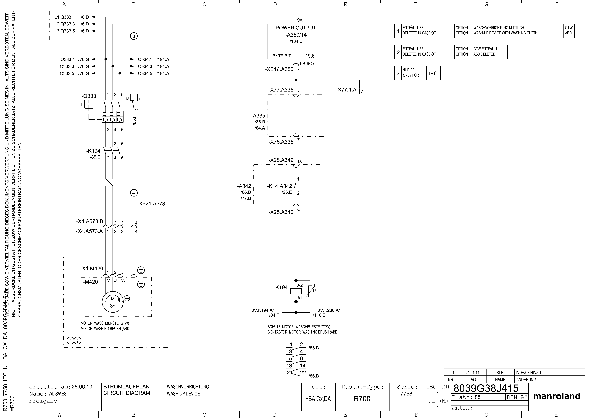

# +BA_Cx_DA — Sheet 85 of 247 — WASCHVORRICHTUNG

**WASH UP DEVICE**

> Part of the manroland **R700** printing press IEC/UL circuit diagrams.
> Drawing class: **Stromlaufplan / Circuit diagram** (DIN A3).
> Document `+BA_Cx_DA` covers the **Printing units / main switch cabinet** machine section.

## At a glance

| Field | Value |
|---|---|
| Document | `+BA_Cx_DA`  (8039G38J415) |
| Sheet | **85** of 247 |
| Section (DE) | WASCHVORRICHTUNG |
| Section (EN) | WASH UP DEVICE |
| Section type | CIRCUIT — Circuit diagram |
| Machine type | `R700` |
| Series | `7758` |
| Created | 28.06.10 |
| Replaces | — |
| Columns used | A, B, D, E, F, G, H |
| Path numbers | — |
| Labels on sheet | 142 |
| Cross-refs out | 21 |
| Cross-refs in | 39 |

**Previous:** [+BA_Cx_DA sheet 84](SHEET_0084.md) · **Next:** [+BA_Cx_DA sheet 86](SHEET_0086.md) · **Document TOC:** [_TOC.md](_TOC.md)  (+BA_Cx_DA) · **Master TOC:** [all sheets](../_MASTER_TOC.md)

## Sheet image (300 DPI, exact vector render)



_Rendered directly from the PDF vector layer at 300 DPI (1-bit), no OCR and no resampling. Use it to confirm anything ambiguous in the text below._

## Cross-references on this sheet

Each entry is a wire leaving this sheet. The printed token is `/sheet.column`; the link resolves to that sheet inside the same document.

| Ref | Target sheet | Col | Path | Destination on target | Target section | From col |
|---|---|---|---|---|---|---|
| `/6.D` | [+BA_Cx_DA sheet 6](SHEET_0006.md) | D | — | L1.Q333:1 | SPANNUNGSVERSORGUNG: 400V | A |
| `/6.D` | [+BA_Cx_DA sheet 6](SHEET_0006.md) | D | — | L2.Q333:3 | SPANNUNGSVERSORGUNG: 400V | A |
| `/6.D` | [+BA_Cx_DA sheet 6](SHEET_0006.md) | D | — | L3.Q333:5 | SPANNUNGSVERSORGUNG: 400V | A |
| `/134.E` | [+BA_Cx_DA sheet 134](SHEET_0134.md) | E | — | — | REFERENZMODUL | D |
| `/76.G` | [+BA_Cx_DA sheet 76](SHEET_0076.md) | G | — | Q333:1 | FARBWERK | A |
| `/194.A` | [+BA_Cx_DA sheet 194](SHEET_0194.md) | A | — | Q334:1 | OPTION: WASCHVORRICHTUNG MIT BÜRSTE | B |
| `/76.G` | [+BA_Cx_DA sheet 76](SHEET_0076.md) | G | — | Q333:3 | FARBWERK | A |
| `/194.A` | [+BA_Cx_DA sheet 194](SHEET_0194.md) | A | — | Q334:3 | OPTION: WASCHVORRICHTUNG MIT BÜRSTE | B |
| `/194.A` | [+BA_Cx_DA sheet 194](SHEET_0194.md) | A | — | Q334:5 | OPTION: WASCHVORRICHTUNG MIT BÜRSTE | B |
| `/76.G` | [+BA_Cx_DA sheet 76](SHEET_0076.md) | G | — | Q333:5 | FARBWERK | A |
| `/86.F` | [+BA_Cx_DA sheet 86](SHEET_0086.md) | F | — | — | WASCHVORRICHTUNG | B |
| `/86.B` | [+BA_Cx_DA sheet 86](SHEET_0086.md) | B | — | — | WASCHVORRICHTUNG | D |
| `/84.A` | [+BA_Cx_DA sheet 84](SHEET_0084.md) | A | — | — | FARBWERK | D |
| `/85.E` | [+BA_Cx_DA sheet 85](SHEET_0085.md) | E | — | — | WASCHVORRICHTUNG | A |
| `/86.B` | [+BA_Cx_DA sheet 86](SHEET_0086.md) | B | — | — | WASCHVORRICHTUNG | D |
| `/77.B` | [+BA_Cx_DA sheet 77](SHEET_0077.md) | B | — | — | FARBWERK | D |
| `/26.E` | [+BA_Cx_DA sheet 26](SHEET_0026.md) | E | — | — | BUSVERBINDUNGEN: NOT AUS | D |
| `/84.F` | [+BA_Cx_DA sheet 84](SHEET_0084.md) | F | — | 0V.K194:A1 0V.K280:A1 | FARBWERK | D |
| `/116.D` | [+BA_Cx_DA sheet 116](SHEET_0116.md) | D | — | — | PPL 2 | E |
| `/85.B` | [+BA_Cx_DA sheet 85](SHEET_0085.md) | B | — | — | WASCHVORRICHTUNG | E |
| `/86.B` | [+BA_Cx_DA sheet 86](SHEET_0086.md) | B | — | — | WASCHVORRICHTUNG | E |

### Incoming references (sheets that point here)

Every other sheet that sends a wire to this one. `Back-ref` is the token printed on *that* sheet; `Path` is its line number.

| From sheet | Cols | Back-ref | Path | Refs | What continues there |
|---|---|---|---|---|---|
| [+BA_Cx_DA#6](SHEET_0006.md) | E | `/6.E` | — | 3 | L1.Q333:1; L2.Q333:3; L3.Q333:5 |
| [+BA_Cx_DA#26](SHEET_0026.md) | E | `/26.E` | — | 1 | — |
| [+BA_Cx_DA#76](SHEET_0076.md) | G | `/76.G` | — | 3 | Q333:1; Q333:3; Q333:5 |
| [+BA_Cx_DA#77](SHEET_0077.md) | B | `/77.B` | — | 1 | — |
| [+BA_Cx_DA#84](SHEET_0084.md) | A, F | `/84.A`, `/84.F` | — | 2 | 0V.K270:A1 |
| [+BA_Cx_DA#85](SHEET_0085.md) | A, E | `/85.A`, `/85.E` | — | 2 | — |
| [+BA_Cx_DA#86](SHEET_0086.md) | A, B, F | `/86.A`, `/86.B`, `/86.F` | — | 4 | — |
| [+BA_Cx_DA#116](SHEET_0116.md) | D | `/116.D` | — | 1 | 0V.K280:A1 0V.K195:A1 |
| [+BA_Cx_DA#134](SHEET_0134.md) | E | `/134.E` | — | 1 | — |
| [+BA_Cx_DA#148](SHEET_0148.md) | H | `/148.H` | — | 4 | — |
| [+BA_Cx_DA#160](SHEET_0160.md) | A | `/160.A` | — | 8 | — |
| [+BA_Cx_DA#172](SHEET_0172.md) | F | `/172.F` | — | 1 | — |
| [+BA_Cx_DA#175](SHEET_0175.md) | F | `/175.F` | — | 1 | — |
| [+BA_Cx_DA#178](SHEET_0178.md) | F | `/178.F` | — | 1 | — |
| [+BA_Cx_DA#185](SHEET_0185.md) | E, G | `/185.E`, `/185.G` | — | 2 | — |
| [+BA_Cx_DA#186](SHEET_0186.md) | B | `/186.B` | — | 1 | — |
| [+BA_Cx_DA#194](SHEET_0194.md) | A | `/194.A` | — | 3 | Q334:1; Q334:3; Q334:5 Q342:5 |


## Devices on this sheet

| Tag | Class | Class meaning (IEC) | Col | Sub | Terminal | Sign |
|---|---|---|---|---|---|---|
| `K194` | K | Relais / relay, contactor | A | — | — | — |
| `Q333` | Q | Leistungsschalter / power switching device | A | — | — | — |
| `A335` | A | Baugruppe / assembly, module, PC board | D | — | — | — |
| `A342` | A | Baugruppe / assembly, module, PC board | D | — | — | — |
| `A2` | A | Baugruppe / assembly, module, PC board | D | — | — | — |
| `A1` | A | Baugruppe / assembly, module, PC board | D | — | — | — |
| `K194` | K | Relais / relay, contactor | D | — | — | — |
| `A350/14` | A | Baugruppe / assembly, module, PC board | D | 14 | — | — |
| `Q333:5` | Q | Leistungsschalter / power switching device | A | — | 5 | — |
| `Q334:1` | Q | Leistungsschalter / power switching device | B | — | 1 | — |
| `Q333:3` | Q | Leistungsschalter / power switching device | A | — | 3 | — |
| `Q333:1` | Q | Leistungsschalter / power switching device | A | — | 1 | — |
| `Q334:3` | Q | Leistungsschalter / power switching device | B | — | 3 | — |
| `Q334:5` | Q | Leistungsschalter / power switching device | B | — | 5 | — |
| `X1.M420` | — | cross-device reference | A | — | — | — |
| `X4.A573.B` | — | cross-device reference | A | — | — | — |
| `X4.A573.A` | — | cross-device reference | A | — | — | — |
| `X77.A335` | — | cross-device reference | D | — | — | — |
| `X78.A335` | — | cross-device reference | D | — | — | — |
| `X28.A342` | — | cross-device reference | D | — | — | — |
| `K14.A342` | — | cross-device reference | D | — | — | — |
| `X25.A342` | — | cross-device reference | D | — | — | — |
| `19.6` | — | cross-device reference | D | — | — | — |
| `XB16.A350` | — | cross-device reference | D | — | — | — |
| `X77.1.A` | — | cross-device reference | E | — | — | — |
| `NR.` | — | cross-device reference | G | — | — | — |
| `21.01.11` | — | cross-device reference | G | — | — | — |
| `X921.A573` | — | cross-device reference | B | — | — | — |

## Potentials / nets

| Potential | Count | Columns | Attached devices | Terminals |
|---|---|---|---|---|
| `0V` | 2 | D, E | `K194`, `K280` | `A1` |
| `L1` | 1 | A | `Q333` | `1` |
| `L2` | 1 | A | `Q333` | `3` |
| `L3` | 1 | A | `Q333` | `5` |
| `M420` | 1 | A | — | — |


A potential such as `L24+/4` or `M24+` is a named supply/return rail; every place it appears on this sheet is electrically common.

## Wire-end annotations (grouped as printed)

A wire that continues elsewhere is annotated with a small cluster: the destination description, the path/line number `#NN`, and the `/sheet.column` cross reference. Each row below is one such cluster exactly as it is grouped on the drawing.

| Col | Y | Path | Cross-ref | Text on the wire |
|---|---|---|---|---|
| A | 30.7 | — | `/6.D` | `L1.Q333:1` |
| D | 36.4 | — | — | `9A` |
| A | 44.2 | — | `/6.D` | `L2.Q333:3` |
| D | 51.6 | — | — | `POWER QUTPUT` |
| H | 52.9 | — | — | `GTW ABD` |
| F | 53.0 | — | — | `1 ENTFÄLLT BEI DELETED IN CASE OF` |
| G | 53.0 | — | — | `OPTION OPTION` |
| G | 53.1 | — | — | `WASCHVORRICHTUNG MIT TUCH WASH UP DEVICE WITH WASHING CLOTH` |
| A | 58.4 | — | `/6.D` | `L3.Q333:5` |
| D | 65.5 | — | — | `A350/14` |
| B | 70.0 | — | — | `3` |
| D | 79.3 | — | `/134.E` | — |
| F | 95.5 | — | — | `2 ENTFÄLLT BEI DELETED IN CASE OF` |
| G | 95.5 | — | — | `GTW ENTFÄLLT ABD DELETED` |
| G | 95.6 | — | — | `OPTION OPTION` |
| D | 108.3 | — | — | `BYTE.BIT 19.6` |
| A | 115.8 | — | `/76.G` | `Q333:1` |
| B | 115.8 | — | `/194.A` | `Q334:1` |
| D | 124.3 | — | — | `9B(9C)` |
| A | 129.9 | — | `/76.G` | `Q333:3` |
| B | 129.9 | — | `/194.A` | `Q334:3` |
| D | 134.9 | — | — | `XB16.A350 7` |
| F | 138.1 | — | — | `3 NUR BEI` |
| F | 143.6 | — | — | `ONLY FOR IEC` |
| A | 144.1 | — | `/76.G` | `Q333:5` |
| B | 144.1 | — | `/194.A` | `Q334:5` |
| D | 176.1 | — | — | `X77.A335 7` |
| E | 176.1 | — | — | `X77.1.A 7` |
| B | 186.7 | — | — | `1` |
| B | 186.7 | — | — | `3` |
| B | 186.7 | — | — | `5` |
| A | 188.8 | — | — | `Q333` |
| B | 195.8 | — | — | `12 14` |
| B | 218.4 | — | — | `11` |
| D | 228.5 | — | — | `A335` |
| B | 232.2 | — | `/86.F` | — |
| D | 241.6 | — | `/86.B`, `/84.A` | — |
| B | 257.6 | — | — | `2` |
| B | 257.6 | — | — | `4` |
| B | 257.6 | — | — | `6` |
| D | 278.1 | — | — | `X78.A335 7` |
| B | 285.9 | — | — | `1` |
| B | 285.9 | — | — | `3` |
| B | 285.9 | — | — | `5` |
| B | 299.4 | — | — | `K194 6` |
| A | 312.4 | — | `/85.E` | — |
| B | 314.3 | — | — | `2` |
| B | 314.3 | — | — | `4` |
| D | 317.8 | — | — | `X28.A342 18` |
| D | 356.8 | — | — | `K14.A342 1` |
| D | 370.2 | — | — | `A342` |
| D | 383.3 | — | `/86.B`, `/77.B` | — |
| D | 383.3 | — | `/26.E` | — |
| D | 385.1 | — | — | `2` |
| B | 405.7 | — | — | `X921.A573` |
| D | 419.9 | — | — | `X25.A342 9` |
| B | 441.1 | — | — | `X4.A573.B 1 2 3` |
| B | 445.4 | — | — | `4` |
| B | 460.9 | — | — | `X4.A573.A 1 2 3` |
| B | 462.4 | — | — | `4` |
| A | 536.1 | — | — | `X1.M420 1` |
| B | 544.6 | — | — | `2 3` |
| B | 560.5 | — | — | `V U W` |
| A | 563.0 | — | — | `M420` |
| D | 570.7 | — | — | `A2` |
| D | 574.3 | — | — | `K194 U` |
| D | 596.2 | — | — | `A1` |
| B | 597.3 | — | — | `3~ M` |
| D | 621.0 | — | `/84.F` | `0V.K194:A1 0V.K280:A1` |
| E | 631.0 | — | `/116.D` | — |
| B | 648.3 | — | — | `MOTOR: WASCHBÜRSTE (GTW) MOTOR: WASHING BRUSH (ABD)` |
| D | 655.4 | — | — | `SCHÜTZ: MOTOR, WASCHBÜRSTE (GTW) CONTACTOR: MOTOR, WASHING BRUSH (ABD)` |
| A | 682.9 | — | — | `1 2` |
| D | 689.1 | — | — | `13 21 3 5 1` |
| D | 689.1 | — | — | `14 2 4 6 22` |
| E | 696.9 | — | `/85.B` | — |
| G | 747.2 | — | — | `001 21.01.11 SLEI INDEX 3 HINZU` |
| E | 753.6 | — | `/86.B` | — |
| G | 761.3 | — | — | `NR. TAG NAME ÄNDERUNG` |


## Reconstructed tables

This sheet carries tabular content (pin map / terminal assignment / index). The grid below was rebuilt from the drawing's own rule lines, so each row is exactly one physical row of the table.

### Table 1 — 2 data rows × 4 columns (at x=163.0, y=62.4) — **/6.D /76.G /76.G**

| /76.G | Q333 |  |  |
|---|---|---|---|
|  |  | `X4.A573.B X4.A573.A X1.M420` | `K194 /85.E` |
|  |  | `M420` |  |


### Table 2 — 2 data rows × 3 columns (at x=212.6, y=62.4)

| 1 |  | 3 |
|---|---|---|
| `2 1 2 1 1 1` |  | `4 3 4 2 2 2` |
| `V` | `M` | `U 3~` |


### Table 3 — 4 data rows × 3 columns (at x=240.9, y=62.4) — **3 Q334:1 Q334:3**

| 5 | 12 | Q334:5 14 |
|---|---|---|
|  |  | `11` |
|  |  | `/86.F` |
| `6 5 6 3 3 3` |  | `X921.A573 4 4` |
|  | `W` |  |


### Table 4 — 2 data rows × 3 columns (at x=538.6, y=48.2)

| POWER | QUTPUT A350/14 /134.E |  |
|---|---|---|
| `BYTE.BIT` |  | `19.6` |
| `XB16.A350` | `9B(9C) 7` |  |


## Notes and free text on this sheet

| Text | Col | Y (pt) |
|---|---|---|
| `V` | B | 560.78 |
| `U` | B | 560.89 |
| `W` | B | 560.52 |
| `M` | B | 597.28 |
| `MOTOR: WASCHBÜRSTE (GTW)` | B | 648.32 |
| `MOTOR: WASHING BRUSH (ABD)` | B | 658.97 |
| `U` | E | 582.29 |
| `SCHÜTZ: MOTOR, WASCHBÜRSTE (GTW)` | D | 655.42 |
| `CONTACTOR: MOTOR, WASHING BRUSH (ABD)` | D | 666.06 |
| `9A` | D | 36.41 |
| `9B(9C)` | D | 124.33 |
| `POWER QUTPUT` | D | 51.59 |
| `BYTE.BIT` | D | 108.91 |
| `TAG` | G | 761.44 |
| `NAME` | G | 761.42 |
| `ÄNDERUNG` | H | 761.48 |
| `SLEI` | G | 747.27 |
| `INDEX 3 HINZU` | H | 747.3 |
| `ENTFÄLLT BEI` | F | 53.03 |
| `DELETED IN CASE OF` | F | 63.69 |
| `OPTION` | G | 53.04 |
| `WASCHVORRICHTUNG MIT TUCH` | G | 53.07 |
| `WASH UP DEVICE WITH WASHING CLOTH` | G | 63.67 |
| `GTW` | H | 52.94 |
| `ABD` | H | 63.68 |
| `GTW ENTFÄLLT` | G | 95.55 |
| `ABD DELETED` | G | 106.22 |
| `NUR BEI` | F | 138.06 |
| `ONLY FOR` | F | 148.75 |
| `IEC` | F | 143.55 |

## Complete label inventory (exact text from the drawing)

Every text object inside the drawing area of this sheet, in DIN reading order (column A→H, then top→bottom). This is the authoritative list: if a string is not here it is not printed on this sheet.

| Col | Y | X | Dir | Type | Text |
|---|---|---|---|---|---|
| A | 30.7 | 162.7 | → | cross-reference | `/6.D` |
| A | 30.8 | 109.7 | → | potential | `L1.Q333:1` |
| A | 44.2 | 109.7 | → | potential | `L2.Q333:3` |
| A | 44.2 | 162.7 | → | cross-reference | `/6.D` |
| A | 58.4 | 109.7 | → | potential | `L3.Q333:5` |
| A | 58.4 | 162.7 | → | cross-reference | `/6.D` |
| A | 115.8 | 119.1 | → | device tag | `Q333:1` |
| A | 115.8 | 157.6 | → | cross-reference | `/76.G` |
| A | 130.0 | 117.6 | → | device tag | `Q333:3` |
| A | 130.0 | 157.6 | → | cross-reference | `/76.G` |
| A | 144.1 | 157.6 | → | cross-reference | `/76.G` |
| A | 144.2 | 117.6 | → | device tag | `Q333:5` |
| A | 188.8 | 163.8 | → | device tag | `Q333` |
| A | 299.4 | 173.5 | → | device tag | `K194` |
| A | 312.4 | 181.1 | → | cross-reference | `/85.E` |
| A | 441.1 | 153.4 | → | device ref | `X4.A573.B` |
| A | 460.9 | 152.5 | → | device ref | `X4.A573.A` |
| A | 536.1 | 161.6 | → | device ref | `X1.M420` |
| A | 563.0 | 167.0 | → | potential | `M420` |
| A | 682.9 | 140.0 | → | number | `1` |
| A | 683.4 | 153.9 | → | number | `2` |
| B | 70.0 | 267.3 | → | number | `3` |
| B | 115.8 | 274.7 | → | device tag | `Q334:1` |
| B | 115.8 | 314.6 | → | cross-reference | `/194.A` |
| B | 129.9 | 314.6 | → | cross-reference | `/194.A` |
| B | 130.0 | 274.7 | → | device tag | `Q334:3` |
| B | 144.1 | 314.6 | → | cross-reference | `/194.A` |
| B | 144.2 | 274.7 | → | device tag | `Q334:5` |
| B | 186.7 | 214.6 | → | number | `1` |
| B | 186.7 | 229.3 | → | number | `3` |
| B | 186.7 | 243.5 | → | number | `5` |
| B | 195.8 | 251.7 | → | number | `12` |
| B | 195.8 | 278.6 | → | number | `14` |
| B | 218.4 | 271.6 | → | number | `11` |
| B | 232.2 | 266.0 | ↕ | cross-reference | `/86.F` |
| B | 257.6 | 215.1 | → | number | `2` |
| B | 257.6 | 229.3 | → | number | `4` |
| B | 257.6 | 243.5 | → | number | `6` |
| B | 285.9 | 214.6 | → | number | `1` |
| B | 285.9 | 229.3 | → | number | `3` |
| B | 285.9 | 243.5 | → | number | `5` |
| B | 314.3 | 215.1 | → | number | `2` |
| B | 314.3 | 229.3 | → | number | `4` |
| B | 314.3 | 243.5 | → | number | `6` |
| B | 405.7 | 276.1 | → | device ref | `X921.A573` |
| B | 445.4 | 214.6 | → | number | `1` |
| B | 445.4 | 229.3 | → | number | `2` |
| B | 445.4 | 243.5 | → | number | `3` |
| B | 445.4 | 271.8 | → | number | `4` |
| B | 462.4 | 214.6 | → | number | `1` |
| B | 462.4 | 229.3 | → | number | `2` |
| B | 462.4 | 243.5 | → | number | `3` |
| B | 462.4 | 271.8 | → | number | `4` |
| B | 544.6 | 214.6 | → | number | `1` |
| B | 544.6 | 229.3 | → | number | `2` |
| B | 544.6 | 243.5 | → | number | `3` |
| B | 560.5 | 243.8 | → | text | `W` |
| B | 560.8 | 215.4 | → | text | `V` |
| B | 560.9 | 228.8 | → | text | `U` |
| B | 597.3 | 222.7 | → | text | `M` |
| B | 611.5 | 221.4 | → | other | `3~` |
| B | 648.3 | 162.4 | → | text | `MOTOR: WASCHBÜRSTE (GTW)` |
| B | 659.0 | 162.4 | → | text | `MOTOR: WASHING BRUSH (ABD)` |
| D | 36.4 | 597.8 | → | text | `9A` |
| D | 51.6 | 554.5 | → | text | `POWER QUTPUT` |
| D | 65.5 | 573.9 | → | device tag | `A350/14` |
| D | 79.3 | 582.8 | → | cross-reference | `/134.E` |
| D | 108.3 | 613.8 | → | device ref | `19.6` |
| D | 108.9 | 548.5 | → | text | `BYTE.BIT` |
| D | 124.3 | 603.5 | → | text | `9B(9C)` |
| D | 134.9 | 532.9 | → | device ref | `XB16.A350` |
| D | 136.4 | 597.8 | → | number | `7` |
| D | 176.1 | 540.0 | → | device ref | `X77.A335` |
| D | 180.3 | 597.8 | → | number | `7` |
| D | 228.5 | 505.1 | → | device tag | `A335` |
| D | 241.5 | 512.5 | → | cross-reference | `/86.B` |
| D | 253.9 | 512.2 | → | cross-reference | `/84.A` |
| D | 278.1 | 597.8 | → | number | `7` |
| D | 280.9 | 540.0 | → | device ref | `X78.A335` |
| D | 317.8 | 540.0 | → | device ref | `X28.A342` |
| D | 322.1 | 597.3 | → | number | `18` |
| D | 356.8 | 597.3 | → | number | `1` |
| D | 370.2 | 476.8 | → | device tag | `A342` |
| D | 370.2 | 537.2 | → | device ref | `K14.A342` |
| D | 383.3 | 484.2 | → | cross-reference | `/86.B` |
| D | 383.3 | 566.6 | → | cross-reference | `/26.E` |
| D | 385.1 | 597.8 | → | number | `2` |
| D | 395.7 | 484.2 | → | cross-reference | `/77.B` |
| D | 419.9 | 597.8 | → | number | `9` |
| D | 422.7 | 540.0 | → | device ref | `X25.A342` |
| D | 570.7 | 598.1 | → | device tag | `A2` |
| D | 574.3 | 550.5 | → | device tag | `K194` |
| D | 596.3 | 598.1 | → | device tag | `A1` |
| D | 621.1 | 506.0 | → | potential | `0V.K194:A1` |
| D | 631.0 | 541.4 | → | cross-reference | `/84.F` |
| D | 655.4 | 538.3 | → | text | `SCHÜTZ: MOTOR, WASCHBÜRSTE (GTW)` |
| D | 666.1 | 538.3 | → | text | `CONTACTOR: MOTOR, WASHING BRUSH (ABD)` |
| D | 689.1 | 582.8 | → | number | `1` |
| D | 689.1 | 603.5 | → | number | `2` |
| D | 703.3 | 581.4 | → | number | `3` |
| D | 703.3 | 603.5 | → | number | `4` |
| D | 717.4 | 581.4 | → | number | `5` |
| D | 717.4 | 603.5 | → | number | `6` |
| D | 731.6 | 575.4 | → | number | `13` |
| D | 731.6 | 602.6 | → | number | `14` |
| D | 745.8 | 576.9 | → | number | `21` |
| D | 745.8 | 603.5 | → | number | `22` |
| E | 176.1 | 675.8 | → | device ref | `X77.1.A` |
| E | 180.3 | 725.4 | → | number | `7` |
| E | 582.3 | 629.1 | → | text | `U` |
| E | 621.1 | 638.9 | → | potential | `0V.K280:A1` |
| E | 631.0 | 629.3 | → | cross-reference | `/116.D` |
| E | 696.9 | 620.8 | → | cross-reference | `/85.B` |
| E | 753.6 | 620.8 | → | cross-reference | `/86.B` |
| F | 53.0 | 809.9 | → | text | `ENTFÄLLT BEI` |
| F | 58.4 | 798.2 | → | number | `1` |
| F | 63.7 | 809.9 | → | text | `DELETED IN CASE OF` |
| F | 95.5 | 809.9 | → | text | `ENTFÄLLT BEI` |
| F | 100.9 | 798.0 | → | number | `2` |
| F | 106.2 | 809.9 | → | text | `DELETED IN CASE OF` |
| F | 138.1 | 809.9 | → | text | `NUR BEI` |
| F | 143.4 | 797.8 | → | number | `3` |
| F | 143.5 | 862.9 | → | text | `IEC` |
| F | 148.7 | 810.4 | → | text | `ONLY FOR` |
| G | 53.0 | 916.7 | → | text | `OPTION` |
| G | 53.1 | 952.4 | → | text | `WASCHVORRICHTUNG MIT TUCH` |
| G | 63.7 | 916.7 | → | text | `OPTION` |
| G | 63.7 | 952.4 | → | text | `WASH UP DEVICE WITH WASHING CLOTH` |
| G | 95.6 | 916.7 | → | text | `OPTION` |
| G | 95.6 | 952.2 | → | text | `GTW ENTFÄLLT` |
| G | 106.2 | 916.7 | → | text | `OPTION` |
| G | 106.2 | 952.4 | → | text | `ABD DELETED` |
| G | 747.2 | 901.9 | → | number | `001` |
| G | 747.3 | 936.6 | → | device ref | `21.01.11` |
| G | 747.3 | 998.8 | → | text | `SLEI` |
| G | 761.3 | 900.9 | → | device ref | `NR.` |
| G | 761.4 | 942.5 | → | text | `TAG` |
| G | 761.4 | 995.9 | → | text | `NAME` |
| H | 52.9 | 1136.4 | → | text | `GTW` |
| H | 63.7 | 1136.7 | → | text | `ABD` |
| H | 747.3 | 1037.3 | → | text | `INDEX 3 HINZU` |
| H | 761.5 | 1038.5 | → | text | `ÄNDERUNG` |

## Reading-order text block

The same content as a plain block, grouped by DIN column — convenient to paste or to match against a visual description.

```text
=== Column A ===
  30.7  162.7  xref         /6.D
  30.8  109.7  net          L1.Q333:1
  44.2  109.7  net          L2.Q333:3
  44.2  162.7  xref         /6.D
  58.4  109.7  net          L3.Q333:5
  58.4  162.7  xref         /6.D
 115.8  119.1  devtag       Q333:1
 115.8  157.6  xref         /76.G
 130.0  117.6  devtag       Q333:3
 130.0  157.6  xref         /76.G
 144.1  157.6  xref         /76.G
 144.2  117.6  devtag       Q333:5
 188.8  163.8  devtag       Q333
 299.4  173.5  devtag       K194
 312.4  181.1  xref         /85.E
 441.1  153.4  devref       X4.A573.B
 460.9  152.5  devref       X4.A573.A
 536.1  161.6  devref       X1.M420
 563.0  167.0  net          M420
 682.9  140.0  numeric      1
 683.4  153.9  numeric      2
=== Column B ===
  70.0  267.3  numeric      3
 115.8  274.7  devtag       Q334:1
 115.8  314.6  xref         /194.A
 129.9  314.6  xref         /194.A
 130.0  274.7  devtag       Q334:3
 144.1  314.6  xref         /194.A
 144.2  274.7  devtag       Q334:5
 186.7  214.6  numeric      1
 186.7  229.3  numeric      3
 186.7  243.5  numeric      5
 195.8  251.7  numeric      12
 195.8  278.6  numeric      14
 218.4  271.6  numeric      11
 232.2  266.0  xref         /86.F
 257.6  215.1  numeric      2
 257.6  229.3  numeric      4
 257.6  243.5  numeric      6
 285.9  214.6  numeric      1
 285.9  229.3  numeric      3
 285.9  243.5  numeric      5
 314.3  215.1  numeric      2
 314.3  229.3  numeric      4
 314.3  243.5  numeric      6
 405.7  276.1  devref       X921.A573
 445.4  214.6  numeric      1
 445.4  229.3  numeric      2
 445.4  243.5  numeric      3
 445.4  271.8  numeric      4
 462.4  214.6  numeric      1
 462.4  229.3  numeric      2
 462.4  243.5  numeric      3
 462.4  271.8  numeric      4
 544.6  214.6  numeric      1
 544.6  229.3  numeric      2
 544.6  243.5  numeric      3
 560.5  243.8  text         W
 560.8  215.4  text         V
 560.9  228.8  text         U
 597.3  222.7  text         M
 611.5  221.4  other        3~
 648.3  162.4  text         MOTOR: WASCHBÜRSTE (GTW)
 659.0  162.4  text         MOTOR: WASHING BRUSH (ABD)
=== Column D ===
  36.4  597.8  text         9A
  51.6  554.5  text         POWER QUTPUT
  65.5  573.9  devtag       A350/14
  79.3  582.8  xref         /134.E
 108.3  613.8  devref       19.6
 108.9  548.5  text         BYTE.BIT
 124.3  603.5  text         9B(9C)
 134.9  532.9  devref       XB16.A350
 136.4  597.8  numeric      7
 176.1  540.0  devref       X77.A335
 180.3  597.8  numeric      7
 228.5  505.1  devtag       A335
 241.5  512.5  xref         /86.B
 253.9  512.2  xref         /84.A
 278.1  597.8  numeric      7
 280.9  540.0  devref       X78.A335
 317.8  540.0  devref       X28.A342
 322.1  597.3  numeric      18
 356.8  597.3  numeric      1
 370.2  476.8  devtag       A342
 370.2  537.2  devref       K14.A342
 383.3  484.2  xref         /86.B
 383.3  566.6  xref         /26.E
 385.1  597.8  numeric      2
 395.7  484.2  xref         /77.B
 419.9  597.8  numeric      9
 422.7  540.0  devref       X25.A342
 570.7  598.1  devtag       A2
 574.3  550.5  devtag       K194
 596.3  598.1  devtag       A1
 621.1  506.0  net          0V.K194:A1
 631.0  541.4  xref         /84.F
 655.4  538.3  text         SCHÜTZ: MOTOR, WASCHBÜRSTE (GTW)
 666.1  538.3  text         CONTACTOR: MOTOR, WASHING BRUSH (ABD)
 689.1  582.8  numeric      1
 689.1  603.5  numeric      2
 703.3  581.4  numeric      3
 703.3  603.5  numeric      4
 717.4  581.4  numeric      5
 717.4  603.5  numeric      6
 731.6  575.4  numeric      13
 731.6  602.6  numeric      14
 745.8  576.9  numeric      21
 745.8  603.5  numeric      22
=== Column E ===
 176.1  675.8  devref       X77.1.A
 180.3  725.4  numeric      7
 582.3  629.1  text         U
 621.1  638.9  net          0V.K280:A1
 631.0  629.3  xref         /116.D
 696.9  620.8  xref         /85.B
 753.6  620.8  xref         /86.B
=== Column F ===
  53.0  809.9  text         ENTFÄLLT BEI
  58.4  798.2  numeric      1
  63.7  809.9  text         DELETED IN CASE OF
  95.5  809.9  text         ENTFÄLLT BEI
 100.9  798.0  numeric      2
 106.2  809.9  text         DELETED IN CASE OF
 138.1  809.9  text         NUR BEI
 143.4  797.8  numeric      3
 143.5  862.9  text         IEC
 148.7  810.4  text         ONLY FOR
=== Column G ===
  53.0  916.7  text         OPTION
  53.1  952.4  text         WASCHVORRICHTUNG MIT TUCH
  63.7  916.7  text         OPTION
  63.7  952.4  text         WASH UP DEVICE WITH WASHING CLOTH
  95.6  916.7  text         OPTION
  95.6  952.2  text         GTW ENTFÄLLT
 106.2  916.7  text         OPTION
 106.2  952.4  text         ABD DELETED
 747.2  901.9  numeric      001
 747.3  936.6  devref       21.01.11
 747.3  998.8  text         SLEI
 761.3  900.9  devref       NR.
 761.4  942.5  text         TAG
 761.4  995.9  text         NAME
=== Column H ===
  52.9 1136.4  text         GTW
  63.7 1136.7  text         ABD
 747.3 1037.3  text         INDEX 3 HINZU
 761.5 1038.5  text         ÄNDERUNG
```

---
_Generated from the PDF vector text layer; no OCR. Source: `R700_7758_IEC_UL_BA_CX_DA_8039G38J415_p`, sheet 85._
