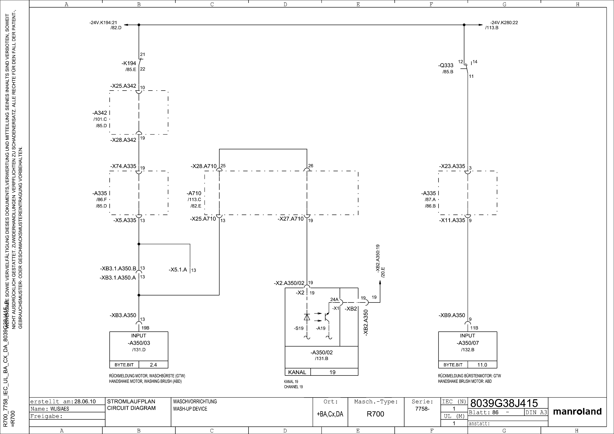

# +BA_Cx_DA — Sheet 86 of 247 — WASCHVORRICHTUNG

**WASH UP DEVICE**

> Part of the manroland **R700** printing press IEC/UL circuit diagrams.
> Drawing class: **Stromlaufplan / Circuit diagram** (DIN A3).
> Document `+BA_Cx_DA` covers the **Printing units / main switch cabinet** machine section.

## At a glance

| Field | Value |
|---|---|
| Document | `+BA_Cx_DA`  (8039G38J415) |
| Sheet | **86** of 247 |
| Section (DE) | WASCHVORRICHTUNG |
| Section (EN) | WASH UP DEVICE |
| Section type | CIRCUIT — Circuit diagram |
| Machine type | `R700` |
| Series | `7758` |
| Created | 28.06.10 |
| Replaces | — |
| Columns used | A, B, C, D, E, F, G |
| Path numbers | — |
| Labels on sheet | 90 |
| Cross-refs out | 16 |
| Cross-refs in | 33 |

**Previous:** [+BA_Cx_DA sheet 85](SHEET_0085.md) · **Next:** [+BA_Cx_DA sheet 87](SHEET_0087.md) · **Document TOC:** [_TOC.md](_TOC.md)  (+BA_Cx_DA) · **Master TOC:** [all sheets](../_MASTER_TOC.md)

## Sheet image (300 DPI, exact vector render)



_Rendered directly from the PDF vector layer at 300 DPI (1-bit), no OCR and no resampling. Use it to confirm anything ambiguous in the text below._

## Cross-references on this sheet

Each entry is a wire leaving this sheet. The printed token is `/sheet.column`; the link resolves to that sheet inside the same document.

| Ref | Target sheet | Col | Path | Destination on target | Target section | From col |
|---|---|---|---|---|---|---|
| `/82.D` | [+BA_Cx_DA sheet 82](SHEET_0082.md) | D | — | 24V.K194:21 24V.K280:22 | FARBWERK | D |
| `/113.B` | [+BA_Cx_DA sheet 113](SHEET_0113.md) | B | — | — | PPL 2 | G |
| `/85.E` | [+BA_Cx_DA sheet 85](SHEET_0085.md) | E | — | — | WASCHVORRICHTUNG | B |
| `/85.B` | [+BA_Cx_DA sheet 85](SHEET_0085.md) | B | — | — | WASCHVORRICHTUNG | F |
| `/101.C` | [+BA_Cx_DA sheet 101](SHEET_0101.md) | C | — | — | FEHLBOGENKONTROLLE | A |
| `/85.D` | [+BA_Cx_DA sheet 85](SHEET_0085.md) | D | — | — | WASCHVORRICHTUNG | A |
| `/87.A` | [+BA_Cx_DA sheet 87](SHEET_0087.md) | A | — | — | WASCHVORRICHTUNG | F |
| `/86.B` | [+BA_Cx_DA sheet 86](SHEET_0086.md) | B | — | — | WASCHVORRICHTUNG | F |
| `/86.F` | [+BA_Cx_DA sheet 86](SHEET_0086.md) | F | — | — | WASCHVORRICHTUNG | A |
| `/85.D` | [+BA_Cx_DA sheet 85](SHEET_0085.md) | D | — | — | WASCHVORRICHTUNG | A |
| `/113.C` | [+BA_Cx_DA sheet 113](SHEET_0113.md) | C | — | — | PPL 2 | C |
| `/82.E` | [+BA_Cx_DA sheet 82](SHEET_0082.md) | E | — | — | FARBWERK | C |
| `/20.E` | [+BA_Cx_DA sheet 20](SHEET_0020.md) | E | — | XB2.A350:19 | BUSVERBINDUNGEN: SICHERHEITSBUS | E |
| `/132.B` | [+BA_Cx_DA sheet 132](SHEET_0132.md) | B | — | — | REFERENZMODUL | G |
| `/131.D` | [+BA_Cx_DA sheet 131](SHEET_0131.md) | D | — | — | REFERENZMODUL | B |
| `/131.B` | [+BA_Cx_DA sheet 131](SHEET_0131.md) | B | — | — | REFERENZMODUL | E |

### Incoming references (sheets that point here)

Every other sheet that sends a wire to this one. `Back-ref` is the token printed on *that* sheet; `Path` is its line number.

| From sheet | Cols | Back-ref | Path | Refs | What continues there |
|---|---|---|---|---|---|
| [+BA_Cx_DA#20](SHEET_0020.md) | E | `/20.E` | — | 1 | XB2.A350:19 |
| [+BA_Cx_DA#82](SHEET_0082.md) | D | `/82.D` | — | 2 | 24V.K194:21 |
| [+BA_Cx_DA#85](SHEET_0085.md) | B, D, E | `/85.B`, `/85.D`, `/85.E` | — | 4 | — |
| [+BA_Cx_DA#86](SHEET_0086.md) | A, F | `/86.A`, `/86.F` | — | 2 | — |
| [+BA_Cx_DA#87](SHEET_0087.md) | A | `/87.A` | — | 1 | — |
| [+BA_Cx_DA#101](SHEET_0101.md) | C | `/101.C` | — | 1 | — |
| [+BA_Cx_DA#113](SHEET_0113.md) | A, C | `/113.A`, `/113.C` | — | 2 | 24V.K280:22 |
| [+BA_Cx_DA#131](SHEET_0131.md) | B, D | `/131.B`, `/131.D` | — | 2 | — |
| [+BA_Cx_DA#132](SHEET_0132.md) | B | `/132.B` | — | 1 | — |
| [+BA_Cx_DA#153](SHEET_0153.md) | G | `/153.G` | — | 2 | — |
| [+BA_Cx_DA#157](SHEET_0157.md) | C, D, F | `/157.C`, `/157.D`, `/157.F` | — | 3 | — |
| [+BA_Cx_DA#160](SHEET_0160.md) | C | `/160.C` | — | 1 | — |
| [+BA_Cx_DA#161](SHEET_0161.md) | A | `/161.A` | — | 1 | — |
| [+BA_Cx_DA#166](SHEET_0166.md) | G | `/166.G` | — | 1 | — |
| [+BA_Cx_DA#168](SHEET_0168.md) | G | `/168.G` | — | 1 | — |
| [+BA_Cx_DA#174](SHEET_0174.md) | G | `/174.G` | — | 1 | — |
| [+BA_Cx_DA#175](SHEET_0175.md) | F, H | `/175.F`, `/175.H` | — | 2 | — |
| [+BA_Cx_DA#177](SHEET_0177.md) | F | `/177.F` | — | 1 | — |
| [+BA_Cx_DA#178](SHEET_0178.md) | F, G, H | `/178.F`, `/178.G`, `/178.H` | — | 3 | — |
| [+BA_Cx_DA#184](SHEET_0184.md) | F | `/184.F` | — | 1 | — |


## Devices on this sheet

| Tag | Class | Class meaning (IEC) | Col | Sub | Terminal | Sign |
|---|---|---|---|---|---|---|
| `K194` | K | Relais / relay, contactor | B | — | — | — |
| `A350/03` | A | Baugruppe / assembly, module, PC board | B | 03 | — | — |
| `Q333` | Q | Leistungsschalter / power switching device | F | — | — | — |
| `A350/07` | A | Baugruppe / assembly, module, PC board | G | 07 | — | — |
| `S19` | S | Schalter / switch | D | — | — | — |
| `A19` | A | Baugruppe / assembly, module, PC board | D | — | — | — |
| `X1` | X | Klemme / terminal, plug connector | E | — | — | — |
| `X2` | X | Klemme / terminal, plug connector | D | — | — | — |
| `XB2` | XB |  | E | — | — | — |
| `A350/02` | A | Baugruppe / assembly, module, PC board | E | 02 | — | — |
| `A335` | A | Baugruppe / assembly, module, PC board | A | — | — | — |
| `A342` | A | Baugruppe / assembly, module, PC board | A | — | — | — |
| `A710` | A | Baugruppe / assembly, module, PC board | C | — | — | — |
| `A335` | A | Baugruppe / assembly, module, PC board | F | — | — | — |
| `XB3.A350` | — | cross-device reference | B | — | — | — |
| `2.4` | — | cross-device reference | B | — | — | — |
| `XB3.1.A350.B` | — | cross-device reference | B | — | — | — |
| `XB3.1.A350.A` | — | cross-device reference | B | — | — | — |
| `XB9.A350` | — | cross-device reference | F | — | — | — |
| `11.0` | — | cross-device reference | G | — | — | — |
| `XB2.A350` | — | cross-device reference | E | — | — | — |
| `X74.A335` | — | cross-device reference | B | — | — | — |
| `X5.A335` | — | cross-device reference | B | — | — | — |
| `X28.A342` | — | cross-device reference | B | — | — | — |
| `X25.A342` | — | cross-device reference | B | — | — | — |
| `X27.A710` | — | cross-device reference | D | — | — | — |
| `X28.A710` | — | cross-device reference | C | — | — | — |
| `X25.A710` | — | cross-device reference | C | — | — | — |
| `X23.A335` | — | cross-device reference | F | — | — | — |
| `X11.A335` | — | cross-device reference | F | — | — | — |
| `X5.1.A` | — | cross-device reference | C | — | — | — |
| `XB2.A350:19` | — | cross-device reference | E | — | 19 | — |

## Potentials / nets

| Potential | Count | Columns | Attached devices | Terminals |
|---|---|---|---|---|
| `24V` | 2 | B, G | `K194`, `K280` | `21`, `22` |


A potential such as `L24+/4` or `M24+` is a named supply/return rail; every place it appears on this sheet is electrically common.

## Wire-end annotations (grouped as printed)

A wire that continues elsewhere is annotated with a small cluster: the destination description, the path/line number `#NN`, and the `/sheet.column` cross reference. Each row below is one such cluster exactly as it is grouped on the drawing.

| Col | Y | Path | Cross-ref | Text on the wire |
|---|---|---|---|---|
| D | 40.0 | — | `/82.D` | `24V.K194:21 24V.K280:22` |
| G | 49.9 | — | `/113.B` | — |
| B | 101.7 | — | — | `21` |
| F | 115.8 | — | — | `Q333 14` |
| F | 115.8 | — | — | `12` |
| B | 117.9 | — | — | `K194 22` |
| B | 131.0 | — | `/85.E` | — |
| F | 135.2 | — | `/85.B` | — |
| G | 144.2 | — | — | `11` |
| B | 161.9 | — | — | `X25.A342 10` |
| A | 214.3 | — | — | `A342` |
| A | 227.4 | — | `/101.C` | — |
| A | 239.8 | — | `/85.D` | — |
| B | 263.9 | — | — | `X28.A342 19` |
| B | 317.8 | — | — | `X74.A335 19` |
| C | 317.8 | — | — | `X28.A710 25` |
| D | 317.8 | — | — | `26` |
| F | 317.8 | — | — | `X23.A335 3` |
| A | 370.2 | — | — | `A335` |
| C | 370.2 | — | — | `A710` |
| F | 370.2 | — | — | `A335` |
| A | 383.3 | — | `/86.F`, `/85.D` | — |
| C | 383.3 | — | `/113.C` | — |
| F | 383.3 | — | `/87.A`, `/86.B` | — |
| C | 395.7 | — | `/82.E` | — |
| C | 419.8 | — | — | `X25.A710 13` |
| D | 419.8 | — | — | `X27.A710 19` |
| B | 422.7 | — | — | `X5.A335 13` |
| F | 422.7 | — | — | `X11.A335 9` |
| E | 474.2 | — | `/20.E` | `XB2.A350:19` |
| B | 516.2 | — | — | `XB3.1.A350.B 13` |
| C | 518.4 | — | — | `X5.1.A 13` |
| B | 533.2 | — | — | `XB3.1.A350.A 13` |
| D | 544.6 | — | — | `X2.A350/02 19` |
| D | 563.0 | — | — | `X2` |
| E | 564.4 | — | — | `19 19` |
| E | 572.9 | — | — | `19` |
| E | 577.1 | — | — | `24A` |
| E | 594.1 | — | — | `X1` |
| E | 594.2 | — | — | `XB2` |
| E | 600.4 | — | — | `XB2.A350` |
| B | 606.9 | — | — | `XB3.A350 13` |
| F | 606.9 | — | — | `XB9.A350 9` |
| B | 632.4 | — | — | `19B` |
| G | 632.4 | — | — | `11B` |
| D | 633.1 | — | — | `S19 A19` |
| B | 646.9 | — | — | `INPUT` |
| F | 646.9 | — | — | `INPUT` |
| B | 660.8 | — | — | `A350/03` |
| G | 660.8 | — | — | `A350/07` |
| G | 674.5 | — | `/132.B` | — |
| B | 674.6 | — | `/131.D` | — |
| E | 679.2 | — | — | `A350/02` |
| E | 691.6 | — | `/131.B` | — |
| B | 703.6 | — | — | `BYTE.BIT 2.4` |
| F | 703.6 | — | — | `BYTE.BIT 11.0` |
| D | 717.4 | — | — | `KANAL 19` |
| B | 726.3 | — | — | `RÜCKMELDUNG MOTOR, WASCHBÜRSTE (GTW) HANDSHAKE MOTOR, WASHING BRUSH (ABD)` |
| G | 726.3 | — | — | `RÜCKMELDUNG BÜRSTENMOTOR: GTW HANDSHAKE BRUSH MOTOR: ABD` |
| D | 737.8 | — | — | `KANAL 19 CHANNEL 19` |


## Reconstructed tables

This sheet carries tabular content (pin map / terminal assignment / index). The grid below was rebuilt from the drawing's own rule lines, so each row is exactly one physical row of the table.

### Table 1 — 5 data rows × 4 columns (at x=212.6, y=48.2)

| /82.D K194 /85.E X25.A342 X28.A342 | 21 22 10 19 |  |  |
|---|---|---|---|
| `X74.A335 X5.A335` | `19 13` |  | `X28.A710 A710 /113.C /82.E X25.A710` |
| `XB3.1.A350.B XB3.1.A350.A` | `13 13` | `X5.1.A` | `13` |
| `XB3.A350` | `13 19B` |  |  |
| `INPUT` | `A350/03 /131.D` |  |  |
| `BYTE.BIT` | `2.4` |  |  |


### Table 2 — 3 data rows × 5 columns (at x=552.8, y=48.2)

| X27.A710 X2.A350/02 | 26 19 19 |  |  | XB2.A350:19 |
|---|---|---|---|---|
| `X2 S19` | `19 A19` | `24A X1` | `XB2` | `19 19 XB2.A350` |
|  | `A350/02 /131.B` |  |  |  |
| `KANAL` |  | `19` |  |  |


### Table 3 — 2 data rows × 3 columns (at x=850.4, y=48.2)

| 12 Q333 /85.B X23.A335 X11.A335 XB9.A350 |  | /113.B 14 11 3 9 9 11B |
|---|---|---|
|  | `INPUT` | `A350/07 /132.B` |
| `BYTE.BIT` |  | `11.0` |


## Notes and free text on this sheet

| Text | Col | Y (pt) |
|---|---|---|
| `19B` | B | 632.41 |
| `INPUT` | B | 646.94 |
| `BYTE.BIT` | B | 704.19 |
| `RÜCKMELDUNG MOTOR, WASCHBÜRSTE (GTW)` | B | 726.29 |
| `HANDSHAKE MOTOR, WASHING BRUSH (ABD)` | B | 736.92 |
| `11B` | G | 632.41 |
| `INPUT` | F | 646.94 |
| `BYTE.BIT` | F | 704.19 |
| `RÜCKMELDUNG BÜRSTENMOTOR: GTW` | G | 726.3 |
| `HANDSHAKE BRUSH MOTOR: ABD` | F | 736.93 |
| `KANAL 19` | D | 737.79 |
| `CHANNEL 19` | D | 747.74 |
| `24A` | E | 577.14 |
| `KANAL` | D | 717.46 |
| `X2.A350/02` | D | 544.56 |

## Complete label inventory (exact text from the drawing)

Every text object inside the drawing area of this sheet, in DIN reading order (column A→H, then top→bottom). This is the authoritative list: if a string is not here it is not printed on this sheet.

| Col | Y | X | Dir | Type | Text |
|---|---|---|---|---|---|
| A | 214.3 | 179.1 | → | device tag | `A342` |
| A | 227.4 | 181.4 | → | cross-reference | `/101.C` |
| A | 239.8 | 186.2 | → | cross-reference | `/85.D` |
| A | 370.2 | 179.1 | → | device tag | `A335` |
| A | 383.3 | 187.1 | → | cross-reference | `/86.F` |
| A | 395.7 | 186.2 | → | cross-reference | `/85.D` |
| B | 40.0 | 173.5 | → | potential | `24V.K194:21` |
| B | 49.9 | 214.6 | → | cross-reference | `/82.D` |
| B | 101.7 | 271.8 | → | number | `21` |
| B | 117.9 | 235.8 | → | device tag | `K194` |
| B | 130.0 | 271.8 | → | number | `22` |
| B | 131.0 | 243.5 | → | cross-reference | `/85.E` |
| B | 161.9 | 214.0 | → | device ref | `X25.A342` |
| B | 166.2 | 271.3 | → | number | `10` |
| B | 263.9 | 271.3 | → | number | `19` |
| B | 266.8 | 214.0 | → | device ref | `X28.A342` |
| B | 317.8 | 214.0 | → | device ref | `X74.A335` |
| B | 322.1 | 271.3 | → | number | `19` |
| B | 422.7 | 220.0 | → | device ref | `X5.A335` |
| B | 424.1 | 271.3 | → | number | `13` |
| B | 516.2 | 194.2 | → | device ref | `XB3.1.A350.B` |
| B | 516.2 | 271.3 | → | number | `13` |
| B | 533.2 | 271.3 | → | number | `13` |
| B | 533.9 | 193.3 | → | device ref | `XB3.1.A350.A` |
| B | 606.9 | 212.9 | → | device ref | `XB3.A350` |
| B | 615.4 | 271.3 | → | number | `13` |
| B | 632.4 | 274.1 | → | text | `19B` |
| B | 646.9 | 254.4 | → | text | `INPUT` |
| B | 660.8 | 247.9 | → | device tag | `A350/03` |
| B | 674.6 | 256.5 | → | cross-reference | `/131.D` |
| B | 703.6 | 290.8 | → | device ref | `2.4` |
| B | 704.2 | 222.5 | → | text | `BYTE.BIT` |
| B | 726.3 | 211.7 | → | text | `RÜCKMELDUNG MOTOR, WASCHBÜRSTE (GTW)` |
| B | 736.9 | 211.7 | → | text | `HANDSHAKE MOTOR, WASHING BRUSH (ABD)` |
| C | 317.8 | 369.9 | → | device ref | `X28.A710` |
| C | 317.8 | 427.7 | → | number | `25` |
| C | 370.2 | 362.0 | → | device tag | `A710` |
| C | 383.3 | 364.3 | → | cross-reference | `/113.C` |
| C | 395.7 | 369.6 | → | cross-reference | `/82.E` |
| C | 419.8 | 368.5 | → | device ref | `X25.A710` |
| C | 424.1 | 427.2 | → | number | `13` |
| C | 518.4 | 327.4 | → | device ref | `X5.1.A` |
| C | 520.5 | 370.5 | → | number | `13` |
| D | 317.8 | 597.8 | → | number | `26` |
| D | 419.8 | 538.6 | → | device ref | `X27.A710` |
| D | 424.1 | 597.3 | → | number | `19` |
| D | 544.6 | 531.2 | → | text | `X2.A350/02` |
| D | 544.6 | 597.3 | → | number | `19` |
| D | 563.0 | 573.7 | → | device tag | `X2` |
| D | 564.4 | 600.1 | → | number | `19` |
| D | 633.1 | 570.0 | → | device tag | `S19` |
| D | 633.1 | 612.6 | → | device tag | `A19` |
| D | 717.5 | 559.0 | → | text | `KANAL` |
| D | 737.8 | 550.8 | → | text | `KANAL 19` |
| D | 747.7 | 551.1 | → | text | `CHANNEL 19` |
| E | 474.2 | 728.8 | ↕ | device ref | `XB2.A350:19` |
| E | 517.9 | 738.7 | ↕ | cross-reference | `/20.E` |
| E | 572.9 | 720.6 | → | number | `19` |
| E | 574.3 | 699.3 | → | number | `19` |
| E | 577.1 | 640.6 | → | text | `24A` |
| E | 594.2 | 644.3 | → | device tag | `X1` |
| E | 594.2 | 668.7 | → | device tag | `XB2` |
| E | 600.4 | 704.7 | ↕ | device ref | `XB2.A350` |
| E | 679.2 | 602.2 | → | device tag | `A350/02` |
| E | 691.6 | 611.0 | → | cross-reference | `/131.B` |
| E | 717.4 | 638.6 | → | number | `19` |
| F | 115.8 | 888.1 | → | number | `12` |
| F | 122.2 | 849.8 | → | device tag | `Q333` |
| F | 135.2 | 858.3 | → | cross-reference | `/85.B` |
| F | 317.8 | 851.8 | → | device ref | `X23.A335` |
| F | 370.2 | 816.9 | → | device tag | `A335` |
| F | 383.3 | 824.0 | → | cross-reference | `/87.A` |
| F | 395.7 | 824.3 | → | cross-reference | `/86.B` |
| F | 422.7 | 851.8 | → | device ref | `X11.A335` |
| F | 606.9 | 850.7 | → | device ref | `XB9.A350` |
| F | 646.9 | 892.2 | → | text | `INPUT` |
| F | 704.2 | 860.3 | → | text | `BYTE.BIT` |
| F | 736.9 | 849.5 | → | text | `HANDSHAKE BRUSH MOTOR: ABD` |
| G | 40.0 | 950.7 | → | potential | `24V.K280:22` |
| G | 49.9 | 941.1 | → | cross-reference | `/113.B` |
| G | 115.8 | 916.2 | → | number | `14` |
| G | 144.2 | 909.1 | → | number | `11` |
| G | 322.1 | 909.6 | → | number | `3` |
| G | 424.1 | 909.6 | → | number | `9` |
| G | 615.4 | 909.6 | → | number | `9` |
| G | 632.4 | 911.9 | → | text | `11B` |
| G | 660.8 | 885.7 | → | device tag | `A350/07` |
| G | 674.6 | 894.5 | → | cross-reference | `/132.B` |
| G | 703.6 | 925.7 | → | device ref | `11.0` |
| G | 726.3 | 849.5 | → | text | `RÜCKMELDUNG BÜRSTENMOTOR: GTW` |

## Reading-order text block

The same content as a plain block, grouped by DIN column — convenient to paste or to match against a visual description.

```text
=== Column A ===
 214.3  179.1  devtag       A342
 227.4  181.4  xref         /101.C
 239.8  186.2  xref         /85.D
 370.2  179.1  devtag       A335
 383.3  187.1  xref         /86.F
 395.7  186.2  xref         /85.D
=== Column B ===
  40.0  173.5  net          24V.K194:21
  49.9  214.6  xref         /82.D
 101.7  271.8  numeric      21
 117.9  235.8  devtag       K194
 130.0  271.8  numeric      22
 131.0  243.5  xref         /85.E
 161.9  214.0  devref       X25.A342
 166.2  271.3  numeric      10
 263.9  271.3  numeric      19
 266.8  214.0  devref       X28.A342
 317.8  214.0  devref       X74.A335
 322.1  271.3  numeric      19
 422.7  220.0  devref       X5.A335
 424.1  271.3  numeric      13
 516.2  194.2  devref       XB3.1.A350.B
 516.2  271.3  numeric      13
 533.2  271.3  numeric      13
 533.9  193.3  devref       XB3.1.A350.A
 606.9  212.9  devref       XB3.A350
 615.4  271.3  numeric      13
 632.4  274.1  text         19B
 646.9  254.4  text         INPUT
 660.8  247.9  devtag       A350/03
 674.6  256.5  xref         /131.D
 703.6  290.8  devref       2.4
 704.2  222.5  text         BYTE.BIT
 726.3  211.7  text         RÜCKMELDUNG MOTOR, WASCHBÜRSTE (GTW)
 736.9  211.7  text         HANDSHAKE MOTOR, WASHING BRUSH (ABD)
=== Column C ===
 317.8  369.9  devref       X28.A710
 317.8  427.7  numeric      25
 370.2  362.0  devtag       A710
 383.3  364.3  xref         /113.C
 395.7  369.6  xref         /82.E
 419.8  368.5  devref       X25.A710
 424.1  427.2  numeric      13
 518.4  327.4  devref       X5.1.A
 520.5  370.5  numeric      13
=== Column D ===
 317.8  597.8  numeric      26
 419.8  538.6  devref       X27.A710
 424.1  597.3  numeric      19
 544.6  531.2  text         X2.A350/02
 544.6  597.3  numeric      19
 563.0  573.7  devtag       X2
 564.4  600.1  numeric      19
 633.1  570.0  devtag       S19
 633.1  612.6  devtag       A19
 717.5  559.0  text         KANAL
 737.8  550.8  text         KANAL 19
 747.7  551.1  text         CHANNEL 19
=== Column E ===
 474.2  728.8  devref       XB2.A350:19
 517.9  738.7  xref         /20.E
 572.9  720.6  numeric      19
 574.3  699.3  numeric      19
 577.1  640.6  text         24A
 594.2  644.3  devtag       X1
 594.2  668.7  devtag       XB2
 600.4  704.7  devref       XB2.A350
 679.2  602.2  devtag       A350/02
 691.6  611.0  xref         /131.B
 717.4  638.6  numeric      19
=== Column F ===
 115.8  888.1  numeric      12
 122.2  849.8  devtag       Q333
 135.2  858.3  xref         /85.B
 317.8  851.8  devref       X23.A335
 370.2  816.9  devtag       A335
 383.3  824.0  xref         /87.A
 395.7  824.3  xref         /86.B
 422.7  851.8  devref       X11.A335
 606.9  850.7  devref       XB9.A350
 646.9  892.2  text         INPUT
 704.2  860.3  text         BYTE.BIT
 736.9  849.5  text         HANDSHAKE BRUSH MOTOR: ABD
=== Column G ===
  40.0  950.7  net          24V.K280:22
  49.9  941.1  xref         /113.B
 115.8  916.2  numeric      14
 144.2  909.1  numeric      11
 322.1  909.6  numeric      3
 424.1  909.6  numeric      9
 615.4  909.6  numeric      9
 632.4  911.9  text         11B
 660.8  885.7  devtag       A350/07
 674.6  894.5  xref         /132.B
 703.6  925.7  devref       11.0
 726.3  849.5  text         RÜCKMELDUNG BÜRSTENMOTOR: GTW
```

---
_Generated from the PDF vector text layer; no OCR. Source: `R700_7758_IEC_UL_BA_CX_DA_8039G38J415_p`, sheet 86._
