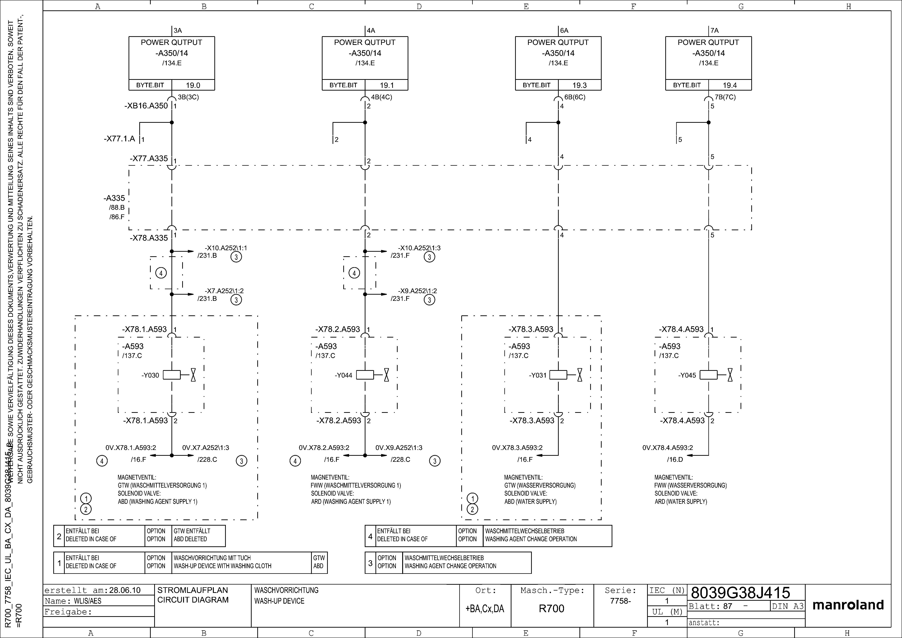

# +BA_Cx_DA — Sheet 87 of 247 — WASCHVORRICHTUNG

**WASH UP DEVICE**

> Part of the manroland **R700** printing press IEC/UL circuit diagrams.
> Drawing class: **Stromlaufplan / Circuit diagram** (DIN A3).
> Document `+BA_Cx_DA` covers the **Printing units / main switch cabinet** machine section.

## At a glance

| Field | Value |
|---|---|
| Document | `+BA_Cx_DA`  (8039G38J415) |
| Sheet | **87** of 247 |
| Section (DE) | WASCHVORRICHTUNG |
| Section (EN) | WASH UP DEVICE |
| Section type | CIRCUIT — Circuit diagram |
| Machine type | `R700` |
| Series | `7758` |
| Created | 28.06.10 |
| Replaces | — |
| Columns used | A, B, C, D, E, F, G |
| Path numbers | — |
| Labels on sheet | 157 |
| Cross-refs out | 20 |
| Cross-refs in | 44 |

**Previous:** [+BA_Cx_DA sheet 86](SHEET_0086.md) · **Next:** [+BA_Cx_DA sheet 88](SHEET_0088.md) · **Document TOC:** [_TOC.md](_TOC.md)  (+BA_Cx_DA) · **Master TOC:** [all sheets](../_MASTER_TOC.md)

## Sheet image (300 DPI, exact vector render)



_Rendered directly from the PDF vector layer at 300 DPI (1-bit), no OCR and no resampling. Use it to confirm anything ambiguous in the text below._

## Cross-references on this sheet

Each entry is a wire leaving this sheet. The printed token is `/sheet.column`; the link resolves to that sheet inside the same document.

| Ref | Target sheet | Col | Path | Destination on target | Target section | From col |
|---|---|---|---|---|---|---|
| `/134.E` | [+BA_Cx_DA sheet 134](SHEET_0134.md) | E | — | — | REFERENZMODUL | B |
| `/134.E` | [+BA_Cx_DA sheet 134](SHEET_0134.md) | E | — | — | REFERENZMODUL | D |
| `/134.E` | [+BA_Cx_DA sheet 134](SHEET_0134.md) | E | — | — | REFERENZMODUL | E |
| `/134.E` | [+BA_Cx_DA sheet 134](SHEET_0134.md) | E | — | — | REFERENZMODUL | G |
| `/88.B` | [+BA_Cx_DA sheet 88](SHEET_0088.md) | B | — | — | WASCHVORRICHTUNG | A |
| `/86.F` | [+BA_Cx_DA sheet 86](SHEET_0086.md) | F | — | — | WASCHVORRICHTUNG | A |
| `/231.B` | [+BA_Cx_DA sheet 231](SHEET_0231.md) | B | — | X10.A252\1:3 | OPTION: WASCHMITTELWECHSELBETRIEB | C |
| `/231.F` | [+BA_Cx_DA sheet 231](SHEET_0231.md) | F | — | — | OPTION: WASCHMITTELWECHSELBETRIEB | D |
| `/231.B` | [+BA_Cx_DA sheet 231](SHEET_0231.md) | B | — | — | OPTION: WASCHMITTELWECHSELBETRIEB | B |
| `/231.F` | [+BA_Cx_DA sheet 231](SHEET_0231.md) | F | — | — | OPTION: WASCHMITTELWECHSELBETRIEB | D |
| `/137.C` | [+BA_Cx_DA sheet 137](SHEET_0137.md) | C | — | A593 | REFERENZMODUL | A |
| `/137.C` | [+BA_Cx_DA sheet 137](SHEET_0137.md) | C | — | A593 | REFERENZMODUL | C |
| `/137.C` | [+BA_Cx_DA sheet 137](SHEET_0137.md) | C | — | A593 | REFERENZMODUL | E |
| `/137.C` | [+BA_Cx_DA sheet 137](SHEET_0137.md) | C | — | A593 | REFERENZMODUL | F |
| `/16.F` | [+BA_Cx_DA sheet 16](SHEET_0016.md) | F | — | — | SPANNUNGSVERSORGUNG, SCHALTSCHRANKBELÜFTUNG | A |
| `/16.F` | [+BA_Cx_DA sheet 16](SHEET_0016.md) | F | — | — | SPANNUNGSVERSORGUNG, SCHALTSCHRANKBELÜFTUNG | C |
| `/16.F` | [+BA_Cx_DA sheet 16](SHEET_0016.md) | F | — | — | SPANNUNGSVERSORGUNG, SCHALTSCHRANKBELÜFTUNG | E |
| `/16.D` | [+BA_Cx_DA sheet 16](SHEET_0016.md) | D | — | — | SPANNUNGSVERSORGUNG, SCHALTSCHRANKBELÜFTUNG | F |
| `/228.C` | [+BA_Cx_DA sheet 228](SHEET_0228.md) | C | — | — | OPTION: WASCHMITTELWECHSELBETRIEB | B |
| `/228.C` | [+BA_Cx_DA sheet 228](SHEET_0228.md) | C | — | — | OPTION: WASCHMITTELWECHSELBETRIEB | D |

### Incoming references (sheets that point here)

Every other sheet that sends a wire to this one. `Back-ref` is the token printed on *that* sheet; `Path` is its line number.

| From sheet | Cols | Back-ref | Path | Refs | What continues there |
|---|---|---|---|---|---|
| [+BA_Cx_DA#16](SHEET_0016.md) | D, F | `/16.D`, `/16.F` | — | 4 | — |
| [+BA_Cx_DA#86](SHEET_0086.md) | F | `/86.F` | — | 1 | — |
| [+BA_Cx_DA#88](SHEET_0088.md) | A | `/88.A` | — | 1 | — |
| [+BA_Cx_DA#134](SHEET_0134.md) | E | `/134.E` | — | 4 | — |
| [+BA_Cx_DA#137](SHEET_0137.md) | C | `/137.C` | — | 4 | — |
| [+BA_Cx_DA#172](SHEET_0172.md) | F | `/172.F` | — | 4 | — |
| [+BA_Cx_DA#185](SHEET_0185.md) | E, G, H | `/185.E`, `/185.G`, `/185.H` | — | 16 | — |
| [+BA_Cx_DA#186](SHEET_0186.md) | B | `/186.B` | — | 4 | — |
| [+BA_Cx_DA#228](SHEET_0228.md) | C | `/228.C` | — | 2 | — |
| [+BA_Cx_DA#231](SHEET_0231.md) | A, D, F | `/231.A`, `/231.D`, `/231.F` | — | 4 | X10.A252\1:1 X10.A252\1:3; X7.A252\1:2; X9.A252\1:2 |


## Devices on this sheet

| Tag | Class | Class meaning (IEC) | Col | Sub | Terminal | Sign |
|---|---|---|---|---|---|---|
| `A350/14` | A | Baugruppe / assembly, module, PC board | B | 14 | — | — |
| `A350/14` | A | Baugruppe / assembly, module, PC board | E | 14 | — | — |
| `A350/14` | A | Baugruppe / assembly, module, PC board | C | 14 | — | — |
| `A350/14` | A | Baugruppe / assembly, module, PC board | G | 14 | — | — |
| `Y030` | Y | Magnetventil / solenoid valve, actuator | A | — | — | — |
| `A593` | A | Baugruppe / assembly, module, PC board | A | — | — | — |
| `Y031` | Y | Magnetventil / solenoid valve, actuator | E | — | — | — |
| `A593` | A | Baugruppe / assembly, module, PC board | E | — | — | — |
| `Y044` | Y | Magnetventil / solenoid valve, actuator | C | — | — | — |
| `A593` | A | Baugruppe / assembly, module, PC board | C | — | — | — |
| `Y045` | Y | Magnetventil / solenoid valve, actuator | F | — | — | — |
| `A593` | A | Baugruppe / assembly, module, PC board | F | — | — | — |
| `A335` | A | Baugruppe / assembly, module, PC board | A | — | — | — |
| `XB16.A350` | — | cross-device reference | A | — | — | — |
| `19.0` | — | cross-device reference | B | — | — | — |
| `19.3` | — | cross-device reference | E | — | — | — |
| `19.1` | — | cross-device reference | D | — | — | — |
| `19.4` | — | cross-device reference | G | — | — | — |
| `X77.A335` | — | cross-device reference | A | — | — | — |
| `X78.A335` | — | cross-device reference | A | — | — | — |
| `X78.1.A593` | — | cross-device reference | A | — | — | — |
| `X78.1.A593` | — | cross-device reference | A | — | — | — |
| `X78.3.A593` | — | cross-device reference | E | — | — | — |
| `X78.3.A593` | — | cross-device reference | E | — | — | — |
| `X78.2.A593` | — | cross-device reference | C | — | — | — |
| `X78.2.A593` | — | cross-device reference | C | — | — | — |
| `X78.4.A593` | — | cross-device reference | F | — | — | — |
| `X78.4.A593` | — | cross-device reference | F | — | — | — |
| `X77.1.A` | — | cross-device reference | A | — | — | — |
| `X9.A252\1:2` | — | cross-device reference | D | — | 2 | — |
| `X10.A252\1:3` | — | cross-device reference | D | — | 3 | — |
| `X10.A252\1:1` | — | cross-device reference | B | — | 1 | — |
| `X7.A252\1:2` | — | cross-device reference | B | — | 2 | — |

## Potentials / nets

| Potential | Count | Columns | Attached devices | Terminals |
|---|---|---|---|---|
| `0V` | 6 | A, B, C, D, E, F | `1`, `2`, `3`, `4`, `A252\1`, `A593`, `X7`, `X78`, `X9` | `2`, `3` |


A potential such as `L24+/4` or `M24+` is a named supply/return rail; every place it appears on this sheet is electrically common.

## Wire-end annotations (grouped as printed)

A wire that continues elsewhere is annotated with a small cluster: the destination description, the path/line number `#NN`, and the `/sheet.column` cross reference. Each row below is one such cluster exactly as it is grouped on the drawing.

| Col | Y | Path | Cross-ref | Text on the wire |
|---|---|---|---|---|
| B | 36.4 | — | — | `3A` |
| D | 36.4 | — | — | `4A` |
| E | 36.4 | — | — | `6A` |
| G | 36.4 | — | — | `7A` |
| B | 51.6 | — | — | `POWER QUTPUT` |
| C | 51.6 | — | — | `POWER QUTPUT` |
| E | 51.6 | — | — | `POWER QUTPUT` |
| G | 51.6 | — | — | `POWER QUTPUT` |
| B | 65.5 | — | — | `A350/14` |
| C | 65.5 | — | — | `A350/14` |
| E | 65.5 | — | — | `A350/14` |
| G | 65.5 | — | — | `A350/14` |
| B | 79.3 | — | `/134.E` | — |
| D | 79.3 | — | `/134.E` | — |
| E | 79.3 | — | `/134.E` | — |
| G | 79.3 | — | `/134.E` | — |
| B | 108.3 | — | — | `BYTE.BIT 19.0` |
| C | 108.3 | — | — | `BYTE.BIT 19.1` |
| E | 108.3 | — | — | `BYTE.BIT 19.3` |
| G | 108.3 | — | — | `BYTE.BIT 19.4` |
| B | 124.3 | — | — | `3B(3C)` |
| D | 124.3 | — | — | `4B(4C)` |
| E | 124.3 | — | — | `6B(6C)` |
| G | 124.3 | — | — | `7B(7C)` |
| A | 134.9 | — | — | `XB16.A350 1` |
| D | 136.4 | — | — | `2` |
| E | 136.4 | — | — | `4` |
| G | 136.4 | — | — | `5` |
| D | 178.2 | — | — | `X77.1.A 1 2 4 5` |
| E | 203.0 | — | — | `4` |
| G | 203.0 | — | — | `5` |
| B | 204.4 | — | — | `X77.A335 1` |
| D | 208.7 | — | — | `2` |
| A | 256.8 | — | — | `A335` |
| A | 269.9 | — | `/88.B` | — |
| A | 282.3 | — | `/86.F` | — |
| B | 306.5 | — | — | `X78.A335 1` |
| D | 306.5 | — | — | `2` |
| E | 306.5 | — | — | `4` |
| G | 306.5 | — | — | `5` |
| C | 323.4 | — | `/231.B` | `X10.A252\1:3` |
| B | 323.4 | — | — | `X10.A252\1:1` |
| D | 333.3 | — | `/231.F` | — |
| B | 336.2 | — | — | `3` |
| D | 336.2 | — | — | `3` |
| B | 357.5 | — | — | `4` |
| C | 357.5 | — | — | `4` |
| B | 380.1 | — | — | `X7.A252\1:2` |
| D | 380.1 | — | — | `X9.A252\1:2` |
| B | 390.0 | — | `/231.B` | — |
| D | 390.0 | — | `/231.F` | — |
| B | 392.9 | — | — | `3` |
| D | 392.9 | — | — | `3` |
| C | 429.8 | — | — | `X78.1.A593 1 X78.3.A593 1` |
| E | 429.8 | — | — | `X78.2.A593 1 X78.4.A593 1` |
| A | 452.4 | — | `/137.C` | `A593` |
| C | 452.4 | — | `/137.C` | `A593` |
| E | 452.4 | — | `/137.C` | `A593` |
| F | 452.4 | — | `/137.C` | `A593` |
| A | 491.4 | — | — | `Y030` |
| C | 491.4 | — | — | `Y044` |
| E | 491.4 | — | — | `Y031` |
| F | 491.4 | — | — | `Y045` |
| A | 550.2 | — | — | `X78.1.A593 2` |
| C | 550.2 | — | — | `X78.2.A593 2` |
| E | 550.2 | — | — | `X78.3.A593 2` |
| F | 550.2 | — | — | `X78.4.A593 2` |
| A | 587.0 | — | — | `0V.X78.1.A593:2` |
| B | 587.0 | — | — | `0V.X7.A252\1:3` |
| C | 587.0 | — | — | `0V.X78.2.A593:2` |
| D | 587.0 | — | — | `0V.X9.A252\1:3` |
| E | 587.0 | — | — | `0V.X78.3.A593:2` |
| F | 587.0 | — | — | `0V.X78.4.A593:2` |
| A | 602.6 | — | `/16.F` | — |
| B | 602.6 | — | `/228.C` | — |
| C | 602.6 | — | `/16.F` | — |
| D | 602.6 | — | `/228.C` | — |
| E | 602.6 | — | `/16.F` | — |
| F | 602.6 | — | `/16.D` | — |
| C | 605.5 | — | — | `4 3 4 3` |
| B | 627.1 | — | — | `MAGNETVENTIL: GTW (WASCHMITTELVERSORGUNG 1) SOLENOID VALVE: ABD (WASHING AGENT SUPPLY 1)` |
| C | 627.1 | — | — | `FWW (WASCHMITTELVERSORGUNG 1) MAGNETVENTIL:` |
| E | 627.1 | — | — | `MAGNETVENTIL: GTW (WASSERVERSORGUNG) SOLENOID VALVE: ABD (WATER SUPPLY)` |
| G | 627.1 | — | — | `FWW (WASSERVERSORGUNG) MAGNETVENTIL:` |
| C | 648.3 | — | — | `SOLENOID VALVE: ARD (WASHING AGENT SUPPLY 1)` |
| F | 648.3 | — | — | `SOLENOID VALVE: ARD (WATER SUPPLY)` |
| A | 654.6 | — | — | `1` |
| E | 654.6 | — | — | `1` |
| A | 669.3 | — | — | `2` |
| D | 669.3 | — | — | `2` |
| A | 697.9 | — | — | `2 ENTFÄLLT BEI DELETED IN CASE OF` |
| B | 697.9 | — | — | `OPTION OPTION` |
| B | 697.9 | — | — | `GTW ENTFÄLLT ABD DELETED` |
| E | 697.9 | — | — | `4 WASCHMITTELWECHSELBETRIEB WASHING AGENT CHANGE OPERATION` |
| D | 697.9 | — | — | `ENTFÄLLT BEI DELETED IN CASE OF` |
| D | 697.9 | — | — | `OPTION OPTION` |
| C | 733.3 | — | — | `GTW ABD` |
| A | 733.4 | — | — | `1 ENTFÄLLT BEI DELETED IN CASE OF` |
| B | 733.4 | — | — | `OPTION OPTION` |
| B | 733.4 | — | — | `WASCHVORRICHTUNG MIT TUCH WASH UP DEVICE WITH WASHING CLOTH` |
| D | 733.4 | — | — | `3 WASCHMITTELWECHSELBETRIEB WASHING AGENT CHANGE OPERATION` |
| D | 733.4 | — | — | `OPTION OPTION` |


## Reconstructed tables

This sheet carries tabular content (pin map / terminal assignment / index). The grid below was rebuilt from the drawing's own rule lines, so each row is exactly one physical row of the table.

### Table 1 — 2 data rows × 2 columns (at x=170.1, y=48.2)

| POWER | QUTPUT A350/14 /134.E |
|---|---|
| `BYTE.BIT` | `19.0` |
| `XB16.A350` | `3B(3C) 1` |


### Table 2 — 2 data rows × 2 columns (at x=425.2, y=48.2)

| POWER | QUTPUT A350/14 /134.E |
|---|---|
| `BYTE.BIT` | `19.1` |
|  | `4B(4C) 2` |


### Table 3 — 2 data rows × 2 columns (at x=680.3, y=48.2)

| POWER | QUTPUT A350/14 /134.E |
|---|---|
| `BYTE.BIT` | `19.3` |
|  | `6B(6C) 4` |


### Table 4 — 2 data rows × 2 columns (at x=878.7, y=48.2)

| POWER | QUTPUT A350/14 /134.E |
|---|---|
| `BYTE.BIT` | `19.4` |
|  | `7B(7C) 5` |


## Notes and free text on this sheet

| Text | Col | Y (pt) |
|---|---|---|
| `3A` | B | 36.41 |
| `3B(3C)` | B | 124.33 |
| `POWER QUTPUT` | B | 51.59 |
| `BYTE.BIT` | A | 108.91 |
| `6A` | E | 36.41 |
| `6B(6C)` | E | 124.33 |
| `POWER QUTPUT` | E | 51.59 |
| `BYTE.BIT` | E | 108.91 |
| `4A` | D | 36.41 |
| `4B(4C)` | D | 124.33 |
| `POWER QUTPUT` | C | 51.59 |
| `BYTE.BIT` | C | 108.91 |
| `7A` | G | 36.41 |
| `7B(7C)` | G | 124.33 |
| `POWER QUTPUT` | G | 51.59 |
| `BYTE.BIT` | F | 108.91 |
| `MAGNETVENTIL:` | A | 627.07 |
| `GTW (WASCHMITTELVERSORGUNG 1)` | B | 637.7 |
| `SOLENOID VALVE:` | A | 648.33 |
| `ABD (WASHING AGENT SUPPLY 1)` | B | 658.96 |
| `MAGNETVENTIL:` | E | 627.07 |
| `GTW (WASSERVERSORGUNG)` | E | 637.69 |
| `SOLENOID VALVE:` | E | 648.33 |
| `ABD (WATER SUPPLY)` | E | 658.95 |
| `MAGNETVENTIL:` | C | 627.07 |
| `FWW (WASCHMITTELVERSORGUNG 1)` | C | 637.69 |
| `SOLENOID VALVE:` | C | 648.33 |
| `ARD (WASHING AGENT SUPPLY 1)` | C | 658.97 |
| `MAGNETVENTIL:` | F | 627.07 |
| `FWW (WASSERVERSORGUNG)` | G | 637.67 |
| `SOLENOID VALVE:` | F | 648.33 |
| `ARD (WATER SUPPLY)` | F | 658.96 |
| `ENTFÄLLT BEI` | A | 733.35 |
| `DELETED IN CASE OF` | A | 744 |
| `OPTION` | B | 733.35 |
| `WASCHVORRICHTUNG MIT TUCH` | B | 733.39 |
| `WASH UP DEVICE WITH WASHING CLOTH` | B | 743.98 |
| `GTW` | C | 733.26 |
| `ABD` | C | 744 |
| `GTW ENTFÄLLT` | B | 697.92 |
| `ABD DELETED` | B | 708.58 |
| `OPTION` | D | 733.35 |
| `WASCHMITTELWECHSELBETRIEB` | D | 733.36 |
| `WASHING AGENT CHANGE OPERATION` | D | 744 |
| `ENTFÄLLT BEI` | D | 697.91 |
| `DELETED IN CASE OF` | D | 708.57 |
| `WASCHMITTELWECHSELBETRIEB` | E | 697.93 |
| `WASHING AGENT CHANGE OPERATION` | E | 708.57 |

## Complete label inventory (exact text from the drawing)

Every text object inside the drawing area of this sheet, in DIN reading order (column A→H, then top→bottom). This is the authoritative list: if a string is not here it is not printed on this sheet.

| Col | Y | X | Dir | Type | Text |
|---|---|---|---|---|---|
| A | 108.9 | 180.0 | → | text | `BYTE.BIT` |
| A | 134.9 | 164.4 | → | device ref | `XB16.A350` |
| A | 178.2 | 137.2 | → | device ref | `X77.1.A` |
| A | 180.3 | 186.2 | → | number | `1` |
| A | 204.4 | 171.5 | → | device ref | `X77.A335` |
| A | 256.8 | 136.6 | → | device tag | `A335` |
| A | 269.9 | 144.0 | → | cross-reference | `/88.B` |
| A | 282.3 | 144.6 | → | cross-reference | `/86.F` |
| A | 309.3 | 171.5 | → | device ref | `X78.A335` |
| A | 429.8 | 161.3 | → | device ref | `X78.1.A593` |
| A | 452.4 | 161.3 | → | device tag | `A593` |
| A | 465.5 | 161.6 | → | cross-reference | `/137.C` |
| A | 491.4 | 186.8 | → | device tag | `Y030` |
| A | 550.2 | 162.7 | → | device ref | `X78.1.A593` |
| A | 587.0 | 139.5 | → | potential | `0V.X78.1.A593:2` |
| A | 602.6 | 172.9 | → | cross-reference | `/16.F` |
| A | 605.5 | 132.7 | → | number | `4` |
| A | 627.1 | 155.3 | → | text | `MAGNETVENTIL:` |
| A | 648.3 | 155.6 | → | text | `SOLENOID VALVE:` |
| A | 654.6 | 111.6 | → | number | `1` |
| A | 669.3 | 111.4 | → | number | `2` |
| A | 697.9 | 87.0 | → | text | `ENTFÄLLT BEI` |
| A | 703.3 | 75.1 | → | number | `2` |
| A | 708.6 | 87.0 | → | text | `DELETED IN CASE OF` |
| A | 733.3 | 87.0 | → | text | `ENTFÄLLT BEI` |
| A | 738.7 | 75.4 | → | number | `1` |
| A | 744.0 | 87.0 | → | text | `DELETED IN CASE OF` |
| B | 36.4 | 229.3 | → | text | `3A` |
| B | 51.6 | 186.0 | → | text | `POWER QUTPUT` |
| B | 65.5 | 205.4 | → | device tag | `A350/14` |
| B | 79.3 | 214.3 | → | cross-reference | `/134.E` |
| B | 108.3 | 245.3 | → | device ref | `19.0` |
| B | 124.3 | 235.0 | → | text | `3B(3C)` |
| B | 136.4 | 228.8 | → | number | `1` |
| B | 208.7 | 228.8 | → | number | `1` |
| B | 306.5 | 228.8 | → | number | `1` |
| B | 323.4 | 270.4 | → | device ref | `X10.A252\1:1` |
| B | 333.3 | 260.8 | → | cross-reference | `/231.B` |
| B | 336.2 | 309.8 | → | number | `3` |
| B | 357.5 | 210.6 | → | number | `4` |
| B | 380.1 | 270.4 | → | device ref | `X7.A252\1:2` |
| B | 390.0 | 260.8 | → | cross-reference | `/231.B` |
| B | 392.9 | 309.8 | → | number | `3` |
| B | 431.2 | 228.8 | → | number | `1` |
| B | 551.7 | 229.3 | → | number | `2` |
| B | 587.0 | 240.7 | → | potential | `0V.X7.A252\1:3` |
| B | 602.7 | 260.8 | → | cross-reference | `/228.C` |
| B | 605.5 | 316.9 | → | number | `3` |
| B | 637.7 | 155.6 | → | text | `GTW (WASCHMITTELVERSORGUNG 1)` |
| B | 659.0 | 155.9 | → | text | `ABD (WASHING AGENT SUPPLY 1)` |
| B | 697.9 | 193.9 | → | text | `OPTION` |
| B | 697.9 | 229.3 | → | text | `GTW ENTFÄLLT` |
| B | 708.6 | 193.9 | → | text | `OPTION` |
| B | 708.6 | 229.6 | → | text | `ABD DELETED` |
| B | 733.4 | 193.9 | → | text | `OPTION` |
| B | 733.4 | 229.6 | → | text | `WASCHVORRICHTUNG MIT TUCH` |
| B | 744.0 | 193.9 | → | text | `OPTION` |
| B | 744.0 | 229.6 | → | text | `WASH UP DEVICE WITH WASHING CLOTH` |
| C | 51.6 | 441.1 | → | text | `POWER QUTPUT` |
| C | 65.5 | 460.5 | → | device tag | `A350/14` |
| C | 108.9 | 435.1 | → | text | `BYTE.BIT` |
| C | 180.3 | 441.9 | → | number | `2` |
| C | 357.5 | 465.7 | → | number | `4` |
| C | 429.8 | 416.4 | → | device ref | `X78.2.A593` |
| C | 452.4 | 416.4 | → | device tag | `A593` |
| C | 465.5 | 416.7 | → | cross-reference | `/137.C` |
| C | 491.4 | 441.9 | → | device tag | `Y044` |
| C | 550.2 | 417.8 | → | device ref | `X78.2.A593` |
| C | 587.0 | 394.6 | → | potential | `0V.X78.2.A593:2` |
| C | 602.6 | 428.0 | → | cross-reference | `/16.F` |
| C | 605.5 | 387.8 | → | number | `4` |
| C | 627.1 | 410.5 | → | text | `MAGNETVENTIL:` |
| C | 637.7 | 410.2 | → | text | `FWW (WASCHMITTELVERSORGUNG 1)` |
| C | 648.3 | 410.7 | → | text | `SOLENOID VALVE:` |
| C | 659.0 | 411.0 | → | text | `ARD (WASHING AGENT SUPPLY 1)` |
| C | 733.3 | 413.6 | → | text | `GTW` |
| C | 744.0 | 413.9 | → | text | `ABD` |
| D | 36.4 | 484.4 | → | text | `4A` |
| D | 79.3 | 469.4 | → | cross-reference | `/134.E` |
| D | 108.3 | 501.3 | → | device ref | `19.1` |
| D | 124.3 | 490.1 | → | text | `4B(4C)` |
| D | 136.4 | 484.4 | → | number | `2` |
| D | 208.7 | 484.4 | → | number | `2` |
| D | 306.5 | 484.4 | → | number | `2` |
| D | 323.4 | 525.5 | → | device ref | `X10.A252\1:3` |
| D | 333.3 | 515.9 | → | cross-reference | `/231.F` |
| D | 336.2 | 564.9 | → | number | `3` |
| D | 380.1 | 525.5 | → | device ref | `X9.A252\1:2` |
| D | 390.0 | 515.9 | → | cross-reference | `/231.F` |
| D | 392.9 | 564.9 | → | number | `3` |
| D | 431.2 | 483.9 | → | number | `1` |
| D | 551.7 | 484.4 | → | number | `2` |
| D | 587.0 | 495.8 | → | potential | `0V.X9.A252\1:3` |
| D | 602.7 | 515.9 | → | cross-reference | `/228.C` |
| D | 605.5 | 572.0 | → | number | `3` |
| D | 669.3 | 621.6 | → | number | `2` |
| D | 697.9 | 498.0 | → | text | `ENTFÄLLT BEI` |
| D | 697.9 | 604.9 | → | text | `OPTION` |
| D | 703.3 | 486.1 | → | number | `4` |
| D | 708.6 | 498.0 | → | text | `DELETED IN CASE OF` |
| D | 708.6 | 604.9 | → | text | `OPTION` |
| D | 733.4 | 498.6 | → | text | `OPTION` |
| D | 733.4 | 534.3 | → | text | `WASCHMITTELWECHSELBETRIEB` |
| D | 738.7 | 486.0 | → | number | `3` |
| D | 744.0 | 498.6 | → | text | `OPTION` |
| D | 744.0 | 534.3 | → | text | `WASHING AGENT CHANGE OPERATION` |
| E | 36.4 | 739.6 | → | text | `6A` |
| E | 51.6 | 696.2 | → | text | `POWER QUTPUT` |
| E | 65.5 | 715.6 | → | device tag | `A350/14` |
| E | 79.3 | 724.5 | → | cross-reference | `/134.E` |
| E | 108.3 | 755.6 | → | device ref | `19.3` |
| E | 108.9 | 690.2 | → | text | `BYTE.BIT` |
| E | 124.3 | 745.2 | → | text | `6B(6C)` |
| E | 136.4 | 739.6 | → | number | `4` |
| E | 180.3 | 697.0 | → | number | `4` |
| E | 203.0 | 739.6 | → | number | `4` |
| E | 306.5 | 739.6 | → | number | `4` |
| E | 429.8 | 671.5 | → | device ref | `X78.3.A593` |
| E | 431.2 | 739.0 | → | number | `1` |
| E | 452.4 | 671.5 | → | device tag | `A593` |
| E | 465.5 | 671.8 | → | cross-reference | `/137.C` |
| E | 491.4 | 698.5 | → | device tag | `Y031` |
| E | 550.2 | 672.9 | → | device ref | `X78.3.A593` |
| E | 551.7 | 739.6 | → | number | `2` |
| E | 587.0 | 649.7 | → | potential | `0V.X78.3.A593:2` |
| E | 602.6 | 683.1 | → | cross-reference | `/16.F` |
| E | 627.1 | 665.6 | → | text | `MAGNETVENTIL:` |
| E | 637.7 | 665.9 | → | text | `GTW (WASSERVERSORGUNG)` |
| E | 648.3 | 665.9 | → | text | `SOLENOID VALVE:` |
| E | 654.6 | 621.9 | → | number | `1` |
| E | 659.0 | 666.1 | → | text | `ABD (WATER SUPPLY)` |
| E | 697.9 | 640.6 | → | text | `WASCHMITTELWECHSELBETRIEB` |
| E | 708.6 | 640.6 | → | text | `WASHING AGENT CHANGE OPERATION` |
| F | 108.9 | 888.7 | → | text | `BYTE.BIT` |
| F | 180.3 | 895.5 | → | number | `5` |
| F | 429.8 | 870.0 | → | device ref | `X78.4.A593` |
| F | 452.4 | 870.0 | → | device tag | `A593` |
| F | 465.5 | 870.2 | → | cross-reference | `/137.C` |
| F | 491.4 | 895.5 | → | device tag | `Y045` |
| F | 550.2 | 871.4 | → | device ref | `X78.4.A593` |
| F | 587.0 | 848.1 | → | potential | `0V.X78.4.A593:2` |
| F | 602.6 | 880.7 | → | cross-reference | `/16.D` |
| F | 627.1 | 864.0 | → | text | `MAGNETVENTIL:` |
| F | 648.3 | 864.3 | → | text | `SOLENOID VALVE:` |
| F | 659.0 | 864.6 | → | text | `ARD (WATER SUPPLY)` |
| G | 36.4 | 938.0 | → | text | `7A` |
| G | 51.6 | 894.6 | → | text | `POWER QUTPUT` |
| G | 65.5 | 914.0 | → | device tag | `A350/14` |
| G | 79.3 | 923.0 | → | cross-reference | `/134.E` |
| G | 108.3 | 954.0 | → | device ref | `19.4` |
| G | 124.3 | 943.7 | → | text | `7B(7C)` |
| G | 136.4 | 938.0 | → | number | `5` |
| G | 203.0 | 938.0 | → | number | `5` |
| G | 306.5 | 938.0 | → | number | `5` |
| G | 431.2 | 937.4 | → | number | `1` |
| G | 551.7 | 938.0 | → | number | `2` |
| G | 637.7 | 863.7 | → | text | `FWW (WASSERVERSORGUNG)` |

## Reading-order text block

The same content as a plain block, grouped by DIN column — convenient to paste or to match against a visual description.

```text
=== Column A ===
 108.9  180.0  text         BYTE.BIT
 134.9  164.4  devref       XB16.A350
 178.2  137.2  devref       X77.1.A
 180.3  186.2  numeric      1
 204.4  171.5  devref       X77.A335
 256.8  136.6  devtag       A335
 269.9  144.0  xref         /88.B
 282.3  144.6  xref         /86.F
 309.3  171.5  devref       X78.A335
 429.8  161.3  devref       X78.1.A593
 452.4  161.3  devtag       A593
 465.5  161.6  xref         /137.C
 491.4  186.8  devtag       Y030
 550.2  162.7  devref       X78.1.A593
 587.0  139.5  net          0V.X78.1.A593:2
 602.6  172.9  xref         /16.F
 605.5  132.7  numeric      4
 627.1  155.3  text         MAGNETVENTIL:
 648.3  155.6  text         SOLENOID VALVE:
 654.6  111.6  numeric      1
 669.3  111.4  numeric      2
 697.9   87.0  text         ENTFÄLLT BEI
 703.3   75.1  numeric      2
 708.6   87.0  text         DELETED IN CASE OF
 733.3   87.0  text         ENTFÄLLT BEI
 738.7   75.4  numeric      1
 744.0   87.0  text         DELETED IN CASE OF
=== Column B ===
  36.4  229.3  text         3A
  51.6  186.0  text         POWER QUTPUT
  65.5  205.4  devtag       A350/14
  79.3  214.3  xref         /134.E
 108.3  245.3  devref       19.0
 124.3  235.0  text         3B(3C)
 136.4  228.8  numeric      1
 208.7  228.8  numeric      1
 306.5  228.8  numeric      1
 323.4  270.4  devref       X10.A252\1:1
 333.3  260.8  xref         /231.B
 336.2  309.8  numeric      3
 357.5  210.6  numeric      4
 380.1  270.4  devref       X7.A252\1:2
 390.0  260.8  xref         /231.B
 392.9  309.8  numeric      3
 431.2  228.8  numeric      1
 551.7  229.3  numeric      2
 587.0  240.7  net          0V.X7.A252\1:3
 602.7  260.8  xref         /228.C
 605.5  316.9  numeric      3
 637.7  155.6  text         GTW (WASCHMITTELVERSORGUNG 1)
 659.0  155.9  text         ABD (WASHING AGENT SUPPLY 1)
 697.9  193.9  text         OPTION
 697.9  229.3  text         GTW ENTFÄLLT
 708.6  193.9  text         OPTION
 708.6  229.6  text         ABD DELETED
 733.4  193.9  text         OPTION
 733.4  229.6  text         WASCHVORRICHTUNG MIT TUCH
 744.0  193.9  text         OPTION
 744.0  229.6  text         WASH UP DEVICE WITH WASHING CLOTH
=== Column C ===
  51.6  441.1  text         POWER QUTPUT
  65.5  460.5  devtag       A350/14
 108.9  435.1  text         BYTE.BIT
 180.3  441.9  numeric      2
 357.5  465.7  numeric      4
 429.8  416.4  devref       X78.2.A593
 452.4  416.4  devtag       A593
 465.5  416.7  xref         /137.C
 491.4  441.9  devtag       Y044
 550.2  417.8  devref       X78.2.A593
 587.0  394.6  net          0V.X78.2.A593:2
 602.6  428.0  xref         /16.F
 605.5  387.8  numeric      4
 627.1  410.5  text         MAGNETVENTIL:
 637.7  410.2  text         FWW (WASCHMITTELVERSORGUNG 1)
 648.3  410.7  text         SOLENOID VALVE:
 659.0  411.0  text         ARD (WASHING AGENT SUPPLY 1)
 733.3  413.6  text         GTW
 744.0  413.9  text         ABD
=== Column D ===
  36.4  484.4  text         4A
  79.3  469.4  xref         /134.E
 108.3  501.3  devref       19.1
 124.3  490.1  text         4B(4C)
 136.4  484.4  numeric      2
 208.7  484.4  numeric      2
 306.5  484.4  numeric      2
 323.4  525.5  devref       X10.A252\1:3
 333.3  515.9  xref         /231.F
 336.2  564.9  numeric      3
 380.1  525.5  devref       X9.A252\1:2
 390.0  515.9  xref         /231.F
 392.9  564.9  numeric      3
 431.2  483.9  numeric      1
 551.7  484.4  numeric      2
 587.0  495.8  net          0V.X9.A252\1:3
 602.7  515.9  xref         /228.C
 605.5  572.0  numeric      3
 669.3  621.6  numeric      2
 697.9  498.0  text         ENTFÄLLT BEI
 697.9  604.9  text         OPTION
 703.3  486.1  numeric      4
 708.6  498.0  text         DELETED IN CASE OF
 708.6  604.9  text         OPTION
 733.4  498.6  text         OPTION
 733.4  534.3  text         WASCHMITTELWECHSELBETRIEB
 738.7  486.0  numeric      3
 744.0  498.6  text         OPTION
 744.0  534.3  text         WASHING AGENT CHANGE OPERATION
=== Column E ===
  36.4  739.6  text         6A
  51.6  696.2  text         POWER QUTPUT
  65.5  715.6  devtag       A350/14
  79.3  724.5  xref         /134.E
 108.3  755.6  devref       19.3
 108.9  690.2  text         BYTE.BIT
 124.3  745.2  text         6B(6C)
 136.4  739.6  numeric      4
 180.3  697.0  numeric      4
 203.0  739.6  numeric      4
 306.5  739.6  numeric      4
 429.8  671.5  devref       X78.3.A593
 431.2  739.0  numeric      1
 452.4  671.5  devtag       A593
 465.5  671.8  xref         /137.C
 491.4  698.5  devtag       Y031
 550.2  672.9  devref       X78.3.A593
 551.7  739.6  numeric      2
 587.0  649.7  net          0V.X78.3.A593:2
 602.6  683.1  xref         /16.F
 627.1  665.6  text         MAGNETVENTIL:
 637.7  665.9  text         GTW (WASSERVERSORGUNG)
 648.3  665.9  text         SOLENOID VALVE:
 654.6  621.9  numeric      1
 659.0  666.1  text         ABD (WATER SUPPLY)
 697.9  640.6  text         WASCHMITTELWECHSELBETRIEB
 708.6  640.6  text         WASHING AGENT CHANGE OPERATION
=== Column F ===
 108.9  888.7  text         BYTE.BIT
 180.3  895.5  numeric      5
 429.8  870.0  devref       X78.4.A593
 452.4  870.0  devtag       A593
 465.5  870.2  xref         /137.C
 491.4  895.5  devtag       Y045
 550.2  871.4  devref       X78.4.A593
 587.0  848.1  net          0V.X78.4.A593:2
 602.6  880.7  xref         /16.D
 627.1  864.0  text         MAGNETVENTIL:
 648.3  864.3  text         SOLENOID VALVE:
 659.0  864.6  text         ARD (WATER SUPPLY)
=== Column G ===
  36.4  938.0  text         7A
  51.6  894.6  text         POWER QUTPUT
  65.5  914.0  devtag       A350/14
  79.3  923.0  xref         /134.E
 108.3  954.0  devref       19.4
 124.3  943.7  text         7B(7C)
 136.4  938.0  numeric      5
 203.0  938.0  numeric      5
 306.5  938.0  numeric      5
 431.2  937.4  numeric      1
 551.7  938.0  numeric      2
 637.7  863.7  text         FWW (WASSERVERSORGUNG)
```

---
_Generated from the PDF vector text layer; no OCR. Source: `R700_7758_IEC_UL_BA_CX_DA_8039G38J415_p`, sheet 87._
