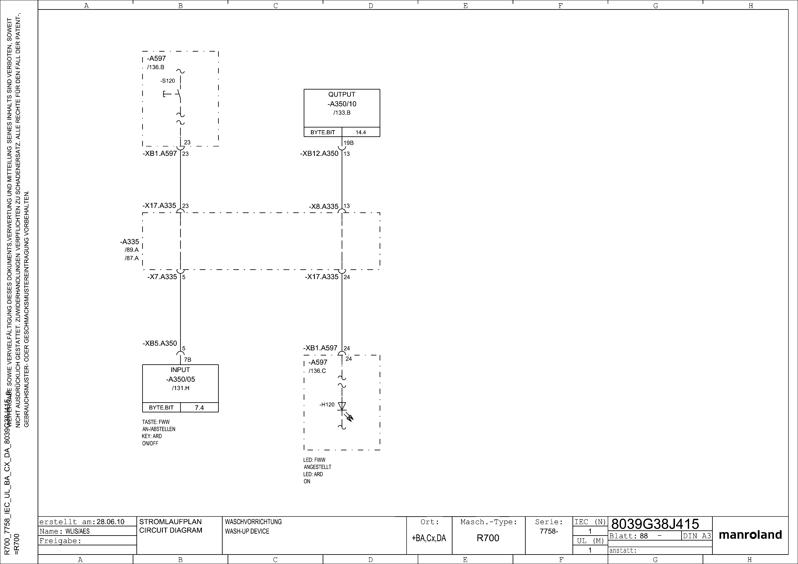

# +BA_Cx_DA — Sheet 88 of 247 — WASCHVORRICHTUNG

**WASH UP DEVICE**

> Part of the manroland **R700** printing press IEC/UL circuit diagrams.
> Drawing class: **Stromlaufplan / Circuit diagram** (DIN A3).
> Document `+BA_Cx_DA` covers the **Printing units / main switch cabinet** machine section.

## At a glance

| Field | Value |
|---|---|
| Document | `+BA_Cx_DA`  (8039G38J415) |
| Sheet | **88** of 247 |
| Section (DE) | WASCHVORRICHTUNG |
| Section (EN) | WASH UP DEVICE |
| Section type | CIRCUIT — Circuit diagram |
| Machine type | `R700` |
| Series | `7758` |
| Created | 28.06.10 |
| Replaces | — |
| Columns used | A, B, C, D |
| Path numbers | — |
| Labels on sheet | 47 |
| Cross-refs out | 6 |
| Cross-refs in | 14 |

**Previous:** [+BA_Cx_DA sheet 87](SHEET_0087.md) · **Next:** [+BA_Cx_DA sheet 89](SHEET_0089.md) · **Document TOC:** [_TOC.md](_TOC.md)  (+BA_Cx_DA) · **Master TOC:** [all sheets](../_MASTER_TOC.md)

## Sheet image (300 DPI, exact vector render)



_Rendered directly from the PDF vector layer at 300 DPI (1-bit), no OCR and no resampling. Use it to confirm anything ambiguous in the text below._

## Cross-references on this sheet

Each entry is a wire leaving this sheet. The printed token is `/sheet.column`; the link resolves to that sheet inside the same document.

| Ref | Target sheet | Col | Path | Destination on target | Target section | From col |
|---|---|---|---|---|---|---|
| `/136.B` | [+BA_Cx_DA sheet 136](SHEET_0136.md) | B | — | A597 | REFERENZMODUL | B |
| `/133.B` | [+BA_Cx_DA sheet 133](SHEET_0133.md) | B | — | — | REFERENZMODUL | D |
| `/89.A` | [+BA_Cx_DA sheet 89](SHEET_0089.md) | A | — | — | WASCHVORRICHTUNG | A |
| `/87.A` | [+BA_Cx_DA sheet 87](SHEET_0087.md) | A | — | — | WASCHVORRICHTUNG | A |
| `/136.C` | [+BA_Cx_DA sheet 136](SHEET_0136.md) | C | — | A597 | REFERENZMODUL | C |
| `/131.H` | [+BA_Cx_DA sheet 131](SHEET_0131.md) | H | — | — | REFERENZMODUL | B |

### Incoming references (sheets that point here)

Every other sheet that sends a wire to this one. `Back-ref` is the token printed on *that* sheet; `Path` is its line number.

| From sheet | Cols | Back-ref | Path | Refs | What continues there |
|---|---|---|---|---|---|
| [+BA_Cx_DA#87](SHEET_0087.md) | A | `/87.A` | — | 1 | — |
| [+BA_Cx_DA#89](SHEET_0089.md) | A | `/89.A` | — | 1 | — |
| [+BA_Cx_DA#131](SHEET_0131.md) | H | `/131.H` | — | 1 | — |
| [+BA_Cx_DA#133](SHEET_0133.md) | B | `/133.B` | — | 1 | — |
| [+BA_Cx_DA#136](SHEET_0136.md) | B, C | `/136.B`, `/136.C` | — | 2 | — |
| [+BA_Cx_DA#143](SHEET_0143.md) | B | `/143.B` | — | 2 | — |
| [+BA_Cx_DA#161](SHEET_0161.md) | F | `/161.F` | — | 1 | — |
| [+BA_Cx_DA#163](SHEET_0163.md) | G | `/163.G` | — | 1 | — |
| [+BA_Cx_DA#165](SHEET_0165.md) | E | `/165.E` | — | 1 | — |
| [+BA_Cx_DA#169](SHEET_0169.md) | G | `/169.G` | — | 1 | — |
| [+BA_Cx_DA#173](SHEET_0173.md) | B | `/173.B` | — | 2 | — |


## Devices on this sheet

| Tag | Class | Class meaning (IEC) | Col | Sub | Terminal | Sign |
|---|---|---|---|---|---|---|
| `A350/05` | A | Baugruppe / assembly, module, PC board | B | 05 | — | — |
| `S120` | S | Schalter / switch | B | — | — | — |
| `A597` | A | Baugruppe / assembly, module, PC board | B | — | — | — |
| `A350/10` | A | Baugruppe / assembly, module, PC board | D | 10 | — | — |
| `A597` | A | Baugruppe / assembly, module, PC board | C | — | — | — |
| `A335` | A | Baugruppe / assembly, module, PC board | A | — | — | — |
| `7.4` | — | cross-device reference | B | — | — | — |
| `XB5.A350` | — | cross-device reference | B | — | — | — |
| `XB1.A597` | — | cross-device reference | B | — | — | — |
| `X17.A335` | — | cross-device reference | B | — | — | — |
| `X7.A335` | — | cross-device reference | B | — | — | — |
| `14.4` | — | cross-device reference | D | — | — | — |
| `XB12.A350` | — | cross-device reference | C | — | — | — |
| `X8.A335` | — | cross-device reference | D | — | — | — |
| `X17.A335` | — | cross-device reference | C | — | — | — |
| `XB1.A597` | — | cross-device reference | C | — | — | — |

## Potentials / nets

| Potential | Count | Columns | Attached devices | Terminals |
|---|---|---|---|---|
| `H120` | 1 | D | — | — |


A potential such as `L24+/4` or `M24+` is a named supply/return rail; every place it appears on this sheet is electrically common.

## Wire-end annotations (grouped as printed)

A wire that continues elsewhere is annotated with a small cluster: the destination description, the path/line number `#NN`, and the `/sheet.column` cross reference. Each row below is one such cluster exactly as it is grouped on the drawing.

| Col | Y | Path | Cross-ref | Text on the wire |
|---|---|---|---|---|
| B | 82.5 | — | `/136.B` | `A597` |
| B | 117.0 | — | — | `S120` |
| D | 136.7 | — | — | `QUTPUT` |
| D | 150.5 | — | — | `A350/10` |
| D | 164.3 | — | `/133.B` | — |
| D | 193.9 | — | — | `BYTE.BIT 14.4` |
| B | 208.7 | — | — | `23` |
| D | 209.3 | — | — | `19B` |
| B | 224.2 | — | — | `XB1.A597 23` |
| D | 224.2 | — | — | `XB12.A350 13` |
| B | 302.2 | — | — | `X17.A335 23` |
| D | 303.6 | — | — | `X8.A335 13` |
| A | 356.1 | — | — | `A335` |
| A | 369.1 | — | `/89.A`, `/87.A` | — |
| B | 408.5 | — | — | `X7.A335 5` |
| D | 408.5 | — | — | `X17.A335 24` |
| B | 507.7 | — | — | `XB5.A350 5` |
| D | 514.8 | — | — | `XB1.A597 24` |
| D | 531.8 | — | — | `24` |
| B | 533.2 | — | — | `7B` |
| C | 536.0 | — | `/136.C` | `A597` |
| B | 547.7 | — | — | `INPUT` |
| B | 561.6 | — | — | `A350/05` |
| B | 575.4 | — | `/131.H` | — |
| D | 600.2 | — | — | `H120` |
| B | 604.4 | — | — | `BYTE.BIT 7.4` |
| B | 627.0 | — | — | `KEY: ARD TASTE: FWW AN /ABSTELLEN` |
| B | 659.0 | — | — | `ON/OFF` |
| C | 683.6 | — | — | `LED: FWW` |
| C | 694.4 | — | — | `LED: ARD ANGESTELLT` |
| C | 715.6 | — | — | `ON` |


## Reconstructed tables

This sheet carries tabular content (pin map / terminal assignment / index). The grid below was rebuilt from the drawing's own rule lines, so each row is exactly one physical row of the table.

### Table 1 — 3 data rows × 2 columns (at x=212.6, y=76.5)

| A597 /136.B S120 | 23 |
|---|---|
| `XB1.A597 X17.A335 X7.A335 XB5.A350` | `23 23 5 5 7B` |
| `INPUT` | `A350/05 /131.H` |
| `BYTE.BIT` | `7.4` |


### Table 2 — 3 data rows × 2 columns (at x=453.5, y=133.2)

| QUTPUT | A350/10 /133.B |
|---|---|
| `BYTE.BIT` | `14.4` |
| `XB12.A350 X8.A335 X17.A335 XB1.A597` | `19B 13 13 24 24` |
| `A597 /136.C H120` | `24` |


## Notes and free text on this sheet

| Text | Col | Y (pt) |
|---|---|---|
| `7B` | B | 533.18 |
| `INPUT` | B | 547.72 |
| `BYTE.BIT` | B | 604.97 |
| `TASTE: FWW` | B | 626.98 |
| `AN /ABSTELLEN` | B | 637.71 |
| `KEY: ARD` | B | 648.31 |
| `ON/OFF` | B | 658.98 |
| `19B` | D | 209.34 |
| `QUTPUT` | D | 136.68 |
| `BYTE.BIT` | C | 193.95 |
| `LED: FWW` | C | 683.65 |
| `ANGESTELLT` | C | 694.41 |
| `LED: ARD` | C | 705.02 |
| `ON` | C | 715.62 |

## Complete label inventory (exact text from the drawing)

Every text object inside the drawing area of this sheet, in DIN reading order (column A→H, then top→bottom). This is the authoritative list: if a string is not here it is not printed on this sheet.

| Col | Y | X | Dir | Type | Text |
|---|---|---|---|---|---|
| A | 356.1 | 179.1 | → | device tag | `A335` |
| A | 369.1 | 186.2 | → | cross-reference | `/89.A` |
| A | 381.5 | 186.2 | → | cross-reference | `/87.A` |
| B | 82.5 | 219.4 | → | device tag | `A597` |
| B | 96.3 | 219.7 | → | cross-reference | `/136.B` |
| B | 117.0 | 239.2 | → | device tag | `S120` |
| B | 208.7 | 274.7 | → | number | `23` |
| B | 224.2 | 212.9 | → | device ref | `XB1.A597` |
| B | 225.7 | 271.8 | → | number | `23` |
| B | 302.2 | 212.6 | → | device ref | `X17.A335` |
| B | 303.6 | 271.8 | → | number | `23` |
| B | 408.5 | 220.0 | → | device ref | `X7.A335` |
| B | 409.9 | 271.8 | → | number | `5` |
| B | 507.7 | 212.9 | → | device ref | `XB5.A350` |
| B | 516.2 | 271.8 | → | number | `5` |
| B | 533.2 | 274.7 | → | text | `7B` |
| B | 547.7 | 254.4 | → | text | `INPUT` |
| B | 561.6 | 247.9 | → | device tag | `A350/05` |
| B | 575.4 | 256.8 | → | cross-reference | `/131.H` |
| B | 604.4 | 290.8 | → | device ref | `7.4` |
| B | 605.0 | 222.5 | → | text | `BYTE.BIT` |
| B | 627.0 | 212.3 | → | text | `TASTE: FWW` |
| B | 637.7 | 212.6 | → | text | `AN /ABSTELLEN` |
| B | 648.3 | 211.7 | → | text | `KEY: ARD` |
| B | 659.0 | 212.3 | → | text | `ON/OFF` |
| C | 194.0 | 463.5 | → | text | `BYTE.BIT` |
| C | 224.2 | 447.9 | → | device ref | `XB12.A350` |
| C | 408.5 | 455.0 | → | device ref | `X17.A335` |
| C | 514.8 | 452.4 | → | device ref | `XB1.A597` |
| C | 536.1 | 460.3 | → | device tag | `A597` |
| C | 549.9 | 460.6 | → | cross-reference | `/136.C` |
| C | 683.7 | 452.7 | → | text | `LED: FWW` |
| C | 694.4 | 453.5 | → | text | `ANGESTELLT` |
| C | 705.0 | 452.7 | → | text | `LED: ARD` |
| C | 715.6 | 453.3 | → | text | `ON` |
| D | 136.7 | 490.0 | → | text | `QUTPUT` |
| D | 150.5 | 488.8 | → | device tag | `A350/10` |
| D | 164.3 | 497.6 | → | cross-reference | `/133.B` |
| D | 194.0 | 530.4 | → | device ref | `14.4` |
| D | 209.3 | 512.2 | → | text | `19B` |
| D | 225.7 | 512.2 | → | number | `13` |
| D | 303.6 | 460.9 | → | device ref | `X8.A335` |
| D | 303.6 | 512.2 | → | number | `13` |
| D | 409.9 | 512.8 | → | number | `24` |
| D | 516.2 | 512.8 | → | number | `24` |
| D | 531.8 | 515.6 | → | number | `24` |
| D | 600.3 | 476.8 | → | potential | `H120` |

## Reading-order text block

The same content as a plain block, grouped by DIN column — convenient to paste or to match against a visual description.

```text
=== Column A ===
 356.1  179.1  devtag       A335
 369.1  186.2  xref         /89.A
 381.5  186.2  xref         /87.A
=== Column B ===
  82.5  219.4  devtag       A597
  96.3  219.7  xref         /136.B
 117.0  239.2  devtag       S120
 208.7  274.7  numeric      23
 224.2  212.9  devref       XB1.A597
 225.7  271.8  numeric      23
 302.2  212.6  devref       X17.A335
 303.6  271.8  numeric      23
 408.5  220.0  devref       X7.A335
 409.9  271.8  numeric      5
 507.7  212.9  devref       XB5.A350
 516.2  271.8  numeric      5
 533.2  274.7  text         7B
 547.7  254.4  text         INPUT
 561.6  247.9  devtag       A350/05
 575.4  256.8  xref         /131.H
 604.4  290.8  devref       7.4
 605.0  222.5  text         BYTE.BIT
 627.0  212.3  text         TASTE: FWW
 637.7  212.6  text         AN /ABSTELLEN
 648.3  211.7  text         KEY: ARD
 659.0  212.3  text         ON/OFF
=== Column C ===
 194.0  463.5  text         BYTE.BIT
 224.2  447.9  devref       XB12.A350
 408.5  455.0  devref       X17.A335
 514.8  452.4  devref       XB1.A597
 536.1  460.3  devtag       A597
 549.9  460.6  xref         /136.C
 683.7  452.7  text         LED: FWW
 694.4  453.5  text         ANGESTELLT
 705.0  452.7  text         LED: ARD
 715.6  453.3  text         ON
=== Column D ===
 136.7  490.0  text         QUTPUT
 150.5  488.8  devtag       A350/10
 164.3  497.6  xref         /133.B
 194.0  530.4  devref       14.4
 209.3  512.2  text         19B
 225.7  512.2  numeric      13
 303.6  460.9  devref       X8.A335
 303.6  512.2  numeric      13
 409.9  512.8  numeric      24
 516.2  512.8  numeric      24
 531.8  515.6  numeric      24
 600.3  476.8  net          H120
```

---
_Generated from the PDF vector text layer; no OCR. Source: `R700_7758_IEC_UL_BA_CX_DA_8039G38J415_p`, sheet 88._
