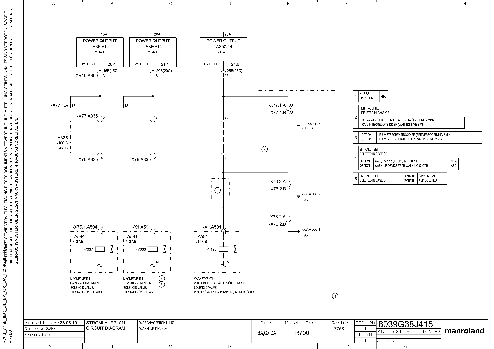

# +BA_Cx_DA — Sheet 89 of 247 — WASCHVORRICHTUNG

**WASH UP DEVICE**

> Part of the manroland **R700** printing press IEC/UL circuit diagrams.
> Drawing class: **Stromlaufplan / Circuit diagram** (DIN A3).
> Document `+BA_Cx_DA` covers the **Printing units / main switch cabinet** machine section.

## At a glance

| Field | Value |
|---|---|
| Document | `+BA_Cx_DA`  (8039G38J415) |
| Sheet | **89** of 247 |
| Section (DE) | WASCHVORRICHTUNG |
| Section (EN) | WASH UP DEVICE |
| Section type | CIRCUIT — Circuit diagram |
| Machine type | `R700` |
| Series | `7758` |
| Created | 28.06.10 |
| Replaces | — |
| Columns used | A, B, C, D, E, F, G, H |
| Path numbers | — |
| Labels on sheet | 126 |
| Cross-refs out | 9 |
| Cross-refs in | 29 |

**Previous:** [+BA_Cx_DA sheet 88](SHEET_0088.md) · **Next:** [+BA_Cx_DA sheet 90](SHEET_0090.md) · **Document TOC:** [_TOC.md](_TOC.md)  (+BA_Cx_DA) · **Master TOC:** [all sheets](../_MASTER_TOC.md)

## Sheet image (300 DPI, exact vector render)



_Rendered directly from the PDF vector layer at 300 DPI (1-bit), no OCR and no resampling. Use it to confirm anything ambiguous in the text below._

## Cross-references on this sheet

Each entry is a wire leaving this sheet. The printed token is `/sheet.column`; the link resolves to that sheet inside the same document.

| Ref | Target sheet | Col | Path | Destination on target | Target section | From col |
|---|---|---|---|---|---|---|
| `/134.E` | [+BA_Cx_DA sheet 134](SHEET_0134.md) | E | — | — | REFERENZMODUL | B |
| `/134.E` | [+BA_Cx_DA sheet 134](SHEET_0134.md) | E | — | — | REFERENZMODUL | C |
| `/134.E` | [+BA_Cx_DA sheet 134](SHEET_0134.md) | E | — | — | REFERENZMODUL | D |
| `/203.B` | [+BA_Cx_DA sheet 203](SHEET_0203.md) | B | — | — | OPTION: | E |
| `/100.B` | [+BA_Cx_DA sheet 100](SHEET_0100.md) | B | — | — | WASCHMITTELVERSORGUNG | A |
| `/88.B` | [+BA_Cx_DA sheet 88](SHEET_0088.md) | B | — | — | WASCHVORRICHTUNG | A |
| `/137.E` | [+BA_Cx_DA sheet 137](SHEET_0137.md) | E | — | A594 | REFERENZMODUL | A |
| `/137.B` | [+BA_Cx_DA sheet 137](SHEET_0137.md) | B | — | A591 | REFERENZMODUL | B |
| `/137.B` | [+BA_Cx_DA sheet 137](SHEET_0137.md) | B | — | A591 | REFERENZMODUL | D |

### Incoming references (sheets that point here)

Every other sheet that sends a wire to this one. `Back-ref` is the token printed on *that* sheet; `Path` is its line number.

| From sheet | Cols | Back-ref | Path | Refs | What continues there |
|---|---|---|---|---|---|
| [+BA_Cx_DA#88](SHEET_0088.md) | A | `/88.A` | — | 1 | — |
| [+BA_Cx_DA#100](SHEET_0100.md) | B | `/100.B` | — | 1 | — |
| [+BA_Cx_DA#134](SHEET_0134.md) | E | `/134.E` | — | 3 | — |
| [+BA_Cx_DA#137](SHEET_0137.md) | B, E | `/137.B`, `/137.E` | — | 3 | — |
| [+BA_Cx_DA#142](SHEET_0142.md) | B | `/142.B` | — | 2 | — |
| [+BA_Cx_DA#172](SHEET_0172.md) | F | `/172.F` | — | 3 | — |
| [+BA_Cx_DA#184](SHEET_0184.md) | G | `/184.G` | — | 1 | — |
| [+BA_Cx_DA#185](SHEET_0185.md) | A, B, C, E, F, G | `/185.A`, `/185.B`, `/185.C`, `/185.E`, `/185.F`, `/185.G` | — | 14 | — |
| [+BA_Cx_DA#203](SHEET_0203.md) | B | `/203.B` | — | 1 | X5.1B:6 |


## Devices on this sheet

| Tag | Class | Class meaning (IEC) | Col | Sub | Terminal | Sign |
|---|---|---|---|---|---|---|
| `A350/14` | A | Baugruppe / assembly, module, PC board | C | 14 | — | — |
| `A335` | A | Baugruppe / assembly, module, PC board | A | — | — | — |
| `Y037` | Y | Magnetventil / solenoid valve, actuator | B | — | — | — |
| `A594` | A | Baugruppe / assembly, module, PC board | A | — | — | — |
| `A350/14` | A | Baugruppe / assembly, module, PC board | B | 14 | — | — |
| `A350/14` | A | Baugruppe / assembly, module, PC board | D | 14 | — | — |
| `Y033` | Y | Magnetventil / solenoid valve, actuator | B | — | — | — |
| `A591` | A | Baugruppe / assembly, module, PC board | B | — | — | — |
| `Y196` | Y | Magnetventil / solenoid valve, actuator | D | — | — | — |
| `A591` | A | Baugruppe / assembly, module, PC board | D | — | — | — |
| `X1.A591` | — | cross-device reference | C | — | — | — |
| `X76.A335` | — | cross-device reference | B | — | — | — |
| `21.1` | — | cross-device reference | C | — | — | — |
| `X77.A335` | — | cross-device reference | B | — | — | — |
| `X75.A335` | — | cross-device reference | B | — | — | — |
| `X75.1.A594` | — | cross-device reference | B | — | — | — |
| `20.4` | — | cross-device reference | B | — | — | — |
| `XB16.A350` | — | cross-device reference | B | — | — | — |
| `X77.1.A` | — | cross-device reference | A | — | — | — |
| `X1.A591` | — | cross-device reference | D | — | — | — |
| `21.6` | — | cross-device reference | D | — | — | — |
| `X77.1.A` | — | cross-device reference | E | — | — | — |
| `X77.1.B` | — | cross-device reference | E | — | — | — |
| `X76.2.A` | — | cross-device reference | E | — | — | — |
| `X76.2.B` | — | cross-device reference | E | — | — | — |
| `X76.2.A` | — | cross-device reference | E | — | — | — |
| `X76.2.B` | — | cross-device reference | E | — | — | — |
| `X7.A566:1` | — | cross-device reference | E | — | 1 | — |
| `X7.A566:2` | — | cross-device reference | E | — | 2 | — |

## Potentials / nets

| Potential | Count | Columns | Attached devices | Terminals |
|---|---|---|---|---|
| `0V` | 1 | B | — | — |


A potential such as `L24+/4` or `M24+` is a named supply/return rail; every place it appears on this sheet is electrically common.

## Wire-end annotations (grouped as printed)

A wire that continues elsewhere is annotated with a small cluster: the destination description, the path/line number `#NN`, and the `/sheet.column` cross reference. Each row below is one such cluster exactly as it is grouped on the drawing.

| Col | Y | Path | Cross-ref | Text on the wire |
|---|---|---|---|---|
| B | 79.0 | — | — | `15A` |
| C | 79.0 | — | — | `20A` |
| D | 79.0 | — | — | `25A` |
| B | 94.1 | — | — | `POWER QUTPUT` |
| C | 94.1 | — | — | `POWER QUTPUT` |
| D | 94.1 | — | — | `POWER QUTPUT` |
| B | 108.0 | — | — | `A350/14` |
| C | 108.0 | — | — | `A350/14` |
| D | 108.0 | — | — | `A350/14` |
| B | 121.8 | — | `/134.E` | — |
| C | 121.8 | — | `/134.E` | — |
| D | 121.8 | — | `/134.E` | — |
| B | 150.9 | — | — | `BYTE.BIT 20.4` |
| C | 150.9 | — | — | `BYTE.BIT 21.1` |
| D | 150.9 | — | — | `BYTE.BIT 21.6` |
| B | 166.9 | — | — | `15B(15C)` |
| C | 166.9 | — | — | `20B(20C)` |
| D | 166.9 | — | — | `25B(25C)` |
| B | 177.5 | — | — | `XB16.A350 13` |
| C | 178.9 | — | — | `18` |
| D | 178.9 | — | — | `23` |
| F | 223.1 | — | — | `1 NUR BEI` |
| F | 230.2 | — | — | `ONLY FOR +BA` |
| A | 249.1 | — | — | `X77.1.A 13` |
| E | 249.1 | — | — | `X77.1.A 23` |
| B | 251.2 | — | — | `18` |
| F | 258.5 | — | — | `ENTFÄLLT BEI DELETED IN CASE OF` |
| E | 266.8 | — | — | `X77.1.B 23` |
| B | 275.3 | — | — | `X77.A335 13` |
| F | 278.1 | — | — | `2` |
| C | 279.5 | — | — | `18` |
| D | 279.5 | — | — | `23` |
| G | 286.9 | — | — | `IR/UV ZWISCHENTROCKNER (ZEITVERZÖGERUNG 2 MIN) IR/UV INTERMEDIATE DRIER (WAITING TIME 2 MIN)` |
| E | 295.1 | — | — | `X5.1B:6` |
| E | 305.0 | — | `/203.B` | — |
| F | 322.3 | — | — | `OPTION OPTION` |
| G | 322.4 | — | — | `3 IR/UV ZWISCHENTROCKNER (ZEITVERZÖGERUNG 2 MIN) IR/UV INTERMEDIATE DRIER (WAITING TIME 2 MIN)` |
| A | 327.7 | — | — | `A335` |
| A | 340.8 | — | `/100.B` | — |
| A | 353.2 | — | `/88.B` | — |
| E | 357.5 | — | — | `3` |
| F | 357.8 | — | — | `ENTFÄLLT BEI DELETED IN CASE OF` |
| B | 377.3 | — | — | `X75.A335 5` |
| C | 377.3 | — | — | `X76.A335 2` |
| D | 377.3 | — | — | `7` |
| F | 377.3 | — | — | `4` |
| H | 386.0 | — | — | `GTW ABD` |
| F | 386.1 | — | — | `OPTION OPTION` |
| G | 386.1 | — | — | `WASCHVORRICHTUNG MIT TUCH WASH UP DEVICE WITH WASHING CLOTH` |
| G | 421.5 | — | — | `5 GTW ENTFÄLLT ABD DELETED` |
| F | 421.5 | — | — | `ENTFÄLLT BEI DELETED IN CASE OF` |
| G | 421.5 | — | — | `OPTION OPTION` |
| E | 433.3 | — | — | `X76.2.A 2` |
| E | 451.0 | — | — | `X76.2.B 2` |
| D | 456.7 | — | — | `2` |
| E | 464.4 | — | — | `X7.A566:2` |
| E | 478.7 | — | — | `+Ax` |
| E | 518.4 | — | — | `X76.2.A 1` |
| E | 536.1 | — | — | `X76.2.B 1` |
| B | 543.1 | — | — | `X75.1.A594 4` |
| C | 543.1 | — | — | `X1.A591 4` |
| D | 543.1 | — | — | `X1.A591 5` |
| E | 549.5 | — | — | `X7.A566:1` |
| B | 560.2 | — | — | `4` |
| C | 560.2 | — | — | `4` |
| D | 560.2 | — | — | `5` |
| E | 563.7 | — | — | `+Ax` |
| A | 565.8 | — | `/137.E` | `A594` |
| B | 565.8 | — | `/137.B` | `A591` |
| D | 565.8 | — | `/137.B` | `A591` |
| B | 597.7 | — | — | `Y037` |
| B | 597.7 | — | — | `Y033` |
| D | 597.7 | — | — | `Y196` |
| B | 628.1 | — | — | `0V` |
| C | 628.3 | — | — | `M` |
| D | 628.3 | — | — | `M` |
| C | 669.3 | — | — | `4` |
| B | 669.6 | — | — | `FWW ANSCHWENKEN MAGNETVENTIL:` |
| B | 669.6 | — | — | `MAGNETVENTIL: GTW ANSCHWENKEN SOLENOID VALVE: THROWING ON THE ABD` |
| D | 669.6 | — | — | `MAGNETVENTIL:` |
| D | 680.2 | — | — | `SOLENOID VALVE: WASCHMITTELBEHÄLTER (ÜBERDRUCK) WASHING AGENT CONTAINER (OVERPRESSURE)` |
| C | 683.4 | — | — | `5` |
| B | 690.9 | — | — | `SOLENOID VALVE: THROWING ON THE ARD` |
| F | 711.3 | — | — | `1` |


## Reconstructed tables

This sheet carries tabular content (pin map / terminal assignment / index). The grid below was rebuilt from the drawing's own rule lines, so each row is exactly one physical row of the table.

### Table 1 — 4 data rows × 5 columns (at x=184.3, y=90.7)

| POWER | QUTPUT A350/14 /134.E |  | POWER | QUTPUT A350/14 /134.E |
|---|---|---|---|---|
| `BYTE.BIT` | `20.4` |  | `BYTE.BIT` | `21.1` |
| `XB16.A350` | `15B(15C) 13` |  |  | `20B(20C) 18` |
| `X77.A335 X75.A335` | `13 5` | `18` | `X76.A335` | `18 2` |
| `X75.1.A594 A594 /137.E` | `4 4` |  | `X1.A591 A591 /137.B` | `4 4` |


### Table 2 — 5 data rows × 2 columns (at x=481.9, y=90.7)

| POWER | QUTPUT A350/14 /134.E |
|---|---|
| `BYTE.BIT` | `21.6` |
|  | `25B(25C) 23` |
|  | `23 7` |
| `2` |  |
| `X1.A591 A591 /137.B` | `5 5` |


### Table 3 — 3 data rows × 1 columns (at x=623.6, y=90.7)

| C1 |
|---|
| `X77.1.A X77.1.B 3` |
| `X76.2.A X76.2.B` |
| `X76.2.A X76.2.B` |


## Notes and free text on this sheet

| Text | Col | Y (pt) |
|---|---|---|
| `20A` | C | 78.95 |
| `20B(20C)` | C | 166.86 |
| `POWER QUTPUT` | C | 94.1 |
| `BYTE.BIT` | B | 151.43 |
| `MAGNETVENTIL:` | A | 669.59 |
| `FWW ANSCHWENKEN` | B | 680.16 |
| `SOLENOID VALVE:` | A | 690.85 |
| `THROWING ON THE ARD` | B | 701.49 |
| `15A` | B | 78.95 |
| `15B(15C)` | B | 166.86 |
| `POWER QUTPUT` | B | 94.1 |
| `25A` | D | 78.95 |
| `25B(25C)` | D | 166.86 |
| `POWER QUTPUT` | D | 94.1 |
| `BYTE.BIT` | D | 151.43 |
| `+Ax` | E | 563.74 |
| `MAGNETVENTIL:` | B | 669.59 |
| `GTW ANSCHWENKEN` | B | 680.19 |
| `SOLENOID VALVE:` | B | 690.85 |
| `THROWING ON THE ABD` | B | 701.49 |
| `M` | C | 628.26 |
| `MAGNETVENTIL:` | D | 669.59 |
| `WASCHMITTELBEHÄLTER (ÜBERDRUCK)` | D | 680.24 |
| `SOLENOID VALVE:` | D | 690.85 |
| `WASHING AGENT CONTAINER (OVERPRESSURE)` | D | 701.5 |
| `M` | D | 628.26 |
| `X5.1B:6` | E | 295.07 |
| `NUR BEI` | F | 223.1 |
| `ONLY FOR` | F | 233.79 |
| `+BA` | G | 230.2 |
| `ENTFÄLLT BEI` | F | 258.54 |
| `DELETED IN CASE OF` | F | 269.2 |
| `IR/UV ZWISCHENTROCKNER (ZEITVERZÖGERUNG 2 MIN)` | G | 286.93 |
| `IR/UV INTERMEDIATE DRIER (WAITING TIME 2 MIN)` | G | 297.55 |
| `OPTION` | F | 322.33 |
| `WASCHVORRICHTUNG MIT TUCH` | G | 386.14 |
| `WASH UP DEVICE WITH WASHING CLOTH` | G | 396.74 |
| `GTW` | H | 386.02 |
| `ABD` | H | 396.75 |
| `OPTION` | G | 421.54 |
| `GTW ENTFÄLLT` | G | 421.54 |
| `ABD DELETED` | G | 432.2 |

## Complete label inventory (exact text from the drawing)

Every text object inside the drawing area of this sheet, in DIN reading order (column A→H, then top→bottom). This is the authoritative list: if a string is not here it is not printed on this sheet.

| Col | Y | X | Dir | Type | Text |
|---|---|---|---|---|---|
| A | 249.1 | 123.0 | → | device ref | `X77.1.A` |
| A | 251.2 | 172.1 | → | number | `13` |
| A | 327.7 | 135.2 | → | device tag | `A335` |
| A | 340.8 | 137.8 | → | cross-reference | `/100.B` |
| A | 353.2 | 142.6 | → | cross-reference | `/88.B` |
| A | 565.8 | 175.5 | → | device tag | `A594` |
| A | 578.9 | 175.7 | → | cross-reference | `/137.E` |
| A | 669.6 | 169.5 | → | text | `MAGNETVENTIL:` |
| A | 690.8 | 169.8 | → | text | `SOLENOID VALVE:` |
| B | 78.9 | 242.9 | → | text | `15A` |
| B | 94.1 | 200.1 | → | text | `POWER QUTPUT` |
| B | 108.0 | 219.5 | → | device tag | `A350/14` |
| B | 121.8 | 228.5 | → | cross-reference | `/134.E` |
| B | 150.9 | 259.8 | → | device ref | `20.4` |
| B | 151.4 | 194.2 | → | text | `BYTE.BIT` |
| B | 151.4 | 321.7 | → | text | `BYTE.BIT` |
| B | 166.9 | 248.6 | → | text | `15B(15C)` |
| B | 177.5 | 178.6 | → | device ref | `XB16.A350` |
| B | 178.9 | 242.9 | → | number | `13` |
| B | 251.2 | 299.6 | → | number | `18` |
| B | 275.3 | 185.7 | → | device ref | `X77.A335` |
| B | 279.5 | 242.9 | → | number | `13` |
| B | 377.3 | 243.5 | → | number | `5` |
| B | 380.1 | 185.7 | → | device ref | `X75.A335` |
| B | 380.1 | 313.2 | → | device ref | `X76.A335` |
| B | 543.1 | 175.5 | → | device ref | `X75.1.A594` |
| B | 544.6 | 243.5 | → | number | `4` |
| B | 560.2 | 243.5 | → | number | `4` |
| B | 565.8 | 303.0 | → | device tag | `A591` |
| B | 578.9 | 303.3 | → | cross-reference | `/137.B` |
| B | 597.7 | 201.0 | → | device tag | `Y037` |
| B | 597.7 | 328.5 | → | device tag | `Y033` |
| B | 628.1 | 249.2 | → | potential | `0V` |
| B | 669.6 | 297.1 | → | text | `MAGNETVENTIL:` |
| B | 680.2 | 169.2 | → | text | `FWW ANSCHWENKEN` |
| B | 680.2 | 297.4 | → | text | `GTW ANSCHWENKEN` |
| B | 690.8 | 297.4 | → | text | `SOLENOID VALVE:` |
| B | 701.5 | 169.8 | → | text | `THROWING ON THE ARD` |
| B | 701.5 | 297.4 | → | text | `THROWING ON THE ABD` |
| C | 78.9 | 371.1 | → | text | `20A` |
| C | 94.1 | 327.7 | → | text | `POWER QUTPUT` |
| C | 108.0 | 347.1 | → | device tag | `A350/14` |
| C | 121.8 | 356.0 | → | cross-reference | `/134.E` |
| C | 150.9 | 388.2 | → | device ref | `21.1` |
| C | 166.9 | 376.7 | → | text | `20B(20C)` |
| C | 178.9 | 370.5 | → | number | `18` |
| C | 279.5 | 370.5 | → | number | `18` |
| C | 377.3 | 371.1 | → | number | `2` |
| C | 543.1 | 319.2 | → | device ref | `X1.A591` |
| C | 544.6 | 371.1 | → | number | `4` |
| C | 560.2 | 371.1 | → | number | `4` |
| C | 628.3 | 376.4 | → | text | `M` |
| C | 669.3 | 387.8 | → | number | `4` |
| C | 683.4 | 387.8 | → | number | `5` |
| D | 78.9 | 541.1 | → | text | `25A` |
| D | 94.1 | 497.8 | → | text | `POWER QUTPUT` |
| D | 108.0 | 517.2 | → | device tag | `A350/14` |
| D | 121.8 | 526.1 | → | cross-reference | `/134.E` |
| D | 150.9 | 557.4 | → | device ref | `21.6` |
| D | 151.4 | 491.8 | → | text | `BYTE.BIT` |
| D | 166.9 | 546.8 | → | text | `25B(25C)` |
| D | 178.9 | 541.1 | → | number | `23` |
| D | 279.5 | 541.1 | → | number | `23` |
| D | 377.3 | 541.1 | → | number | `7` |
| D | 456.7 | 522.4 | → | number | `2` |
| D | 543.1 | 489.3 | → | device ref | `X1.A591` |
| D | 544.6 | 541.1 | → | number | `5` |
| D | 560.2 | 541.1 | → | number | `5` |
| D | 565.8 | 473.1 | → | device tag | `A591` |
| D | 578.9 | 473.4 | → | cross-reference | `/137.B` |
| D | 597.7 | 498.6 | → | device tag | `Y196` |
| D | 628.3 | 546.5 | → | text | `M` |
| D | 669.6 | 467.1 | → | text | `MAGNETVENTIL:` |
| D | 680.2 | 467.7 | → | text | `WASCHMITTELBEHÄLTER (ÜBERDRUCK)` |
| D | 690.8 | 467.4 | → | text | `SOLENOID VALVE:` |
| D | 701.5 | 467.7 | → | text | `WASHING AGENT CONTAINER (OVERPRESSURE)` |
| E | 249.1 | 647.4 | → | device ref | `X77.1.A` |
| E | 251.2 | 697.0 | → | number | `23` |
| E | 266.8 | 648.3 | → | device ref | `X77.1.B` |
| E | 268.2 | 697.0 | → | number | `23` |
| E | 295.1 | 738.1 | → | text | `X5.1B:6` |
| E | 305.0 | 728.5 | → | cross-reference | `/203.B` |
| E | 357.5 | 635.8 | → | number | `3` |
| E | 433.3 | 647.4 | → | device ref | `X76.2.A` |
| E | 435.4 | 697.0 | → | number | `2` |
| E | 451.0 | 648.3 | → | device ref | `X76.2.B` |
| E | 452.5 | 697.0 | → | number | `2` |
| E | 464.5 | 728.2 | → | device ref | `X7.A566:2` |
| E | 478.7 | 728.2 | → | text | `+Ax` |
| E | 518.4 | 647.4 | → | device ref | `X76.2.A` |
| E | 520.5 | 696.5 | → | number | `1` |
| E | 536.1 | 648.3 | → | device ref | `X76.2.B` |
| E | 537.5 | 696.5 | → | number | `1` |
| E | 549.5 | 728.2 | → | device ref | `X7.A566:1` |
| E | 563.7 | 728.2 | → | text | `+Ax` |
| F | 223.1 | 866.6 | → | text | `NUR BEI` |
| F | 228.5 | 854.9 | → | number | `1` |
| F | 233.8 | 867.1 | → | text | `ONLY FOR` |
| F | 258.5 | 870.8 | → | text | `ENTFÄLLT BEI` |
| F | 269.2 | 870.8 | → | text | `DELETED IN CASE OF` |
| F | 278.1 | 854.6 | → | number | `2` |
| F | 322.3 | 871.4 | → | text | `OPTION` |
| F | 327.7 | 854.5 | → | number | `3` |
| F | 333.0 | 871.4 | → | text | `OPTION` |
| F | 357.8 | 866.6 | → | text | `ENTFÄLLT BEI` |
| F | 368.4 | 866.6 | → | text | `DELETED IN CASE OF` |
| F | 377.3 | 854.6 | → | number | `4` |
| F | 386.1 | 867.1 | → | text | `OPTION` |
| F | 396.7 | 867.1 | → | text | `OPTION` |
| F | 421.5 | 866.6 | → | text | `ENTFÄLLT BEI` |
| F | 426.9 | 854.5 | → | number | `5` |
| F | 432.2 | 866.6 | → | text | `DELETED IN CASE OF` |
| F | 711.3 | 806.1 | → | number | `1` |
| G | 230.2 | 917.4 | → | text | `+BA` |
| G | 286.9 | 870.8 | → | text | `IR/UV ZWISCHENTROCKNER (ZEITVERZÖGERUNG 2 MIN)` |
| G | 297.6 | 870.8 | → | text | `IR/UV INTERMEDIATE DRIER (WAITING TIME 2 MIN)` |
| G | 322.4 | 913.3 | → | text | `IR/UV ZWISCHENTROCKNER (ZEITVERZÖGERUNG 2 MIN)` |
| G | 333.0 | 913.3 | → | text | `IR/UV INTERMEDIATE DRIER (WAITING TIME 2 MIN)` |
| G | 386.1 | 902.8 | → | text | `WASCHVORRICHTUNG MIT TUCH` |
| G | 396.7 | 902.8 | → | text | `WASH UP DEVICE WITH WASHING CLOTH` |
| G | 421.5 | 973.4 | → | text | `OPTION` |
| G | 421.5 | 1008.9 | → | text | `GTW ENTFÄLLT` |
| G | 432.2 | 973.4 | → | text | `OPTION` |
| G | 432.2 | 1009.1 | → | text | `ABD DELETED` |
| H | 386.0 | 1086.8 | → | text | `GTW` |
| H | 396.8 | 1087.1 | → | text | `ABD` |

## Reading-order text block

The same content as a plain block, grouped by DIN column — convenient to paste or to match against a visual description.

```text
=== Column A ===
 249.1  123.0  devref       X77.1.A
 251.2  172.1  numeric      13
 327.7  135.2  devtag       A335
 340.8  137.8  xref         /100.B
 353.2  142.6  xref         /88.B
 565.8  175.5  devtag       A594
 578.9  175.7  xref         /137.E
 669.6  169.5  text         MAGNETVENTIL:
 690.8  169.8  text         SOLENOID VALVE:
=== Column B ===
  78.9  242.9  text         15A
  94.1  200.1  text         POWER QUTPUT
 108.0  219.5  devtag       A350/14
 121.8  228.5  xref         /134.E
 150.9  259.8  devref       20.4
 151.4  194.2  text         BYTE.BIT
 151.4  321.7  text         BYTE.BIT
 166.9  248.6  text         15B(15C)
 177.5  178.6  devref       XB16.A350
 178.9  242.9  numeric      13
 251.2  299.6  numeric      18
 275.3  185.7  devref       X77.A335
 279.5  242.9  numeric      13
 377.3  243.5  numeric      5
 380.1  185.7  devref       X75.A335
 380.1  313.2  devref       X76.A335
 543.1  175.5  devref       X75.1.A594
 544.6  243.5  numeric      4
 560.2  243.5  numeric      4
 565.8  303.0  devtag       A591
 578.9  303.3  xref         /137.B
 597.7  201.0  devtag       Y037
 597.7  328.5  devtag       Y033
 628.1  249.2  net          0V
 669.6  297.1  text         MAGNETVENTIL:
 680.2  169.2  text         FWW ANSCHWENKEN
 680.2  297.4  text         GTW ANSCHWENKEN
 690.8  297.4  text         SOLENOID VALVE:
 701.5  169.8  text         THROWING ON THE ARD
 701.5  297.4  text         THROWING ON THE ABD
=== Column C ===
  78.9  371.1  text         20A
  94.1  327.7  text         POWER QUTPUT
 108.0  347.1  devtag       A350/14
 121.8  356.0  xref         /134.E
 150.9  388.2  devref       21.1
 166.9  376.7  text         20B(20C)
 178.9  370.5  numeric      18
 279.5  370.5  numeric      18
 377.3  371.1  numeric      2
 543.1  319.2  devref       X1.A591
 544.6  371.1  numeric      4
 560.2  371.1  numeric      4
 628.3  376.4  text         M
 669.3  387.8  numeric      4
 683.4  387.8  numeric      5
=== Column D ===
  78.9  541.1  text         25A
  94.1  497.8  text         POWER QUTPUT
 108.0  517.2  devtag       A350/14
 121.8  526.1  xref         /134.E
 150.9  557.4  devref       21.6
 151.4  491.8  text         BYTE.BIT
 166.9  546.8  text         25B(25C)
 178.9  541.1  numeric      23
 279.5  541.1  numeric      23
 377.3  541.1  numeric      7
 456.7  522.4  numeric      2
 543.1  489.3  devref       X1.A591
 544.6  541.1  numeric      5
 560.2  541.1  numeric      5
 565.8  473.1  devtag       A591
 578.9  473.4  xref         /137.B
 597.7  498.6  devtag       Y196
 628.3  546.5  text         M
 669.6  467.1  text         MAGNETVENTIL:
 680.2  467.7  text         WASCHMITTELBEHÄLTER (ÜBERDRUCK)
 690.8  467.4  text         SOLENOID VALVE:
 701.5  467.7  text         WASHING AGENT CONTAINER (OVERPRESSURE)
=== Column E ===
 249.1  647.4  devref       X77.1.A
 251.2  697.0  numeric      23
 266.8  648.3  devref       X77.1.B
 268.2  697.0  numeric      23
 295.1  738.1  text         X5.1B:6
 305.0  728.5  xref         /203.B
 357.5  635.8  numeric      3
 433.3  647.4  devref       X76.2.A
 435.4  697.0  numeric      2
 451.0  648.3  devref       X76.2.B
 452.5  697.0  numeric      2
 464.5  728.2  devref       X7.A566:2
 478.7  728.2  text         +Ax
 518.4  647.4  devref       X76.2.A
 520.5  696.5  numeric      1
 536.1  648.3  devref       X76.2.B
 537.5  696.5  numeric      1
 549.5  728.2  devref       X7.A566:1
 563.7  728.2  text         +Ax
=== Column F ===
 223.1  866.6  text         NUR BEI
 228.5  854.9  numeric      1
 233.8  867.1  text         ONLY FOR
 258.5  870.8  text         ENTFÄLLT BEI
 269.2  870.8  text         DELETED IN CASE OF
 278.1  854.6  numeric      2
 322.3  871.4  text         OPTION
 327.7  854.5  numeric      3
 333.0  871.4  text         OPTION
 357.8  866.6  text         ENTFÄLLT BEI
 368.4  866.6  text         DELETED IN CASE OF
 377.3  854.6  numeric      4
 386.1  867.1  text         OPTION
 396.7  867.1  text         OPTION
 421.5  866.6  text         ENTFÄLLT BEI
 426.9  854.5  numeric      5
 432.2  866.6  text         DELETED IN CASE OF
 711.3  806.1  numeric      1
=== Column G ===
 230.2  917.4  text         +BA
 286.9  870.8  text         IR/UV ZWISCHENTROCKNER (ZEITVERZÖGERUNG 2 MIN)
 297.6  870.8  text         IR/UV INTERMEDIATE DRIER (WAITING TIME 2 MIN)
 322.4  913.3  text         IR/UV ZWISCHENTROCKNER (ZEITVERZÖGERUNG 2 MIN)
 333.0  913.3  text         IR/UV INTERMEDIATE DRIER (WAITING TIME 2 MIN)
 386.1  902.8  text         WASCHVORRICHTUNG MIT TUCH
 396.7  902.8  text         WASH UP DEVICE WITH WASHING CLOTH
 421.5  973.4  text         OPTION
 421.5 1008.9  text         GTW ENTFÄLLT
 432.2  973.4  text         OPTION
 432.2 1009.1  text         ABD DELETED
=== Column H ===
 386.0 1086.8  text         GTW
 396.8 1087.1  text         ABD
```

---
_Generated from the PDF vector text layer; no OCR. Source: `R700_7758_IEC_UL_BA_CX_DA_8039G38J415_p`, sheet 89._
