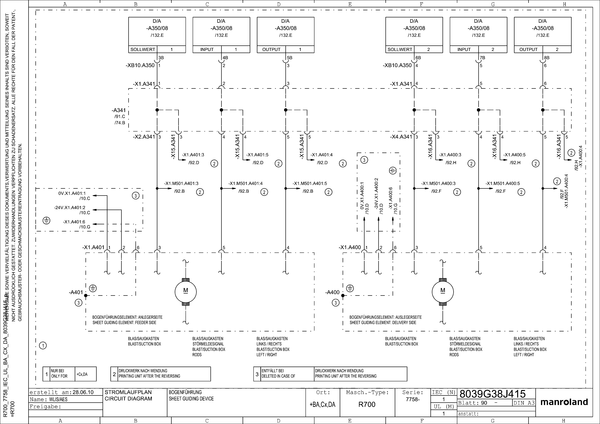

# +BA_Cx_DA — Sheet 90 of 247 — BOGENFÜHRUNG

**SHEET GUIDING DEVICE**

> Part of the manroland **R700** printing press IEC/UL circuit diagrams.
> Drawing class: **Stromlaufplan / Circuit diagram** (DIN A3).
> Document `+BA_Cx_DA` covers the **Printing units / main switch cabinet** machine section.

## At a glance

| Field | Value |
|---|---|
| Document | `+BA_Cx_DA`  (8039G38J415) |
| Sheet | **90** of 247 |
| Section (DE) | BOGENFÜHRUNG |
| Section (EN) | SHEET GUIDING DEVICE |
| Section type | CIRCUIT — Circuit diagram |
| Machine type | `R700` |
| Series | `7758` |
| Created | 28.06.10 |
| Replaces | — |
| Columns used | A, B, C, D, E, F, G, H |
| Path numbers | — |
| Labels on sheet | 182 |
| Cross-refs out | 26 |
| Cross-refs in | 62 |

**Previous:** [+BA_Cx_DA sheet 89](SHEET_0089.md) · **Next:** [+BA_Cx_DA sheet 91](SHEET_0091.md) · **Document TOC:** [_TOC.md](_TOC.md)  (+BA_Cx_DA) · **Master TOC:** [all sheets](../_MASTER_TOC.md)

## Sheet image (300 DPI, exact vector render)



_Rendered directly from the PDF vector layer at 300 DPI (1-bit), no OCR and no resampling. Use it to confirm anything ambiguous in the text below._

## Cross-references on this sheet

Each entry is a wire leaving this sheet. The printed token is `/sheet.column`; the link resolves to that sheet inside the same document.

| Ref | Target sheet | Col | Path | Destination on target | Target section | From col |
|---|---|---|---|---|---|---|
| `/132.E` | [+BA_Cx_DA sheet 132](SHEET_0132.md) | E | — | — | REFERENZMODUL | B |
| `/132.E` | [+BA_Cx_DA sheet 132](SHEET_0132.md) | E | — | — | REFERENZMODUL | C |
| `/132.E` | [+BA_Cx_DA sheet 132](SHEET_0132.md) | E | — | — | REFERENZMODUL | D |
| `/132.E` | [+BA_Cx_DA sheet 132](SHEET_0132.md) | E | — | — | REFERENZMODUL | F |
| `/132.E` | [+BA_Cx_DA sheet 132](SHEET_0132.md) | E | — | — | REFERENZMODUL | G |
| `/132.E` | [+BA_Cx_DA sheet 132](SHEET_0132.md) | E | — | — | REFERENZMODUL | H |
| `/91.C` | [+BA_Cx_DA sheet 91](SHEET_0091.md) | C | — | — | BOGENFÜHRUNG WENDETROMMEL | B |
| `/74.B` | [+BA_Cx_DA sheet 74](SHEET_0074.md) | B | — | — | FEUCHTWERK | B |
| `/92.H` | [+BA_Cx_DA sheet 92](SHEET_0092.md) | H | — | — | BOGENFÜHRUNG, DRUCKWERK NACH WENDUNG | H |
| `/92.D` | [+BA_Cx_DA sheet 92](SHEET_0092.md) | D | — | — | BOGENFÜHRUNG, DRUCKWERK NACH WENDUNG | C |
| `/92.D` | [+BA_Cx_DA sheet 92](SHEET_0092.md) | D | — | — | BOGENFÜHRUNG, DRUCKWERK NACH WENDUNG | D |
| `/92.D` | [+BA_Cx_DA sheet 92](SHEET_0092.md) | D | — | — | BOGENFÜHRUNG, DRUCKWERK NACH WENDUNG | E |
| `/92.H` | [+BA_Cx_DA sheet 92](SHEET_0092.md) | H | — | — | BOGENFÜHRUNG, DRUCKWERK NACH WENDUNG | F |
| `/92.H` | [+BA_Cx_DA sheet 92](SHEET_0092.md) | H | — | — | BOGENFÜHRUNG, DRUCKWERK NACH WENDUNG | G |
| `/10.D` | [+BA_Cx_DA sheet 10](SHEET_0010.md) | D | — | 24V.X1.A400:2 | SPANNUNGSVERSORGUNG, SCHALTSCHRANKBELÜFTUNG | E |
| `/10.D` | [+BA_Cx_DA sheet 10](SHEET_0010.md) | D | — | 0V.X1.A400:1 | SPANNUNGSVERSORGUNG, SCHALTSCHRANKBELÜFTUNG | E |
| `/10.G` | [+BA_Cx_DA sheet 10](SHEET_0010.md) | G | — | X1.A400:6 | SPANNUNGSVERSORGUNG, SCHALTSCHRANKBELÜFTUNG | F |
| `/92.F` | [+BA_Cx_DA sheet 92](SHEET_0092.md) | F | — | — | BOGENFÜHRUNG, DRUCKWERK NACH WENDUNG | H |
| `/92.B` | [+BA_Cx_DA sheet 92](SHEET_0092.md) | B | — | — | BOGENFÜHRUNG, DRUCKWERK NACH WENDUNG | C |
| `/92.B` | [+BA_Cx_DA sheet 92](SHEET_0092.md) | B | — | — | BOGENFÜHRUNG, DRUCKWERK NACH WENDUNG | D |
| `/92.B` | [+BA_Cx_DA sheet 92](SHEET_0092.md) | B | — | — | BOGENFÜHRUNG, DRUCKWERK NACH WENDUNG | D |
| `/92.F` | [+BA_Cx_DA sheet 92](SHEET_0092.md) | F | — | — | BOGENFÜHRUNG, DRUCKWERK NACH WENDUNG | F |
| `/92.F` | [+BA_Cx_DA sheet 92](SHEET_0092.md) | F | — | — | BOGENFÜHRUNG, DRUCKWERK NACH WENDUNG | G |
| `/10.C` | [+BA_Cx_DA sheet 10](SHEET_0010.md) | C | — | 0V.X1.A401:1 | SPANNUNGSVERSORGUNG, SCHALTSCHRANKBELÜFTUNG | A |
| `/10.C` | [+BA_Cx_DA sheet 10](SHEET_0010.md) | C | — | 24V.X1.A401:2 | SPANNUNGSVERSORGUNG, SCHALTSCHRANKBELÜFTUNG | A |
| `/10.G` | [+BA_Cx_DA sheet 10](SHEET_0010.md) | G | — | X1.A401:6 | SPANNUNGSVERSORGUNG, SCHALTSCHRANKBELÜFTUNG | A |

### Incoming references (sheets that point here)

Every other sheet that sends a wire to this one. `Back-ref` is the token printed on *that* sheet; `Path` is its line number.

| From sheet | Cols | Back-ref | Path | Refs | What continues there |
|---|---|---|---|---|---|
| [+BA_Cx_DA#10](SHEET_0010.md) | C, D, G | `/10.C`, `/10.D`, `/10.G` | — | 6 | 0V.X1.A400:1; 0V.X1.A401:1; X1.A264:PE |
| [+BA_Cx_DA#74](SHEET_0074.md) | B | `/74.B` | — | 1 | — |
| [+BA_Cx_DA#91](SHEET_0091.md) | C | `/91.C` | — | 1 | — |
| [+BA_Cx_DA#92](SHEET_0092.md) | B, D, F, H | `/92.B`, `/92.D`, `/92.F`, `/92.H` | — | 12 | X1.A400:3; X1.A400:4; X1.A400:5; X1.A401:3; X1.A401:4; X1.A401:5; X1.M501.A400:3; X1.M501.A400:4; X1.M501.A400:5; X1.M501.A401:3; X1.M501.A401:4; X1.M501.A401:5 |
| [+BA_Cx_DA#132](SHEET_0132.md) | E | `/132.E` | — | 6 | — |
| [+BA_Cx_DA#141](SHEET_0141.md) | D, G | `/141.D`, `/141.G` | — | 18 | — |
| [+BA_Cx_DA#153](SHEET_0153.md) | B | `/153.B` | — | 3 | — |
| [+BA_Cx_DA#159](SHEET_0159.md) | B | `/159.B` | — | 3 | — |
| [+BA_Cx_DA#167](SHEET_0167.md) | C | `/167.C` | — | 6 | — |
| [+BA_Cx_DA#171](SHEET_0171.md) | H | `/171.H` | — | 3 | — |
| [+BA_Cx_DA#172](SHEET_0172.md) | D | `/172.D` | — | 3 | — |


## Devices on this sheet

| Tag | Class | Class meaning (IEC) | Col | Sub | Terminal | Sign |
|---|---|---|---|---|---|---|
| `A350/08` | A | Baugruppe / assembly, module, PC board | F | 08 | — | — |
| `A350/08` | A | Baugruppe / assembly, module, PC board | G | 08 | — | — |
| `A350/08` | A | Baugruppe / assembly, module, PC board | H | 08 | — | — |
| `A350/08` | A | Baugruppe / assembly, module, PC board | B | 08 | — | — |
| `A350/08` | A | Baugruppe / assembly, module, PC board | C | 08 | — | — |
| `A350/08` | A | Baugruppe / assembly, module, PC board | D | 08 | — | — |
| `A341` | A | Baugruppe / assembly, module, PC board | B | — | — | — |
| `A401` | A | Baugruppe / assembly, module, PC board | A | — | — | — |
| `A400` | A | Baugruppe / assembly, module, PC board | E | — | — | — |
| `XB10.A350` | — | cross-device reference | F | — | — | — |
| `XB10.A350` | — | cross-device reference | B | — | — | — |
| `X1.A341` | — | cross-device reference | F | — | — | — |
| `X1.A341` | — | cross-device reference | B | — | — | — |
| `X2.A341` | — | cross-device reference | B | — | — | — |
| `X15.A341` | — | cross-device reference | C | — | — | — |
| `X15.A341` | — | cross-device reference | C | — | — | — |
| `X15.A341` | — | cross-device reference | D | — | — | — |
| `X4.A341` | — | cross-device reference | F | — | — | — |
| `X16.A341` | — | cross-device reference | F | — | — | — |
| `X16.A341` | — | cross-device reference | G | — | — | — |
| `X16.A341` | — | cross-device reference | H | — | — | — |
| `X1.A401` | — | cross-device reference | A | — | — | — |
| `X1.A400` | — | cross-device reference | E | — | — | — |
| `X1.A400:3` | — | cross-device reference | F | — | 3 | — |
| `X1.A400:4` | — | cross-device reference | H | — | 4 | — |
| `X1.A401:6` | — | cross-device reference | A | — | 6 | — |
| `X1.A400:5` | — | cross-device reference | G | — | 5 | — |
| `X1.A400:6` | — | cross-device reference | F | — | 6 | — |
| `X1.A401:3` | — | cross-device reference | C | — | 3 | — |
| `X1.A401:4` | — | cross-device reference | E | — | 4 | — |
| `X1.A401:5` | — | cross-device reference | D | — | 5 | — |
| `X1.M501.A400:5` | — | cross-device reference | G | — | 5 | — |
| `X1.M501.A401:3` | — | cross-device reference | C | — | 3 | — |
| `X1.M501.A400:4` | — | cross-device reference | H | — | 4 | — |
| `X1.M501.A400:3` | — | cross-device reference | F | — | 3 | — |
| `X1.M501.A401:4` | — | cross-device reference | D | — | 4 | — |
| `X1.M501.A401:5` | — | cross-device reference | D | — | 5 | — |

## Potentials / nets

| Potential | Count | Columns | Attached devices | Terminals |
|---|---|---|---|---|
| `0V` | 2 | A, E | `A400`, `A401`, `X1` | `1` |
| `24V` | 2 | A, E | `A400`, `A401`, `X1` | `2` |


A potential such as `L24+/4` or `M24+` is a named supply/return rail; every place it appears on this sheet is electrically common.

## Wire-end annotations (grouped as printed)

A wire that continues elsewhere is annotated with a small cluster: the destination description, the path/line number `#NN`, and the `/sheet.column` cross reference. Each row below is one such cluster exactly as it is grouped on the drawing.

| Col | Y | Path | Cross-ref | Text on the wire |
|---|---|---|---|---|
| B | 37.4 | — | — | `D/A` |
| C | 37.4 | — | — | `D/A` |
| D | 37.4 | — | — | `D/A` |
| F | 37.4 | — | — | `D/A` |
| G | 37.4 | — | — | `D/A` |
| H | 37.4 | — | — | `D/A` |
| B | 51.3 | — | — | `A350/08` |
| C | 51.3 | — | — | `A350/08` |
| D | 51.3 | — | — | `A350/08` |
| F | 51.3 | — | — | `A350/08` |
| G | 51.3 | — | — | `A350/08` |
| H | 51.3 | — | — | `A350/08` |
| B | 66.2 | — | `/132.E` | — |
| C | 66.2 | — | `/132.E` | — |
| D | 66.2 | — | `/132.E` | — |
| F | 66.2 | — | `/132.E` | — |
| G | 66.2 | — | `/132.E` | — |
| H | 66.2 | — | `/132.E` | — |
| B | 94.5 | — | — | `SOLLWERT 1` |
| C | 94.5 | — | — | `INPUT 1` |
| D | 94.5 | — | — | `OUTPUT 1` |
| F | 94.5 | — | — | `SOLLWERT 2` |
| G | 94.5 | — | — | `INPUT 2` |
| H | 94.5 | — | — | `OUTPUT 2` |
| B | 110.8 | — | — | `3B` |
| C | 110.8 | — | — | `4B` |
| D | 110.8 | — | — | `5B` |
| F | 110.8 | — | — | `6B` |
| G | 110.8 | — | — | `7B` |
| H | 110.8 | — | — | `8B` |
| C | 125.0 | — | — | `XB10.A350 1 2 3` |
| G | 125.0 | — | — | `XB10.A350 4 5 6` |
| E | 161.9 | — | — | `X1.A341 1 X1.A341 4 5 6` |
| D | 161.9 | — | — | `2 3` |
| B | 214.3 | — | — | `A341` |
| B | 227.4 | — | `/91.C`, `/74.B` | — |
| C | 265.9 | — | — | `X15.A341` |
| C | 265.9 | — | — | `X15.A341` |
| D | 265.9 | — | — | `X15.A341` |
| F | 265.9 | — | — | `X16.A341` |
| G | 265.9 | — | — | `X16.A341` |
| H | 265.9 | — | — | `X16.A341` |
| C | 266.8 | — | — | `X2.A341 3 3 4 5` |
| G | 266.8 | — | — | `X4.A341 3 3 4 5` |
| D | 268.2 | — | — | `4` |
| D | 268.2 | — | — | `5` |
| G | 268.2 | — | — | `4` |
| H | 268.2 | — | — | `5` |
| H | 288.9 | — | — | `X1.A400:4` |
| H | 300.8 | — | — | `2` |
| C | 303.6 | — | — | `X1.A401:3` |
| D | 303.6 | — | — | `X1.A401:5` |
| E | 303.6 | — | — | `X1.A401:4` |
| F | 303.6 | — | — | `X1.A400:3` |
| G | 303.6 | — | — | `X1.A400:5` |
| E | 314.9 | — | — | `3` |
| H | 318.1 | — | `/92.H` | — |
| C | 319.2 | — | `/92.D` | — |
| D | 319.2 | — | `/92.D` | — |
| E | 319.2 | — | `/92.D` | — |
| F | 319.2 | — | `/92.H` | — |
| G | 319.2 | — | `/92.H` | — |
| E | 322.0 | — | — | `2 2 2 2 2` |
| H | 345.5 | — | — | `X1.M501.A400:4` |
| E | 353.5 | — | `/10.D` | `24V.X1.A400:2` |
| H | 357.5 | — | — | `2` |
| C | 360.3 | — | — | `X1.M501.A401:3` |
| D | 360.3 | — | — | `X1.M501.A401:4` |
| D | 360.3 | — | — | `X1.M501.A401:5` |
| F | 360.3 | — | — | `X1.M501.A400:3` |
| G | 360.3 | — | — | `X1.M501.A400:5` |
| E | 361.1 | — | `/10.D` | `0V.X1.A400:1` |
| F | 371.6 | — | `/10.G` | `X1.A400:6` |
| H | 375.3 | — | `/92.F` | — |
| C | 375.8 | — | `/92.B` | — |
| D | 375.8 | — | `/92.B` | — |
| D | 375.8 | — | `/92.B` | — |
| F | 375.9 | — | `/92.F` | — |
| G | 375.9 | — | `/92.F` | — |
| E | 378.7 | — | — | `2 2 2 2 2` |
| A | 380.1 | — | `/10.C` | `0V.X1.A401:1` |
| B | 385.8 | — | — | `3` |
| A | 408.5 | — | `/10.C` | `24V.X1.A401:2` |
| A | 436.8 | — | `/10.G` | `X1.A401:6` |
| C | 486.4 | — | — | `X1.A401 1 2 6 3 5 4` |
| F | 486.4 | — | — | `X1.A400 1 2 6 3 5 4` |
| D | 571.3 | — | — | `M M` |
| A | 575.7 | — | — | `A401` |
| E | 575.7 | — | — | `A400` |
| C | 598.4 | — | — | `3 3` |
| B | 627.1 | — | — | `BOGENFÜHRUNGSELEMENT: ANLEGERSEITE` |
| E | 627.1 | — | — | `BOGENFÜHRUNGSELEMENT: AUSLEGERSEITE` |
| B | 637.7 | — | — | `SHEET GUIDING ELEMENT: FEEDER SIDE` |
| E | 637.7 | — | — | `SHEET GUIDING ELEMENT: DELIVERY SIDE` |
| B | 669.6 | — | — | `BLAS/SAUGKASTEN BLAST/SUCTION BOX` |
| C | 669.6 | — | — | `BLAS/SAUGKASTEN` |
| D | 669.6 | — | — | `BLAS/SAUGKASTEN LINKS / RECHTS BLAST/SUCTION BOX LEFT / RIGHT` |
| F | 669.6 | — | — | `BLAS/SAUGKASTEN BLAST/SUCTION BOX` |
| G | 669.6 | — | — | `BLAS/SAUGKASTEN` |
| H | 669.6 | — | — | `BLAS/SAUGKASTEN LINKS / RECHTS BLAST/SUCTION BOX LEFT / RIGHT` |
| C | 680.2 | — | — | `BLAST/SUCTION BOX RODS STÖRMELDESIGNAL` |
| G | 680.2 | — | — | `BLAST/SUCTION BOX RODS STÖRMELDESIGNAL` |
| A | 682.9 | — | — | `1` |
| A | 733.3 | — | — | `1 NUR BEI` |
| C | 733.4 | — | — | `2 DRUCKWERK NACH WENDUNG PRINTING UNIT AFTER THE REVERSING 3 ENTFÄLLT BEI DELETED IN CASE OF` |
| E | 733.4 | — | — | `DRUCKWERK NACH WENDUNG PRINTING UNIT AFTER THE REVERSING` |
| A | 740.5 | — | — | `ONLY FOR +Cx,DA` |


## Reconstructed tables

This sheet carries tabular content (pin map / terminal assignment / index). The grid below was rebuilt from the drawing's own rule lines, so each row is exactly one physical row of the table.

### Table 1 — 4 data rows × 10 columns (at x=212.6, y=34.0)

|  |  |  | D/A | A350/08 /132.E |  |  | D/A | A350/08 /132.E |  |
|---|---|---|---|---|---|---|---|---|---|
|  |  |  | `SOLLWERT` | `1` |  |  | `INPUT` | `1` |  |
|  |  |  | `XB10.A350 X1.A341` | `3B 1 1` |  |  |  | `4B 2 2` |  |
| `A341 /91.C /74.B` |  | `3` | `X2.A341` | `X15.A341 3` | `3 X1.M501.A401:3 /92.B` |  | `X1.A401:3 /92.D 2 2` | `X15.A341 4` | `4 X1.M501.A401:4 /92.B` |
| `1` | `2` |  | `6` | `3` |  | `M` |  | `5` |  |


### Table 2 — 4 data rows × 14 columns (at x=510.2, y=34.0)

| D/A | A350/08 /132.E |  |  |  |  |  | D/A | A350/08 /132.E |  |  | D/A | A350/08 /132.E |  |
|---|---|---|---|---|---|---|---|---|---|---|---|---|---|
| `OUTPUT` | `1` |  |  |  |  |  | `SOLLWERT` | `2` |  |  | `INPUT` | `2` |  |
|  | `5B 3 3` |  |  |  |  |  | `XB10.A350 X1.A341` | `6B 4 4` |  |  |  | `7B 5 5` |  |
| `X1.A401:5 /92.D 2 2` | `X15.A341 5` | `5 X1.M501.A401:5 /92.B` | `X1.A401:4 /92.D 2 0V.X1.A400:1 2` | `3 24V.X1.A400:2 /10.D` | `/10.D` | `X1.A400:6` | `X4.A341 /10.G` | `X16.A341 3` | `3 X1.M501.A400:3 /92.F` |  | `X1.A400:3 /92.H 2 2` | `X16.A341 4` | `4 X1.M501.A400:5 /92.F` |
|  | `4` |  | `X1.A400 A400` | `1` | `2` |  | `6` | `3` |  | `M` |  | `5` |  |


### Table 3 — 4 data rows × 3 columns (at x=1020.5, y=34.0)

| D/A | A350/08 /132.E |  |
|---|---|---|
| `OUTPUT` | `2` |  |
|  | `8B 6 6` |  |
| `X1.A400:5 /92.H 2 2` | `X16.A341 5 2 /92.F` | `5 2 X1.M501.A400:4` |
|  | `4` |  |


## Notes and free text on this sheet

| Text | Col | Y (pt) |
|---|---|---|
| `M` | F | 571.26 |
| `M` | C | 571.26 |
| `6B` | F | 110.82 |
| `D/A` | F | 37.44 |
| `SOLLWERT` | F | 94.48 |
| `BLAS/SAUGKASTEN` | F | 669.57 |
| `BLAST/SUCTION BOX` | F | 680.22 |
| `7B` | G | 110.82 |
| `D/A` | G | 37.44 |
| `INPUT` | G | 94.53 |
| `BLAS/SAUGKASTEN` | G | 669.57 |
| `STÖRMELDESIGNAL` | G | 680.25 |
| `BLAST/SUCTION BOX` | G | 690.86 |
| `RODS` | F | 701.47 |
| `8B` | H | 110.82 |
| `D/A` | H | 37.44 |
| `OUTPUT` | G | 94.54 |
| `BLAS/SAUGKASTEN` | H | 669.57 |
| `LINKS / RECHTS` | G | 680.21 |
| `BLAST/SUCTION BOX` | H | 690.86 |
| `LEFT / RIGHT` | G | 701.48 |
| `3B` | B | 110.82 |
| `D/A` | B | 37.44 |
| `SOLLWERT` | B | 94.48 |
| `BLAS/SAUGKASTEN` | B | 669.57 |
| `BLAST/SUCTION BOX` | B | 680.22 |
| `4B` | C | 110.82 |
| `D/A` | C | 37.44 |
| `INPUT` | C | 94.53 |
| `BLAS/SAUGKASTEN` | C | 669.57 |
| `STÖRMELDESIGNAL` | C | 680.25 |
| `BLAST/SUCTION BOX` | C | 690.86 |
| `RODS` | C | 701.47 |
| `5B` | D | 110.82 |
| `D/A` | D | 37.44 |
| `OUTPUT` | D | 94.54 |
| `BLAS/SAUGKASTEN` | D | 669.57 |
| `LINKS / RECHTS` | D | 680.21 |
| `BLAST/SUCTION BOX` | D | 690.86 |
| `LEFT / RIGHT` | D | 701.48 |
| `BOGENFÜHRUNGSELEMENT: ANLEGERSEITE` | B | 627.09 |
| `SHEET GUIDING ELEMENT: FEEDER SIDE` | B | 637.71 |
| `BOGENFÜHRUNGSELEMENT: AUSLEGERSEITE` | E | 627.09 |
| `SHEET GUIDING ELEMENT: DELIVERY SIDE` | E | 637.71 |
| `NUR BEI` | A | 733.33 |
| `ONLY FOR` | A | 744.02 |
| `+Cx,DA` | A | 740.52 |
| `DRUCKWERK NACH WENDUNG` | B | 733.36 |
| `PRINTING UNIT AFTER THE REVERSING` | B | 744.01 |
| `ENTFÄLLT BEI` | D | 733.35 |
| `DELETED IN CASE OF` | D | 744 |
| `DRUCKWERK NACH WENDUNG` | E | 733.36 |
| `PRINTING UNIT AFTER THE REVERSING` | E | 744.01 |

## Complete label inventory (exact text from the drawing)

Every text object inside the drawing area of this sheet, in DIN reading order (column A→H, then top→bottom). This is the authoritative list: if a string is not here it is not printed on this sheet.

| Col | Y | X | Dir | Type | Text |
|---|---|---|---|---|---|
| A | 380.1 | 115.9 | → | potential | `0V.X1.A401:1` |
| A | 390.0 | 157.9 | → | cross-reference | `/10.C` |
| A | 408.5 | 107.1 | → | potential | `24V.X1.A401:2` |
| A | 418.4 | 157.9 | → | cross-reference | `/10.C` |
| A | 436.8 | 125.0 | → | device ref | `X1.A401:6` |
| A | 446.7 | 157.6 | → | cross-reference | `/10.G` |
| A | 486.5 | 163.3 | → | device ref | `X1.A401` |
| A | 575.7 | 136.6 | → | device tag | `A401` |
| A | 598.4 | 153.9 | → | number | `3` |
| A | 682.9 | 83.3 | → | number | `1` |
| A | 733.3 | 101.2 | → | text | `NUR BEI` |
| A | 738.7 | 89.6 | → | number | `1` |
| A | 740.5 | 152.1 | → | text | `+Cx,DA` |
| A | 744.0 | 101.8 | → | text | `ONLY FOR` |
| B | 37.4 | 303.0 | → | text | `D/A` |
| B | 51.3 | 290.4 | → | device tag | `A350/08` |
| B | 66.2 | 299.3 | → | cross-reference | `/132.E` |
| B | 94.5 | 258.9 | → | text | `SOLLWERT` |
| B | 110.8 | 314.4 | → | text | `3B` |
| B | 125.0 | 249.4 | → | device ref | `XB10.A350` |
| B | 126.5 | 313.8 | → | number | `1` |
| B | 161.9 | 263.9 | → | device ref | `X1.A341` |
| B | 161.9 | 313.8 | → | number | `1` |
| B | 214.3 | 221.7 | → | device tag | `A341` |
| B | 227.4 | 227.3 | → | cross-reference | `/91.C` |
| B | 239.8 | 227.6 | → | cross-reference | `/74.B` |
| B | 266.8 | 263.9 | → | device ref | `X2.A341` |
| B | 268.2 | 314.4 | → | number | `3` |
| B | 385.8 | 267.3 | → | number | `3` |
| B | 487.9 | 214.6 | → | number | `1` |
| B | 487.9 | 243.5 | → | number | `2` |
| B | 487.9 | 271.8 | → | number | `6` |
| B | 487.9 | 314.4 | → | number | `3` |
| B | 627.1 | 183.4 | → | text | `BOGENFÜHRUNGSELEMENT: ANLEGERSEITE` |
| B | 637.7 | 184.0 | → | text | `SHEET GUIDING ELEMENT: FEEDER SIDE` |
| B | 669.6 | 254.3 | → | text | `BLAS/SAUGKASTEN` |
| B | 680.2 | 254.3 | → | text | `BLAST/SUCTION BOX` |
| B | 733.4 | 235.8 | → | text | `DRUCKWERK NACH WENDUNG` |
| B | 738.7 | 223.9 | → | number | `2` |
| B | 744.0 | 235.8 | → | text | `PRINTING UNIT AFTER THE REVERSING` |
| C | 37.4 | 430.6 | → | text | `D/A` |
| C | 51.3 | 418.0 | → | device tag | `A350/08` |
| C | 66.2 | 426.9 | → | cross-reference | `/132.E` |
| C | 94.5 | 397.6 | → | text | `INPUT` |
| C | 94.6 | 338.2 | → | number | `1` |
| C | 94.6 | 465.7 | → | number | `1` |
| C | 110.8 | 441.9 | → | text | `4B` |
| C | 126.5 | 441.9 | → | number | `2` |
| C | 161.9 | 441.9 | → | number | `2` |
| C | 265.9 | 339.0 | ↕ | device ref | `X15.A341` |
| C | 265.9 | 466.6 | ↕ | device ref | `X15.A341` |
| C | 268.2 | 356.9 | → | number | `3` |
| C | 268.2 | 441.9 | → | number | `4` |
| C | 303.6 | 361.1 | → | device ref | `X1.A401:3` |
| C | 319.2 | 374.2 | → | cross-reference | `/92.D` |
| C | 322.0 | 423.2 | → | number | `2` |
| C | 360.3 | 325.7 | → | device ref | `X1.M501.A401:3` |
| C | 375.8 | 345.8 | → | cross-reference | `/92.B` |
| C | 378.7 | 394.9 | → | number | `2` |
| C | 487.9 | 441.9 | → | number | `5` |
| C | 571.3 | 363.8 | → | text | `M` |
| C | 669.6 | 381.8 | → | text | `BLAS/SAUGKASTEN` |
| C | 680.2 | 382.4 | → | text | `STÖRMELDESIGNAL` |
| C | 690.9 | 381.8 | → | text | `BLAST/SUCTION BOX` |
| C | 701.5 | 381.8 | → | text | `RODS` |
| D | 37.4 | 558.1 | → | text | `D/A` |
| D | 51.3 | 545.5 | → | device tag | `A350/08` |
| D | 66.2 | 554.5 | → | cross-reference | `/132.E` |
| D | 94.5 | 520.6 | → | text | `OUTPUT` |
| D | 94.6 | 593.3 | → | number | `1` |
| D | 110.8 | 569.5 | → | text | `5B` |
| D | 126.5 | 569.5 | → | number | `3` |
| D | 161.9 | 569.5 | → | number | `3` |
| D | 265.9 | 594.2 | ↕ | device ref | `X15.A341` |
| D | 268.2 | 484.4 | → | number | `4` |
| D | 268.2 | 569.5 | → | number | `5` |
| D | 268.2 | 612.0 | → | number | `5` |
| D | 303.6 | 488.7 | → | device ref | `X1.A401:5` |
| D | 319.2 | 501.7 | → | cross-reference | `/92.D` |
| D | 322.0 | 550.8 | → | number | `2` |
| D | 360.3 | 453.3 | → | device ref | `X1.M501.A401:4` |
| D | 360.3 | 580.8 | → | device ref | `X1.M501.A401:5` |
| D | 375.8 | 473.4 | → | cross-reference | `/92.B` |
| D | 375.8 | 600.9 | → | cross-reference | `/92.B` |
| D | 378.7 | 522.4 | → | number | `2` |
| D | 487.9 | 569.5 | → | number | `4` |
| D | 669.6 | 509.4 | → | text | `BLAS/SAUGKASTEN` |
| D | 680.2 | 509.4 | → | text | `LINKS / RECHTS` |
| D | 690.9 | 509.4 | → | text | `BLAST/SUCTION BOX` |
| D | 701.5 | 509.4 | → | text | `LEFT / RIGHT` |
| D | 733.3 | 519.3 | → | text | `ENTFÄLLT BEI` |
| D | 738.7 | 507.3 | → | number | `3` |
| D | 744.0 | 519.3 | → | text | `DELETED IN CASE OF` |
| E | 303.6 | 616.3 | → | device ref | `X1.A401:4` |
| E | 314.9 | 720.8 | → | number | `3` |
| E | 319.2 | 629.3 | → | cross-reference | `/92.D` |
| E | 322.0 | 678.3 | → | number | `2` |
| E | 353.5 | 743.0 | ↕ | potential | `24V.X1.A400:2` |
| E | 361.1 | 714.6 | ↕ | potential | `0V.X1.A400:1` |
| E | 378.7 | 650.0 | → | number | `2` |
| E | 404.2 | 724.5 | ↕ | cross-reference | `/10.D` |
| E | 404.2 | 752.9 | ↕ | cross-reference | `/10.D` |
| E | 486.5 | 672.1 | → | device ref | `X1.A400` |
| E | 487.9 | 724.8 | → | number | `1` |
| E | 487.9 | 753.7 | → | number | `2` |
| E | 575.7 | 645.4 | → | device tag | `A400` |
| E | 598.4 | 664.1 | → | number | `3` |
| E | 627.1 | 693.6 | → | text | `BOGENFÜHRUNGSELEMENT: AUSLEGERSEITE` |
| E | 637.7 | 694.2 | → | text | `SHEET GUIDING ELEMENT: DELIVERY SIDE` |
| E | 733.4 | 625.6 | → | text | `DRUCKWERK NACH WENDUNG` |
| E | 744.0 | 625.6 | → | text | `PRINTING UNIT AFTER THE REVERSING` |
| F | 37.4 | 813.3 | → | text | `D/A` |
| F | 51.3 | 800.6 | → | device tag | `A350/08` |
| F | 66.2 | 809.6 | → | cross-reference | `/132.E` |
| F | 94.5 | 769.2 | → | text | `SOLLWERT` |
| F | 94.6 | 848.1 | → | number | `2` |
| F | 110.8 | 824.6 | → | text | `6B` |
| F | 125.0 | 759.7 | → | device ref | `XB10.A350` |
| F | 126.5 | 824.6 | → | number | `4` |
| F | 161.9 | 774.1 | → | device ref | `X1.A341` |
| F | 161.9 | 824.6 | → | number | `4` |
| F | 265.9 | 849.3 | ↕ | device ref | `X16.A341` |
| F | 266.8 | 774.1 | → | device ref | `X4.A341` |
| F | 268.2 | 824.6 | → | number | `3` |
| F | 268.2 | 867.1 | → | number | `3` |
| F | 303.6 | 871.4 | → | device ref | `X1.A400:3` |
| F | 319.2 | 884.4 | → | cross-reference | `/92.H` |
| F | 360.3 | 835.9 | → | device ref | `X1.M501.A400:3` |
| F | 371.6 | 771.3 | ↕ | device ref | `X1.A400:6` |
| F | 375.9 | 856.1 | → | cross-reference | `/92.F` |
| F | 378.7 | 905.1 | → | number | `2` |
| F | 403.7 | 781.2 | ↕ | cross-reference | `/10.G` |
| F | 487.9 | 782.1 | → | number | `6` |
| F | 487.9 | 824.6 | → | number | `3` |
| F | 571.3 | 874.1 | → | text | `M` |
| F | 669.6 | 764.5 | → | text | `BLAS/SAUGKASTEN` |
| F | 680.2 | 764.5 | → | text | `BLAST/SUCTION BOX` |
| F | 701.5 | 892.1 | → | text | `RODS` |
| G | 37.4 | 940.8 | → | text | `D/A` |
| G | 51.3 | 928.2 | → | device tag | `A350/08` |
| G | 66.2 | 937.1 | → | cross-reference | `/132.E` |
| G | 94.5 | 907.8 | → | text | `INPUT` |
| G | 94.5 | 1030.8 | → | text | `OUTPUT` |
| G | 94.6 | 975.7 | → | number | `2` |
| G | 110.8 | 952.2 | → | text | `7B` |
| G | 126.5 | 952.2 | → | number | `5` |
| G | 161.9 | 952.2 | → | number | `5` |
| G | 265.9 | 976.8 | ↕ | device ref | `X16.A341` |
| G | 268.2 | 952.2 | → | number | `4` |
| G | 268.2 | 994.7 | → | number | `4` |
| G | 303.6 | 998.9 | → | device ref | `X1.A400:5` |
| G | 319.2 | 1012.0 | → | cross-reference | `/92.H` |
| G | 322.0 | 933.4 | → | number | `2` |
| G | 360.3 | 963.5 | → | device ref | `X1.M501.A400:5` |
| G | 375.9 | 983.6 | → | cross-reference | `/92.F` |
| G | 378.7 | 1032.7 | → | number | `2` |
| G | 487.9 | 952.2 | → | number | `5` |
| G | 669.6 | 892.1 | → | text | `BLAS/SAUGKASTEN` |
| G | 680.2 | 892.6 | → | text | `STÖRMELDESIGNAL` |
| G | 680.2 | 1019.6 | → | text | `LINKS / RECHTS` |
| G | 690.9 | 892.1 | → | text | `BLAST/SUCTION BOX` |
| G | 701.5 | 1019.6 | → | text | `LEFT / RIGHT` |
| H | 37.4 | 1068.4 | → | text | `D/A` |
| H | 51.3 | 1055.8 | → | device tag | `A350/08` |
| H | 66.2 | 1064.7 | → | cross-reference | `/132.E` |
| H | 94.6 | 1103.2 | → | number | `2` |
| H | 110.8 | 1079.7 | → | text | `8B` |
| H | 126.5 | 1079.7 | → | number | `6` |
| H | 161.9 | 1079.7 | → | number | `6` |
| H | 265.9 | 1104.4 | ↕ | device ref | `X16.A341` |
| H | 268.2 | 1079.7 | → | number | `5` |
| H | 268.2 | 1122.2 | → | number | `5` |
| H | 288.9 | 1148.3 | ↕ | device ref | `X1.A400:4` |
| H | 300.8 | 1131.9 | → | number | `2` |
| H | 318.0 | 1139.8 | ↕ | cross-reference | `/92.H` |
| H | 322.0 | 1061.0 | → | number | `2` |
| H | 345.5 | 1120.0 | ↕ | device ref | `X1.M501.A400:4` |
| H | 357.5 | 1103.5 | → | number | `2` |
| H | 375.3 | 1111.4 | ↕ | cross-reference | `/92.F` |
| H | 487.9 | 1079.7 | → | number | `4` |
| H | 669.6 | 1019.6 | → | text | `BLAS/SAUGKASTEN` |
| H | 690.9 | 1019.6 | → | text | `BLAST/SUCTION BOX` |

## Reading-order text block

The same content as a plain block, grouped by DIN column — convenient to paste or to match against a visual description.

```text
=== Column A ===
 380.1  115.9  net          0V.X1.A401:1
 390.0  157.9  xref         /10.C
 408.5  107.1  net          24V.X1.A401:2
 418.4  157.9  xref         /10.C
 436.8  125.0  devref       X1.A401:6
 446.7  157.6  xref         /10.G
 486.5  163.3  devref       X1.A401
 575.7  136.6  devtag       A401
 598.4  153.9  numeric      3
 682.9   83.3  numeric      1
 733.3  101.2  text         NUR BEI
 738.7   89.6  numeric      1
 740.5  152.1  text         +Cx,DA
 744.0  101.8  text         ONLY FOR
=== Column B ===
  37.4  303.0  text         D/A
  51.3  290.4  devtag       A350/08
  66.2  299.3  xref         /132.E
  94.5  258.9  text         SOLLWERT
 110.8  314.4  text         3B
 125.0  249.4  devref       XB10.A350
 126.5  313.8  numeric      1
 161.9  263.9  devref       X1.A341
 161.9  313.8  numeric      1
 214.3  221.7  devtag       A341
 227.4  227.3  xref         /91.C
 239.8  227.6  xref         /74.B
 266.8  263.9  devref       X2.A341
 268.2  314.4  numeric      3
 385.8  267.3  numeric      3
 487.9  214.6  numeric      1
 487.9  243.5  numeric      2
 487.9  271.8  numeric      6
 487.9  314.4  numeric      3
 627.1  183.4  text         BOGENFÜHRUNGSELEMENT: ANLEGERSEITE
 637.7  184.0  text         SHEET GUIDING ELEMENT: FEEDER SIDE
 669.6  254.3  text         BLAS/SAUGKASTEN
 680.2  254.3  text         BLAST/SUCTION BOX
 733.4  235.8  text         DRUCKWERK NACH WENDUNG
 738.7  223.9  numeric      2
 744.0  235.8  text         PRINTING UNIT AFTER THE REVERSING
=== Column C ===
  37.4  430.6  text         D/A
  51.3  418.0  devtag       A350/08
  66.2  426.9  xref         /132.E
  94.5  397.6  text         INPUT
  94.6  338.2  numeric      1
  94.6  465.7  numeric      1
 110.8  441.9  text         4B
 126.5  441.9  numeric      2
 161.9  441.9  numeric      2
 265.9  339.0  devref       X15.A341
 265.9  466.6  devref       X15.A341
 268.2  356.9  numeric      3
 268.2  441.9  numeric      4
 303.6  361.1  devref       X1.A401:3
 319.2  374.2  xref         /92.D
 322.0  423.2  numeric      2
 360.3  325.7  devref       X1.M501.A401:3
 375.8  345.8  xref         /92.B
 378.7  394.9  numeric      2
 487.9  441.9  numeric      5
 571.3  363.8  text         M
 669.6  381.8  text         BLAS/SAUGKASTEN
 680.2  382.4  text         STÖRMELDESIGNAL
 690.9  381.8  text         BLAST/SUCTION BOX
 701.5  381.8  text         RODS
=== Column D ===
  37.4  558.1  text         D/A
  51.3  545.5  devtag       A350/08
  66.2  554.5  xref         /132.E
  94.5  520.6  text         OUTPUT
  94.6  593.3  numeric      1
 110.8  569.5  text         5B
 126.5  569.5  numeric      3
 161.9  569.5  numeric      3
 265.9  594.2  devref       X15.A341
 268.2  484.4  numeric      4
 268.2  569.5  numeric      5
 268.2  612.0  numeric      5
 303.6  488.7  devref       X1.A401:5
 319.2  501.7  xref         /92.D
 322.0  550.8  numeric      2
 360.3  453.3  devref       X1.M501.A401:4
 360.3  580.8  devref       X1.M501.A401:5
 375.8  473.4  xref         /92.B
 375.8  600.9  xref         /92.B
 378.7  522.4  numeric      2
 487.9  569.5  numeric      4
 669.6  509.4  text         BLAS/SAUGKASTEN
 680.2  509.4  text         LINKS / RECHTS
 690.9  509.4  text         BLAST/SUCTION BOX
 701.5  509.4  text         LEFT / RIGHT
 733.3  519.3  text         ENTFÄLLT BEI
 738.7  507.3  numeric      3
 744.0  519.3  text         DELETED IN CASE OF
=== Column E ===
 303.6  616.3  devref       X1.A401:4
 314.9  720.8  numeric      3
 319.2  629.3  xref         /92.D
 322.0  678.3  numeric      2
 353.5  743.0  net          24V.X1.A400:2
 361.1  714.6  net          0V.X1.A400:1
 378.7  650.0  numeric      2
 404.2  724.5  xref         /10.D
 404.2  752.9  xref         /10.D
 486.5  672.1  devref       X1.A400
 487.9  724.8  numeric      1
 487.9  753.7  numeric      2
 575.7  645.4  devtag       A400
 598.4  664.1  numeric      3
 627.1  693.6  text         BOGENFÜHRUNGSELEMENT: AUSLEGERSEITE
 637.7  694.2  text         SHEET GUIDING ELEMENT: DELIVERY SIDE
 733.4  625.6  text         DRUCKWERK NACH WENDUNG
 744.0  625.6  text         PRINTING UNIT AFTER THE REVERSING
=== Column F ===
  37.4  813.3  text         D/A
  51.3  800.6  devtag       A350/08
  66.2  809.6  xref         /132.E
  94.5  769.2  text         SOLLWERT
  94.6  848.1  numeric      2
 110.8  824.6  text         6B
 125.0  759.7  devref       XB10.A350
 126.5  824.6  numeric      4
 161.9  774.1  devref       X1.A341
 161.9  824.6  numeric      4
 265.9  849.3  devref       X16.A341
 266.8  774.1  devref       X4.A341
 268.2  824.6  numeric      3
 268.2  867.1  numeric      3
 303.6  871.4  devref       X1.A400:3
 319.2  884.4  xref         /92.H
 360.3  835.9  devref       X1.M501.A400:3
 371.6  771.3  devref       X1.A400:6
 375.9  856.1  xref         /92.F
 378.7  905.1  numeric      2
 403.7  781.2  xref         /10.G
 487.9  782.1  numeric      6
 487.9  824.6  numeric      3
 571.3  874.1  text         M
 669.6  764.5  text         BLAS/SAUGKASTEN
 680.2  764.5  text         BLAST/SUCTION BOX
 701.5  892.1  text         RODS
=== Column G ===
  37.4  940.8  text         D/A
  51.3  928.2  devtag       A350/08
  66.2  937.1  xref         /132.E
  94.5  907.8  text         INPUT
  94.5 1030.8  text         OUTPUT
  94.6  975.7  numeric      2
 110.8  952.2  text         7B
 126.5  952.2  numeric      5
 161.9  952.2  numeric      5
 265.9  976.8  devref       X16.A341
 268.2  952.2  numeric      4
 268.2  994.7  numeric      4
 303.6  998.9  devref       X1.A400:5
 319.2 1012.0  xref         /92.H
 322.0  933.4  numeric      2
 360.3  963.5  devref       X1.M501.A400:5
 375.9  983.6  xref         /92.F
 378.7 1032.7  numeric      2
 487.9  952.2  numeric      5
 669.6  892.1  text         BLAS/SAUGKASTEN
 680.2  892.6  text         STÖRMELDESIGNAL
 680.2 1019.6  text         LINKS / RECHTS
 690.9  892.1  text         BLAST/SUCTION BOX
 701.5 1019.6  text         LEFT / RIGHT
=== Column H ===
  37.4 1068.4  text         D/A
  51.3 1055.8  devtag       A350/08
  66.2 1064.7  xref         /132.E
  94.6 1103.2  numeric      2
 110.8 1079.7  text         8B
 126.5 1079.7  numeric      6
 161.9 1079.7  numeric      6
 265.9 1104.4  devref       X16.A341
 268.2 1079.7  numeric      5
 268.2 1122.2  numeric      5
 288.9 1148.3  devref       X1.A400:4
 300.8 1131.9  numeric      2
 318.0 1139.8  xref         /92.H
 322.0 1061.0  numeric      2
 345.5 1120.0  devref       X1.M501.A400:4
 357.5 1103.5  numeric      2
 375.3 1111.4  xref         /92.F
 487.9 1079.7  numeric      4
 669.6 1019.6  text         BLAS/SAUGKASTEN
 690.9 1019.6  text         BLAST/SUCTION BOX
```

---
_Generated from the PDF vector text layer; no OCR. Source: `R700_7758_IEC_UL_BA_CX_DA_8039G38J415_p`, sheet 90._
