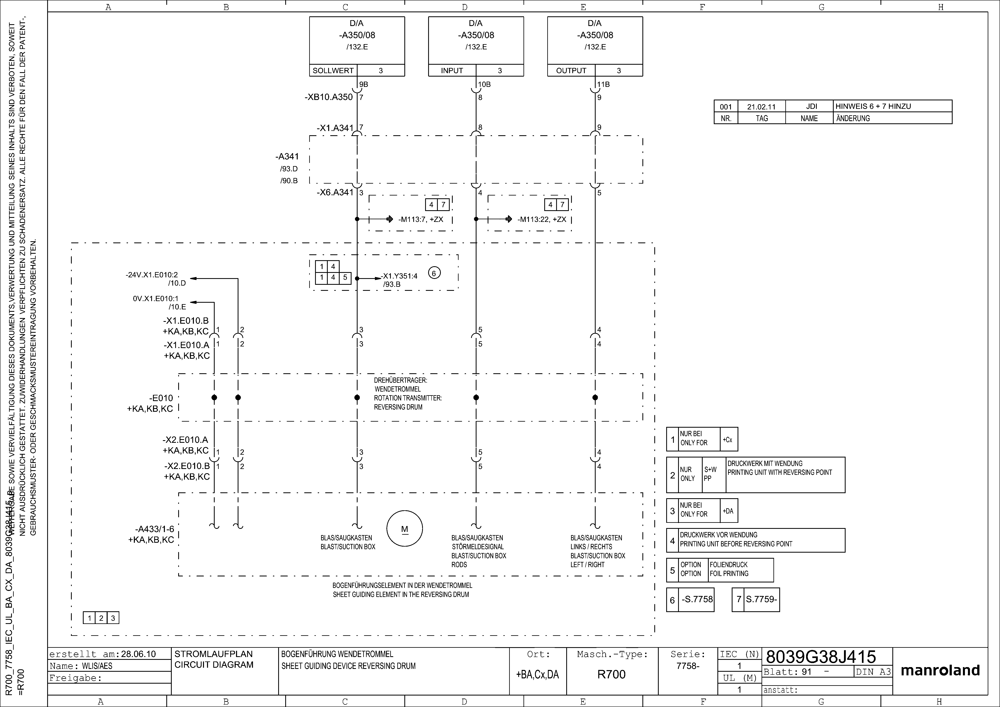

# +BA_Cx_DA — Sheet 91 of 247 — BOGENFÜHRUNG WENDETROMMEL

**SHEET GUIDING DEVICE REVERSING DRUM**

> Part of the manroland **R700** printing press IEC/UL circuit diagrams.
> Drawing class: **Stromlaufplan / Circuit diagram** (DIN A3).
> Document `+BA_Cx_DA` covers the **Printing units / main switch cabinet** machine section.

## At a glance

| Field | Value |
|---|---|
| Document | `+BA_Cx_DA`  (8039G38J415) |
| Sheet | **91** of 247 |
| Section (DE) | BOGENFÜHRUNG WENDETROMMEL |
| Section (EN) | SHEET GUIDING DEVICE REVERSING DRUM |
| Section type | CIRCUIT — Circuit diagram |
| Machine type | `R700` |
| Series | `7758` |
| Created | 28.06.10 |
| Replaces | — |
| Columns used | A, B, C, D, E, F, G |
| Path numbers | — |
| Labels on sheet | 137 |
| Cross-refs out | 8 |
| Cross-refs in | 37 |

**Previous:** [+BA_Cx_DA sheet 90](SHEET_0090.md) · **Next:** [+BA_Cx_DA sheet 92](SHEET_0092.md) · **Document TOC:** [_TOC.md](_TOC.md)  (+BA_Cx_DA) · **Master TOC:** [all sheets](../_MASTER_TOC.md)

## Sheet image (300 DPI, exact vector render)



_Rendered directly from the PDF vector layer at 300 DPI (1-bit), no OCR and no resampling. Use it to confirm anything ambiguous in the text below._

## Cross-references on this sheet

Each entry is a wire leaving this sheet. The printed token is `/sheet.column`; the link resolves to that sheet inside the same document.

| Ref | Target sheet | Col | Path | Destination on target | Target section | From col |
|---|---|---|---|---|---|---|
| `/132.E` | [+BA_Cx_DA sheet 132](SHEET_0132.md) | E | — | — | REFERENZMODUL | C |
| `/132.E` | [+BA_Cx_DA sheet 132](SHEET_0132.md) | E | — | — | REFERENZMODUL | D |
| `/132.E` | [+BA_Cx_DA sheet 132](SHEET_0132.md) | E | — | — | REFERENZMODUL | E |
| `/93.D` | [+BA_Cx_DA sheet 93](SHEET_0093.md) | D | — | — | BOGENFÜHRUNG (BLASROHRE) | C |
| `/90.B` | [+BA_Cx_DA sheet 90](SHEET_0090.md) | B | — | — | BOGENFÜHRUNG | C |
| `/10.D` | [+BA_Cx_DA sheet 10](SHEET_0010.md) | D | — | 24V.X1.E010:2 X1.Y351:4 | SPANNUNGSVERSORGUNG, SCHALTSCHRANKBELÜFTUNG | B |
| `/93.B` | [+BA_Cx_DA sheet 93](SHEET_0093.md) | B | — | 24V.X1.E010:2 X1.Y351:4 | BOGENFÜHRUNG (BLASROHRE) | B |
| `/10.E` | [+BA_Cx_DA sheet 10](SHEET_0010.md) | E | — | 0V.X1.E010:1 | SPANNUNGSVERSORGUNG, SCHALTSCHRANKBELÜFTUNG | A |

### Incoming references (sheets that point here)

Every other sheet that sends a wire to this one. `Back-ref` is the token printed on *that* sheet; `Path` is its line number.

| From sheet | Cols | Back-ref | Path | Refs | What continues there |
|---|---|---|---|---|---|
| [+BA_Cx_DA#10](SHEET_0010.md) | D, E | `/10.D`, `/10.E` | — | 2 | 0V.X1.E010:1 |
| [+BA_Cx_DA#90](SHEET_0090.md) | B | `/90.B` | — | 1 | — |
| [+BA_Cx_DA#93](SHEET_0093.md) | A, D | `/93.A`, `/93.D` | — | 2 | X1.Y351:4 |
| [+BA_Cx_DA#132](SHEET_0132.md) | E | `/132.E` | — | 3 | — |
| [+BA_Cx_DA#141](SHEET_0141.md) | D | `/141.D` | — | 3 | — |
| [+BA_Cx_DA#147](SHEET_0147.md) | A | `/147.A` | — | 10 | — |
| [+BA_Cx_DA#153](SHEET_0153.md) | H | `/153.H` | — | 10 | — |
| [+BA_Cx_DA#162](SHEET_0162.md) | E | `/162.E` | — | 3 | — |
| [+BA_Cx_DA#167](SHEET_0167.md) | C | `/167.C` | — | 3 | — |


## Devices on this sheet

| Tag | Class | Class meaning (IEC) | Col | Sub | Terminal | Sign |
|---|---|---|---|---|---|---|
| `A350/08` | A | Baugruppe / assembly, module, PC board | E | 08 | — | — |
| `A350/08` | A | Baugruppe / assembly, module, PC board | C | 08 | — | — |
| `A350/08` | A | Baugruppe / assembly, module, PC board | D | 08 | — | — |
| `A341` | A | Baugruppe / assembly, module, PC board | C | — | — | — |
| `E010` | E | Sonstiges / miscellaneous, lamp | A | — | — | — |
| `X2.E010.A` | — | cross-device reference | B | — | — | — |
| `X2.E010.B` | — | cross-device reference | B | — | — | — |
| `XB10.A350` | — | cross-device reference | C | — | — | — |
| `X1.A341` | — | cross-device reference | C | — | — | — |
| `X6.A341` | — | cross-device reference | C | — | — | — |
| `X1.E010.B` | — | cross-device reference | B | — | — | — |
| `X1.E010.A` | — | cross-device reference | B | — | — | — |
| `X1.Y351:4` | — | cross-device reference | C | — | 4 | — |
| `NR.` | — | cross-device reference | F | — | — | — |
| `S.7759` | — | cross-device reference | F | — | — | — |
| `21.02.11` | — | cross-device reference | F | — | — | — |

## Potentials / nets

| Potential | Count | Columns | Attached devices | Terminals |
|---|---|---|---|---|
| `0V` | 1 | A | `E010`, `X1` | `1` |
| `24V` | 1 | A | `E010`, `X1` | `2` |


A potential such as `L24+/4` or `M24+` is a named supply/return rail; every place it appears on this sheet is electrically common.

## Wire-end annotations (grouped as printed)

A wire that continues elsewhere is annotated with a small cluster: the destination description, the path/line number `#NN`, and the `/sheet.column` cross reference. Each row below is one such cluster exactly as it is grouped on the drawing.

| Col | Y | Path | Cross-ref | Text on the wire |
|---|---|---|---|---|
| C | 23.3 | — | — | `D/A` |
| D | 23.3 | — | — | `D/A` |
| E | 23.3 | — | — | `D/A` |
| C | 37.2 | — | — | `A350/08` |
| D | 37.2 | — | — | `A350/08` |
| E | 37.2 | — | — | `A350/08` |
| C | 52.0 | — | `/132.E` | — |
| D | 52.0 | — | `/132.E` | — |
| E | 52.0 | — | `/132.E` | — |
| C | 80.3 | — | — | `SOLLWERT 3` |
| D | 80.4 | — | — | `INPUT 3` |
| E | 80.4 | — | — | `OUTPUT 3` |
| C | 96.7 | — | — | `9B` |
| D | 96.7 | — | — | `10B` |
| E | 96.7 | — | — | `11B` |
| D | 110.9 | — | — | `XB10.A350 7 8 9` |
| G | 122.8 | — | — | `001 21.02.11 JDI HINWEIS 6 + 7 HINZU` |
| G | 137.7 | — | — | `NR. TAG NAME ÄNDERUNG` |
| D | 147.7 | — | — | `X1.A341 7 8 9` |
| C | 181.7 | — | — | `A341` |
| C | 197.3 | — | `/93.D` | — |
| C | 211.4 | — | `/90.B` | — |
| D | 224.2 | — | — | `X6.A341 3 4 5` |
| D | 239.8 | — | — | `4 7 4 7` |
| D | 257.5 | — | — | `M113:7, +ZX M113:22, +ZX` |
| C | 313.6 | — | — | `1 1 4 4 5` |
| D | 322.1 | — | — | `6` |
| B | 323.4 | — | `/10.D`, `/93.B` | `24V.X1.E010:2 X1.Y351:4` |
| A | 351.8 | — | `/10.E` | `0V.X1.E010:1` |
| B | 377.3 | — | — | `+KA,KB,KC X1.E010.B 1 2` |
| C | 388.7 | — | — | `3` |
| E | 388.7 | — | — | `5 4` |
| B | 405.7 | — | — | `X1.E010.A +KA,KB,KC 1` |
| B | 405.7 | — | — | `2` |
| C | 405.7 | — | — | `3` |
| E | 405.7 | — | — | `5 4` |
| C | 449.9 | — | — | `DREHÜBERTRAGER:` |
| D | 460.6 | — | — | `ROTATION TRANSMITTER: REVERSING DRUM WENDETROMMEL` |
| A | 469.4 | — | — | `+KA,KB,KC E010` |
| F | 513.6 | — | — | `1 NUR BEI` |
| B | 519.1 | — | — | `X2.E010.A +KA,KB,KC 1 2` |
| F | 520.9 | — | — | `ONLY FOR +Cx` |
| C | 534.7 | — | — | `3` |
| E | 534.7 | — | — | `5 4` |
| F | 549.1 | — | — | `2 NUR DRUCKWERK MIT WENDUNG PRINTING UNIT WITH REVERSING POINT` |
| B | 550.2 | — | — | `+KA,KB,KC X2.E010.B 1` |
| B | 551.7 | — | — | `2` |
| D | 551.7 | — | — | `3 5 4` |
| F | 556.1 | — | — | `PP S+W` |
| F | 566.9 | — | — | `ONLY` |
| F | 598.7 | — | — | `3 NUR BEI` |
| F | 605.8 | — | — | `ONLY FOR +DA` |
| A | 625.4 | — | — | `+KA,KB,KC A433/1 6` |
| C | 625.6 | — | — | `M` |
| F | 634.1 | — | — | `4 DRUCKWERK VOR WENDUNG PRINTING UNIT BEFORE REVERSING POINT` |
| C | 637.7 | — | — | `BLAS/SAUGKASTEN BLAST/SUCTION BOX` |
| D | 637.7 | — | — | `BLAS/SAUGKASTEN` |
| E | 637.7 | — | — | `BLAS/SAUGKASTEN LINKS / RECHTS BLAST/SUCTION BOX LEFT / RIGHT` |
| D | 648.4 | — | — | `BLAST/SUCTION BOX RODS STÖRMELDESIGNAL` |
| F | 669.6 | — | — | `5 OPTION OPTION` |
| F | 669.6 | — | — | `FOLIENDRUCK FOIL PRINTING` |
| C | 694.4 | — | — | `BOGENFÜHRUNGSELEMENT IN DER WENDETROMMEL` |
| C | 705.0 | — | — | `SHEET GUIDING ELEMENT IN THE REVERSING DRUM` |
| F | 708.9 | — | — | `6 S.7758 7 S.7759` |
| A | 732.4 | — | — | `1 2 3` |


## Reconstructed tables

This sheet carries tabular content (pin map / terminal assignment / index). The grid below was rebuilt from the drawing's own rule lines, so each row is exactly one physical row of the table.

### Table 1 — 2 data rows × 9 columns (at x=283.5, y=19.8)

|  | D/A | A350/08 /132.E |  | D/A | A350/08 /132.E |  | D/A | A350/08 /132.E |
|---|---|---|---|---|---|---|---|---|
|  | `SOLLWERT` | `3` |  | `INPUT` | `3` |  | `OUTPUT` | `3` |
| `A341 /93.D /90.B` | `XB10.A350 X1.A341 X6.A341 1 4 1 4 5` | `9B 7 7 3 X1.Y351:4` | `M113:7,` | `4 7 +ZX 6` | `10B 8 8 4` | `M113:22,` | `4 7 +ZX` | `11B 9 9 5` |


## Notes and free text on this sheet

| Text | Col | Y (pt) |
|---|---|---|
| `+KA,KB,KC` | B | 531.75 |
| `A433/1 6` | A | 625.36 |
| `+KA,KB,KC` | A | 638.05 |
| `BOGENFÜHRUNGSELEMENT IN DER WENDETROMMEL` | C | 694.42 |
| `SHEET GUIDING ELEMENT IN THE REVERSING DRUM` | C | 705.05 |
| `11B` | E | 96.66 |
| `D/A` | E | 23.26 |
| `OUTPUT` | E | 80.37 |
| `BLAS/SAUGKASTEN` | E | 637.68 |
| `LINKS / RECHTS` | E | 648.32 |
| `BLAST/SUCTION BOX` | E | 658.97 |
| `LEFT / RIGHT` | E | 669.59 |
| `9B` | C | 96.65 |
| `D/A` | C | 23.26 |
| `SOLLWERT` | C | 80.31 |
| `BLAS/SAUGKASTEN` | C | 637.68 |
| `BLAST/SUCTION BOX` | C | 648.33 |
| `10B` | D | 96.66 |
| `D/A` | D | 23.26 |
| `INPUT` | D | 80.36 |
| `BLAS/SAUGKASTEN` | D | 637.68 |
| `STÖRMELDESIGNAL` | D | 648.36 |
| `BLAST/SUCTION BOX` | D | 658.97 |
| `RODS` | D | 669.58 |
| `DREHÜBERTRAGER:` | C | 449.92 |
| `WENDETROMMEL` | C | 460.55 |
| `ROTATION TRANSMITTER:` | D | 471.18 |
| `REVERSING DRUM` | C | 481.82 |
| `M113:7, +ZX` | D | 257.53 |
| `M113:22, +ZX` | E | 257.54 |
| `TAG` | G | 137.82 |
| `NAME` | G | 137.8 |
| `ÄNDERUNG` | G | 137.86 |
| `M` | C | 625.62 |
| `DRUCKWERK MIT WENDUNG` | G | 549.11 |
| `PRINTING UNIT WITH REVERSING POINT` | G | 559.75 |
| `NUR` | F | 556.21 |
| `ONLY` | F | 566.86 |
| `S+W` | F | 556.07 |
| `PP` | F | 566.71 |
| `NUR BEI` | F | 513.65 |
| `ONLY FOR` | F | 524.34 |
| `+Cx` | F | 520.88 |
| `+DA` | F | 605.83 |
| `DRUCKWERK VOR WENDUNG` | F | 634.15 |
| `PRINTING UNIT BEFORE REVERSING POINT` | F | 644.8 |
| `OPTION` | F | 669.57 |
| `FOLIENDRUCK` | F | 669.62 |
| `FOIL PRINTING` | F | 680.22 |
| `6 S.7758` | F | 708.97 |
| `JDI` | G | 122.84 |
| `HINWEIS 6 + 7 HINZU` | G | 122.84 |

## Complete label inventory (exact text from the drawing)

Every text object inside the drawing area of this sheet, in DIN reading order (column A→H, then top→bottom). This is the authoritative list: if a string is not here it is not printed on this sheet.

| Col | Y | X | Dir | Type | Text |
|---|---|---|---|---|---|
| A | 323.4 | 149.7 | → | potential | `24V.X1.E010:2` |
| A | 351.8 | 158.5 | → | potential | `0V.X1.E010:1` |
| A | 469.4 | 177.7 | → | device tag | `E010` |
| A | 482.1 | 151.1 | → | text | `+KA,KB,KC` |
| A | 625.4 | 161.0 | → | text | `A433/1 6` |
| A | 638.0 | 152.5 | → | text | `+KA,KB,KC` |
| A | 732.4 | 104.3 | → | number | `1` |
| A | 732.4 | 118.2 | → | number | `2` |
| A | 732.4 | 132.2 | → | number | `3` |
| B | 333.4 | 200.4 | → | cross-reference | `/10.D` |
| B | 361.7 | 201.0 | → | cross-reference | `/10.E` |
| B | 377.3 | 194.5 | → | device ref | `X1.E010.B` |
| B | 388.7 | 257.1 | → | number | `1` |
| B | 388.7 | 286.0 | → | number | `2` |
| B | 390.0 | 193.6 | → | text | `+KA,KB,KC` |
| B | 405.7 | 257.1 | → | number | `1` |
| B | 405.7 | 286.0 | → | number | `2` |
| B | 406.4 | 195.0 | → | device ref | `X1.E010.A` |
| B | 419.1 | 195.0 | → | text | `+KA,KB,KC` |
| B | 519.1 | 193.6 | → | device ref | `X2.E010.A` |
| B | 531.7 | 193.6 | → | text | `+KA,KB,KC` |
| B | 534.7 | 257.1 | → | number | `1` |
| B | 534.7 | 286.0 | → | number | `2` |
| B | 550.2 | 195.9 | → | device ref | `X2.E010.B` |
| B | 551.7 | 257.1 | → | number | `1` |
| B | 551.7 | 286.0 | → | number | `2` |
| B | 562.9 | 195.0 | → | text | `+KA,KB,KC` |
| C | 23.3 | 416.4 | → | text | `D/A` |
| C | 37.2 | 403.8 | → | device tag | `A350/08` |
| C | 52.0 | 412.7 | → | cross-reference | `/132.E` |
| C | 80.3 | 372.3 | → | text | `SOLLWERT` |
| C | 80.4 | 451.1 | → | number | `3` |
| C | 96.6 | 427.7 | → | text | `9B` |
| C | 110.9 | 362.8 | → | device ref | `XB10.A350` |
| C | 112.3 | 427.7 | → | number | `7` |
| C | 147.7 | 377.3 | → | device ref | `X1.A341` |
| C | 147.7 | 427.7 | → | number | `7` |
| C | 181.7 | 328.0 | → | device tag | `A341` |
| C | 197.3 | 333.6 | → | cross-reference | `/93.D` |
| C | 211.4 | 333.9 | → | cross-reference | `/90.B` |
| C | 224.2 | 377.3 | → | device ref | `X6.A341` |
| C | 225.7 | 427.7 | → | number | `3` |
| C | 313.6 | 380.7 | → | number | `1` |
| C | 313.6 | 394.4 | → | number | `4` |
| C | 324.8 | 453.3 | → | device ref | `X1.Y351:4` |
| C | 326.3 | 380.7 | → | number | `1` |
| C | 326.3 | 394.4 | → | number | `4` |
| C | 326.3 | 408.6 | → | number | `5` |
| C | 334.7 | 456.4 | → | cross-reference | `/93.B` |
| C | 388.7 | 427.7 | → | number | `3` |
| C | 405.7 | 427.7 | → | number | `3` |
| C | 449.9 | 445.6 | → | text | `DREHÜBERTRAGER:` |
| C | 460.6 | 446.5 | → | text | `WENDETROMMEL` |
| C | 481.8 | 445.6 | → | text | `REVERSING DRUM` |
| C | 534.7 | 427.7 | → | number | `3` |
| C | 551.7 | 427.7 | → | number | `3` |
| C | 625.6 | 477.8 | → | text | `M` |
| C | 637.7 | 381.8 | → | text | `BLAS/SAUGKASTEN` |
| C | 648.3 | 381.8 | → | text | `BLAST/SUCTION BOX` |
| C | 694.4 | 396.0 | → | text | `BOGENFÜHRUNGSELEMENT IN DER WENDETROMMEL` |
| C | 705.0 | 396.6 | → | text | `SHEET GUIDING ELEMENT IN THE REVERSING DRUM` |
| D | 23.3 | 558.1 | → | text | `D/A` |
| D | 37.2 | 545.5 | → | device tag | `A350/08` |
| D | 52.0 | 554.5 | → | cross-reference | `/132.E` |
| D | 80.4 | 525.1 | → | text | `INPUT` |
| D | 80.4 | 592.9 | → | number | `3` |
| D | 96.7 | 568.9 | → | text | `10B` |
| D | 112.3 | 569.5 | → | number | `8` |
| D | 147.7 | 569.5 | → | number | `8` |
| D | 225.7 | 569.5 | → | number | `4` |
| D | 239.9 | 511.4 | → | number | `4` |
| D | 239.9 | 525.5 | → | number | `7` |
| D | 257.5 | 474.5 | → | text | `M113:7, +ZX` |
| D | 322.1 | 514.2 | → | number | `6` |
| D | 388.7 | 569.5 | → | number | `5` |
| D | 405.7 | 569.5 | → | number | `5` |
| D | 471.2 | 445.6 | → | text | `ROTATION TRANSMITTER:` |
| D | 534.7 | 569.5 | → | number | `5` |
| D | 551.7 | 569.5 | → | number | `5` |
| D | 637.7 | 537.7 | → | text | `BLAS/SAUGKASTEN` |
| D | 648.4 | 538.3 | → | text | `STÖRMELDESIGNAL` |
| D | 659.0 | 537.7 | → | text | `BLAST/SUCTION BOX` |
| D | 669.6 | 537.7 | → | text | `RODS` |
| E | 23.3 | 699.9 | → | text | `D/A` |
| E | 37.2 | 687.3 | → | device tag | `A350/08` |
| E | 52.0 | 696.2 | → | cross-reference | `/132.E` |
| E | 80.4 | 662.3 | → | text | `OUTPUT` |
| E | 80.4 | 734.6 | → | number | `3` |
| E | 96.7 | 710.6 | → | text | `11B` |
| E | 112.3 | 711.2 | → | number | `9` |
| E | 147.7 | 711.2 | → | number | `9` |
| E | 225.7 | 711.2 | → | number | `5` |
| E | 239.9 | 653.1 | → | number | `4` |
| E | 239.9 | 667.3 | → | number | `7` |
| E | 257.5 | 616.3 | → | text | `M113:22, +ZX` |
| E | 388.7 | 711.2 | → | number | `4` |
| E | 405.7 | 711.2 | → | number | `4` |
| E | 534.7 | 711.2 | → | number | `4` |
| E | 551.7 | 711.2 | → | number | `4` |
| E | 637.7 | 679.5 | → | text | `BLAS/SAUGKASTEN` |
| E | 648.3 | 679.5 | → | text | `LINKS / RECHTS` |
| E | 659.0 | 679.5 | → | text | `BLAST/SUCTION BOX` |
| E | 669.6 | 679.5 | → | text | `LEFT / RIGHT` |
| F | 123.6 | 857.2 | → | number | `001` |
| F | 123.6 | 889.8 | → | device ref | `21.02.11` |
| F | 137.7 | 858.4 | → | device ref | `NR.` |
| F | 513.6 | 809.9 | → | text | `NUR BEI` |
| F | 519.0 | 798.2 | → | number | `1` |
| F | 520.9 | 860.7 | → | text | `+Cx` |
| F | 524.3 | 810.4 | → | text | `ONLY FOR` |
| F | 556.1 | 838.8 | → | text | `S+W` |
| F | 556.2 | 809.9 | → | text | `NUR` |
| F | 561.5 | 798.0 | → | number | `2` |
| F | 566.7 | 838.2 | → | text | `PP` |
| F | 566.9 | 810.4 | → | text | `ONLY` |
| F | 598.7 | 809.9 | → | text | `NUR BEI` |
| F | 604.1 | 797.8 | → | number | `3` |
| F | 605.8 | 860.7 | → | text | `+DA` |
| F | 609.4 | 810.4 | → | text | `ONLY FOR` |
| F | 634.1 | 809.9 | → | text | `DRUCKWERK VOR WENDUNG` |
| F | 639.5 | 798.0 | → | number | `4` |
| F | 644.8 | 809.9 | → | text | `PRINTING UNIT BEFORE REVERSING POINT` |
| F | 669.6 | 810.4 | → | text | `OPTION` |
| F | 669.6 | 845.3 | → | text | `FOLIENDRUCK` |
| F | 674.9 | 797.8 | → | number | `5` |
| F | 680.2 | 810.4 | → | text | `OPTION` |
| F | 680.2 | 845.3 | → | text | `FOIL PRINTING` |
| F | 708.9 | 877.0 | → | number | `7` |
| F | 709.0 | 797.7 | → | text | `6 S.7758` |
| F | 709.0 | 888.1 | → | device ref | `S.7759` |
| G | 122.8 | 960.0 | → | text | `JDI` |
| G | 122.8 | 994.8 | → | text | `HINWEIS 6 + 7 HINZU` |
| G | 137.8 | 900.0 | → | text | `TAG` |
| G | 137.8 | 953.4 | → | text | `NAME` |
| G | 137.9 | 996.0 | → | text | `ÄNDERUNG` |
| G | 549.1 | 866.6 | → | text | `DRUCKWERK MIT WENDUNG` |
| G | 559.7 | 866.6 | → | text | `PRINTING UNIT WITH REVERSING POINT` |

## Reading-order text block

The same content as a plain block, grouped by DIN column — convenient to paste or to match against a visual description.

```text
=== Column A ===
 323.4  149.7  net          24V.X1.E010:2
 351.8  158.5  net          0V.X1.E010:1
 469.4  177.7  devtag       E010
 482.1  151.1  text         +KA,KB,KC
 625.4  161.0  text         A433/1 6
 638.0  152.5  text         +KA,KB,KC
 732.4  104.3  numeric      1
 732.4  118.2  numeric      2
 732.4  132.2  numeric      3
=== Column B ===
 333.4  200.4  xref         /10.D
 361.7  201.0  xref         /10.E
 377.3  194.5  devref       X1.E010.B
 388.7  257.1  numeric      1
 388.7  286.0  numeric      2
 390.0  193.6  text         +KA,KB,KC
 405.7  257.1  numeric      1
 405.7  286.0  numeric      2
 406.4  195.0  devref       X1.E010.A
 419.1  195.0  text         +KA,KB,KC
 519.1  193.6  devref       X2.E010.A
 531.7  193.6  text         +KA,KB,KC
 534.7  257.1  numeric      1
 534.7  286.0  numeric      2
 550.2  195.9  devref       X2.E010.B
 551.7  257.1  numeric      1
 551.7  286.0  numeric      2
 562.9  195.0  text         +KA,KB,KC
=== Column C ===
  23.3  416.4  text         D/A
  37.2  403.8  devtag       A350/08
  52.0  412.7  xref         /132.E
  80.3  372.3  text         SOLLWERT
  80.4  451.1  numeric      3
  96.6  427.7  text         9B
 110.9  362.8  devref       XB10.A350
 112.3  427.7  numeric      7
 147.7  377.3  devref       X1.A341
 147.7  427.7  numeric      7
 181.7  328.0  devtag       A341
 197.3  333.6  xref         /93.D
 211.4  333.9  xref         /90.B
 224.2  377.3  devref       X6.A341
 225.7  427.7  numeric      3
 313.6  380.7  numeric      1
 313.6  394.4  numeric      4
 324.8  453.3  devref       X1.Y351:4
 326.3  380.7  numeric      1
 326.3  394.4  numeric      4
 326.3  408.6  numeric      5
 334.7  456.4  xref         /93.B
 388.7  427.7  numeric      3
 405.7  427.7  numeric      3
 449.9  445.6  text         DREHÜBERTRAGER:
 460.6  446.5  text         WENDETROMMEL
 481.8  445.6  text         REVERSING DRUM
 534.7  427.7  numeric      3
 551.7  427.7  numeric      3
 625.6  477.8  text         M
 637.7  381.8  text         BLAS/SAUGKASTEN
 648.3  381.8  text         BLAST/SUCTION BOX
 694.4  396.0  text         BOGENFÜHRUNGSELEMENT IN DER WENDETROMMEL
 705.0  396.6  text         SHEET GUIDING ELEMENT IN THE REVERSING DRUM
=== Column D ===
  23.3  558.1  text         D/A
  37.2  545.5  devtag       A350/08
  52.0  554.5  xref         /132.E
  80.4  525.1  text         INPUT
  80.4  592.9  numeric      3
  96.7  568.9  text         10B
 112.3  569.5  numeric      8
 147.7  569.5  numeric      8
 225.7  569.5  numeric      4
 239.9  511.4  numeric      4
 239.9  525.5  numeric      7
 257.5  474.5  text         M113:7, +ZX
 322.1  514.2  numeric      6
 388.7  569.5  numeric      5
 405.7  569.5  numeric      5
 471.2  445.6  text         ROTATION TRANSMITTER:
 534.7  569.5  numeric      5
 551.7  569.5  numeric      5
 637.7  537.7  text         BLAS/SAUGKASTEN
 648.4  538.3  text         STÖRMELDESIGNAL
 659.0  537.7  text         BLAST/SUCTION BOX
 669.6  537.7  text         RODS
=== Column E ===
  23.3  699.9  text         D/A
  37.2  687.3  devtag       A350/08
  52.0  696.2  xref         /132.E
  80.4  662.3  text         OUTPUT
  80.4  734.6  numeric      3
  96.7  710.6  text         11B
 112.3  711.2  numeric      9
 147.7  711.2  numeric      9
 225.7  711.2  numeric      5
 239.9  653.1  numeric      4
 239.9  667.3  numeric      7
 257.5  616.3  text         M113:22, +ZX
 388.7  711.2  numeric      4
 405.7  711.2  numeric      4
 534.7  711.2  numeric      4
 551.7  711.2  numeric      4
 637.7  679.5  text         BLAS/SAUGKASTEN
 648.3  679.5  text         LINKS / RECHTS
 659.0  679.5  text         BLAST/SUCTION BOX
 669.6  679.5  text         LEFT / RIGHT
=== Column F ===
 123.6  857.2  numeric      001
 123.6  889.8  devref       21.02.11
 137.7  858.4  devref       NR.
 513.6  809.9  text         NUR BEI
 519.0  798.2  numeric      1
 520.9  860.7  text         +Cx
 524.3  810.4  text         ONLY FOR
 556.1  838.8  text         S+W
 556.2  809.9  text         NUR
 561.5  798.0  numeric      2
 566.7  838.2  text         PP
 566.9  810.4  text         ONLY
 598.7  809.9  text         NUR BEI
 604.1  797.8  numeric      3
 605.8  860.7  text         +DA
 609.4  810.4  text         ONLY FOR
 634.1  809.9  text         DRUCKWERK VOR WENDUNG
 639.5  798.0  numeric      4
 644.8  809.9  text         PRINTING UNIT BEFORE REVERSING POINT
 669.6  810.4  text         OPTION
 669.6  845.3  text         FOLIENDRUCK
 674.9  797.8  numeric      5
 680.2  810.4  text         OPTION
 680.2  845.3  text         FOIL PRINTING
 708.9  877.0  numeric      7
 709.0  797.7  text         6 S.7758
 709.0  888.1  devref       S.7759
=== Column G ===
 122.8  960.0  text         JDI
 122.8  994.8  text         HINWEIS 6 + 7 HINZU
 137.8  900.0  text         TAG
 137.8  953.4  text         NAME
 137.9  996.0  text         ÄNDERUNG
 549.1  866.6  text         DRUCKWERK MIT WENDUNG
 559.7  866.6  text         PRINTING UNIT WITH REVERSING POINT
```

---
_Generated from the PDF vector text layer; no OCR. Source: `R700_7758_IEC_UL_BA_CX_DA_8039G38J415_p`, sheet 91._
