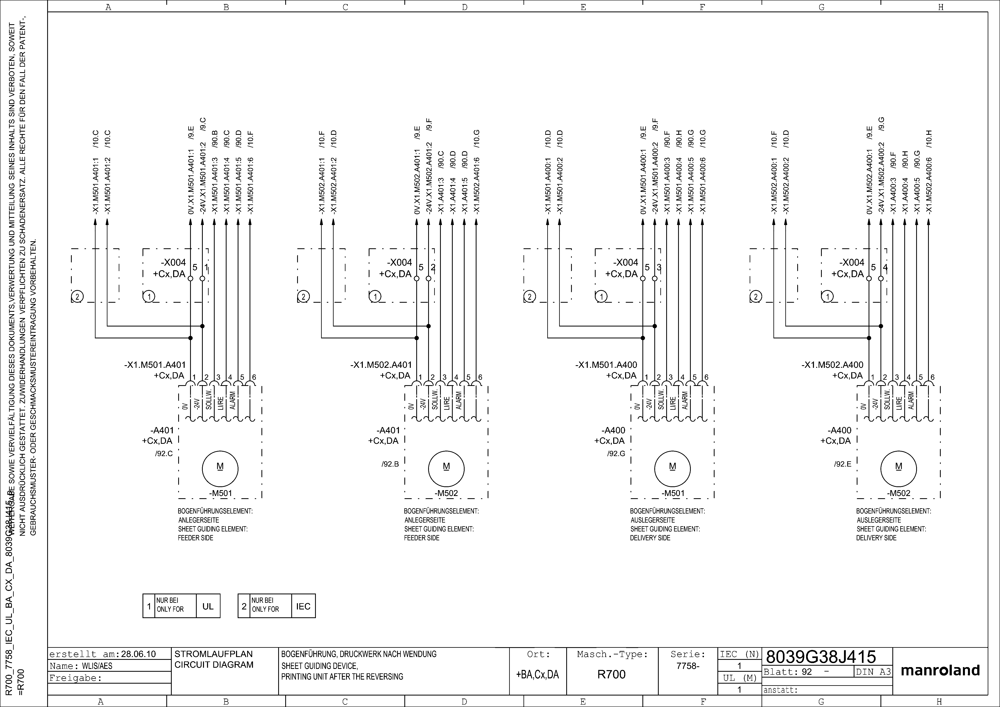

# +BA_Cx_DA — Sheet 92 of 247 — BOGENFÜHRUNG, DRUCKWERK NACH WENDUNG

**SHEET GUIDING DEVICE**

> Part of the manroland **R700** printing press IEC/UL circuit diagrams.
> Drawing class: **Stromlaufplan / Circuit diagram** (DIN A3).
> Document `+BA_Cx_DA` covers the **Printing units / main switch cabinet** machine section.

## At a glance

| Field | Value |
|---|---|
| Document | `+BA_Cx_DA`  (8039G38J415) |
| Sheet | **92** of 247 |
| Section (DE) | BOGENFÜHRUNG, DRUCKWERK NACH WENDUNG |
| Section (EN) | SHEET GUIDING DEVICE |
| Section type | CIRCUIT — Circuit diagram |
| Machine type | `R700` |
| Series | `7758` |
| Created | 28.06.10 |
| Replaces | — |
| Columns used | A, B, C, D, E, F, G, H |
| Path numbers | — |
| Labels on sheet | 184 |
| Cross-refs out | 36 |
| Cross-refs in | 60 |

**Previous:** [+BA_Cx_DA sheet 91](SHEET_0091.md) · **Next:** [+BA_Cx_DA sheet 93](SHEET_0093.md) · **Document TOC:** [_TOC.md](_TOC.md)  (+BA_Cx_DA) · **Master TOC:** [all sheets](../_MASTER_TOC.md)

## Sheet image (300 DPI, exact vector render)



_Rendered directly from the PDF vector layer at 300 DPI (1-bit), no OCR and no resampling. Use it to confirm anything ambiguous in the text below._

## Cross-references on this sheet

Each entry is a wire leaving this sheet. The printed token is `/sheet.column`; the link resolves to that sheet inside the same document.

| Ref | Target sheet | Col | Path | Destination on target | Target section | From col |
|---|---|---|---|---|---|---|
| `/9.G` | [+BA_Cx_DA sheet 9](SHEET_0009.md) | G | — | 24V.X1.M502.A400:2 | SPANNUNGSVERSORGUNG, SCHALTSCHRANKBELÜFTUNG | H |
| `/9.C` | [+BA_Cx_DA sheet 9](SHEET_0009.md) | C | — | 24V.X1.M501.A401:2 | SPANNUNGSVERSORGUNG, SCHALTSCHRANKBELÜFTUNG | B |
| `/9.F` | [+BA_Cx_DA sheet 9](SHEET_0009.md) | F | — | 24V.X1.M502.A401:2 | SPANNUNGSVERSORGUNG, SCHALTSCHRANKBELÜFTUNG | D |
| `/9.F` | [+BA_Cx_DA sheet 9](SHEET_0009.md) | F | — | 24V.X1.M501.A400:2 | SPANNUNGSVERSORGUNG, SCHALTSCHRANKBELÜFTUNG | F |
| `/9.E` | [+BA_Cx_DA sheet 9](SHEET_0009.md) | E | — | 0V.X1.M501.A401:1 | SPANNUNGSVERSORGUNG, SCHALTSCHRANKBELÜFTUNG | B |
| `/9.E` | [+BA_Cx_DA sheet 9](SHEET_0009.md) | E | — | 0V.X1.M502.A401:1 | SPANNUNGSVERSORGUNG, SCHALTSCHRANKBELÜFTUNG | D |
| `/9.E` | [+BA_Cx_DA sheet 9](SHEET_0009.md) | E | — | 0V.X1.M501.A400:1 | SPANNUNGSVERSORGUNG, SCHALTSCHRANKBELÜFTUNG | F |
| `/9.E` | [+BA_Cx_DA sheet 9](SHEET_0009.md) | E | — | 0V.X1.M502.A400:1 | SPANNUNGSVERSORGUNG, SCHALTSCHRANKBELÜFTUNG | G |
| `/10.G` | [+BA_Cx_DA sheet 10](SHEET_0010.md) | G | — | X1.M502.A401:6 | SPANNUNGSVERSORGUNG, SCHALTSCHRANKBELÜFTUNG | D |
| `/90.G` | [+BA_Cx_DA sheet 90](SHEET_0090.md) | G | — | X1.M501.A400:5 | BOGENFÜHRUNG | F |
| `/10.G` | [+BA_Cx_DA sheet 10](SHEET_0010.md) | G | — | X1.M501.A400:6 | SPANNUNGSVERSORGUNG, SCHALTSCHRANKBELÜFTUNG | F |
| `/10.C` | [+BA_Cx_DA sheet 10](SHEET_0010.md) | C | — | X1.M501.A401:1 | SPANNUNGSVERSORGUNG, SCHALTSCHRANKBELÜFTUNG | A |
| `/10.C` | [+BA_Cx_DA sheet 10](SHEET_0010.md) | C | — | X1.M501.A401:2 | SPANNUNGSVERSORGUNG, SCHALTSCHRANKBELÜFTUNG | A |
| `/90.C` | [+BA_Cx_DA sheet 90](SHEET_0090.md) | C | — | X1.M501.A401:4 | BOGENFÜHRUNG | B |
| `/90.D` | [+BA_Cx_DA sheet 90](SHEET_0090.md) | D | — | X1.M501.A401:5 | BOGENFÜHRUNG | B |
| `/10.D` | [+BA_Cx_DA sheet 10](SHEET_0010.md) | D | — | X1.M502.A401:2 | SPANNUNGSVERSORGUNG, SCHALTSCHRANKBELÜFTUNG | C |
| `/10.D` | [+BA_Cx_DA sheet 10](SHEET_0010.md) | D | — | X1.M501.A400:1 | SPANNUNGSVERSORGUNG, SCHALTSCHRANKBELÜFTUNG | E |
| `/10.D` | [+BA_Cx_DA sheet 10](SHEET_0010.md) | D | — | X1.M501.A400:2 | SPANNUNGSVERSORGUNG, SCHALTSCHRANKBELÜFTUNG | E |
| `/90.H` | [+BA_Cx_DA sheet 90](SHEET_0090.md) | H | — | X1.M501.A400:4 | BOGENFÜHRUNG | F |
| `/10.D` | [+BA_Cx_DA sheet 10](SHEET_0010.md) | D | — | X1.M502.A400:2 | SPANNUNGSVERSORGUNG, SCHALTSCHRANKBELÜFTUNG | G |
| `/10.H` | [+BA_Cx_DA sheet 10](SHEET_0010.md) | H | — | X1.M502.A400:6 | SPANNUNGSVERSORGUNG, SCHALTSCHRANKBELÜFTUNG | H |
| `/90.B` | [+BA_Cx_DA sheet 90](SHEET_0090.md) | B | — | X1.M501.A401:3 | BOGENFÜHRUNG | B |
| `/10.F` | [+BA_Cx_DA sheet 10](SHEET_0010.md) | F | — | X1.M501.A401:6 | SPANNUNGSVERSORGUNG, SCHALTSCHRANKBELÜFTUNG | B |
| `/10.F` | [+BA_Cx_DA sheet 10](SHEET_0010.md) | F | — | X1.M502.A401:1 | SPANNUNGSVERSORGUNG, SCHALTSCHRANKBELÜFTUNG | C |
| `/90.F` | [+BA_Cx_DA sheet 90](SHEET_0090.md) | F | — | X1.M501.A400:3 | BOGENFÜHRUNG | F |
| `/10.F` | [+BA_Cx_DA sheet 10](SHEET_0010.md) | F | — | X1.M502.A400:1 | SPANNUNGSVERSORGUNG, SCHALTSCHRANKBELÜFTUNG | G |
| `/90.G` | [+BA_Cx_DA sheet 90](SHEET_0090.md) | G | — | X1.A400:5 | BOGENFÜHRUNG | H |
| `/90.C` | [+BA_Cx_DA sheet 90](SHEET_0090.md) | C | — | X1.A401:3 | BOGENFÜHRUNG | D |
| `/90.D` | [+BA_Cx_DA sheet 90](SHEET_0090.md) | D | — | X1.A401:4 | BOGENFÜHRUNG | D |
| `/90.D` | [+BA_Cx_DA sheet 90](SHEET_0090.md) | D | — | X1.A401:5 | BOGENFÜHRUNG | D |
| `/90.H` | [+BA_Cx_DA sheet 90](SHEET_0090.md) | H | — | X1.A400:4 | BOGENFÜHRUNG | H |
| `/90.F` | [+BA_Cx_DA sheet 90](SHEET_0090.md) | F | — | X1.A400:3 | BOGENFÜHRUNG | H |
| `/92.G` | [+BA_Cx_DA sheet 92](SHEET_0092.md) | G | — | — | BOGENFÜHRUNG, DRUCKWERK NACH WENDUNG | E |
| `/92.C` | [+BA_Cx_DA sheet 92](SHEET_0092.md) | C | — | — | BOGENFÜHRUNG, DRUCKWERK NACH WENDUNG | A |
| `/92.B` | [+BA_Cx_DA sheet 92](SHEET_0092.md) | B | — | — | BOGENFÜHRUNG, DRUCKWERK NACH WENDUNG | C |
| `/92.E` | [+BA_Cx_DA sheet 92](SHEET_0092.md) | E | — | — | BOGENFÜHRUNG, DRUCKWERK NACH WENDUNG | G |

### Incoming references (sheets that point here)

Every other sheet that sends a wire to this one. `Back-ref` is the token printed on *that* sheet; `Path` is its line number.

| From sheet | Cols | Back-ref | Path | Refs | What continues there |
|---|---|---|---|---|---|
| [+BA_Cx_DA#9](SHEET_0009.md) | D, E, F, G | `/9.D`, `/9.E`, `/9.F`, `/9.G` | — | 8 | — |
| [+BA_Cx_DA#10](SHEET_0010.md) | C, D, F, G | `/10.C`, `/10.D`, `/10.F`, `/10.G` | — | 12 | X1.M501.A400:1; X1.M501.A401:1; X1.M502.A400:1; X1.M502.A401:1 |
| [+BA_Cx_DA#90](SHEET_0090.md) | C, D, E, F, G, H | `/90.C`, `/90.D`, `/90.E`, `/90.F`, `/90.G`, `/90.H` | — | 12 | — |
| [+BA_Cx_DA#92](SHEET_0092.md) | A, C, E, G | `/92.A`, `/92.C`, `/92.E`, `/92.G` | — | 4 | — |
| [+BA_Cx_DA#149](SHEET_0149.md) | A, B | `/149.A`, `/149.B` | — | 24 | — |


## Devices on this sheet

| Tag | Class | Class meaning (IEC) | Col | Sub | Terminal | Sign |
|---|---|---|---|---|---|---|
| `X004` | X | Klemme / terminal, plug connector | G | — | — | — |
| `A400` | A | Baugruppe / assembly, module, PC board | G | — | — | — |
| `X004` | X | Klemme / terminal, plug connector | E | — | — | — |
| `A400` | A | Baugruppe / assembly, module, PC board | E | — | — | — |
| `X004` | X | Klemme / terminal, plug connector | C | — | — | — |
| `A401` | A | Baugruppe / assembly, module, PC board | C | — | — | — |
| `X004` | X | Klemme / terminal, plug connector | B | — | — | — |
| `A401` | A | Baugruppe / assembly, module, PC board | A | — | — | — |
| `X1.M502.A400` | — | cross-device reference | G | — | — | — |
| `X1.M501.A400` | — | cross-device reference | E | — | — | — |
| `X1.M502.A401` | — | cross-device reference | C | — | — | — |
| `X1.M501.A401` | — | cross-device reference | A | — | — | — |
| `X1.A400:3` | — | cross-device reference | H | — | 3 | — |
| `X1.A400:4` | — | cross-device reference | H | — | 4 | — |
| `X1.A400:5` | — | cross-device reference | H | — | 5 | — |
| `X1.A401:3` | — | cross-device reference | D | — | 3 | — |
| `X1.A401:4` | — | cross-device reference | D | — | 4 | — |
| `X1.A401:5` | — | cross-device reference | D | — | 5 | — |
| `X1.M501.A400:6` | — | cross-device reference | F | — | 6 | — |
| `X1.M501.A401:1` | — | cross-device reference | A | — | 1 | — |
| `X1.M501.A401:2` | — | cross-device reference | A | — | 2 | — |
| `X1.M501.A401:3` | — | cross-device reference | B | — | 3 | — |
| `X1.M501.A400:5` | — | cross-device reference | F | — | 5 | — |
| `X1.M501.A400:4` | — | cross-device reference | F | — | 4 | — |
| `X1.M501.A400:1` | — | cross-device reference | E | — | 1 | — |
| `X1.M501.A400:2` | — | cross-device reference | E | — | 2 | — |
| `X1.M501.A400:3` | — | cross-device reference | F | — | 3 | — |
| `X1.M501.A401:4` | — | cross-device reference | B | — | 4 | — |
| `X1.M502.A401:2` | — | cross-device reference | C | — | 2 | — |
| `X1.M502.A401:6` | — | cross-device reference | D | — | 6 | — |
| `X1.M502.A401:1` | — | cross-device reference | C | — | 1 | — |
| `X1.M501.A401:5` | — | cross-device reference | B | — | 5 | — |
| `X1.M501.A401:6` | — | cross-device reference | B | — | 6 | — |
| `X1.M502.A400:1` | — | cross-device reference | G | — | 1 | — |
| `X1.M502.A400:2` | — | cross-device reference | G | — | 2 | — |
| `X1.M502.A400:6` | — | cross-device reference | H | — | 6 | — |
| `SOLLW.` | — | cross-device reference | H | — | — | — |
| `SOLLW.` | — | cross-device reference | F | — | — | — |
| `SOLLW.` | — | cross-device reference | D | — | — | — |
| `SOLLW.` | — | cross-device reference | B | — | — | — |

## Potentials / nets

| Potential | Count | Columns | Attached devices | Terminals |
|---|---|---|---|---|
| `0V` | 8 | B, D, E, F, G | `A400`, `A401`, `M501`, `M502`, `X1` | `1` |
| `24V` | 8 | B, D, F, G, H | `A400`, `A401`, `M501`, `M502`, `X1` | `2` |
| `M501` | 2 | B, F | — | — |
| `M502` | 2 | D, H | — | — |


A potential such as `L24+/4` or `M24+` is a named supply/return rail; every place it appears on this sheet is electrically common.

## Wire-end annotations (grouped as printed)

A wire that continues elsewhere is annotated with a small cluster: the destination description, the path/line number `#NN`, and the `/sheet.column` cross reference. Each row below is one such cluster exactly as it is grouped on the drawing.

| Col | Y | Path | Cross-ref | Text on the wire |
|---|---|---|---|---|
| H | 139.2 | — | `/9.G` | `24V.X1.M502.A400:2` |
| B | 139.8 | — | `/9.C` | `24V.X1.M501.A401:2` |
| D | 140.6 | — | `/9.F` | `24V.X1.M502.A401:2` |
| F | 140.6 | — | `/9.F` | `24V.X1.M501.A400:2` |
| B | 149.9 | — | `/9.E` | `0V.X1.M501.A401:1` |
| D | 149.9 | — | `/9.E` | `0V.X1.M502.A401:1` |
| F | 149.9 | — | `/9.E` | `0V.X1.M501.A400:1` |
| G | 149.9 | — | `/9.E` | `0V.X1.M502.A400:1` |
| D | 154.2 | — | `/10.G` | `X1.M502.A401:6` |
| F | 154.2 | — | `/90.G` | `X1.M501.A400:5` |
| F | 154.2 | — | `/10.G` | `X1.M501.A400:6` |
| A | 154.8 | — | `/10.C` | `X1.M501.A401:1` |
| A | 154.8 | — | `/10.C` | `X1.M501.A401:2` |
| B | 154.8 | — | `/90.C` | `X1.M501.A401:4` |
| B | 154.8 | — | `/90.D` | `X1.M501.A401:5` |
| C | 154.8 | — | `/10.D` | `X1.M502.A401:2` |
| E | 154.8 | — | `/10.D` | `X1.M501.A400:1` |
| E | 154.8 | — | `/10.D` | `X1.M501.A400:2` |
| F | 154.8 | — | `/90.H` | `X1.M501.A400:4` |
| G | 154.8 | — | `/10.D` | `X1.M502.A400:2` |
| H | 154.8 | — | `/10.H` | `X1.M502.A400:6` |
| B | 155.1 | — | `/90.B` | `X1.M501.A401:3` |
| B | 155.6 | — | `/10.F` | `X1.M501.A401:6` |
| C | 155.6 | — | `/10.F` | `X1.M502.A401:1` |
| F | 155.6 | — | `/90.F` | `X1.M501.A400:3` |
| G | 155.6 | — | `/10.F` | `X1.M502.A400:1` |
| H | 179.0 | — | `/90.G` | `X1.A400:5` |
| D | 179.6 | — | `/90.C` | `X1.A401:3` |
| D | 179.6 | — | `/90.D` | `X1.A401:4` |
| D | 179.6 | — | `/90.D` | `X1.A401:5` |
| H | 179.6 | — | `/90.H` | `X1.A400:4` |
| H | 180.4 | — | `/90.F` | `X1.A400:3` |
| B | 307.6 | — | — | `+Cx,DA X004 5 1` |
| D | 307.6 | — | — | `+Cx,DA X004 5 2` |
| E | 307.6 | — | — | `+Cx,DA X004 5 3` |
| G | 307.6 | — | — | `+Cx,DA X004 5 4` |
| A | 349.9 | — | — | `1` |
| C | 349.9 | — | — | `1` |
| E | 349.9 | — | — | `1` |
| G | 349.9 | — | — | `1` |
| D | 350.4 | — | — | `2 2 2 2` |
| A | 429.8 | — | — | `X1.M501.A401 1` |
| C | 429.8 | — | — | `X1.M502.A401 1` |
| E | 429.8 | — | — | `X1.M501.A400 1` |
| G | 429.8 | — | — | `X1.M502.A400 1` |
| B | 442.5 | — | — | `+Cx,DA 2 3 4 5 6` |
| D | 442.5 | — | — | `+Cx,DA 2 3 4 5 6` |
| F | 442.5 | — | — | `+Cx,DA 2 3 4 5 6` |
| H | 442.5 | — | — | `+Cx,DA 2 3 4 5 6` |
| B | 463.4 | — | — | `SOLLW.` |
| D | 463.4 | — | — | `SOLLW.` |
| F | 463.4 | — | — | `SOLLW.` |
| H | 463.4 | — | — | `SOLLW.` |
| B | 466.1 | — | — | `ALARM` |
| D | 466.1 | — | — | `ALARM` |
| F | 466.1 | — | — | `ALARM` |
| H | 466.1 | — | — | `ALARM` |
| B | 472.3 | — | — | `LI/RE` |
| D | 472.3 | — | — | `LI/RE` |
| F | 472.3 | — | — | `LI/RE` |
| H | 472.3 | — | — | `LI/RE` |
| B | 474.7 | — | — | `24V` |
| D | 474.7 | — | — | `24V` |
| F | 474.7 | — | — | `24V` |
| G | 474.7 | — | — | `24V` |
| B | 480.1 | — | — | `0V` |
| D | 480.1 | — | — | `0V` |
| E | 480.1 | — | — | `0V` |
| G | 480.1 | — | — | `0V` |
| A | 507.7 | — | — | `+Cx,DA A401` |
| C | 507.7 | — | — | `+Cx,DA A401` |
| E | 507.7 | — | — | `+Cx,DA A400` |
| G | 507.7 | — | — | `+Cx,DA A400` |
| A | 536.4 | — | `/92.C` | — |
| E | 536.4 | — | `/92.G` | — |
| C | 548.8 | — | `/92.B` | — |
| G | 548.8 | — | `/92.E` | — |
| B | 550.2 | — | — | `M` |
| D | 550.2 | — | — | `M` |
| F | 550.2 | — | — | `M` |
| H | 550.2 | — | — | `M` |
| B | 583.1 | — | — | `M501` |
| D | 583.1 | — | — | `M502` |
| F | 583.1 | — | — | `M501` |
| H | 583.1 | — | — | `M502` |
| B | 605.8 | — | — | `BOGENFÜHRUNGSELEMENT:` |
| D | 605.8 | — | — | `BOGENFÜHRUNGSELEMENT:` |
| F | 605.8 | — | — | `BOGENFÜHRUNGSELEMENT:` |
| H | 605.8 | — | — | `BOGENFÜHRUNGSELEMENT:` |
| F | 616.4 | — | — | `DELIVERY SIDE SHEET GUIDING ELEMENT: AUSLEGERSEITE` |
| H | 616.4 | — | — | `DELIVERY SIDE SHEET GUIDING ELEMENT: AUSLEGERSEITE` |
| B | 616.5 | — | — | `FEEDER SIDE SHEET GUIDING ELEMENT: ANLEGERSEITE` |
| D | 616.5 | — | — | `FEEDER SIDE SHEET GUIDING ELEMENT: ANLEGERSEITE` |
| A | 712.1 | — | — | `1 NUR BEI` |
| B | 712.1 | — | — | `2 NUR BEI` |
| B | 717.5 | — | — | `ONLY FOR UL` |
| B | 717.6 | — | — | `ONLY FOR IEC` |


## Notes and free text on this sheet

| Text | Col | Y (pt) |
|---|---|---|
| `+Cx,DA` | G | 321.38 |
| `BOGENFÜHRUNGSELEMENT:` | H | 605.83 |
| `AUSLEGERSEITE` | G | 616.44 |
| `SHEET GUIDING ELEMENT:` | H | 627.09 |
| `DELIVERY SIDE` | G | 637.69 |
| `+Cx,DA` | E | 321.38 |
| `BOGENFÜHRUNGSELEMENT:` | F | 605.83 |
| `AUSLEGERSEITE` | F | 616.44 |
| `SHEET GUIDING ELEMENT:` | F | 627.09 |
| `DELIVERY SIDE` | F | 637.69 |
| `+Cx,DA` | C | 321.38 |
| `BOGENFÜHRUNGSELEMENT:` | D | 605.83 |
| `ANLEGERSEITE` | D | 616.45 |
| `SHEET GUIDING ELEMENT:` | D | 627.09 |
| `FEEDER SIDE` | D | 637.69 |
| `+Cx,DA` | B | 321.38 |
| `+Cx,DA` | A | 520.46 |
| `BOGENFÜHRUNGSELEMENT:` | B | 605.83 |
| `ANLEGERSEITE` | B | 616.45 |
| `SHEET GUIDING ELEMENT:` | B | 627.09 |
| `FEEDER SIDE` | B | 637.69 |
| `NUR BEI` | A | 712.08 |
| `ONLY FOR` | B | 722.76 |
| `UL` | B | 717.46 |
| `LI/RE` | H | 472.3 |
| `ALARM` | H | 466.06 |
| `M` | H | 550.25 |
| `LI/RE` | F | 472.3 |
| `ALARM` | F | 466.06 |
| `M` | F | 550.25 |
| `LI/RE` | D | 472.3 |
| `ALARM` | D | 466.06 |
| `M` | D | 550.25 |
| `LI/RE` | B | 472.3 |
| `ALARM` | B | 466.06 |
| `M` | B | 550.25 |
| `NUR BEI` | B | 712.08 |
| `IEC` | C | 717.57 |

## Complete label inventory (exact text from the drawing)

Every text object inside the drawing area of this sheet, in DIN reading order (column A→H, then top→bottom). This is the authoritative list: if a string is not here it is not printed on this sheet.

| Col | Y | X | Dir | Type | Text |
|---|---|---|---|---|---|
| A | 154.8 | 110.1 | ↕ | cross-reference | `/10.C` |
| A | 154.8 | 124.3 | ↕ | cross-reference | `/10.C` |
| A | 187.4 | 110.1 | ↕ | device ref | `X1.M501.A401:1` |
| A | 187.4 | 124.3 | ↕ | device ref | `X1.M501.A401:2` |
| A | 349.9 | 175.4 | → | number | `1` |
| A | 350.4 | 90.1 | → | number | `2` |
| A | 429.8 | 148.0 | → | device ref | `X1.M501.A401` |
| A | 507.7 | 179.1 | → | device tag | `A401` |
| A | 520.5 | 168.9 | → | text | `+Cx,DA` |
| A | 536.4 | 184.8 | → | cross-reference | `/92.C` |
| A | 712.1 | 186.2 | → | text | `NUR BEI` |
| A | 717.4 | 174.6 | → | number | `1` |
| B | 139.7 | 237.7 | ↕ | cross-reference | `/9.C` |
| B | 150.0 | 223.5 | ↕ | cross-reference | `/9.E` |
| B | 154.8 | 266.0 | ↕ | cross-reference | `/90.C` |
| B | 154.8 | 280.2 | ↕ | cross-reference | `/90.D` |
| B | 155.1 | 251.8 | ↕ | cross-reference | `/90.B` |
| B | 155.6 | 294.4 | ↕ | cross-reference | `/10.F` |
| B | 169.2 | 237.7 | ↕ | potential | `24V.X1.M501.A401:2` |
| B | 176.9 | 223.5 | ↕ | potential | `0V.X1.M501.A401:1` |
| B | 187.4 | 251.9 | ↕ | device ref | `X1.M501.A401:3` |
| B | 187.4 | 266.0 | ↕ | device ref | `X1.M501.A401:4` |
| B | 187.4 | 280.2 | ↕ | device ref | `X1.M501.A401:5` |
| B | 187.4 | 294.4 | ↕ | device ref | `X1.M501.A401:6` |
| B | 307.6 | 191.6 | → | device tag | `X004` |
| B | 313.5 | 229.0 | → | number | `5` |
| B | 313.5 | 242.6 | → | number | `1` |
| B | 321.4 | 182.0 | → | text | `+Cx,DA` |
| B | 442.5 | 183.1 | → | text | `+Cx,DA` |
| B | 445.4 | 228.8 | → | number | `1` |
| B | 445.4 | 243.5 | → | number | `2` |
| B | 445.4 | 257.7 | → | number | `3` |
| B | 445.4 | 271.8 | → | number | `4` |
| B | 445.4 | 286.0 | → | number | `5` |
| B | 445.4 | 300.2 | → | number | `6` |
| B | 463.4 | 245.7 | ↕ | device ref | `SOLLW.` |
| B | 466.1 | 274.2 | ↕ | text | `ALARM` |
| B | 472.3 | 259.9 | ↕ | text | `LI/RE` |
| B | 474.7 | 231.7 | ↕ | potential | `24V` |
| B | 480.1 | 217.5 | ↕ | potential | `0V` |
| B | 550.3 | 257.8 | → | text | `M` |
| B | 583.1 | 249.2 | → | potential | `M501` |
| B | 605.8 | 211.7 | → | text | `BOGENFÜHRUNGSELEMENT:` |
| B | 616.4 | 212.6 | → | text | `ANLEGERSEITE` |
| B | 627.1 | 212.3 | → | text | `SHEET GUIDING ELEMENT:` |
| B | 637.7 | 211.7 | → | text | `FEEDER SIDE` |
| B | 712.1 | 299.6 | → | text | `NUR BEI` |
| B | 717.4 | 287.7 | → | number | `2` |
| B | 717.5 | 240.9 | → | text | `UL` |
| B | 722.8 | 186.8 | → | text | `ONLY FOR` |
| B | 722.8 | 300.2 | → | text | `ONLY FOR` |
| C | 154.8 | 393.6 | ↕ | cross-reference | `/10.D` |
| C | 155.6 | 379.4 | ↕ | cross-reference | `/10.F` |
| C | 187.4 | 379.4 | ↕ | device ref | `X1.M502.A401:1` |
| C | 187.4 | 393.6 | ↕ | device ref | `X1.M502.A401:2` |
| C | 307.6 | 460.9 | → | device tag | `X004` |
| C | 321.4 | 451.3 | → | text | `+Cx,DA` |
| C | 349.9 | 444.7 | → | number | `1` |
| C | 350.4 | 359.4 | → | number | `2` |
| C | 429.8 | 417.3 | → | device ref | `X1.M502.A401` |
| C | 442.5 | 452.4 | → | text | `+Cx,DA` |
| C | 507.7 | 448.4 | → | device tag | `A401` |
| C | 520.5 | 438.2 | → | text | `+Cx,DA` |
| C | 548.8 | 454.4 | → | cross-reference | `/92.B` |
| C | 717.6 | 352.6 | → | text | `IEC` |
| D | 140.6 | 506.9 | ↕ | cross-reference | `/9.F` |
| D | 150.0 | 492.7 | ↕ | cross-reference | `/9.E` |
| D | 154.2 | 563.7 | ↕ | cross-reference | `/10.G` |
| D | 169.2 | 507.0 | ↕ | potential | `24V.X1.M502.A401:2` |
| D | 176.9 | 492.8 | ↕ | potential | `0V.X1.M502.A401:1` |
| D | 179.6 | 521.1 | ↕ | cross-reference | `/90.C` |
| D | 179.6 | 535.3 | ↕ | cross-reference | `/90.D` |
| D | 179.6 | 549.5 | ↕ | cross-reference | `/90.D` |
| D | 187.4 | 563.7 | ↕ | device ref | `X1.M502.A401:6` |
| D | 211.5 | 521.1 | ↕ | device ref | `X1.A401:3` |
| D | 211.5 | 535.3 | ↕ | device ref | `X1.A401:4` |
| D | 211.5 | 549.5 | ↕ | device ref | `X1.A401:5` |
| D | 313.5 | 498.3 | → | number | `5` |
| D | 313.5 | 512.8 | → | number | `2` |
| D | 445.4 | 498.0 | → | number | `1` |
| D | 445.4 | 512.8 | → | number | `2` |
| D | 445.4 | 527.0 | → | number | `3` |
| D | 445.4 | 541.1 | → | number | `4` |
| D | 445.4 | 555.3 | → | number | `5` |
| D | 445.4 | 569.5 | → | number | `6` |
| D | 463.4 | 515.0 | ↕ | device ref | `SOLLW.` |
| D | 466.1 | 543.5 | ↕ | text | `ALARM` |
| D | 472.3 | 529.2 | ↕ | text | `LI/RE` |
| D | 474.7 | 501.0 | ↕ | potential | `24V` |
| D | 480.1 | 486.7 | ↕ | potential | `0V` |
| D | 550.3 | 527.1 | → | text | `M` |
| D | 583.1 | 517.6 | → | potential | `M502` |
| D | 605.8 | 481.0 | → | text | `BOGENFÜHRUNGSELEMENT:` |
| D | 616.4 | 481.9 | → | text | `ANLEGERSEITE` |
| D | 627.1 | 481.6 | → | text | `SHEET GUIDING ELEMENT:` |
| D | 637.7 | 481.0 | → | text | `FEEDER SIDE` |
| E | 154.8 | 648.7 | ↕ | cross-reference | `/10.D` |
| E | 154.8 | 662.9 | ↕ | cross-reference | `/10.D` |
| E | 187.4 | 648.7 | ↕ | device ref | `X1.M501.A400:1` |
| E | 187.4 | 662.9 | ↕ | device ref | `X1.M501.A400:2` |
| E | 307.6 | 730.2 | → | device tag | `X004` |
| E | 321.4 | 720.6 | → | text | `+Cx,DA` |
| E | 349.9 | 714.0 | → | number | `1` |
| E | 350.4 | 628.7 | → | number | `2` |
| E | 429.8 | 685.1 | → | device ref | `X1.M501.A400` |
| E | 442.5 | 721.7 | → | text | `+Cx,DA` |
| E | 480.1 | 756.0 | ↕ | potential | `0V` |
| E | 507.7 | 716.3 | → | device tag | `A400` |
| E | 520.5 | 707.5 | → | text | `+Cx,DA` |
| E | 536.4 | 723.1 | → | cross-reference | `/92.G` |
| F | 140.6 | 776.2 | ↕ | cross-reference | `/9.F` |
| F | 150.0 | 762.0 | ↕ | cross-reference | `/9.E` |
| F | 154.2 | 818.8 | ↕ | cross-reference | `/90.G` |
| F | 154.2 | 832.9 | ↕ | cross-reference | `/10.G` |
| F | 154.8 | 804.6 | ↕ | cross-reference | `/90.H` |
| F | 155.6 | 790.4 | ↕ | cross-reference | `/90.F` |
| F | 169.2 | 776.3 | ↕ | potential | `24V.X1.M501.A400:2` |
| F | 176.9 | 762.1 | ↕ | potential | `0V.X1.M501.A400:1` |
| F | 187.4 | 790.5 | ↕ | device ref | `X1.M501.A400:3` |
| F | 187.4 | 804.6 | ↕ | device ref | `X1.M501.A400:4` |
| F | 187.4 | 818.8 | ↕ | device ref | `X1.M501.A400:5` |
| F | 187.4 | 833.0 | ↕ | device ref | `X1.M501.A400:6` |
| F | 313.5 | 767.6 | → | number | `5` |
| F | 313.5 | 781.8 | → | number | `3` |
| F | 350.4 | 898.0 | → | number | `2` |
| F | 445.4 | 767.3 | → | number | `1` |
| F | 445.4 | 782.1 | → | number | `2` |
| F | 445.4 | 796.3 | → | number | `3` |
| F | 445.4 | 810.4 | → | number | `4` |
| F | 445.4 | 824.6 | → | number | `5` |
| F | 445.4 | 838.8 | → | number | `6` |
| F | 463.4 | 784.3 | ↕ | device ref | `SOLLW.` |
| F | 466.1 | 812.8 | ↕ | text | `ALARM` |
| F | 472.3 | 798.5 | ↕ | text | `LI/RE` |
| F | 474.7 | 770.2 | ↕ | potential | `24V` |
| F | 550.3 | 796.4 | → | text | `M` |
| F | 583.1 | 787.7 | → | potential | `M501` |
| F | 605.8 | 750.3 | → | text | `BOGENFÜHRUNGSELEMENT:` |
| F | 616.4 | 751.2 | → | text | `AUSLEGERSEITE` |
| F | 627.1 | 750.9 | → | text | `SHEET GUIDING ELEMENT:` |
| F | 637.7 | 750.3 | → | text | `DELIVERY SIDE` |
| G | 150.0 | 1031.3 | ↕ | cross-reference | `/9.E` |
| G | 154.8 | 932.2 | ↕ | cross-reference | `/10.D` |
| G | 155.6 | 918.0 | ↕ | cross-reference | `/10.F` |
| G | 176.9 | 1031.4 | ↕ | potential | `0V.X1.M502.A400:1` |
| G | 187.4 | 918.0 | ↕ | device ref | `X1.M502.A400:1` |
| G | 187.4 | 932.2 | ↕ | device ref | `X1.M502.A400:2` |
| G | 307.6 | 999.5 | → | device tag | `X004` |
| G | 313.5 | 1036.9 | → | number | `5` |
| G | 321.4 | 989.9 | → | text | `+Cx,DA` |
| G | 349.9 | 983.3 | → | number | `1` |
| G | 429.8 | 954.4 | → | device ref | `X1.M502.A400` |
| G | 442.5 | 991.0 | → | text | `+Cx,DA` |
| G | 445.4 | 1036.6 | → | number | `1` |
| G | 474.7 | 1039.5 | ↕ | potential | `24V` |
| G | 480.1 | 1025.3 | ↕ | potential | `0V` |
| G | 507.7 | 985.6 | → | device tag | `A400` |
| G | 520.5 | 976.8 | → | text | `+Cx,DA` |
| G | 548.8 | 993.3 | → | cross-reference | `/92.E` |
| G | 616.4 | 1020.5 | → | text | `AUSLEGERSEITE` |
| G | 637.7 | 1019.6 | → | text | `DELIVERY SIDE` |
| H | 139.2 | 1045.5 | ↕ | cross-reference | `/9.G` |
| H | 154.8 | 1102.3 | ↕ | cross-reference | `/10.H` |
| H | 169.2 | 1045.6 | ↕ | potential | `24V.X1.M502.A400:2` |
| H | 179.0 | 1088.1 | ↕ | cross-reference | `/90.G` |
| H | 179.6 | 1073.9 | ↕ | cross-reference | `/90.H` |
| H | 180.4 | 1059.7 | ↕ | cross-reference | `/90.F` |
| H | 187.4 | 1102.3 | ↕ | device ref | `X1.M502.A400:6` |
| H | 211.5 | 1059.7 | ↕ | device ref | `X1.A400:3` |
| H | 211.5 | 1073.9 | ↕ | device ref | `X1.A400:4` |
| H | 211.5 | 1088.1 | ↕ | device ref | `X1.A400:5` |
| H | 313.5 | 1051.4 | → | number | `4` |
| H | 445.4 | 1051.4 | → | number | `2` |
| H | 445.4 | 1065.5 | → | number | `3` |
| H | 445.4 | 1079.7 | → | number | `4` |
| H | 445.4 | 1093.9 | → | number | `5` |
| H | 445.4 | 1108.1 | → | number | `6` |
| H | 463.4 | 1053.6 | ↕ | device ref | `SOLLW.` |
| H | 466.1 | 1082.1 | ↕ | text | `ALARM` |
| H | 472.3 | 1067.8 | ↕ | text | `LI/RE` |
| H | 550.3 | 1065.7 | → | text | `M` |
| H | 583.1 | 1056.2 | → | potential | `M502` |
| H | 605.8 | 1019.6 | → | text | `BOGENFÜHRUNGSELEMENT:` |
| H | 627.1 | 1020.2 | → | text | `SHEET GUIDING ELEMENT:` |

## Reading-order text block

The same content as a plain block, grouped by DIN column — convenient to paste or to match against a visual description.

```text
=== Column A ===
 154.8  110.1  xref         /10.C
 154.8  124.3  xref         /10.C
 187.4  110.1  devref       X1.M501.A401:1
 187.4  124.3  devref       X1.M501.A401:2
 349.9  175.4  numeric      1
 350.4   90.1  numeric      2
 429.8  148.0  devref       X1.M501.A401
 507.7  179.1  devtag       A401
 520.5  168.9  text         +Cx,DA
 536.4  184.8  xref         /92.C
 712.1  186.2  text         NUR BEI
 717.4  174.6  numeric      1
=== Column B ===
 139.7  237.7  xref         /9.C
 150.0  223.5  xref         /9.E
 154.8  266.0  xref         /90.C
 154.8  280.2  xref         /90.D
 155.1  251.8  xref         /90.B
 155.6  294.4  xref         /10.F
 169.2  237.7  net          24V.X1.M501.A401:2
 176.9  223.5  net          0V.X1.M501.A401:1
 187.4  251.9  devref       X1.M501.A401:3
 187.4  266.0  devref       X1.M501.A401:4
 187.4  280.2  devref       X1.M501.A401:5
 187.4  294.4  devref       X1.M501.A401:6
 307.6  191.6  devtag       X004
 313.5  229.0  numeric      5
 313.5  242.6  numeric      1
 321.4  182.0  text         +Cx,DA
 442.5  183.1  text         +Cx,DA
 445.4  228.8  numeric      1
 445.4  243.5  numeric      2
 445.4  257.7  numeric      3
 445.4  271.8  numeric      4
 445.4  286.0  numeric      5
 445.4  300.2  numeric      6
 463.4  245.7  devref       SOLLW.
 466.1  274.2  text         ALARM
 472.3  259.9  text         LI/RE
 474.7  231.7  net          24V
 480.1  217.5  net          0V
 550.3  257.8  text         M
 583.1  249.2  net          M501
 605.8  211.7  text         BOGENFÜHRUNGSELEMENT:
 616.4  212.6  text         ANLEGERSEITE
 627.1  212.3  text         SHEET GUIDING ELEMENT:
 637.7  211.7  text         FEEDER SIDE
 712.1  299.6  text         NUR BEI
 717.4  287.7  numeric      2
 717.5  240.9  text         UL
 722.8  186.8  text         ONLY FOR
 722.8  300.2  text         ONLY FOR
=== Column C ===
 154.8  393.6  xref         /10.D
 155.6  379.4  xref         /10.F
 187.4  379.4  devref       X1.M502.A401:1
 187.4  393.6  devref       X1.M502.A401:2
 307.6  460.9  devtag       X004
 321.4  451.3  text         +Cx,DA
 349.9  444.7  numeric      1
 350.4  359.4  numeric      2
 429.8  417.3  devref       X1.M502.A401
 442.5  452.4  text         +Cx,DA
 507.7  448.4  devtag       A401
 520.5  438.2  text         +Cx,DA
 548.8  454.4  xref         /92.B
 717.6  352.6  text         IEC
=== Column D ===
 140.6  506.9  xref         /9.F
 150.0  492.7  xref         /9.E
 154.2  563.7  xref         /10.G
 169.2  507.0  net          24V.X1.M502.A401:2
 176.9  492.8  net          0V.X1.M502.A401:1
 179.6  521.1  xref         /90.C
 179.6  535.3  xref         /90.D
 179.6  549.5  xref         /90.D
 187.4  563.7  devref       X1.M502.A401:6
 211.5  521.1  devref       X1.A401:3
 211.5  535.3  devref       X1.A401:4
 211.5  549.5  devref       X1.A401:5
 313.5  498.3  numeric      5
 313.5  512.8  numeric      2
 445.4  498.0  numeric      1
 445.4  512.8  numeric      2
 445.4  527.0  numeric      3
 445.4  541.1  numeric      4
 445.4  555.3  numeric      5
 445.4  569.5  numeric      6
 463.4  515.0  devref       SOLLW.
 466.1  543.5  text         ALARM
 472.3  529.2  text         LI/RE
 474.7  501.0  net          24V
 480.1  486.7  net          0V
 550.3  527.1  text         M
 583.1  517.6  net          M502
 605.8  481.0  text         BOGENFÜHRUNGSELEMENT:
 616.4  481.9  text         ANLEGERSEITE
 627.1  481.6  text         SHEET GUIDING ELEMENT:
 637.7  481.0  text         FEEDER SIDE
=== Column E ===
 154.8  648.7  xref         /10.D
 154.8  662.9  xref         /10.D
 187.4  648.7  devref       X1.M501.A400:1
 187.4  662.9  devref       X1.M501.A400:2
 307.6  730.2  devtag       X004
 321.4  720.6  text         +Cx,DA
 349.9  714.0  numeric      1
 350.4  628.7  numeric      2
 429.8  685.1  devref       X1.M501.A400
 442.5  721.7  text         +Cx,DA
 480.1  756.0  net          0V
 507.7  716.3  devtag       A400
 520.5  707.5  text         +Cx,DA
 536.4  723.1  xref         /92.G
=== Column F ===
 140.6  776.2  xref         /9.F
 150.0  762.0  xref         /9.E
 154.2  818.8  xref         /90.G
 154.2  832.9  xref         /10.G
 154.8  804.6  xref         /90.H
 155.6  790.4  xref         /90.F
 169.2  776.3  net          24V.X1.M501.A400:2
 176.9  762.1  net          0V.X1.M501.A400:1
 187.4  790.5  devref       X1.M501.A400:3
 187.4  804.6  devref       X1.M501.A400:4
 187.4  818.8  devref       X1.M501.A400:5
 187.4  833.0  devref       X1.M501.A400:6
 313.5  767.6  numeric      5
 313.5  781.8  numeric      3
 350.4  898.0  numeric      2
 445.4  767.3  numeric      1
 445.4  782.1  numeric      2
 445.4  796.3  numeric      3
 445.4  810.4  numeric      4
 445.4  824.6  numeric      5
 445.4  838.8  numeric      6
 463.4  784.3  devref       SOLLW.
 466.1  812.8  text         ALARM
 472.3  798.5  text         LI/RE
 474.7  770.2  net          24V
 550.3  796.4  text         M
 583.1  787.7  net          M501
 605.8  750.3  text         BOGENFÜHRUNGSELEMENT:
 616.4  751.2  text         AUSLEGERSEITE
 627.1  750.9  text         SHEET GUIDING ELEMENT:
 637.7  750.3  text         DELIVERY SIDE
=== Column G ===
 150.0 1031.3  xref         /9.E
 154.8  932.2  xref         /10.D
 155.6  918.0  xref         /10.F
 176.9 1031.4  net          0V.X1.M502.A400:1
 187.4  918.0  devref       X1.M502.A400:1
 187.4  932.2  devref       X1.M502.A400:2
 307.6  999.5  devtag       X004
 313.5 1036.9  numeric      5
 321.4  989.9  text         +Cx,DA
 349.9  983.3  numeric      1
 429.8  954.4  devref       X1.M502.A400
 442.5  991.0  text         +Cx,DA
 445.4 1036.6  numeric      1
 474.7 1039.5  net          24V
 480.1 1025.3  net          0V
 507.7  985.6  devtag       A400
 520.5  976.8  text         +Cx,DA
 548.8  993.3  xref         /92.E
 616.4 1020.5  text         AUSLEGERSEITE
 637.7 1019.6  text         DELIVERY SIDE
=== Column H ===
 139.2 1045.5  xref         /9.G
 154.8 1102.3  xref         /10.H
 169.2 1045.6  net          24V.X1.M502.A400:2
 179.0 1088.1  xref         /90.G
 179.6 1073.9  xref         /90.H
 180.4 1059.7  xref         /90.F
 187.4 1102.3  devref       X1.M502.A400:6
 211.5 1059.7  devref       X1.A400:3
 211.5 1073.9  devref       X1.A400:4
 211.5 1088.1  devref       X1.A400:5
 313.5 1051.4  numeric      4
 445.4 1051.4  numeric      2
 445.4 1065.5  numeric      3
 445.4 1079.7  numeric      4
 445.4 1093.9  numeric      5
 445.4 1108.1  numeric      6
 463.4 1053.6  devref       SOLLW.
 466.1 1082.1  text         ALARM
 472.3 1067.8  text         LI/RE
 550.3 1065.7  text         M
 583.1 1056.2  net          M502
 605.8 1019.6  text         BOGENFÜHRUNGSELEMENT:
 627.1 1020.2  text         SHEET GUIDING ELEMENT:
```

---
_Generated from the PDF vector text layer; no OCR. Source: `R700_7758_IEC_UL_BA_CX_DA_8039G38J415_p`, sheet 92._
