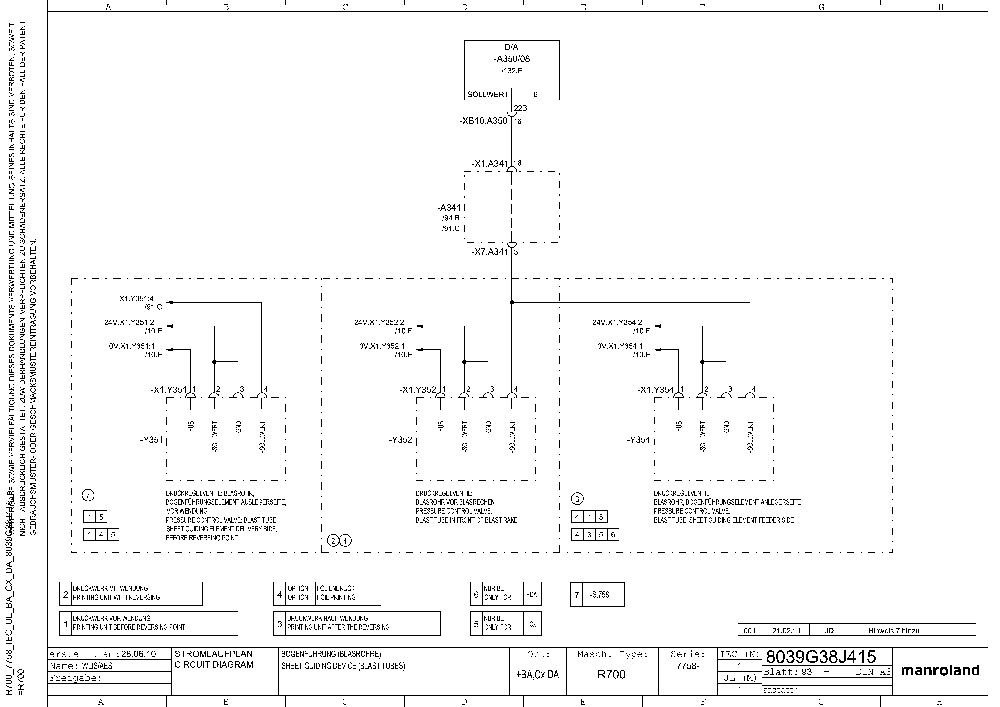

# +BA_Cx_DA — Sheet 93 of 247 — BOGENFÜHRUNG (BLASROHRE)

**SHEET GUIDING DEVICE (BLAST TUBES)**

> Part of the manroland **R700** printing press IEC/UL circuit diagrams.
> Drawing class: **Stromlaufplan / Circuit diagram** (DIN A3).
> Document `+BA_Cx_DA` covers the **Printing units / main switch cabinet** machine section.

## At a glance

| Field | Value |
|---|---|
| Document | `+BA_Cx_DA`  (8039G38J415) |
| Sheet | **93** of 247 |
| Section (DE) | BOGENFÜHRUNG (BLASROHRE) |
| Section (EN) | SHEET GUIDING DEVICE (BLAST TUBES) |
| Section type | CIRCUIT — Circuit diagram |
| Machine type | `R700` |
| Series | `7758` |
| Created | 28.06.10 |
| Replaces | — |
| Columns used | A, B, C, D, E, F, G, H |
| Path numbers | — |
| Labels on sheet | 117 |
| Cross-refs out | 10 |
| Cross-refs in | 25 |

**Previous:** [+BA_Cx_DA sheet 92](SHEET_0092.md) · **Next:** [+BA_Cx_DA sheet 94](SHEET_0094.md) · **Document TOC:** [_TOC.md](_TOC.md)  (+BA_Cx_DA) · **Master TOC:** [all sheets](../_MASTER_TOC.md)

## Sheet image (300 DPI, exact vector render)



_Rendered directly from the PDF vector layer at 300 DPI (1-bit), no OCR and no resampling. Use it to confirm anything ambiguous in the text below._

## Cross-references on this sheet

Each entry is a wire leaving this sheet. The printed token is `/sheet.column`; the link resolves to that sheet inside the same document.

| Ref | Target sheet | Col | Path | Destination on target | Target section | From col |
|---|---|---|---|---|---|---|
| `/132.E` | [+BA_Cx_DA sheet 132](SHEET_0132.md) | E | — | — | REFERENZMODUL | D |
| `/94.B` | [+BA_Cx_DA sheet 94](SHEET_0094.md) | B | — | — | BOGENFÜHRUNG (BLASROHRE) | D |
| `/91.C` | [+BA_Cx_DA sheet 91](SHEET_0091.md) | C | — | — | BOGENFÜHRUNG WENDETROMMEL | D |
| `/91.C` | [+BA_Cx_DA sheet 91](SHEET_0091.md) | C | — | X1.Y351:4 | BOGENFÜHRUNG WENDETROMMEL | A |
| `/10.E` | [+BA_Cx_DA sheet 10](SHEET_0010.md) | E | — | 24V.X1.Y351:2 24V.X1.Y354:2 | SPANNUNGSVERSORGUNG, SCHALTSCHRANKBELÜFTUNG | C |
| `/10.F` | [+BA_Cx_DA sheet 10](SHEET_0010.md) | F | — | 24V.X1.Y351:2 24V.X1.Y354:2 | SPANNUNGSVERSORGUNG, SCHALTSCHRANKBELÜFTUNG | C |
| `/10.F` | [+BA_Cx_DA sheet 10](SHEET_0010.md) | F | — | 24V.X1.Y352:2 | SPANNUNGSVERSORGUNG, SCHALTSCHRANKBELÜFTUNG | C |
| `/10.E` | [+BA_Cx_DA sheet 10](SHEET_0010.md) | E | — | 0V.X1.Y351:1 0V.X1.Y352:1 0V.X1.Y354:1 | SPANNUNGSVERSORGUNG, SCHALTSCHRANKBELÜFTUNG | C |
| `/10.E` | [+BA_Cx_DA sheet 10](SHEET_0010.md) | E | — | 0V.X1.Y351:1 0V.X1.Y352:1 0V.X1.Y354:1 | SPANNUNGSVERSORGUNG, SCHALTSCHRANKBELÜFTUNG | C |
| `/10.E` | [+BA_Cx_DA sheet 10](SHEET_0010.md) | E | — | 0V.X1.Y351:1 0V.X1.Y352:1 0V.X1.Y354:1 | SPANNUNGSVERSORGUNG, SCHALTSCHRANKBELÜFTUNG | C |

### Incoming references (sheets that point here)

Every other sheet that sends a wire to this one. `Back-ref` is the token printed on *that* sheet; `Path` is its line number.

| From sheet | Cols | Back-ref | Path | Refs | What continues there |
|---|---|---|---|---|---|
| [+BA_Cx_DA#10](SHEET_0010.md) | D, E, F | `/10.D`, `/10.E`, `/10.F` | — | 6 | 0V.X1.Y351:1; 0V.X1.Y352:1; 0V.X1.Y354:1 |
| [+BA_Cx_DA#91](SHEET_0091.md) | B, C | `/91.B`, `/91.C` | — | 2 | 24V.X1.E010:2 X1.Y351:4 |
| [+BA_Cx_DA#94](SHEET_0094.md) | B | `/94.B` | — | 1 | — |
| [+BA_Cx_DA#132](SHEET_0132.md) | E | `/132.E` | — | 1 | — |
| [+BA_Cx_DA#141](SHEET_0141.md) | D | `/141.D` | — | 1 | — |
| [+BA_Cx_DA#150](SHEET_0150.md) | G, H | `/150.G`, `/150.H` | — | 12 | — |
| [+BA_Cx_DA#163](SHEET_0163.md) | H | `/163.H` | — | 1 | — |
| [+BA_Cx_DA#167](SHEET_0167.md) | C | `/167.C` | — | 1 | — |


## Devices on this sheet

| Tag | Class | Class meaning (IEC) | Col | Sub | Terminal | Sign |
|---|---|---|---|---|---|---|
| `A350/08` | A | Baugruppe / assembly, module, PC board | D | 08 | — | — |
| `A341` | A | Baugruppe / assembly, module, PC board | D | — | — | — |
| `Y352` | Y | Magnetventil / solenoid valve, actuator | C | — | — | — |
| `Y351` | Y | Magnetventil / solenoid valve, actuator | A | — | — | — |
| `Y354` | Y | Magnetventil / solenoid valve, actuator | E | — | — | — |
| `XB10.A350` | — | cross-device reference | D | — | — | — |
| `X1.A341` | — | cross-device reference | D | — | — | — |
| `X7.A341` | — | cross-device reference | D | — | — | — |
| `X1.Y352` | — | cross-device reference | D | — | — | — |
| `X1.Y351` | — | cross-device reference | B | — | — | — |
| `X1.Y354` | — | cross-device reference | F | — | — | — |
| `X1.Y351:4` | — | cross-device reference | A | — | 4 | — |
| `S.758` | — | cross-device reference | E | — | — | — |
| `21.02.11` | — | cross-device reference | G | — | — | — |

## Potentials / nets

| Potential | Count | Columns | Attached devices | Terminals |
|---|---|---|---|---|
| `0V` | 3 | A, C, E | `X1`, `Y351`, `Y352`, `Y354` | `1` |
| `24V` | 3 | A, C, E | `X1`, `Y351`, `Y352`, `Y354` | `2` |


A potential such as `L24+/4` or `M24+` is a named supply/return rail; every place it appears on this sheet is electrically common.

## Wire-end annotations (grouped as printed)

A wire that continues elsewhere is annotated with a small cluster: the destination description, the path/line number `#NN`, and the `/sheet.column` cross reference. Each row below is one such cluster exactly as it is grouped on the drawing.

| Col | Y | Path | Cross-ref | Text on the wire |
|---|---|---|---|---|
| D | 51.6 | — | — | `D/A` |
| D | 65.5 | — | — | `A350/08` |
| D | 80.3 | — | `/132.E` | — |
| D | 108.7 | — | — | `SOLLWERT 6` |
| D | 125.0 | — | — | `22B` |
| D | 139.2 | — | — | `XB10.A350 16` |
| D | 190.2 | — | — | `X1.A341 16` |
| D | 242.7 | — | — | `A341` |
| D | 255.7 | — | `/94.B`, `/91.C` | — |
| D | 295.1 | — | — | `X7.A341 3` |
| A | 351.8 | — | `/91.C` | `X1.Y351:4` |
| C | 380.1 | — | `/10.E`, `/10.F` | `24V.X1.Y351:2 24V.X1.Y354:2` |
| C | 380.1 | — | `/10.F` | `24V.X1.Y352:2` |
| C | 408.4 | — | `/10.E`, `/10.E`, `/10.E` | `0V.X1.Y351:1 0V.X1.Y352:1 0V.X1.Y354:1` |
| B | 459.5 | — | — | `X1.Y351 1 2 3 4` |
| D | 459.5 | — | — | `X1.Y352 1 2 3 4` |
| F | 459.5 | — | — | `X1.Y354 1 2 3 4` |
| B | 501.4 | — | — | `+UB` |
| B | 501.4 | — | — | `SOLLWERT` |
| B | 501.4 | — | — | `GND` |
| B | 501.4 | — | — | `+SOLLWERT` |
| D | 501.4 | — | — | `+UB` |
| D | 501.4 | — | — | `SOLLWERT` |
| D | 501.4 | — | — | `GND` |
| D | 501.4 | — | — | `+SOLLWERT` |
| F | 501.4 | — | — | `+UB` |
| F | 501.4 | — | — | `SOLLWERT` |
| F | 501.4 | — | — | `GND` |
| F | 501.4 | — | — | `+SOLLWERT` |
| A | 519.1 | — | — | `Y351` |
| C | 519.1 | — | — | `Y352` |
| E | 519.1 | — | — | `Y354` |
| B | 584.6 | — | — | `DRUCKREGELVENTIL: BLASROHR, BOGENFÜHRUNGSELEMENT AUSLEGERSEITE,` |
| D | 584.6 | — | — | `DRUCKREGELVENTIL: BLASROHR VOR BLASRECHEN PRESSURE CONTROL VALVE: BLAST TUBE IN FRONT OF BLAST RAKE` |
| F | 584.6 | — | — | `DRUCKREGELVENTIL: BLASROHR, BOGENFÜHRUNGSELEMENT ANLEGERSEITE PRESSURE CONTROL VALVE: BLAST TUBE, SHEET GUIDING ELEMENT FEEDER SIDE` |
| A | 587.1 | — | — | `7` |
| E | 591.3 | — | — | `3` |
| B | 605.8 | — | — | `PRESSURE CONTROL VALVE: BLAST TUBE, VOR WENDUNG` |
| A | 611.9 | — | — | `1 5` |
| E | 611.9 | — | — | `4 1 5` |
| B | 627.1 | — | — | `BEFORE REVERSING POINT SHEET GUIDING ELEMENT DELIVERY SIDE,` |
| A | 633.2 | — | — | `1 4 5` |
| E | 633.2 | — | — | `4 3 5 6` |
| C | 640.9 | — | — | `2 4` |
| A | 697.9 | — | — | `2 DRUCKWERK MIT WENDUNG PRINTING UNIT WITH REVERSING` |
| C | 697.9 | — | — | `4 OPTION OPTION FOLIENDRUCK FOIL PRINTING` |
| D | 697.9 | — | — | `6 NUR BEI` |
| E | 704.0 | — | — | `7 S.758` |
| D | 705.0 | — | — | `ONLY FOR +DA` |
| D | 733.3 | — | — | `5 NUR BEI` |
| A | 733.4 | — | — | `1 DRUCKWERK VOR WENDUNG PRINTING UNIT BEFORE REVERSING POINT` |
| C | 733.4 | — | — | `3 DRUCKWERK NACH WENDUNG PRINTING UNIT AFTER THE REVERSING` |
| D | 740.6 | — | — | `ONLY FOR +Cx` |
| G | 747.2 | — | — | `001 21.02.11 JDI Hinweis 7 hinzu` |


## Reconstructed tables

This sheet carries tabular content (pin map / terminal assignment / index). The grid below was rebuilt from the drawing's own rule lines, so each row is exactly one physical row of the table.

### Table 1 — 2 data rows × 4 columns (at x=524.4, y=48.2)

|  |  | D/A | A350/08 /132.E |
|---|---|---|---|
|  |  | `SOLLWERT` | `6` |
| `A341 /94.B /91.C` | `XB10.A350` | `X1.A341 X7.A341` | `22B 16 16 3` |


## Notes and free text on this sheet

| Text | Col | Y (pt) |
|---|---|---|
| `22B` | D | 125.01 |
| `D/A` | D | 51.61 |
| `SOLLWERT` | D | 108.65 |
| `DRUCKREGELVENTIL:` | D | 584.56 |
| `BLASROHR VOR BLASRECHEN` | D | 595.2 |
| `PRESSURE CONTROL VALVE:` | D | 605.82 |
| `BLAST TUBE IN FRONT OF BLAST RAKE` | D | 616.45 |
| `DRUCKREGELVENTIL: BLASROHR,` | B | 584.57 |
| `BOGENFÜHRUNGSELEMENT AUSLEGERSEITE,` | B | 595.2 |
| `VOR WENDUNG` | B | 605.81 |
| `PRESSURE CONTROL VALVE: BLAST TUBE,` | B | 616.45 |
| `SHEET GUIDING ELEMENT DELIVERY SIDE,` | B | 627.09 |
| `BEFORE REVERSING POINT` | B | 637.72 |
| `DRUCKREGELVENTIL:` | F | 584.56 |
| `BLASROHR, BOGENFÜHRUNGSELEMENT ANLEGERSEITE` | F | 595.2 |
| `PRESSURE CONTROL VALVE:` | F | 605.82 |
| `BLAST TUBE, SHEET GUIDING ELEMENT FEEDER SIDE` | F | 616.45 |
| `DRUCKWERK VOR WENDUNG` | A | 733.36 |
| `PRINTING UNIT BEFORE REVERSING POINT` | A | 744.01 |
| `DRUCKWERK MIT WENDUNG` | A | 697.93 |
| `PRINTING UNIT WITH REVERSING` | A | 708.56 |
| `DRUCKWERK NACH WENDUNG` | C | 733.36 |
| `PRINTING UNIT AFTER THE REVERSING` | C | 744.01 |
| `OPTION` | C | 697.92 |
| `FOLIENDRUCK` | C | 697.96 |
| `FOIL PRINTING` | C | 708.57 |
| `NUR BEI` | D | 733.33 |
| `ONLY FOR` | D | 744.02 |
| `+Cx` | E | 740.56 |
| `+DA` | E | 705.04 |
| `+UB` | D | 501.45 |
| `GND` | D | 501.45 |
| `+SOLLWERT` | D | 501.45 |
| `+UB` | B | 501.45 |
| `SOLLWERT` | B | 501.45 |
| `GND` | B | 501.45 |
| `+SOLLWERT` | B | 501.45 |
| `+UB` | F | 501.45 |
| `SOLLWERT` | F | 501.45 |
| `GND` | F | 501.45 |
| `+SOLLWERT` | F | 501.45 |
| `JDI` | G | 747.17 |
| `Hinweis 7 hinzu` | H | 747.24 |

## Complete label inventory (exact text from the drawing)

Every text object inside the drawing area of this sheet, in DIN reading order (column A→H, then top→bottom). This is the authoritative list: if a string is not here it is not printed on this sheet.

| Col | Y | X | Dir | Type | Text |
|---|---|---|---|---|---|
| A | 351.8 | 139.2 | → | device ref | `X1.Y351:4` |
| A | 361.7 | 172.1 | → | cross-reference | `/91.C` |
| A | 380.1 | 121.3 | → | potential | `24V.X1.Y351:2` |
| A | 390.0 | 172.6 | → | cross-reference | `/10.E` |
| A | 408.5 | 130.1 | → | potential | `0V.X1.Y351:1` |
| A | 418.4 | 172.6 | → | cross-reference | `/10.E` |
| A | 519.1 | 167.0 | → | device tag | `Y351` |
| A | 587.1 | 102.9 | → | number | `7` |
| A | 611.9 | 104.3 | → | number | `1` |
| A | 611.9 | 118.1 | → | number | `5` |
| A | 633.2 | 104.3 | → | number | `1` |
| A | 633.2 | 118.1 | → | number | `4` |
| A | 633.2 | 132.2 | → | number | `5` |
| A | 697.9 | 87.0 | → | text | `DRUCKWERK MIT WENDUNG` |
| A | 703.3 | 75.1 | → | number | `2` |
| A | 708.6 | 87.0 | → | text | `PRINTING UNIT WITH REVERSING` |
| A | 733.4 | 87.0 | → | text | `DRUCKWERK VOR WENDUNG` |
| A | 738.7 | 75.4 | → | number | `1` |
| A | 744.0 | 87.0 | → | text | `PRINTING UNIT BEFORE REVERSING POINT` |
| B | 459.5 | 228.8 | → | number | `1` |
| B | 459.5 | 257.7 | → | number | `2` |
| B | 459.5 | 286.0 | → | number | `3` |
| B | 459.5 | 314.4 | → | number | `4` |
| B | 459.6 | 179.4 | → | device ref | `X1.Y351` |
| B | 501.4 | 252.9 | ↕ | text | `SOLLWERT` |
| B | 501.4 | 281.3 | ↕ | text | `GND` |
| B | 501.5 | 224.5 | ↕ | text | `+UB` |
| B | 501.5 | 309.6 | ↕ | text | `+SOLLWERT` |
| B | 584.6 | 197.6 | → | text | `DRUCKREGELVENTIL: BLASROHR,` |
| B | 595.2 | 197.6 | → | text | `BOGENFÜHRUNGSELEMENT AUSLEGERSEITE,` |
| B | 605.8 | 198.4 | → | text | `VOR WENDUNG` |
| B | 616.5 | 197.6 | → | text | `PRESSURE CONTROL VALVE: BLAST TUBE,` |
| B | 627.1 | 198.1 | → | text | `SHEET GUIDING ELEMENT DELIVERY SIDE,` |
| B | 637.7 | 197.6 | → | text | `BEFORE REVERSING POINT` |
| B | 703.3 | 330.2 | → | number | `4` |
| B | 738.7 | 330.1 | → | number | `3` |
| C | 380.1 | 419.0 | → | potential | `24V.X1.Y352:2` |
| C | 390.0 | 470.6 | → | cross-reference | `/10.F` |
| C | 408.5 | 427.7 | → | potential | `0V.X1.Y352:1` |
| C | 418.4 | 470.3 | → | cross-reference | `/10.E` |
| C | 519.1 | 463.2 | → | device tag | `Y352` |
| C | 640.9 | 394.9 | → | number | `2` |
| C | 640.9 | 409.0 | → | number | `4` |
| C | 697.9 | 342.7 | → | text | `OPTION` |
| C | 698.0 | 377.6 | → | text | `FOLIENDRUCK` |
| C | 708.6 | 342.7 | → | text | `OPTION` |
| C | 708.6 | 377.6 | → | text | `FOIL PRINTING` |
| C | 733.4 | 342.1 | → | text | `DRUCKWERK NACH WENDUNG` |
| C | 744.0 | 342.1 | → | text | `PRINTING UNIT AFTER THE REVERSING` |
| D | 51.6 | 600.7 | → | text | `D/A` |
| D | 65.5 | 588.0 | → | device tag | `A350/08` |
| D | 80.3 | 597.0 | → | cross-reference | `/132.E` |
| D | 108.7 | 556.6 | → | text | `SOLLWERT` |
| D | 125.0 | 612.0 | → | text | `22B` |
| D | 139.2 | 547.1 | → | device ref | `XB10.A350` |
| D | 140.6 | 611.4 | → | number | `16` |
| D | 190.2 | 561.5 | → | device ref | `X1.A341` |
| D | 190.2 | 611.4 | → | number | `16` |
| D | 242.7 | 520.7 | → | device tag | `A341` |
| D | 255.7 | 526.7 | → | cross-reference | `/94.B` |
| D | 268.2 | 526.4 | → | cross-reference | `/91.C` |
| D | 295.1 | 561.5 | → | device ref | `X7.A341` |
| D | 296.5 | 612.0 | → | number | `3` |
| D | 459.5 | 526.4 | → | number | `1` |
| D | 459.5 | 555.3 | → | number | `2` |
| D | 459.5 | 583.7 | → | number | `3` |
| D | 459.5 | 612.0 | → | number | `4` |
| D | 459.6 | 475.7 | → | device ref | `X1.Y352` |
| D | 501.4 | 550.5 | ↕ | text | `SOLLWERT` |
| D | 501.4 | 578.9 | ↕ | text | `GND` |
| D | 501.5 | 522.2 | ↕ | text | `+UB` |
| D | 501.5 | 607.2 | ↕ | text | `+SOLLWERT` |
| D | 584.6 | 495.2 | → | text | `DRUCKREGELVENTIL:` |
| D | 595.2 | 495.2 | → | text | `BLASROHR VOR BLASRECHEN` |
| D | 605.8 | 495.2 | → | text | `PRESSURE CONTROL VALVE:` |
| D | 616.4 | 495.2 | → | text | `BLAST TUBE IN FRONT OF BLAST RAKE` |
| D | 697.9 | 576.0 | → | text | `NUR BEI` |
| D | 703.3 | 564.1 | → | number | `6` |
| D | 708.6 | 576.6 | → | text | `ONLY FOR` |
| D | 733.3 | 576.0 | → | text | `NUR BEI` |
| D | 738.7 | 564.0 | → | number | `5` |
| D | 744.0 | 576.6 | → | text | `ONLY FOR` |
| E | 108.7 | 635.4 | → | number | `6` |
| E | 380.1 | 702.4 | → | potential | `24V.X1.Y354:2` |
| E | 390.0 | 754.0 | → | cross-reference | `/10.F` |
| E | 408.5 | 711.2 | → | potential | `0V.X1.Y354:1` |
| E | 418.4 | 753.7 | → | cross-reference | `/10.E` |
| E | 519.1 | 746.6 | → | device tag | `Y354` |
| E | 591.3 | 685.4 | → | number | `3` |
| E | 611.9 | 685.0 | → | number | `4` |
| E | 611.9 | 699.6 | → | number | `1` |
| E | 611.9 | 713.3 | → | number | `5` |
| E | 633.2 | 685.0 | → | number | `4` |
| E | 633.2 | 699.2 | → | number | `3` |
| E | 633.2 | 713.3 | → | number | `5` |
| E | 633.2 | 727.5 | → | number | `6` |
| E | 704.0 | 683.9 | → | number | `7` |
| E | 704.6 | 702.7 | → | device ref | `S.758` |
| E | 705.0 | 626.9 | → | text | `+DA` |
| E | 740.6 | 626.9 | → | text | `+Cx` |
| F | 459.5 | 809.9 | → | number | `1` |
| F | 459.5 | 838.8 | → | number | `2` |
| F | 459.5 | 867.1 | → | number | `3` |
| F | 459.5 | 895.5 | → | number | `4` |
| F | 459.6 | 759.1 | → | device ref | `X1.Y354` |
| F | 501.4 | 834.0 | ↕ | text | `SOLLWERT` |
| F | 501.4 | 862.4 | ↕ | text | `GND` |
| F | 501.5 | 805.6 | ↕ | text | `+UB` |
| F | 501.5 | 890.7 | ↕ | text | `+SOLLWERT` |
| F | 584.6 | 778.7 | → | text | `DRUCKREGELVENTIL:` |
| F | 595.2 | 778.7 | → | text | `BLASROHR, BOGENFÜHRUNGSELEMENT ANLEGERSEITE` |
| F | 605.8 | 778.7 | → | text | `PRESSURE CONTROL VALVE:` |
| F | 616.5 | 778.7 | → | text | `BLAST TUBE, SHEET GUIDING ELEMENT FEEDER SIDE` |
| F | 747.3 | 885.5 | → | number | `001` |
| G | 747.2 | 919.6 | → | device ref | `21.02.11` |
| G | 747.2 | 981.9 | → | text | `JDI` |
| H | 747.2 | 1033.8 | → | text | `Hinweis 7 hinzu` |

## Reading-order text block

The same content as a plain block, grouped by DIN column — convenient to paste or to match against a visual description.

```text
=== Column A ===
 351.8  139.2  devref       X1.Y351:4
 361.7  172.1  xref         /91.C
 380.1  121.3  net          24V.X1.Y351:2
 390.0  172.6  xref         /10.E
 408.5  130.1  net          0V.X1.Y351:1
 418.4  172.6  xref         /10.E
 519.1  167.0  devtag       Y351
 587.1  102.9  numeric      7
 611.9  104.3  numeric      1
 611.9  118.1  numeric      5
 633.2  104.3  numeric      1
 633.2  118.1  numeric      4
 633.2  132.2  numeric      5
 697.9   87.0  text         DRUCKWERK MIT WENDUNG
 703.3   75.1  numeric      2
 708.6   87.0  text         PRINTING UNIT WITH REVERSING
 733.4   87.0  text         DRUCKWERK VOR WENDUNG
 738.7   75.4  numeric      1
 744.0   87.0  text         PRINTING UNIT BEFORE REVERSING POINT
=== Column B ===
 459.5  228.8  numeric      1
 459.5  257.7  numeric      2
 459.5  286.0  numeric      3
 459.5  314.4  numeric      4
 459.6  179.4  devref       X1.Y351
 501.4  252.9  text         SOLLWERT
 501.4  281.3  text         GND
 501.5  224.5  text         +UB
 501.5  309.6  text         +SOLLWERT
 584.6  197.6  text         DRUCKREGELVENTIL: BLASROHR,
 595.2  197.6  text         BOGENFÜHRUNGSELEMENT AUSLEGERSEITE,
 605.8  198.4  text         VOR WENDUNG
 616.5  197.6  text         PRESSURE CONTROL VALVE: BLAST TUBE,
 627.1  198.1  text         SHEET GUIDING ELEMENT DELIVERY SIDE,
 637.7  197.6  text         BEFORE REVERSING POINT
 703.3  330.2  numeric      4
 738.7  330.1  numeric      3
=== Column C ===
 380.1  419.0  net          24V.X1.Y352:2
 390.0  470.6  xref         /10.F
 408.5  427.7  net          0V.X1.Y352:1
 418.4  470.3  xref         /10.E
 519.1  463.2  devtag       Y352
 640.9  394.9  numeric      2
 640.9  409.0  numeric      4
 697.9  342.7  text         OPTION
 698.0  377.6  text         FOLIENDRUCK
 708.6  342.7  text         OPTION
 708.6  377.6  text         FOIL PRINTING
 733.4  342.1  text         DRUCKWERK NACH WENDUNG
 744.0  342.1  text         PRINTING UNIT AFTER THE REVERSING
=== Column D ===
  51.6  600.7  text         D/A
  65.5  588.0  devtag       A350/08
  80.3  597.0  xref         /132.E
 108.7  556.6  text         SOLLWERT
 125.0  612.0  text         22B
 139.2  547.1  devref       XB10.A350
 140.6  611.4  numeric      16
 190.2  561.5  devref       X1.A341
 190.2  611.4  numeric      16
 242.7  520.7  devtag       A341
 255.7  526.7  xref         /94.B
 268.2  526.4  xref         /91.C
 295.1  561.5  devref       X7.A341
 296.5  612.0  numeric      3
 459.5  526.4  numeric      1
 459.5  555.3  numeric      2
 459.5  583.7  numeric      3
 459.5  612.0  numeric      4
 459.6  475.7  devref       X1.Y352
 501.4  550.5  text         SOLLWERT
 501.4  578.9  text         GND
 501.5  522.2  text         +UB
 501.5  607.2  text         +SOLLWERT
 584.6  495.2  text         DRUCKREGELVENTIL:
 595.2  495.2  text         BLASROHR VOR BLASRECHEN
 605.8  495.2  text         PRESSURE CONTROL VALVE:
 616.4  495.2  text         BLAST TUBE IN FRONT OF BLAST RAKE
 697.9  576.0  text         NUR BEI
 703.3  564.1  numeric      6
 708.6  576.6  text         ONLY FOR
 733.3  576.0  text         NUR BEI
 738.7  564.0  numeric      5
 744.0  576.6  text         ONLY FOR
=== Column E ===
 108.7  635.4  numeric      6
 380.1  702.4  net          24V.X1.Y354:2
 390.0  754.0  xref         /10.F
 408.5  711.2  net          0V.X1.Y354:1
 418.4  753.7  xref         /10.E
 519.1  746.6  devtag       Y354
 591.3  685.4  numeric      3
 611.9  685.0  numeric      4
 611.9  699.6  numeric      1
 611.9  713.3  numeric      5
 633.2  685.0  numeric      4
 633.2  699.2  numeric      3
 633.2  713.3  numeric      5
 633.2  727.5  numeric      6
 704.0  683.9  numeric      7
 704.6  702.7  devref       S.758
 705.0  626.9  text         +DA
 740.6  626.9  text         +Cx
=== Column F ===
 459.5  809.9  numeric      1
 459.5  838.8  numeric      2
 459.5  867.1  numeric      3
 459.5  895.5  numeric      4
 459.6  759.1  devref       X1.Y354
 501.4  834.0  text         SOLLWERT
 501.4  862.4  text         GND
 501.5  805.6  text         +UB
 501.5  890.7  text         +SOLLWERT
 584.6  778.7  text         DRUCKREGELVENTIL:
 595.2  778.7  text         BLASROHR, BOGENFÜHRUNGSELEMENT ANLEGERSEITE
 605.8  778.7  text         PRESSURE CONTROL VALVE:
 616.5  778.7  text         BLAST TUBE, SHEET GUIDING ELEMENT FEEDER SIDE
 747.3  885.5  numeric      001
=== Column G ===
 747.2  919.6  devref       21.02.11
 747.2  981.9  text         JDI
=== Column H ===
 747.2 1033.8  text         Hinweis 7 hinzu
```

---
_Generated from the PDF vector text layer; no OCR. Source: `R700_7758_IEC_UL_BA_CX_DA_8039G38J415_p`, sheet 93._
