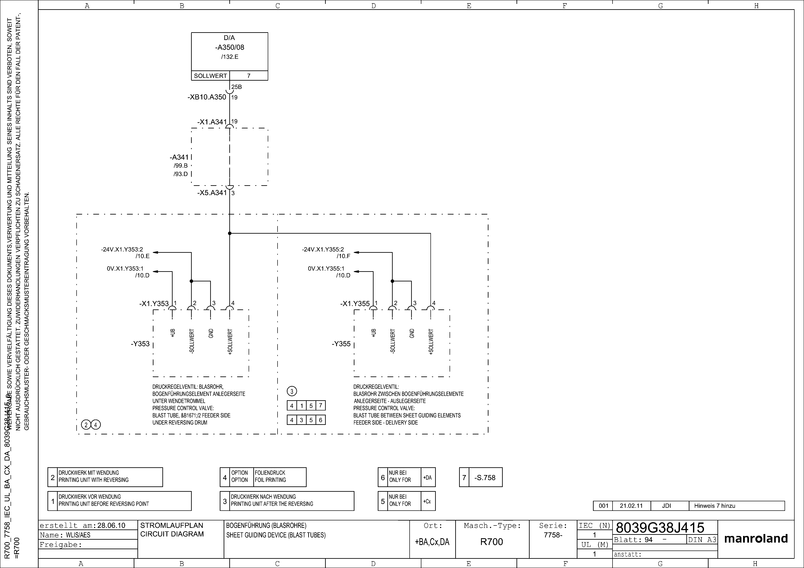

# +BA_Cx_DA — Sheet 94 of 247 — BOGENFÜHRUNG (BLASROHRE)

**SHEET GUIDING DEVICE (BLAST TUBES)**

> Part of the manroland **R700** printing press IEC/UL circuit diagrams.
> Drawing class: **Stromlaufplan / Circuit diagram** (DIN A3).
> Document `+BA_Cx_DA` covers the **Printing units / main switch cabinet** machine section.

## At a glance

| Field | Value |
|---|---|
| Document | `+BA_Cx_DA`  (8039G38J415) |
| Sheet | **94** of 247 |
| Section (DE) | BOGENFÜHRUNG (BLASROHRE) |
| Section (EN) | SHEET GUIDING DEVICE (BLAST TUBES) |
| Section type | CIRCUIT — Circuit diagram |
| Machine type | `R700` |
| Series | `7758` |
| Created | 28.06.10 |
| Replaces | — |
| Columns used | A, B, C, D, E, F, G, H |
| Path numbers | — |
| Labels on sheet | 94 |
| Cross-refs out | 7 |
| Cross-refs in | 18 |

**Previous:** [+BA_Cx_DA sheet 93](SHEET_0093.md) · **Next:** [+BA_Cx_DA sheet 95](SHEET_0095.md) · **Document TOC:** [_TOC.md](_TOC.md)  (+BA_Cx_DA) · **Master TOC:** [all sheets](../_MASTER_TOC.md)

## Sheet image (300 DPI, exact vector render)



_Rendered directly from the PDF vector layer at 300 DPI (1-bit), no OCR and no resampling. Use it to confirm anything ambiguous in the text below._

## Cross-references on this sheet

Each entry is a wire leaving this sheet. The printed token is `/sheet.column`; the link resolves to that sheet inside the same document.

| Ref | Target sheet | Col | Path | Destination on target | Target section | From col |
|---|---|---|---|---|---|---|
| `/132.E` | [+BA_Cx_DA sheet 132](SHEET_0132.md) | E | — | — | REFERENZMODUL | C |
| `/99.B` | [+BA_Cx_DA sheet 99](SHEET_0099.md) | B | — | — | BLAS/SAUGLUFT MIT MOTORVENTILEINSTELLUNG | B |
| `/93.D` | [+BA_Cx_DA sheet 93](SHEET_0093.md) | D | — | — | BOGENFÜHRUNG (BLASROHRE) | B |
| `/10.E` | [+BA_Cx_DA sheet 10](SHEET_0010.md) | E | — | 24V.X1.Y353:2 24V.X1.Y355:2 | SPANNUNGSVERSORGUNG, SCHALTSCHRANKBELÜFTUNG | B |
| `/10.F` | [+BA_Cx_DA sheet 10](SHEET_0010.md) | F | — | 24V.X1.Y353:2 24V.X1.Y355:2 | SPANNUNGSVERSORGUNG, SCHALTSCHRANKBELÜFTUNG | B |
| `/10.D` | [+BA_Cx_DA sheet 10](SHEET_0010.md) | D | — | 0V.X1.Y353:1 0V.X1.Y355:1 | SPANNUNGSVERSORGUNG, SCHALTSCHRANKBELÜFTUNG | B |
| `/10.D` | [+BA_Cx_DA sheet 10](SHEET_0010.md) | D | — | 0V.X1.Y353:1 0V.X1.Y355:1 | SPANNUNGSVERSORGUNG, SCHALTSCHRANKBELÜFTUNG | B |

### Incoming references (sheets that point here)

Every other sheet that sends a wire to this one. `Back-ref` is the token printed on *that* sheet; `Path` is its line number.

| From sheet | Cols | Back-ref | Path | Refs | What continues there |
|---|---|---|---|---|---|
| [+BA_Cx_DA#10](SHEET_0010.md) | D, E | `/10.D`, `/10.E` | — | 4 | 0V.X1.Y353:1; 0V.X1.Y355:1 |
| [+BA_Cx_DA#93](SHEET_0093.md) | D | `/93.D` | — | 1 | — |
| [+BA_Cx_DA#99](SHEET_0099.md) | B | `/99.B` | — | 1 | — |
| [+BA_Cx_DA#132](SHEET_0132.md) | E | `/132.E` | — | 1 | — |
| [+BA_Cx_DA#141](SHEET_0141.md) | D | `/141.D` | — | 1 | — |
| [+BA_Cx_DA#150](SHEET_0150.md) | G, H | `/150.G`, `/150.H` | — | 8 | — |
| [+BA_Cx_DA#161](SHEET_0161.md) | B | `/161.B` | — | 1 | — |
| [+BA_Cx_DA#167](SHEET_0167.md) | C | `/167.C` | — | 1 | — |


## Devices on this sheet

| Tag | Class | Class meaning (IEC) | Col | Sub | Terminal | Sign |
|---|---|---|---|---|---|---|
| `A350/08` | A | Baugruppe / assembly, module, PC board | B | 08 | — | — |
| `Y353` | Y | Magnetventil / solenoid valve, actuator | B | — | — | — |
| `Y355` | Y | Magnetventil / solenoid valve, actuator | D | — | — | — |
| `A341` | A | Baugruppe / assembly, module, PC board | B | — | — | — |
| `XB10.A350` | — | cross-device reference | B | — | — | — |
| `X1.Y353` | — | cross-device reference | B | — | — | — |
| `X1.Y355` | — | cross-device reference | D | — | — | — |
| `X1.A341` | — | cross-device reference | B | — | — | — |
| `X5.A341` | — | cross-device reference | B | — | — | — |
| `S.758` | — | cross-device reference | E | — | — | — |
| `21.02.11` | — | cross-device reference | G | — | — | — |

## Potentials / nets

| Potential | Count | Columns | Attached devices | Terminals |
|---|---|---|---|---|
| `0V` | 2 | A, D | `X1`, `Y353`, `Y355` | `1` |
| `24V` | 2 | A, C | `X1`, `Y353`, `Y355` | `2` |


A potential such as `L24+/4` or `M24+` is a named supply/return rail; every place it appears on this sheet is electrically common.

## Wire-end annotations (grouped as printed)

A wire that continues elsewhere is annotated with a small cluster: the destination description, the path/line number `#NN`, and the `/sheet.column` cross reference. Each row below is one such cluster exactly as it is grouped on the drawing.

| Col | Y | Path | Cross-ref | Text on the wire |
|---|---|---|---|---|
| B | 51.6 | — | — | `D/A` |
| B | 65.5 | — | — | `A350/08` |
| C | 80.3 | — | `/132.E` | — |
| B | 108.7 | — | — | `SOLLWERT 7` |
| C | 125.0 | — | — | `25B` |
| B | 139.2 | — | — | `XB10.A350 19` |
| B | 176.1 | — | — | `X1.A341 19` |
| B | 228.5 | — | — | `A341` |
| B | 241.6 | — | `/99.B`, `/93.D` | — |
| B | 280.9 | — | — | `X5.A341 3` |
| B | 365.9 | — | `/10.E`, `/10.F` | `24V.X1.Y353:2 24V.X1.Y355:2` |
| B | 394.3 | — | `/10.D`, `/10.D` | `0V.X1.Y353:1 0V.X1.Y355:1` |
| B | 445.4 | — | — | `X1.Y353 1 2 3 4` |
| D | 445.4 | — | — | `X1.Y355 1 2 3 4` |
| B | 487.3 | — | — | `+UB` |
| B | 487.3 | — | — | `SOLLWERT` |
| B | 487.3 | — | — | `GND` |
| C | 487.3 | — | — | `+SOLLWERT` |
| D | 487.3 | — | — | `+UB` |
| D | 487.3 | — | — | `SOLLWERT` |
| D | 487.3 | — | — | `GND` |
| E | 487.3 | — | — | `+SOLLWERT` |
| B | 504.9 | — | — | `Y353` |
| D | 504.9 | — | — | `Y355` |
| B | 570.4 | — | — | `DRUCKREGELVENTIL: BLASROHR, BOGENFÜHRUNGSELEMENT ANLEGERSEITE UNTER WENDETROMMEL PRESSURE CONTROL VALVE: BLAST TUBE, &B1671;/2 FEEDER SIDE UNDER REVERSING DRUM` |
| D | 570.4 | — | — | `DRUCKREGELVENTIL: BLASROHR ZWISCHEN BOGENFÜHRUNGSELEMENTE` |
| C | 577.1 | — | — | `3` |
| D | 591.6 | — | — | `PRESSURE CONTROL VALVE: BLAST TUBE BETWEEN SHEET GUIDING ELEMENTS FEEDER SIDE DELIVERY SIDE ANLEGERSEITE AUSLEGERSEITE` |
| C | 597.0 | — | — | `7` |
| C | 597.7 | — | — | `4 1 5` |
| C | 619.0 | — | — | `4 3 5 6` |
| A | 626.8 | — | — | `2 4` |
| A | 697.9 | — | — | `2 DRUCKWERK MIT WENDUNG PRINTING UNIT WITH REVERSING` |
| C | 697.9 | — | — | `4 OPTION OPTION FOLIENDRUCK FOIL PRINTING` |
| D | 697.9 | — | — | `6 NUR BEI` |
| E | 703.3 | — | — | `ONLY FOR +DA 7 S.758` |
| D | 733.3 | — | — | `5 NUR BEI` |
| A | 733.4 | — | — | `1 DRUCKWERK VOR WENDUNG PRINTING UNIT BEFORE REVERSING POINT` |
| C | 733.4 | — | — | `3 DRUCKWERK NACH WENDUNG PRINTING UNIT AFTER THE REVERSING` |
| D | 740.6 | — | — | `ONLY FOR +Cx` |
| G | 745.8 | — | — | `001 21.02.11 JDI Hinweis 7 hinzu` |


## Reconstructed tables

This sheet carries tabular content (pin map / terminal assignment / index). The grid below was rebuilt from the drawing's own rule lines, so each row is exactly one physical row of the table.

### Table 1 — 2 data rows × 4 columns (at x=255.1, y=48.2)

|  |  | D/A | A350/08 /132.E |
|---|---|---|---|
|  |  | `SOLLWERT` | `7` |
| `A341 /99.B /93.D` | `XB10.A350` | `X1.A341 X5.A341` | `25B 19 19 3` |


## Notes and free text on this sheet

| Text | Col | Y (pt) |
|---|---|---|
| `25B` | C | 125.01 |
| `D/A` | B | 51.61 |
| `SOLLWERT` | B | 108.65 |
| `DRUCKREGELVENTIL: BLASROHR,` | B | 570.39 |
| `BOGENFÜHRUNGSELEMENT ANLEGERSEITE` | B | 581.03 |
| `UNTER WENDETROMMEL` | B | 591.66 |
| `PRESSURE CONTROL VALVE:` | B | 602.28 |
| `BLAST TUBE, &B1671;/2 FEEDER SIDE` | B | 612.9 |
| `UNDER REVERSING DRUM` | B | 623.57 |
| `DRUCKREGELVENTIL:` | D | 570.39 |
| `BLASROHR ZWISCHEN BOGENFÜHRUNGSELEMENTE` | D | 581.03 |
| `ANLEGERSEITE AUSLEGERSEITE` | D | 591.65 |
| `PRESSURE CONTROL VALVE:` | D | 602.28 |
| `BLAST TUBE BETWEEN SHEET GUIDING ELEMENTS` | D | 612.9 |
| `FEEDER SIDE DELIVERY SIDE` | D | 623.53 |
| `+UB` | B | 487.28 |
| `GND` | B | 487.28 |
| `+SOLLWERT` | C | 487.28 |
| `+UB` | D | 487.28 |
| `SOLLWERT` | D | 487.28 |
| `GND` | D | 487.28 |
| `+SOLLWERT` | E | 487.28 |
| `DRUCKWERK VOR WENDUNG` | A | 733.36 |
| `PRINTING UNIT BEFORE REVERSING POINT` | A | 744.01 |
| `DRUCKWERK MIT WENDUNG` | A | 697.93 |
| `PRINTING UNIT WITH REVERSING` | A | 708.56 |
| `DRUCKWERK NACH WENDUNG` | C | 733.36 |
| `PRINTING UNIT AFTER THE REVERSING` | C | 744.01 |
| `OPTION` | C | 697.92 |
| `FOLIENDRUCK` | C | 697.96 |
| `FOIL PRINTING` | C | 708.57 |
| `NUR BEI` | D | 733.33 |
| `ONLY FOR` | D | 744.02 |
| `+Cx` | E | 740.56 |
| `+DA` | E | 705.04 |
| `JDI` | G | 745.75 |
| `Hinweis 7 hinzu` | H | 745.82 |

## Complete label inventory (exact text from the drawing)

Every text object inside the drawing area of this sheet, in DIN reading order (column A→H, then top→bottom). This is the authoritative list: if a string is not here it is not printed on this sheet.

| Col | Y | X | Dir | Type | Text |
|---|---|---|---|---|---|
| A | 365.9 | 149.7 | → | potential | `24V.X1.Y353:2` |
| A | 394.3 | 158.5 | → | potential | `0V.X1.Y353:1` |
| A | 626.7 | 125.6 | → | number | `2` |
| A | 626.7 | 139.7 | → | number | `4` |
| A | 697.9 | 87.0 | → | text | `DRUCKWERK MIT WENDUNG` |
| A | 703.3 | 75.1 | → | number | `2` |
| A | 708.6 | 87.0 | → | text | `PRINTING UNIT WITH REVERSING` |
| A | 733.4 | 87.0 | → | text | `DRUCKWERK VOR WENDUNG` |
| A | 738.7 | 75.4 | → | number | `1` |
| A | 744.0 | 87.0 | → | text | `PRINTING UNIT BEFORE REVERSING POINT` |
| B | 51.6 | 331.4 | → | text | `D/A` |
| B | 65.5 | 318.8 | → | device tag | `A350/08` |
| B | 108.7 | 287.3 | → | text | `SOLLWERT` |
| B | 139.2 | 277.8 | → | device ref | `XB10.A350` |
| B | 176.1 | 292.3 | → | device ref | `X1.A341` |
| B | 228.5 | 251.4 | → | device tag | `A341` |
| B | 241.5 | 257.4 | → | cross-reference | `/99.B` |
| B | 254.0 | 257.1 | → | cross-reference | `/93.D` |
| B | 280.9 | 292.3 | → | device ref | `X5.A341` |
| B | 375.8 | 201.0 | → | cross-reference | `/10.E` |
| B | 404.2 | 200.4 | → | cross-reference | `/10.D` |
| B | 445.4 | 206.4 | → | device ref | `X1.Y353` |
| B | 445.4 | 257.1 | → | number | `1` |
| B | 445.4 | 286.0 | → | number | `2` |
| B | 445.4 | 314.4 | → | number | `3` |
| B | 487.3 | 252.9 | ↕ | text | `+UB` |
| B | 487.3 | 281.2 | ↕ | text | `SOLLWERT` |
| B | 487.3 | 309.6 | ↕ | text | `GND` |
| B | 505.0 | 193.9 | → | device tag | `Y353` |
| B | 570.4 | 225.9 | → | text | `DRUCKREGELVENTIL: BLASROHR,` |
| B | 581.0 | 225.9 | → | text | `BOGENFÜHRUNGSELEMENT ANLEGERSEITE` |
| B | 591.7 | 225.9 | → | text | `UNTER WENDETROMMEL` |
| B | 602.3 | 225.9 | → | text | `PRESSURE CONTROL VALVE:` |
| B | 612.9 | 225.9 | → | text | `BLAST TUBE, &B1671;/2 FEEDER SIDE` |
| B | 623.6 | 225.9 | → | text | `UNDER REVERSING DRUM` |
| B | 703.3 | 330.2 | → | number | `4` |
| B | 738.7 | 330.1 | → | number | `3` |
| C | 80.3 | 327.7 | → | cross-reference | `/132.E` |
| C | 108.7 | 366.1 | → | number | `7` |
| C | 125.0 | 342.7 | → | text | `25B` |
| C | 140.6 | 342.1 | → | number | `19` |
| C | 176.1 | 342.1 | → | number | `19` |
| C | 282.4 | 342.7 | → | number | `3` |
| C | 365.9 | 447.3 | → | potential | `24V.X1.Y355:2` |
| C | 445.4 | 342.7 | → | number | `4` |
| C | 487.3 | 337.9 | ↕ | text | `+SOLLWERT` |
| C | 577.1 | 430.3 | → | number | `3` |
| C | 597.0 | 472.4 | → | number | `7` |
| C | 597.7 | 429.9 | → | number | `4` |
| C | 597.7 | 444.5 | → | number | `1` |
| C | 597.7 | 458.2 | → | number | `5` |
| C | 619.0 | 429.9 | → | number | `4` |
| C | 619.0 | 444.0 | → | number | `3` |
| C | 619.0 | 458.2 | → | number | `5` |
| C | 619.0 | 472.4 | → | number | `6` |
| C | 697.9 | 342.7 | → | text | `OPTION` |
| C | 698.0 | 377.6 | → | text | `FOLIENDRUCK` |
| C | 708.6 | 342.7 | → | text | `OPTION` |
| C | 708.6 | 377.6 | → | text | `FOIL PRINTING` |
| C | 733.4 | 342.1 | → | text | `DRUCKWERK NACH WENDUNG` |
| C | 744.0 | 342.1 | → | text | `PRINTING UNIT AFTER THE REVERSING` |
| D | 375.9 | 498.9 | → | cross-reference | `/10.F` |
| D | 394.3 | 456.1 | → | potential | `0V.X1.Y355:1` |
| D | 404.2 | 498.0 | → | cross-reference | `/10.D` |
| D | 445.4 | 504.0 | → | device ref | `X1.Y355` |
| D | 445.4 | 554.7 | → | number | `1` |
| D | 445.4 | 583.7 | → | number | `2` |
| D | 445.4 | 612.0 | → | number | `3` |
| D | 487.3 | 550.5 | ↕ | text | `+UB` |
| D | 487.3 | 578.9 | ↕ | text | `SOLLWERT` |
| D | 487.3 | 607.3 | ↕ | text | `GND` |
| D | 505.0 | 491.5 | → | device tag | `Y355` |
| D | 570.4 | 523.6 | → | text | `DRUCKREGELVENTIL:` |
| D | 581.0 | 523.6 | → | text | `BLASROHR ZWISCHEN BOGENFÜHRUNGSELEMENTE` |
| D | 591.6 | 524.4 | → | text | `ANLEGERSEITE AUSLEGERSEITE` |
| D | 602.3 | 523.6 | → | text | `PRESSURE CONTROL VALVE:` |
| D | 612.9 | 523.6 | → | text | `BLAST TUBE BETWEEN SHEET GUIDING ELEMENTS` |
| D | 623.5 | 523.6 | → | text | `FEEDER SIDE DELIVERY SIDE` |
| D | 697.9 | 576.0 | → | text | `NUR BEI` |
| D | 703.3 | 564.1 | → | number | `6` |
| D | 708.6 | 576.6 | → | text | `ONLY FOR` |
| D | 733.3 | 576.0 | → | text | `NUR BEI` |
| D | 738.7 | 564.0 | → | number | `5` |
| D | 744.0 | 576.6 | → | text | `ONLY FOR` |
| E | 445.4 | 640.3 | → | number | `4` |
| E | 487.3 | 635.6 | ↕ | text | `+SOLLWERT` |
| E | 703.3 | 684.6 | → | number | `7` |
| E | 703.3 | 702.7 | → | device ref | `S.758` |
| E | 705.0 | 626.9 | → | text | `+DA` |
| E | 740.6 | 626.9 | → | text | `+Cx` |
| F | 745.8 | 887.0 | → | number | `001` |
| G | 745.8 | 918.1 | → | device ref | `21.02.11` |
| G | 745.8 | 980.5 | → | text | `JDI` |
| H | 745.8 | 1028.1 | → | text | `Hinweis 7 hinzu` |

## Reading-order text block

The same content as a plain block, grouped by DIN column — convenient to paste or to match against a visual description.

```text
=== Column A ===
 365.9  149.7  net          24V.X1.Y353:2
 394.3  158.5  net          0V.X1.Y353:1
 626.7  125.6  numeric      2
 626.7  139.7  numeric      4
 697.9   87.0  text         DRUCKWERK MIT WENDUNG
 703.3   75.1  numeric      2
 708.6   87.0  text         PRINTING UNIT WITH REVERSING
 733.4   87.0  text         DRUCKWERK VOR WENDUNG
 738.7   75.4  numeric      1
 744.0   87.0  text         PRINTING UNIT BEFORE REVERSING POINT
=== Column B ===
  51.6  331.4  text         D/A
  65.5  318.8  devtag       A350/08
 108.7  287.3  text         SOLLWERT
 139.2  277.8  devref       XB10.A350
 176.1  292.3  devref       X1.A341
 228.5  251.4  devtag       A341
 241.5  257.4  xref         /99.B
 254.0  257.1  xref         /93.D
 280.9  292.3  devref       X5.A341
 375.8  201.0  xref         /10.E
 404.2  200.4  xref         /10.D
 445.4  206.4  devref       X1.Y353
 445.4  257.1  numeric      1
 445.4  286.0  numeric      2
 445.4  314.4  numeric      3
 487.3  252.9  text         +UB
 487.3  281.2  text         SOLLWERT
 487.3  309.6  text         GND
 505.0  193.9  devtag       Y353
 570.4  225.9  text         DRUCKREGELVENTIL: BLASROHR,
 581.0  225.9  text         BOGENFÜHRUNGSELEMENT ANLEGERSEITE
 591.7  225.9  text         UNTER WENDETROMMEL
 602.3  225.9  text         PRESSURE CONTROL VALVE:
 612.9  225.9  text         BLAST TUBE, &B1671;/2 FEEDER SIDE
 623.6  225.9  text         UNDER REVERSING DRUM
 703.3  330.2  numeric      4
 738.7  330.1  numeric      3
=== Column C ===
  80.3  327.7  xref         /132.E
 108.7  366.1  numeric      7
 125.0  342.7  text         25B
 140.6  342.1  numeric      19
 176.1  342.1  numeric      19
 282.4  342.7  numeric      3
 365.9  447.3  net          24V.X1.Y355:2
 445.4  342.7  numeric      4
 487.3  337.9  text         +SOLLWERT
 577.1  430.3  numeric      3
 597.0  472.4  numeric      7
 597.7  429.9  numeric      4
 597.7  444.5  numeric      1
 597.7  458.2  numeric      5
 619.0  429.9  numeric      4
 619.0  444.0  numeric      3
 619.0  458.2  numeric      5
 619.0  472.4  numeric      6
 697.9  342.7  text         OPTION
 698.0  377.6  text         FOLIENDRUCK
 708.6  342.7  text         OPTION
 708.6  377.6  text         FOIL PRINTING
 733.4  342.1  text         DRUCKWERK NACH WENDUNG
 744.0  342.1  text         PRINTING UNIT AFTER THE REVERSING
=== Column D ===
 375.9  498.9  xref         /10.F
 394.3  456.1  net          0V.X1.Y355:1
 404.2  498.0  xref         /10.D
 445.4  504.0  devref       X1.Y355
 445.4  554.7  numeric      1
 445.4  583.7  numeric      2
 445.4  612.0  numeric      3
 487.3  550.5  text         +UB
 487.3  578.9  text         SOLLWERT
 487.3  607.3  text         GND
 505.0  491.5  devtag       Y355
 570.4  523.6  text         DRUCKREGELVENTIL:
 581.0  523.6  text         BLASROHR ZWISCHEN BOGENFÜHRUNGSELEMENTE
 591.6  524.4  text         ANLEGERSEITE AUSLEGERSEITE
 602.3  523.6  text         PRESSURE CONTROL VALVE:
 612.9  523.6  text         BLAST TUBE BETWEEN SHEET GUIDING ELEMENTS
 623.5  523.6  text         FEEDER SIDE DELIVERY SIDE
 697.9  576.0  text         NUR BEI
 703.3  564.1  numeric      6
 708.6  576.6  text         ONLY FOR
 733.3  576.0  text         NUR BEI
 738.7  564.0  numeric      5
 744.0  576.6  text         ONLY FOR
=== Column E ===
 445.4  640.3  numeric      4
 487.3  635.6  text         +SOLLWERT
 703.3  684.6  numeric      7
 703.3  702.7  devref       S.758
 705.0  626.9  text         +DA
 740.6  626.9  text         +Cx
=== Column F ===
 745.8  887.0  numeric      001
=== Column G ===
 745.8  918.1  devref       21.02.11
 745.8  980.5  text         JDI
=== Column H ===
 745.8 1028.1  text         Hinweis 7 hinzu
```

---
_Generated from the PDF vector text layer; no OCR. Source: `R700_7758_IEC_UL_BA_CX_DA_8039G38J415_p`, sheet 94._
