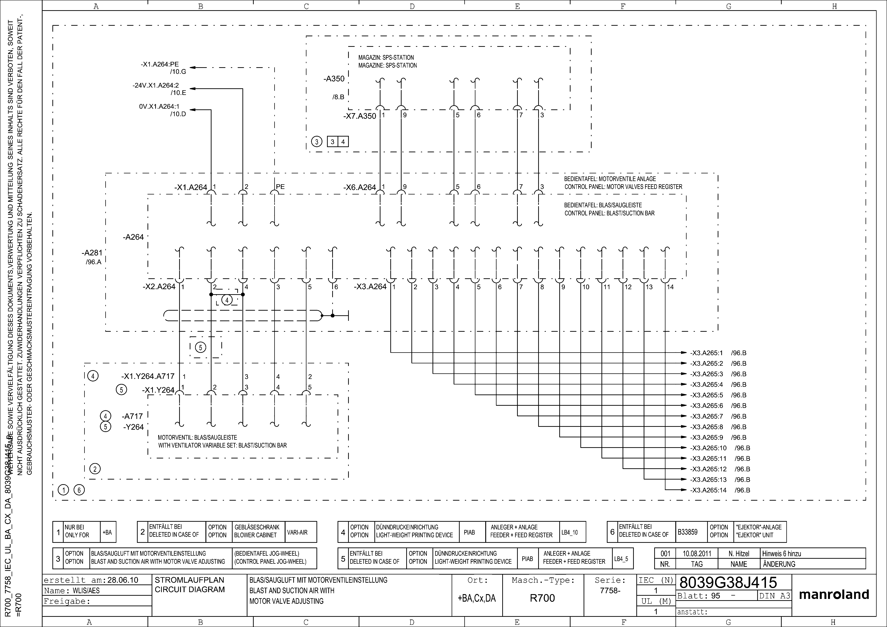

# +BA_Cx_DA — Sheet 95 of 247 — BLAS/SAUGLUFT MIT MOTORVENTILEINSTELLUNG

**BLAST AND SUCTION AIR WITH**

> Part of the manroland **R700** printing press IEC/UL circuit diagrams.
> Drawing class: **Stromlaufplan / Circuit diagram** (DIN A3).
> Document `+BA_Cx_DA` covers the **Printing units / main switch cabinet** machine section.

## At a glance

| Field | Value |
|---|---|
| Document | `+BA_Cx_DA`  (8039G38J415) |
| Sheet | **95** of 247 |
| Section (DE) | BLAS/SAUGLUFT MIT MOTORVENTILEINSTELLUNG |
| Section (EN) | BLAST AND SUCTION AIR WITH |
| Section type | CIRCUIT — Circuit diagram |
| Machine type | `R700` |
| Series | `7758` |
| Created | 28.06.10 |
| Replaces | — |
| Columns used | A, B, C, D, E, F, G, H |
| Path numbers | — |
| Labels on sheet | 167 |
| Cross-refs out | 19 |
| Cross-refs in | 59 |

**Previous:** [+BA_Cx_DA sheet 94](SHEET_0094.md) · **Next:** [+BA_Cx_DA sheet 96](SHEET_0096.md) · **Document TOC:** [_TOC.md](_TOC.md)  (+BA_Cx_DA) · **Master TOC:** [all sheets](../_MASTER_TOC.md)

## Sheet image (300 DPI, exact vector render)



_Rendered directly from the PDF vector layer at 300 DPI (1-bit), no OCR and no resampling. Use it to confirm anything ambiguous in the text below._

## Cross-references on this sheet

Each entry is a wire leaving this sheet. The printed token is `/sheet.column`; the link resolves to that sheet inside the same document.

| Ref | Target sheet | Col | Path | Destination on target | Target section | From col |
|---|---|---|---|---|---|---|
| `/10.G` | [+BA_Cx_DA sheet 10](SHEET_0010.md) | G | — | X1.A264:PE | SPANNUNGSVERSORGUNG, SCHALTSCHRANKBELÜFTUNG | B |
| `/10.E` | [+BA_Cx_DA sheet 10](SHEET_0010.md) | E | — | 24V.X1.A264:2 | SPANNUNGSVERSORGUNG, SCHALTSCHRANKBELÜFTUNG | B |
| `/8.B` | [+BA_Cx_DA sheet 8](SHEET_0008.md) | B | — | — | SPANNUNGSVERSORGUNG, SCHALTSCHRANKBELÜFTUNG | C |
| `/10.D` | [+BA_Cx_DA sheet 10](SHEET_0010.md) | D | — | 0V.X1.A264:1 | SPANNUNGSVERSORGUNG, SCHALTSCHRANKBELÜFTUNG | B |
| `/96.A` | [+BA_Cx_DA sheet 96](SHEET_0096.md) | A | — | — | BLAS/SAUGLUFT MIT MOTORVENTILEINSTELLUNG | A |
| `/96.B` | [+BA_Cx_DA sheet 96](SHEET_0096.md) | B | — | X3.A265:1 | BLAS/SAUGLUFT MIT MOTORVENTILEINSTELLUNG | G |
| `/96.B` | [+BA_Cx_DA sheet 96](SHEET_0096.md) | B | — | X3.A265:2 | BLAS/SAUGLUFT MIT MOTORVENTILEINSTELLUNG | G |
| `/96.B` | [+BA_Cx_DA sheet 96](SHEET_0096.md) | B | — | X3.A265:3 | BLAS/SAUGLUFT MIT MOTORVENTILEINSTELLUNG | G |
| `/96.B` | [+BA_Cx_DA sheet 96](SHEET_0096.md) | B | — | X3.A265:4 | BLAS/SAUGLUFT MIT MOTORVENTILEINSTELLUNG | G |
| `/96.B` | [+BA_Cx_DA sheet 96](SHEET_0096.md) | B | — | X3.A265:5 | BLAS/SAUGLUFT MIT MOTORVENTILEINSTELLUNG | G |
| `/96.B` | [+BA_Cx_DA sheet 96](SHEET_0096.md) | B | — | X3.A265:6 | BLAS/SAUGLUFT MIT MOTORVENTILEINSTELLUNG | G |
| `/96.B` | [+BA_Cx_DA sheet 96](SHEET_0096.md) | B | — | X3.A265:7 | BLAS/SAUGLUFT MIT MOTORVENTILEINSTELLUNG | G |
| `/96.B` | [+BA_Cx_DA sheet 96](SHEET_0096.md) | B | — | X3.A265:8 | BLAS/SAUGLUFT MIT MOTORVENTILEINSTELLUNG | G |
| `/96.B` | [+BA_Cx_DA sheet 96](SHEET_0096.md) | B | — | X3.A265:9 | BLAS/SAUGLUFT MIT MOTORVENTILEINSTELLUNG | G |
| `/96.B` | [+BA_Cx_DA sheet 96](SHEET_0096.md) | B | — | X3.A265:10 | BLAS/SAUGLUFT MIT MOTORVENTILEINSTELLUNG | G |
| `/96.B` | [+BA_Cx_DA sheet 96](SHEET_0096.md) | B | — | X3.A265:11 | BLAS/SAUGLUFT MIT MOTORVENTILEINSTELLUNG | G |
| `/96.B` | [+BA_Cx_DA sheet 96](SHEET_0096.md) | B | — | X3.A265:12 | BLAS/SAUGLUFT MIT MOTORVENTILEINSTELLUNG | G |
| `/96.B` | [+BA_Cx_DA sheet 96](SHEET_0096.md) | B | — | X3.A265:13 | BLAS/SAUGLUFT MIT MOTORVENTILEINSTELLUNG | G |
| `/96.B` | [+BA_Cx_DA sheet 96](SHEET_0096.md) | B | — | X3.A265:14 | BLAS/SAUGLUFT MIT MOTORVENTILEINSTELLUNG | G |

### Incoming references (sheets that point here)

Every other sheet that sends a wire to this one. `Back-ref` is the token printed on *that* sheet; `Path` is its line number.

| From sheet | Cols | Back-ref | Path | Refs | What continues there |
|---|---|---|---|---|---|
| [+BA_Cx_DA#8](SHEET_0008.md) | A | `/8.A` | — | 1 | — |
| [+BA_Cx_DA#10](SHEET_0010.md) | D, E, G | `/10.D`, `/10.E`, `/10.G` | — | 3 | 0V.X1.A264:1; X1.A264:PE |
| [+BA_Cx_DA#96](SHEET_0096.md) | A, B | `/96.A`, `/96.B` | — | 15 | X3.A265:1; X3.A265:10; X3.A265:11; X3.A265:12; X3.A265:13; X3.A265:14; X3.A265:2; X3.A265:3; X3.A265:4; X3.A265:5; X3.A265:6; X3.A265:7; X3.A265:8; X3.A265:9 |
| [+BA_Cx_DA#141](SHEET_0141.md) | A | `/141.A` | — | 3 | — |
| [+BA_Cx_DA#150](SHEET_0150.md) | C | `/150.C` | — | 5 | — |
| [+BA_Cx_DA#152](SHEET_0152.md) | F | `/152.F` | — | 6 | — |
| [+BA_Cx_DA#156](SHEET_0156.md) | B | `/156.B` | — | 14 | — |
| [+BA_Cx_DA#162](SHEET_0162.md) | A | `/162.A` | — | 6 | — |
| [+BA_Cx_DA#164](SHEET_0164.md) | B | `/164.B` | — | 6 | — |


## Devices on this sheet

| Tag | Class | Class meaning (IEC) | Col | Sub | Terminal | Sign |
|---|---|---|---|---|---|---|
| `A264` | A | Baugruppe / assembly, module, PC board | A | — | — | — |
| `A281` | A | Baugruppe / assembly, module, PC board | A | — | — | — |
| `A350` | A | Baugruppe / assembly, module, PC board | C | — | — | — |
| `Y264` | Y | Magnetventil / solenoid valve, actuator | A | — | — | — |
| `A717` | A | Baugruppe / assembly, module, PC board | A | — | — | — |
| `X2.A264` | — | cross-device reference | B | — | — | — |
| `X1.A264` | — | cross-device reference | B | — | — | — |
| `X3.A264` | — | cross-device reference | D | — | — | — |
| `X6.A264` | — | cross-device reference | D | — | — | — |
| `X7.A350` | — | cross-device reference | D | — | — | — |
| `X1.Y264` | — | cross-device reference | B | — | — | — |
| `X1.A264:PE` | — | cross-device reference | B | — | PE | — |
| `X3.A265:12` | — | cross-device reference | G | — | 12 | — |
| `X3.A265:11` | — | cross-device reference | G | — | 11 | — |
| `X3.A265:10` | — | cross-device reference | G | — | 10 | — |
| `X3.A265:9` | — | cross-device reference | G | — | 9 | — |
| `X3.A265:13` | — | cross-device reference | G | — | 13 | — |
| `X3.A265:14` | — | cross-device reference | G | — | 14 | — |
| `X3.A265:8` | — | cross-device reference | G | — | 8 | — |
| `X3.A265:7` | — | cross-device reference | G | — | 7 | — |
| `X3.A265:1` | — | cross-device reference | G | — | 1 | — |
| `X3.A265:2` | — | cross-device reference | G | — | 2 | — |
| `X3.A265:6` | — | cross-device reference | G | — | 6 | — |
| `X3.A265:5` | — | cross-device reference | G | — | 5 | — |
| `X3.A265:4` | — | cross-device reference | G | — | 4 | — |
| `X3.A265:3` | — | cross-device reference | G | — | 3 | — |
| `NR.` | — | cross-device reference | F | — | — | — |
| `10.08.2011` | — | cross-device reference | G | — | — | — |
| `X1.Y264.A717` | — | cross-device reference | A | — | — | — |

## Potentials / nets

| Potential | Count | Columns | Attached devices | Terminals |
|---|---|---|---|---|
| `0V` | 1 | B | `A264`, `X1` | `1` |
| `24V` | 1 | B | `A264`, `X1` | `2` |
| `PE` | 1 | C | — | — |


A potential such as `L24+/4` or `M24+` is a named supply/return rail; every place it appears on this sheet is electrically common.

## Wire-end annotations (grouped as printed)

A wire that continues elsewhere is annotated with a small cluster: the destination description, the path/line number `#NN`, and the `/sheet.column` cross reference. Each row below is one such cluster exactly as it is grouped on the drawing.

| Col | Y | Path | Cross-ref | Text on the wire |
|---|---|---|---|---|
| D | 74.3 | — | — | `MAGAZIN: SPS STATION MAGAZINE: SPS STATION` |
| B | 82.5 | — | `/10.G` | `X1.A264:PE` |
| C | 100.9 | — | — | `A350` |
| B | 110.8 | — | `/10.E` | `24V.X1.A264:2` |
| C | 126.4 | — | `/8.B` | — |
| B | 139.2 | — | `/10.D` | `0V.X1.A264:1` |
| D | 150.6 | — | — | `X7.A350 1 9 5 6 7 3` |
| C | 186.7 | — | — | `3 3 4` |
| F | 237.3 | — | — | `BEDIENTAFEL: MOTORVENTILE ANLAGE` |
| D | 246.8 | — | — | `X1.A264 1 2 PE CONTROL PANEL: MOTOR VALVES FEED REGISTER` |
| D | 246.9 | — | — | `X6.A264 1 9 5 6 7 3` |
| F | 272.7 | — | — | `BEDIENTAFEL: BLAS/SAUGLEISTE` |
| F | 283.4 | — | — | `CONTROL PANEL: BLAST/SUCTION BAR` |
| A | 313.5 | — | — | `A264` |
| A | 334.8 | — | — | `A281` |
| A | 347.9 | — | `/96.A` | — |
| B | 380.1 | — | — | `X2.A264 1 2 4 3 5` |
| E | 380.1 | — | — | `6 X3.A264 1 2 3 4 5 6 7 8 9 10 11 12 13 14` |
| B | 400.0 | — | — | `4` |
| B | 463.8 | — | — | `5` |
| G | 470.1 | — | `/96.B` | `X3.A265:1` |
| G | 484.3 | — | `/96.B` | `X3.A265:2` |
| G | 498.4 | — | `/96.B` | `X3.A265:3` |
| B | 500.6 | — | — | `X1.Y264.A717 1 3 4 2` |
| A | 502.0 | — | — | `4` |
| G | 512.6 | — | `/96.B` | `X3.A265:4` |
| B | 516.2 | — | — | `X1.Y264 1 2 3 4 5` |
| A | 520.5 | — | — | `5` |
| G | 526.8 | — | `/96.B` | `X3.A265:5` |
| G | 541.0 | — | `/96.B` | `X3.A265:6` |
| A | 554.5 | — | — | `A717` |
| G | 555.1 | — | `/96.B` | `X3.A265:7` |
| A | 555.9 | — | — | `4` |
| A | 568.7 | — | — | `Y264` |
| G | 569.3 | — | `/96.B` | `X3.A265:8` |
| A | 570.1 | — | — | `5` |
| G | 583.5 | — | `/96.B` | `X3.A265:9` |
| B | 584.6 | — | — | `MOTORVENTIL: BLAS/SAUGLEISTE` |
| B | 595.2 | — | — | `WITH VENTILATOR VARIABLE SET: BLAST/SUCTION BAR` |
| G | 597.6 | — | `/96.B` | `X3.A265:10` |
| G | 611.8 | — | `/96.B` | `X3.A265:11` |
| G | 626.0 | — | `/96.B` | `X3.A265:12` |
| A | 626.8 | — | — | `2` |
| G | 640.2 | — | `/96.B` | `X3.A265:13` |
| G | 654.3 | — | `/96.B` | `X3.A265:14` |
| A | 654.6 | — | — | `1` |
| A | 655.1 | — | — | `6` |
| B | 704.3 | — | — | `ENTFÄLLT BEI DELETED IN CASE OF` |
| F | 704.3 | — | — | `ENTFÄLLT BEI DELETED IN CASE OF` |
| A | 705.0 | — | — | `1 NUR BEI` |
| C | 705.0 | — | — | `2 BLOWER CABINET GEBLÄSESCHRANK VARI AIR 4 OPTION OPTION` |
| B | 705.0 | — | — | `OPTION OPTION` |
| E | 705.0 | — | — | `FEEDER + FEED REGISTER ANLEGER + ANLAGE LB4_10` |
| G | 705.0 | — | — | `6 B33859 "EJEKTOR" ANLAGE "EJEKTOR" UNIT` |
| G | 705.0 | — | — | `OPTION OPTION` |
| D | 705.1 | — | — | `DÜNNDRUCKEINRICHTUNG LIGHT WEIGHT PRINTING DEVICE PIAB` |
| A | 712.1 | — | — | `ONLY FOR +BA` |
| G | 739.8 | — | — | `001 10.08.2011 N. Hitzel Hinweis 6 hinzu` |
| A | 740.4 | — | — | `3 OPTION OPTION` |
| D | 740.4 | — | — | `5 ENTFÄLLT BEI DELETED IN CASE OF OPTION OPTION` |
| B | 740.5 | — | — | `BLAS/SAUGLUFT MIT MOTORVENTILEINSTELLUNG BLAST AND SUCTION AIR WITH MOTOR VALVE ADJUSTING` |
| C | 740.5 | — | — | `(BEDIENTAFEL JOG WHEEL) (CONTROL PANEL JOG WHEEL)` |
| E | 740.5 | — | — | `DÜNNDRUCKEINRICHTUNG LIGHT WEIGHT PRINTING DEVICE PIAB` |
| F | 740.5 | — | — | `FEEDER + FEED REGISTER ANLEGER + ANLAGE LB4_5` |
| G | 754.1 | — | — | `NR. TAG NAME ÄNDERUNG` |


## Reconstructed tables

This sheet carries tabular content (pin map / terminal assignment / index). The grid below was rebuilt from the drawing's own rule lines, so each row is exactly one physical row of the table.

### Table 1 — 5 data rows × 21 columns (at x=240.9, y=90.7) — **A350**

| X1.A264 1 | 1 2 | 2 4 | PE 3 | 3 3 5 | /8.B X7.A350 4 X6.A264 X3.A264 6 | 1 1 | 1 | 9 9 | 2 | 3 | 5 5 4 | 6 6 5 | 6 | 7 7 7 | 3 3 8 | CONTROL CONTROL 9 | BEDIENTAFEL: PANEL: BEDIENTAFEL: PANEL: 10 | MOTORVENTILE MOTOR BLAS/SAUGLEISTE 11 | VALVES BLAST/SUCTION 12 | ANLAGE FEED BAR 13 |
|---|---|---|---|---|---|---|---|---|---|---|---|---|---|---|---|---|---|---|---|---|
|  | `4` |  |  |  |  |  |  |  |  |  |  |  |  |  |  |  |  |  |  |  |
| `5` |  |  |  |  |  |  |  |  |  |  |  |  |  |  |  |  |  |  |  |  |
| `1` |  | `3` | `4` | `2` |  |  |  |  |  |  |  |  |  |  |  |  |  |  |  |  |
| `1` | `2` | `3` | `4` | `5` |  |  |  |  |  |  |  |  |  |  |  |  |  |  |  |  |
| `VENTILATOR` | `BLAS/SAUGLEISTE VARIABLE SET:` | `BLAST/SUCTION` | `BAR` |  |  |  |  |  |  |  |  |  |  |  |  |  |  |  |  |  |


## Notes and free text on this sheet

| Text | Col | Y (pt) |
|---|---|---|
| `BEDIENTAFEL: BLAS/SAUGLEISTE` | F | 272.73 |
| `CONTROL PANEL: BLAST/SUCTION BAR` | F | 283.39 |
| `BEDIENTAFEL: MOTORVENTILE ANLAGE` | F | 237.31 |
| `CONTROL PANEL: MOTOR VALVES FEED REGISTER` | F | 247.96 |
| `MAGAZIN: SPS STATION` | D | 74.31 |
| `MAGAZINE: SPS STATION` | D | 84.94 |
| `MOTORVENTIL: BLAS/SAUGLEISTE` | B | 584.56 |
| `WITH VENTILATOR VARIABLE SET: BLAST/SUCTION BAR` | B | 595.18 |
| `TAG` | G | 754.14 |
| `NAME` | G | 754.14 |
| `ÄNDERUNG` | G | 754.19 |
| `N. Hitzel` | G | 740.11 |
| `Hinweis 6 hinzu` | H | 740.07 |
| `OPTION` | A | 740.44 |
| `BLAS/SAUGLUFT MIT MOTORVENTILEINSTELLUNG` | B | 740.48 |
| `BLAST AND SUCTION AIR WITH MOTOR VALVE ADJUSTING` | B | 751.09 |
| `(BEDIENTAFEL JOG WHEEL)` | C | 740.45 |
| `(CONTROL PANEL JOG WHEEL)` | C | 751.1 |
| `NUR BEI` | A | 704.99 |
| `ONLY FOR` | A | 715.68 |
| `+BA` | A | 712.09 |
| `ENTFÄLLT BEI` | B | 704.29 |
| `DELETED IN CASE OF` | B | 714.95 |
| `OPTION` | B | 705.01 |
| `GEBLÄSESCHRANK` | C | 705.04 |
| `BLOWER CABINET` | C | 715.63 |
| `VARI AIR` | C | 712.11 |
| `OPTION` | D | 705.01 |
| `DÜNNDRUCKEINRICHTUNG` | D | 705.06 |
| `LIGHT WEIGHT PRINTING DEVICE` | D | 715.65 |
| `PIAB` | E | 712.02 |
| `ANLEGER + ANLAGE` | E | 705.04 |
| `FEEDER + FEED REGISTER` | E | 715.66 |
| `LB4_10` | E | 712.12 |
| `ENTFÄLLT BEI` | D | 740.43 |
| `DELETED IN CASE OF` | D | 751.09 |
| `DÜNNDRUCKEINRICHTUNG` | E | 740.5 |
| `LIGHT WEIGHT PRINTING DEVICE` | E | 751.08 |
| `FEEDER + FEED REGISTER` | F | 751.09 |
| `LB4_5` | F | 747.54 |
| `ENTFÄLLT BEI` | F | 704.29 |
| `DELETED IN CASE OF` | F | 714.95 |
| `OPTION` | G | 705.01 |
| `"EJEKTOR" ANLAGE` | G | 705.03 |
| `"EJEKTOR" UNIT` | G | 715.66 |
| `B33859` | G | 710.89 |

## Complete label inventory (exact text from the drawing)

Every text object inside the drawing area of this sheet, in DIN reading order (column A→H, then top→bottom). This is the authoritative list: if a string is not here it is not printed on this sheet.

| Col | Y | X | Dir | Type | Text |
|---|---|---|---|---|---|
| A | 313.5 | 165.0 | → | device tag | `A264` |
| A | 334.8 | 109.7 | → | device tag | `A281` |
| A | 347.8 | 115.4 | → | cross-reference | `/96.A` |
| A | 500.7 | 163.0 | → | device ref | `X1.Y264.A717` |
| A | 502.0 | 122.7 | → | number | `4` |
| A | 520.5 | 161.0 | → | number | `5` |
| A | 554.5 | 163.6 | → | device tag | `A717` |
| A | 555.9 | 139.7 | → | number | `4` |
| A | 568.7 | 165.5 | → | device tag | `Y264` |
| A | 570.1 | 139.7 | → | number | `5` |
| A | 626.7 | 125.6 | → | number | `2` |
| A | 654.6 | 83.3 | → | number | `1` |
| A | 655.1 | 104.3 | → | number | `6` |
| A | 705.0 | 87.0 | → | text | `NUR BEI` |
| A | 709.6 | 188.5 | → | number | `2` |
| A | 710.3 | 75.4 | → | number | `1` |
| A | 712.1 | 137.9 | → | text | `+BA` |
| A | 715.7 | 87.6 | → | text | `ONLY FOR` |
| A | 740.4 | 87.6 | → | text | `OPTION` |
| A | 745.8 | 75.0 | → | number | `3` |
| A | 751.1 | 87.6 | → | text | `OPTION` |
| B | 82.5 | 189.1 | → | device ref | `X1.A264:PE` |
| B | 92.4 | 228.5 | → | cross-reference | `/10.G` |
| B | 110.8 | 178.0 | → | potential | `24V.X1.A264:2` |
| B | 120.7 | 229.3 | → | cross-reference | `/10.E` |
| B | 139.2 | 186.8 | → | potential | `0V.X1.A264:1` |
| B | 149.1 | 228.8 | → | cross-reference | `/10.D` |
| B | 246.9 | 234.1 | → | device ref | `X1.A264` |
| B | 246.9 | 285.4 | → | number | `1` |
| B | 246.9 | 328.5 | → | number | `2` |
| B | 380.2 | 191.6 | → | device ref | `X2.A264` |
| B | 381.6 | 242.9 | → | number | `1` |
| B | 381.6 | 286.0 | → | number | `2` |
| B | 381.6 | 328.5 | → | number | `4` |
| B | 400.0 | 302.7 | → | number | `4` |
| B | 463.8 | 267.3 | → | number | `5` |
| B | 502.1 | 244.9 | → | number | `1` |
| B | 502.1 | 328.5 | → | number | `3` |
| B | 516.2 | 242.9 | → | number | `1` |
| B | 516.2 | 286.0 | → | number | `2` |
| B | 516.2 | 328.5 | → | number | `3` |
| B | 519.1 | 190.8 | → | device ref | `X1.Y264` |
| B | 584.6 | 212.0 | → | text | `MOTORVENTIL: BLAS/SAUGLEISTE` |
| B | 595.2 | 212.6 | → | text | `WITH VENTILATOR VARIABLE SET: BLAST/SUCTION BAR` |
| B | 704.3 | 200.4 | → | text | `ENTFÄLLT BEI` |
| B | 705.0 | 279.6 | → | text | `OPTION` |
| B | 714.9 | 200.4 | → | text | `DELETED IN CASE OF` |
| B | 715.6 | 279.6 | → | text | `OPTION` |
| B | 740.5 | 122.5 | → | text | `BLAS/SAUGLUFT MIT MOTORVENTILEINSTELLUNG` |
| B | 751.1 | 122.5 | → | text | `BLAST AND SUCTION AIR WITH MOTOR VALVE ADJUSTING` |
| C | 100.9 | 434.3 | → | device tag | `A350` |
| C | 126.4 | 446.5 | → | cross-reference | `/8.B` |
| C | 186.7 | 444.0 | → | number | `3` |
| C | 186.7 | 458.2 | → | number | `4` |
| C | 187.4 | 423.2 | → | number | `3` |
| C | 246.8 | 370.5 | → | potential | `PE` |
| C | 381.6 | 371.1 | → | number | `3` |
| C | 381.6 | 413.6 | → | number | `5` |
| C | 381.6 | 449.0 | → | number | `6` |
| C | 502.1 | 371.1 | → | number | `4` |
| C | 502.1 | 413.9 | → | number | `2` |
| C | 516.2 | 371.1 | → | number | `4` |
| C | 516.2 | 413.6 | → | number | `5` |
| C | 705.0 | 315.1 | → | text | `GEBLÄSESCHRANK` |
| C | 710.3 | 457.8 | → | number | `4` |
| C | 712.1 | 385.5 | → | text | `VARI AIR` |
| C | 715.6 | 314.5 | → | text | `BLOWER CABINET` |
| C | 740.4 | 314.8 | → | text | `(BEDIENTAFEL JOG WHEEL)` |
| C | 745.8 | 457.7 | → | number | `5` |
| C | 751.1 | 314.8 | → | text | `(CONTROL PANEL JOG WHEEL)` |
| D | 74.3 | 481.3 | → | text | `MAGAZIN: SPS STATION` |
| D | 84.9 | 481.3 | → | text | `MAGAZINE: SPS STATION` |
| D | 150.6 | 512.2 | → | number | `1` |
| D | 150.6 | 541.1 | → | number | `9` |
| D | 150.6 | 612.0 | → | number | `5` |
| D | 151.3 | 460.9 | → | device ref | `X7.A350` |
| D | 246.9 | 460.9 | → | device ref | `X6.A264` |
| D | 246.9 | 512.2 | → | number | `1` |
| D | 246.9 | 541.1 | → | number | `9` |
| D | 246.9 | 612.0 | → | number | `5` |
| D | 380.2 | 475.1 | → | device ref | `X3.A264` |
| D | 381.6 | 526.4 | → | number | `1` |
| D | 381.6 | 555.3 | → | number | `2` |
| D | 381.6 | 583.7 | → | number | `3` |
| D | 381.6 | 612.0 | → | number | `4` |
| D | 705.0 | 470.3 | → | text | `OPTION` |
| D | 705.1 | 505.1 | → | text | `DÜNNDRUCKEINRICHTUNG` |
| D | 715.6 | 470.3 | → | text | `OPTION` |
| D | 715.7 | 505.1 | → | text | `LIGHT WEIGHT PRINTING DEVICE` |
| D | 740.4 | 469.7 | → | text | `ENTFÄLLT BEI` |
| D | 740.4 | 548.9 | → | text | `OPTION` |
| D | 751.1 | 469.7 | → | text | `DELETED IN CASE OF` |
| D | 751.1 | 548.9 | → | text | `OPTION` |
| E | 150.6 | 640.3 | → | number | `6` |
| E | 150.6 | 697.0 | → | number | `7` |
| E | 150.6 | 725.4 | → | number | `3` |
| E | 246.9 | 640.3 | → | number | `6` |
| E | 246.9 | 697.0 | → | number | `7` |
| E | 246.9 | 725.4 | → | number | `3` |
| E | 381.6 | 640.3 | → | number | `5` |
| E | 381.6 | 668.7 | → | number | `6` |
| E | 381.6 | 697.0 | → | number | `7` |
| E | 381.6 | 725.4 | → | number | `8` |
| E | 381.6 | 753.7 | → | number | `9` |
| E | 705.0 | 659.1 | → | text | `ANLEGER + ANLAGE` |
| E | 712.0 | 622.8 | → | text | `PIAB` |
| E | 712.1 | 753.9 | → | text | `LB4_10` |
| E | 715.7 | 658.2 | → | text | `FEEDER + FEED REGISTER` |
| E | 740.5 | 583.8 | → | text | `DÜNNDRUCKEINRICHTUNG` |
| E | 740.5 | 729.9 | → | text | `ANLEGER + ANLAGE` |
| E | 747.4 | 700.7 | → | text | `PIAB` |
| E | 751.1 | 583.8 | → | text | `LIGHT WEIGHT PRINTING DEVICE` |
| F | 237.3 | 757.4 | → | text | `BEDIENTAFEL: MOTORVENTILE ANLAGE` |
| F | 248.0 | 758.0 | → | text | `CONTROL PANEL: MOTOR VALVES FEED REGISTER` |
| F | 272.7 | 757.4 | → | text | `BEDIENTAFEL: BLAS/SAUGLEISTE` |
| F | 283.4 | 758.0 | → | text | `CONTROL PANEL: BLAST/SUCTION BAR` |
| F | 381.6 | 781.5 | → | number | `10` |
| F | 381.6 | 809.9 | → | number | `11` |
| F | 381.6 | 838.2 | → | number | `12` |
| F | 381.6 | 866.6 | → | number | `13` |
| F | 381.6 | 894.9 | → | number | `14` |
| F | 704.3 | 831.1 | → | text | `ENTFÄLLT BEI` |
| F | 709.6 | 819.2 | → | number | `6` |
| F | 714.9 | 831.1 | → | text | `DELETED IN CASE OF` |
| F | 739.8 | 886.9 | → | number | `001` |
| F | 747.5 | 824.7 | → | text | `LB4_5` |
| F | 751.1 | 729.1 | → | text | `FEEDER + FEED REGISTER` |
| F | 754.1 | 886.3 | → | device ref | `NR.` |
| G | 470.1 | 926.6 | → | device ref | `X3.A265:1` |
| G | 470.1 | 981.5 | → | cross-reference | `/96.B` |
| G | 484.3 | 926.6 | → | device ref | `X3.A265:2` |
| G | 484.3 | 981.5 | → | cross-reference | `/96.B` |
| G | 498.4 | 981.5 | → | cross-reference | `/96.B` |
| G | 498.5 | 926.6 | → | device ref | `X3.A265:3` |
| G | 512.6 | 926.6 | → | device ref | `X3.A265:4` |
| G | 512.6 | 981.5 | → | cross-reference | `/96.B` |
| G | 526.8 | 926.6 | → | device ref | `X3.A265:5` |
| G | 526.8 | 981.5 | → | cross-reference | `/96.B` |
| G | 541.0 | 926.6 | → | device ref | `X3.A265:6` |
| G | 541.0 | 981.5 | → | cross-reference | `/96.B` |
| G | 555.1 | 981.5 | → | cross-reference | `/96.B` |
| G | 555.2 | 926.6 | → | device ref | `X3.A265:7` |
| G | 569.3 | 926.6 | → | device ref | `X3.A265:8` |
| G | 569.3 | 981.5 | → | cross-reference | `/96.B` |
| G | 583.5 | 926.6 | → | device ref | `X3.A265:9` |
| G | 583.5 | 981.5 | → | cross-reference | `/96.B` |
| G | 597.7 | 926.6 | → | device ref | `X3.A265:10` |
| G | 597.7 | 986.5 | → | cross-reference | `/96.B` |
| G | 611.8 | 986.5 | → | cross-reference | `/96.B` |
| G | 611.9 | 926.6 | → | device ref | `X3.A265:11` |
| G | 626.0 | 926.6 | → | device ref | `X3.A265:12` |
| G | 626.0 | 986.5 | → | cross-reference | `/96.B` |
| G | 640.2 | 926.6 | → | device ref | `X3.A265:13` |
| G | 640.2 | 986.5 | → | cross-reference | `/96.B` |
| G | 654.3 | 986.5 | → | cross-reference | `/96.B` |
| G | 654.4 | 926.6 | → | device ref | `X3.A265:14` |
| G | 705.0 | 952.9 | → | text | `OPTION` |
| G | 705.0 | 988.3 | → | text | `"EJEKTOR" ANLAGE` |
| G | 710.9 | 909.8 | → | text | `B33859` |
| G | 715.6 | 952.9 | → | text | `OPTION` |
| G | 715.7 | 988.3 | → | text | `"EJEKTOR" UNIT` |
| G | 739.9 | 916.5 | → | device ref | `10.08.2011` |
| G | 740.1 | 978.1 | → | text | `N. Hitzel` |
| G | 754.1 | 927.7 | → | text | `TAG` |
| G | 754.1 | 980.9 | → | text | `NAME` |
| G | 754.2 | 1024.4 | → | text | `ÄNDERUNG` |
| H | 740.1 | 1023.3 | → | text | `Hinweis 6 hinzu` |

## Reading-order text block

The same content as a plain block, grouped by DIN column — convenient to paste or to match against a visual description.

```text
=== Column A ===
 313.5  165.0  devtag       A264
 334.8  109.7  devtag       A281
 347.8  115.4  xref         /96.A
 500.7  163.0  devref       X1.Y264.A717
 502.0  122.7  numeric      4
 520.5  161.0  numeric      5
 554.5  163.6  devtag       A717
 555.9  139.7  numeric      4
 568.7  165.5  devtag       Y264
 570.1  139.7  numeric      5
 626.7  125.6  numeric      2
 654.6   83.3  numeric      1
 655.1  104.3  numeric      6
 705.0   87.0  text         NUR BEI
 709.6  188.5  numeric      2
 710.3   75.4  numeric      1
 712.1  137.9  text         +BA
 715.7   87.6  text         ONLY FOR
 740.4   87.6  text         OPTION
 745.8   75.0  numeric      3
 751.1   87.6  text         OPTION
=== Column B ===
  82.5  189.1  devref       X1.A264:PE
  92.4  228.5  xref         /10.G
 110.8  178.0  net          24V.X1.A264:2
 120.7  229.3  xref         /10.E
 139.2  186.8  net          0V.X1.A264:1
 149.1  228.8  xref         /10.D
 246.9  234.1  devref       X1.A264
 246.9  285.4  numeric      1
 246.9  328.5  numeric      2
 380.2  191.6  devref       X2.A264
 381.6  242.9  numeric      1
 381.6  286.0  numeric      2
 381.6  328.5  numeric      4
 400.0  302.7  numeric      4
 463.8  267.3  numeric      5
 502.1  244.9  numeric      1
 502.1  328.5  numeric      3
 516.2  242.9  numeric      1
 516.2  286.0  numeric      2
 516.2  328.5  numeric      3
 519.1  190.8  devref       X1.Y264
 584.6  212.0  text         MOTORVENTIL: BLAS/SAUGLEISTE
 595.2  212.6  text         WITH VENTILATOR VARIABLE SET: BLAST/SUCTION BAR
 704.3  200.4  text         ENTFÄLLT BEI
 705.0  279.6  text         OPTION
 714.9  200.4  text         DELETED IN CASE OF
 715.6  279.6  text         OPTION
 740.5  122.5  text         BLAS/SAUGLUFT MIT MOTORVENTILEINSTELLUNG
 751.1  122.5  text         BLAST AND SUCTION AIR WITH MOTOR VALVE ADJUSTING
=== Column C ===
 100.9  434.3  devtag       A350
 126.4  446.5  xref         /8.B
 186.7  444.0  numeric      3
 186.7  458.2  numeric      4
 187.4  423.2  numeric      3
 246.8  370.5  net          PE
 381.6  371.1  numeric      3
 381.6  413.6  numeric      5
 381.6  449.0  numeric      6
 502.1  371.1  numeric      4
 502.1  413.9  numeric      2
 516.2  371.1  numeric      4
 516.2  413.6  numeric      5
 705.0  315.1  text         GEBLÄSESCHRANK
 710.3  457.8  numeric      4
 712.1  385.5  text         VARI AIR
 715.6  314.5  text         BLOWER CABINET
 740.4  314.8  text         (BEDIENTAFEL JOG WHEEL)
 745.8  457.7  numeric      5
 751.1  314.8  text         (CONTROL PANEL JOG WHEEL)
=== Column D ===
  74.3  481.3  text         MAGAZIN: SPS STATION
  84.9  481.3  text         MAGAZINE: SPS STATION
 150.6  512.2  numeric      1
 150.6  541.1  numeric      9
 150.6  612.0  numeric      5
 151.3  460.9  devref       X7.A350
 246.9  460.9  devref       X6.A264
 246.9  512.2  numeric      1
 246.9  541.1  numeric      9
 246.9  612.0  numeric      5
 380.2  475.1  devref       X3.A264
 381.6  526.4  numeric      1
 381.6  555.3  numeric      2
 381.6  583.7  numeric      3
 381.6  612.0  numeric      4
 705.0  470.3  text         OPTION
 705.1  505.1  text         DÜNNDRUCKEINRICHTUNG
 715.6  470.3  text         OPTION
 715.7  505.1  text         LIGHT WEIGHT PRINTING DEVICE
 740.4  469.7  text         ENTFÄLLT BEI
 740.4  548.9  text         OPTION
 751.1  469.7  text         DELETED IN CASE OF
 751.1  548.9  text         OPTION
=== Column E ===
 150.6  640.3  numeric      6
 150.6  697.0  numeric      7
 150.6  725.4  numeric      3
 246.9  640.3  numeric      6
 246.9  697.0  numeric      7
 246.9  725.4  numeric      3
 381.6  640.3  numeric      5
 381.6  668.7  numeric      6
 381.6  697.0  numeric      7
 381.6  725.4  numeric      8
 381.6  753.7  numeric      9
 705.0  659.1  text         ANLEGER + ANLAGE
 712.0  622.8  text         PIAB
 712.1  753.9  text         LB4_10
 715.7  658.2  text         FEEDER + FEED REGISTER
 740.5  583.8  text         DÜNNDRUCKEINRICHTUNG
 740.5  729.9  text         ANLEGER + ANLAGE
 747.4  700.7  text         PIAB
 751.1  583.8  text         LIGHT WEIGHT PRINTING DEVICE
=== Column F ===
 237.3  757.4  text         BEDIENTAFEL: MOTORVENTILE ANLAGE
 248.0  758.0  text         CONTROL PANEL: MOTOR VALVES FEED REGISTER
 272.7  757.4  text         BEDIENTAFEL: BLAS/SAUGLEISTE
 283.4  758.0  text         CONTROL PANEL: BLAST/SUCTION BAR
 381.6  781.5  numeric      10
 381.6  809.9  numeric      11
 381.6  838.2  numeric      12
 381.6  866.6  numeric      13
 381.6  894.9  numeric      14
 704.3  831.1  text         ENTFÄLLT BEI
 709.6  819.2  numeric      6
 714.9  831.1  text         DELETED IN CASE OF
 739.8  886.9  numeric      001
 747.5  824.7  text         LB4_5
 751.1  729.1  text         FEEDER + FEED REGISTER
 754.1  886.3  devref       NR.
=== Column G ===
 470.1  926.6  devref       X3.A265:1
 470.1  981.5  xref         /96.B
 484.3  926.6  devref       X3.A265:2
 484.3  981.5  xref         /96.B
 498.4  981.5  xref         /96.B
 498.5  926.6  devref       X3.A265:3
 512.6  926.6  devref       X3.A265:4
 512.6  981.5  xref         /96.B
 526.8  926.6  devref       X3.A265:5
 526.8  981.5  xref         /96.B
 541.0  926.6  devref       X3.A265:6
 541.0  981.5  xref         /96.B
 555.1  981.5  xref         /96.B
 555.2  926.6  devref       X3.A265:7
 569.3  926.6  devref       X3.A265:8
 569.3  981.5  xref         /96.B
 583.5  926.6  devref       X3.A265:9
 583.5  981.5  xref         /96.B
 597.7  926.6  devref       X3.A265:10
 597.7  986.5  xref         /96.B
 611.8  986.5  xref         /96.B
 611.9  926.6  devref       X3.A265:11
 626.0  926.6  devref       X3.A265:12
 626.0  986.5  xref         /96.B
 640.2  926.6  devref       X3.A265:13
 640.2  986.5  xref         /96.B
 654.3  986.5  xref         /96.B
 654.4  926.6  devref       X3.A265:14
 705.0  952.9  text         OPTION
 705.0  988.3  text         "EJEKTOR" ANLAGE
 710.9  909.8  text         B33859
 715.6  952.9  text         OPTION
 715.7  988.3  text         "EJEKTOR" UNIT
 739.9  916.5  devref       10.08.2011
 740.1  978.1  text         N. Hitzel
 754.1  927.7  text         TAG
 754.1  980.9  text         NAME
 754.2 1024.4  text         ÄNDERUNG
=== Column H ===
 740.1 1023.3  text         Hinweis 6 hinzu
```

---
_Generated from the PDF vector text layer; no OCR. Source: `R700_7758_IEC_UL_BA_CX_DA_8039G38J415_p`, sheet 95._
