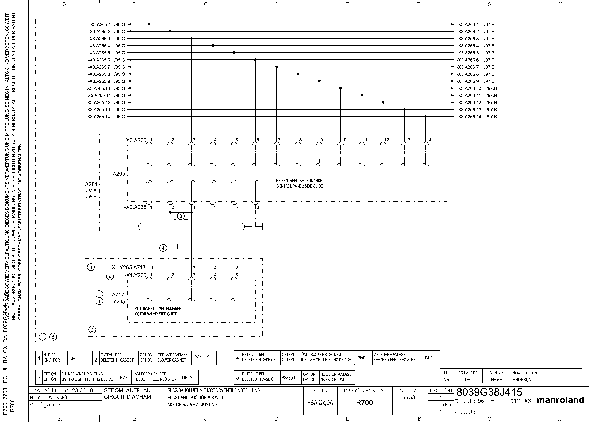

# +BA_Cx_DA — Sheet 96 of 247 — BLAS/SAUGLUFT MIT MOTORVENTILEINSTELLUNG

**BLAST AND SUCTION AIR WITH**

> Part of the manroland **R700** printing press IEC/UL circuit diagrams.
> Drawing class: **Stromlaufplan / Circuit diagram** (DIN A3).
> Document `+BA_Cx_DA` covers the **Printing units / main switch cabinet** machine section.

## At a glance

| Field | Value |
|---|---|
| Document | `+BA_Cx_DA`  (8039G38J415) |
| Sheet | **96** of 247 |
| Section (DE) | BLAS/SAUGLUFT MIT MOTORVENTILEINSTELLUNG |
| Section (EN) | BLAST AND SUCTION AIR WITH |
| Section type | CIRCUIT — Circuit diagram |
| Machine type | `R700` |
| Series | `7758` |
| Created | 28.06.10 |
| Replaces | — |
| Columns used | A, B, C, D, E, F, G, H |
| Path numbers | — |
| Labels on sheet | 156 |
| Cross-refs out | 30 |
| Cross-refs in | 55 |

**Previous:** [+BA_Cx_DA sheet 95](SHEET_0095.md) · **Next:** [+BA_Cx_DA sheet 97](SHEET_0097.md) · **Document TOC:** [_TOC.md](_TOC.md)  (+BA_Cx_DA) · **Master TOC:** [all sheets](../_MASTER_TOC.md)

## Sheet image (300 DPI, exact vector render)



_Rendered directly from the PDF vector layer at 300 DPI (1-bit), no OCR and no resampling. Use it to confirm anything ambiguous in the text below._

## Cross-references on this sheet

Each entry is a wire leaving this sheet. The printed token is `/sheet.column`; the link resolves to that sheet inside the same document.

| Ref | Target sheet | Col | Path | Destination on target | Target section | From col |
|---|---|---|---|---|---|---|
| `/97.B` | [+BA_Cx_DA sheet 97](SHEET_0097.md) | B | — | X3.A266:1 | BLAS/SAUGLUFT MIT MOTORVENTILEINSTELLUNG | G |
| `/95.G` | [+BA_Cx_DA sheet 95](SHEET_0095.md) | G | — | X3.A265:1 | BLAS/SAUGLUFT MIT MOTORVENTILEINSTELLUNG | B |
| `/97.B` | [+BA_Cx_DA sheet 97](SHEET_0097.md) | B | — | X3.A266:2 | BLAS/SAUGLUFT MIT MOTORVENTILEINSTELLUNG | G |
| `/95.G` | [+BA_Cx_DA sheet 95](SHEET_0095.md) | G | — | X3.A265:2 | BLAS/SAUGLUFT MIT MOTORVENTILEINSTELLUNG | B |
| `/97.B` | [+BA_Cx_DA sheet 97](SHEET_0097.md) | B | — | X3.A266:3 | BLAS/SAUGLUFT MIT MOTORVENTILEINSTELLUNG | G |
| `/95.G` | [+BA_Cx_DA sheet 95](SHEET_0095.md) | G | — | X3.A265:3 | BLAS/SAUGLUFT MIT MOTORVENTILEINSTELLUNG | B |
| `/97.B` | [+BA_Cx_DA sheet 97](SHEET_0097.md) | B | — | X3.A266:4 | BLAS/SAUGLUFT MIT MOTORVENTILEINSTELLUNG | G |
| `/95.G` | [+BA_Cx_DA sheet 95](SHEET_0095.md) | G | — | X3.A265:4 | BLAS/SAUGLUFT MIT MOTORVENTILEINSTELLUNG | B |
| `/97.B` | [+BA_Cx_DA sheet 97](SHEET_0097.md) | B | — | X3.A266:5 | BLAS/SAUGLUFT MIT MOTORVENTILEINSTELLUNG | G |
| `/95.G` | [+BA_Cx_DA sheet 95](SHEET_0095.md) | G | — | X3.A265:5 | BLAS/SAUGLUFT MIT MOTORVENTILEINSTELLUNG | B |
| `/97.B` | [+BA_Cx_DA sheet 97](SHEET_0097.md) | B | — | X3.A266:6 | BLAS/SAUGLUFT MIT MOTORVENTILEINSTELLUNG | G |
| `/95.G` | [+BA_Cx_DA sheet 95](SHEET_0095.md) | G | — | X3.A265:6 | BLAS/SAUGLUFT MIT MOTORVENTILEINSTELLUNG | B |
| `/97.B` | [+BA_Cx_DA sheet 97](SHEET_0097.md) | B | — | X3.A266:7 | BLAS/SAUGLUFT MIT MOTORVENTILEINSTELLUNG | G |
| `/95.G` | [+BA_Cx_DA sheet 95](SHEET_0095.md) | G | — | X3.A265:7 | BLAS/SAUGLUFT MIT MOTORVENTILEINSTELLUNG | B |
| `/97.B` | [+BA_Cx_DA sheet 97](SHEET_0097.md) | B | — | X3.A266:8 | BLAS/SAUGLUFT MIT MOTORVENTILEINSTELLUNG | G |
| `/95.G` | [+BA_Cx_DA sheet 95](SHEET_0095.md) | G | — | X3.A265:8 | BLAS/SAUGLUFT MIT MOTORVENTILEINSTELLUNG | B |
| `/97.B` | [+BA_Cx_DA sheet 97](SHEET_0097.md) | B | — | X3.A266:9 | BLAS/SAUGLUFT MIT MOTORVENTILEINSTELLUNG | G |
| `/95.G` | [+BA_Cx_DA sheet 95](SHEET_0095.md) | G | — | X3.A265:9 | BLAS/SAUGLUFT MIT MOTORVENTILEINSTELLUNG | B |
| `/97.B` | [+BA_Cx_DA sheet 97](SHEET_0097.md) | B | — | X3.A266:10 | BLAS/SAUGLUFT MIT MOTORVENTILEINSTELLUNG | G |
| `/95.G` | [+BA_Cx_DA sheet 95](SHEET_0095.md) | G | — | X3.A265:10 | BLAS/SAUGLUFT MIT MOTORVENTILEINSTELLUNG | B |
| `/97.B` | [+BA_Cx_DA sheet 97](SHEET_0097.md) | B | — | X3.A266:11 | BLAS/SAUGLUFT MIT MOTORVENTILEINSTELLUNG | G |
| `/95.G` | [+BA_Cx_DA sheet 95](SHEET_0095.md) | G | — | X3.A265:11 | BLAS/SAUGLUFT MIT MOTORVENTILEINSTELLUNG | B |
| `/97.B` | [+BA_Cx_DA sheet 97](SHEET_0097.md) | B | — | X3.A266:12 | BLAS/SAUGLUFT MIT MOTORVENTILEINSTELLUNG | G |
| `/95.G` | [+BA_Cx_DA sheet 95](SHEET_0095.md) | G | — | X3.A265:12 | BLAS/SAUGLUFT MIT MOTORVENTILEINSTELLUNG | B |
| `/97.B` | [+BA_Cx_DA sheet 97](SHEET_0097.md) | B | — | X3.A266:13 | BLAS/SAUGLUFT MIT MOTORVENTILEINSTELLUNG | G |
| `/95.G` | [+BA_Cx_DA sheet 95](SHEET_0095.md) | G | — | X3.A265:13 | BLAS/SAUGLUFT MIT MOTORVENTILEINSTELLUNG | B |
| `/97.B` | [+BA_Cx_DA sheet 97](SHEET_0097.md) | B | — | X3.A266:14 | BLAS/SAUGLUFT MIT MOTORVENTILEINSTELLUNG | G |
| `/95.G` | [+BA_Cx_DA sheet 95](SHEET_0095.md) | G | — | X3.A265:14 | BLAS/SAUGLUFT MIT MOTORVENTILEINSTELLUNG | B |
| `/97.A` | [+BA_Cx_DA sheet 97](SHEET_0097.md) | A | — | — | BLAS/SAUGLUFT MIT MOTORVENTILEINSTELLUNG | A |
| `/95.A` | [+BA_Cx_DA sheet 95](SHEET_0095.md) | A | — | — | BLAS/SAUGLUFT MIT MOTORVENTILEINSTELLUNG | A |

### Incoming references (sheets that point here)

Every other sheet that sends a wire to this one. `Back-ref` is the token printed on *that* sheet; `Path` is its line number.

| From sheet | Cols | Back-ref | Path | Refs | What continues there |
|---|---|---|---|---|---|
| [+BA_Cx_DA#95](SHEET_0095.md) | A, G | `/95.A`, `/95.G` | — | 15 | X3.A265:1; X3.A265:10; X3.A265:11; X3.A265:12; X3.A265:13; X3.A265:14; X3.A265:2; X3.A265:3; X3.A265:4; X3.A265:5; X3.A265:6; X3.A265:7; X3.A265:8; X3.A265:9 |
| [+BA_Cx_DA#97](SHEET_0097.md) | A, B | `/97.A`, `/97.B` | — | 15 | X3.A266:1; X3.A266:10; X3.A266:11; X3.A266:12; X3.A266:13; X3.A266:14; X3.A266:2; X3.A266:3; X3.A266:4; X3.A266:5; X3.A266:6; X3.A266:7; X3.A266:8; X3.A266:9 |
| [+BA_Cx_DA#150](SHEET_0150.md) | C | `/150.C` | — | 5 | — |
| [+BA_Cx_DA#152](SHEET_0152.md) | F | `/152.F` | — | 6 | — |
| [+BA_Cx_DA#156](SHEET_0156.md) | C | `/156.C` | — | 14 | — |


## Devices on this sheet

| Tag | Class | Class meaning (IEC) | Col | Sub | Terminal | Sign |
|---|---|---|---|---|---|---|
| `A265` | A | Baugruppe / assembly, module, PC board | B | — | — | — |
| `A281` | A | Baugruppe / assembly, module, PC board | A | — | — | — |
| `Y265` | Y | Magnetventil / solenoid valve, actuator | B | — | — | — |
| `A717` | A | Baugruppe / assembly, module, PC board | B | — | — | — |
| `X3.A265` | — | cross-device reference | B | — | — | — |
| `X2.A265` | — | cross-device reference | B | — | — | — |
| `X1.Y265` | — | cross-device reference | B | — | — | — |
| `X3.A266:6` | — | cross-device reference | G | — | 6 | — |
| `X3.A266:5` | — | cross-device reference | G | — | 5 | — |
| `X3.A266:4` | — | cross-device reference | G | — | 4 | — |
| `X3.A266:3` | — | cross-device reference | G | — | 3 | — |
| `X3.A266:2` | — | cross-device reference | G | — | 2 | — |
| `X3.A266:7` | — | cross-device reference | G | — | 7 | — |
| `X3.A266:12` | — | cross-device reference | G | — | 12 | — |
| `X3.A266:11` | — | cross-device reference | G | — | 11 | — |
| `X3.A266:10` | — | cross-device reference | G | — | 10 | — |
| `X3.A266:9` | — | cross-device reference | G | — | 9 | — |
| `X3.A266:8` | — | cross-device reference | G | — | 8 | — |
| `X3.A266:1` | — | cross-device reference | G | — | 1 | — |
| `X3.A265:13` | — | cross-device reference | A | — | 13 | — |
| `X3.A265:12` | — | cross-device reference | A | — | 12 | — |
| `X3.A265:11` | — | cross-device reference | A | — | 11 | — |
| `X3.A265:10` | — | cross-device reference | A | — | 10 | — |
| `X3.A265:9` | — | cross-device reference | A | — | 9 | — |
| `X3.A265:14` | — | cross-device reference | A | — | 14 | — |
| `X3.A266:13` | — | cross-device reference | G | — | 13 | — |
| `X3.A266:14` | — | cross-device reference | G | — | 14 | — |
| `X3.A265:8` | — | cross-device reference | A | — | 8 | — |
| `X3.A265:1` | — | cross-device reference | B | — | 1 | — |
| `X3.A265:2` | — | cross-device reference | A | — | 2 | — |
| `X3.A265:7` | — | cross-device reference | A | — | 7 | — |
| `X3.A265:6` | — | cross-device reference | A | — | 6 | — |
| `X3.A265:5` | — | cross-device reference | A | — | 5 | — |
| `X3.A265:4` | — | cross-device reference | A | — | 4 | — |
| `X3.A265:3` | — | cross-device reference | A | — | 3 | — |
| `NR.` | — | cross-device reference | F | — | — | — |
| `10.08.2011` | — | cross-device reference | G | — | — | — |
| `X1.Y265.A717` | — | cross-device reference | B | — | — | — |

## Potentials / nets

_No named potentials on this sheet._

## Wire-end annotations (grouped as printed)

A wire that continues elsewhere is annotated with a small cluster: the destination description, the path/line number `#NN`, and the `/sheet.column` cross reference. Each row below is one such cluster exactly as it is grouped on the drawing.

| Col | Y | Path | Cross-ref | Text on the wire |
|---|---|---|---|---|
| B | 44.9 | — | `/95.G` | `X3.A265:1` |
| G | 44.9 | — | `/97.B` | `X3.A266:1` |
| B | 59.1 | — | `/95.G` | `X3.A265:2` |
| G | 59.1 | — | `/97.B` | `X3.A266:2` |
| G | 73.2 | — | `/97.B` | `X3.A266:3` |
| B | 73.3 | — | `/95.G` | `X3.A265:3` |
| B | 87.4 | — | `/95.G` | `X3.A265:4` |
| G | 87.4 | — | `/97.B` | `X3.A266:4` |
| B | 101.6 | — | `/95.G` | `X3.A265:5` |
| G | 101.6 | — | `/97.B` | `X3.A266:5` |
| B | 115.8 | — | `/95.G` | `X3.A265:6` |
| G | 115.8 | — | `/97.B` | `X3.A266:6` |
| B | 129.9 | — | `/95.G` | `X3.A265:7` |
| G | 129.9 | — | `/97.B` | `X3.A266:7` |
| B | 144.1 | — | `/95.G` | `X3.A265:8` |
| G | 144.1 | — | `/97.B` | `X3.A266:8` |
| B | 158.3 | — | `/95.G` | `X3.A265:9` |
| G | 158.3 | — | `/97.B` | `X3.A266:9` |
| G | 172.4 | — | `/97.B` | `X3.A266:10` |
| B | 172.5 | — | `/95.G` | `X3.A265:10` |
| G | 186.6 | — | `/97.B` | `X3.A266:11` |
| B | 186.7 | — | `/95.G` | `X3.A265:11` |
| B | 200.8 | — | `/95.G` | `X3.A265:12` |
| G | 200.8 | — | `/97.B` | `X3.A266:12` |
| B | 215.0 | — | `/95.G` | `X3.A265:13` |
| G | 215.0 | — | `/97.B` | `X3.A266:13` |
| B | 229.2 | — | `/95.G` | `X3.A265:14` |
| G | 229.2 | — | `/97.B` | `X3.A266:14` |
| B | 275.3 | — | — | `X3.A265 1 2` |
| D | 275.3 | — | — | `3 4 5 6 7 8 9 10 11 12 13 14` |
| B | 341.9 | — | — | `A265` |
| D | 357.8 | — | — | `BEDIENTAFEL: SEITENMARKE` |
| C | 363.1 | — | — | `A281 CONTROL PANEL: SIDE GUIDE` |
| A | 376.2 | — | `/97.A`, `/95.A` | — |
| C | 408.5 | — | — | `X2.A265 1 2 4 3 5` |
| D | 409.9 | — | — | `6` |
| C | 428.3 | — | — | `3` |
| B | 492.1 | — | — | `4` |
| B | 529.0 | — | — | `3 X1.Y265.A717 1 3 4 2` |
| C | 544.6 | — | — | `X1.Y265 1 2 3 4 5` |
| B | 548.8 | — | — | `4` |
| B | 582.8 | — | — | `A717` |
| A | 584.2 | — | — | `3` |
| B | 597.1 | — | — | `Y265` |
| A | 598.4 | — | — | `4` |
| B | 612.9 | — | — | `MOTORVENTIL: SEITENMARKE MOTOR VALVE: SIDE GUIDE` |
| A | 655.1 | — | — | `2` |
| A | 668.8 | — | — | `1` |
| A | 669.3 | — | — | `5` |
| D | 704.3 | — | — | `4 ENTFÄLLT BEI DELETED IN CASE OF OPTION OPTION` |
| F | 704.3 | — | — | `FEEDER + FEED REGISTER ANLEGER + ANLAGE LB4_5` |
| E | 704.4 | — | — | `DÜNNDRUCKEINRICHTUNG LIGHT WEIGHT PRINTING DEVICE PIAB` |
| B | 705.0 | — | — | `1 NUR BEI VARI AIR` |
| B | 705.0 | — | — | `2 ENTFÄLLT BEI DELETED IN CASE OF` |
| B | 705.0 | — | — | `OPTION OPTION` |
| C | 705.0 | — | — | `BLOWER CABINET GEBLÄSESCHRANK` |
| A | 712.1 | — | — | `ONLY FOR +BA` |
| G | 739.8 | — | — | `001 10.08.2011 N. Hitzel Hinweis 5 hinzu` |
| A | 743.3 | — | — | `3 OPTION OPTION` |
| A | 743.3 | — | — | `DÜNNDRUCKEINRICHTUNG LIGHT WEIGHT PRINTING DEVICE PIAB` |
| B | 743.3 | — | — | `FEEDER + FEED REGISTER ANLEGER + ANLAGE LB4_10` |
| D | 743.3 | — | — | `ENTFÄLLT BEI DELETED IN CASE OF` |
| D | 744.0 | — | — | `5 B33859 "EJEKTOR" ANLAGE "EJEKTOR" UNIT` |
| D | 744.0 | — | — | `OPTION OPTION` |
| G | 754.1 | — | — | `NR. TAG NAME ÄNDERUNG` |


## Reconstructed tables

This sheet carries tabular content (pin map / terminal assignment / index). The grid below was rebuilt from the drawing's own rule lines, so each row is exactly one physical row of the table.

### Table 1 — 1 data rows × 13 columns (at x=297.6, y=48.2)

| 1 1 | 2 2 | 3 4 | 4 3 | 5 5 | 6 6 | 7 BEDIENTAFEL: CONTROL | 8 SEITENMARKE PANEL: SIDE GUIDE | 9 | 10 | 11 | 12 | 13 |
|---|---|---|---|---|---|---|---|---|---|---|---|---|
|  | `3` |  |  |  |  |  |  |  |  |  |  |  |


## Notes and free text on this sheet

| Text | Col | Y (pt) |
|---|---|---|
| `BEDIENTAFEL: SEITENMARKE` | D | 357.78 |
| `CONTROL PANEL: SIDE GUIDE` | D | 368.43 |
| `MOTORVENTIL: SEITENMARKE` | B | 612.91 |
| `MOTOR VALVE: SIDE GUIDE` | B | 623.53 |
| `TAG` | G | 754.14 |
| `NAME` | G | 754.14 |
| `ÄNDERUNG` | G | 754.19 |
| `N. Hitzel` | G | 740.11 |
| `Hinweis 5 hinzu` | H | 740.07 |
| `ENTFÄLLT BEI` | B | 705 |
| `DELETED IN CASE OF` | B | 715.65 |
| `OPTION` | B | 705.01 |
| `GEBLÄSESCHRANK` | C | 705.04 |
| `BLOWER CABINET` | C | 715.63 |
| `VARI AIR` | C | 708.57 |
| `NUR BEI` | A | 704.99 |
| `ONLY FOR` | A | 715.68 |
| `+BA` | A | 712.09 |
| `OPTION` | A | 743.27 |
| `DÜNNDRUCKEINRICHTUNG` | A | 743.33 |
| `LIGHT WEIGHT PRINTING DEVICE` | A | 753.92 |
| `PIAB` | B | 750.28 |
| `ANLEGER + ANLAGE` | B | 743.3 |
| `FEEDER + FEED REGISTER` | B | 753.92 |
| `LB4_10` | C | 750.38 |
| `ENTFÄLLT BEI` | D | 704.29 |
| `DELETED IN CASE OF` | D | 714.95 |
| `OPTION` | D | 704.3 |
| `DÜNNDRUCKEINRICHTUNG` | E | 704.35 |
| `LIGHT WEIGHT PRINTING DEVICE` | E | 714.94 |
| `PIAB` | E | 711.31 |
| `ANLEGER + ANLAGE` | F | 704.33 |
| `FEEDER + FEED REGISTER` | F | 714.95 |
| `LB4_5` | F | 711.4 |
| `"EJEKTOR" ANLAGE` | E | 744.01 |
| `"EJEKTOR" UNIT` | E | 754.64 |
| `B33859` | D | 749.86 |

## Complete label inventory (exact text from the drawing)

Every text object inside the drawing area of this sheet, in DIN reading order (column A→H, then top→bottom). This is the authoritative list: if a string is not here it is not printed on this sheet.

| Col | Y | X | Dir | Type | Text |
|---|---|---|---|---|---|
| A | 59.1 | 176.3 | → | device ref | `X3.A265:2` |
| A | 73.3 | 176.0 | → | device ref | `X3.A265:3` |
| A | 87.4 | 176.0 | → | device ref | `X3.A265:4` |
| A | 101.6 | 176.0 | → | device ref | `X3.A265:5` |
| A | 115.8 | 176.0 | → | device ref | `X3.A265:6` |
| A | 130.0 | 176.0 | → | device ref | `X3.A265:7` |
| A | 144.1 | 176.0 | → | device ref | `X3.A265:8` |
| A | 158.3 | 176.0 | → | device ref | `X3.A265:9` |
| A | 172.5 | 171.2 | → | device ref | `X3.A265:10` |
| A | 186.7 | 172.6 | → | device ref | `X3.A265:11` |
| A | 200.8 | 171.5 | → | device ref | `X3.A265:12` |
| A | 215.0 | 171.2 | → | device ref | `X3.A265:13` |
| A | 229.2 | 171.2 | → | device ref | `X3.A265:14` |
| A | 363.1 | 166.4 | → | device tag | `A281` |
| A | 376.2 | 172.1 | → | cross-reference | `/97.A` |
| A | 388.6 | 172.1 | → | cross-reference | `/95.A` |
| A | 530.4 | 179.4 | → | number | `3` |
| A | 584.2 | 196.4 | → | number | `3` |
| A | 598.4 | 196.4 | → | number | `4` |
| A | 655.1 | 182.3 | → | number | `2` |
| A | 668.8 | 83.3 | → | number | `1` |
| A | 669.3 | 104.3 | → | number | `5` |
| A | 705.0 | 87.0 | → | text | `NUR BEI` |
| A | 710.3 | 75.4 | → | number | `1` |
| A | 712.1 | 137.9 | → | text | `+BA` |
| A | 713.2 | 188.5 | → | number | `2` |
| A | 715.7 | 87.6 | → | text | `ONLY FOR` |
| A | 743.3 | 87.6 | → | text | `OPTION` |
| A | 743.3 | 122.5 | → | text | `DÜNNDRUCKEINRICHTUNG` |
| A | 748.6 | 75.0 | → | number | `3` |
| A | 753.9 | 87.6 | → | text | `OPTION` |
| A | 753.9 | 122.5 | → | text | `LIGHT WEIGHT PRINTING DEVICE` |
| B | 44.9 | 177.4 | → | device ref | `X3.A265:1` |
| B | 44.9 | 228.5 | → | cross-reference | `/95.G` |
| B | 59.1 | 228.5 | → | cross-reference | `/95.G` |
| B | 73.3 | 228.5 | → | cross-reference | `/95.G` |
| B | 87.4 | 228.5 | → | cross-reference | `/95.G` |
| B | 101.6 | 228.5 | → | cross-reference | `/95.G` |
| B | 115.8 | 228.5 | → | cross-reference | `/95.G` |
| B | 130.0 | 228.5 | → | cross-reference | `/95.G` |
| B | 144.1 | 228.5 | → | cross-reference | `/95.G` |
| B | 158.3 | 228.5 | → | cross-reference | `/95.G` |
| B | 172.5 | 228.5 | → | cross-reference | `/95.G` |
| B | 186.6 | 228.5 | → | cross-reference | `/95.G` |
| B | 200.8 | 228.5 | → | cross-reference | `/95.G` |
| B | 215.0 | 228.5 | → | cross-reference | `/95.G` |
| B | 229.2 | 228.5 | → | cross-reference | `/95.G` |
| B | 275.3 | 248.3 | → | device ref | `X3.A265` |
| B | 275.3 | 299.6 | → | number | `1` |
| B | 341.9 | 221.7 | → | device tag | `A265` |
| B | 408.5 | 248.3 | → | device ref | `X2.A265` |
| B | 409.9 | 299.6 | → | number | `1` |
| B | 492.1 | 324.0 | → | number | `4` |
| B | 529.0 | 219.7 | → | device ref | `X1.Y265.A717` |
| B | 530.4 | 301.6 | → | number | `1` |
| B | 544.6 | 248.9 | → | device ref | `X1.Y265` |
| B | 544.6 | 299.6 | → | number | `1` |
| B | 548.8 | 217.7 | → | number | `4` |
| B | 582.8 | 220.3 | → | device tag | `A717` |
| B | 597.1 | 222.2 | → | device tag | `Y265` |
| B | 612.9 | 268.7 | → | text | `MOTORVENTIL: SEITENMARKE` |
| B | 623.5 | 268.7 | → | text | `MOTOR VALVE: SIDE GUIDE` |
| B | 705.0 | 201.1 | → | text | `ENTFÄLLT BEI` |
| B | 705.0 | 279.6 | → | text | `OPTION` |
| B | 715.6 | 279.6 | → | text | `OPTION` |
| B | 715.7 | 201.1 | → | text | `DELETED IN CASE OF` |
| B | 743.3 | 269.3 | → | text | `ANLEGER + ANLAGE` |
| B | 750.3 | 240.1 | → | text | `PIAB` |
| B | 753.9 | 268.4 | → | text | `FEEDER + FEED REGISTER` |
| C | 275.3 | 342.7 | → | number | `2` |
| C | 275.3 | 385.2 | → | number | `3` |
| C | 275.3 | 427.7 | → | number | `4` |
| C | 275.3 | 470.3 | → | number | `5` |
| C | 409.9 | 342.7 | → | number | `2` |
| C | 409.9 | 385.2 | → | number | `4` |
| C | 409.9 | 427.7 | → | number | `3` |
| C | 409.9 | 470.3 | → | number | `5` |
| C | 428.3 | 359.4 | → | number | `3` |
| C | 530.4 | 385.2 | → | number | `3` |
| C | 530.4 | 427.7 | → | number | `4` |
| C | 530.4 | 470.6 | → | number | `2` |
| C | 544.6 | 342.7 | → | number | `2` |
| C | 544.6 | 385.2 | → | number | `3` |
| C | 544.6 | 427.7 | → | number | `4` |
| C | 544.6 | 470.3 | → | number | `5` |
| C | 705.0 | 315.1 | → | text | `GEBLÄSESCHRANK` |
| C | 708.6 | 389.8 | → | text | `VARI AIR` |
| C | 709.6 | 472.0 | → | number | `4` |
| C | 715.6 | 314.5 | → | text | `BLOWER CABINET` |
| C | 748.6 | 471.8 | → | number | `5` |
| C | 750.4 | 364.1 | → | text | `LB4_10` |
| D | 275.3 | 512.8 | → | number | `6` |
| D | 275.3 | 555.3 | → | number | `7` |
| D | 275.3 | 597.8 | → | number | `8` |
| D | 357.8 | 551.9 | → | text | `BEDIENTAFEL: SEITENMARKE` |
| D | 368.4 | 552.5 | → | text | `CONTROL PANEL: SIDE GUIDE` |
| D | 409.9 | 512.8 | → | number | `6` |
| D | 704.3 | 483.9 | → | text | `ENTFÄLLT BEI` |
| D | 704.3 | 563.1 | → | text | `OPTION` |
| D | 714.9 | 483.9 | → | text | `DELETED IN CASE OF` |
| D | 714.9 | 563.1 | → | text | `OPTION` |
| D | 743.3 | 483.9 | → | text | `ENTFÄLLT BEI` |
| D | 744.0 | 605.6 | → | text | `OPTION` |
| D | 749.9 | 562.5 | → | text | `B33859` |
| D | 753.9 | 483.9 | → | text | `DELETED IN CASE OF` |
| D | 754.6 | 605.6 | → | text | `OPTION` |
| E | 275.3 | 640.3 | → | number | `9` |
| E | 275.3 | 682.3 | → | number | `10` |
| E | 275.3 | 724.8 | → | number | `11` |
| E | 704.4 | 598.0 | → | text | `DÜNNDRUCKEINRICHTUNG` |
| E | 711.3 | 714.9 | → | text | `PIAB` |
| E | 714.9 | 598.0 | → | text | `LIGHT WEIGHT PRINTING DEVICE` |
| E | 744.0 | 641.1 | → | text | `"EJEKTOR" ANLAGE` |
| E | 754.6 | 641.1 | → | text | `"EJEKTOR" UNIT` |
| F | 275.3 | 767.3 | → | number | `12` |
| F | 275.3 | 809.9 | → | number | `13` |
| F | 275.3 | 852.4 | → | number | `14` |
| F | 704.3 | 747.6 | → | text | `ANLEGER + ANLAGE` |
| F | 711.4 | 846.0 | → | text | `LB4_5` |
| F | 714.9 | 746.8 | → | text | `FEEDER + FEED REGISTER` |
| F | 739.8 | 886.9 | → | number | `001` |
| F | 754.1 | 886.3 | → | device ref | `NR.` |
| G | 44.9 | 912.5 | → | device ref | `X3.A266:1` |
| G | 44.9 | 967.3 | → | cross-reference | `/97.B` |
| G | 59.1 | 912.5 | → | device ref | `X3.A266:2` |
| G | 59.1 | 967.3 | → | cross-reference | `/97.B` |
| G | 73.2 | 967.3 | → | cross-reference | `/97.B` |
| G | 73.3 | 912.5 | → | device ref | `X3.A266:3` |
| G | 87.4 | 912.5 | → | device ref | `X3.A266:4` |
| G | 87.4 | 967.3 | → | cross-reference | `/97.B` |
| G | 101.6 | 912.5 | → | device ref | `X3.A266:5` |
| G | 101.6 | 967.3 | → | cross-reference | `/97.B` |
| G | 115.8 | 912.5 | → | device ref | `X3.A266:6` |
| G | 115.8 | 967.3 | → | cross-reference | `/97.B` |
| G | 129.9 | 967.3 | → | cross-reference | `/97.B` |
| G | 130.0 | 912.5 | → | device ref | `X3.A266:7` |
| G | 144.1 | 912.5 | → | device ref | `X3.A266:8` |
| G | 144.1 | 967.3 | → | cross-reference | `/97.B` |
| G | 158.3 | 912.5 | → | device ref | `X3.A266:9` |
| G | 158.3 | 967.3 | → | cross-reference | `/97.B` |
| G | 172.5 | 912.5 | → | device ref | `X3.A266:10` |
| G | 172.5 | 972.3 | → | cross-reference | `/97.B` |
| G | 186.6 | 972.3 | → | cross-reference | `/97.B` |
| G | 186.7 | 912.5 | → | device ref | `X3.A266:11` |
| G | 200.8 | 912.5 | → | device ref | `X3.A266:12` |
| G | 200.8 | 972.3 | → | cross-reference | `/97.B` |
| G | 215.0 | 912.5 | → | device ref | `X3.A266:13` |
| G | 215.0 | 972.3 | → | cross-reference | `/97.B` |
| G | 229.1 | 972.3 | → | cross-reference | `/97.B` |
| G | 229.2 | 912.5 | → | device ref | `X3.A266:14` |
| G | 739.9 | 916.5 | → | device ref | `10.08.2011` |
| G | 740.1 | 978.1 | → | text | `N. Hitzel` |
| G | 754.1 | 927.7 | → | text | `TAG` |
| G | 754.1 | 980.9 | → | text | `NAME` |
| G | 754.2 | 1024.4 | → | text | `ÄNDERUNG` |
| H | 740.1 | 1023.3 | → | text | `Hinweis 5 hinzu` |

## Reading-order text block

The same content as a plain block, grouped by DIN column — convenient to paste or to match against a visual description.

```text
=== Column A ===
  59.1  176.3  devref       X3.A265:2
  73.3  176.0  devref       X3.A265:3
  87.4  176.0  devref       X3.A265:4
 101.6  176.0  devref       X3.A265:5
 115.8  176.0  devref       X3.A265:6
 130.0  176.0  devref       X3.A265:7
 144.1  176.0  devref       X3.A265:8
 158.3  176.0  devref       X3.A265:9
 172.5  171.2  devref       X3.A265:10
 186.7  172.6  devref       X3.A265:11
 200.8  171.5  devref       X3.A265:12
 215.0  171.2  devref       X3.A265:13
 229.2  171.2  devref       X3.A265:14
 363.1  166.4  devtag       A281
 376.2  172.1  xref         /97.A
 388.6  172.1  xref         /95.A
 530.4  179.4  numeric      3
 584.2  196.4  numeric      3
 598.4  196.4  numeric      4
 655.1  182.3  numeric      2
 668.8   83.3  numeric      1
 669.3  104.3  numeric      5
 705.0   87.0  text         NUR BEI
 710.3   75.4  numeric      1
 712.1  137.9  text         +BA
 713.2  188.5  numeric      2
 715.7   87.6  text         ONLY FOR
 743.3   87.6  text         OPTION
 743.3  122.5  text         DÜNNDRUCKEINRICHTUNG
 748.6   75.0  numeric      3
 753.9   87.6  text         OPTION
 753.9  122.5  text         LIGHT WEIGHT PRINTING DEVICE
=== Column B ===
  44.9  177.4  devref       X3.A265:1
  44.9  228.5  xref         /95.G
  59.1  228.5  xref         /95.G
  73.3  228.5  xref         /95.G
  87.4  228.5  xref         /95.G
 101.6  228.5  xref         /95.G
 115.8  228.5  xref         /95.G
 130.0  228.5  xref         /95.G
 144.1  228.5  xref         /95.G
 158.3  228.5  xref         /95.G
 172.5  228.5  xref         /95.G
 186.6  228.5  xref         /95.G
 200.8  228.5  xref         /95.G
 215.0  228.5  xref         /95.G
 229.2  228.5  xref         /95.G
 275.3  248.3  devref       X3.A265
 275.3  299.6  numeric      1
 341.9  221.7  devtag       A265
 408.5  248.3  devref       X2.A265
 409.9  299.6  numeric      1
 492.1  324.0  numeric      4
 529.0  219.7  devref       X1.Y265.A717
 530.4  301.6  numeric      1
 544.6  248.9  devref       X1.Y265
 544.6  299.6  numeric      1
 548.8  217.7  numeric      4
 582.8  220.3  devtag       A717
 597.1  222.2  devtag       Y265
 612.9  268.7  text         MOTORVENTIL: SEITENMARKE
 623.5  268.7  text         MOTOR VALVE: SIDE GUIDE
 705.0  201.1  text         ENTFÄLLT BEI
 705.0  279.6  text         OPTION
 715.6  279.6  text         OPTION
 715.7  201.1  text         DELETED IN CASE OF
 743.3  269.3  text         ANLEGER + ANLAGE
 750.3  240.1  text         PIAB
 753.9  268.4  text         FEEDER + FEED REGISTER
=== Column C ===
 275.3  342.7  numeric      2
 275.3  385.2  numeric      3
 275.3  427.7  numeric      4
 275.3  470.3  numeric      5
 409.9  342.7  numeric      2
 409.9  385.2  numeric      4
 409.9  427.7  numeric      3
 409.9  470.3  numeric      5
 428.3  359.4  numeric      3
 530.4  385.2  numeric      3
 530.4  427.7  numeric      4
 530.4  470.6  numeric      2
 544.6  342.7  numeric      2
 544.6  385.2  numeric      3
 544.6  427.7  numeric      4
 544.6  470.3  numeric      5
 705.0  315.1  text         GEBLÄSESCHRANK
 708.6  389.8  text         VARI AIR
 709.6  472.0  numeric      4
 715.6  314.5  text         BLOWER CABINET
 748.6  471.8  numeric      5
 750.4  364.1  text         LB4_10
=== Column D ===
 275.3  512.8  numeric      6
 275.3  555.3  numeric      7
 275.3  597.8  numeric      8
 357.8  551.9  text         BEDIENTAFEL: SEITENMARKE
 368.4  552.5  text         CONTROL PANEL: SIDE GUIDE
 409.9  512.8  numeric      6
 704.3  483.9  text         ENTFÄLLT BEI
 704.3  563.1  text         OPTION
 714.9  483.9  text         DELETED IN CASE OF
 714.9  563.1  text         OPTION
 743.3  483.9  text         ENTFÄLLT BEI
 744.0  605.6  text         OPTION
 749.9  562.5  text         B33859
 753.9  483.9  text         DELETED IN CASE OF
 754.6  605.6  text         OPTION
=== Column E ===
 275.3  640.3  numeric      9
 275.3  682.3  numeric      10
 275.3  724.8  numeric      11
 704.4  598.0  text         DÜNNDRUCKEINRICHTUNG
 711.3  714.9  text         PIAB
 714.9  598.0  text         LIGHT WEIGHT PRINTING DEVICE
 744.0  641.1  text         "EJEKTOR" ANLAGE
 754.6  641.1  text         "EJEKTOR" UNIT
=== Column F ===
 275.3  767.3  numeric      12
 275.3  809.9  numeric      13
 275.3  852.4  numeric      14
 704.3  747.6  text         ANLEGER + ANLAGE
 711.4  846.0  text         LB4_5
 714.9  746.8  text         FEEDER + FEED REGISTER
 739.8  886.9  numeric      001
 754.1  886.3  devref       NR.
=== Column G ===
  44.9  912.5  devref       X3.A266:1
  44.9  967.3  xref         /97.B
  59.1  912.5  devref       X3.A266:2
  59.1  967.3  xref         /97.B
  73.2  967.3  xref         /97.B
  73.3  912.5  devref       X3.A266:3
  87.4  912.5  devref       X3.A266:4
  87.4  967.3  xref         /97.B
 101.6  912.5  devref       X3.A266:5
 101.6  967.3  xref         /97.B
 115.8  912.5  devref       X3.A266:6
 115.8  967.3  xref         /97.B
 129.9  967.3  xref         /97.B
 130.0  912.5  devref       X3.A266:7
 144.1  912.5  devref       X3.A266:8
 144.1  967.3  xref         /97.B
 158.3  912.5  devref       X3.A266:9
 158.3  967.3  xref         /97.B
 172.5  912.5  devref       X3.A266:10
 172.5  972.3  xref         /97.B
 186.6  972.3  xref         /97.B
 186.7  912.5  devref       X3.A266:11
 200.8  912.5  devref       X3.A266:12
 200.8  972.3  xref         /97.B
 215.0  912.5  devref       X3.A266:13
 215.0  972.3  xref         /97.B
 229.1  972.3  xref         /97.B
 229.2  912.5  devref       X3.A266:14
 739.9  916.5  devref       10.08.2011
 740.1  978.1  text         N. Hitzel
 754.1  927.7  text         TAG
 754.1  980.9  text         NAME
 754.2 1024.4  text         ÄNDERUNG
=== Column H ===
 740.1 1023.3  text         Hinweis 5 hinzu
```

---
_Generated from the PDF vector text layer; no OCR. Source: `R700_7758_IEC_UL_BA_CX_DA_8039G38J415_p`, sheet 96._
