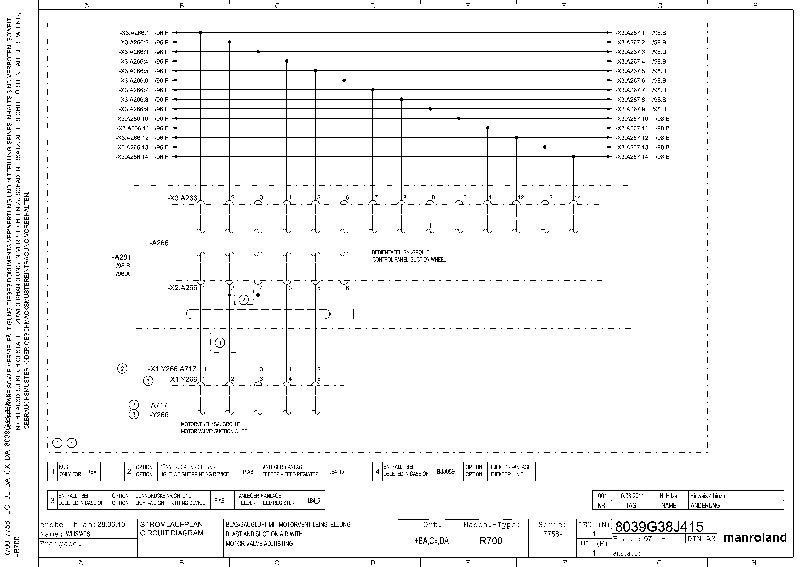

# +BA_Cx_DA — Sheet 97 of 247 — BLAS/SAUGLUFT MIT MOTORVENTILEINSTELLUNG

**BLAST AND SUCTION AIR WITH**

> Part of the manroland **R700** printing press IEC/UL circuit diagrams.
> Drawing class: **Stromlaufplan / Circuit diagram** (DIN A3).
> Document `+BA_Cx_DA` covers the **Printing units / main switch cabinet** machine section.

## At a glance

| Field | Value |
|---|---|
| Document | `+BA_Cx_DA`  (8039G38J415) |
| Sheet | **97** of 247 |
| Section (DE) | BLAS/SAUGLUFT MIT MOTORVENTILEINSTELLUNG |
| Section (EN) | BLAST AND SUCTION AIR WITH |
| Section type | CIRCUIT — Circuit diagram |
| Machine type | `R700` |
| Series | `7758` |
| Created | 28.06.10 |
| Replaces | — |
| Columns used | A, B, C, D, E, F, G, H |
| Path numbers | — |
| Labels on sheet | 147 |
| Cross-refs out | 30 |
| Cross-refs in | 55 |

**Previous:** [+BA_Cx_DA sheet 96](SHEET_0096.md) · **Next:** [+BA_Cx_DA sheet 98](SHEET_0098.md) · **Document TOC:** [_TOC.md](_TOC.md)  (+BA_Cx_DA) · **Master TOC:** [all sheets](../_MASTER_TOC.md)

## Sheet image (300 DPI, exact vector render)



_Rendered directly from the PDF vector layer at 300 DPI (1-bit), no OCR and no resampling. Use it to confirm anything ambiguous in the text below._

## Cross-references on this sheet

Each entry is a wire leaving this sheet. The printed token is `/sheet.column`; the link resolves to that sheet inside the same document.

| Ref | Target sheet | Col | Path | Destination on target | Target section | From col |
|---|---|---|---|---|---|---|
| `/98.B` | [+BA_Cx_DA sheet 98](SHEET_0098.md) | B | — | X3.A267:1 | BLAS/SAUGLUFT MIT MOTORVENTILEINSTELLUNG | G |
| `/96.F` | [+BA_Cx_DA sheet 96](SHEET_0096.md) | F | — | X3.A266:1 | BLAS/SAUGLUFT MIT MOTORVENTILEINSTELLUNG | B |
| `/98.B` | [+BA_Cx_DA sheet 98](SHEET_0098.md) | B | — | X3.A267:2 | BLAS/SAUGLUFT MIT MOTORVENTILEINSTELLUNG | G |
| `/96.F` | [+BA_Cx_DA sheet 96](SHEET_0096.md) | F | — | X3.A266:2 | BLAS/SAUGLUFT MIT MOTORVENTILEINSTELLUNG | B |
| `/98.B` | [+BA_Cx_DA sheet 98](SHEET_0098.md) | B | — | X3.A267:3 | BLAS/SAUGLUFT MIT MOTORVENTILEINSTELLUNG | G |
| `/96.F` | [+BA_Cx_DA sheet 96](SHEET_0096.md) | F | — | X3.A266:3 | BLAS/SAUGLUFT MIT MOTORVENTILEINSTELLUNG | B |
| `/98.B` | [+BA_Cx_DA sheet 98](SHEET_0098.md) | B | — | X3.A267:4 | BLAS/SAUGLUFT MIT MOTORVENTILEINSTELLUNG | G |
| `/96.F` | [+BA_Cx_DA sheet 96](SHEET_0096.md) | F | — | X3.A266:4 | BLAS/SAUGLUFT MIT MOTORVENTILEINSTELLUNG | B |
| `/98.B` | [+BA_Cx_DA sheet 98](SHEET_0098.md) | B | — | X3.A267:5 | BLAS/SAUGLUFT MIT MOTORVENTILEINSTELLUNG | G |
| `/96.F` | [+BA_Cx_DA sheet 96](SHEET_0096.md) | F | — | X3.A266:5 | BLAS/SAUGLUFT MIT MOTORVENTILEINSTELLUNG | B |
| `/98.B` | [+BA_Cx_DA sheet 98](SHEET_0098.md) | B | — | X3.A267:6 | BLAS/SAUGLUFT MIT MOTORVENTILEINSTELLUNG | G |
| `/96.F` | [+BA_Cx_DA sheet 96](SHEET_0096.md) | F | — | X3.A266:6 | BLAS/SAUGLUFT MIT MOTORVENTILEINSTELLUNG | B |
| `/98.B` | [+BA_Cx_DA sheet 98](SHEET_0098.md) | B | — | X3.A267:7 | BLAS/SAUGLUFT MIT MOTORVENTILEINSTELLUNG | G |
| `/96.F` | [+BA_Cx_DA sheet 96](SHEET_0096.md) | F | — | X3.A266:7 | BLAS/SAUGLUFT MIT MOTORVENTILEINSTELLUNG | B |
| `/98.B` | [+BA_Cx_DA sheet 98](SHEET_0098.md) | B | — | X3.A267:8 | BLAS/SAUGLUFT MIT MOTORVENTILEINSTELLUNG | G |
| `/96.F` | [+BA_Cx_DA sheet 96](SHEET_0096.md) | F | — | X3.A266:8 | BLAS/SAUGLUFT MIT MOTORVENTILEINSTELLUNG | B |
| `/98.B` | [+BA_Cx_DA sheet 98](SHEET_0098.md) | B | — | X3.A267:9 | BLAS/SAUGLUFT MIT MOTORVENTILEINSTELLUNG | G |
| `/96.F` | [+BA_Cx_DA sheet 96](SHEET_0096.md) | F | — | X3.A266:9 | BLAS/SAUGLUFT MIT MOTORVENTILEINSTELLUNG | B |
| `/98.B` | [+BA_Cx_DA sheet 98](SHEET_0098.md) | B | — | X3.A267:10 | BLAS/SAUGLUFT MIT MOTORVENTILEINSTELLUNG | G |
| `/96.F` | [+BA_Cx_DA sheet 96](SHEET_0096.md) | F | — | X3.A266:10 | BLAS/SAUGLUFT MIT MOTORVENTILEINSTELLUNG | B |
| `/98.B` | [+BA_Cx_DA sheet 98](SHEET_0098.md) | B | — | X3.A267:11 | BLAS/SAUGLUFT MIT MOTORVENTILEINSTELLUNG | G |
| `/96.F` | [+BA_Cx_DA sheet 96](SHEET_0096.md) | F | — | X3.A266:11 | BLAS/SAUGLUFT MIT MOTORVENTILEINSTELLUNG | B |
| `/98.B` | [+BA_Cx_DA sheet 98](SHEET_0098.md) | B | — | X3.A267:12 | BLAS/SAUGLUFT MIT MOTORVENTILEINSTELLUNG | G |
| `/96.F` | [+BA_Cx_DA sheet 96](SHEET_0096.md) | F | — | X3.A266:12 | BLAS/SAUGLUFT MIT MOTORVENTILEINSTELLUNG | B |
| `/98.B` | [+BA_Cx_DA sheet 98](SHEET_0098.md) | B | — | X3.A267:13 | BLAS/SAUGLUFT MIT MOTORVENTILEINSTELLUNG | G |
| `/96.F` | [+BA_Cx_DA sheet 96](SHEET_0096.md) | F | — | X3.A266:13 | BLAS/SAUGLUFT MIT MOTORVENTILEINSTELLUNG | B |
| `/98.B` | [+BA_Cx_DA sheet 98](SHEET_0098.md) | B | — | X3.A267:14 | BLAS/SAUGLUFT MIT MOTORVENTILEINSTELLUNG | G |
| `/96.F` | [+BA_Cx_DA sheet 96](SHEET_0096.md) | F | — | X3.A266:14 | BLAS/SAUGLUFT MIT MOTORVENTILEINSTELLUNG | B |
| `/98.B` | [+BA_Cx_DA sheet 98](SHEET_0098.md) | B | — | — | BLAS/SAUGLUFT MIT MOTORVENTILEINSTELLUNG | A |
| `/96.A` | [+BA_Cx_DA sheet 96](SHEET_0096.md) | A | — | — | BLAS/SAUGLUFT MIT MOTORVENTILEINSTELLUNG | A |

### Incoming references (sheets that point here)

Every other sheet that sends a wire to this one. `Back-ref` is the token printed on *that* sheet; `Path` is its line number.

| From sheet | Cols | Back-ref | Path | Refs | What continues there |
|---|---|---|---|---|---|
| [+BA_Cx_DA#96](SHEET_0096.md) | A, G | `/96.A`, `/96.G` | — | 15 | X3.A266:1; X3.A266:10; X3.A266:11; X3.A266:12; X3.A266:13; X3.A266:14; X3.A266:2; X3.A266:3; X3.A266:4; X3.A266:5; X3.A266:6; X3.A266:7; X3.A266:8; X3.A266:9 |
| [+BA_Cx_DA#98](SHEET_0098.md) | B | `/98.B` | — | 15 | X3.A267:1; X3.A267:10; X3.A267:11; X3.A267:12; X3.A267:13; X3.A267:14; X3.A267:2; X3.A267:3; X3.A267:4; X3.A267:5; X3.A267:6; X3.A267:7; X3.A267:8; X3.A267:9 |
| [+BA_Cx_DA#150](SHEET_0150.md) | C | `/150.C` | — | 5 | — |
| [+BA_Cx_DA#152](SHEET_0152.md) | G | `/152.G` | — | 6 | — |
| [+BA_Cx_DA#156](SHEET_0156.md) | E | `/156.E` | — | 14 | — |


## Devices on this sheet

| Tag | Class | Class meaning (IEC) | Col | Sub | Terminal | Sign |
|---|---|---|---|---|---|---|
| `Y266` | Y | Magnetventil / solenoid valve, actuator | B | — | — | — |
| `A266` | A | Baugruppe / assembly, module, PC board | B | — | — | — |
| `A281` | A | Baugruppe / assembly, module, PC board | A | — | — | — |
| `A717` | A | Baugruppe / assembly, module, PC board | B | — | — | — |
| `X1.Y266` | — | cross-device reference | B | — | — | — |
| `X3.A266` | — | cross-device reference | B | — | — | — |
| `X2.A266` | — | cross-device reference | B | — | — | — |
| `X3.A267:14` | — | cross-device reference | G | — | 14 | — |
| `X3.A267:12` | — | cross-device reference | G | — | 12 | — |
| `X3.A267:13` | — | cross-device reference | G | — | 13 | — |
| `X3.A267:11` | — | cross-device reference | G | — | 11 | — |
| `X3.A266:6` | — | cross-device reference | A | — | 6 | — |
| `X3.A266:5` | — | cross-device reference | A | — | 5 | — |
| `X3.A266:4` | — | cross-device reference | A | — | 4 | — |
| `X3.A266:3` | — | cross-device reference | A | — | 3 | — |
| `X3.A266:7` | — | cross-device reference | A | — | 7 | — |
| `X3.A266:8` | — | cross-device reference | A | — | 8 | — |
| `X3.A266:12` | — | cross-device reference | A | — | 12 | — |
| `X3.A266:11` | — | cross-device reference | A | — | 11 | — |
| `X3.A266:10` | — | cross-device reference | A | — | 10 | — |
| `X3.A266:9` | — | cross-device reference | A | — | 9 | — |
| `X3.A266:2` | — | cross-device reference | A | — | 2 | — |
| `X3.A266:1` | — | cross-device reference | B | — | 1 | — |
| `X3.A266:13` | — | cross-device reference | A | — | 13 | — |
| `X3.A267:7` | — | cross-device reference | G | — | 7 | — |
| `X3.A267:10` | — | cross-device reference | G | — | 10 | — |
| `X3.A267:9` | — | cross-device reference | G | — | 9 | — |
| `X3.A267:8` | — | cross-device reference | G | — | 8 | — |
| `X3.A267:3` | — | cross-device reference | G | — | 3 | — |
| `X3.A267:2` | — | cross-device reference | G | — | 2 | — |
| `X3.A267:1` | — | cross-device reference | G | — | 1 | — |
| `X3.A266:14` | — | cross-device reference | A | — | 14 | — |
| `X3.A267:4` | — | cross-device reference | G | — | 4 | — |
| `X3.A267:6` | — | cross-device reference | G | — | 6 | — |
| `X3.A267:5` | — | cross-device reference | G | — | 5 | — |
| `NR.` | — | cross-device reference | F | — | — | — |
| `10.08.2011` | — | cross-device reference | G | — | — | — |
| `X1.Y266.A717` | — | cross-device reference | B | — | — | — |

## Potentials / nets

_No named potentials on this sheet._

## Wire-end annotations (grouped as printed)

A wire that continues elsewhere is annotated with a small cluster: the destination description, the path/line number `#NN`, and the `/sheet.column` cross reference. Each row below is one such cluster exactly as it is grouped on the drawing.

| Col | Y | Path | Cross-ref | Text on the wire |
|---|---|---|---|---|
| B | 44.9 | — | `/96.F` | `X3.A266:1` |
| G | 44.9 | — | `/98.B` | `X3.A267:1` |
| B | 59.1 | — | `/96.F` | `X3.A266:2` |
| G | 59.1 | — | `/98.B` | `X3.A267:2` |
| B | 73.2 | — | `/96.F` | `X3.A266:3` |
| G | 73.2 | — | `/98.B` | `X3.A267:3` |
| B | 87.4 | — | `/96.F` | `X3.A266:4` |
| G | 87.4 | — | `/98.B` | `X3.A267:4` |
| B | 101.6 | — | `/96.F` | `X3.A266:5` |
| G | 101.6 | — | `/98.B` | `X3.A267:5` |
| B | 115.8 | — | `/96.F` | `X3.A266:6` |
| G | 115.8 | — | `/98.B` | `X3.A267:6` |
| B | 129.9 | — | `/96.F` | `X3.A266:7` |
| G | 129.9 | — | `/98.B` | `X3.A267:7` |
| B | 144.1 | — | `/96.F` | `X3.A266:8` |
| G | 144.1 | — | `/98.B` | `X3.A267:8` |
| B | 158.3 | — | `/96.F` | `X3.A266:9` |
| G | 158.3 | — | `/98.B` | `X3.A267:9` |
| G | 172.4 | — | `/98.B` | `X3.A267:10` |
| B | 172.5 | — | `/96.F` | `X3.A266:10` |
| B | 186.6 | — | `/96.F` | `X3.A266:11` |
| G | 186.6 | — | `/98.B` | `X3.A267:11` |
| B | 200.8 | — | `/96.F` | `X3.A266:12` |
| G | 200.8 | — | `/98.B` | `X3.A267:12` |
| B | 215.0 | — | `/96.F` | `X3.A266:13` |
| G | 215.0 | — | `/98.B` | `X3.A267:13` |
| B | 229.2 | — | `/96.F` | `X3.A266:14` |
| G | 229.2 | — | `/98.B` | `X3.A267:14` |
| B | 289.4 | — | — | `X3.A266 1 2` |
| D | 289.5 | — | — | `3 4 5 6 7 8 9 10 11 12 13 14` |
| B | 356.1 | — | — | `A266` |
| D | 372.0 | — | — | `BEDIENTAFEL: SAUGROLLE` |
| C | 377.3 | — | — | `A281 CONTROL PANEL: SUCTION WHEEL` |
| A | 390.4 | — | `/98.B`, `/96.A` | — |
| C | 422.7 | — | — | `X2.A266 1 2 4 3 5` |
| D | 424.1 | — | — | `6` |
| C | 442.5 | — | — | `2` |
| B | 506.3 | — | — | `3` |
| B | 543.2 | — | — | `2 X1.Y266.A717 1 3 4 2` |
| C | 558.8 | — | — | `X1.Y266 1 2 3 4 5` |
| B | 563.0 | — | — | `3` |
| B | 597.0 | — | — | `A717` |
| A | 598.4 | — | — | `2` |
| B | 611.2 | — | — | `Y266` |
| A | 612.6 | — | — | `3` |
| B | 627.1 | — | — | `MOTORVENTIL: SAUGROLLE MOTOR VALVE: SUCTION WHEEL` |
| A | 654.6 | — | — | `1` |
| A | 655.1 | — | — | `4` |
| D | 690.1 | — | — | `ENTFÄLLT BEI DELETED IN CASE OF` |
| A | 690.8 | — | — | `1 NUR BEI` |
| B | 690.8 | — | — | `2 OPTION OPTION` |
| E | 690.8 | — | — | `OPTION OPTION` |
| B | 690.9 | — | — | `DÜNNDRUCKEINRICHTUNG LIGHT WEIGHT PRINTING DEVICE PIAB` |
| C | 690.9 | — | — | `FEEDER + FEED REGISTER ANLEGER + ANLAGE LB4_10` |
| E | 690.9 | — | — | `4 B33859 "EJEKTOR" ANLAGE "EJEKTOR" UNIT` |
| A | 697.9 | — | — | `ONLY FOR +BA` |
| G | 732.7 | — | — | `001 10.08.2011 N. Hitzel Hinweis 4 hinzu` |
| A | 733.4 | — | — | `3 ENTFÄLLT BEI DELETED IN CASE OF OPTION OPTION` |
| B | 733.4 | — | — | `DÜNNDRUCKEINRICHTUNG LIGHT WEIGHT PRINTING DEVICE PIAB` |
| C | 733.4 | — | — | `FEEDER + FEED REGISTER ANLEGER + ANLAGE LB4_5` |
| G | 747.0 | — | — | `NR. TAG NAME ÄNDERUNG` |


## Reconstructed tables

This sheet carries tabular content (pin map / terminal assignment / index). The grid below was rebuilt from the drawing's own rule lines, so each row is exactly one physical row of the table.

### Table 1 — 1 data rows × 13 columns (at x=297.6, y=48.2)

| 1 1 | 2 2 | 3 4 | 4 3 | 5 5 | 6 6 | 7 BEDIENTAFEL: CONTROL | 8 SAUGROLLE PANEL: SUCTION | 9 WHEEL | 10 | 11 | 12 | 13 |
|---|---|---|---|---|---|---|---|---|---|---|---|---|
|  | `2` |  |  |  |  |  |  |  |  |  |  |  |


## Notes and free text on this sheet

| Text | Col | Y (pt) |
|---|---|---|
| `MOTORVENTIL: SAUGROLLE` | B | 627.09 |
| `MOTOR VALVE: SUCTION WHEEL` | B | 637.7 |
| `BEDIENTAFEL: SAUGROLLE` | D | 371.96 |
| `CONTROL PANEL: SUCTION WHEEL` | D | 382.59 |
| `TAG` | G | 747.05 |
| `NAME` | G | 747.05 |
| `ÄNDERUNG` | G | 747.11 |
| `N. Hitzel` | G | 733.02 |
| `Hinweis 4 hinzu` | H | 732.98 |
| `NUR BEI` | A | 690.82 |
| `ONLY FOR` | A | 701.5 |
| `+BA` | A | 697.92 |
| `OPTION` | B | 690.83 |
| `DÜNNDRUCKEINRICHTUNG` | B | 690.89 |
| `LIGHT WEIGHT PRINTING DEVICE` | B | 701.48 |
| `PIAB` | C | 697.84 |
| `ANLEGER + ANLAGE` | C | 690.86 |
| `FEEDER + FEED REGISTER` | C | 701.48 |
| `LB4_10` | D | 697.94 |
| `ENTFÄLLT BEI` | A | 733.35 |
| `DELETED IN CASE OF` | A | 744 |
| `OPTION` | A | 733.35 |
| `PIAB` | B | 740.36 |
| `LB4_5` | C | 740.45 |
| `ENTFÄLLT BEI` | D | 690.12 |
| `DELETED IN CASE OF` | D | 700.77 |
| `OPTION` | E | 690.83 |
| `"EJEKTOR" ANLAGE` | E | 690.86 |
| `"EJEKTOR" UNIT` | E | 701.49 |
| `B33859` | E | 696.71 |

## Complete label inventory (exact text from the drawing)

Every text object inside the drawing area of this sheet, in DIN reading order (column A→H, then top→bottom). This is the authoritative list: if a string is not here it is not printed on this sheet.

| Col | Y | X | Dir | Type | Text |
|---|---|---|---|---|---|
| A | 59.1 | 176.3 | → | device ref | `X3.A266:2` |
| A | 73.3 | 176.0 | → | device ref | `X3.A266:3` |
| A | 87.4 | 176.0 | → | device ref | `X3.A266:4` |
| A | 101.6 | 176.0 | → | device ref | `X3.A266:5` |
| A | 115.8 | 176.0 | → | device ref | `X3.A266:6` |
| A | 130.0 | 176.0 | → | device ref | `X3.A266:7` |
| A | 144.1 | 176.0 | → | device ref | `X3.A266:8` |
| A | 158.3 | 176.0 | → | device ref | `X3.A266:9` |
| A | 172.5 | 171.2 | → | device ref | `X3.A266:10` |
| A | 186.7 | 172.6 | → | device ref | `X3.A266:11` |
| A | 200.8 | 171.5 | → | device ref | `X3.A266:12` |
| A | 215.0 | 171.2 | → | device ref | `X3.A266:13` |
| A | 229.2 | 171.2 | → | device ref | `X3.A266:14` |
| A | 377.3 | 166.4 | → | device tag | `A281` |
| A | 390.4 | 172.3 | → | cross-reference | `/98.B` |
| A | 402.8 | 172.1 | → | cross-reference | `/96.A` |
| A | 544.5 | 179.4 | → | number | `2` |
| A | 598.4 | 196.4 | → | number | `2` |
| A | 612.6 | 196.4 | → | number | `3` |
| A | 654.6 | 83.3 | → | number | `1` |
| A | 655.1 | 104.3 | → | number | `4` |
| A | 690.8 | 87.7 | → | text | `NUR BEI` |
| A | 695.5 | 75.4 | → | number | `1` |
| A | 695.5 | 188.5 | → | number | `2` |
| A | 697.9 | 130.8 | → | text | `+BA` |
| A | 701.5 | 88.3 | → | text | `ONLY FOR` |
| A | 733.3 | 87.0 | → | text | `ENTFÄLLT BEI` |
| A | 733.4 | 166.3 | → | text | `OPTION` |
| A | 738.7 | 75.0 | → | number | `3` |
| A | 744.0 | 87.0 | → | text | `DELETED IN CASE OF` |
| A | 744.0 | 166.3 | → | text | `OPTION` |
| B | 44.9 | 177.4 | → | device ref | `X3.A266:1` |
| B | 44.9 | 229.6 | → | cross-reference | `/96.F` |
| B | 59.1 | 229.6 | → | cross-reference | `/96.F` |
| B | 73.3 | 229.6 | → | cross-reference | `/96.F` |
| B | 87.4 | 229.6 | → | cross-reference | `/96.F` |
| B | 101.6 | 229.6 | → | cross-reference | `/96.F` |
| B | 115.8 | 229.6 | → | cross-reference | `/96.F` |
| B | 129.9 | 229.6 | → | cross-reference | `/96.F` |
| B | 144.1 | 229.6 | → | cross-reference | `/96.F` |
| B | 158.3 | 229.6 | → | cross-reference | `/96.F` |
| B | 172.5 | 229.6 | → | cross-reference | `/96.F` |
| B | 186.6 | 229.6 | → | cross-reference | `/96.F` |
| B | 200.8 | 229.6 | → | cross-reference | `/96.F` |
| B | 215.0 | 229.6 | → | cross-reference | `/96.F` |
| B | 229.2 | 229.6 | → | cross-reference | `/96.F` |
| B | 289.4 | 248.3 | → | device ref | `X3.A266` |
| B | 289.5 | 299.6 | → | number | `1` |
| B | 356.1 | 221.7 | → | device tag | `A266` |
| B | 422.7 | 248.3 | → | device ref | `X2.A266` |
| B | 424.1 | 299.6 | → | number | `1` |
| B | 506.3 | 324.0 | → | number | `3` |
| B | 543.2 | 219.7 | → | device ref | `X1.Y266.A717` |
| B | 544.6 | 301.6 | → | number | `1` |
| B | 558.7 | 299.6 | → | number | `1` |
| B | 558.8 | 248.9 | → | device ref | `X1.Y266` |
| B | 563.0 | 217.7 | → | number | `3` |
| B | 597.0 | 220.3 | → | device tag | `A717` |
| B | 611.3 | 222.2 | → | device tag | `Y266` |
| B | 627.1 | 268.7 | → | text | `MOTORVENTIL: SAUGROLLE` |
| B | 637.7 | 268.7 | → | text | `MOTOR VALVE: SUCTION WHEEL` |
| B | 690.8 | 201.7 | → | text | `OPTION` |
| B | 690.9 | 236.6 | → | text | `DÜNNDRUCKEINRICHTUNG` |
| B | 701.5 | 201.7 | → | text | `OPTION` |
| B | 701.5 | 236.6 | → | text | `LIGHT WEIGHT PRINTING DEVICE` |
| B | 733.4 | 201.1 | → | text | `DÜNNDRUCKEINRICHTUNG` |
| B | 740.4 | 318.0 | → | text | `PIAB` |
| B | 744.0 | 201.1 | → | text | `LIGHT WEIGHT PRINTING DEVICE` |
| C | 289.5 | 342.7 | → | number | `2` |
| C | 289.5 | 385.2 | → | number | `3` |
| C | 289.5 | 427.7 | → | number | `4` |
| C | 289.5 | 470.3 | → | number | `5` |
| C | 424.1 | 342.7 | → | number | `2` |
| C | 424.1 | 385.2 | → | number | `4` |
| C | 424.1 | 427.7 | → | number | `3` |
| C | 424.1 | 470.3 | → | number | `5` |
| C | 442.5 | 359.4 | → | number | `2` |
| C | 544.6 | 385.2 | → | number | `3` |
| C | 544.6 | 427.7 | → | number | `4` |
| C | 544.6 | 470.6 | → | number | `2` |
| C | 558.7 | 342.7 | → | number | `2` |
| C | 558.7 | 385.2 | → | number | `3` |
| C | 558.7 | 427.7 | → | number | `4` |
| C | 558.7 | 470.3 | → | number | `5` |
| C | 690.9 | 389.8 | → | text | `ANLEGER + ANLAGE` |
| C | 697.8 | 360.6 | → | text | `PIAB` |
| C | 701.5 | 388.9 | → | text | `FEEDER + FEED REGISTER` |
| C | 733.4 | 354.3 | → | text | `ANLEGER + ANLAGE` |
| C | 740.5 | 456.2 | → | text | `LB4_5` |
| C | 744.0 | 353.5 | → | text | `FEEDER + FEED REGISTER` |
| D | 289.5 | 512.8 | → | number | `6` |
| D | 289.5 | 555.3 | → | number | `7` |
| D | 289.5 | 597.8 | → | number | `8` |
| D | 372.0 | 551.9 | → | text | `BEDIENTAFEL: SAUGROLLE` |
| D | 382.6 | 552.5 | → | text | `CONTROL PANEL: SUCTION WHEEL` |
| D | 424.1 | 512.8 | → | number | `6` |
| D | 690.1 | 568.9 | → | text | `ENTFÄLLT BEI` |
| D | 695.5 | 557.0 | → | number | `4` |
| D | 697.9 | 488.1 | → | text | `LB4_10` |
| D | 700.8 | 568.9 | → | text | `DELETED IN CASE OF` |
| E | 289.5 | 640.3 | → | number | `9` |
| E | 289.5 | 682.3 | → | number | `10` |
| E | 289.5 | 724.8 | → | number | `11` |
| E | 690.8 | 690.7 | → | text | `OPTION` |
| E | 690.9 | 726.1 | → | text | `"EJEKTOR" ANLAGE` |
| E | 696.7 | 647.6 | → | text | `B33859` |
| E | 701.5 | 690.7 | → | text | `OPTION` |
| E | 701.5 | 726.1 | → | text | `"EJEKTOR" UNIT` |
| F | 289.5 | 767.3 | → | number | `12` |
| F | 289.5 | 809.9 | → | number | `13` |
| F | 289.5 | 852.4 | → | number | `14` |
| F | 732.7 | 886.9 | → | number | `001` |
| F | 747.0 | 886.3 | → | device ref | `NR.` |
| G | 44.9 | 912.5 | → | device ref | `X3.A267:1` |
| G | 44.9 | 967.3 | → | cross-reference | `/98.B` |
| G | 59.1 | 912.5 | → | device ref | `X3.A267:2` |
| G | 59.1 | 967.3 | → | cross-reference | `/98.B` |
| G | 73.2 | 967.3 | → | cross-reference | `/98.B` |
| G | 73.3 | 912.5 | → | device ref | `X3.A267:3` |
| G | 87.4 | 912.5 | → | device ref | `X3.A267:4` |
| G | 87.4 | 967.3 | → | cross-reference | `/98.B` |
| G | 101.6 | 912.5 | → | device ref | `X3.A267:5` |
| G | 101.6 | 967.3 | → | cross-reference | `/98.B` |
| G | 115.8 | 912.5 | → | device ref | `X3.A267:6` |
| G | 115.8 | 967.3 | → | cross-reference | `/98.B` |
| G | 129.9 | 967.3 | → | cross-reference | `/98.B` |
| G | 130.0 | 912.5 | → | device ref | `X3.A267:7` |
| G | 144.1 | 912.5 | → | device ref | `X3.A267:8` |
| G | 144.1 | 967.3 | → | cross-reference | `/98.B` |
| G | 158.3 | 912.5 | → | device ref | `X3.A267:9` |
| G | 158.3 | 967.3 | → | cross-reference | `/98.B` |
| G | 172.5 | 912.5 | → | device ref | `X3.A267:10` |
| G | 172.5 | 972.3 | → | cross-reference | `/98.B` |
| G | 186.6 | 972.3 | → | cross-reference | `/98.B` |
| G | 186.7 | 912.5 | → | device ref | `X3.A267:11` |
| G | 200.8 | 912.5 | → | device ref | `X3.A267:12` |
| G | 200.8 | 972.3 | → | cross-reference | `/98.B` |
| G | 215.0 | 912.5 | → | device ref | `X3.A267:13` |
| G | 215.0 | 972.3 | → | cross-reference | `/98.B` |
| G | 229.1 | 972.3 | → | cross-reference | `/98.B` |
| G | 229.2 | 912.5 | → | device ref | `X3.A267:14` |
| G | 732.8 | 916.5 | → | device ref | `10.08.2011` |
| G | 733.0 | 978.1 | → | text | `N. Hitzel` |
| G | 747.0 | 980.9 | → | text | `NAME` |
| G | 747.1 | 927.7 | → | text | `TAG` |
| G | 747.1 | 1024.4 | → | text | `ÄNDERUNG` |
| H | 733.0 | 1023.3 | → | text | `Hinweis 4 hinzu` |

## Reading-order text block

The same content as a plain block, grouped by DIN column — convenient to paste or to match against a visual description.

```text
=== Column A ===
  59.1  176.3  devref       X3.A266:2
  73.3  176.0  devref       X3.A266:3
  87.4  176.0  devref       X3.A266:4
 101.6  176.0  devref       X3.A266:5
 115.8  176.0  devref       X3.A266:6
 130.0  176.0  devref       X3.A266:7
 144.1  176.0  devref       X3.A266:8
 158.3  176.0  devref       X3.A266:9
 172.5  171.2  devref       X3.A266:10
 186.7  172.6  devref       X3.A266:11
 200.8  171.5  devref       X3.A266:12
 215.0  171.2  devref       X3.A266:13
 229.2  171.2  devref       X3.A266:14
 377.3  166.4  devtag       A281
 390.4  172.3  xref         /98.B
 402.8  172.1  xref         /96.A
 544.5  179.4  numeric      2
 598.4  196.4  numeric      2
 612.6  196.4  numeric      3
 654.6   83.3  numeric      1
 655.1  104.3  numeric      4
 690.8   87.7  text         NUR BEI
 695.5   75.4  numeric      1
 695.5  188.5  numeric      2
 697.9  130.8  text         +BA
 701.5   88.3  text         ONLY FOR
 733.3   87.0  text         ENTFÄLLT BEI
 733.4  166.3  text         OPTION
 738.7   75.0  numeric      3
 744.0   87.0  text         DELETED IN CASE OF
 744.0  166.3  text         OPTION
=== Column B ===
  44.9  177.4  devref       X3.A266:1
  44.9  229.6  xref         /96.F
  59.1  229.6  xref         /96.F
  73.3  229.6  xref         /96.F
  87.4  229.6  xref         /96.F
 101.6  229.6  xref         /96.F
 115.8  229.6  xref         /96.F
 129.9  229.6  xref         /96.F
 144.1  229.6  xref         /96.F
 158.3  229.6  xref         /96.F
 172.5  229.6  xref         /96.F
 186.6  229.6  xref         /96.F
 200.8  229.6  xref         /96.F
 215.0  229.6  xref         /96.F
 229.2  229.6  xref         /96.F
 289.4  248.3  devref       X3.A266
 289.5  299.6  numeric      1
 356.1  221.7  devtag       A266
 422.7  248.3  devref       X2.A266
 424.1  299.6  numeric      1
 506.3  324.0  numeric      3
 543.2  219.7  devref       X1.Y266.A717
 544.6  301.6  numeric      1
 558.7  299.6  numeric      1
 558.8  248.9  devref       X1.Y266
 563.0  217.7  numeric      3
 597.0  220.3  devtag       A717
 611.3  222.2  devtag       Y266
 627.1  268.7  text         MOTORVENTIL: SAUGROLLE
 637.7  268.7  text         MOTOR VALVE: SUCTION WHEEL
 690.8  201.7  text         OPTION
 690.9  236.6  text         DÜNNDRUCKEINRICHTUNG
 701.5  201.7  text         OPTION
 701.5  236.6  text         LIGHT WEIGHT PRINTING DEVICE
 733.4  201.1  text         DÜNNDRUCKEINRICHTUNG
 740.4  318.0  text         PIAB
 744.0  201.1  text         LIGHT WEIGHT PRINTING DEVICE
=== Column C ===
 289.5  342.7  numeric      2
 289.5  385.2  numeric      3
 289.5  427.7  numeric      4
 289.5  470.3  numeric      5
 424.1  342.7  numeric      2
 424.1  385.2  numeric      4
 424.1  427.7  numeric      3
 424.1  470.3  numeric      5
 442.5  359.4  numeric      2
 544.6  385.2  numeric      3
 544.6  427.7  numeric      4
 544.6  470.6  numeric      2
 558.7  342.7  numeric      2
 558.7  385.2  numeric      3
 558.7  427.7  numeric      4
 558.7  470.3  numeric      5
 690.9  389.8  text         ANLEGER + ANLAGE
 697.8  360.6  text         PIAB
 701.5  388.9  text         FEEDER + FEED REGISTER
 733.4  354.3  text         ANLEGER + ANLAGE
 740.5  456.2  text         LB4_5
 744.0  353.5  text         FEEDER + FEED REGISTER
=== Column D ===
 289.5  512.8  numeric      6
 289.5  555.3  numeric      7
 289.5  597.8  numeric      8
 372.0  551.9  text         BEDIENTAFEL: SAUGROLLE
 382.6  552.5  text         CONTROL PANEL: SUCTION WHEEL
 424.1  512.8  numeric      6
 690.1  568.9  text         ENTFÄLLT BEI
 695.5  557.0  numeric      4
 697.9  488.1  text         LB4_10
 700.8  568.9  text         DELETED IN CASE OF
=== Column E ===
 289.5  640.3  numeric      9
 289.5  682.3  numeric      10
 289.5  724.8  numeric      11
 690.8  690.7  text         OPTION
 690.9  726.1  text         "EJEKTOR" ANLAGE
 696.7  647.6  text         B33859
 701.5  690.7  text         OPTION
 701.5  726.1  text         "EJEKTOR" UNIT
=== Column F ===
 289.5  767.3  numeric      12
 289.5  809.9  numeric      13
 289.5  852.4  numeric      14
 732.7  886.9  numeric      001
 747.0  886.3  devref       NR.
=== Column G ===
  44.9  912.5  devref       X3.A267:1
  44.9  967.3  xref         /98.B
  59.1  912.5  devref       X3.A267:2
  59.1  967.3  xref         /98.B
  73.2  967.3  xref         /98.B
  73.3  912.5  devref       X3.A267:3
  87.4  912.5  devref       X3.A267:4
  87.4  967.3  xref         /98.B
 101.6  912.5  devref       X3.A267:5
 101.6  967.3  xref         /98.B
 115.8  912.5  devref       X3.A267:6
 115.8  967.3  xref         /98.B
 129.9  967.3  xref         /98.B
 130.0  912.5  devref       X3.A267:7
 144.1  912.5  devref       X3.A267:8
 144.1  967.3  xref         /98.B
 158.3  912.5  devref       X3.A267:9
 158.3  967.3  xref         /98.B
 172.5  912.5  devref       X3.A267:10
 172.5  972.3  xref         /98.B
 186.6  972.3  xref         /98.B
 186.7  912.5  devref       X3.A267:11
 200.8  912.5  devref       X3.A267:12
 200.8  972.3  xref         /98.B
 215.0  912.5  devref       X3.A267:13
 215.0  972.3  xref         /98.B
 229.1  972.3  xref         /98.B
 229.2  912.5  devref       X3.A267:14
 732.8  916.5  devref       10.08.2011
 733.0  978.1  text         N. Hitzel
 747.0  980.9  text         NAME
 747.1  927.7  text         TAG
 747.1 1024.4  text         ÄNDERUNG
=== Column H ===
 733.0 1023.3  text         Hinweis 4 hinzu
```

---
_Generated from the PDF vector text layer; no OCR. Source: `R700_7758_IEC_UL_BA_CX_DA_8039G38J415_p`, sheet 97._
