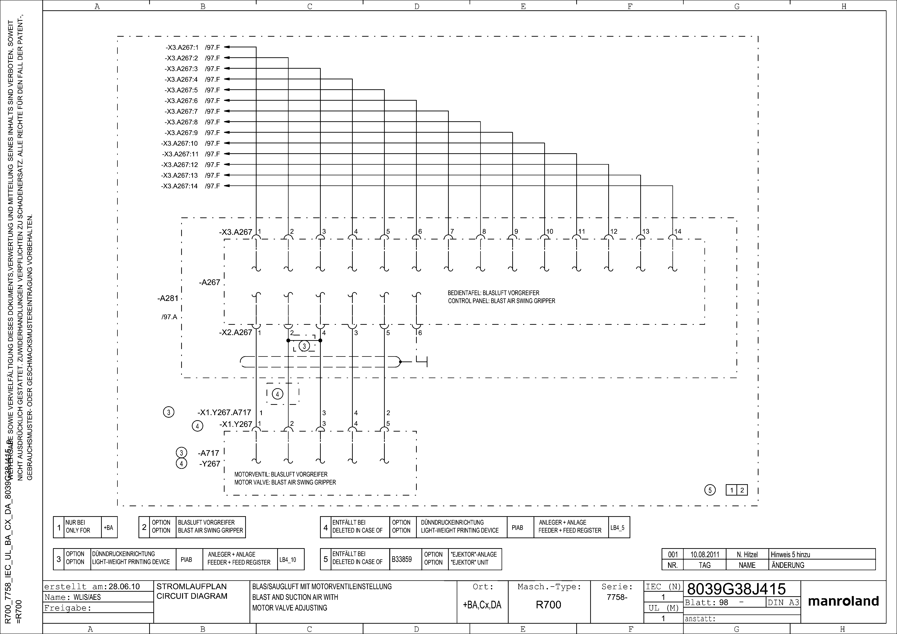

# +BA_Cx_DA — Sheet 98 of 247 — BLAS/SAUGLUFT MIT MOTORVENTILEINSTELLUNG

**BLAST AND SUCTION AIR WITH**

> Part of the manroland **R700** printing press IEC/UL circuit diagrams.
> Drawing class: **Stromlaufplan / Circuit diagram** (DIN A3).
> Document `+BA_Cx_DA` covers the **Printing units / main switch cabinet** machine section.

## At a glance

| Field | Value |
|---|---|
| Document | `+BA_Cx_DA`  (8039G38J415) |
| Sheet | **98** of 247 |
| Section (DE) | BLAS/SAUGLUFT MIT MOTORVENTILEINSTELLUNG |
| Section (EN) | BLAST AND SUCTION AIR WITH |
| Section type | CIRCUIT — Circuit diagram |
| Machine type | `R700` |
| Series | `7758` |
| Created | 28.06.10 |
| Replaces | — |
| Columns used | A, B, C, D, E, F, G, H |
| Path numbers | — |
| Labels on sheet | 124 |
| Cross-refs out | 15 |
| Cross-refs in | 40 |

**Previous:** [+BA_Cx_DA sheet 97](SHEET_0097.md) · **Next:** [+BA_Cx_DA sheet 99](SHEET_0099.md) · **Document TOC:** [_TOC.md](_TOC.md)  (+BA_Cx_DA) · **Master TOC:** [all sheets](../_MASTER_TOC.md)

## Sheet image (300 DPI, exact vector render)



_Rendered directly from the PDF vector layer at 300 DPI (1-bit), no OCR and no resampling. Use it to confirm anything ambiguous in the text below._

## Cross-references on this sheet

Each entry is a wire leaving this sheet. The printed token is `/sheet.column`; the link resolves to that sheet inside the same document.

| Ref | Target sheet | Col | Path | Destination on target | Target section | From col |
|---|---|---|---|---|---|---|
| `/97.F` | [+BA_Cx_DA sheet 97](SHEET_0097.md) | F | — | X3.A267:1 | BLAS/SAUGLUFT MIT MOTORVENTILEINSTELLUNG | B |
| `/97.F` | [+BA_Cx_DA sheet 97](SHEET_0097.md) | F | — | X3.A267:2 | BLAS/SAUGLUFT MIT MOTORVENTILEINSTELLUNG | B |
| `/97.F` | [+BA_Cx_DA sheet 97](SHEET_0097.md) | F | — | X3.A267:3 | BLAS/SAUGLUFT MIT MOTORVENTILEINSTELLUNG | B |
| `/97.F` | [+BA_Cx_DA sheet 97](SHEET_0097.md) | F | — | X3.A267:4 | BLAS/SAUGLUFT MIT MOTORVENTILEINSTELLUNG | B |
| `/97.F` | [+BA_Cx_DA sheet 97](SHEET_0097.md) | F | — | X3.A267:5 | BLAS/SAUGLUFT MIT MOTORVENTILEINSTELLUNG | B |
| `/97.F` | [+BA_Cx_DA sheet 97](SHEET_0097.md) | F | — | X3.A267:6 | BLAS/SAUGLUFT MIT MOTORVENTILEINSTELLUNG | B |
| `/97.F` | [+BA_Cx_DA sheet 97](SHEET_0097.md) | F | — | X3.A267:7 | BLAS/SAUGLUFT MIT MOTORVENTILEINSTELLUNG | B |
| `/97.F` | [+BA_Cx_DA sheet 97](SHEET_0097.md) | F | — | X3.A267:8 | BLAS/SAUGLUFT MIT MOTORVENTILEINSTELLUNG | B |
| `/97.F` | [+BA_Cx_DA sheet 97](SHEET_0097.md) | F | — | X3.A267:9 | BLAS/SAUGLUFT MIT MOTORVENTILEINSTELLUNG | B |
| `/97.F` | [+BA_Cx_DA sheet 97](SHEET_0097.md) | F | — | X3.A267:10 | BLAS/SAUGLUFT MIT MOTORVENTILEINSTELLUNG | B |
| `/97.F` | [+BA_Cx_DA sheet 97](SHEET_0097.md) | F | — | X3.A267:11 | BLAS/SAUGLUFT MIT MOTORVENTILEINSTELLUNG | B |
| `/97.F` | [+BA_Cx_DA sheet 97](SHEET_0097.md) | F | — | X3.A267:12 | BLAS/SAUGLUFT MIT MOTORVENTILEINSTELLUNG | B |
| `/97.F` | [+BA_Cx_DA sheet 97](SHEET_0097.md) | F | — | X3.A267:13 | BLAS/SAUGLUFT MIT MOTORVENTILEINSTELLUNG | B |
| `/97.F` | [+BA_Cx_DA sheet 97](SHEET_0097.md) | F | — | X3.A267:14 | BLAS/SAUGLUFT MIT MOTORVENTILEINSTELLUNG | B |
| `/97.A` | [+BA_Cx_DA sheet 97](SHEET_0097.md) | A | — | — | BLAS/SAUGLUFT MIT MOTORVENTILEINSTELLUNG | B |

### Incoming references (sheets that point here)

Every other sheet that sends a wire to this one. `Back-ref` is the token printed on *that* sheet; `Path` is its line number.

| From sheet | Cols | Back-ref | Path | Refs | What continues there |
|---|---|---|---|---|---|
| [+BA_Cx_DA#97](SHEET_0097.md) | A, G | `/97.A`, `/97.G` | — | 15 | X3.A267:1; X3.A267:10; X3.A267:11; X3.A267:12; X3.A267:13; X3.A267:14; X3.A267:2; X3.A267:3; X3.A267:4; X3.A267:5; X3.A267:6; X3.A267:7; X3.A267:8; X3.A267:9 |
| [+BA_Cx_DA#150](SHEET_0150.md) | E | `/150.E` | — | 5 | — |
| [+BA_Cx_DA#152](SHEET_0152.md) | G | `/152.G` | — | 6 | — |
| [+BA_Cx_DA#156](SHEET_0156.md) | F | `/156.F` | — | 14 | — |


## Devices on this sheet

| Tag | Class | Class meaning (IEC) | Col | Sub | Terminal | Sign |
|---|---|---|---|---|---|---|
| `Y267` | Y | Magnetventil / solenoid valve, actuator | B | — | — | — |
| `A267` | A | Baugruppe / assembly, module, PC board | B | — | — | — |
| `A281` | A | Baugruppe / assembly, module, PC board | B | — | — | — |
| `A717` | A | Baugruppe / assembly, module, PC board | B | — | — | — |
| `X1.Y267` | — | cross-device reference | B | — | — | — |
| `X3.A267` | — | cross-device reference | B | — | — | — |
| `X2.A267` | — | cross-device reference | B | — | — | — |
| `X3.A267:14` | — | cross-device reference | B | — | 14 | — |
| `X3.A267:12` | — | cross-device reference | B | — | 12 | — |
| `X3.A267:13` | — | cross-device reference | B | — | 13 | — |
| `X3.A267:8` | — | cross-device reference | B | — | 8 | — |
| `X3.A267:7` | — | cross-device reference | B | — | 7 | — |
| `X3.A267:11` | — | cross-device reference | B | — | 11 | — |
| `X3.A267:10` | — | cross-device reference | B | — | 10 | — |
| `X3.A267:9` | — | cross-device reference | B | — | 9 | — |
| `X3.A267:4` | — | cross-device reference | B | — | 4 | — |
| `X3.A267:3` | — | cross-device reference | B | — | 3 | — |
| `X3.A267:2` | — | cross-device reference | B | — | 2 | — |
| `X3.A267:1` | — | cross-device reference | B | — | 1 | — |
| `X3.A267:5` | — | cross-device reference | B | — | 5 | — |
| `X3.A267:6` | — | cross-device reference | B | — | 6 | — |
| `NR.` | — | cross-device reference | F | — | — | — |
| `10.08.2011` | — | cross-device reference | G | — | — | — |
| `X1.Y267.A717` | — | cross-device reference | B | — | — | — |

## Potentials / nets

_No named potentials on this sheet._

## Wire-end annotations (grouped as printed)

A wire that continues elsewhere is annotated with a small cluster: the destination description, the path/line number `#NN`, and the `/sheet.column` cross reference. Each row below is one such cluster exactly as it is grouped on the drawing.

| Col | Y | Path | Cross-ref | Text on the wire |
|---|---|---|---|---|
| B | 59.1 | — | `/97.F` | `X3.A267:1` |
| B | 73.2 | — | `/97.F` | `X3.A267:2` |
| B | 87.4 | — | `/97.F` | `X3.A267:3` |
| B | 101.6 | — | `/97.F` | `X3.A267:4` |
| B | 115.8 | — | `/97.F` | `X3.A267:5` |
| B | 129.9 | — | `/97.F` | `X3.A267:6` |
| B | 144.1 | — | `/97.F` | `X3.A267:7` |
| B | 158.3 | — | `/97.F` | `X3.A267:8` |
| B | 172.5 | — | `/97.F` | `X3.A267:9` |
| B | 186.6 | — | `/97.F` | `X3.A267:10` |
| B | 200.8 | — | `/97.F` | `X3.A267:11` |
| B | 215.0 | — | `/97.F` | `X3.A267:12` |
| B | 229.2 | — | `/97.F` | `X3.A267:13` |
| B | 243.3 | — | `/97.F` | `X3.A267:14` |
| C | 303.6 | — | — | `X3.A267 1 2` |
| E | 303.6 | — | — | `3 4 5 6 7 8 9 10 11 12 13 14` |
| B | 370.2 | — | — | `A267` |
| E | 386.1 | — | — | `BEDIENTAFEL: BLASLUFT VORGREIFER` |
| C | 391.5 | — | — | `A281 CONTROL PANEL: BLAST AIR SWING GRIPPER` |
| B | 416.9 | — | `/97.A` | — |
| C | 436.8 | — | — | `X2.A267 1 2 4 3 5` |
| D | 438.3 | — | — | `6` |
| C | 456.7 | — | — | `3` |
| C | 520.5 | — | — | `4` |
| C | 543.2 | — | — | `3 X1.Y267.A717 1 3 4 2` |
| C | 558.8 | — | — | `X1.Y267 1 2 3 4 5` |
| B | 563.0 | — | — | `4` |
| B | 597.0 | — | — | `A717` |
| B | 598.4 | — | — | `3` |
| B | 611.2 | — | — | `Y267` |
| B | 612.6 | — | — | `4` |
| C | 627.1 | — | — | `MOTORVENTIL: BLASLUFT VORGREIFER MOTOR VALVE: BLAST AIR SWING GRIPPER` |
| G | 647.3 | — | — | `1 2` |
| G | 648.0 | — | — | `5` |
| A | 690.8 | — | — | `1 NUR BEI` |
| B | 690.8 | — | — | `2 OPTION OPTION BLASLUFT VORGREIFER BLAST AIR SWING GRIPPER` |
| D | 690.8 | — | — | `4 ENTFÄLLT BEI DELETED IN CASE OF OPTION OPTION` |
| E | 690.9 | — | — | `DÜNNDRUCKEINRICHTUNG LIGHT WEIGHT PRINTING DEVICE PIAB` |
| F | 690.9 | — | — | `FEEDER + FEED REGISTER ANLEGER + ANLAGE LB4_5` |
| A | 697.9 | — | — | `ONLY FOR +BA` |
| A | 732.6 | — | — | `3 OPTION OPTION` |
| C | 732.6 | — | — | `ENTFÄLLT BEI DELETED IN CASE OF` |
| A | 732.7 | — | — | `DÜNNDRUCKEINRICHTUNG LIGHT WEIGHT PRINTING DEVICE PIAB` |
| G | 732.7 | — | — | `001 10.08.2011 N. Hitzel Hinweis 5 hinzu` |
| B | 733.4 | — | — | `FEEDER + FEED REGISTER ANLEGER + ANLAGE LB4_10` |
| D | 733.4 | — | — | `5 B33859 "EJEKTOR" ANLAGE "EJEKTOR" UNIT` |
| D | 733.4 | — | — | `OPTION OPTION` |
| G | 747.0 | — | — | `NR. TAG NAME ÄNDERUNG` |


## Reconstructed tables

This sheet carries tabular content (pin map / terminal assignment / index). The grid below was rebuilt from the drawing's own rule lines, so each row is exactly one physical row of the table.

### Table 1 — 1 data rows × 13 columns (at x=340.2, y=76.5)

| 1 1 | 2 2 | 3 4 | 4 3 | 5 5 | 6 6 | 7 BEDIENTAFEL: CONTROL | 8 BLASLUFT PANEL: BLAST AIR | 9 VORGREIFER SWING | 10 GRIPPER | 11 | 12 | 13 |
|---|---|---|---|---|---|---|---|---|---|---|---|---|
|  | `3` |  |  |  |  |  |  |  |  |  |  |  |


## Notes and free text on this sheet

| Text | Col | Y (pt) |
|---|---|---|
| `MOTORVENTIL: BLASLUFT VORGREIFER` | C | 627.09 |
| `MOTOR VALVE: BLAST AIR SWING GRIPPER` | C | 637.7 |
| `BEDIENTAFEL: BLASLUFT VORGREIFER` | E | 386.13 |
| `CONTROL PANEL: BLAST AIR SWING GRIPPER` | E | 396.76 |
| `TAG` | G | 747.05 |
| `NAME` | G | 747.05 |
| `ÄNDERUNG` | G | 747.11 |
| `N. Hitzel` | G | 733.02 |
| `Hinweis 5 hinzu` | H | 732.98 |
| `NUR BEI` | A | 690.82 |
| `ONLY FOR` | A | 701.5 |
| `+BA` | A | 697.92 |
| `OPTION` | B | 690.83 |
| `BLASLUFT VORGREIFER` | B | 690.86 |
| `BLAST AIR SWING GRIPPER` | B | 701.46 |
| `OPTION` | A | 732.64 |
| `DÜNNDRUCKEINRICHTUNG` | A | 732.7 |
| `LIGHT WEIGHT PRINTING DEVICE` | A | 743.29 |
| `PIAB` | B | 740.36 |
| `ANLEGER + ANLAGE` | B | 733.38 |
| `FEEDER + FEED REGISTER` | B | 744 |
| `LB4_10` | C | 740.46 |
| `ENTFÄLLT BEI` | C | 690.83 |
| `DELETED IN CASE OF` | C | 701.48 |
| `OPTION` | D | 690.83 |
| `DÜNNDRUCKEINRICHTUNG` | D | 690.89 |
| `LIGHT WEIGHT PRINTING DEVICE` | D | 701.48 |
| `PIAB` | E | 697.84 |
| `ANLEGER + ANLAGE` | E | 690.86 |
| `FEEDER + FEED REGISTER` | E | 701.48 |
| `LB4_5` | F | 697.93 |
| `"EJEKTOR" ANLAGE` | E | 733.38 |
| `"EJEKTOR" UNIT` | D | 744.01 |
| `B33859` | D | 739.23 |

## Complete label inventory (exact text from the drawing)

Every text object inside the drawing area of this sheet, in DIN reading order (column A→H, then top→bottom). This is the authoritative list: if a string is not here it is not printed on this sheet.

| Col | Y | X | Dir | Type | Text |
|---|---|---|---|---|---|
| A | 690.8 | 87.0 | → | text | `NUR BEI` |
| A | 695.5 | 188.5 | → | number | `2` |
| A | 696.2 | 75.4 | → | number | `1` |
| A | 697.9 | 137.9 | → | text | `+BA` |
| A | 701.5 | 87.6 | → | text | `ONLY FOR` |
| A | 732.6 | 87.6 | → | text | `OPTION` |
| A | 732.7 | 122.5 | → | text | `DÜNNDRUCKEINRICHTUNG` |
| A | 738.0 | 75.0 | → | number | `3` |
| A | 743.3 | 87.6 | → | text | `OPTION` |
| A | 743.3 | 122.5 | → | text | `LIGHT WEIGHT PRINTING DEVICE` |
| B | 59.1 | 220.0 | → | device ref | `X3.A267:1` |
| B | 59.1 | 272.1 | → | cross-reference | `/97.F` |
| B | 73.3 | 218.8 | → | device ref | `X3.A267:2` |
| B | 73.3 | 272.1 | → | cross-reference | `/97.F` |
| B | 87.4 | 218.6 | → | device ref | `X3.A267:3` |
| B | 87.4 | 272.1 | → | cross-reference | `/97.F` |
| B | 101.6 | 218.6 | → | device ref | `X3.A267:4` |
| B | 101.6 | 272.1 | → | cross-reference | `/97.F` |
| B | 115.8 | 218.6 | → | device ref | `X3.A267:5` |
| B | 115.8 | 272.1 | → | cross-reference | `/97.F` |
| B | 129.9 | 272.1 | → | cross-reference | `/97.F` |
| B | 130.0 | 218.6 | → | device ref | `X3.A267:6` |
| B | 144.1 | 218.6 | → | device ref | `X3.A267:7` |
| B | 144.1 | 272.1 | → | cross-reference | `/97.F` |
| B | 158.3 | 218.6 | → | device ref | `X3.A267:8` |
| B | 158.3 | 272.1 | → | cross-reference | `/97.F` |
| B | 172.5 | 218.6 | → | device ref | `X3.A267:9` |
| B | 172.5 | 272.1 | → | cross-reference | `/97.F` |
| B | 186.6 | 272.1 | → | cross-reference | `/97.F` |
| B | 186.7 | 213.7 | → | device ref | `X3.A267:10` |
| B | 200.8 | 215.1 | → | device ref | `X3.A267:11` |
| B | 200.8 | 272.1 | → | cross-reference | `/97.F` |
| B | 215.0 | 214.0 | → | device ref | `X3.A267:12` |
| B | 215.0 | 272.1 | → | cross-reference | `/97.F` |
| B | 229.2 | 213.7 | → | device ref | `X3.A267:13` |
| B | 229.2 | 272.1 | → | cross-reference | `/97.F` |
| B | 243.3 | 272.1 | → | cross-reference | `/97.F` |
| B | 243.4 | 213.7 | → | device ref | `X3.A267:14` |
| B | 303.6 | 290.8 | → | device ref | `X3.A267` |
| B | 370.2 | 264.2 | → | device tag | `A267` |
| B | 391.5 | 208.9 | → | device tag | `A281` |
| B | 416.9 | 214.6 | → | cross-reference | `/97.A` |
| B | 436.8 | 290.8 | → | device ref | `X2.A267` |
| B | 543.2 | 262.2 | → | device ref | `X1.Y267.A717` |
| B | 544.5 | 221.9 | → | number | `3` |
| B | 558.8 | 291.4 | → | device ref | `X1.Y267` |
| B | 563.0 | 260.2 | → | number | `4` |
| B | 597.0 | 262.8 | → | device tag | `A717` |
| B | 598.4 | 239.0 | → | number | `3` |
| B | 611.3 | 264.8 | → | device tag | `Y267` |
| B | 612.6 | 239.0 | → | number | `4` |
| B | 690.8 | 201.7 | → | text | `OPTION` |
| B | 690.9 | 236.6 | → | text | `BLASLUFT VORGREIFER` |
| B | 701.5 | 201.7 | → | text | `OPTION` |
| B | 701.5 | 236.6 | → | text | `BLAST AIR SWING GRIPPER` |
| B | 733.4 | 276.4 | → | text | `ANLEGER + ANLAGE` |
| B | 740.4 | 240.1 | → | text | `PIAB` |
| B | 744.0 | 275.5 | → | text | `FEEDER + FEED REGISTER` |
| C | 303.6 | 342.1 | → | number | `1` |
| C | 303.6 | 385.2 | → | number | `2` |
| C | 303.6 | 427.7 | → | number | `3` |
| C | 303.6 | 470.3 | → | number | `4` |
| C | 438.3 | 342.1 | → | number | `1` |
| C | 438.3 | 385.2 | → | number | `2` |
| C | 438.3 | 427.7 | → | number | `4` |
| C | 438.3 | 470.3 | → | number | `3` |
| C | 456.7 | 401.9 | → | number | `3` |
| C | 520.5 | 366.5 | → | number | `4` |
| C | 544.6 | 344.1 | → | number | `1` |
| C | 544.6 | 427.7 | → | number | `3` |
| C | 544.6 | 470.3 | → | number | `4` |
| C | 558.7 | 342.1 | → | number | `1` |
| C | 558.7 | 385.2 | → | number | `2` |
| C | 558.7 | 427.7 | → | number | `3` |
| C | 558.7 | 470.3 | → | number | `4` |
| C | 627.1 | 311.2 | → | text | `MOTORVENTIL: BLASLUFT VORGREIFER` |
| C | 637.7 | 311.2 | → | text | `MOTOR VALVE: BLAST AIR SWING GRIPPER` |
| C | 690.8 | 441.4 | → | text | `ENTFÄLLT BEI` |
| C | 696.2 | 429.4 | → | number | `4` |
| C | 701.5 | 441.4 | → | text | `DELETED IN CASE OF` |
| C | 732.6 | 441.4 | → | text | `ENTFÄLLT BEI` |
| C | 738.0 | 429.3 | → | number | `5` |
| C | 740.5 | 371.2 | → | text | `LB4_10` |
| C | 743.3 | 441.4 | → | text | `DELETED IN CASE OF` |
| D | 303.6 | 512.8 | → | number | `5` |
| D | 303.6 | 555.3 | → | number | `6` |
| D | 303.6 | 597.8 | → | number | `7` |
| D | 438.3 | 512.8 | → | number | `5` |
| D | 438.3 | 555.3 | → | number | `6` |
| D | 544.6 | 513.1 | → | number | `2` |
| D | 558.7 | 512.8 | → | number | `5` |
| D | 690.8 | 520.6 | → | text | `OPTION` |
| D | 690.9 | 559.0 | → | text | `DÜNNDRUCKEINRICHTUNG` |
| D | 701.5 | 520.6 | → | text | `OPTION` |
| D | 701.5 | 559.0 | → | text | `LIGHT WEIGHT PRINTING DEVICE` |
| D | 733.4 | 563.1 | → | text | `OPTION` |
| D | 739.2 | 520.0 | → | text | `B33859` |
| D | 744.0 | 563.1 | → | text | `OPTION` |
| D | 744.0 | 598.5 | → | text | `"EJEKTOR" UNIT` |
| E | 303.6 | 640.3 | → | number | `8` |
| E | 303.6 | 682.9 | → | number | `9` |
| E | 303.6 | 724.8 | → | number | `10` |
| E | 386.1 | 594.4 | → | text | `BEDIENTAFEL: BLASLUFT VORGREIFER` |
| E | 396.8 | 595.0 | → | text | `CONTROL PANEL: BLAST AIR SWING GRIPPER` |
| E | 690.9 | 715.7 | → | text | `ANLEGER + ANLAGE` |
| E | 697.8 | 679.5 | → | text | `PIAB` |
| E | 701.5 | 714.9 | → | text | `FEEDER + FEED REGISTER` |
| E | 733.4 | 598.5 | → | text | `"EJEKTOR" ANLAGE` |
| F | 303.6 | 767.3 | → | number | `11` |
| F | 303.6 | 809.9 | → | number | `12` |
| F | 303.6 | 852.4 | → | number | `13` |
| F | 303.6 | 894.9 | → | number | `14` |
| F | 697.9 | 810.6 | → | text | `LB4_5` |
| F | 732.7 | 886.9 | → | number | `001` |
| F | 747.0 | 886.3 | → | device ref | `NR.` |
| G | 647.3 | 968.9 | → | number | `1` |
| G | 647.3 | 982.8 | → | number | `2` |
| G | 648.0 | 940.5 | → | number | `5` |
| G | 732.8 | 916.5 | → | device ref | `10.08.2011` |
| G | 733.0 | 978.1 | → | text | `N. Hitzel` |
| G | 747.0 | 980.9 | → | text | `NAME` |
| G | 747.1 | 927.7 | → | text | `TAG` |
| G | 747.1 | 1024.4 | → | text | `ÄNDERUNG` |
| H | 733.0 | 1023.3 | → | text | `Hinweis 5 hinzu` |

## Reading-order text block

The same content as a plain block, grouped by DIN column — convenient to paste or to match against a visual description.

```text
=== Column A ===
 690.8   87.0  text         NUR BEI
 695.5  188.5  numeric      2
 696.2   75.4  numeric      1
 697.9  137.9  text         +BA
 701.5   87.6  text         ONLY FOR
 732.6   87.6  text         OPTION
 732.7  122.5  text         DÜNNDRUCKEINRICHTUNG
 738.0   75.0  numeric      3
 743.3   87.6  text         OPTION
 743.3  122.5  text         LIGHT WEIGHT PRINTING DEVICE
=== Column B ===
  59.1  220.0  devref       X3.A267:1
  59.1  272.1  xref         /97.F
  73.3  218.8  devref       X3.A267:2
  73.3  272.1  xref         /97.F
  87.4  218.6  devref       X3.A267:3
  87.4  272.1  xref         /97.F
 101.6  218.6  devref       X3.A267:4
 101.6  272.1  xref         /97.F
 115.8  218.6  devref       X3.A267:5
 115.8  272.1  xref         /97.F
 129.9  272.1  xref         /97.F
 130.0  218.6  devref       X3.A267:6
 144.1  218.6  devref       X3.A267:7
 144.1  272.1  xref         /97.F
 158.3  218.6  devref       X3.A267:8
 158.3  272.1  xref         /97.F
 172.5  218.6  devref       X3.A267:9
 172.5  272.1  xref         /97.F
 186.6  272.1  xref         /97.F
 186.7  213.7  devref       X3.A267:10
 200.8  215.1  devref       X3.A267:11
 200.8  272.1  xref         /97.F
 215.0  214.0  devref       X3.A267:12
 215.0  272.1  xref         /97.F
 229.2  213.7  devref       X3.A267:13
 229.2  272.1  xref         /97.F
 243.3  272.1  xref         /97.F
 243.4  213.7  devref       X3.A267:14
 303.6  290.8  devref       X3.A267
 370.2  264.2  devtag       A267
 391.5  208.9  devtag       A281
 416.9  214.6  xref         /97.A
 436.8  290.8  devref       X2.A267
 543.2  262.2  devref       X1.Y267.A717
 544.5  221.9  numeric      3
 558.8  291.4  devref       X1.Y267
 563.0  260.2  numeric      4
 597.0  262.8  devtag       A717
 598.4  239.0  numeric      3
 611.3  264.8  devtag       Y267
 612.6  239.0  numeric      4
 690.8  201.7  text         OPTION
 690.9  236.6  text         BLASLUFT VORGREIFER
 701.5  201.7  text         OPTION
 701.5  236.6  text         BLAST AIR SWING GRIPPER
 733.4  276.4  text         ANLEGER + ANLAGE
 740.4  240.1  text         PIAB
 744.0  275.5  text         FEEDER + FEED REGISTER
=== Column C ===
 303.6  342.1  numeric      1
 303.6  385.2  numeric      2
 303.6  427.7  numeric      3
 303.6  470.3  numeric      4
 438.3  342.1  numeric      1
 438.3  385.2  numeric      2
 438.3  427.7  numeric      4
 438.3  470.3  numeric      3
 456.7  401.9  numeric      3
 520.5  366.5  numeric      4
 544.6  344.1  numeric      1
 544.6  427.7  numeric      3
 544.6  470.3  numeric      4
 558.7  342.1  numeric      1
 558.7  385.2  numeric      2
 558.7  427.7  numeric      3
 558.7  470.3  numeric      4
 627.1  311.2  text         MOTORVENTIL: BLASLUFT VORGREIFER
 637.7  311.2  text         MOTOR VALVE: BLAST AIR SWING GRIPPER
 690.8  441.4  text         ENTFÄLLT BEI
 696.2  429.4  numeric      4
 701.5  441.4  text         DELETED IN CASE OF
 732.6  441.4  text         ENTFÄLLT BEI
 738.0  429.3  numeric      5
 740.5  371.2  text         LB4_10
 743.3  441.4  text         DELETED IN CASE OF
=== Column D ===
 303.6  512.8  numeric      5
 303.6  555.3  numeric      6
 303.6  597.8  numeric      7
 438.3  512.8  numeric      5
 438.3  555.3  numeric      6
 544.6  513.1  numeric      2
 558.7  512.8  numeric      5
 690.8  520.6  text         OPTION
 690.9  559.0  text         DÜNNDRUCKEINRICHTUNG
 701.5  520.6  text         OPTION
 701.5  559.0  text         LIGHT WEIGHT PRINTING DEVICE
 733.4  563.1  text         OPTION
 739.2  520.0  text         B33859
 744.0  563.1  text         OPTION
 744.0  598.5  text         "EJEKTOR" UNIT
=== Column E ===
 303.6  640.3  numeric      8
 303.6  682.9  numeric      9
 303.6  724.8  numeric      10
 386.1  594.4  text         BEDIENTAFEL: BLASLUFT VORGREIFER
 396.8  595.0  text         CONTROL PANEL: BLAST AIR SWING GRIPPER
 690.9  715.7  text         ANLEGER + ANLAGE
 697.8  679.5  text         PIAB
 701.5  714.9  text         FEEDER + FEED REGISTER
 733.4  598.5  text         "EJEKTOR" ANLAGE
=== Column F ===
 303.6  767.3  numeric      11
 303.6  809.9  numeric      12
 303.6  852.4  numeric      13
 303.6  894.9  numeric      14
 697.9  810.6  text         LB4_5
 732.7  886.9  numeric      001
 747.0  886.3  devref       NR.
=== Column G ===
 647.3  968.9  numeric      1
 647.3  982.8  numeric      2
 648.0  940.5  numeric      5
 732.8  916.5  devref       10.08.2011
 733.0  978.1  text         N. Hitzel
 747.0  980.9  text         NAME
 747.1  927.7  text         TAG
 747.1 1024.4  text         ÄNDERUNG
=== Column H ===
 733.0 1023.3  text         Hinweis 5 hinzu
```

---
_Generated from the PDF vector text layer; no OCR. Source: `R700_7758_IEC_UL_BA_CX_DA_8039G38J415_p`, sheet 98._
