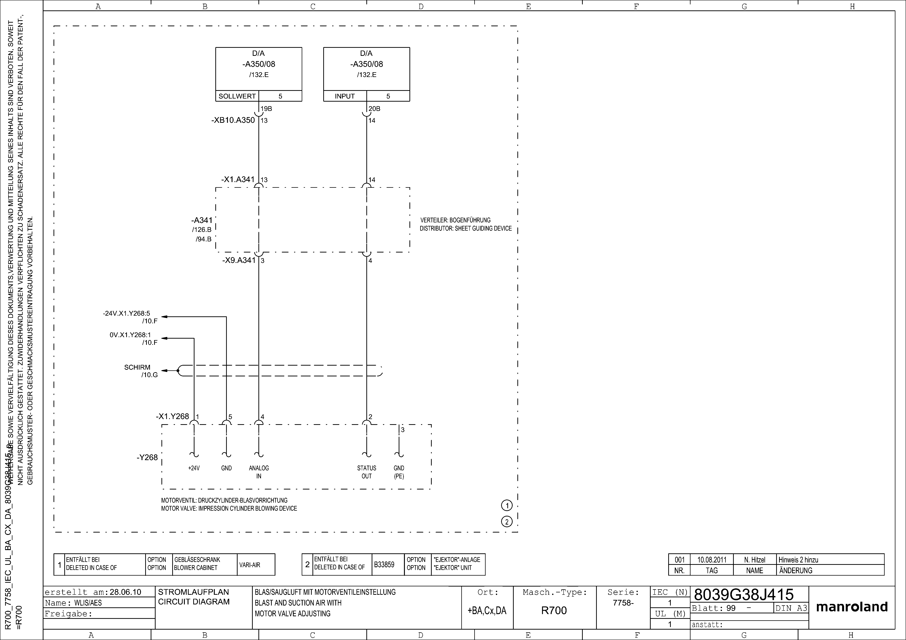

# +BA_Cx_DA — Sheet 99 of 247 — BLAS/SAUGLUFT MIT MOTORVENTILEINSTELLUNG

**BLAST AND SUCTION AIR WITH**

> Part of the manroland **R700** printing press IEC/UL circuit diagrams.
> Drawing class: **Stromlaufplan / Circuit diagram** (DIN A3).
> Document `+BA_Cx_DA` covers the **Printing units / main switch cabinet** machine section.

## At a glance

| Field | Value |
|---|---|
| Document | `+BA_Cx_DA`  (8039G38J415) |
| Sheet | **99** of 247 |
| Section (DE) | BLAS/SAUGLUFT MIT MOTORVENTILEINSTELLUNG |
| Section (EN) | BLAST AND SUCTION AIR WITH |
| Section type | CIRCUIT — Circuit diagram |
| Machine type | `R700` |
| Series | `7758` |
| Created | 28.06.10 |
| Replaces | — |
| Columns used | A, B, C, D, E, F, G, H |
| Path numbers | — |
| Labels on sheet | 75 |
| Cross-refs out | 7 |
| Cross-refs in | 17 |

**Previous:** [+BA_Cx_DA sheet 98](SHEET_0098.md) · **Next:** [+BA_Cx_DA sheet 100](SHEET_0100.md) · **Document TOC:** [_TOC.md](_TOC.md)  (+BA_Cx_DA) · **Master TOC:** [all sheets](../_MASTER_TOC.md)

## Sheet image (300 DPI, exact vector render)



_Rendered directly from the PDF vector layer at 300 DPI (1-bit), no OCR and no resampling. Use it to confirm anything ambiguous in the text below._

## Cross-references on this sheet

Each entry is a wire leaving this sheet. The printed token is `/sheet.column`; the link resolves to that sheet inside the same document.

| Ref | Target sheet | Col | Path | Destination on target | Target section | From col |
|---|---|---|---|---|---|---|
| `/132.E` | [+BA_Cx_DA sheet 132](SHEET_0132.md) | E | — | — | REFERENZMODUL | C |
| `/132.E` | [+BA_Cx_DA sheet 132](SHEET_0132.md) | E | — | — | REFERENZMODUL | D |
| `/126.B` | [+BA_Cx_DA sheet 126](SHEET_0126.md) | B | — | — | RESERVE: SPS STATION (D/A) | B |
| `/94.B` | [+BA_Cx_DA sheet 94](SHEET_0094.md) | B | — | — | BOGENFÜHRUNG (BLASROHRE) | B |
| `/10.F` | [+BA_Cx_DA sheet 10](SHEET_0010.md) | F | — | 24V.X1.Y268:5 | SPANNUNGSVERSORGUNG, SCHALTSCHRANKBELÜFTUNG | A |
| `/10.F` | [+BA_Cx_DA sheet 10](SHEET_0010.md) | F | — | 0V.X1.Y268:1 | SPANNUNGSVERSORGUNG, SCHALTSCHRANKBELÜFTUNG | A |
| `/10.G` | [+BA_Cx_DA sheet 10](SHEET_0010.md) | G | — | SCHIRM | SPANNUNGSVERSORGUNG, SCHALTSCHRANKBELÜFTUNG | A |

### Incoming references (sheets that point here)

Every other sheet that sends a wire to this one. `Back-ref` is the token printed on *that* sheet; `Path` is its line number.

| From sheet | Cols | Back-ref | Path | Refs | What continues there |
|---|---|---|---|---|---|
| [+BA_Cx_DA#10](SHEET_0010.md) | F, G | `/10.F`, `/10.G` | — | 3 | 0V.X1.Y268:1; SCHIRM |
| [+BA_Cx_DA#94](SHEET_0094.md) | B | `/94.B` | — | 1 | — |
| [+BA_Cx_DA#126](SHEET_0126.md) | A | `/126.A` | — | 1 | — |
| [+BA_Cx_DA#132](SHEET_0132.md) | E | `/132.E` | — | 2 | — |
| [+BA_Cx_DA#141](SHEET_0141.md) | D | `/141.D` | — | 2 | — |
| [+BA_Cx_DA#150](SHEET_0150.md) | E | `/150.E` | — | 4 | — |
| [+BA_Cx_DA#166](SHEET_0166.md) | E | `/166.E` | — | 2 | — |
| [+BA_Cx_DA#167](SHEET_0167.md) | C | `/167.C` | — | 2 | — |


## Devices on this sheet

| Tag | Class | Class meaning (IEC) | Col | Sub | Terminal | Sign |
|---|---|---|---|---|---|---|
| `A350/08` | A | Baugruppe / assembly, module, PC board | B | 08 | — | — |
| `A350/08` | A | Baugruppe / assembly, module, PC board | C | 08 | — | — |
| `Y268` | Y | Magnetventil / solenoid valve, actuator | A | — | — | — |
| `A341` | A | Baugruppe / assembly, module, PC board | B | — | — | — |
| `XB10.A350` | — | cross-device reference | B | — | — | — |
| `X9.A341` | — | cross-device reference | B | — | — | — |
| `X1.Y268` | — | cross-device reference | B | — | — | — |
| `X1.A341` | — | cross-device reference | B | — | — | — |
| `NR.` | — | cross-device reference | F | — | — | — |
| `10.08.2011` | — | cross-device reference | G | — | — | — |

## Potentials / nets

| Potential | Count | Columns | Attached devices | Terminals |
|---|---|---|---|---|
| `+24V` | 1 | B | — | — |
| `0V` | 1 | A | `X1`, `Y268` | `1` |
| `24V` | 1 | A | `X1`, `Y268` | `5` |


A potential such as `L24+/4` or `M24+` is a named supply/return rail; every place it appears on this sheet is electrically common.

## Wire-end annotations (grouped as printed)

A wire that continues elsewhere is annotated with a small cluster: the destination description, the path/line number `#NN`, and the `/sheet.column` cross reference. Each row below is one such cluster exactly as it is grouped on the drawing.

| Col | Y | Path | Cross-ref | Text on the wire |
|---|---|---|---|---|
| B | 65.8 | — | — | `D/A` |
| C | 65.8 | — | — | `D/A` |
| B | 79.7 | — | — | `A350/08` |
| C | 79.7 | — | — | `A350/08` |
| C | 94.5 | — | `/132.E` | — |
| D | 94.5 | — | `/132.E` | — |
| B | 122.8 | — | — | `SOLLWERT 5` |
| C | 122.9 | — | — | `INPUT 5` |
| C | 139.2 | — | — | `19B` |
| D | 139.2 | — | — | `20B` |
| B | 153.4 | — | — | `XB10.A350 13` |
| D | 154.8 | — | — | `14` |
| C | 231.3 | — | — | `X1.A341 13 14` |
| B | 285.2 | — | — | `A341` |
| D | 286.9 | — | — | `DISTRIBUTOR: SHEET GUIDING DEVICE VERTEILER: BOGENFÜHRUNG` |
| B | 298.3 | — | `/126.B` | — |
| B | 310.6 | — | `/94.B` | — |
| C | 337.6 | — | — | `X9.A341 3 4` |
| A | 408.5 | — | `/10.F` | `24V.X1.Y268:5` |
| A | 436.8 | — | `/10.F` | `0V.X1.Y268:1` |
| A | 479.4 | — | `/10.G` | `SCHIRM` |
| B | 543.2 | — | — | `X1.Y268 1` |
| C | 544.6 | — | — | `5 2` |
| C | 544.6 | — | — | `4` |
| D | 561.6 | — | — | `3` |
| A | 597.1 | — | — | `Y268` |
| B | 612.9 | — | — | `+24V GND ANALOG` |
| C | 612.9 | — | — | `STATUS` |
| D | 612.9 | — | — | `GND` |
| B | 623.3 | — | — | `IN` |
| C | 623.5 | — | — | `OUT` |
| D | 623.5 | — | — | `(PE)` |
| B | 655.5 | — | — | `MOTORVENTIL: DRUCKZYLINDER BLASVORRICHTUNG MOTOR VALVE: IMPRESSION CYLINDER BLOWING DEVICE` |
| E | 661.7 | — | — | `1` |
| E | 683.4 | — | — | `2` |
| B | 732.6 | — | — | `1 BLOWER CABINET GEBLÄSESCHRANK VARI AIR ENTFÄLLT BEI DELETED IN CASE OF` |
| G | 732.7 | — | — | `001 10.08.2011 N. Hitzel Hinweis 2 hinzu` |
| A | 733.4 | — | — | `ENTFÄLLT BEI DELETED IN CASE OF` |
| B | 733.4 | — | — | `OPTION OPTION` |
| D | 733.4 | — | — | `2 B33859 "EJEKTOR" ANLAGE "EJEKTOR" UNIT` |
| D | 733.4 | — | — | `OPTION OPTION` |
| G | 747.0 | — | — | `NR. TAG NAME ÄNDERUNG` |


## Reconstructed tables

This sheet carries tabular content (pin map / terminal assignment / index). The grid below was rebuilt from the drawing's own rule lines, so each row is exactly one physical row of the table.

### Table 1 — 2 data rows × 2 columns (at x=297.6, y=62.4)

| D/A | A350/08 /132.E |
|---|---|
| `SOLLWERT` | `5` |
| `XB10.A350 X1.A341 X9.A341` | `19B 13 13 3` |


### Table 2 — 2 data rows × 2 columns (at x=425.2, y=62.4)

| D/A | A350/08 /132.E |
|---|---|
| `INPUT` | `5` |
|  | `20B 14 14 4` |


## Notes and free text on this sheet

| Text | Col | Y (pt) |
|---|---|---|
| `19B` | C | 139.18 |
| `D/A` | B | 65.78 |
| `SOLLWERT` | B | 122.83 |
| `20B` | D | 139.18 |
| `D/A` | C | 65.78 |
| `INPUT` | C | 122.88 |
| `MOTORVENTIL: DRUCKZYLINDER BLASVORRICHTUNG` | B | 655.45 |
| `MOTOR VALVE: IMPRESSION CYLINDER BLOWING DEVICE` | B | 666.06 |
| `VERTEILER: BOGENFÜHRUNG` | D | 286.94 |
| `DISTRIBUTOR: SHEET GUIDING DEVICE` | D | 297.55 |
| `SCHIRM` | A | 479.37 |
| `TAG` | G | 747.05 |
| `NAME` | G | 747.05 |
| `ÄNDERUNG` | G | 747.11 |
| `N. Hitzel` | G | 733.02 |
| `Hinweis 2 hinzu` | H | 732.98 |
| `GND` | B | 612.93 |
| `ANALOG` | C | 612.91 |
| `IN` | B | 623.33 |
| `STATUS` | C | 612.88 |
| `OUT` | C | 623.54 |
| `GND` | D | 612.93 |
| `(PE)` | D | 623.48 |
| `ENTFÄLLT BEI` | A | 733.35 |
| `DELETED IN CASE OF` | A | 744 |
| `OPTION` | B | 733.35 |
| `GEBLÄSESCHRANK` | B | 733.39 |
| `BLOWER CABINET` | B | 743.97 |
| `VARI AIR` | B | 740.46 |
| `ENTFÄLLT BEI` | C | 732.64 |
| `DELETED IN CASE OF` | C | 743.29 |
| `OPTION` | D | 733.35 |
| `"EJEKTOR" ANLAGE` | D | 733.38 |
| `"EJEKTOR" UNIT` | D | 744.01 |
| `B33859` | D | 739.23 |

## Complete label inventory (exact text from the drawing)

Every text object inside the drawing area of this sheet, in DIN reading order (column A→H, then top→bottom). This is the authoritative list: if a string is not here it is not printed on this sheet.

| Col | Y | X | Dir | Type | Text |
|---|---|---|---|---|---|
| A | 408.5 | 135.2 | → | potential | `24V.X1.Y268:5` |
| A | 418.4 | 187.1 | → | cross-reference | `/10.F` |
| A | 436.8 | 144.3 | → | potential | `0V.X1.Y268:1` |
| A | 446.7 | 187.1 | → | cross-reference | `/10.F` |
| A | 479.4 | 163.3 | → | text | `SCHIRM` |
| A | 489.2 | 186.0 | → | cross-reference | `/10.G` |
| A | 597.1 | 179.7 | → | device tag | `Y268` |
| A | 733.3 | 87.0 | → | text | `ENTFÄLLT BEI` |
| A | 738.7 | 75.4 | → | number | `1` |
| A | 744.0 | 87.0 | → | text | `DELETED IN CASE OF` |
| B | 65.8 | 331.4 | → | text | `D/A` |
| B | 79.7 | 318.8 | → | device tag | `A350/08` |
| B | 122.8 | 287.3 | → | text | `SOLLWERT` |
| B | 153.4 | 277.8 | → | device ref | `XB10.A350` |
| B | 231.3 | 290.8 | → | device ref | `X1.A341` |
| B | 285.2 | 251.4 | → | device tag | `A341` |
| B | 298.3 | 252.6 | → | cross-reference | `/126.B` |
| B | 310.6 | 257.4 | → | cross-reference | `/94.B` |
| B | 337.6 | 292.3 | → | device ref | `X9.A341` |
| B | 543.2 | 204.9 | → | device ref | `X1.Y268` |
| B | 544.6 | 257.1 | → | number | `1` |
| B | 544.6 | 300.2 | → | number | `5` |
| B | 612.9 | 247.6 | → | potential | `+24V` |
| B | 612.9 | 290.7 | → | text | `GND` |
| B | 623.3 | 336.8 | → | text | `IN` |
| B | 655.4 | 212.0 | → | text | `MOTORVENTIL: DRUCKZYLINDER BLASVORRICHTUNG` |
| B | 666.1 | 212.0 | → | text | `MOTOR VALVE: IMPRESSION CYLINDER BLOWING DEVICE` |
| B | 733.4 | 193.9 | → | text | `OPTION` |
| B | 733.4 | 229.3 | → | text | `GEBLÄSESCHRANK` |
| B | 740.5 | 314.6 | → | text | `VARI AIR` |
| B | 744.0 | 193.9 | → | text | `OPTION` |
| B | 744.0 | 228.8 | → | text | `BLOWER CABINET` |
| C | 65.8 | 473.1 | → | text | `D/A` |
| C | 79.7 | 460.5 | → | device tag | `A350/08` |
| C | 94.5 | 327.7 | → | cross-reference | `/132.E` |
| C | 122.9 | 366.1 | → | number | `5` |
| C | 122.9 | 440.1 | → | text | `INPUT` |
| C | 139.2 | 342.1 | → | text | `19B` |
| C | 154.8 | 342.1 | → | number | `13` |
| C | 232.8 | 342.1 | → | number | `13` |
| C | 339.1 | 342.7 | → | number | `3` |
| C | 544.6 | 342.7 | → | number | `4` |
| C | 612.9 | 327.4 | → | text | `ANALOG` |
| C | 612.9 | 469.5 | → | text | `STATUS` |
| C | 623.5 | 475.3 | → | text | `OUT` |
| C | 732.6 | 413.0 | → | text | `ENTFÄLLT BEI` |
| C | 738.0 | 401.1 | → | number | `2` |
| C | 743.3 | 413.0 | → | text | `DELETED IN CASE OF` |
| D | 94.5 | 469.4 | → | cross-reference | `/132.E` |
| D | 122.9 | 507.8 | → | number | `5` |
| D | 139.2 | 484.4 | → | text | `20B` |
| D | 154.8 | 483.9 | → | number | `14` |
| D | 232.8 | 483.9 | → | number | `14` |
| D | 286.9 | 552.8 | → | text | `VERTEILER: BOGENFÜHRUNG` |
| D | 297.6 | 551.9 | → | text | `DISTRIBUTOR: SHEET GUIDING DEVICE` |
| D | 339.1 | 484.4 | → | number | `4` |
| D | 544.6 | 484.4 | → | number | `2` |
| D | 561.6 | 527.0 | → | number | `3` |
| D | 612.9 | 517.5 | → | text | `GND` |
| D | 623.5 | 518.0 | → | text | `(PE)` |
| D | 733.4 | 534.8 | → | text | `OPTION` |
| D | 733.4 | 570.2 | → | text | `"EJEKTOR" ANLAGE` |
| D | 739.2 | 491.7 | → | text | `B33859` |
| D | 744.0 | 534.8 | → | text | `OPTION` |
| D | 744.0 | 570.2 | → | text | `"EJEKTOR" UNIT` |
| E | 661.7 | 664.4 | → | number | `1` |
| E | 683.4 | 664.1 | → | number | `2` |
| F | 732.7 | 886.9 | → | number | `001` |
| F | 747.0 | 886.3 | → | device ref | `NR.` |
| G | 732.8 | 916.5 | → | device ref | `10.08.2011` |
| G | 733.0 | 978.1 | → | text | `N. Hitzel` |
| G | 747.0 | 980.9 | → | text | `NAME` |
| G | 747.1 | 927.7 | → | text | `TAG` |
| G | 747.1 | 1024.4 | → | text | `ÄNDERUNG` |
| H | 733.0 | 1023.3 | → | text | `Hinweis 2 hinzu` |

## Reading-order text block

The same content as a plain block, grouped by DIN column — convenient to paste or to match against a visual description.

```text
=== Column A ===
 408.5  135.2  net          24V.X1.Y268:5
 418.4  187.1  xref         /10.F
 436.8  144.3  net          0V.X1.Y268:1
 446.7  187.1  xref         /10.F
 479.4  163.3  text         SCHIRM
 489.2  186.0  xref         /10.G
 597.1  179.7  devtag       Y268
 733.3   87.0  text         ENTFÄLLT BEI
 738.7   75.4  numeric      1
 744.0   87.0  text         DELETED IN CASE OF
=== Column B ===
  65.8  331.4  text         D/A
  79.7  318.8  devtag       A350/08
 122.8  287.3  text         SOLLWERT
 153.4  277.8  devref       XB10.A350
 231.3  290.8  devref       X1.A341
 285.2  251.4  devtag       A341
 298.3  252.6  xref         /126.B
 310.6  257.4  xref         /94.B
 337.6  292.3  devref       X9.A341
 543.2  204.9  devref       X1.Y268
 544.6  257.1  numeric      1
 544.6  300.2  numeric      5
 612.9  247.6  net          +24V
 612.9  290.7  text         GND
 623.3  336.8  text         IN
 655.4  212.0  text         MOTORVENTIL: DRUCKZYLINDER BLASVORRICHTUNG
 666.1  212.0  text         MOTOR VALVE: IMPRESSION CYLINDER BLOWING DEVICE
 733.4  193.9  text         OPTION
 733.4  229.3  text         GEBLÄSESCHRANK
 740.5  314.6  text         VARI AIR
 744.0  193.9  text         OPTION
 744.0  228.8  text         BLOWER CABINET
=== Column C ===
  65.8  473.1  text         D/A
  79.7  460.5  devtag       A350/08
  94.5  327.7  xref         /132.E
 122.9  366.1  numeric      5
 122.9  440.1  text         INPUT
 139.2  342.1  text         19B
 154.8  342.1  numeric      13
 232.8  342.1  numeric      13
 339.1  342.7  numeric      3
 544.6  342.7  numeric      4
 612.9  327.4  text         ANALOG
 612.9  469.5  text         STATUS
 623.5  475.3  text         OUT
 732.6  413.0  text         ENTFÄLLT BEI
 738.0  401.1  numeric      2
 743.3  413.0  text         DELETED IN CASE OF
=== Column D ===
  94.5  469.4  xref         /132.E
 122.9  507.8  numeric      5
 139.2  484.4  text         20B
 154.8  483.9  numeric      14
 232.8  483.9  numeric      14
 286.9  552.8  text         VERTEILER: BOGENFÜHRUNG
 297.6  551.9  text         DISTRIBUTOR: SHEET GUIDING DEVICE
 339.1  484.4  numeric      4
 544.6  484.4  numeric      2
 561.6  527.0  numeric      3
 612.9  517.5  text         GND
 623.5  518.0  text         (PE)
 733.4  534.8  text         OPTION
 733.4  570.2  text         "EJEKTOR" ANLAGE
 739.2  491.7  text         B33859
 744.0  534.8  text         OPTION
 744.0  570.2  text         "EJEKTOR" UNIT
=== Column E ===
 661.7  664.4  numeric      1
 683.4  664.1  numeric      2
=== Column F ===
 732.7  886.9  numeric      001
 747.0  886.3  devref       NR.
=== Column G ===
 732.8  916.5  devref       10.08.2011
 733.0  978.1  text         N. Hitzel
 747.0  980.9  text         NAME
 747.1  927.7  text         TAG
 747.1 1024.4  text         ÄNDERUNG
=== Column H ===
 733.0 1023.3  text         Hinweis 2 hinzu
```

---
_Generated from the PDF vector text layer; no OCR. Source: `R700_7758_IEC_UL_BA_CX_DA_8039G38J415_p`, sheet 99._
