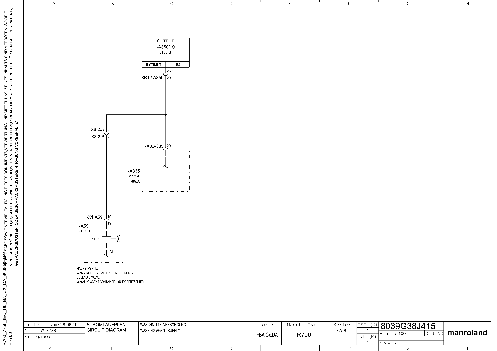

# +BA_Cx_DA — Sheet 100 of 247 — WASCHMITTELVERSORGUNG

**WASHING AGENT SUPPLY**

> Part of the manroland **R700** printing press IEC/UL circuit diagrams.
> Drawing class: **Stromlaufplan / Circuit diagram** (DIN A3).
> Document `+BA_Cx_DA` covers the **Printing units / main switch cabinet** machine section.

## At a glance

| Field | Value |
|---|---|
| Document | `+BA_Cx_DA`  (8039G38J415) |
| Sheet | **100** of 247 |
| Section (DE) | WASCHMITTELVERSORGUNG |
| Section (EN) | WASHING AGENT SUPPLY |
| Section type | CIRCUIT — Circuit diagram |
| Machine type | `R700` |
| Series | `7758` |
| Created | 28.06.10 |
| Replaces | — |
| Columns used | B, C |
| Path numbers | — |
| Labels on sheet | 28 |
| Cross-refs out | 4 |
| Cross-refs in | 9 |

**Previous:** [+BA_Cx_DA sheet 99](SHEET_0099.md) · **Next:** [+BA_Cx_DA sheet 101](SHEET_0101.md) · **Document TOC:** [_TOC.md](_TOC.md)  (+BA_Cx_DA) · **Master TOC:** [all sheets](../_MASTER_TOC.md)

## Sheet image (300 DPI, exact vector render)



_Rendered directly from the PDF vector layer at 300 DPI (1-bit), no OCR and no resampling. Use it to confirm anything ambiguous in the text below._

## Cross-references on this sheet

Each entry is a wire leaving this sheet. The printed token is `/sheet.column`; the link resolves to that sheet inside the same document.

| Ref | Target sheet | Col | Path | Destination on target | Target section | From col |
|---|---|---|---|---|---|---|
| `/133.B` | [+BA_Cx_DA sheet 133](SHEET_0133.md) | B | — | — | REFERENZMODUL | C |
| `/113.A` | [+BA_Cx_DA sheet 113](SHEET_0113.md) | A | — | — | PPL 2 | B |
| `/89.A` | [+BA_Cx_DA sheet 89](SHEET_0089.md) | A | — | — | WASCHVORRICHTUNG | B |
| `/137.B` | [+BA_Cx_DA sheet 137](SHEET_0137.md) | B | — | A591 | REFERENZMODUL | B |

### Incoming references (sheets that point here)

Every other sheet that sends a wire to this one. `Back-ref` is the token printed on *that* sheet; `Path` is its line number.

| From sheet | Cols | Back-ref | Path | Refs | What continues there |
|---|---|---|---|---|---|
| [+BA_Cx_DA#89](SHEET_0089.md) | A | `/89.A` | — | 1 | — |
| [+BA_Cx_DA#113](SHEET_0113.md) | A | `/113.A` | — | 1 | — |
| [+BA_Cx_DA#133](SHEET_0133.md) | B | `/133.B` | — | 1 | — |
| [+BA_Cx_DA#137](SHEET_0137.md) | B | `/137.B` | — | 1 | — |
| [+BA_Cx_DA#142](SHEET_0142.md) | B | `/142.B` | — | 1 | — |
| [+BA_Cx_DA#164](SHEET_0164.md) | G, H | `/164.G`, `/164.H` | — | 2 | — |
| [+BA_Cx_DA#165](SHEET_0165.md) | E | `/165.E` | — | 1 | — |
| [+BA_Cx_DA#169](SHEET_0169.md) | G | `/169.G` | — | 1 | — |


## Devices on this sheet

| Tag | Class | Class meaning (IEC) | Col | Sub | Terminal | Sign |
|---|---|---|---|---|---|---|
| `A335` | A | Baugruppe / assembly, module, PC board | B | — | — | — |
| `Y195` | Y | Magnetventil / solenoid valve, actuator | B | — | — | — |
| `A591` | A | Baugruppe / assembly, module, PC board | B | — | — | — |
| `A350/10` | A | Baugruppe / assembly, module, PC board | C | 10 | — | — |
| `X8.A335` | — | cross-device reference | C | — | — | — |
| `X8.2.B` | — | cross-device reference | B | — | — | — |
| `X8.2.A` | — | cross-device reference | B | — | — | — |
| `X1.A591` | — | cross-device reference | B | — | — | — |
| `15.3` | — | cross-device reference | C | — | — | — |
| `XB12.A350` | — | cross-device reference | C | — | — | — |

## Potentials / nets

_No named potentials on this sheet._

## Wire-end annotations (grouped as printed)

A wire that continues elsewhere is annotated with a small cluster: the destination description, the path/line number `#NN`, and the `/sheet.column` cross reference. Each row below is one such cluster exactly as it is grouped on the drawing.

| Col | Y | Path | Cross-ref | Text on the wire |
|---|---|---|---|---|
| C | 94.2 | — | — | `QUTPUT` |
| C | 108.0 | — | — | `A350/10` |
| C | 121.8 | — | `/133.B` | — |
| C | 151.4 | — | — | `BYTE.BIT 15.3` |
| C | 166.8 | — | — | `26B` |
| C | 181.7 | — | — | `XB12.A350 20` |
| B | 305.8 | — | — | `X8.2.A 20` |
| B | 323.5 | — | — | `X8.2.B 20` |
| C | 346.1 | — | — | `X8.A335 20` |
| B | 405.7 | — | — | `A335` |
| B | 418.7 | — | `/113.A` | — |
| B | 431.1 | — | `/89.A` | — |
| B | 516.2 | — | — | `X1.A591 19` |
| B | 531.8 | — | — | `19` |
| B | 537.5 | — | `/137.B` | `A591` |
| B | 569.4 | — | — | `Y195` |
| B | 599.9 | — | — | `M` |
| B | 641.2 | — | — | `MAGNETVENTIL:` |
| B | 651.9 | — | — | `SOLENOID VALVE: WASCHMITTELBEHÄLTER 1 (UNTERDRUCK) WASHING AGENT CONTAINER 1 (UNDERPRESSURE)` |


## Reconstructed tables

This sheet carries tabular content (pin map / terminal assignment / index). The grid below was rebuilt from the drawing's own rule lines, so each row is exactly one physical row of the table.

### Table 1 — 2 data rows × 2 columns (at x=340.2, y=90.7)

| QUTPUT | A350/10 /133.B |
|---|---|
| `BYTE.BIT` | `15.3` |
| `XB12.A350` | `26B 20` |


## Notes and free text on this sheet

| Text | Col | Y (pt) |
|---|---|---|
| `MAGNETVENTIL:` | B | 641.24 |
| `WASCHMITTELBEHÄLTER 1 (UNTERDRUCK)` | B | 651.9 |
| `SOLENOID VALVE:` | B | 662.5 |
| `WASHING AGENT CONTAINER 1 (UNDERPRESSURE)` | B | 673.16 |
| `M` | B | 599.91 |
| `26B` | C | 166.82 |
| `QUTPUT` | C | 94.16 |
| `BYTE.BIT` | C | 151.43 |

## Complete label inventory (exact text from the drawing)

Every text object inside the drawing area of this sheet, in DIN reading order (column A→H, then top→bottom). This is the authoritative list: if a string is not here it is not printed on this sheet.

| Col | Y | X | Dir | Type | Text |
|---|---|---|---|---|---|
| B | 305.8 | 214.0 | → | device ref | `X8.2.A` |
| B | 307.9 | 257.7 | → | number | `20` |
| B | 323.5 | 214.9 | → | device ref | `X8.2.B` |
| B | 324.9 | 257.7 | → | number | `20` |
| B | 405.7 | 306.7 | → | device tag | `A335` |
| B | 418.7 | 309.0 | → | cross-reference | `/113.A` |
| B | 431.1 | 313.8 | → | cross-reference | `/89.A` |
| B | 516.2 | 207.2 | → | device ref | `X1.A591` |
| B | 516.2 | 257.1 | → | number | `19` |
| B | 531.8 | 257.1 | → | number | `19` |
| B | 537.5 | 189.6 | → | device tag | `A591` |
| B | 550.5 | 189.9 | → | cross-reference | `/137.B` |
| B | 569.4 | 215.1 | → | device tag | `Y195` |
| B | 599.9 | 263.1 | → | text | `M` |
| B | 641.2 | 183.7 | → | text | `MAGNETVENTIL:` |
| B | 651.9 | 184.3 | → | text | `WASCHMITTELBEHÄLTER 1 (UNTERDRUCK)` |
| B | 662.5 | 184.0 | → | text | `SOLENOID VALVE:` |
| B | 673.2 | 184.3 | → | text | `WASHING AGENT CONTAINER 1 (UNDERPRESSURE)` |
| C | 94.2 | 376.6 | → | text | `QUTPUT` |
| C | 108.0 | 375.4 | → | device tag | `A350/10` |
| C | 121.8 | 384.2 | → | cross-reference | `/133.B` |
| C | 151.4 | 350.1 | → | text | `BYTE.BIT` |
| C | 151.5 | 417.0 | → | device ref | `15.3` |
| C | 166.8 | 399.4 | → | text | `26B` |
| C | 181.7 | 334.5 | → | device ref | `XB12.A350` |
| C | 183.2 | 399.4 | → | number | `20` |
| C | 346.1 | 347.5 | → | device ref | `X8.A335` |
| C | 346.2 | 399.4 | → | number | `20` |

## Reading-order text block

The same content as a plain block, grouped by DIN column — convenient to paste or to match against a visual description.

```text
=== Column B ===
 305.8  214.0  devref       X8.2.A
 307.9  257.7  numeric      20
 323.5  214.9  devref       X8.2.B
 324.9  257.7  numeric      20
 405.7  306.7  devtag       A335
 418.7  309.0  xref         /113.A
 431.1  313.8  xref         /89.A
 516.2  207.2  devref       X1.A591
 516.2  257.1  numeric      19
 531.8  257.1  numeric      19
 537.5  189.6  devtag       A591
 550.5  189.9  xref         /137.B
 569.4  215.1  devtag       Y195
 599.9  263.1  text         M
 641.2  183.7  text         MAGNETVENTIL:
 651.9  184.3  text         WASCHMITTELBEHÄLTER 1 (UNTERDRUCK)
 662.5  184.0  text         SOLENOID VALVE:
 673.2  184.3  text         WASHING AGENT CONTAINER 1 (UNDERPRESSURE)
=== Column C ===
  94.2  376.6  text         QUTPUT
 108.0  375.4  devtag       A350/10
 121.8  384.2  xref         /133.B
 151.4  350.1  text         BYTE.BIT
 151.5  417.0  devref       15.3
 166.8  399.4  text         26B
 181.7  334.5  devref       XB12.A350
 183.2  399.4  numeric      20
 346.1  347.5  devref       X8.A335
 346.2  399.4  numeric      20
```

---
_Generated from the PDF vector text layer; no OCR. Source: `R700_7758_IEC_UL_BA_CX_DA_8039G38J415_p`, sheet 100._
