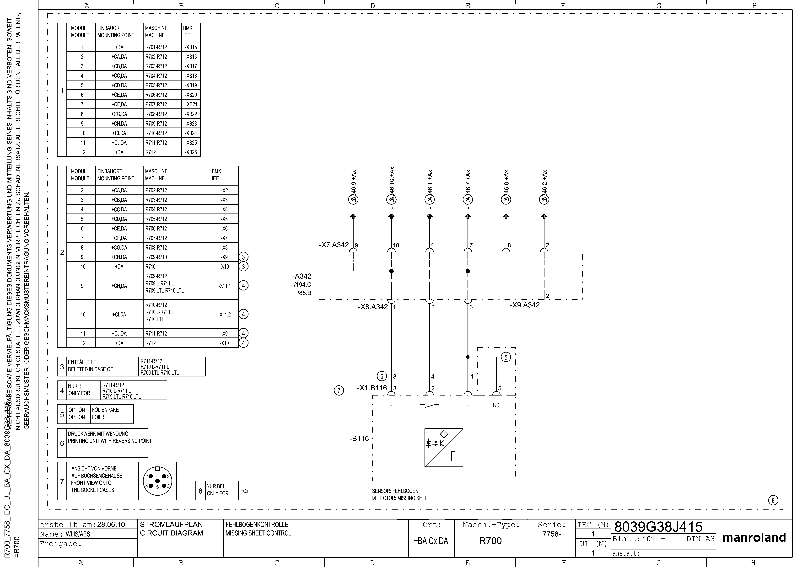

# +BA_Cx_DA — Sheet 101 of 247 — FEHLBOGENKONTROLLE

**MISSING SHEET CONTROL**

> Part of the manroland **R700** printing press IEC/UL circuit diagrams.
> Drawing class: **Stromlaufplan / Circuit diagram** (DIN A3).
> Document `+BA_Cx_DA` covers the **Printing units / main switch cabinet** machine section.

## At a glance

| Field | Value |
|---|---|
| Document | `+BA_Cx_DA`  (8039G38J415) |
| Sheet | **101** of 247 |
| Section (DE) | FEHLBOGENKONTROLLE |
| Section (EN) | MISSING SHEET CONTROL |
| Section type | CIRCUIT — Circuit diagram |
| Machine type | `R700` |
| Series | `7758` |
| Created | 28.06.10 |
| Replaces | — |
| Columns used | A, B, C, D, E, F, H |
| Path numbers | — |
| Labels on sheet | 207 |
| Cross-refs out | 2 |
| Cross-refs in | 17 |

**Previous:** [+BA_Cx_DA sheet 100](SHEET_0100.md) · **Next:** [+BA_Cx_DA sheet 102](SHEET_0102.md) · **Document TOC:** [_TOC.md](_TOC.md)  (+BA_Cx_DA) · **Master TOC:** [all sheets](../_MASTER_TOC.md)

## Sheet image (300 DPI, exact vector render)



_Rendered directly from the PDF vector layer at 300 DPI (1-bit), no OCR and no resampling. Use it to confirm anything ambiguous in the text below._

## Cross-references on this sheet

Each entry is a wire leaving this sheet. The printed token is `/sheet.column`; the link resolves to that sheet inside the same document.

| Ref | Target sheet | Col | Path | Destination on target | Target section | From col |
|---|---|---|---|---|---|---|
| `/194.C` | [+BA_Cx_DA sheet 194](SHEET_0194.md) | C | — | — | OPTION: WASCHVORRICHTUNG MIT BÜRSTE | C |
| `/86.B` | [+BA_Cx_DA sheet 86](SHEET_0086.md) | B | — | — | WASCHVORRICHTUNG | C |

### Incoming references (sheets that point here)

Every other sheet that sends a wire to this one. `Back-ref` is the token printed on *that* sheet; `Path` is its line number.

| From sheet | Cols | Back-ref | Path | Refs | What continues there |
|---|---|---|---|---|---|
| [+BA_Cx_DA#86](SHEET_0086.md) | A | `/86.A` | — | 1 | — |
| [+BA_Cx_DA#145](SHEET_0145.md) | B | `/145.B` | — | 5 | — |
| [+BA_Cx_DA#164](SHEET_0164.md) | A | `/164.A` | — | 6 | — |
| [+BA_Cx_DA#165](SHEET_0165.md) | G | `/165.G` | — | 3 | — |
| [+BA_Cx_DA#166](SHEET_0166.md) | F | `/166.F` | — | 1 | — |
| [+BA_Cx_DA#194](SHEET_0194.md) | C | `/194.C` | — | 1 | — |


## Devices on this sheet

| Tag | Class | Class meaning (IEC) | Col | Sub | Terminal | Sign |
|---|---|---|---|---|---|---|
| `B116` | B | Umformer / transducer, sensor | D | — | — | — |
| `A342` | A | Baugruppe / assembly, module, PC board | C | — | — | — |
| `XB15` | XB |  | B | — | — | — |
| `XB16` | XB |  | B | — | — | — |
| `XB17` | XB |  | B | — | — | — |
| `XB18` | XB |  | B | — | — | — |
| `XB19` | XB |  | B | — | — | — |
| `XB20` | XB |  | B | — | — | — |
| `XB21` | XB |  | B | — | — | — |
| `XB22` | XB |  | B | — | — | — |
| `XB23` | XB |  | B | — | — | — |
| `XB24` | XB |  | B | — | — | — |
| `XB25` | XB |  | B | — | — | — |
| `XB26` | XB |  | B | — | — | — |
| `R712` | R | Widerstand / resistor | B | — | — | — |
| `X2` | X | Klemme / terminal, plug connector | B | — | — | — |
| `X3` | X | Klemme / terminal, plug connector | B | — | — | — |
| `X4` | X | Klemme / terminal, plug connector | B | — | — | — |
| `X5` | X | Klemme / terminal, plug connector | B | — | — | — |
| `X6` | X | Klemme / terminal, plug connector | B | — | — | — |
| `X7` | X | Klemme / terminal, plug connector | B | — | — | — |
| `X8` | X | Klemme / terminal, plug connector | B | — | — | — |
| `X9` | X | Klemme / terminal, plug connector | B | — | — | — |
| `R710` | R | Widerstand / resistor | B | — | — | — |
| `X10` | X | Klemme / terminal, plug connector | B | — | — | — |
| `X9` | X | Klemme / terminal, plug connector | B | — | — | — |
| `R712` | R | Widerstand / resistor | B | — | — | — |
| `X10` | X | Klemme / terminal, plug connector | B | — | — | — |
| `X1.B116` | — | cross-device reference | D | — | — | — |
| `X8.A342` | — | cross-device reference | D | — | — | — |
| `X7.A342` | — | cross-device reference | D | — | — | — |
| `X9.A342` | — | cross-device reference | F | — | — | — |
| `X11.1` | — | cross-device reference | B | — | — | — |
| `X11.2` | — | cross-device reference | B | — | — | — |

## Potentials / nets

_No named potentials on this sheet._

## Wire-end annotations (grouped as printed)

A wire that continues elsewhere is annotated with a small cluster: the destination description, the path/line number `#NN`, and the `/sheet.column` cross reference. Each row below is one such cluster exactly as it is grouped on the drawing.

| Col | Y | Path | Cross-ref | Text on the wire |
|---|---|---|---|---|
| A | 38.9 | — | — | `MODUL MODULE` |
| A | 38.9 | — | — | `EINBAUORT MOUNTING POINT` |
| B | 38.9 | — | — | `MASCHINE MACHINE` |
| B | 38.9 | — | — | `BMK IEE` |
| A | 66.7 | — | — | `1` |
| A | 67.2 | — | — | `+BA` |
| B | 67.2 | — | — | `XB15` |
| B | 67.3 | — | — | `R701 R712` |
| A | 81.3 | — | — | `2` |
| A | 81.4 | — | — | `+CA,DA` |
| B | 81.4 | — | — | `R702 R712` |
| B | 81.4 | — | — | `XB16` |
| A | 95.5 | — | — | `3` |
| A | 95.6 | — | — | `+CB,DA` |
| B | 95.6 | — | — | `R703 R712` |
| B | 95.6 | — | — | `XB17` |
| A | 109.7 | — | — | `4` |
| A | 109.8 | — | — | `+CC,DA` |
| B | 109.8 | — | — | `R704 R712` |
| B | 109.8 | — | — | `XB18` |
| A | 123.8 | — | — | `5` |
| B | 123.9 | — | — | `XB19` |
| A | 124.0 | — | — | `+CD,DA` |
| B | 124.0 | — | — | `R705 R712` |
| A | 129.2 | — | — | `1` |
| A | 138.0 | — | — | `6` |
| A | 138.1 | — | — | `+CE,DA` |
| B | 138.1 | — | — | `R706 R712` |
| B | 138.1 | — | — | `XB20` |
| A | 152.2 | — | — | `7` |
| B | 152.2 | — | — | `XB21` |
| A | 152.3 | — | — | `+CF,DA` |
| B | 152.3 | — | — | `R707 R712` |
| A | 166.4 | — | — | `8` |
| B | 166.4 | — | — | `XB22` |
| A | 166.5 | — | — | `+CG,DA` |
| B | 166.5 | — | — | `R708 R712` |
| A | 180.5 | — | — | `9` |
| A | 180.6 | — | — | `+CH,DA` |
| B | 180.6 | — | — | `XB23` |
| B | 180.7 | — | — | `R709 R712` |
| A | 194.7 | — | — | `10` |
| A | 194.8 | — | — | `+CI,DA` |
| B | 194.8 | — | — | `R710 R712` |
| B | 194.8 | — | — | `XB24` |
| A | 208.7 | — | — | `11` |
| A | 209.0 | — | — | `+CJ,DA` |
| B | 209.0 | — | — | `R711 R712` |
| B | 209.0 | — | — | `XB25` |
| A | 223.0 | — | — | `12` |
| B | 223.1 | — | — | `R712` |
| B | 223.1 | — | — | `XB26` |
| A | 223.2 | — | — | `+DA` |
| D | 247.5 | — | — | `.A346:10,+Ax` |
| A | 251.5 | — | — | `MODUL MODULE` |
| A | 251.5 | — | — | `EINBAUORT MOUNTING POINT` |
| B | 251.5 | — | — | `MASCHINE MACHINE` |
| B | 251.5 | — | — | `BMK IEE` |
| D | 252.3 | — | — | `.A346:9,+Ax` |
| E | 252.3 | — | — | `.A346:1,+Ax` |
| E | 252.3 | — | — | `.A346:7,+Ax` |
| E | 252.3 | — | — | `.A346:8,+Ax` |
| F | 252.3 | — | — | `.A346:2,+Ax` |
| A | 279.7 | — | — | `2` |
| A | 279.8 | — | — | `+CA,DA` |
| B | 279.8 | — | — | `X2` |
| B | 279.9 | — | — | `R702 R712` |
| A | 293.9 | — | — | `3` |
| A | 294.0 | — | — | `+CB,DA` |
| B | 294.0 | — | — | `R703 R712` |
| B | 294.0 | — | — | `X3` |
| D | 294.2 | — | — | `2` |
| D | 294.2 | — | — | `2` |
| E | 294.2 | — | — | `2` |
| E | 294.2 | — | — | `2` |
| E | 294.2 | — | — | `2` |
| F | 294.2 | — | — | `2` |
| A | 308.1 | — | — | `4` |
| A | 308.2 | — | — | `+CC,DA` |
| B | 308.2 | — | — | `R704 R712` |
| B | 308.2 | — | — | `X4` |
| A | 322.3 | — | — | `5` |
| B | 322.3 | — | — | `X5` |
| A | 322.4 | — | — | `+CD,DA` |
| B | 322.4 | — | — | `R705 R712` |
| A | 336.4 | — | — | `6` |
| A | 336.5 | — | — | `+CE,DA` |
| B | 336.5 | — | — | `X6` |
| B | 336.6 | — | — | `R706 R712` |
| A | 350.6 | — | — | `7` |
| A | 350.7 | — | — | `+CF,DA` |
| B | 350.7 | — | — | `R707 R712` |
| B | 350.7 | — | — | `X7` |
| D | 358.9 | — | — | `X7.A342 9` |
| D | 360.3 | — | — | `10` |
| E | 360.3 | — | — | `1` |
| E | 360.3 | — | — | `7` |
| E | 360.3 | — | — | `8` |
| F | 360.3 | — | — | `2` |
| A | 364.8 | — | — | `8` |
| A | 364.9 | — | — | `+CG,DA` |
| B | 364.9 | — | — | `R708 R712` |
| B | 364.9 | — | — | `X8` |
| A | 370.2 | — | — | `2` |
| C | 378.7 | — | — | `3` |
| A | 379.0 | — | — | `9` |
| B | 379.0 | — | — | `X9` |
| A | 379.1 | — | — | `+CH,DA` |
| B | 379.1 | — | — | `R709 R710` |
| C | 392.9 | — | — | `3` |
| B | 393.1 | — | — | `10 +DA R710 X10` |
| C | 405.7 | — | — | `A342` |
| B | 407.4 | — | — | `R709 R712 R709 L R711 L R709 LTL R710 LTL` |
| C | 418.8 | — | `/194.C` | — |
| C | 421.2 | — | — | `4` |
| A | 421.5 | — | — | `9` |
| B | 421.5 | — | — | `X11.1` |
| A | 421.6 | — | — | `+CH,DA` |
| C | 431.1 | — | `/86.B` | — |
| F | 435.4 | — | — | `2` |
| F | 448.2 | — | — | `X9.A342` |
| B | 449.9 | — | — | `R710 R712 R710 L R711 L R710 LTL` |
| D | 451.0 | — | — | `X8.A342 1` |
| E | 452.4 | — | — | `2` |
| E | 452.4 | — | — | `3` |
| C | 463.8 | — | — | `4` |
| A | 464.0 | — | — | `10` |
| A | 464.1 | — | — | `+CI,DA` |
| B | 464.1 | — | — | `X11.2` |
| B | 492.1 | — | — | `11 +CJ,DA R711 R712 X9 4` |
| B | 506.3 | — | — | `12 +DA R712 X10 4` |
| E | 527.5 | — | — | `5` |
| B | 533.6 | — | — | `R711 R712 R710 L R711 L R709 LTL R710 LTL` |
| A | 534.9 | — | — | `3 ENTFÄLLT BEI DELETED IN CASE OF` |
| E | 555.2 | — | — | `6 3 4 1` |
| A | 569.0 | — | — | `R711 R712 R710 L R711 L R709 LTL R710 LTL` |
| A | 570.3 | — | — | `4 NUR BEI` |
| D | 571.5 | — | — | `X1.B116 3 2` |
| E | 572.9 | — | — | `1` |
| E | 572.9 | — | — | `5` |
| D | 577.1 | — | — | `7` |
| A | 581.0 | — | — | `ONLY FOR` |
| E | 597.0 | — | — | `+ L/D` |
| A | 605.8 | — | — | `5 OPTION OPTION` |
| A | 605.8 | — | — | `FOLIENPAKET FOIL SET` |
| A | 641.2 | — | — | `6 DRUCKWERK MIT WENDUNG PRINTING UNIT WITH REVERSING POINT` |
| D | 646.6 | — | — | `B116` |
| A | 693.0 | — | — | `FRONT VIEW ONTO ANSICHT VON VORNE AUF BUCHSENGEHÄUSE` |
| A | 704.6 | — | — | `7 1 5 2` |
| B | 718.8 | — | — | `4 3` |
| B | 719.2 | — | — | `8 NUR BEI` |
| A | 724.9 | — | — | `THE SOCKET CASES` |
| D | 726.3 | — | — | `DETECTOR: MISSING SHEET SENSOR: FEHLBOGEN` |
| B | 726.4 | — | — | `ONLY FOR +Cx` |
| H | 740.1 | — | — | `8` |


## Reconstructed tables

This sheet carries tabular content (pin map / terminal assignment / index). The grid below was rebuilt from the drawing's own rule lines, so each row is exactly one physical row of the table.

### Table 1 — 2 data rows × 2 columns (at x=524.4, y=402.5)

| X8.A342 | 1 |
|---|---|
| `6 X1.B116` | `3 3` |
| `B116` |  |


### Table 2 — 2 data rows × 1 columns (at x=637.8, y=402.5)

| C1 |
|---|
| `2` |
| `4 2` |


### Table 3 — 1 data rows × 3 columns (at x=694.5, y=402.5)

| 3 |  | X9.A342 |
|---|---|---|
| `1 1 + L/D` | `5 5` |  |


## Notes and free text on this sheet

| Text | Col | Y (pt) |
|---|---|---|
| `SENSOR: FEHLBOGEN` | D | 726.29 |
| `DETECTOR: MISSING SHEET` | D | 736.92 |
| `.A346:1,+Ax` | E | 252.28 |
| `.A346:10,+Ax` | D | 247.47 |
| `.A346:7,+Ax` | E | 252.28 |
| `.A346:9,+Ax` | D | 252.28 |
| `.A346:8,+Ax` | E | 252.28 |
| `.A346:2,+Ax` | F | 252.28 |
| `L/D` | E | 598.67 |
| `ANSICHT VON VORNE` | A | 692.99 |
| `AUF BUCHSENGEHÄUSE` | A | 703.63 |
| `FRONT VIEW ONTO` | A | 714.22 |
| `THE SOCKET CASES` | A | 724.87 |
| `OPTION` | A | 605.79 |
| `FOLIENPAKET` | A | 605.8 |
| `FOIL SET` | A | 616.41 |
| `DRUCKWERK MIT WENDUNG` | A | 641.23 |
| `PRINTING UNIT WITH REVERSING POINT` | A | 651.87 |
| `NUR BEI` | A | 570.34 |
| `ONLY FOR` | A | 581.03 |
| `R711 R712` | A | 569 |
| `R710 L R711 L` | A | 577.5 |
| `R709 LTL R710 LTL` | A | 586 |
| `ENTFÄLLT BEI` | A | 534.92 |
| `DELETED IN CASE OF` | A | 545.57 |
| `R711 R712` | B | 533.56 |
| `R710 L R711 L` | B | 542.07 |
| `R709 LTL R710 LTL` | B | 550.57 |
| `NUR BEI` | B | 719.16 |
| `ONLY FOR` | B | 729.85 |
| `+Cx` | C | 726.39 |
| `MODUL` | A | 38.93 |
| `MODULE` | A | 49.54 |
| `EINBAUORT` | A | 38.88 |
| `MOUNTING POINT` | A | 49.54 |
| `+BA` | A | 67.21 |
| `+CA,DA` | A | 81.41 |
| `+CB,DA` | A | 95.59 |
| `+CC,DA` | A | 109.78 |
| `+CD,DA` | A | 123.95 |
| `+CE,DA` | A | 138.11 |
| `+CF,DA` | A | 152.29 |
| `+CG,DA` | A | 166.46 |
| `+CH,DA` | A | 180.64 |
| `+CI,DA` | A | 194.8 |
| `+CJ,DA` | A | 208.97 |
| `+DA` | A | 223.15 |
| `MASCHINE` | B | 38.89 |
| `MACHINE` | B | 49.53 |
| `BMK` | B | 38.86 |
| `IEE` | B | 49.37 |
| `R701 R712` | B | 67.26 |
| `R702 R712` | B | 81.44 |
| `R703 R712` | B | 95.61 |
| `R704 R712` | B | 109.78 |
| `R705 R712` | B | 123.96 |
| `R706 R712` | B | 138.13 |
| `R707 R712` | B | 152.3 |
| `R708 R712` | B | 166.48 |
| `R709 R712` | B | 180.65 |
| `R710 R712` | B | 194.82 |
| `R709 R710` | B | 379.08 |
| `R709 L R711 L` | B | 418.05 |
| `R710 LTL` | B | 471.19 |

## Complete label inventory (exact text from the drawing)

Every text object inside the drawing area of this sheet, in DIN reading order (column A→H, then top→bottom). This is the authoritative list: if a string is not here it is not printed on this sheet.

| Col | Y | X | Dir | Type | Text |
|---|---|---|---|---|---|
| A | 38.9 | 105.7 | → | text | `MODUL` |
| A | 38.9 | 144.4 | → | text | `EINBAUORT` |
| A | 49.5 | 105.7 | → | text | `MODULE` |
| A | 49.5 | 144.7 | → | text | `MOUNTING POINT` |
| A | 66.7 | 119.6 | → | number | `1` |
| A | 67.2 | 170.9 | → | text | `+BA` |
| A | 81.3 | 120.2 | → | number | `2` |
| A | 81.4 | 165.6 | → | text | `+CA,DA` |
| A | 95.5 | 120.2 | → | number | `3` |
| A | 95.6 | 165.6 | → | text | `+CB,DA` |
| A | 109.7 | 120.2 | → | number | `4` |
| A | 109.8 | 165.5 | → | text | `+CC,DA` |
| A | 123.9 | 120.2 | → | number | `5` |
| A | 124.0 | 165.5 | → | text | `+CD,DA` |
| A | 129.2 | 89.6 | → | number | `1` |
| A | 138.0 | 120.2 | → | number | `6` |
| A | 138.1 | 165.6 | → | text | `+CE,DA` |
| A | 152.2 | 120.2 | → | number | `7` |
| A | 152.3 | 165.8 | → | text | `+CF,DA` |
| A | 166.4 | 120.2 | → | number | `8` |
| A | 166.5 | 165.3 | → | text | `+CG,DA` |
| A | 180.5 | 120.2 | → | number | `9` |
| A | 180.6 | 165.5 | → | text | `+CH,DA` |
| A | 194.7 | 119.6 | → | number | `10` |
| A | 194.8 | 166.8 | → | text | `+CI,DA` |
| A | 208.7 | 119.6 | → | number | `11` |
| A | 209.0 | 166.1 | → | text | `+CJ,DA` |
| A | 223.0 | 119.6 | → | number | `12` |
| A | 223.1 | 170.8 | → | text | `+DA` |
| A | 251.5 | 105.7 | → | text | `MODUL` |
| A | 251.5 | 144.4 | → | text | `EINBAUORT` |
| A | 262.1 | 105.7 | → | text | `MODULE` |
| A | 262.1 | 144.7 | → | text | `MOUNTING POINT` |
| A | 279.7 | 120.2 | → | number | `2` |
| A | 279.8 | 165.6 | → | text | `+CA,DA` |
| A | 293.9 | 120.2 | → | number | `3` |
| A | 294.0 | 165.6 | → | text | `+CB,DA` |
| A | 308.1 | 120.2 | → | number | `4` |
| A | 308.2 | 165.5 | → | text | `+CC,DA` |
| A | 322.3 | 120.2 | → | number | `5` |
| A | 322.4 | 165.5 | → | text | `+CD,DA` |
| A | 336.5 | 120.2 | → | number | `6` |
| A | 336.5 | 165.6 | → | text | `+CE,DA` |
| A | 350.6 | 120.2 | → | number | `7` |
| A | 350.7 | 165.8 | → | text | `+CF,DA` |
| A | 364.8 | 120.2 | → | number | `8` |
| A | 364.9 | 165.3 | → | text | `+CG,DA` |
| A | 370.2 | 89.3 | → | number | `2` |
| A | 379.0 | 120.2 | → | number | `9` |
| A | 379.1 | 165.5 | → | text | `+CH,DA` |
| A | 393.1 | 119.6 | → | number | `10` |
| A | 393.2 | 170.8 | → | text | `+DA` |
| A | 421.5 | 120.2 | → | number | `9` |
| A | 421.6 | 165.5 | → | text | `+CH,DA` |
| A | 464.0 | 119.6 | → | number | `10` |
| A | 464.1 | 166.8 | → | text | `+CI,DA` |
| A | 492.2 | 119.6 | → | number | `11` |
| A | 492.4 | 166.1 | → | text | `+CJ,DA` |
| A | 506.5 | 119.6 | → | number | `12` |
| A | 506.6 | 170.8 | → | text | `+DA` |
| A | 534.9 | 101.2 | → | text | `ENTFÄLLT BEI` |
| A | 540.3 | 89.1 | → | number | `3` |
| A | 545.6 | 101.2 | → | text | `DELETED IN CASE OF` |
| A | 569.0 | 152.2 | → | text | `R711 R712` |
| A | 570.3 | 101.2 | → | text | `NUR BEI` |
| A | 575.7 | 89.3 | → | number | `4` |
| A | 577.5 | 152.2 | → | text | `R710 L R711 L` |
| A | 581.0 | 101.8 | → | text | `ONLY FOR` |
| A | 586.0 | 152.2 | → | text | `R709 LTL R710 LTL` |
| A | 605.8 | 101.8 | → | text | `OPTION` |
| A | 605.8 | 136.6 | → | text | `FOLIENPAKET` |
| A | 611.1 | 89.1 | → | number | `5` |
| A | 616.4 | 101.8 | → | text | `OPTION` |
| A | 616.4 | 136.6 | → | text | `FOIL SET` |
| A | 641.2 | 101.2 | → | text | `DRUCKWERK MIT WENDUNG` |
| A | 651.9 | 101.2 | → | text | `PRINTING UNIT WITH REVERSING POINT` |
| A | 653.7 | 89.3 | → | number | `6` |
| A | 693.0 | 106.3 | → | text | `ANSICHT VON VORNE` |
| A | 703.6 | 106.3 | → | text | `AUF BUCHSENGEHÄUSE` |
| A | 710.3 | 89.3 | → | number | `7` |
| A | 714.2 | 105.4 | → | text | `FRONT VIEW ONTO` |
| A | 724.9 | 106.0 | → | text | `THE SOCKET CASES` |
| B | 38.9 | 215.6 | → | text | `MASCHINE` |
| B | 38.9 | 272.0 | → | text | `BMK` |
| B | 49.4 | 272.0 | → | text | `IEE` |
| B | 49.5 | 215.6 | → | text | `MACHINE` |
| B | 67.2 | 274.7 | → | device tag | `XB15` |
| B | 67.3 | 216.0 | → | text | `R701 R712` |
| B | 81.4 | 216.0 | → | text | `R702 R712` |
| B | 81.4 | 274.7 | → | device tag | `XB16` |
| B | 95.6 | 216.0 | → | text | `R703 R712` |
| B | 95.6 | 274.7 | → | device tag | `XB17` |
| B | 109.8 | 216.0 | → | text | `R704 R712` |
| B | 109.8 | 274.7 | → | device tag | `XB18` |
| B | 123.9 | 274.7 | → | device tag | `XB19` |
| B | 124.0 | 216.0 | → | text | `R705 R712` |
| B | 138.1 | 216.0 | → | text | `R706 R712` |
| B | 138.1 | 274.7 | → | device tag | `XB20` |
| B | 152.2 | 275.2 | → | device tag | `XB21` |
| B | 152.3 | 216.0 | → | text | `R707 R712` |
| B | 166.4 | 274.8 | → | device tag | `XB22` |
| B | 166.5 | 216.0 | → | text | `R708 R712` |
| B | 180.6 | 216.0 | → | text | `R709 R712` |
| B | 180.6 | 274.7 | → | device tag | `XB23` |
| B | 194.8 | 216.0 | → | text | `R710 R712` |
| B | 194.8 | 274.7 | → | device tag | `XB24` |
| B | 209.0 | 216.0 | → | text | `R711 R712` |
| B | 209.0 | 274.7 | → | device tag | `XB25` |
| B | 223.1 | 216.0 | → | device tag | `R712` |
| B | 223.1 | 274.7 | → | device tag | `XB26` |
| B | 251.5 | 215.6 | → | text | `MASCHINE` |
| B | 251.5 | 314.5 | → | text | `BMK` |
| B | 262.0 | 314.5 | → | text | `IEE` |
| B | 262.1 | 215.6 | → | text | `MACHINE` |
| B | 279.8 | 328.3 | → | device tag | `X2` |
| B | 279.9 | 216.0 | → | text | `R702 R712` |
| B | 294.0 | 216.0 | → | text | `R703 R712` |
| B | 294.0 | 328.2 | → | device tag | `X3` |
| B | 308.2 | 216.0 | → | text | `R704 R712` |
| B | 308.2 | 328.2 | → | device tag | `X4` |
| B | 322.3 | 328.2 | → | device tag | `X5` |
| B | 322.4 | 216.0 | → | text | `R705 R712` |
| B | 336.5 | 328.2 | → | device tag | `X6` |
| B | 336.6 | 216.0 | → | text | `R706 R712` |
| B | 350.7 | 216.0 | → | text | `R707 R712` |
| B | 350.7 | 328.2 | → | device tag | `X7` |
| B | 364.9 | 216.0 | → | text | `R708 R712` |
| B | 364.9 | 328.2 | → | device tag | `X8` |
| B | 379.0 | 328.2 | → | device tag | `X9` |
| B | 379.1 | 216.0 | → | text | `R709 R710` |
| B | 393.2 | 216.0 | → | device tag | `R710` |
| B | 393.2 | 326.4 | → | device tag | `X10` |
| B | 407.4 | 216.0 | → | text | `R709 R712` |
| B | 418.1 | 216.0 | → | text | `R709 L R711 L` |
| B | 421.5 | 324.3 | → | device ref | `X11.1` |
| B | 428.7 | 216.0 | → | text | `R709 LTL R710 LTL` |
| B | 449.9 | 216.0 | → | text | `R710 R712` |
| B | 460.6 | 216.0 | → | text | `R710 L R711 L` |
| B | 464.1 | 323.9 | → | device ref | `X11.2` |
| B | 471.2 | 216.0 | → | text | `R710 LTL` |
| B | 492.4 | 328.2 | → | device tag | `X9` |
| B | 492.5 | 216.0 | → | text | `R711 R712` |
| B | 506.6 | 216.0 | → | device tag | `R712` |
| B | 506.6 | 326.4 | → | device tag | `X10` |
| B | 533.6 | 208.9 | → | text | `R711 R712` |
| B | 542.1 | 208.9 | → | text | `R710 L R711 L` |
| B | 550.6 | 208.9 | → | text | `R709 LTL R710 LTL` |
| B | 704.6 | 217.1 | → | number | `1` |
| B | 704.6 | 247.7 | → | number | `2` |
| B | 718.8 | 216.0 | → | number | `4` |
| B | 718.8 | 247.7 | → | number | `3` |
| B | 719.2 | 306.7 | → | text | `NUR BEI` |
| B | 720.2 | 231.9 | → | number | `5` |
| B | 724.5 | 294.7 | → | number | `8` |
| B | 729.8 | 307.3 | → | text | `ONLY FOR` |
| C | 378.7 | 359.4 | → | number | `3` |
| C | 392.9 | 359.4 | → | number | `3` |
| C | 405.7 | 434.3 | → | device tag | `A342` |
| C | 418.8 | 436.5 | → | cross-reference | `/194.C` |
| C | 421.2 | 359.4 | → | number | `4` |
| C | 431.1 | 441.6 | → | cross-reference | `/86.B` |
| C | 463.8 | 359.4 | → | number | `4` |
| C | 492.1 | 359.4 | → | number | `4` |
| C | 506.3 | 359.4 | → | number | `4` |
| C | 726.4 | 357.6 | → | text | `+Cx` |
| D | 247.5 | 577.8 | ↕ | text | `.A346:10,+Ax` |
| D | 252.3 | 521.1 | ↕ | text | `.A346:9,+Ax` |
| D | 294.2 | 521.9 | ↕ | number | `2` |
| D | 294.2 | 578.6 | ↕ | number | `2` |
| D | 358.9 | 473.7 | → | device ref | `X7.A342` |
| D | 360.3 | 527.0 | → | number | `9` |
| D | 360.3 | 583.1 | → | number | `10` |
| D | 451.0 | 531.8 | → | device ref | `X8.A342` |
| D | 452.5 | 583.1 | → | number | `1` |
| D | 555.2 | 583.7 | → | number | `3` |
| D | 555.9 | 564.9 | → | number | `6` |
| D | 571.5 | 530.4 | → | device ref | `X1.B116` |
| D | 572.9 | 583.7 | → | number | `3` |
| D | 577.1 | 501.2 | → | number | `7` |
| D | 646.6 | 519.3 | → | device tag | `B116` |
| D | 726.3 | 552.5 | → | text | `SENSOR: FEHLBOGEN` |
| D | 736.9 | 551.9 | → | text | `DETECTOR: MISSING SHEET` |
| E | 252.3 | 634.5 | ↕ | text | `.A346:1,+Ax` |
| E | 252.3 | 691.2 | ↕ | text | `.A346:7,+Ax` |
| E | 252.3 | 747.9 | ↕ | text | `.A346:8,+Ax` |
| E | 294.2 | 635.3 | ↕ | number | `2` |
| E | 294.2 | 691.9 | ↕ | number | `2` |
| E | 294.2 | 748.6 | ↕ | number | `2` |
| E | 360.3 | 639.8 | → | number | `1` |
| E | 360.3 | 697.0 | → | number | `7` |
| E | 360.3 | 753.7 | → | number | `8` |
| E | 452.5 | 640.3 | → | number | `2` |
| E | 452.5 | 697.0 | → | number | `3` |
| E | 527.5 | 749.2 | → | number | `5` |
| E | 555.2 | 640.3 | → | number | `4` |
| E | 555.2 | 698.5 | → | number | `1` |
| E | 572.9 | 640.3 | → | number | `2` |
| E | 572.9 | 696.5 | → | number | `1` |
| E | 572.9 | 739.6 | → | number | `5` |
| E | 597.0 | 691.5 | → | number | `+` |
| E | 598.7 | 731.7 | → | text | `L/D` |
| F | 252.3 | 804.6 | ↕ | text | `.A346:2,+Ax` |
| F | 294.2 | 805.3 | ↕ | number | `2` |
| F | 360.3 | 810.4 | → | number | `2` |
| F | 435.4 | 810.4 | → | number | `2` |
| F | 448.2 | 757.1 | → | device ref | `X9.A342` |
| H | 740.1 | 1146.0 | → | number | `8` |

## Reading-order text block

The same content as a plain block, grouped by DIN column — convenient to paste or to match against a visual description.

```text
=== Column A ===
  38.9  105.7  text         MODUL
  38.9  144.4  text         EINBAUORT
  49.5  105.7  text         MODULE
  49.5  144.7  text         MOUNTING POINT
  66.7  119.6  numeric      1
  67.2  170.9  text         +BA
  81.3  120.2  numeric      2
  81.4  165.6  text         +CA,DA
  95.5  120.2  numeric      3
  95.6  165.6  text         +CB,DA
 109.7  120.2  numeric      4
 109.8  165.5  text         +CC,DA
 123.9  120.2  numeric      5
 124.0  165.5  text         +CD,DA
 129.2   89.6  numeric      1
 138.0  120.2  numeric      6
 138.1  165.6  text         +CE,DA
 152.2  120.2  numeric      7
 152.3  165.8  text         +CF,DA
 166.4  120.2  numeric      8
 166.5  165.3  text         +CG,DA
 180.5  120.2  numeric      9
 180.6  165.5  text         +CH,DA
 194.7  119.6  numeric      10
 194.8  166.8  text         +CI,DA
 208.7  119.6  numeric      11
 209.0  166.1  text         +CJ,DA
 223.0  119.6  numeric      12
 223.1  170.8  text         +DA
 251.5  105.7  text         MODUL
 251.5  144.4  text         EINBAUORT
 262.1  105.7  text         MODULE
 262.1  144.7  text         MOUNTING POINT
 279.7  120.2  numeric      2
 279.8  165.6  text         +CA,DA
 293.9  120.2  numeric      3
 294.0  165.6  text         +CB,DA
 308.1  120.2  numeric      4
 308.2  165.5  text         +CC,DA
 322.3  120.2  numeric      5
 322.4  165.5  text         +CD,DA
 336.5  120.2  numeric      6
 336.5  165.6  text         +CE,DA
 350.6  120.2  numeric      7
 350.7  165.8  text         +CF,DA
 364.8  120.2  numeric      8
 364.9  165.3  text         +CG,DA
 370.2   89.3  numeric      2
 379.0  120.2  numeric      9
 379.1  165.5  text         +CH,DA
 393.1  119.6  numeric      10
 393.2  170.8  text         +DA
 421.5  120.2  numeric      9
 421.6  165.5  text         +CH,DA
 464.0  119.6  numeric      10
 464.1  166.8  text         +CI,DA
 492.2  119.6  numeric      11
 492.4  166.1  text         +CJ,DA
 506.5  119.6  numeric      12
 506.6  170.8  text         +DA
 534.9  101.2  text         ENTFÄLLT BEI
 540.3   89.1  numeric      3
 545.6  101.2  text         DELETED IN CASE OF
 569.0  152.2  text         R711 R712
 570.3  101.2  text         NUR BEI
 575.7   89.3  numeric      4
 577.5  152.2  text         R710 L R711 L
 581.0  101.8  text         ONLY FOR
 586.0  152.2  text         R709 LTL R710 LTL
 605.8  101.8  text         OPTION
 605.8  136.6  text         FOLIENPAKET
 611.1   89.1  numeric      5
 616.4  101.8  text         OPTION
 616.4  136.6  text         FOIL SET
 641.2  101.2  text         DRUCKWERK MIT WENDUNG
 651.9  101.2  text         PRINTING UNIT WITH REVERSING POINT
 653.7   89.3  numeric      6
 693.0  106.3  text         ANSICHT VON VORNE
 703.6  106.3  text         AUF BUCHSENGEHÄUSE
 710.3   89.3  numeric      7
 714.2  105.4  text         FRONT VIEW ONTO
 724.9  106.0  text         THE SOCKET CASES
=== Column B ===
  38.9  215.6  text         MASCHINE
  38.9  272.0  text         BMK
  49.4  272.0  text         IEE
  49.5  215.6  text         MACHINE
  67.2  274.7  devtag       XB15
  67.3  216.0  text         R701 R712
  81.4  216.0  text         R702 R712
  81.4  274.7  devtag       XB16
  95.6  216.0  text         R703 R712
  95.6  274.7  devtag       XB17
 109.8  216.0  text         R704 R712
 109.8  274.7  devtag       XB18
 123.9  274.7  devtag       XB19
 124.0  216.0  text         R705 R712
 138.1  216.0  text         R706 R712
 138.1  274.7  devtag       XB20
 152.2  275.2  devtag       XB21
 152.3  216.0  text         R707 R712
 166.4  274.8  devtag       XB22
 166.5  216.0  text         R708 R712
 180.6  216.0  text         R709 R712
 180.6  274.7  devtag       XB23
 194.8  216.0  text         R710 R712
 194.8  274.7  devtag       XB24
 209.0  216.0  text         R711 R712
 209.0  274.7  devtag       XB25
 223.1  216.0  devtag       R712
 223.1  274.7  devtag       XB26
 251.5  215.6  text         MASCHINE
 251.5  314.5  text         BMK
 262.0  314.5  text         IEE
 262.1  215.6  text         MACHINE
 279.8  328.3  devtag       X2
 279.9  216.0  text         R702 R712
 294.0  216.0  text         R703 R712
 294.0  328.2  devtag       X3
 308.2  216.0  text         R704 R712
 308.2  328.2  devtag       X4
 322.3  328.2  devtag       X5
 322.4  216.0  text         R705 R712
 336.5  328.2  devtag       X6
 336.6  216.0  text         R706 R712
 350.7  216.0  text         R707 R712
 350.7  328.2  devtag       X7
 364.9  216.0  text         R708 R712
 364.9  328.2  devtag       X8
 379.0  328.2  devtag       X9
 379.1  216.0  text         R709 R710
 393.2  216.0  devtag       R710
 393.2  326.4  devtag       X10
 407.4  216.0  text         R709 R712
 418.1  216.0  text         R709 L R711 L
 421.5  324.3  devref       X11.1
 428.7  216.0  text         R709 LTL R710 LTL
 449.9  216.0  text         R710 R712
 460.6  216.0  text         R710 L R711 L
 464.1  323.9  devref       X11.2
 471.2  216.0  text         R710 LTL
 492.4  328.2  devtag       X9
 492.5  216.0  text         R711 R712
 506.6  216.0  devtag       R712
 506.6  326.4  devtag       X10
 533.6  208.9  text         R711 R712
 542.1  208.9  text         R710 L R711 L
 550.6  208.9  text         R709 LTL R710 LTL
 704.6  217.1  numeric      1
 704.6  247.7  numeric      2
 718.8  216.0  numeric      4
 718.8  247.7  numeric      3
 719.2  306.7  text         NUR BEI
 720.2  231.9  numeric      5
 724.5  294.7  numeric      8
 729.8  307.3  text         ONLY FOR
=== Column C ===
 378.7  359.4  numeric      3
 392.9  359.4  numeric      3
 405.7  434.3  devtag       A342
 418.8  436.5  xref         /194.C
 421.2  359.4  numeric      4
 431.1  441.6  xref         /86.B
 463.8  359.4  numeric      4
 492.1  359.4  numeric      4
 506.3  359.4  numeric      4
 726.4  357.6  text         +Cx
=== Column D ===
 247.5  577.8  text         .A346:10,+Ax
 252.3  521.1  text         .A346:9,+Ax
 294.2  521.9  numeric      2
 294.2  578.6  numeric      2
 358.9  473.7  devref       X7.A342
 360.3  527.0  numeric      9
 360.3  583.1  numeric      10
 451.0  531.8  devref       X8.A342
 452.5  583.1  numeric      1
 555.2  583.7  numeric      3
 555.9  564.9  numeric      6
 571.5  530.4  devref       X1.B116
 572.9  583.7  numeric      3
 577.1  501.2  numeric      7
 646.6  519.3  devtag       B116
 726.3  552.5  text         SENSOR: FEHLBOGEN
 736.9  551.9  text         DETECTOR: MISSING SHEET
=== Column E ===
 252.3  634.5  text         .A346:1,+Ax
 252.3  691.2  text         .A346:7,+Ax
 252.3  747.9  text         .A346:8,+Ax
 294.2  635.3  numeric      2
 294.2  691.9  numeric      2
 294.2  748.6  numeric      2
 360.3  639.8  numeric      1
 360.3  697.0  numeric      7
 360.3  753.7  numeric      8
 452.5  640.3  numeric      2
 452.5  697.0  numeric      3
 527.5  749.2  numeric      5
 555.2  640.3  numeric      4
 555.2  698.5  numeric      1
 572.9  640.3  numeric      2
 572.9  696.5  numeric      1
 572.9  739.6  numeric      5
 597.0  691.5  numeric      +
 598.7  731.7  text         L/D
=== Column F ===
 252.3  804.6  text         .A346:2,+Ax
 294.2  805.3  numeric      2
 360.3  810.4  numeric      2
 435.4  810.4  numeric      2
 448.2  757.1  devref       X9.A342
=== Column H ===
 740.1 1146.0  numeric      8
```

---
_Generated from the PDF vector text layer; no OCR. Source: `R700_7758_IEC_UL_BA_CX_DA_8039G38J415_p`, sheet 101._
