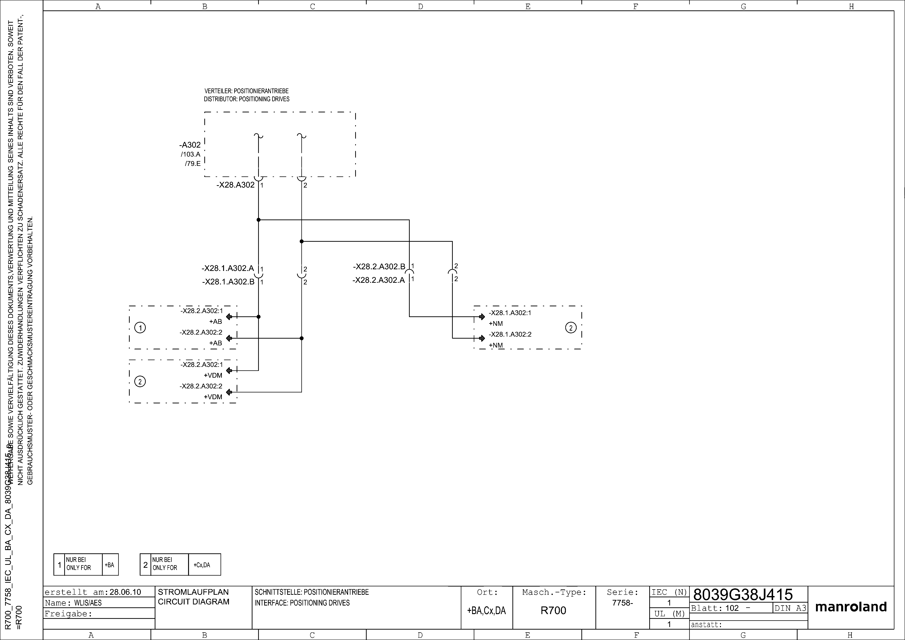

# +BA_Cx_DA — Sheet 102 of 247 — SCHNITTSTELLE: POSITIONIERANTRIEBE

**INTERFACE: POSITIONING DRIVES**

> Part of the manroland **R700** printing press IEC/UL circuit diagrams.
> Drawing class: **Stromlaufplan / Circuit diagram** (DIN A3).
> Document `+BA_Cx_DA` covers the **Printing units / main switch cabinet** machine section.

## At a glance

| Field | Value |
|---|---|
| Document | `+BA_Cx_DA`  (8039G38J415) |
| Sheet | **102** of 247 |
| Section (DE) | SCHNITTSTELLE: POSITIONIERANTRIEBE |
| Section (EN) | INTERFACE: POSITIONING DRIVES |
| Section type | CIRCUIT — Circuit diagram |
| Machine type | `R700` |
| Series | `7758` |
| Created | 28.06.10 |
| Replaces | — |
| Columns used | A, B, C, D, E |
| Path numbers | — |
| Labels on sheet | 43 |
| Cross-refs out | 2 |
| Cross-refs in | 12 |

**Previous:** [+BA_Cx_DA sheet 101](SHEET_0101.md) · **Next:** [+BA_Cx_DA sheet 103](SHEET_0103.md) · **Document TOC:** [_TOC.md](_TOC.md)  (+BA_Cx_DA) · **Master TOC:** [all sheets](../_MASTER_TOC.md)

## Sheet image (300 DPI, exact vector render)



_Rendered directly from the PDF vector layer at 300 DPI (1-bit), no OCR and no resampling. Use it to confirm anything ambiguous in the text below._

## Cross-references on this sheet

Each entry is a wire leaving this sheet. The printed token is `/sheet.column`; the link resolves to that sheet inside the same document.

| Ref | Target sheet | Col | Path | Destination on target | Target section | From col |
|---|---|---|---|---|---|---|
| `/103.A` | [+BA_Cx_DA sheet 103](SHEET_0103.md) | A | — | — | FARBSCHIEBER | B |
| `/79.E` | [+BA_Cx_DA sheet 79](SHEET_0079.md) | E | — | — | FARBWERK | B |

### Incoming references (sheets that point here)

Every other sheet that sends a wire to this one. `Back-ref` is the token printed on *that* sheet; `Path` is its line number.

| From sheet | Cols | Back-ref | Path | Refs | What continues there |
|---|---|---|---|---|---|
| [+BA_Cx_DA#79](SHEET_0079.md) | E | `/79.E` | — | 1 | — |
| [+BA_Cx_DA#103](SHEET_0103.md) | A | `/103.A` | — | 1 | — |
| [+BA_Cx_DA#178](SHEET_0178.md) | B, C, E | `/178.B`, `/178.C`, `/178.E` | — | 10 | — |


## Devices on this sheet

| Tag | Class | Class meaning (IEC) | Col | Sub | Terminal | Sign |
|---|---|---|---|---|---|---|
| `A302` | A | Baugruppe / assembly, module, PC board | B | — | — | — |
| `X28.A302` | — | cross-device reference | B | — | — | — |
| `X28.2.A302:1` | — | cross-device reference | B | — | 1 | — |
| `X28.2.A302:2` | — | cross-device reference | B | — | 2 | — |
| `X28.2.A302:1` | — | cross-device reference | B | — | 1 | — |
| `X28.2.A302:2` | — | cross-device reference | B | — | 2 | — |
| `X28.1.A302:1` | — | cross-device reference | E | — | 1 | — |
| `X28.1.A302:2` | — | cross-device reference | E | — | 2 | — |
| `X28.1.A302.A` | — | cross-device reference | B | — | — | — |
| `X28.1.A302.B` | — | cross-device reference | B | — | — | — |
| `X28.2.A302.B` | — | cross-device reference | D | — | — | — |
| `X28.2.A302.A` | — | cross-device reference | D | — | — | — |

## Potentials / nets

_No named potentials on this sheet._

## Wire-end annotations (grouped as printed)

A wire that continues elsewhere is annotated with a small cluster: the destination description, the path/line number `#NN`, and the `/sheet.column` cross reference. Each row below is one such cluster exactly as it is grouped on the drawing.

| Col | Y | Path | Cross-ref | Text on the wire |
|---|---|---|---|---|
| B | 116.8 | — | — | `DISTRIBUTOR: POSITIONING DRIVES VERTEILER: POSITIONIERANTRIEBE` |
| B | 186.0 | — | — | `A302` |
| B | 199.0 | — | `/103.A` | — |
| B | 211.4 | — | `/79.E` | — |
| C | 238.4 | — | — | `X28.A302 1 2` |
| D | 346.1 | — | — | `X28.2.A302.B 1` |
| D | 346.1 | — | — | `2` |
| B | 348.3 | — | — | `X28.1.A302.A 1` |
| C | 350.4 | — | — | `2` |
| D | 363.2 | — | — | `X28.2.A302.A 1` |
| D | 363.2 | — | — | `2` |
| B | 366.0 | — | — | `X28.1.A302.B 1` |
| C | 367.4 | — | — | `2` |
| B | 404.9 | — | — | `X28.2.A302:1` |
| E | 407.8 | — | — | `X28.1.A302:1` |
| B | 419.1 | — | — | `+AB` |
| E | 422.0 | — | — | `+NM` |
| A | 427.8 | — | — | `1` |
| E | 428.3 | — | — | `2` |
| B | 433.3 | — | — | `X28.2.A302:2` |
| E | 436.1 | — | — | `X28.1.A302:2` |
| B | 447.4 | — | — | `+AB` |
| E | 450.4 | — | — | `+NM` |
| B | 475.8 | — | — | `X28.2.A302:1` |
| B | 490.0 | — | — | `+VDM` |
| A | 499.2 | — | — | `2` |
| B | 504.1 | — | — | `X28.2.A302:2` |
| B | 518.4 | — | — | `+VDM` |
| A | 733.3 | — | — | `1 NUR BEI` |
| A | 733.3 | — | — | `ONLY FOR +BA 2 NUR BEI` |
| B | 740.5 | — | — | `ONLY FOR +Cx,DA` |


## Notes and free text on this sheet

| Text | Col | Y (pt) |
|---|---|---|
| `VERTEILER: POSITIONIERANTRIEBE` | B | 116.84 |
| `DISTRIBUTOR: POSITIONING DRIVES` | B | 127.47 |
| `+AB` | B | 419.07 |
| `+VDM` | B | 490 |
| `+NM` | E | 422 |
| `NUR BEI` | A | 733.33 |
| `ONLY FOR` | A | 744.02 |
| `+BA` | A | 740.44 |
| `NUR BEI` | B | 733.33 |
| `ONLY FOR` | B | 744.02 |
| `+Cx,DA` | B | 740.52 |

## Complete label inventory (exact text from the drawing)

Every text object inside the drawing area of this sheet, in DIN reading order (column A→H, then top→bottom). This is the authoritative list: if a string is not here it is not printed on this sheet.

| Col | Y | X | Dir | Type | Text |
|---|---|---|---|---|---|
| A | 427.8 | 182.5 | → | number | `1` |
| A | 499.2 | 182.3 | → | number | `2` |
| A | 733.3 | 87.0 | → | text | `NUR BEI` |
| A | 738.7 | 75.4 | → | number | `1` |
| A | 738.7 | 188.5 | → | number | `2` |
| A | 740.4 | 137.9 | → | text | `+BA` |
| A | 744.0 | 87.6 | → | text | `ONLY FOR` |
| B | 116.8 | 269.3 | → | text | `VERTEILER: POSITIONIERANTRIEBE` |
| B | 127.5 | 268.4 | → | text | `DISTRIBUTOR: POSITIONING DRIVES` |
| B | 186.0 | 235.8 | → | device tag | `A302` |
| B | 199.0 | 238.1 | → | cross-reference | `/103.A` |
| B | 211.4 | 243.5 | → | cross-reference | `/79.E` |
| B | 238.4 | 284.9 | → | device ref | `X28.A302` |
| B | 348.3 | 265.3 | → | device ref | `X28.1.A302.A` |
| B | 366.0 | 266.2 | → | device ref | `X28.1.A302.B` |
| B | 404.9 | 237.5 | → | device ref | `X28.2.A302:1` |
| B | 419.1 | 275.2 | → | text | `+AB` |
| B | 433.3 | 236.4 | → | device ref | `X28.2.A302:2` |
| B | 447.4 | 275.2 | → | text | `+AB` |
| B | 475.8 | 237.5 | → | device ref | `X28.2.A302:1` |
| B | 490.0 | 268.2 | → | text | `+VDM` |
| B | 504.1 | 236.4 | → | device ref | `X28.2.A302:2` |
| B | 518.3 | 268.2 | → | text | `+VDM` |
| B | 733.3 | 200.4 | → | text | `NUR BEI` |
| B | 740.5 | 254.8 | → | text | `+Cx,DA` |
| B | 744.0 | 201.0 | → | text | `ONLY FOR` |
| C | 239.9 | 342.1 | → | number | `1` |
| C | 239.9 | 399.4 | → | number | `2` |
| C | 350.4 | 342.1 | → | number | `1` |
| C | 350.4 | 399.4 | → | number | `2` |
| C | 367.4 | 342.1 | → | number | `1` |
| C | 367.4 | 399.4 | → | number | `2` |
| D | 346.1 | 464.6 | → | device ref | `X28.2.A302.B` |
| D | 346.2 | 540.6 | → | number | `1` |
| D | 346.2 | 597.8 | → | number | `2` |
| D | 363.2 | 540.6 | → | number | `1` |
| D | 363.2 | 597.8 | → | number | `2` |
| D | 363.9 | 463.7 | → | device ref | `X28.2.A302.A` |
| E | 407.8 | 643.2 | → | device ref | `X28.1.A302:1` |
| E | 422.0 | 643.2 | → | text | `+NM` |
| E | 428.3 | 749.2 | → | number | `2` |
| E | 436.1 | 643.2 | → | device ref | `X28.1.A302:2` |
| E | 450.3 | 643.2 | → | text | `+NM` |

## Reading-order text block

The same content as a plain block, grouped by DIN column — convenient to paste or to match against a visual description.

```text
=== Column A ===
 427.8  182.5  numeric      1
 499.2  182.3  numeric      2
 733.3   87.0  text         NUR BEI
 738.7   75.4  numeric      1
 738.7  188.5  numeric      2
 740.4  137.9  text         +BA
 744.0   87.6  text         ONLY FOR
=== Column B ===
 116.8  269.3  text         VERTEILER: POSITIONIERANTRIEBE
 127.5  268.4  text         DISTRIBUTOR: POSITIONING DRIVES
 186.0  235.8  devtag       A302
 199.0  238.1  xref         /103.A
 211.4  243.5  xref         /79.E
 238.4  284.9  devref       X28.A302
 348.3  265.3  devref       X28.1.A302.A
 366.0  266.2  devref       X28.1.A302.B
 404.9  237.5  devref       X28.2.A302:1
 419.1  275.2  text         +AB
 433.3  236.4  devref       X28.2.A302:2
 447.4  275.2  text         +AB
 475.8  237.5  devref       X28.2.A302:1
 490.0  268.2  text         +VDM
 504.1  236.4  devref       X28.2.A302:2
 518.3  268.2  text         +VDM
 733.3  200.4  text         NUR BEI
 740.5  254.8  text         +Cx,DA
 744.0  201.0  text         ONLY FOR
=== Column C ===
 239.9  342.1  numeric      1
 239.9  399.4  numeric      2
 350.4  342.1  numeric      1
 350.4  399.4  numeric      2
 367.4  342.1  numeric      1
 367.4  399.4  numeric      2
=== Column D ===
 346.1  464.6  devref       X28.2.A302.B
 346.2  540.6  numeric      1
 346.2  597.8  numeric      2
 363.2  540.6  numeric      1
 363.2  597.8  numeric      2
 363.9  463.7  devref       X28.2.A302.A
=== Column E ===
 407.8  643.2  devref       X28.1.A302:1
 422.0  643.2  text         +NM
 428.3  749.2  numeric      2
 436.1  643.2  devref       X28.1.A302:2
 450.3  643.2  text         +NM
```

---
_Generated from the PDF vector text layer; no OCR. Source: `R700_7758_IEC_UL_BA_CX_DA_8039G38J415_p`, sheet 102._
