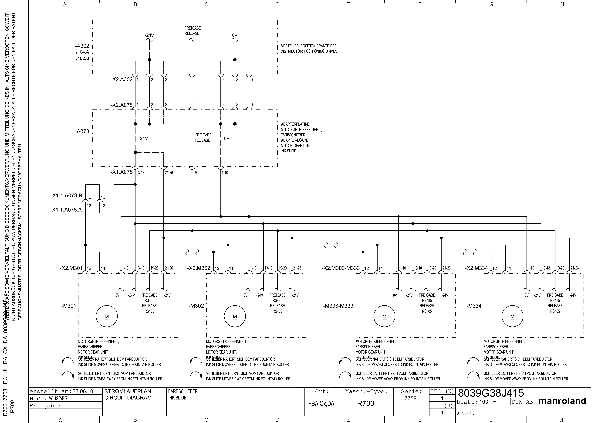

# +BA_Cx_DA — Sheet 103 of 247 — FARBSCHIEBER

**INK SLIDE**

> Part of the manroland **R700** printing press IEC/UL circuit diagrams.
> Drawing class: **Stromlaufplan / Circuit diagram** (DIN A3).
> Document `+BA_Cx_DA` covers the **Printing units / main switch cabinet** machine section.

## At a glance

| Field | Value |
|---|---|
| Document | `+BA_Cx_DA`  (8039G38J415) |
| Sheet | **103** of 247 |
| Section (DE) | FARBSCHIEBER |
| Section (EN) | INK SLIDE |
| Section type | CIRCUIT — Circuit diagram |
| Machine type | `R700` |
| Series | `7758` |
| Created | 28.06.10 |
| Replaces | — |
| Columns used | A, B, C, D, E, F, G, H |
| Path numbers | — |
| Labels on sheet | 143 |
| Cross-refs out | 2 |
| Cross-refs in | 148 |

**Previous:** [+BA_Cx_DA sheet 102](SHEET_0102.md) · **Next:** [+BA_Cx_DA sheet 104](SHEET_0104.md) · **Document TOC:** [_TOC.md](_TOC.md)  (+BA_Cx_DA) · **Master TOC:** [all sheets](../_MASTER_TOC.md)

## Sheet image (300 DPI, exact vector render)



_Rendered directly from the PDF vector layer at 300 DPI (1-bit), no OCR and no resampling. Use it to confirm anything ambiguous in the text below._

## Cross-references on this sheet

Each entry is a wire leaving this sheet. The printed token is `/sheet.column`; the link resolves to that sheet inside the same document.

| Ref | Target sheet | Col | Path | Destination on target | Target section | From col |
|---|---|---|---|---|---|---|
| `/104.A` | [+BA_Cx_DA sheet 104](SHEET_0104.md) | A | — | — | MOTOR: UMFANGSREGISTER | A |
| `/102.B` | [+BA_Cx_DA sheet 102](SHEET_0102.md) | B | — | — | SCHNITTSTELLE: POSITIONIERANTRIEBE | A |

### Incoming references (sheets that point here)

Every other sheet that sends a wire to this one. `Back-ref` is the token printed on *that* sheet; `Path` is its line number.

| From sheet | Cols | Back-ref | Path | Refs | What continues there |
|---|---|---|---|---|---|
| [+BA_Cx_DA#102](SHEET_0102.md) | B | `/102.B` | — | 1 | — |
| [+BA_Cx_DA#104](SHEET_0104.md) | A | `/104.A` | — | 1 | — |
| [+BA_Cx_DA#139](SHEET_0139.md) | H | `/139.H` | — | 24 | — |
| [+BA_Cx_DA#140](SHEET_0140.md) | A, B | `/140.A`, `/140.B` | — | 4 | — |
| [+BA_Cx_DA#151](SHEET_0151.md) | F | `/151.F` | — | 7 | — |
| [+BA_Cx_DA#152](SHEET_0152.md) | H | `/152.H` | — | 7 | — |
| [+BA_Cx_DA#154](SHEET_0154.md) | G, H | `/154.G`, `/154.H` | — | 52 | — |
| [+BA_Cx_DA#155](SHEET_0155.md) | A, B | `/155.A`, `/155.B` | — | 52 | — |


## Devices on this sheet

| Tag | Class | Class meaning (IEC) | Col | Sub | Terminal | Sign |
|---|---|---|---|---|---|---|
| `A078` | A | Baugruppe / assembly, module, PC board | A | — | — | — |
| `A302` | A | Baugruppe / assembly, module, PC board | A | — | — | — |
| `RS485` | RS |  | B | — | — | — |
| `RS485` | RS |  | B | — | — | — |
| `RS485` | RS |  | H | — | — | — |
| `RS485` | RS |  | H | — | — | — |
| `RS485` | RS |  | F | — | — | — |
| `RS485` | RS |  | F | — | — | — |
| `RS485` | RS |  | D | — | — | — |
| `RS485` | RS |  | D | — | — | — |
| `X2.A302` | — | cross-device reference | B | — | — | — |
| `X2.A078` | — | cross-device reference | B | — | — | — |
| `X1.A078` | — | cross-device reference | B | — | — | — |
| `X1.1.A078.B` | — | cross-device reference | A | — | — | — |
| `X1.1.A078.A` | — | cross-device reference | A | — | — | — |
| `X2.M301` | — | cross-device reference | A | — | — | — |
| `X2.M302` | — | cross-device reference | C | — | — | — |
| `X2.M334` | — | cross-device reference | G | — | — | — |

## Potentials / nets

| Potential | Count | Columns | Attached devices | Terminals |
|---|---|---|---|---|
| `0V` | 6 | B, C, D, F, G | — | — |
| `24V` | 10 | B, D, F, H | — | — |
| `M301` | 1 | A | — | — |
| `M302` | 1 | C | — | — |
| `M334` | 1 | G | — | — |


A potential such as `L24+/4` or `M24+` is a named supply/return rail; every place it appears on this sheet is electrically common.

## Wire-end annotations (grouped as printed)

A wire that continues elsewhere is annotated with a small cluster: the destination description, the path/line number `#NN`, and the `/sheet.column` cross reference. Each row below is one such cluster exactly as it is grouped on the drawing.

| Col | Y | Path | Cross-ref | Text on the wire |
|---|---|---|---|---|
| C | 53.0 | — | — | `FREIGABE RELEASE 0V` |
| B | 66.2 | — | — | `24V` |
| A | 86.8 | — | — | `A302` |
| D | 88.5 | — | — | `DISTRIBUTOR: POSITIONING DRIVES VERTEILER: POSITIONIERANTRIEBE` |
| A | 99.8 | — | `/104.A`, `/102.B` | — |
| C | 153.4 | — | — | `X2.A302 1 2 3 4 7 8 9` |
| B | 204.4 | — | — | `X2.A078 1 2 3` |
| C | 204.4 | — | — | `4` |
| C | 204.4 | — | — | `7 8 9` |
| D | 244.4 | — | — | `FARBSCHIEBER MOTORGETRIEBEEINHEIT, ADAPTERPLATINE:` |
| A | 256.8 | — | — | `A078` |
| C | 265.6 | — | — | `FREIGABE RELEASE` |
| C | 271.7 | — | — | `24V 0V` |
| D | 276.3 | — | — | `INK SLIDE MOTOR GEAR UNIT, ADAPTER BOARD:` |
| B | 337.6 | — | — | `X1.A078` |
| B | 340.8 | — | — | `13 18 21 26 19 20` |
| C | 340.8 | — | — | `1 10` |
| A | 384.4 | — | — | `X1.1.A078.B 12 13` |
| A | 405.7 | — | — | `X1.1.A078.A 12` |
| B | 405.7 | — | — | `13` |
| A | 529.0 | — | — | `X2.M301 12 11` |
| E | 529.0 | — | — | `X2.M302 12 11 X2.M303 M333 12 11 X2.M334 12 11` |
| B | 530.7 | — | — | `1 10 13 18 19 20 21 26` |
| D | 530.7 | — | — | `1 10 13 18 19 20 21 26` |
| F | 530.7 | — | — | `1 10 13 18 19 20 21 26` |
| H | 530.7 | — | — | `1 10 13 18 19 20 21 26` |
| B | 584.5 | — | — | `0V 24V 24V` |
| B | 584.5 | — | — | `FREIGABE` |
| D | 584.5 | — | — | `0V 24V 24V` |
| D | 584.5 | — | — | `FREIGABE` |
| F | 584.5 | — | — | `0V 24V 24V` |
| F | 584.5 | — | — | `FREIGABE` |
| H | 584.5 | — | — | `0V 24V 24V` |
| H | 584.5 | — | — | `FREIGABE` |
| B | 595.2 | — | — | `RELEASE RS485` |
| D | 595.2 | — | — | `RELEASE RS485` |
| F | 595.2 | — | — | `RELEASE RS485` |
| H | 595.2 | — | — | `RELEASE RS485` |
| A | 604.1 | — | — | `M301` |
| C | 604.1 | — | — | `M302` |
| E | 604.1 | — | — | `M303 M333` |
| G | 604.1 | — | — | `M334` |
| B | 616.5 | — | — | `RS485` |
| D | 616.5 | — | — | `RS485` |
| F | 616.5 | — | — | `RS485` |
| H | 616.5 | — | — | `RS485` |
| B | 625.6 | — | — | `M` |
| C | 625.6 | — | — | `M` |
| F | 625.6 | — | — | `M M` |
| A | 676.7 | — | — | `FARBSCHIEBER INK SLIDE MOTORGETRIEBEEINHEIT, MOTOR GEAR UNIT,` |
| C | 676.7 | — | — | `FARBSCHIEBER INK SLIDE MOTORGETRIEBEEINHEIT, MOTOR GEAR UNIT,` |
| E | 676.7 | — | — | `FARBSCHIEBER INK SLIDE MOTORGETRIEBEEINHEIT, MOTOR GEAR UNIT,` |
| G | 676.7 | — | — | `FARBSCHIEBER INK SLIDE MOTORGETRIEBEEINHEIT, MOTOR GEAR UNIT,` |
| B | 712.1 | — | — | `INK SLIDE MOVES CLOSER TO INK FOUNTAIN ROLLER SCHIEBER NÄHERT SICH DEM FARBDUKTOR` |
| D | 712.1 | — | — | `INK SLIDE MOVES CLOSER TO INK FOUNTAIN ROLLER SCHIEBER NÄHERT SICH DEM FARBDUKTOR` |
| F | 712.1 | — | — | `INK SLIDE MOVES CLOSER TO INK FOUNTAIN ROLLER SCHIEBER NÄHERT SICH DEM FARBDUKTOR` |
| G | 712.1 | — | — | `INK SLIDE MOVES CLOSER TO INK FOUNTAIN ROLLER SCHIEBER NÄHERT SICH DEM FARBDUKTOR` |
| B | 740.5 | — | — | `INK SLIDE MOVES AWAY FROM INK FOUNTAIN ROLLER SCHIEBER ENTFERNT SICH VOM FARBDUKTOR` |
| D | 740.5 | — | — | `INK SLIDE MOVES AWAY FROM INK FOUNTAIN ROLLER SCHIEBER ENTFERNT SICH VOM FARBDUKTOR` |
| F | 740.5 | — | — | `INK SLIDE MOVES AWAY FROM INK FOUNTAIN ROLLER SCHIEBER ENTFERNT SICH VOM FARBDUKTOR` |
| G | 740.5 | — | — | `INK SLIDE MOVES AWAY FROM INK FOUNTAIN ROLLER SCHIEBER ENTFERNT SICH VOM FARBDUKTOR` |


## Reconstructed tables

This sheet carries tabular content (pin map / terminal assignment / index). The grid below was rebuilt from the drawing's own rule lines, so each row is exactly one physical row of the table.

### Table 1 — 2 data rows × 5 columns (at x=240.9, y=119.1)

| X2.A302 X2.A078 | 1 1 | 2 2 | 3 3 | 4 4 |
|---|---|---|---|---|
|  | `24V` |  |  | `FREIGABE RELEASE` |
| `X1.A078` | `13 18` |  | `21 26` | `19 20` |


### Table 2 — 3 data rows × 1 columns (at x=439.4, y=119.1)

| C1 |
|---|
| `7 7` |
| `0V` |
| `1 10` |


## Notes and free text on this sheet

| Text | Col | Y (pt) |
|---|---|---|
| `ADAPTERPLATINE:` | D | 244.39 |
| `MOTORGETRIEBEEINHEIT,` | D | 255.03 |
| `FARBSCHIEBER` | D | 265.66 |
| `ADAPTER BOARD:` | D | 276.3 |
| `MOTOR GEAR UNIT,` | D | 286.94 |
| `INK SLIDE` | D | 297.52 |
| `VERTEILER: POSITIONIERANTRIEBE` | D | 88.49 |
| `DISTRIBUTOR: POSITIONING DRIVES` | D | 99.12 |
| `MOTORGETRIEBEEINHEIT,` | A | 676.68 |
| `FARBSCHIEBER` | A | 687.31 |
| `MOTOR GEAR UNIT,` | A | 697.95 |
| `INK SLIDE` | A | 708.54 |
| `MOTORGETRIEBEEINHEIT,` | G | 676.68 |
| `FARBSCHIEBER` | G | 687.31 |
| `MOTOR GEAR UNIT,` | G | 697.95 |
| `INK SLIDE` | G | 708.54 |
| `M303 M333` | E | 604.09 |
| `MOTORGETRIEBEEINHEIT,` | E | 676.68 |
| `FARBSCHIEBER` | E | 687.31 |
| `MOTOR GEAR UNIT,` | E | 697.95 |
| `INK SLIDE` | E | 708.54 |
| `MOTORGETRIEBEEINHEIT,` | C | 676.68 |
| `FARBSCHIEBER` | C | 687.31 |
| `MOTOR GEAR UNIT,` | C | 697.95 |
| `INK SLIDE` | C | 708.54 |
| `X2.M303 M333` | E | 528.97 |
| `FREIGABE` | C | 53.02 |
| `RELEASE` | C | 63.65 |
| `FREIGABE` | B | 584.52 |
| `RELEASE` | B | 605.78 |
| `SCHIEBER NÄHERT SICH DEM FARBDUKTOR` | B | 712.13 |
| `INK SLIDE MOVES CLOSER TO INK FOUNTAIN ROLLER` | B | 722.76 |
| `SCHIEBER ENTFERNT SICH VOM FARBDUKTOR` | B | 740.48 |
| `INK SLIDE MOVES AWAY FROM INK FOUNTAIN ROLLER` | B | 751.09 |
| `M` | B | 625.62 |
| `FREIGABE` | H | 584.52 |
| `RELEASE` | H | 605.78 |
| `SCHIEBER NÄHERT SICH DEM FARBDUKTOR` | G | 712.13 |
| `INK SLIDE MOVES CLOSER TO INK FOUNTAIN ROLLER` | G | 722.76 |
| `SCHIEBER ENTFERNT SICH VOM FARBDUKTOR` | G | 740.48 |
| `INK SLIDE MOVES AWAY FROM INK FOUNTAIN ROLLER` | G | 751.09 |
| `FREIGABE` | F | 584.52 |
| `RELEASE` | F | 605.78 |
| `FREIGABE` | D | 584.52 |
| `RELEASE` | D | 605.78 |
| `M` | C | 625.62 |
| `SCHIEBER NÄHERT SICH DEM FARBDUKTOR` | C | 712.13 |
| `INK SLIDE MOVES CLOSER TO INK FOUNTAIN ROLLER` | D | 722.76 |
| `SCHIEBER ENTFERNT SICH VOM FARBDUKTOR` | D | 740.48 |
| `INK SLIDE MOVES AWAY FROM INK FOUNTAIN ROLLER` | D | 751.09 |
| `SCHIEBER NÄHERT SICH DEM FARBDUKTOR` | F | 712.13 |
| `INK SLIDE MOVES CLOSER TO INK FOUNTAIN ROLLER` | F | 722.76 |
| `SCHIEBER ENTFERNT SICH VOM FARBDUKTOR` | F | 740.48 |
| `INK SLIDE MOVES AWAY FROM INK FOUNTAIN ROLLER` | F | 751.09 |
| `M` | F | 625.62 |
| `M` | G | 625.62 |

## Complete label inventory (exact text from the drawing)

Every text object inside the drawing area of this sheet, in DIN reading order (column A→H, then top→bottom). This is the authoritative list: if a string is not here it is not printed on this sheet.

| Col | Y | X | Dir | Type | Text |
|---|---|---|---|---|---|
| A | 86.8 | 149.4 | → | device tag | `A302` |
| A | 99.8 | 151.7 | → | cross-reference | `/104.A` |
| A | 112.2 | 151.9 | → | cross-reference | `/102.B` |
| A | 256.8 | 149.4 | → | device tag | `A078` |
| A | 384.4 | 100.6 | → | device ref | `X1.1.A078.B` |
| A | 388.7 | 172.1 | → | number | `12` |
| A | 405.7 | 172.1 | → | number | `12` |
| A | 412.8 | 99.8 | → | device ref | `X1.1.A078.A` |
| A | 529.0 | 119.1 | → | device ref | `X2.M301` |
| A | 530.4 | 172.1 | → | number | `12` |
| A | 604.1 | 122.2 | → | potential | `M301` |
| A | 676.7 | 155.3 | → | text | `MOTORGETRIEBEEINHEIT,` |
| A | 687.3 | 155.1 | → | text | `FARBSCHIEBER` |
| A | 698.0 | 155.3 | → | text | `MOTOR GEAR UNIT,` |
| A | 708.5 | 155.1 | → | text | `INK SLIDE` |
| B | 66.2 | 288.3 | → | potential | `24V` |
| B | 153.4 | 220.0 | → | device ref | `X2.A302` |
| B | 154.8 | 271.3 | → | number | `1` |
| B | 154.8 | 300.2 | → | number | `2` |
| B | 154.8 | 328.5 | → | number | `3` |
| B | 204.4 | 220.0 | → | device ref | `X2.A078` |
| B | 204.4 | 271.3 | → | number | `1` |
| B | 204.4 | 300.2 | → | number | `2` |
| B | 204.4 | 328.5 | → | number | `3` |
| B | 271.7 | 276.1 | → | potential | `24V` |
| B | 337.6 | 220.0 | → | device ref | `X1.A078` |
| B | 340.8 | 271.3 | → | number | `13 18` |
| B | 340.8 | 328.5 | → | number | `21 26` |
| B | 388.7 | 200.4 | → | number | `13` |
| B | 405.7 | 200.4 | → | number | `13` |
| B | 530.4 | 200.4 | → | number | `11` |
| B | 530.7 | 242.9 | → | number | `1 10` |
| B | 530.7 | 271.3 | → | number | `13 18` |
| B | 530.7 | 299.6 | → | number | `19 20` |
| B | 530.7 | 328.5 | → | number | `21 26` |
| B | 584.5 | 229.9 | → | potential | `0V` |
| B | 584.5 | 281.4 | → | text | `FREIGABE` |
| B | 584.6 | 255.5 | → | potential | `24V` |
| B | 584.6 | 326.3 | → | potential | `24V` |
| B | 595.2 | 287.7 | → | device tag | `RS485` |
| B | 605.8 | 282.8 | → | text | `RELEASE` |
| B | 616.4 | 287.7 | → | device tag | `RS485` |
| B | 625.6 | 208.5 | → | text | `M` |
| B | 712.1 | 155.6 | → | text | `SCHIEBER NÄHERT SICH DEM FARBDUKTOR` |
| B | 722.8 | 155.1 | → | text | `INK SLIDE MOVES CLOSER TO INK FOUNTAIN ROLLER` |
| B | 740.5 | 155.6 | → | text | `SCHIEBER ENTFERNT SICH VOM FARBDUKTOR` |
| B | 751.1 | 155.1 | → | text | `INK SLIDE MOVES AWAY FROM INK FOUNTAIN ROLLER` |
| C | 53.0 | 367.7 | → | text | `FREIGABE` |
| C | 63.7 | 367.7 | → | text | `RELEASE` |
| C | 66.2 | 462.2 | → | potential | `0V` |
| C | 154.8 | 385.2 | → | number | `4` |
| C | 154.8 | 441.9 | → | number | `7` |
| C | 154.8 | 470.3 | → | number | `8` |
| C | 204.4 | 385.2 | → | number | `4` |
| C | 204.4 | 441.9 | → | number | `7` |
| C | 204.4 | 470.3 | → | number | `8` |
| C | 265.6 | 388.9 | → | text | `FREIGABE` |
| C | 271.7 | 446.2 | → | potential | `0V` |
| C | 276.3 | 388.9 | → | text | `RELEASE` |
| C | 340.8 | 384.7 | → | number | `19 20` |
| C | 340.8 | 441.4 | → | number | `1 10` |
| C | 529.0 | 372.8 | → | device ref | `X2.M302` |
| C | 530.4 | 427.2 | → | number | `12` |
| C | 530.4 | 455.5 | → | number | `11` |
| C | 604.1 | 375.9 | → | potential | `M302` |
| C | 625.6 | 463.6 | → | text | `M` |
| C | 676.7 | 410.5 | → | text | `MOTORGETRIEBEEINHEIT,` |
| C | 687.3 | 410.2 | → | text | `FARBSCHIEBER` |
| C | 698.0 | 410.5 | → | text | `MOTOR GEAR UNIT,` |
| C | 708.5 | 410.2 | → | text | `INK SLIDE` |
| C | 712.1 | 410.7 | → | text | `SCHIEBER NÄHERT SICH DEM FARBDUKTOR` |
| D | 88.5 | 559.8 | → | text | `VERTEILER: POSITIONIERANTRIEBE` |
| D | 99.1 | 559.0 | → | text | `DISTRIBUTOR: POSITIONING DRIVES` |
| D | 154.8 | 498.6 | → | number | `9` |
| D | 204.4 | 498.6 | → | number | `9` |
| D | 244.4 | 559.8 | → | text | `ADAPTERPLATINE:` |
| D | 255.0 | 559.3 | → | text | `MOTORGETRIEBEEINHEIT,` |
| D | 265.7 | 559.0 | → | text | `FARBSCHIEBER` |
| D | 276.3 | 559.8 | → | text | `ADAPTER BOARD:` |
| D | 286.9 | 559.3 | → | text | `MOTOR GEAR UNIT,` |
| D | 297.5 | 559.0 | → | text | `INK SLIDE` |
| D | 530.7 | 498.0 | → | number | `1 10` |
| D | 530.7 | 526.4 | → | number | `13 18` |
| D | 530.7 | 554.7 | → | number | `19 20` |
| D | 530.7 | 583.7 | → | number | `21 26` |
| D | 584.5 | 485.0 | → | potential | `0V` |
| D | 584.5 | 536.5 | → | text | `FREIGABE` |
| D | 584.6 | 510.6 | → | potential | `24V` |
| D | 584.6 | 581.5 | → | potential | `24V` |
| D | 595.2 | 542.8 | → | device tag | `RS485` |
| D | 605.8 | 537.9 | → | text | `RELEASE` |
| D | 616.4 | 542.8 | → | device tag | `RS485` |
| D | 722.8 | 410.2 | → | text | `INK SLIDE MOVES CLOSER TO INK FOUNTAIN ROLLER` |
| D | 740.5 | 410.7 | → | text | `SCHIEBER ENTFERNT SICH VOM FARBDUKTOR` |
| D | 751.1 | 410.2 | → | text | `INK SLIDE MOVES AWAY FROM INK FOUNTAIN ROLLER` |
| E | 529.0 | 640.3 | → | text | `X2.M303 M333` |
| E | 530.4 | 724.8 | → | number | `12` |
| E | 530.4 | 753.2 | → | number | `11` |
| E | 604.1 | 643.5 | → | text | `M303 M333` |
| E | 676.7 | 708.1 | → | text | `MOTORGETRIEBEEINHEIT,` |
| E | 687.3 | 707.8 | → | text | `FARBSCHIEBER` |
| E | 698.0 | 708.1 | → | text | `MOTOR GEAR UNIT,` |
| E | 708.5 | 707.8 | → | text | `INK SLIDE` |
| F | 530.7 | 795.7 | → | number | `1 10` |
| F | 530.7 | 824.0 | → | number | `13 18` |
| F | 530.7 | 852.4 | → | number | `19 20` |
| F | 530.7 | 881.3 | → | number | `21 26` |
| F | 584.5 | 782.6 | → | potential | `0V` |
| F | 584.5 | 834.1 | → | text | `FREIGABE` |
| F | 584.6 | 808.2 | → | potential | `24V` |
| F | 584.6 | 879.1 | → | potential | `24V` |
| F | 595.2 | 840.5 | → | device tag | `RS485` |
| F | 605.8 | 835.6 | → | text | `RELEASE` |
| F | 616.4 | 840.5 | → | device tag | `RS485` |
| F | 625.6 | 761.2 | → | text | `M` |
| F | 712.1 | 708.4 | → | text | `SCHIEBER NÄHERT SICH DEM FARBDUKTOR` |
| F | 722.8 | 707.8 | → | text | `INK SLIDE MOVES CLOSER TO INK FOUNTAIN ROLLER` |
| F | 740.5 | 708.4 | → | text | `SCHIEBER ENTFERNT SICH VOM FARBDUKTOR` |
| F | 751.1 | 707.8 | → | text | `INK SLIDE MOVES AWAY FROM INK FOUNTAIN ROLLER` |
| G | 529.0 | 925.5 | → | device ref | `X2.M334` |
| G | 530.4 | 979.9 | → | number | `12` |
| G | 530.4 | 1008.3 | → | number | `11` |
| G | 584.5 | 1044.8 | → | potential | `0V` |
| G | 604.1 | 928.6 | → | potential | `M334` |
| G | 625.6 | 1016.4 | → | text | `M` |
| G | 676.7 | 963.2 | → | text | `MOTORGETRIEBEEINHEIT,` |
| G | 687.3 | 962.9 | → | text | `FARBSCHIEBER` |
| G | 698.0 | 963.2 | → | text | `MOTOR GEAR UNIT,` |
| G | 708.5 | 962.9 | → | text | `INK SLIDE` |
| G | 712.1 | 963.5 | → | text | `SCHIEBER NÄHERT SICH DEM FARBDUKTOR` |
| G | 722.8 | 962.9 | → | text | `INK SLIDE MOVES CLOSER TO INK FOUNTAIN ROLLER` |
| G | 740.5 | 963.5 | → | text | `SCHIEBER ENTFERNT SICH VOM FARBDUKTOR` |
| G | 751.1 | 962.9 | → | text | `INK SLIDE MOVES AWAY FROM INK FOUNTAIN ROLLER` |
| H | 530.7 | 1050.8 | → | number | `1 10` |
| H | 530.7 | 1079.1 | → | number | `13 18` |
| H | 530.7 | 1107.5 | → | number | `19 20` |
| H | 530.7 | 1136.4 | → | number | `21 26` |
| H | 584.5 | 1089.3 | → | text | `FREIGABE` |
| H | 584.6 | 1063.4 | → | potential | `24V` |
| H | 584.6 | 1134.2 | → | potential | `24V` |
| H | 595.2 | 1095.6 | → | device tag | `RS485` |
| H | 605.8 | 1090.7 | → | text | `RELEASE` |
| H | 616.4 | 1095.6 | → | device tag | `RS485` |

## Reading-order text block

The same content as a plain block, grouped by DIN column — convenient to paste or to match against a visual description.

```text
=== Column A ===
  86.8  149.4  devtag       A302
  99.8  151.7  xref         /104.A
 112.2  151.9  xref         /102.B
 256.8  149.4  devtag       A078
 384.4  100.6  devref       X1.1.A078.B
 388.7  172.1  numeric      12
 405.7  172.1  numeric      12
 412.8   99.8  devref       X1.1.A078.A
 529.0  119.1  devref       X2.M301
 530.4  172.1  numeric      12
 604.1  122.2  net          M301
 676.7  155.3  text         MOTORGETRIEBEEINHEIT,
 687.3  155.1  text         FARBSCHIEBER
 698.0  155.3  text         MOTOR GEAR UNIT,
 708.5  155.1  text         INK SLIDE
=== Column B ===
  66.2  288.3  net          24V
 153.4  220.0  devref       X2.A302
 154.8  271.3  numeric      1
 154.8  300.2  numeric      2
 154.8  328.5  numeric      3
 204.4  220.0  devref       X2.A078
 204.4  271.3  numeric      1
 204.4  300.2  numeric      2
 204.4  328.5  numeric      3
 271.7  276.1  net          24V
 337.6  220.0  devref       X1.A078
 340.8  271.3  numeric      13 18
 340.8  328.5  numeric      21 26
 388.7  200.4  numeric      13
 405.7  200.4  numeric      13
 530.4  200.4  numeric      11
 530.7  242.9  numeric      1 10
 530.7  271.3  numeric      13 18
 530.7  299.6  numeric      19 20
 530.7  328.5  numeric      21 26
 584.5  229.9  net          0V
 584.5  281.4  text         FREIGABE
 584.6  255.5  net          24V
 584.6  326.3  net          24V
 595.2  287.7  devtag       RS485
 605.8  282.8  text         RELEASE
 616.4  287.7  devtag       RS485
 625.6  208.5  text         M
 712.1  155.6  text         SCHIEBER NÄHERT SICH DEM FARBDUKTOR
 722.8  155.1  text         INK SLIDE MOVES CLOSER TO INK FOUNTAIN ROLLER
 740.5  155.6  text         SCHIEBER ENTFERNT SICH VOM FARBDUKTOR
 751.1  155.1  text         INK SLIDE MOVES AWAY FROM INK FOUNTAIN ROLLER
=== Column C ===
  53.0  367.7  text         FREIGABE
  63.7  367.7  text         RELEASE
  66.2  462.2  net          0V
 154.8  385.2  numeric      4
 154.8  441.9  numeric      7
 154.8  470.3  numeric      8
 204.4  385.2  numeric      4
 204.4  441.9  numeric      7
 204.4  470.3  numeric      8
 265.6  388.9  text         FREIGABE
 271.7  446.2  net          0V
 276.3  388.9  text         RELEASE
 340.8  384.7  numeric      19 20
 340.8  441.4  numeric      1 10
 529.0  372.8  devref       X2.M302
 530.4  427.2  numeric      12
 530.4  455.5  numeric      11
 604.1  375.9  net          M302
 625.6  463.6  text         M
 676.7  410.5  text         MOTORGETRIEBEEINHEIT,
 687.3  410.2  text         FARBSCHIEBER
 698.0  410.5  text         MOTOR GEAR UNIT,
 708.5  410.2  text         INK SLIDE
 712.1  410.7  text         SCHIEBER NÄHERT SICH DEM FARBDUKTOR
=== Column D ===
  88.5  559.8  text         VERTEILER: POSITIONIERANTRIEBE
  99.1  559.0  text         DISTRIBUTOR: POSITIONING DRIVES
 154.8  498.6  numeric      9
 204.4  498.6  numeric      9
 244.4  559.8  text         ADAPTERPLATINE:
 255.0  559.3  text         MOTORGETRIEBEEINHEIT,
 265.7  559.0  text         FARBSCHIEBER
 276.3  559.8  text         ADAPTER BOARD:
 286.9  559.3  text         MOTOR GEAR UNIT,
 297.5  559.0  text         INK SLIDE
 530.7  498.0  numeric      1 10
 530.7  526.4  numeric      13 18
 530.7  554.7  numeric      19 20
 530.7  583.7  numeric      21 26
 584.5  485.0  net          0V
 584.5  536.5  text         FREIGABE
 584.6  510.6  net          24V
 584.6  581.5  net          24V
 595.2  542.8  devtag       RS485
 605.8  537.9  text         RELEASE
 616.4  542.8  devtag       RS485
 722.8  410.2  text         INK SLIDE MOVES CLOSER TO INK FOUNTAIN ROLLER
 740.5  410.7  text         SCHIEBER ENTFERNT SICH VOM FARBDUKTOR
 751.1  410.2  text         INK SLIDE MOVES AWAY FROM INK FOUNTAIN ROLLER
=== Column E ===
 529.0  640.3  text         X2.M303 M333
 530.4  724.8  numeric      12
 530.4  753.2  numeric      11
 604.1  643.5  text         M303 M333
 676.7  708.1  text         MOTORGETRIEBEEINHEIT,
 687.3  707.8  text         FARBSCHIEBER
 698.0  708.1  text         MOTOR GEAR UNIT,
 708.5  707.8  text         INK SLIDE
=== Column F ===
 530.7  795.7  numeric      1 10
 530.7  824.0  numeric      13 18
 530.7  852.4  numeric      19 20
 530.7  881.3  numeric      21 26
 584.5  782.6  net          0V
 584.5  834.1  text         FREIGABE
 584.6  808.2  net          24V
 584.6  879.1  net          24V
 595.2  840.5  devtag       RS485
 605.8  835.6  text         RELEASE
 616.4  840.5  devtag       RS485
 625.6  761.2  text         M
 712.1  708.4  text         SCHIEBER NÄHERT SICH DEM FARBDUKTOR
 722.8  707.8  text         INK SLIDE MOVES CLOSER TO INK FOUNTAIN ROLLER
 740.5  708.4  text         SCHIEBER ENTFERNT SICH VOM FARBDUKTOR
 751.1  707.8  text         INK SLIDE MOVES AWAY FROM INK FOUNTAIN ROLLER
=== Column G ===
 529.0  925.5  devref       X2.M334
 530.4  979.9  numeric      12
 530.4 1008.3  numeric      11
 584.5 1044.8  net          0V
 604.1  928.6  net          M334
 625.6 1016.4  text         M
 676.7  963.2  text         MOTORGETRIEBEEINHEIT,
 687.3  962.9  text         FARBSCHIEBER
 698.0  963.2  text         MOTOR GEAR UNIT,
 708.5  962.9  text         INK SLIDE
 712.1  963.5  text         SCHIEBER NÄHERT SICH DEM FARBDUKTOR
 722.8  962.9  text         INK SLIDE MOVES CLOSER TO INK FOUNTAIN ROLLER
 740.5  963.5  text         SCHIEBER ENTFERNT SICH VOM FARBDUKTOR
 751.1  962.9  text         INK SLIDE MOVES AWAY FROM INK FOUNTAIN ROLLER
=== Column H ===
 530.7 1050.8  numeric      1 10
 530.7 1079.1  numeric      13 18
 530.7 1107.5  numeric      19 20
 530.7 1136.4  numeric      21 26
 584.5 1089.3  text         FREIGABE
 584.6 1063.4  net          24V
 584.6 1134.2  net          24V
 595.2 1095.6  devtag       RS485
 605.8 1090.7  text         RELEASE
 616.4 1095.6  devtag       RS485
```

---
_Generated from the PDF vector text layer; no OCR. Source: `R700_7758_IEC_UL_BA_CX_DA_8039G38J415_p`, sheet 103._
