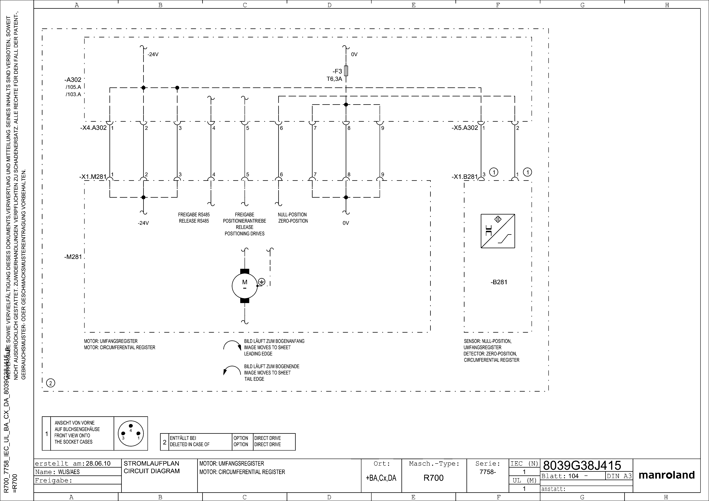

# +BA_Cx_DA — Sheet 104 of 247 — MOTOR: UMFANGSREGISTER

**MOTOR: CIRCUMFERENTIAL REGISTER**

> Part of the manroland **R700** printing press IEC/UL circuit diagrams.
> Drawing class: **Stromlaufplan / Circuit diagram** (DIN A3).
> Document `+BA_Cx_DA` covers the **Printing units / main switch cabinet** machine section.

## At a glance

| Field | Value |
|---|---|
| Document | `+BA_Cx_DA`  (8039G38J415) |
| Sheet | **104** of 247 |
| Section (DE) | MOTOR: UMFANGSREGISTER |
| Section (EN) | MOTOR: CIRCUMFERENTIAL REGISTER |
| Section type | CIRCUIT — Circuit diagram |
| Machine type | `R700` |
| Series | `7758` |
| Created | 28.06.10 |
| Replaces | — |
| Columns used | A, B, C, D, E, F |
| Path numbers | — |
| Labels on sheet | 76 |
| Cross-refs out | 2 |
| Cross-refs in | 24 |

**Previous:** [+BA_Cx_DA sheet 103](SHEET_0103.md) · **Next:** [+BA_Cx_DA sheet 105](SHEET_0105.md) · **Document TOC:** [_TOC.md](_TOC.md)  (+BA_Cx_DA) · **Master TOC:** [all sheets](../_MASTER_TOC.md)

## Sheet image (300 DPI, exact vector render)



_Rendered directly from the PDF vector layer at 300 DPI (1-bit), no OCR and no resampling. Use it to confirm anything ambiguous in the text below._

## Cross-references on this sheet

Each entry is a wire leaving this sheet. The printed token is `/sheet.column`; the link resolves to that sheet inside the same document.

| Ref | Target sheet | Col | Path | Destination on target | Target section | From col |
|---|---|---|---|---|---|---|
| `/105.A` | [+BA_Cx_DA sheet 105](SHEET_0105.md) | A | — | — | MOTOR: SEITENREGISTER | A |
| `/103.A` | [+BA_Cx_DA sheet 103](SHEET_0103.md) | A | — | — | FARBSCHIEBER | A |

### Incoming references (sheets that point here)

Every other sheet that sends a wire to this one. `Back-ref` is the token printed on *that* sheet; `Path` is its line number.

| From sheet | Cols | Back-ref | Path | Refs | What continues there |
|---|---|---|---|---|---|
| [+BA_Cx_DA#103](SHEET_0103.md) | A | `/103.A` | — | 1 | — |
| [+BA_Cx_DA#105](SHEET_0105.md) | A | `/105.A` | — | 1 | — |
| [+BA_Cx_DA#145](SHEET_0145.md) | G | `/145.G` | — | 2 | — |
| [+BA_Cx_DA#147](SHEET_0147.md) | H | `/147.H` | — | 9 | — |
| [+BA_Cx_DA#158](SHEET_0158.md) | H | `/158.H` | — | 9 | — |
| [+BA_Cx_DA#160](SHEET_0160.md) | H | `/160.H` | — | 2 | — |


## Devices on this sheet

| Tag | Class | Class meaning (IEC) | Col | Sub | Terminal | Sign |
|---|---|---|---|---|---|---|
| `B281` | B | Umformer / transducer, sensor | F | — | — | — |
| `A302` | A | Baugruppe / assembly, module, PC board | A | — | — | — |
| `F3` | F | Schutz / protection device (fuse, circuit breaker) | D | — | — | — |
| `X4.A302` | — | cross-device reference | A | — | — | — |
| `X1.M281` | — | cross-device reference | A | — | — | — |
| `X5.A302` | — | cross-device reference | F | — | — | — |
| `X1.B281` | — | cross-device reference | F | — | — | — |

## Potentials / nets

| Potential | Count | Columns | Attached devices | Terminals |
|---|---|---|---|---|
| `0V` | 2 | D | — | — |
| `24V` | 2 | B | — | — |
| `M281` | 1 | A | — | — |


A potential such as `L24+/4` or `M24+` is a named supply/return rail; every place it appears on this sheet is electrically common.

## Wire-end annotations (grouped as printed)

A wire that continues elsewhere is annotated with a small cluster: the destination description, the path/line number `#NN`, and the `/sheet.column` cross reference. Each row below is one such cluster exactly as it is grouped on the drawing.

| Col | Y | Path | Cross-ref | Text on the wire |
|---|---|---|---|---|
| C | 87.4 | — | — | `24V 0V` |
| D | 115.1 | — | — | `F3` |
| D | 128.1 | — | — | `T6,3A` |
| A | 129.3 | — | — | `A302` |
| A | 142.3 | — | `/105.A`, `/103.A` | — |
| C | 210.1 | — | — | `X4.A302 1 2 3 4 5 6 7 8 9` |
| F | 210.1 | — | — | `X5.A302 1 2` |
| F | 286.1 | — | — | `1 1` |
| C | 289.5 | — | — | `X1.M281 1 2 3 4 5 6 7 8 9` |
| F | 289.5 | — | — | `X1.B281 3 1` |
| B | 357.8 | — | — | `FREIGABE RS485` |
| C | 357.8 | — | — | `POSITIONIERANTRIEBE FREIGABE` |
| D | 357.8 | — | — | `NULL POSITION` |
| B | 368.4 | — | — | `RELEASE RS485` |
| D | 368.4 | — | — | `ZERO POSITION` |
| C | 370.9 | — | — | `24V 0V` |
| C | 379.0 | — | — | `POSITIONING DRIVES RELEASE` |
| A | 426.9 | — | — | `M281` |
| F | 469.4 | — | — | `B281` |
| C | 469.5 | — | — | `M` |
| B | 570.4 | — | — | `MOTOR: UMFANGSREGISTER MOTOR: CIRCUMFERENTIAL REGISTER` |
| C | 570.4 | — | — | `BILD LÄUFT ZUM BOGENANFANG IMAGE MOVES TO SHEET LEADING EDGE` |
| F | 570.4 | — | — | `UMFANGSREGISTER DETECTOR: ZERO POSITION, SENSOR: NULL POSITION,` |
| F | 602.3 | — | — | `CIRCUMFERENTIAL REGISTER` |
| C | 612.9 | — | — | `BILD LÄUFT ZUM BOGENENDE IMAGE MOVES TO SHEET` |
| C | 634.1 | — | — | `TAIL EDGE` |
| A | 640.9 | — | — | `2` |
| A | 707.9 | — | — | `FRONT VIEW ONTO ANSICHT VON VORNE AUF BUCHSENGEHÄUSE` |
| B | 720.2 | — | — | `4` |
| B | 724.5 | — | — | `1 THE SOCKET CASES 2 ENTFÄLLT BEI DELETED IN CASE OF` |
| B | 732.9 | — | — | `3 1` |
| C | 733.4 | — | — | `OPTION OPTION` |
| C | 733.4 | — | — | `DIRECT DRIVE DIRECT DRIVE` |


## Reconstructed tables

This sheet carries tabular content (pin map / terminal assignment / index). The grid below was rebuilt from the drawing's own rule lines, so each row is exactly one physical row of the table.

### Table 1 — 2 data rows × 12 columns (at x=85.0, y=147.4) — **/103.A**

| X4.A302 X1.M281 | 1 1 |  | 2 2 |  | 3 3 | 4 4 | 5 5 |  | 6 6 | 7 7 | 8 8 |
|---|---|---|---|---|---|---|---|---|---|---|---|
| `M281 MOTOR: MOTOR: 2` |  | `24V UMFANGSREGISTER CIRCUMFERENTIAL` | `REGISTER` |  | `FREIGABE RS485 RELEASE RS485` | `FREIGABE POSITIONIERANTRIEBE RELEASE POSITIONING` | `DRIVES M BILD LÄUFT IMAGE MOVES LEADING EDGE BILD LÄUFT IMAGE MOVES TAIL EDGE` | `ZUM TO ZUM TO` | `NULL POSITION ZERO POSITION BOGENANFANG SHEET BOGENENDE SHEET` |  |  |
| `ANSICHT VON VORNE AUF BUCHSENGEHÄUSE FRONT VIEW ONTO THE SOCKET CASES` |  | `4 3 1` |  | `2` | `ENTFÄLLT BEI DELETED IN CASE OF` | `OPTION OPTION` | `DIRECT DIRECT` | `DRIVE DRIVE` |  |  |  |


## Notes and free text on this sheet

| Text | Col | Y (pt) |
|---|---|---|
| `MOTOR: UMFANGSREGISTER` | A | 570.4 |
| `MOTOR: CIRCUMFERENTIAL REGISTER` | B | 581.04 |
| `M` | C | 469.47 |
| `SENSOR: NULL POSITION,` | F | 570.39 |
| `UMFANGSREGISTER` | F | 581.03 |
| `DETECTOR: ZERO POSITION,` | F | 591.65 |
| `CIRCUMFERENTIAL REGISTER` | F | 602.3 |
| `T6,3A` | D | 128.12 |
| `ANSICHT VON VORNE` | A | 707.88 |
| `AUF BUCHSENGEHÄUSE` | A | 718.51 |
| `FRONT VIEW ONTO` | A | 729.1 |
| `THE SOCKET CASES` | A | 739.75 |
| `ENTFÄLLT BEI` | B | 733.35 |
| `DELETED IN CASE OF` | B | 744 |
| `OPTION` | C | 733.35 |
| `DIRECT DRIVE` | C | 733.37 |
| `FREIGABE` | C | 357.75 |
| `POSITIONIERANTRIEBE` | C | 368.4 |
| `RELEASE` | C | 379.01 |
| `POSITIONING DRIVES` | C | 389.67 |
| `FREIGABE RS485` | B | 357.78 |
| `RELEASE RS485` | B | 368.41 |
| `NULL POSITION` | D | 357.78 |
| `ZERO POSITION` | D | 368.42 |
| `BILD LÄUFT ZUM BOGENENDE` | C | 612.91 |
| `IMAGE MOVES TO SHEET` | C | 623.53 |
| `TAIL EDGE` | C | 634.15 |
| `BILD LÄUFT ZUM BOGENANFANG` | C | 570.39 |
| `LEADING EDGE` | C | 591.64 |

## Complete label inventory (exact text from the drawing)

Every text object inside the drawing area of this sheet, in DIN reading order (column A→H, then top→bottom). This is the authoritative list: if a string is not here it is not printed on this sheet.

| Col | Y | X | Dir | Type | Text |
|---|---|---|---|---|---|
| A | 129.3 | 108.3 | → | device tag | `A302` |
| A | 142.4 | 110.6 | → | cross-reference | `/105.A` |
| A | 154.8 | 110.6 | → | cross-reference | `/103.A` |
| A | 210.1 | 134.9 | → | device ref | `X4.A302` |
| A | 211.5 | 186.2 | → | number | `1` |
| A | 289.5 | 186.2 | → | number | `1` |
| A | 292.3 | 133.2 | → | device ref | `X1.M281` |
| A | 426.9 | 108.0 | → | potential | `M281` |
| A | 570.4 | 141.2 | → | text | `MOTOR: UMFANGSREGISTER` |
| A | 640.9 | 83.0 | → | number | `2` |
| A | 707.9 | 92.1 | → | text | `ANSICHT VON VORNE` |
| A | 718.5 | 92.1 | → | text | `AUF BUCHSENGEHÄUSE` |
| A | 724.5 | 75.4 | → | number | `1` |
| A | 729.1 | 91.3 | → | text | `FRONT VIEW ONTO` |
| A | 739.8 | 91.8 | → | text | `THE SOCKET CASES` |
| B | 87.5 | 247.7 | → | potential | `24V` |
| B | 211.5 | 243.5 | → | number | `2` |
| B | 211.5 | 300.2 | → | number | `3` |
| B | 289.5 | 243.5 | → | number | `2` |
| B | 289.5 | 300.2 | → | number | `3` |
| B | 357.8 | 299.3 | → | text | `FREIGABE RS485` |
| B | 368.4 | 300.7 | → | text | `RELEASE RS485` |
| B | 370.9 | 231.6 | → | potential | `24V` |
| B | 581.0 | 141.2 | → | text | `MOTOR: CIRCUMFERENTIAL REGISTER` |
| B | 720.2 | 217.7 | → | number | `4` |
| B | 732.9 | 204.9 | → | number | `3` |
| B | 732.9 | 230.9 | → | number | `1` |
| B | 733.3 | 285.4 | → | text | `ENTFÄLLT BEI` |
| B | 738.7 | 273.5 | → | number | `2` |
| B | 744.0 | 285.4 | → | text | `DELETED IN CASE OF` |
| C | 211.5 | 356.9 | → | number | `4` |
| C | 211.5 | 413.6 | → | number | `5` |
| C | 211.5 | 470.3 | → | number | `6` |
| C | 289.5 | 356.9 | → | number | `4` |
| C | 289.5 | 413.6 | → | number | `5` |
| C | 289.5 | 470.3 | → | number | `6` |
| C | 357.7 | 394.8 | → | text | `FREIGABE` |
| C | 368.4 | 374.8 | → | text | `POSITIONIERANTRIEBE` |
| C | 379.0 | 396.2 | → | text | `RELEASE` |
| C | 389.7 | 377.6 | → | text | `POSITIONING DRIVES` |
| C | 469.5 | 406.6 | → | text | `M` |
| C | 570.4 | 410.2 | → | text | `BILD LÄUFT ZUM BOGENANFANG` |
| C | 581.0 | 410.2 | → | text | `IMAGE MOVES TO SHEET` |
| C | 591.6 | 410.2 | → | text | `LEADING EDGE` |
| C | 612.9 | 410.2 | → | text | `BILD LÄUFT ZUM BOGENENDE` |
| C | 623.5 | 410.2 | → | text | `IMAGE MOVES TO SHEET` |
| C | 634.1 | 410.7 | → | text | `TAIL EDGE` |
| C | 733.4 | 392.3 | → | text | `OPTION` |
| C | 733.4 | 427.2 | → | text | `DIRECT DRIVE` |
| C | 744.0 | 392.3 | → | text | `OPTION` |
| C | 744.0 | 427.2 | → | text | `DIRECT DRIVE` |
| D | 87.4 | 589.7 | → | potential | `0V` |
| D | 115.1 | 558.7 | → | device tag | `F3` |
| D | 128.1 | 548.5 | → | text | `T6,3A` |
| D | 211.5 | 527.0 | → | number | `7` |
| D | 211.5 | 583.7 | → | number | `8` |
| D | 289.5 | 527.0 | → | number | `7` |
| D | 289.5 | 583.7 | → | number | `8` |
| D | 357.8 | 466.9 | → | text | `NULL POSITION` |
| D | 368.4 | 467.7 | → | text | `ZERO POSITION` |
| D | 370.9 | 575.6 | → | potential | `0V` |
| E | 211.5 | 640.3 | → | number | `9` |
| E | 289.5 | 640.3 | → | number | `9` |
| F | 210.1 | 758.6 | → | device ref | `X5.A302` |
| F | 211.5 | 809.9 | → | number | `1` |
| F | 211.5 | 867.1 | → | number | `2` |
| F | 286.1 | 827.4 | → | number | `1` |
| F | 286.1 | 884.1 | → | number | `1` |
| F | 289.5 | 810.4 | → | number | `3` |
| F | 289.5 | 866.6 | → | number | `1` |
| F | 292.3 | 758.6 | → | device ref | `X1.B281` |
| F | 469.4 | 824.0 | → | device tag | `B281` |
| F | 570.4 | 779.2 | → | text | `SENSOR: NULL POSITION,` |
| F | 581.0 | 778.7 | → | text | `UMFANGSREGISTER` |
| F | 591.6 | 778.7 | → | text | `DETECTOR: ZERO POSITION,` |
| F | 602.3 | 779.2 | → | text | `CIRCUMFERENTIAL REGISTER` |

## Reading-order text block

The same content as a plain block, grouped by DIN column — convenient to paste or to match against a visual description.

```text
=== Column A ===
 129.3  108.3  devtag       A302
 142.4  110.6  xref         /105.A
 154.8  110.6  xref         /103.A
 210.1  134.9  devref       X4.A302
 211.5  186.2  numeric      1
 289.5  186.2  numeric      1
 292.3  133.2  devref       X1.M281
 426.9  108.0  net          M281
 570.4  141.2  text         MOTOR: UMFANGSREGISTER
 640.9   83.0  numeric      2
 707.9   92.1  text         ANSICHT VON VORNE
 718.5   92.1  text         AUF BUCHSENGEHÄUSE
 724.5   75.4  numeric      1
 729.1   91.3  text         FRONT VIEW ONTO
 739.8   91.8  text         THE SOCKET CASES
=== Column B ===
  87.5  247.7  net          24V
 211.5  243.5  numeric      2
 211.5  300.2  numeric      3
 289.5  243.5  numeric      2
 289.5  300.2  numeric      3
 357.8  299.3  text         FREIGABE RS485
 368.4  300.7  text         RELEASE RS485
 370.9  231.6  net          24V
 581.0  141.2  text         MOTOR: CIRCUMFERENTIAL REGISTER
 720.2  217.7  numeric      4
 732.9  204.9  numeric      3
 732.9  230.9  numeric      1
 733.3  285.4  text         ENTFÄLLT BEI
 738.7  273.5  numeric      2
 744.0  285.4  text         DELETED IN CASE OF
=== Column C ===
 211.5  356.9  numeric      4
 211.5  413.6  numeric      5
 211.5  470.3  numeric      6
 289.5  356.9  numeric      4
 289.5  413.6  numeric      5
 289.5  470.3  numeric      6
 357.7  394.8  text         FREIGABE
 368.4  374.8  text         POSITIONIERANTRIEBE
 379.0  396.2  text         RELEASE
 389.7  377.6  text         POSITIONING DRIVES
 469.5  406.6  text         M
 570.4  410.2  text         BILD LÄUFT ZUM BOGENANFANG
 581.0  410.2  text         IMAGE MOVES TO SHEET
 591.6  410.2  text         LEADING EDGE
 612.9  410.2  text         BILD LÄUFT ZUM BOGENENDE
 623.5  410.2  text         IMAGE MOVES TO SHEET
 634.1  410.7  text         TAIL EDGE
 733.4  392.3  text         OPTION
 733.4  427.2  text         DIRECT DRIVE
 744.0  392.3  text         OPTION
 744.0  427.2  text         DIRECT DRIVE
=== Column D ===
  87.4  589.7  net          0V
 115.1  558.7  devtag       F3
 128.1  548.5  text         T6,3A
 211.5  527.0  numeric      7
 211.5  583.7  numeric      8
 289.5  527.0  numeric      7
 289.5  583.7  numeric      8
 357.8  466.9  text         NULL POSITION
 368.4  467.7  text         ZERO POSITION
 370.9  575.6  net          0V
=== Column E ===
 211.5  640.3  numeric      9
 289.5  640.3  numeric      9
=== Column F ===
 210.1  758.6  devref       X5.A302
 211.5  809.9  numeric      1
 211.5  867.1  numeric      2
 286.1  827.4  numeric      1
 286.1  884.1  numeric      1
 289.5  810.4  numeric      3
 289.5  866.6  numeric      1
 292.3  758.6  devref       X1.B281
 469.4  824.0  devtag       B281
 570.4  779.2  text         SENSOR: NULL POSITION,
 581.0  778.7  text         UMFANGSREGISTER
 591.6  778.7  text         DETECTOR: ZERO POSITION,
 602.3  779.2  text         CIRCUMFERENTIAL REGISTER
```

---
_Generated from the PDF vector text layer; no OCR. Source: `R700_7758_IEC_UL_BA_CX_DA_8039G38J415_p`, sheet 104._
