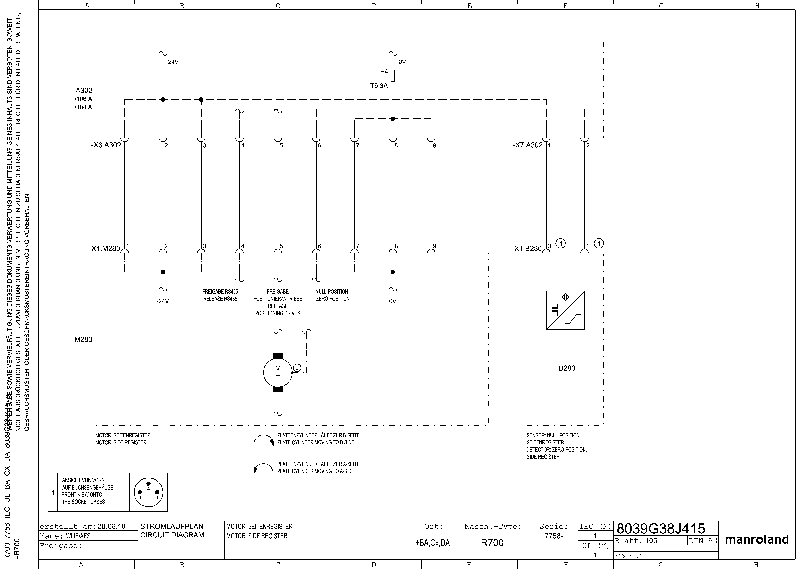

# +BA_Cx_DA — Sheet 105 of 247 — MOTOR: SEITENREGISTER

**MOTOR: SIDE REGISTER**

> Part of the manroland **R700** printing press IEC/UL circuit diagrams.
> Drawing class: **Stromlaufplan / Circuit diagram** (DIN A3).
> Document `+BA_Cx_DA` covers the **Printing units / main switch cabinet** machine section.

## At a glance

| Field | Value |
|---|---|
| Document | `+BA_Cx_DA`  (8039G38J415) |
| Sheet | **105** of 247 |
| Section (DE) | MOTOR: SEITENREGISTER |
| Section (EN) | MOTOR: SIDE REGISTER |
| Section type | CIRCUIT — Circuit diagram |
| Machine type | `R700` |
| Series | `7758` |
| Created | 28.06.10 |
| Replaces | — |
| Columns used | A, B, C, D, E, F |
| Path numbers | — |
| Labels on sheet | 66 |
| Cross-refs out | 2 |
| Cross-refs in | 24 |

**Previous:** [+BA_Cx_DA sheet 104](SHEET_0104.md) · **Next:** [+BA_Cx_DA sheet 106](SHEET_0106.md) · **Document TOC:** [_TOC.md](_TOC.md)  (+BA_Cx_DA) · **Master TOC:** [all sheets](../_MASTER_TOC.md)

## Sheet image (300 DPI, exact vector render)



_Rendered directly from the PDF vector layer at 300 DPI (1-bit), no OCR and no resampling. Use it to confirm anything ambiguous in the text below._

## Cross-references on this sheet

Each entry is a wire leaving this sheet. The printed token is `/sheet.column`; the link resolves to that sheet inside the same document.

| Ref | Target sheet | Col | Path | Destination on target | Target section | From col |
|---|---|---|---|---|---|---|
| `/106.A` | [+BA_Cx_DA sheet 106](SHEET_0106.md) | A | — | — | MOTOR: SCHRÄGREGISTER | A |
| `/104.A` | [+BA_Cx_DA sheet 104](SHEET_0104.md) | A | — | — | MOTOR: UMFANGSREGISTER | A |

### Incoming references (sheets that point here)

Every other sheet that sends a wire to this one. `Back-ref` is the token printed on *that* sheet; `Path` is its line number.

| From sheet | Cols | Back-ref | Path | Refs | What continues there |
|---|---|---|---|---|---|
| [+BA_Cx_DA#104](SHEET_0104.md) | A | `/104.A` | — | 1 | — |
| [+BA_Cx_DA#106](SHEET_0106.md) | A | `/106.A` | — | 1 | — |
| [+BA_Cx_DA#145](SHEET_0145.md) | G | `/145.G` | — | 2 | — |
| [+BA_Cx_DA#147](SHEET_0147.md) | H | `/147.H` | — | 9 | — |
| [+BA_Cx_DA#162](SHEET_0162.md) | B | `/162.B` | — | 9 | — |
| [+BA_Cx_DA#163](SHEET_0163.md) | F | `/163.F` | — | 2 | — |


## Devices on this sheet

| Tag | Class | Class meaning (IEC) | Col | Sub | Terminal | Sign |
|---|---|---|---|---|---|---|
| `A302` | A | Baugruppe / assembly, module, PC board | A | — | — | — |
| `B280` | B | Umformer / transducer, sensor | F | — | — | — |
| `F4` | F | Schutz / protection device (fuse, circuit breaker) | D | — | — | — |
| `X1.M280` | — | cross-device reference | A | — | — | — |
| `X6.A302` | — | cross-device reference | A | — | — | — |
| `X1.B280` | — | cross-device reference | F | — | — | — |
| `X7.A302` | — | cross-device reference | F | — | — | — |

## Potentials / nets

| Potential | Count | Columns | Attached devices | Terminals |
|---|---|---|---|---|
| `0V` | 2 | D | — | — |
| `24V` | 2 | B | — | — |
| `M280` | 1 | A | — | — |


A potential such as `L24+/4` or `M24+` is a named supply/return rail; every place it appears on this sheet is electrically common.

## Wire-end annotations (grouped as printed)

A wire that continues elsewhere is annotated with a small cluster: the destination description, the path/line number `#NN`, and the `/sheet.column` cross reference. Each row below is one such cluster exactly as it is grouped on the drawing.

| Col | Y | Path | Cross-ref | Text on the wire |
|---|---|---|---|---|
| D | 87.4 | — | — | `F4 0V` |
| B | 87.5 | — | — | `24V` |
| D | 122.5 | — | — | `T6,3A` |
| A | 129.3 | — | — | `A302` |
| A | 142.3 | — | `/106.A`, `/104.A` | — |
| C | 210.1 | — | — | `X6.A302 1 2 3 4 5 6 7 8 9` |
| F | 210.1 | — | — | `X7.A302 1 2` |
| F | 356.9 | — | — | `1 1` |
| C | 360.3 | — | — | `X1.M280 1 2 3 4 5 6 7 8 9` |
| F | 360.3 | — | — | `X1.B280 3 1` |
| B | 428.6 | — | — | `FREIGABE RS485` |
| C | 428.6 | — | — | `POSITIONIERANTRIEBE FREIGABE` |
| D | 428.6 | — | — | `NULL POSITION` |
| B | 439.3 | — | — | `RELEASE RS485` |
| D | 439.3 | — | — | `ZERO POSITION` |
| C | 441.8 | — | — | `24V 0V` |
| C | 449.9 | — | — | `POSITIONING DRIVES RELEASE` |
| A | 497.8 | — | — | `M280` |
| C | 540.3 | — | — | `M` |
| F | 540.3 | — | — | `B280` |
| C | 641.2 | — | — | `PLATTENZYLINDER LÄUFT ZUR B SEITE PLATE CYLINDER MOVING TO B SIDE` |
| F | 641.2 | — | — | `DETECTOR: ZERO POSITION, SENSOR: NULL POSITION, SEITENREGISTER` |
| A | 641.3 | — | — | `MOTOR: SEITENREGISTER MOTOR: SIDE REGISTER` |
| F | 673.1 | — | — | `SIDE REGISTER` |
| C | 683.8 | — | — | `PLATTENZYLINDER LÄUFT ZUR A SEITE PLATE CYLINDER MOVING TO A SIDE` |
| A | 707.9 | — | — | `FRONT VIEW ONTO ANSICHT VON VORNE AUF BUCHSENGEHÄUSE` |
| A | 720.2 | — | — | `1 THE SOCKET CASES 4` |
| B | 732.9 | — | — | `3 1` |


## Reconstructed tables

This sheet carries tabular content (pin map / terminal assignment / index). The grid below was rebuilt from the drawing's own rule lines, so each row is exactly one physical row of the table.

### Table 1 — 2 data rows × 4 columns (at x=85.0, y=147.4) — **/104.A**

| X6.A302 X1.M280 | 1 1 |  | 2 2 |
|---|---|---|---|
| `M280 MOTOR: MOTOR: SIDE` |  | `24V SEITENREGISTER REGISTER` |  |
| `ANSICHT VON VORNE AUF BUCHSENGEHÄUSE FRONT VIEW ONTO THE SOCKET CASES` |  | `4 3 1` |  |


### Table 2 — 1 data rows × 3 columns (at x=297.6, y=147.4)

| 3 3 | 4 4 | 5 5 |
|---|---|---|
| `FREIGABE RS485 RELEASE RS485` | `FREIGABE POSITIONIERANTRIEBE RELEASE POSITIONING` | `DRIVES M PLATTENZYLINDER PLATE CYLINDER PLATTENZYLINDER PLATE CYLINDER` |


### Table 3 — 1 data rows × 3 columns (at x=467.7, y=147.4)

| 6 6 | 7 7 | 8 8 |
|---|---|---|
| `NULL POSITION ZERO POSITION LÄUFT ZUR B SEITE MOVING TO B SIDE LÄUFT ZUR A SEITE MOVING TO A SIDE` |  |  |


## Notes and free text on this sheet

| Text | Col | Y (pt) |
|---|---|---|
| `MOTOR: SEITENREGISTER` | A | 641.26 |
| `MOTOR: SIDE REGISTER` | A | 651.89 |
| `M` | C | 540.33 |
| `T6,3A` | D | 122.51 |
| `SENSOR: NULL POSITION,` | F | 641.25 |
| `SEITENREGISTER` | F | 651.88 |
| `DETECTOR: ZERO POSITION,` | F | 662.51 |
| `SIDE REGISTER` | F | 673.14 |
| `FREIGABE` | C | 428.61 |
| `POSITIONIERANTRIEBE` | C | 439.27 |
| `RELEASE` | C | 449.88 |
| `POSITIONING DRIVES` | C | 460.54 |
| `FREIGABE RS485` | B | 428.64 |
| `RELEASE RS485` | B | 439.28 |
| `NULL POSITION` | D | 428.65 |
| `ZERO POSITION` | D | 439.29 |
| `PLATTENZYLINDER LÄUFT ZUR A SEITE` | C | 683.77 |
| `PLATE CYLINDER MOVING TO A SIDE` | C | 694.41 |
| `PLATTENZYLINDER LÄUFT ZUR B SEITE` | C | 641.25 |
| `PLATE CYLINDER MOVING TO B SIDE` | C | 651.89 |
| `ANSICHT VON VORNE` | A | 707.88 |
| `AUF BUCHSENGEHÄUSE` | A | 718.51 |
| `FRONT VIEW ONTO` | A | 729.1 |
| `THE SOCKET CASES` | A | 739.75 |

## Complete label inventory (exact text from the drawing)

Every text object inside the drawing area of this sheet, in DIN reading order (column A→H, then top→bottom). This is the authoritative list: if a string is not here it is not printed on this sheet.

| Col | Y | X | Dir | Type | Text |
|---|---|---|---|---|---|
| A | 129.3 | 108.3 | → | device tag | `A302` |
| A | 142.4 | 110.6 | → | cross-reference | `/106.A` |
| A | 154.8 | 110.6 | → | cross-reference | `/104.A` |
| A | 210.1 | 134.9 | → | device ref | `X6.A302` |
| A | 211.5 | 186.2 | → | number | `1` |
| A | 360.3 | 186.2 | → | number | `1` |
| A | 363.1 | 131.8 | → | device ref | `X1.M280` |
| A | 497.8 | 106.6 | → | potential | `M280` |
| A | 641.3 | 141.2 | → | text | `MOTOR: SEITENREGISTER` |
| A | 651.9 | 141.2 | → | text | `MOTOR: SIDE REGISTER` |
| A | 707.9 | 92.1 | → | text | `ANSICHT VON VORNE` |
| A | 718.5 | 92.1 | → | text | `AUF BUCHSENGEHÄUSE` |
| A | 724.5 | 75.4 | → | number | `1` |
| A | 729.1 | 91.3 | → | text | `FRONT VIEW ONTO` |
| A | 739.8 | 91.8 | → | text | `THE SOCKET CASES` |
| B | 87.5 | 245.8 | → | potential | `24V` |
| B | 211.5 | 243.5 | → | number | `2` |
| B | 211.5 | 300.2 | → | number | `3` |
| B | 360.3 | 243.5 | → | number | `2` |
| B | 360.3 | 300.2 | → | number | `3` |
| B | 428.6 | 299.3 | → | text | `FREIGABE RS485` |
| B | 439.3 | 300.7 | → | text | `RELEASE RS485` |
| B | 441.8 | 231.6 | → | potential | `24V` |
| B | 720.2 | 217.7 | → | number | `4` |
| B | 732.9 | 204.9 | → | number | `3` |
| B | 732.9 | 230.9 | → | number | `1` |
| C | 211.5 | 356.9 | → | number | `4` |
| C | 211.5 | 413.6 | → | number | `5` |
| C | 211.5 | 470.3 | → | number | `6` |
| C | 360.3 | 356.9 | → | number | `4` |
| C | 360.3 | 413.6 | → | number | `5` |
| C | 360.3 | 470.3 | → | number | `6` |
| C | 428.6 | 394.8 | → | text | `FREIGABE` |
| C | 439.3 | 374.8 | → | text | `POSITIONIERANTRIEBE` |
| C | 449.9 | 396.2 | → | text | `RELEASE` |
| C | 460.5 | 377.6 | → | text | `POSITIONING DRIVES` |
| C | 540.3 | 406.6 | → | text | `M` |
| C | 641.3 | 410.2 | → | text | `PLATTENZYLINDER LÄUFT ZUR B SEITE` |
| C | 651.9 | 410.2 | → | text | `PLATE CYLINDER MOVING TO B SIDE` |
| C | 683.8 | 410.2 | → | text | `PLATTENZYLINDER LÄUFT ZUR A SEITE` |
| C | 694.4 | 410.2 | → | text | `PLATE CYLINDER MOVING TO A SIDE` |
| D | 87.4 | 589.7 | → | potential | `0V` |
| D | 100.9 | 558.7 | → | device tag | `F4` |
| D | 122.5 | 547.7 | → | text | `T6,3A` |
| D | 211.5 | 527.0 | → | number | `7` |
| D | 211.5 | 583.7 | → | number | `8` |
| D | 360.3 | 527.0 | → | number | `7` |
| D | 360.3 | 583.7 | → | number | `8` |
| D | 428.7 | 466.9 | → | text | `NULL POSITION` |
| D | 439.3 | 467.7 | → | text | `ZERO POSITION` |
| D | 441.8 | 575.6 | → | potential | `0V` |
| E | 211.5 | 640.3 | → | number | `9` |
| E | 360.3 | 640.3 | → | number | `9` |
| F | 210.1 | 758.6 | → | device ref | `X7.A302` |
| F | 211.5 | 809.9 | → | number | `1` |
| F | 211.5 | 867.1 | → | number | `2` |
| F | 356.9 | 827.4 | → | number | `1` |
| F | 356.9 | 884.1 | → | number | `1` |
| F | 360.3 | 810.4 | → | number | `3` |
| F | 360.3 | 866.6 | → | number | `1` |
| F | 363.1 | 757.1 | → | device ref | `X1.B280` |
| F | 540.3 | 822.6 | → | device tag | `B280` |
| F | 641.3 | 779.2 | → | text | `SENSOR: NULL POSITION,` |
| F | 651.9 | 779.2 | → | text | `SEITENREGISTER` |
| F | 662.5 | 778.7 | → | text | `DETECTOR: ZERO POSITION,` |
| F | 673.1 | 779.2 | → | text | `SIDE REGISTER` |

## Reading-order text block

The same content as a plain block, grouped by DIN column — convenient to paste or to match against a visual description.

```text
=== Column A ===
 129.3  108.3  devtag       A302
 142.4  110.6  xref         /106.A
 154.8  110.6  xref         /104.A
 210.1  134.9  devref       X6.A302
 211.5  186.2  numeric      1
 360.3  186.2  numeric      1
 363.1  131.8  devref       X1.M280
 497.8  106.6  net          M280
 641.3  141.2  text         MOTOR: SEITENREGISTER
 651.9  141.2  text         MOTOR: SIDE REGISTER
 707.9   92.1  text         ANSICHT VON VORNE
 718.5   92.1  text         AUF BUCHSENGEHÄUSE
 724.5   75.4  numeric      1
 729.1   91.3  text         FRONT VIEW ONTO
 739.8   91.8  text         THE SOCKET CASES
=== Column B ===
  87.5  245.8  net          24V
 211.5  243.5  numeric      2
 211.5  300.2  numeric      3
 360.3  243.5  numeric      2
 360.3  300.2  numeric      3
 428.6  299.3  text         FREIGABE RS485
 439.3  300.7  text         RELEASE RS485
 441.8  231.6  net          24V
 720.2  217.7  numeric      4
 732.9  204.9  numeric      3
 732.9  230.9  numeric      1
=== Column C ===
 211.5  356.9  numeric      4
 211.5  413.6  numeric      5
 211.5  470.3  numeric      6
 360.3  356.9  numeric      4
 360.3  413.6  numeric      5
 360.3  470.3  numeric      6
 428.6  394.8  text         FREIGABE
 439.3  374.8  text         POSITIONIERANTRIEBE
 449.9  396.2  text         RELEASE
 460.5  377.6  text         POSITIONING DRIVES
 540.3  406.6  text         M
 641.3  410.2  text         PLATTENZYLINDER LÄUFT ZUR B SEITE
 651.9  410.2  text         PLATE CYLINDER MOVING TO B SIDE
 683.8  410.2  text         PLATTENZYLINDER LÄUFT ZUR A SEITE
 694.4  410.2  text         PLATE CYLINDER MOVING TO A SIDE
=== Column D ===
  87.4  589.7  net          0V
 100.9  558.7  devtag       F4
 122.5  547.7  text         T6,3A
 211.5  527.0  numeric      7
 211.5  583.7  numeric      8
 360.3  527.0  numeric      7
 360.3  583.7  numeric      8
 428.7  466.9  text         NULL POSITION
 439.3  467.7  text         ZERO POSITION
 441.8  575.6  net          0V
=== Column E ===
 211.5  640.3  numeric      9
 360.3  640.3  numeric      9
=== Column F ===
 210.1  758.6  devref       X7.A302
 211.5  809.9  numeric      1
 211.5  867.1  numeric      2
 356.9  827.4  numeric      1
 356.9  884.1  numeric      1
 360.3  810.4  numeric      3
 360.3  866.6  numeric      1
 363.1  757.1  devref       X1.B280
 540.3  822.6  devtag       B280
 641.3  779.2  text         SENSOR: NULL POSITION,
 651.9  779.2  text         SEITENREGISTER
 662.5  778.7  text         DETECTOR: ZERO POSITION,
 673.1  779.2  text         SIDE REGISTER
```

---
_Generated from the PDF vector text layer; no OCR. Source: `R700_7758_IEC_UL_BA_CX_DA_8039G38J415_p`, sheet 105._
