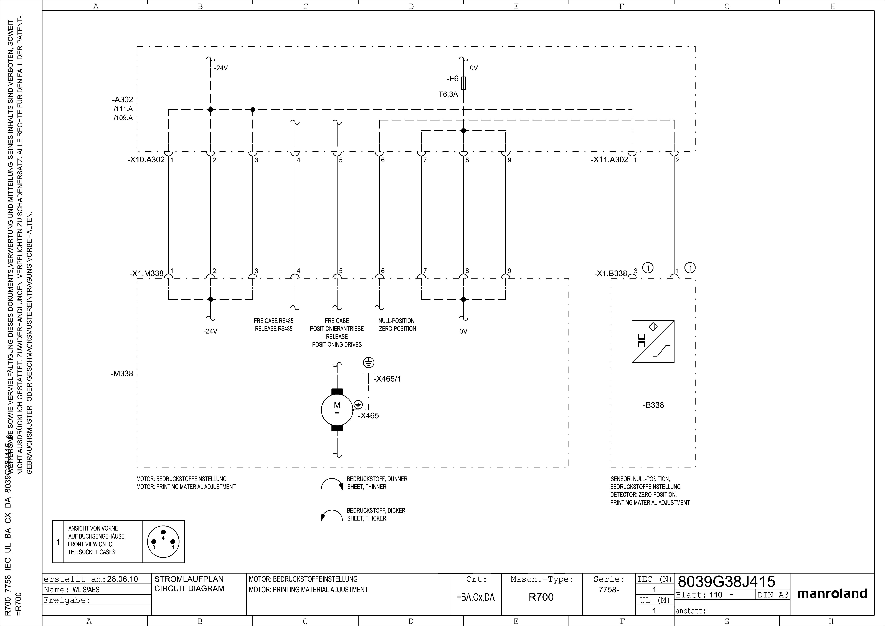

# +BA_Cx_DA — Sheet 110 of 247 — MOTOR: BEDRUCKSTOFFEINSTELLUNG

**MOTOR: PRINTING MATERIAL ADJUSTMENT**

> Part of the manroland **R700** printing press IEC/UL circuit diagrams.
> Drawing class: **Stromlaufplan / Circuit diagram** (DIN A3).
> Document `+BA_Cx_DA` covers the **Printing units / main switch cabinet** machine section.

## At a glance

| Field | Value |
|---|---|
| Document | `+BA_Cx_DA`  (8039G38J415) |
| Sheet | **110** of 247 |
| Section (DE) | MOTOR: BEDRUCKSTOFFEINSTELLUNG |
| Section (EN) | MOTOR: PRINTING MATERIAL ADJUSTMENT |
| Section type | CIRCUIT — Circuit diagram |
| Machine type | `R700` |
| Series | `7758` |
| Created | 28.06.10 |
| Replaces | — |
| Columns used | A, B, C, D, E, F, G |
| Path numbers | — |
| Labels on sheet | 68 |
| Cross-refs out | 2 |
| Cross-refs in | 24 |

**Previous:** [+BA_Cx_DA sheet 109](SHEET_0109.md) · **Next:** [+BA_Cx_DA sheet 111](SHEET_0111.md) · **Document TOC:** [_TOC.md](_TOC.md)  (+BA_Cx_DA) · **Master TOC:** [all sheets](../_MASTER_TOC.md)

## Sheet image (300 DPI, exact vector render)



_Rendered directly from the PDF vector layer at 300 DPI (1-bit), no OCR and no resampling. Use it to confirm anything ambiguous in the text below._

## Cross-references on this sheet

Each entry is a wire leaving this sheet. The printed token is `/sheet.column`; the link resolves to that sheet inside the same document.

| Ref | Target sheet | Col | Path | Destination on target | Target section | From col |
|---|---|---|---|---|---|---|
| `/111.A` | [+BA_Cx_DA sheet 111](SHEET_0111.md) | A | — | — | MOTOR: DECKMARKENHÖHENEINSTELLUNG | A |
| `/109.A` | [+BA_Cx_DA sheet 109](SHEET_0109.md) | A | — | — | MOTOR: HEBERSTREIFENBREITE | A |

### Incoming references (sheets that point here)

Every other sheet that sends a wire to this one. `Back-ref` is the token printed on *that* sheet; `Path` is its line number.

| From sheet | Cols | Back-ref | Path | Refs | What continues there |
|---|---|---|---|---|---|
| [+BA_Cx_DA#109](SHEET_0109.md) | A | `/109.A` | — | 1 | — |
| [+BA_Cx_DA#111](SHEET_0111.md) | A | `/111.A` | — | 1 | — |
| [+BA_Cx_DA#145](SHEET_0145.md) | H | `/145.H` | — | 2 | — |
| [+BA_Cx_DA#148](SHEET_0148.md) | B | `/148.B` | — | 9 | — |
| [+BA_Cx_DA#167](SHEET_0167.md) | B | `/167.B` | — | 9 | — |
| [+BA_Cx_DA#168](SHEET_0168.md) | E | `/168.E` | — | 2 | — |


## Devices on this sheet

| Tag | Class | Class meaning (IEC) | Col | Sub | Terminal | Sign |
|---|---|---|---|---|---|---|
| `A302` | A | Baugruppe / assembly, module, PC board | A | — | — | — |
| `B338` | B | Umformer / transducer, sensor | F | — | — | — |
| `F6` | F | Schutz / protection device (fuse, circuit breaker) | D | — | — | — |
| `X465/1` | X | Klemme / terminal, plug connector | D | 1 | — | — |
| `X465` | X | Klemme / terminal, plug connector | D | — | — | — |
| `X1.M338` | — | cross-device reference | A | — | — | — |
| `X10.A302` | — | cross-device reference | A | — | — | — |
| `X1.B338` | — | cross-device reference | F | — | — | — |
| `X11.A302` | — | cross-device reference | F | — | — | — |

## Potentials / nets

| Potential | Count | Columns | Attached devices | Terminals |
|---|---|---|---|---|
| `0V` | 2 | D, E | — | — |
| `24V` | 2 | B | — | — |
| `M338` | 1 | A | — | — |


A potential such as `L24+/4` or `M24+` is a named supply/return rail; every place it appears on this sheet is electrically common.

## Wire-end annotations (grouped as printed)

A wire that continues elsewhere is annotated with a small cluster: the destination description, the path/line number `#NN`, and the `/sheet.column` cross reference. Each row below is one such cluster exactly as it is grouped on the drawing.

| Col | Y | Path | Cross-ref | Text on the wire |
|---|---|---|---|---|
| D | 87.4 | — | — | `F6 0V` |
| B | 87.5 | — | — | `24V` |
| D | 122.5 | — | — | `T6,3A` |
| A | 129.3 | — | — | `A302` |
| A | 142.3 | — | `/111.A`, `/109.A` | — |
| C | 210.1 | — | — | `X10.A302 1 2 3 4 5 6 7 8 9` |
| F | 210.1 | — | — | `X11.A302 1 2` |
| F | 356.9 | — | — | `1 1` |
| C | 360.3 | — | — | `X1.M338 1 2 3 4 5 6 7 8 9` |
| F | 360.3 | — | — | `X1.B338 3 1` |
| C | 428.6 | — | — | `FREIGABE RS485` |
| C | 428.6 | — | — | `POSITIONIERANTRIEBE FREIGABE` |
| D | 428.6 | — | — | `NULL POSITION` |
| C | 439.3 | — | — | `RELEASE RS485` |
| D | 439.3 | — | — | `ZERO POSITION` |
| C | 441.8 | — | — | `24V 0V` |
| C | 449.9 | — | — | `POSITIONING DRIVES RELEASE` |
| A | 497.8 | — | — | `M338` |
| D | 504.9 | — | — | `X465/1` |
| C | 540.3 | — | — | `M` |
| F | 540.3 | — | — | `B338` |
| D | 554.5 | — | — | `X465` |
| F | 641.2 | — | — | `BEDRUCKSTOFFEINSTELLUNG DETECTOR: ZERO POSITION, PRINTING MATERIAL ADJUSTMENT SENSOR: NULL POSITION,` |
| B | 641.3 | — | — | `MOTOR: BEDRUCKSTOFFEINSTELLUNG MOTOR: PRINTING MATERIAL ADJUSTMENT` |
| D | 641.3 | — | — | `BEDRUCKSTOFF, DÜNNER` |
| D | 651.9 | — | — | `SHEET, THINNER` |
| D | 683.8 | — | — | `BEDRUCKSTOFF, DICKER` |
| D | 694.4 | — | — | `SHEET, THICKER` |
| A | 707.9 | — | — | `FRONT VIEW ONTO ANSICHT VON VORNE AUF BUCHSENGEHÄUSE` |
| A | 720.2 | — | — | `1 THE SOCKET CASES 4` |
| B | 732.9 | — | — | `3 1` |


## Reconstructed tables

This sheet carries tabular content (pin map / terminal assignment / index). The grid below was rebuilt from the drawing's own rule lines, so each row is exactly one physical row of the table.

### Table 1 — 2 data rows × 12 columns (at x=85.0, y=147.4) — **/109.A**

|  | X10.A302 X1.M338 | 1 1 |  | 2 2 | 3 3 | 4 4 | 5 5 |  | 6 6 | 7 7 | 8 8 |
|---|---|---|---|---|---|---|---|---|---|---|---|
| `M338` | `MOTOR: MOTOR: PRINTING` |  | `24V BEDRUCKSTOFFEINSTELLUNG MATERIAL` | `ADJUSTMENT` | `FREIGABE RS485 RELEASE RS485` | `FREIGABE POSITIONIERANTRIEBE RELEASE POSITIONING` | `DRIVES M X465 BEDRUCKSTOFF, SHEET, BEDRUCKSTOFF, SHEET,` | `THINNER THICKER` | `NULL POSITION ZERO POSITION X465/1 DÜNNER DICKER` |  |  |
| `ANSICHT VON VORNE AUF BUCHSENGEHÄUSE FRONT VIEW ONTO THE SOCKET CASES` | `4 3` | `1` |  |  |  |  |  |  |  |  |  |


## Notes and free text on this sheet

| Text | Col | Y (pt) |
|---|---|---|
| `MOTOR: BEDRUCKSTOFFEINSTELLUNG` | B | 641.27 |
| `MOTOR: PRINTING MATERIAL ADJUSTMENT` | B | 651.9 |
| `M` | C | 540.33 |
| `T6,3A` | D | 122.51 |
| `SENSOR: NULL POSITION,` | F | 641.25 |
| `BEDRUCKSTOFFEINSTELLUNG` | F | 651.89 |
| `DETECTOR: ZERO POSITION,` | F | 662.51 |
| `PRINTING MATERIAL ADJUSTMENT` | F | 673.16 |
| `FREIGABE` | C | 428.61 |
| `POSITIONIERANTRIEBE` | C | 439.27 |
| `RELEASE` | C | 449.88 |
| `POSITIONING DRIVES` | C | 460.54 |
| `FREIGABE RS485` | C | 428.64 |
| `RELEASE RS485` | C | 439.28 |
| `NULL POSITION` | D | 428.65 |
| `ZERO POSITION` | D | 439.29 |
| `ANSICHT VON VORNE` | A | 707.88 |
| `AUF BUCHSENGEHÄUSE` | A | 718.51 |
| `FRONT VIEW ONTO` | A | 729.1 |
| `THE SOCKET CASES` | A | 739.75 |
| `BEDRUCKSTOFF, DICKER` | D | 683.77 |
| `SHEET, THICKER` | D | 694.4 |
| `BEDRUCKSTOFF, DÜNNER` | D | 641.27 |
| `SHEET, THINNER` | D | 651.89 |

## Complete label inventory (exact text from the drawing)

Every text object inside the drawing area of this sheet, in DIN reading order (column A→H, then top→bottom). This is the authoritative list: if a string is not here it is not printed on this sheet.

| Col | Y | X | Dir | Type | Text |
|---|---|---|---|---|---|
| A | 129.3 | 150.8 | → | device tag | `A302` |
| A | 142.4 | 153.1 | → | cross-reference | `/111.A` |
| A | 154.8 | 153.1 | → | cross-reference | `/109.A` |
| A | 210.1 | 171.5 | → | device ref | `X10.A302` |
| A | 363.1 | 174.3 | → | device ref | `X1.M338` |
| A | 497.8 | 149.1 | → | potential | `M338` |
| A | 707.9 | 92.1 | → | text | `ANSICHT VON VORNE` |
| A | 718.5 | 92.1 | → | text | `AUF BUCHSENGEHÄUSE` |
| A | 724.5 | 75.4 | → | number | `1` |
| A | 729.1 | 91.3 | → | text | `FRONT VIEW ONTO` |
| A | 739.8 | 91.8 | → | text | `THE SOCKET CASES` |
| B | 87.5 | 288.3 | → | potential | `24V` |
| B | 211.5 | 228.8 | → | number | `1` |
| B | 211.5 | 286.0 | → | number | `2` |
| B | 360.3 | 228.8 | → | number | `1` |
| B | 360.3 | 286.0 | → | number | `2` |
| B | 441.8 | 274.1 | → | potential | `24V` |
| B | 641.3 | 183.7 | → | text | `MOTOR: BEDRUCKSTOFFEINSTELLUNG` |
| B | 651.9 | 183.7 | → | text | `MOTOR: PRINTING MATERIAL ADJUSTMENT` |
| B | 720.2 | 217.7 | → | number | `4` |
| B | 732.9 | 204.9 | → | number | `3` |
| B | 732.9 | 230.9 | → | number | `1` |
| C | 211.5 | 342.7 | → | number | `3` |
| C | 211.5 | 399.4 | → | number | `4` |
| C | 211.5 | 456.1 | → | number | `5` |
| C | 360.3 | 342.7 | → | number | `3` |
| C | 360.3 | 399.4 | → | number | `4` |
| C | 360.3 | 456.1 | → | number | `5` |
| C | 428.6 | 341.8 | → | text | `FREIGABE RS485` |
| C | 428.6 | 437.3 | → | text | `FREIGABE` |
| C | 439.3 | 343.2 | → | text | `RELEASE RS485` |
| C | 439.3 | 417.3 | → | text | `POSITIONIERANTRIEBE` |
| C | 449.9 | 438.7 | → | text | `RELEASE` |
| C | 460.5 | 420.1 | → | text | `POSITIONING DRIVES` |
| C | 540.3 | 449.1 | → | text | `M` |
| D | 100.9 | 601.2 | → | device tag | `F6` |
| D | 122.5 | 590.2 | → | text | `T6,3A` |
| D | 211.5 | 512.8 | → | number | `6` |
| D | 211.5 | 569.5 | → | number | `7` |
| D | 360.3 | 512.8 | → | number | `6` |
| D | 360.3 | 569.5 | → | number | `7` |
| D | 428.7 | 509.4 | → | text | `NULL POSITION` |
| D | 439.3 | 510.2 | → | text | `ZERO POSITION` |
| D | 441.8 | 618.1 | → | potential | `0V` |
| D | 504.9 | 502.9 | → | device tag | `X465/1` |
| D | 554.5 | 481.6 | → | device tag | `X465` |
| D | 641.3 | 466.9 | → | text | `BEDRUCKSTOFF, DÜNNER` |
| D | 651.9 | 467.4 | → | text | `SHEET, THINNER` |
| D | 683.8 | 466.9 | → | text | `BEDRUCKSTOFF, DICKER` |
| D | 694.4 | 467.4 | → | text | `SHEET, THICKER` |
| E | 87.4 | 632.3 | → | potential | `0V` |
| E | 211.5 | 626.2 | → | number | `8` |
| E | 211.5 | 682.9 | → | number | `9` |
| E | 360.3 | 626.2 | → | number | `8` |
| E | 360.3 | 682.9 | → | number | `9` |
| F | 210.1 | 795.1 | → | device ref | `X11.A302` |
| F | 211.5 | 852.4 | → | number | `1` |
| F | 356.9 | 869.9 | → | number | `1` |
| F | 360.3 | 852.9 | → | number | `3` |
| F | 363.1 | 799.7 | → | device ref | `X1.B338` |
| F | 540.3 | 865.1 | → | device tag | `B338` |
| F | 641.3 | 821.8 | → | text | `SENSOR: NULL POSITION,` |
| F | 651.9 | 821.2 | → | text | `BEDRUCKSTOFFEINSTELLUNG` |
| F | 662.5 | 821.2 | → | text | `DETECTOR: ZERO POSITION,` |
| F | 673.2 | 821.2 | → | text | `PRINTING MATERIAL ADJUSTMENT` |
| G | 211.5 | 909.6 | → | number | `2` |
| G | 356.9 | 926.6 | → | number | `1` |
| G | 360.3 | 909.1 | → | number | `1` |

## Reading-order text block

The same content as a plain block, grouped by DIN column — convenient to paste or to match against a visual description.

```text
=== Column A ===
 129.3  150.8  devtag       A302
 142.4  153.1  xref         /111.A
 154.8  153.1  xref         /109.A
 210.1  171.5  devref       X10.A302
 363.1  174.3  devref       X1.M338
 497.8  149.1  net          M338
 707.9   92.1  text         ANSICHT VON VORNE
 718.5   92.1  text         AUF BUCHSENGEHÄUSE
 724.5   75.4  numeric      1
 729.1   91.3  text         FRONT VIEW ONTO
 739.8   91.8  text         THE SOCKET CASES
=== Column B ===
  87.5  288.3  net          24V
 211.5  228.8  numeric      1
 211.5  286.0  numeric      2
 360.3  228.8  numeric      1
 360.3  286.0  numeric      2
 441.8  274.1  net          24V
 641.3  183.7  text         MOTOR: BEDRUCKSTOFFEINSTELLUNG
 651.9  183.7  text         MOTOR: PRINTING MATERIAL ADJUSTMENT
 720.2  217.7  numeric      4
 732.9  204.9  numeric      3
 732.9  230.9  numeric      1
=== Column C ===
 211.5  342.7  numeric      3
 211.5  399.4  numeric      4
 211.5  456.1  numeric      5
 360.3  342.7  numeric      3
 360.3  399.4  numeric      4
 360.3  456.1  numeric      5
 428.6  341.8  text         FREIGABE RS485
 428.6  437.3  text         FREIGABE
 439.3  343.2  text         RELEASE RS485
 439.3  417.3  text         POSITIONIERANTRIEBE
 449.9  438.7  text         RELEASE
 460.5  420.1  text         POSITIONING DRIVES
 540.3  449.1  text         M
=== Column D ===
 100.9  601.2  devtag       F6
 122.5  590.2  text         T6,3A
 211.5  512.8  numeric      6
 211.5  569.5  numeric      7
 360.3  512.8  numeric      6
 360.3  569.5  numeric      7
 428.7  509.4  text         NULL POSITION
 439.3  510.2  text         ZERO POSITION
 441.8  618.1  net          0V
 504.9  502.9  devtag       X465/1
 554.5  481.6  devtag       X465
 641.3  466.9  text         BEDRUCKSTOFF, DÜNNER
 651.9  467.4  text         SHEET, THINNER
 683.8  466.9  text         BEDRUCKSTOFF, DICKER
 694.4  467.4  text         SHEET, THICKER
=== Column E ===
  87.4  632.3  net          0V
 211.5  626.2  numeric      8
 211.5  682.9  numeric      9
 360.3  626.2  numeric      8
 360.3  682.9  numeric      9
=== Column F ===
 210.1  795.1  devref       X11.A302
 211.5  852.4  numeric      1
 356.9  869.9  numeric      1
 360.3  852.9  numeric      3
 363.1  799.7  devref       X1.B338
 540.3  865.1  devtag       B338
 641.3  821.8  text         SENSOR: NULL POSITION,
 651.9  821.2  text         BEDRUCKSTOFFEINSTELLUNG
 662.5  821.2  text         DETECTOR: ZERO POSITION,
 673.2  821.2  text         PRINTING MATERIAL ADJUSTMENT
=== Column G ===
 211.5  909.6  numeric      2
 356.9  926.6  numeric      1
 360.3  909.1  numeric      1
```

---
_Generated from the PDF vector text layer; no OCR. Source: `R700_7758_IEC_UL_BA_CX_DA_8039G38J415_p`, sheet 110._
