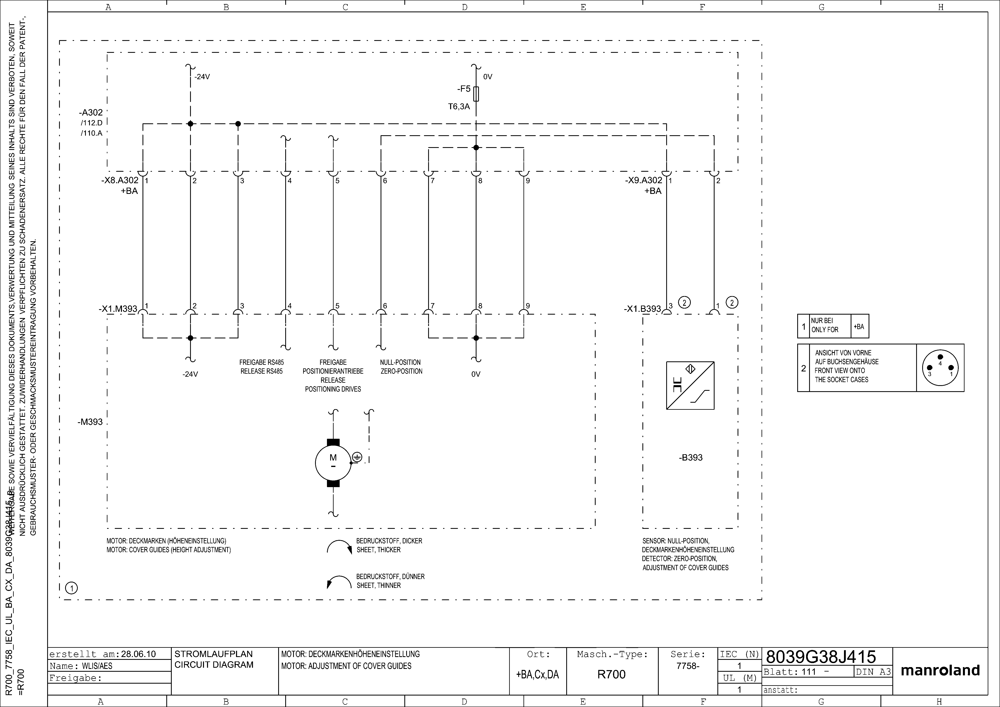

# +BA_Cx_DA — Sheet 111 of 247 — MOTOR: DECKMARKENHÖHENEINSTELLUNG

**MOTOR: ADJUSTMENT OF COVER GUIDES**

> Part of the manroland **R700** printing press IEC/UL circuit diagrams.
> Drawing class: **Stromlaufplan / Circuit diagram** (DIN A3).
> Document `+BA_Cx_DA` covers the **Printing units / main switch cabinet** machine section.

## At a glance

| Field | Value |
|---|---|
| Document | `+BA_Cx_DA`  (8039G38J415) |
| Sheet | **111** of 247 |
| Section (DE) | MOTOR: DECKMARKENHÖHENEINSTELLUNG |
| Section (EN) | MOTOR: ADJUSTMENT OF COVER GUIDES |
| Section type | CIRCUIT — Circuit diagram |
| Machine type | `R700` |
| Series | `7758` |
| Created | 28.06.10 |
| Replaces | — |
| Columns used | A, B, C, D, E, F, G, H |
| Path numbers | — |
| Labels on sheet | 73 |
| Cross-refs out | 2 |
| Cross-refs in | 24 |

**Previous:** [+BA_Cx_DA sheet 110](SHEET_0110.md) · **Next:** [+BA_Cx_DA sheet 112](SHEET_0112.md) · **Document TOC:** [_TOC.md](_TOC.md)  (+BA_Cx_DA) · **Master TOC:** [all sheets](../_MASTER_TOC.md)

## Sheet image (300 DPI, exact vector render)



_Rendered directly from the PDF vector layer at 300 DPI (1-bit), no OCR and no resampling. Use it to confirm anything ambiguous in the text below._

## Cross-references on this sheet

Each entry is a wire leaving this sheet. The printed token is `/sheet.column`; the link resolves to that sheet inside the same document.

| Ref | Target sheet | Col | Path | Destination on target | Target section | From col |
|---|---|---|---|---|---|---|
| `/112.D` | [+BA_Cx_DA sheet 112](SHEET_0112.md) | D | — | — | HANDTERMINAL | A |
| `/110.A` | [+BA_Cx_DA sheet 110](SHEET_0110.md) | A | — | — | MOTOR: BEDRUCKSTOFFEINSTELLUNG | A |

### Incoming references (sheets that point here)

Every other sheet that sends a wire to this one. `Back-ref` is the token printed on *that* sheet; `Path` is its line number.

| From sheet | Cols | Back-ref | Path | Refs | What continues there |
|---|---|---|---|---|---|
| [+BA_Cx_DA#110](SHEET_0110.md) | A | `/110.A` | — | 1 | — |
| [+BA_Cx_DA#112](SHEET_0112.md) | D | `/112.D` | — | 1 | — |
| [+BA_Cx_DA#146](SHEET_0146.md) | A | `/146.A` | — | 2 | — |
| [+BA_Cx_DA#148](SHEET_0148.md) | C | `/148.C` | — | 9 | — |
| [+BA_Cx_DA#165](SHEET_0165.md) | B | `/165.B` | — | 9 | — |
| [+BA_Cx_DA#166](SHEET_0166.md) | B | `/166.B` | — | 2 | — |


## Devices on this sheet

| Tag | Class | Class meaning (IEC) | Col | Sub | Terminal | Sign |
|---|---|---|---|---|---|---|
| `A302` | A | Baugruppe / assembly, module, PC board | A | — | — | — |
| `B393` | B | Umformer / transducer, sensor | F | — | — | — |
| `F5` | F | Schutz / protection device (fuse, circuit breaker) | D | — | — | — |
| `X1.M393` | — | cross-device reference | A | — | — | — |
| `X8.A302` | — | cross-device reference | A | — | — | — |
| `X1.B393` | — | cross-device reference | E | — | — | — |
| `X9.A302` | — | cross-device reference | F | — | — | — |

## Potentials / nets

| Potential | Count | Columns | Attached devices | Terminals |
|---|---|---|---|---|
| `0V` | 2 | D | — | — |
| `24V` | 2 | B | — | — |
| `M393` | 1 | A | — | — |


A potential such as `L24+/4` or `M24+` is a named supply/return rail; every place it appears on this sheet is electrically common.

## Wire-end annotations (grouped as printed)

A wire that continues elsewhere is annotated with a small cluster: the destination description, the path/line number `#NN`, and the `/sheet.column` cross reference. Each row below is one such cluster exactly as it is grouped on the drawing.

| Col | Y | Path | Cross-ref | Text on the wire |
|---|---|---|---|---|
| D | 87.4 | — | — | `F5 0V` |
| B | 87.5 | — | — | `24V` |
| D | 122.5 | — | — | `T6,3A` |
| A | 129.3 | — | — | `A302` |
| A | 142.4 | — | `/112.D`, `/110.A` | — |
| A | 210.1 | — | — | `X8.A302 1` |
| F | 210.1 | — | — | `X9.A302 1` |
| C | 211.5 | — | — | `2 3 4 5 6 7 8 9` |
| F | 211.5 | — | — | `2` |
| A | 222.8 | — | — | `+BA` |
| F | 222.8 | — | — | `+BA` |
| F | 357.5 | — | — | `2 2` |
| C | 360.3 | — | — | `X1.M393 1 2 3 4 5 6 7 8 9` |
| F | 360.3 | — | — | `X1.B393 3 1` |
| G | 379.0 | — | — | `1 NUR BEI` |
| G | 386.1 | — | — | `ONLY FOR +BA` |
| G | 417.3 | — | — | `FRONT VIEW ONTO ANSICHT VON VORNE AUF BUCHSENGEHÄUSE` |
| B | 428.6 | — | — | `FREIGABE RS485` |
| C | 428.6 | — | — | `POSITIONIERANTRIEBE FREIGABE` |
| C | 428.6 | — | — | `NULL POSITION` |
| H | 429.6 | — | — | `4` |
| G | 434.0 | — | — | `2 3 1` |
| B | 439.3 | — | — | `RELEASE RS485` |
| C | 439.3 | — | — | `ZERO POSITION` |
| C | 441.8 | — | — | `24V 0V` |
| G | 449.2 | — | — | `THE SOCKET CASES` |
| C | 449.9 | — | — | `POSITIONING DRIVES RELEASE` |
| A | 497.8 | — | — | `M393` |
| C | 540.3 | — | — | `M` |
| F | 540.3 | — | — | `B393` |
| C | 641.2 | — | — | `BEDRUCKSTOFF, DICKER` |
| F | 641.2 | — | — | `DECKMARKENHÖHENEINSTELLUNG DETECTOR: ZERO POSITION, SENSOR: NULL POSITION,` |
| B | 641.3 | — | — | `MOTOR: DECKMARKEN (HÖHENEINSTELLUNG) MOTOR: COVER GUIDES (HEIGHT ADJUSTMENT)` |
| C | 651.9 | — | — | `SHEET, THICKER` |
| F | 673.2 | — | — | `ADJUSTMENT OF COVER GUIDES` |
| C | 683.8 | — | — | `BEDRUCKSTOFF, DÜNNER` |
| C | 694.4 | — | — | `SHEET, THINNER` |
| A | 697.1 | — | — | `1` |


## Notes and free text on this sheet

| Text | Col | Y (pt) |
|---|---|---|
| `MOTOR: DECKMARKEN (HÖHENEINSTELLUNG)` | A | 641.28 |
| `MOTOR: COVER GUIDES (HEIGHT ADJUSTMENT)` | B | 651.9 |
| `M` | C | 540.33 |
| `+BA` | A | 222.75 |
| `T6,3A` | D | 122.51 |
| `+BA` | F | 222.75 |
| `SENSOR: NULL POSITION,` | F | 641.25 |
| `DECKMARKENHÖHENEINSTELLUNG` | F | 651.9 |
| `DETECTOR: ZERO POSITION,` | F | 662.51 |
| `ADJUSTMENT OF COVER GUIDES` | F | 673.16 |
| `FREIGABE` | C | 428.61 |
| `POSITIONIERANTRIEBE` | C | 439.27 |
| `RELEASE` | C | 449.88 |
| `POSITIONING DRIVES` | C | 460.54 |
| `FREIGABE RS485` | B | 428.64 |
| `RELEASE RS485` | B | 439.28 |
| `NULL POSITION` | C | 428.65 |
| `ZERO POSITION` | C | 439.29 |
| `BEDRUCKSTOFF, DÜNNER` | C | 683.79 |
| `SHEET, THINNER` | C | 694.41 |
| `BEDRUCKSTOFF, DICKER` | C | 641.25 |
| `SHEET, THICKER` | C | 651.88 |
| `ANSICHT VON VORNE` | G | 417.32 |
| `AUF BUCHSENGEHÄUSE` | G | 427.96 |
| `FRONT VIEW ONTO` | G | 438.55 |
| `THE SOCKET CASES` | G | 449.2 |
| `NUR BEI` | G | 379 |
| `ONLY FOR` | G | 389.69 |
| `+BA` | G | 386.11 |

## Complete label inventory (exact text from the drawing)

Every text object inside the drawing area of this sheet, in DIN reading order (column A→H, then top→bottom). This is the authoritative list: if a string is not here it is not printed on this sheet.

| Col | Y | X | Dir | Type | Text |
|---|---|---|---|---|---|
| A | 129.3 | 94.1 | → | device tag | `A302` |
| A | 142.4 | 96.4 | → | cross-reference | `/112.D` |
| A | 154.8 | 96.4 | → | cross-reference | `/110.A` |
| A | 210.1 | 120.8 | → | device ref | `X8.A302` |
| A | 211.5 | 172.1 | → | number | `1` |
| A | 222.8 | 143.7 | → | text | `+BA` |
| A | 360.3 | 172.1 | → | number | `1` |
| A | 363.1 | 117.6 | → | device ref | `X1.M393` |
| A | 497.8 | 92.4 | → | potential | `M393` |
| A | 641.3 | 127.0 | → | text | `MOTOR: DECKMARKEN (HÖHENEINSTELLUNG)` |
| A | 697.1 | 83.3 | → | number | `1` |
| B | 87.5 | 231.6 | → | potential | `24V` |
| B | 211.5 | 229.3 | → | number | `2` |
| B | 211.5 | 286.0 | → | number | `3` |
| B | 360.3 | 229.3 | → | number | `2` |
| B | 360.3 | 286.0 | → | number | `3` |
| B | 428.6 | 285.1 | → | text | `FREIGABE RS485` |
| B | 439.3 | 286.5 | → | text | `RELEASE RS485` |
| B | 441.8 | 217.4 | → | potential | `24V` |
| B | 651.9 | 127.0 | → | text | `MOTOR: COVER GUIDES (HEIGHT ADJUSTMENT)` |
| C | 211.5 | 342.7 | → | number | `4` |
| C | 211.5 | 399.4 | → | number | `5` |
| C | 211.5 | 456.1 | → | number | `6` |
| C | 360.3 | 342.7 | → | number | `4` |
| C | 360.3 | 399.4 | → | number | `5` |
| C | 360.3 | 456.1 | → | number | `6` |
| C | 428.6 | 380.6 | → | text | `FREIGABE` |
| C | 428.7 | 452.7 | → | text | `NULL POSITION` |
| C | 439.3 | 360.6 | → | text | `POSITIONIERANTRIEBE` |
| C | 439.3 | 453.5 | → | text | `ZERO POSITION` |
| C | 449.9 | 382.0 | → | text | `RELEASE` |
| C | 460.5 | 363.4 | → | text | `POSITIONING DRIVES` |
| C | 540.3 | 392.5 | → | text | `M` |
| C | 641.3 | 424.3 | → | text | `BEDRUCKSTOFF, DICKER` |
| C | 651.9 | 424.9 | → | text | `SHEET, THICKER` |
| C | 683.8 | 424.3 | → | text | `BEDRUCKSTOFF, DÜNNER` |
| C | 694.4 | 424.9 | → | text | `SHEET, THINNER` |
| D | 87.4 | 575.6 | → | potential | `0V` |
| D | 100.9 | 544.5 | → | device tag | `F5` |
| D | 122.5 | 533.5 | → | text | `T6,3A` |
| D | 211.5 | 512.8 | → | number | `7` |
| D | 211.5 | 569.5 | → | number | `8` |
| D | 360.3 | 512.8 | → | number | `7` |
| D | 360.3 | 569.5 | → | number | `8` |
| D | 441.8 | 561.4 | → | potential | `0V` |
| E | 211.5 | 626.2 | → | number | `9` |
| E | 360.3 | 626.2 | → | number | `9` |
| E | 363.1 | 743.0 | → | device ref | `X1.B393` |
| F | 210.1 | 744.4 | → | device ref | `X9.A302` |
| F | 211.5 | 795.7 | → | number | `1` |
| F | 211.5 | 852.9 | → | number | `2` |
| F | 222.8 | 767.3 | → | text | `+BA` |
| F | 357.5 | 813.0 | → | number | `2` |
| F | 357.5 | 869.7 | → | number | `2` |
| F | 360.3 | 796.3 | → | number | `3` |
| F | 360.3 | 852.4 | → | number | `1` |
| F | 540.3 | 808.4 | → | device tag | `B393` |
| F | 641.3 | 765.1 | → | text | `SENSOR: NULL POSITION,` |
| F | 651.9 | 764.5 | → | text | `DECKMARKENHÖHENEINSTELLUNG` |
| F | 662.5 | 764.5 | → | text | `DETECTOR: ZERO POSITION,` |
| F | 673.2 | 765.4 | → | text | `ADJUSTMENT OF COVER GUIDES` |
| G | 379.0 | 965.8 | → | text | `NUR BEI` |
| G | 384.4 | 954.1 | → | number | `1` |
| G | 386.1 | 1016.6 | → | text | `+BA` |
| G | 389.7 | 966.3 | → | text | `ONLY FOR` |
| G | 417.3 | 970.9 | → | text | `ANSICHT VON VORNE` |
| G | 428.0 | 970.9 | → | text | `AUF BUCHSENGEHÄUSE` |
| G | 434.0 | 953.9 | → | number | `2` |
| G | 438.6 | 970.0 | → | text | `FRONT VIEW ONTO` |
| G | 449.2 | 970.6 | → | text | `THE SOCKET CASES` |
| H | 429.6 | 1117.7 | → | number | `4` |
| H | 442.4 | 1104.9 | → | number | `3` |
| H | 442.4 | 1130.9 | → | number | `1` |

## Reading-order text block

The same content as a plain block, grouped by DIN column — convenient to paste or to match against a visual description.

```text
=== Column A ===
 129.3   94.1  devtag       A302
 142.4   96.4  xref         /112.D
 154.8   96.4  xref         /110.A
 210.1  120.8  devref       X8.A302
 211.5  172.1  numeric      1
 222.8  143.7  text         +BA
 360.3  172.1  numeric      1
 363.1  117.6  devref       X1.M393
 497.8   92.4  net          M393
 641.3  127.0  text         MOTOR: DECKMARKEN (HÖHENEINSTELLUNG)
 697.1   83.3  numeric      1
=== Column B ===
  87.5  231.6  net          24V
 211.5  229.3  numeric      2
 211.5  286.0  numeric      3
 360.3  229.3  numeric      2
 360.3  286.0  numeric      3
 428.6  285.1  text         FREIGABE RS485
 439.3  286.5  text         RELEASE RS485
 441.8  217.4  net          24V
 651.9  127.0  text         MOTOR: COVER GUIDES (HEIGHT ADJUSTMENT)
=== Column C ===
 211.5  342.7  numeric      4
 211.5  399.4  numeric      5
 211.5  456.1  numeric      6
 360.3  342.7  numeric      4
 360.3  399.4  numeric      5
 360.3  456.1  numeric      6
 428.6  380.6  text         FREIGABE
 428.7  452.7  text         NULL POSITION
 439.3  360.6  text         POSITIONIERANTRIEBE
 439.3  453.5  text         ZERO POSITION
 449.9  382.0  text         RELEASE
 460.5  363.4  text         POSITIONING DRIVES
 540.3  392.5  text         M
 641.3  424.3  text         BEDRUCKSTOFF, DICKER
 651.9  424.9  text         SHEET, THICKER
 683.8  424.3  text         BEDRUCKSTOFF, DÜNNER
 694.4  424.9  text         SHEET, THINNER
=== Column D ===
  87.4  575.6  net          0V
 100.9  544.5  devtag       F5
 122.5  533.5  text         T6,3A
 211.5  512.8  numeric      7
 211.5  569.5  numeric      8
 360.3  512.8  numeric      7
 360.3  569.5  numeric      8
 441.8  561.4  net          0V
=== Column E ===
 211.5  626.2  numeric      9
 360.3  626.2  numeric      9
 363.1  743.0  devref       X1.B393
=== Column F ===
 210.1  744.4  devref       X9.A302
 211.5  795.7  numeric      1
 211.5  852.9  numeric      2
 222.8  767.3  text         +BA
 357.5  813.0  numeric      2
 357.5  869.7  numeric      2
 360.3  796.3  numeric      3
 360.3  852.4  numeric      1
 540.3  808.4  devtag       B393
 641.3  765.1  text         SENSOR: NULL POSITION,
 651.9  764.5  text         DECKMARKENHÖHENEINSTELLUNG
 662.5  764.5  text         DETECTOR: ZERO POSITION,
 673.2  765.4  text         ADJUSTMENT OF COVER GUIDES
=== Column G ===
 379.0  965.8  text         NUR BEI
 384.4  954.1  numeric      1
 386.1 1016.6  text         +BA
 389.7  966.3  text         ONLY FOR
 417.3  970.9  text         ANSICHT VON VORNE
 428.0  970.9  text         AUF BUCHSENGEHÄUSE
 434.0  953.9  numeric      2
 438.6  970.0  text         FRONT VIEW ONTO
 449.2  970.6  text         THE SOCKET CASES
=== Column H ===
 429.6 1117.7  numeric      4
 442.4 1104.9  numeric      3
 442.4 1130.9  numeric      1
```

---
_Generated from the PDF vector text layer; no OCR. Source: `R700_7758_IEC_UL_BA_CX_DA_8039G38J415_p`, sheet 111._
