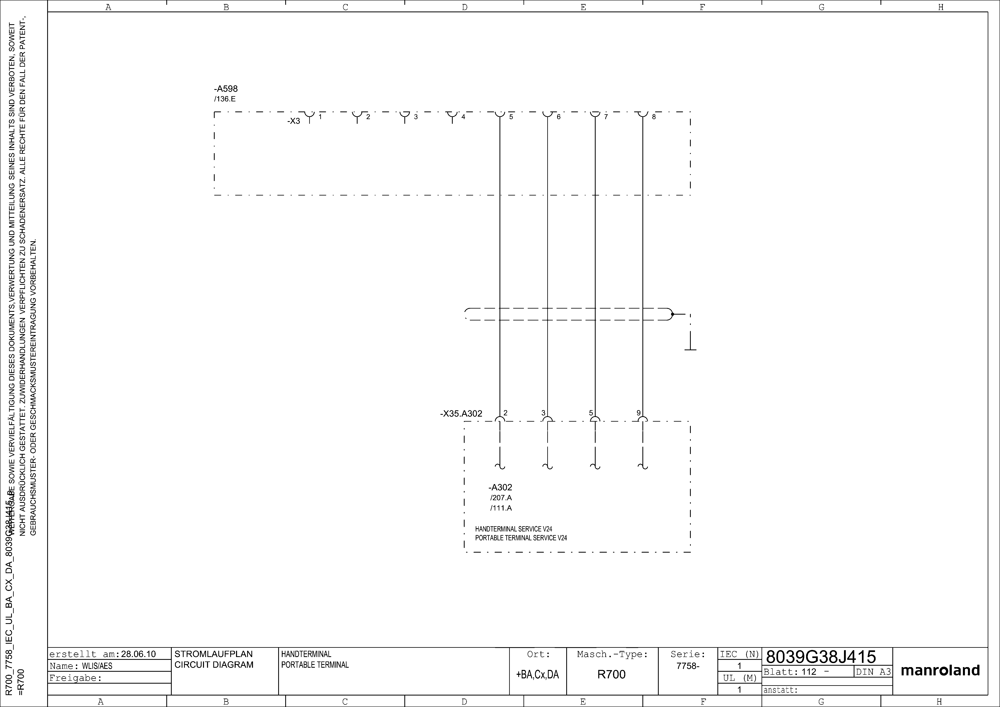

# +BA_Cx_DA — Sheet 112 of 247 — HANDTERMINAL

**PORTABLE TERMINAL**

> Part of the manroland **R700** printing press IEC/UL circuit diagrams.
> Drawing class: **Stromlaufplan / Circuit diagram** (DIN A3).
> Document `+BA_Cx_DA` covers the **Printing units / main switch cabinet** machine section.

## At a glance

| Field | Value |
|---|---|
| Document | `+BA_Cx_DA`  (8039G38J415) |
| Sheet | **112** of 247 |
| Section (DE) | HANDTERMINAL |
| Section (EN) | PORTABLE TERMINAL |
| Section type | CIRCUIT — Circuit diagram |
| Machine type | `R700` |
| Series | `7758` |
| Created | 28.06.10 |
| Replaces | — |
| Columns used | B, C, D, E, F |
| Path numbers | — |
| Labels on sheet | 21 |
| Cross-refs out | 3 |
| Cross-refs in | 7 |

**Previous:** [+BA_Cx_DA sheet 111](SHEET_0111.md) · **Next:** [+BA_Cx_DA sheet 113](SHEET_0113.md) · **Document TOC:** [_TOC.md](_TOC.md)  (+BA_Cx_DA) · **Master TOC:** [all sheets](../_MASTER_TOC.md)

## Sheet image (300 DPI, exact vector render)



_Rendered directly from the PDF vector layer at 300 DPI (1-bit), no OCR and no resampling. Use it to confirm anything ambiguous in the text below._

## Cross-references on this sheet

Each entry is a wire leaving this sheet. The printed token is `/sheet.column`; the link resolves to that sheet inside the same document.

| Ref | Target sheet | Col | Path | Destination on target | Target section | From col |
|---|---|---|---|---|---|---|
| `/136.E` | [+BA_Cx_DA sheet 136](SHEET_0136.md) | E | — | A598 | REFERENZMODUL | B |
| `/207.A` | [+BA_Cx_DA sheet 207](SHEET_0207.md) | A | — | — | OPTION: VERREIBUNGSEINSATZ | D |
| `/111.A` | [+BA_Cx_DA sheet 111](SHEET_0111.md) | A | — | — | MOTOR: DECKMARKENHÖHENEINSTELLUNG | D |

### Incoming references (sheets that point here)

Every other sheet that sends a wire to this one. `Back-ref` is the token printed on *that* sheet; `Path` is its line number.

| From sheet | Cols | Back-ref | Path | Refs | What continues there |
|---|---|---|---|---|---|
| [+BA_Cx_DA#111](SHEET_0111.md) | A | `/111.A` | — | 1 | — |
| [+BA_Cx_DA#136](SHEET_0136.md) | E | `/136.E` | — | 1 | — |
| [+BA_Cx_DA#180](SHEET_0180.md) | C | `/180.C` | — | 4 | — |
| [+BA_Cx_DA#207](SHEET_0207.md) | A | `/207.A` | — | 1 | — |


## Devices on this sheet

| Tag | Class | Class meaning (IEC) | Col | Sub | Terminal | Sign |
|---|---|---|---|---|---|---|
| `A302` | A | Baugruppe / assembly, module, PC board | D | — | — | — |
| `X3` | X | Klemme / terminal, plug connector | C | — | — | — |
| `A598` | A | Baugruppe / assembly, module, PC board | B | — | — | — |
| `X35.A302` | — | cross-device reference | D | — | — | — |

## Potentials / nets

_No named potentials on this sheet._

## Wire-end annotations (grouped as printed)

A wire that continues elsewhere is annotated with a small cluster: the destination description, the path/line number `#NN`, and the `/sheet.column` cross reference. Each row below is one such cluster exactly as it is grouped on the drawing.

| Col | Y | Path | Cross-ref | Text on the wire |
|---|---|---|---|---|
| B | 100.9 | — | `/136.E` | `A598` |
| D | 135.4 | — | — | `X3 1 2 3 4 5 6 7 8` |
| D | 487.9 | — | — | `X35.A302 2 3` |
| E | 487.9 | — | — | `5 9` |
| D | 575.7 | — | — | `A302` |
| D | 588.8 | — | `/207.A`, `/111.A` | — |
| D | 627.1 | — | — | `HANDTERMINAL SERVICE V24 PORTABLE TERMINAL SERVICE V24` |


## Notes and free text on this sheet

| Text | Col | Y (pt) |
|---|---|---|
| `HANDTERMINAL SERVICE V24` | D | 627.09 |
| `PORTABLE TERMINAL SERVICE V24` | D | 637.71 |

## Complete label inventory (exact text from the drawing)

Every text object inside the drawing area of this sheet, in DIN reading order (column A→H, then top→bottom). This is the authoritative list: if a string is not here it is not printed on this sheet.

| Col | Y | X | Dir | Type | Text |
|---|---|---|---|---|---|
| B | 100.9 | 254.8 | → | device tag | `A598` |
| B | 114.0 | 255.1 | → | cross-reference | `/136.E` |
| C | 135.4 | 379.0 | → | number | `1` |
| C | 135.4 | 436.3 | → | number | `2` |
| C | 139.8 | 342.1 | → | device tag | `X3` |
| D | 135.4 | 492.9 | → | number | `3` |
| D | 135.4 | 549.6 | → | number | `4` |
| D | 135.4 | 606.3 | → | number | `5` |
| D | 487.9 | 524.1 | → | device ref | `X35.A302` |
| D | 487.9 | 599.5 | → | number | `2` |
| D | 575.7 | 581.7 | → | device tag | `A302` |
| D | 588.8 | 583.9 | → | cross-reference | `/207.A` |
| D | 601.2 | 583.9 | → | cross-reference | `/111.A` |
| D | 627.1 | 566.1 | → | text | `HANDTERMINAL SERVICE V24` |
| D | 637.7 | 566.1 | → | text | `PORTABLE TERMINAL SERVICE V24` |
| E | 135.4 | 663.0 | → | number | `6` |
| E | 135.4 | 719.4 | → | number | `7` |
| E | 487.9 | 644.6 | → | number | `3` |
| E | 487.9 | 701.3 | → | number | `5` |
| E | 487.9 | 758.0 | → | number | `9` |
| F | 135.4 | 776.4 | → | number | `8` |

## Reading-order text block

The same content as a plain block, grouped by DIN column — convenient to paste or to match against a visual description.

```text
=== Column B ===
 100.9  254.8  devtag       A598
 114.0  255.1  xref         /136.E
=== Column C ===
 135.4  379.0  numeric      1
 135.4  436.3  numeric      2
 139.8  342.1  devtag       X3
=== Column D ===
 135.4  492.9  numeric      3
 135.4  549.6  numeric      4
 135.4  606.3  numeric      5
 487.9  524.1  devref       X35.A302
 487.9  599.5  numeric      2
 575.7  581.7  devtag       A302
 588.8  583.9  xref         /207.A
 601.2  583.9  xref         /111.A
 627.1  566.1  text         HANDTERMINAL SERVICE V24
 637.7  566.1  text         PORTABLE TERMINAL SERVICE V24
=== Column E ===
 135.4  663.0  numeric      6
 135.4  719.4  numeric      7
 487.9  644.6  numeric      3
 487.9  701.3  numeric      5
 487.9  758.0  numeric      9
=== Column F ===
 135.4  776.4  numeric      8
```

---
_Generated from the PDF vector text layer; no OCR. Source: `R700_7758_IEC_UL_BA_CX_DA_8039G38J415_p`, sheet 112._
