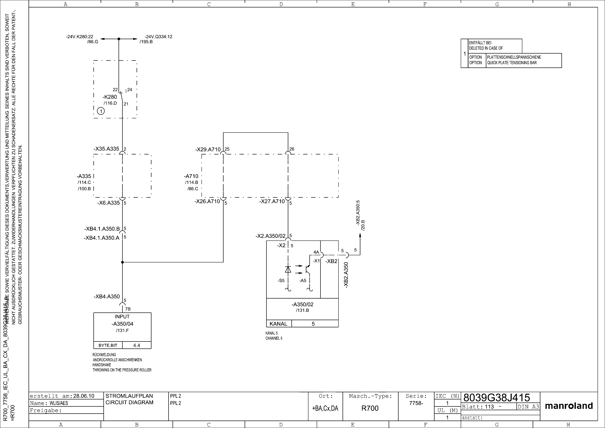

# +BA_Cx_DA — Sheet 113 of 247 — PPL 2

**PPL 2**

> Part of the manroland **R700** printing press IEC/UL circuit diagrams.
> Drawing class: **Stromlaufplan / Circuit diagram** (DIN A3).
> Document `+BA_Cx_DA` covers the **Printing units / main switch cabinet** machine section.

## At a glance

| Field | Value |
|---|---|
| Document | `+BA_Cx_DA`  (8039G38J415) |
| Sheet | **113** of 247 |
| Section (DE) | PPL 2 |
| Section (EN) | PPL 2 |
| Section type | CIRCUIT — Circuit diagram |
| Machine type | `R700` |
| Series | `7758` |
| Created | 28.06.10 |
| Replaces | — |
| Columns used | A, B, C, D, E, G |
| Path numbers | — |
| Labels on sheet | 70 |
| Cross-refs out | 10 |
| Cross-refs in | 21 |

**Previous:** [+BA_Cx_DA sheet 112](SHEET_0112.md) · **Next:** [+BA_Cx_DA sheet 114](SHEET_0114.md) · **Document TOC:** [_TOC.md](_TOC.md)  (+BA_Cx_DA) · **Master TOC:** [all sheets](../_MASTER_TOC.md)

## Sheet image (300 DPI, exact vector render)



_Rendered directly from the PDF vector layer at 300 DPI (1-bit), no OCR and no resampling. Use it to confirm anything ambiguous in the text below._

## Cross-references on this sheet

Each entry is a wire leaving this sheet. The printed token is `/sheet.column`; the link resolves to that sheet inside the same document.

| Ref | Target sheet | Col | Path | Destination on target | Target section | From col |
|---|---|---|---|---|---|---|
| `/86.G` | [+BA_Cx_DA sheet 86](SHEET_0086.md) | G | — | 24V.K280:22 | WASCHVORRICHTUNG | A |
| `/195.B` | [+BA_Cx_DA sheet 195](SHEET_0195.md) | B | — | — | OPTION: WASCHVORRICHTUNG MIT BÜRSTE | B |
| `/116.D` | [+BA_Cx_DA sheet 116](SHEET_0116.md) | D | — | — | PPL 2 | B |
| `/114.B` | [+BA_Cx_DA sheet 114](SHEET_0114.md) | B | — | — | PPL 2 | C |
| `/114.C` | [+BA_Cx_DA sheet 114](SHEET_0114.md) | C | — | — | PPL 2 | A |
| `/100.B` | [+BA_Cx_DA sheet 100](SHEET_0100.md) | B | — | — | WASCHMITTELVERSORGUNG | A |
| `/86.C` | [+BA_Cx_DA sheet 86](SHEET_0086.md) | C | — | — | WASCHVORRICHTUNG | C |
| `/20.B` | [+BA_Cx_DA sheet 20](SHEET_0020.md) | B | — | XB2.A350:5 | BUSVERBINDUNGEN: SICHERHEITSBUS | E |
| `/131.B` | [+BA_Cx_DA sheet 131](SHEET_0131.md) | B | — | — | REFERENZMODUL | D |
| `/131.F` | [+BA_Cx_DA sheet 131](SHEET_0131.md) | F | — | — | REFERENZMODUL | B |

### Incoming references (sheets that point here)

Every other sheet that sends a wire to this one. `Back-ref` is the token printed on *that* sheet; `Path` is its line number.

| From sheet | Cols | Back-ref | Path | Refs | What continues there |
|---|---|---|---|---|---|
| [+BA_Cx_DA#20](SHEET_0020.md) | B | `/20.B` | — | 1 | XB2.A350:5 |
| [+BA_Cx_DA#86](SHEET_0086.md) | C, G | `/86.C`, `/86.G` | — | 2 | — |
| [+BA_Cx_DA#100](SHEET_0100.md) | B | `/100.B` | — | 1 | — |
| [+BA_Cx_DA#114](SHEET_0114.md) | B, C | `/114.B`, `/114.C` | — | 2 | — |
| [+BA_Cx_DA#116](SHEET_0116.md) | D | `/116.D` | — | 1 | — |
| [+BA_Cx_DA#131](SHEET_0131.md) | B, F | `/131.B`, `/131.F` | — | 2 | — |
| [+BA_Cx_DA#153](SHEET_0153.md) | F | `/153.F` | — | 2 | — |
| [+BA_Cx_DA#159](SHEET_0159.md) | F, G, H | `/159.F`, `/159.G`, `/159.H` | — | 3 | — |
| [+BA_Cx_DA#162](SHEET_0162.md) | D | `/162.D` | — | 1 | — |
| [+BA_Cx_DA#176](SHEET_0176.md) | E | `/176.E` | — | 1 | — |
| [+BA_Cx_DA#177](SHEET_0177.md) | E | `/177.E` | — | 1 | — |
| [+BA_Cx_DA#179](SHEET_0179.md) | B, C | `/179.B`, `/179.C` | — | 2 | — |
| [+BA_Cx_DA#180](SHEET_0180.md) | E | `/180.E` | — | 1 | — |
| [+BA_Cx_DA#195](SHEET_0195.md) | D | `/195.D` | — | 1 | 24V.Q334:12 24V.Q342:12 |


## Devices on this sheet

| Tag | Class | Class meaning (IEC) | Col | Sub | Terminal | Sign |
|---|---|---|---|---|---|---|
| `K280` | K | Relais / relay, contactor | B | — | — | — |
| `A350/04` | A | Baugruppe / assembly, module, PC board | B | 04 | — | — |
| `A335` | A | Baugruppe / assembly, module, PC board | A | — | — | — |
| `A710` | A | Baugruppe / assembly, module, PC board | C | — | — | — |
| `S5` | S | Schalter / switch | D | — | — | — |
| `A5` | A | Baugruppe / assembly, module, PC board | D | — | — | — |
| `X1` | X | Klemme / terminal, plug connector | D | — | — | — |
| `X2` | X | Klemme / terminal, plug connector | D | — | — | — |
| `XB2` | XB |  | E | — | — | — |
| `A350/02` | A | Baugruppe / assembly, module, PC board | D | 02 | — | — |
| `4.4` | — | cross-device reference | B | — | — | — |
| `XB4.A350` | — | cross-device reference | B | — | — | — |
| `X35.A335` | — | cross-device reference | B | — | — | — |
| `X6.A335` | — | cross-device reference | B | — | — | — |
| `X26.A710` | — | cross-device reference | C | — | — | — |
| `X29.A710` | — | cross-device reference | C | — | — | — |
| `X27.A710` | — | cross-device reference | D | — | — | — |
| `XB2.A350` | — | cross-device reference | E | — | — | — |
| `XB4.1.A350.B` | — | cross-device reference | B | — | — | — |
| `XB4.1.A350.A` | — | cross-device reference | B | — | — | — |
| `XB2.A350:5` | — | cross-device reference | E | — | 5 | — |

## Potentials / nets

| Potential | Count | Columns | Attached devices | Terminals |
|---|---|---|---|---|
| `24V` | 2 | A, B | `K280`, `Q334` | `12`, `22` |


A potential such as `L24+/4` or `M24+` is a named supply/return rail; every place it appears on this sheet is electrically common.

## Wire-end annotations (grouped as printed)

A wire that continues elsewhere is annotated with a small cluster: the destination description, the path/line number `#NN`, and the `/sheet.column` cross reference. Each row below is one such cluster exactly as it is grouped on the drawing.

| Col | Y | Path | Cross-ref | Text on the wire |
|---|---|---|---|---|
| A | 68.3 | — | `/86.G` | `24V.K280:22` |
| B | 68.3 | — | — | `24V.Q334:12` |
| B | 78.2 | — | `/195.B` | — |
| G | 81.4 | — | — | `ENTFÄLLT BEI DELETED IN CASE OF` |
| G | 100.9 | — | — | `1` |
| G | 109.7 | — | — | `OPTION OPTION` |
| G | 109.8 | — | — | `PLATTENSCHNELLSPANNSCHIENE` |
| G | 120.4 | — | — | `QUICK PLATE TENSIONING BAR` |
| B | 172.5 | — | — | `K280 24` |
| B | 172.5 | — | — | `22` |
| B | 199.1 | — | `/116.D` | — |
| B | 200.9 | — | — | `21` |
| A | 215.2 | — | — | `1` |
| B | 288.0 | — | — | `X35.A335 2` |
| C | 289.4 | — | — | `X29.A710 25` |
| D | 289.5 | — | — | `26` |
| A | 341.9 | — | — | `A335` |
| C | 341.9 | — | — | `A710` |
| C | 354.9 | — | `/114.B` | — |
| A | 355.0 | — | `/114.C`, `/100.B` | — |
| C | 367.4 | — | `/86.C` | — |
| C | 391.5 | — | — | `X26.A710 5` |
| D | 391.5 | — | — | `X27.A710 5` |
| E | 394.0 | — | `/20.B` | `XB2.A350:5` |
| B | 394.3 | — | — | `X6.A335 5` |
| B | 445.4 | — | — | `XB4.1.A350.B 5` |
| D | 459.5 | — | — | `X2.A350/02 5` |
| B | 462.4 | — | — | `XB4.1.A350.A 5` |
| D | 478.0 | — | — | `X2` |
| E | 479.4 | — | — | `5 5` |
| E | 487.9 | — | — | `5` |
| D | 492.1 | — | — | `4A` |
| D | 509.1 | — | — | `X1` |
| E | 509.1 | — | — | `XB2` |
| E | 515.3 | — | — | `XB2.A350` |
| D | 548.1 | — | — | `S5 A5` |
| B | 578.6 | — | — | `XB4.A350 5` |
| D | 594.2 | — | — | `A350/02` |
| B | 604.0 | — | — | `7B` |
| D | 606.5 | — | `/131.B` | — |
| B | 618.6 | — | — | `INPUT` |
| B | 632.4 | — | — | `A350/04` |
| D | 632.4 | — | — | `KANAL 5` |
| B | 646.2 | — | `/131.F` | — |
| D | 652.8 | — | — | `KANAL 5 CHANNEL 5` |
| B | 675.3 | — | — | `BYTE.BIT 4.4` |
| B | 695.3 | — | — | `RÜCKMELDUNG` |
| B | 705.2 | — | — | `HANDSHAKE THROWING ON THE PRESSURE ROLLER ANDRÜCKROLLE ANSCHWENKEN` |


## Reconstructed tables

This sheet carries tabular content (pin map / terminal assignment / index). The grid below was rebuilt from the drawing's own rule lines, so each row is exactly one physical row of the table.

### Table 1 — 2 data rows × 3 columns (at x=184.3, y=515.9)

| XB4.A350 |  | 5 7B |
|---|---|---|
|  | `INPUT` | `A350/04 /131.F` |
| `BYTE.BIT` |  | `4.4` |


### Table 2 — 4 data rows × 6 columns (at x=439.4, y=260.8)

| 25 5 | X27.A710 X2.A350/02 | 26 5 5 |  |  | XB2.A350:5 |
|---|---|---|---|---|---|
|  | `X2` | `5` | `4A X1` | `XB2` | `5 5` |
|  | `S5` | `A5` |  |  | `XB2.A350` |
|  |  | `A350/02 /131.B` |  |  |  |
|  | `KANAL` |  | `5` |  |  |


## Notes and free text on this sheet

| Text | Col | Y (pt) |
|---|---|---|
| `7B` | B | 604.05 |
| `INPUT` | B | 618.59 |
| `BYTE.BIT` | B | 675.84 |
| `RÜCKMELDUNG` | B | 695.26 |
| `ANDRÜCKROLLE ANSCHWENKEN` | B | 705.21 |
| `HANDSHAKE` | B | 715.16 |
| `THROWING ON THE PRESSURE ROLLER` | B | 725.09 |
| `KANAL 5` | D | 652.75 |
| `CHANNEL 5` | D | 662.69 |
| `4A` | D | 492.08 |
| `KANAL` | D | 632.42 |
| `X2.A350/02` | D | 459.52 |
| `ENTFÄLLT BEI` | G | 81.38 |
| `DELETED IN CASE OF` | G | 92.03 |
| `OPTION` | G | 109.73 |
| `PLATTENSCHNELLSPANNSCHIENE` | G | 109.76 |
| `QUICK PLATE TENSIONING BAR` | G | 120.39 |

## Complete label inventory (exact text from the drawing)

Every text object inside the drawing area of this sheet, in DIN reading order (column A→H, then top→bottom). This is the authoritative list: if a string is not here it is not printed on this sheet.

| Col | Y | X | Dir | Type | Text |
|---|---|---|---|---|---|
| A | 68.3 | 129.8 | → | potential | `24V.K280:22` |
| A | 78.2 | 171.8 | → | cross-reference | `/86.G` |
| A | 215.2 | 196.7 | → | number | `1` |
| A | 341.9 | 150.8 | → | device tag | `A335` |
| A | 355.0 | 153.1 | → | cross-reference | `/114.C` |
| A | 367.4 | 153.4 | → | cross-reference | `/100.B` |
| B | 68.3 | 284.6 | → | potential | `24V.Q334:12` |
| B | 78.2 | 275.0 | → | cross-reference | `/195.B` |
| B | 172.5 | 222.0 | → | number | `22` |
| B | 172.5 | 250.6 | → | number | `24` |
| B | 186.0 | 201.8 | → | device tag | `K280` |
| B | 199.1 | 204.1 | → | cross-reference | `/116.D` |
| B | 200.9 | 243.5 | → | number | `21` |
| B | 288.0 | 184.3 | → | device ref | `X35.A335` |
| B | 289.5 | 243.5 | → | number | `2` |
| B | 394.3 | 191.6 | → | device ref | `X6.A335` |
| B | 395.8 | 243.5 | → | number | `5` |
| B | 445.4 | 165.8 | → | device ref | `XB4.1.A350.B` |
| B | 445.4 | 243.5 | → | number | `5` |
| B | 462.4 | 243.5 | → | number | `5` |
| B | 463.1 | 165.0 | → | device ref | `XB4.1.A350.A` |
| B | 578.6 | 184.5 | → | device ref | `XB4.A350` |
| B | 587.1 | 243.5 | → | number | `5` |
| B | 604.0 | 246.3 | → | text | `7B` |
| B | 618.6 | 226.1 | → | text | `INPUT` |
| B | 632.4 | 219.5 | → | device tag | `A350/04` |
| B | 646.2 | 228.6 | → | cross-reference | `/131.F` |
| B | 675.3 | 262.5 | → | device ref | `4.4` |
| B | 675.8 | 194.2 | → | text | `BYTE.BIT` |
| B | 695.3 | 182.3 | → | text | `RÜCKMELDUNG` |
| B | 705.2 | 183.1 | → | text | `ANDRÜCKROLLE ANSCHWENKEN` |
| B | 715.2 | 182.3 | → | text | `HANDSHAKE` |
| B | 725.1 | 182.6 | → | text | `THROWING ON THE PRESSURE ROLLER` |
| C | 289.4 | 384.1 | → | device ref | `X29.A710` |
| C | 289.5 | 441.9 | → | number | `25` |
| C | 341.9 | 362.0 | → | device tag | `A710` |
| C | 354.9 | 364.5 | → | cross-reference | `/114.B` |
| C | 367.4 | 369.1 | → | cross-reference | `/86.C` |
| C | 391.5 | 382.7 | → | device ref | `X26.A710` |
| C | 395.8 | 441.9 | → | number | `5` |
| D | 289.5 | 569.5 | → | number | `26` |
| D | 391.5 | 510.2 | → | device ref | `X27.A710` |
| D | 395.8 | 569.5 | → | number | `5` |
| D | 459.5 | 502.9 | → | text | `X2.A350/02` |
| D | 459.5 | 569.5 | → | number | `5` |
| D | 478.0 | 545.4 | → | device tag | `X2` |
| D | 479.4 | 572.3 | → | number | `5` |
| D | 492.1 | 617.1 | → | text | `4A` |
| D | 509.1 | 616.0 | → | device tag | `X1` |
| D | 548.1 | 546.5 | → | device tag | `S5` |
| D | 548.1 | 589.0 | → | device tag | `A5` |
| D | 594.2 | 573.9 | → | device tag | `A350/02` |
| D | 606.5 | 582.7 | → | cross-reference | `/131.B` |
| D | 632.4 | 530.6 | → | text | `KANAL` |
| D | 632.4 | 613.6 | → | number | `5` |
| D | 652.8 | 522.4 | → | text | `KANAL 5` |
| D | 662.7 | 522.7 | → | text | `CHANNEL 5` |
| E | 394.0 | 700.4 | ↕ | device ref | `XB2.A350:5` |
| E | 432.9 | 710.3 | ↕ | cross-reference | `/20.B` |
| E | 487.9 | 697.0 | → | number | `5` |
| E | 489.3 | 671.5 | → | number | `5` |
| E | 509.1 | 640.3 | → | device tag | `XB2` |
| E | 515.3 | 676.4 | ↕ | device ref | `XB2.A350` |
| G | 81.4 | 923.2 | → | text | `ENTFÄLLT BEI` |
| G | 92.0 | 923.2 | → | text | `DELETED IN CASE OF` |
| G | 100.9 | 911.6 | → | number | `1` |
| G | 109.7 | 923.8 | → | text | `OPTION` |
| G | 109.8 | 958.7 | → | text | `PLATTENSCHNELLSPANNSCHIENE` |
| G | 120.4 | 923.8 | → | text | `OPTION` |
| G | 120.4 | 959.2 | → | text | `QUICK PLATE TENSIONING BAR` |

## Reading-order text block

The same content as a plain block, grouped by DIN column — convenient to paste or to match against a visual description.

```text
=== Column A ===
  68.3  129.8  net          24V.K280:22
  78.2  171.8  xref         /86.G
 215.2  196.7  numeric      1
 341.9  150.8  devtag       A335
 355.0  153.1  xref         /114.C
 367.4  153.4  xref         /100.B
=== Column B ===
  68.3  284.6  net          24V.Q334:12
  78.2  275.0  xref         /195.B
 172.5  222.0  numeric      22
 172.5  250.6  numeric      24
 186.0  201.8  devtag       K280
 199.1  204.1  xref         /116.D
 200.9  243.5  numeric      21
 288.0  184.3  devref       X35.A335
 289.5  243.5  numeric      2
 394.3  191.6  devref       X6.A335
 395.8  243.5  numeric      5
 445.4  165.8  devref       XB4.1.A350.B
 445.4  243.5  numeric      5
 462.4  243.5  numeric      5
 463.1  165.0  devref       XB4.1.A350.A
 578.6  184.5  devref       XB4.A350
 587.1  243.5  numeric      5
 604.0  246.3  text         7B
 618.6  226.1  text         INPUT
 632.4  219.5  devtag       A350/04
 646.2  228.6  xref         /131.F
 675.3  262.5  devref       4.4
 675.8  194.2  text         BYTE.BIT
 695.3  182.3  text         RÜCKMELDUNG
 705.2  183.1  text         ANDRÜCKROLLE ANSCHWENKEN
 715.2  182.3  text         HANDSHAKE
 725.1  182.6  text         THROWING ON THE PRESSURE ROLLER
=== Column C ===
 289.4  384.1  devref       X29.A710
 289.5  441.9  numeric      25
 341.9  362.0  devtag       A710
 354.9  364.5  xref         /114.B
 367.4  369.1  xref         /86.C
 391.5  382.7  devref       X26.A710
 395.8  441.9  numeric      5
=== Column D ===
 289.5  569.5  numeric      26
 391.5  510.2  devref       X27.A710
 395.8  569.5  numeric      5
 459.5  502.9  text         X2.A350/02
 459.5  569.5  numeric      5
 478.0  545.4  devtag       X2
 479.4  572.3  numeric      5
 492.1  617.1  text         4A
 509.1  616.0  devtag       X1
 548.1  546.5  devtag       S5
 548.1  589.0  devtag       A5
 594.2  573.9  devtag       A350/02
 606.5  582.7  xref         /131.B
 632.4  530.6  text         KANAL
 632.4  613.6  numeric      5
 652.8  522.4  text         KANAL 5
 662.7  522.7  text         CHANNEL 5
=== Column E ===
 394.0  700.4  devref       XB2.A350:5
 432.9  710.3  xref         /20.B
 487.9  697.0  numeric      5
 489.3  671.5  numeric      5
 509.1  640.3  devtag       XB2
 515.3  676.4  devref       XB2.A350
=== Column G ===
  81.4  923.2  text         ENTFÄLLT BEI
  92.0  923.2  text         DELETED IN CASE OF
 100.9  911.6  numeric      1
 109.7  923.8  text         OPTION
 109.8  958.7  text         PLATTENSCHNELLSPANNSCHIENE
 120.4  923.8  text         OPTION
 120.4  959.2  text         QUICK PLATE TENSIONING BAR
```

---
_Generated from the PDF vector text layer; no OCR. Source: `R700_7758_IEC_UL_BA_CX_DA_8039G38J415_p`, sheet 113._
