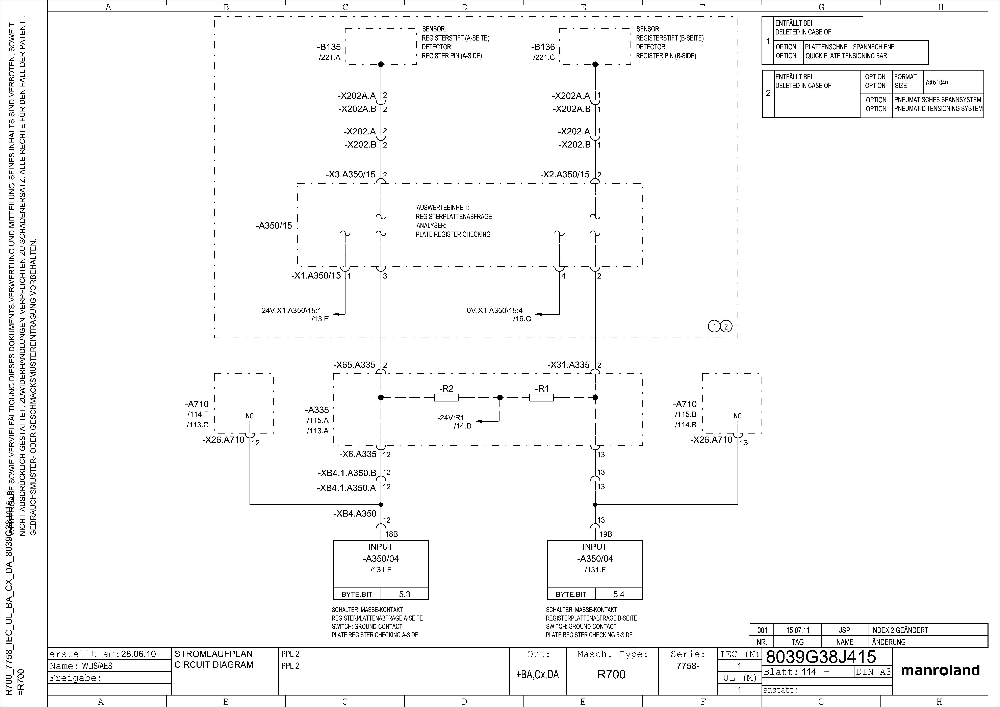

# +BA_Cx_DA — Sheet 114 of 247 — PPL 2

**PPL 2**

> Part of the manroland **R700** printing press IEC/UL circuit diagrams.
> Drawing class: **Stromlaufplan / Circuit diagram** (DIN A3).
> Document `+BA_Cx_DA` covers the **Printing units / main switch cabinet** machine section.

## At a glance

| Field | Value |
|---|---|
| Document | `+BA_Cx_DA`  (8039G38J415) |
| Sheet | **114** of 247 |
| Section (DE) | PPL 2 |
| Section (EN) | PPL 2 |
| Section type | CIRCUIT — Circuit diagram |
| Machine type | `R700` |
| Series | `7758` |
| Created | 28.06.10 |
| Replaces | — |
| Columns used | B, C, D, E, F, G, H |
| Path numbers | — |
| Labels on sheet | 130 |
| Cross-refs out | 13 |
| Cross-refs in | 39 |

**Previous:** [+BA_Cx_DA sheet 113](SHEET_0113.md) · **Next:** [+BA_Cx_DA sheet 115](SHEET_0115.md) · **Document TOC:** [_TOC.md](_TOC.md)  (+BA_Cx_DA) · **Master TOC:** [all sheets](../_MASTER_TOC.md)

## Sheet image (300 DPI, exact vector render)



_Rendered directly from the PDF vector layer at 300 DPI (1-bit), no OCR and no resampling. Use it to confirm anything ambiguous in the text below._

## Cross-references on this sheet

Each entry is a wire leaving this sheet. The printed token is `/sheet.column`; the link resolves to that sheet inside the same document.

| Ref | Target sheet | Col | Path | Destination on target | Target section | From col |
|---|---|---|---|---|---|---|
| `/221.A` | [+BA_Cx_DA sheet 221](SHEET_0221.md) | A | — | — | OPTION: FORMAT 780x1040 | C |
| `/221.C` | [+BA_Cx_DA sheet 221](SHEET_0221.md) | C | — | — | OPTION: FORMAT 780x1040 | E |
| `/16.G` | [+BA_Cx_DA sheet 16](SHEET_0016.md) | G | — | 0V.X1.A350\15:4 | SPANNUNGSVERSORGUNG, SCHALTSCHRANKBELÜFTUNG | D |
| `/13.E` | [+BA_Cx_DA sheet 13](SHEET_0013.md) | E | — | 24V.X1.A350\15:1 | SPANNUNGSVERSORGUNG, SCHALTSCHRANKBELÜFTUNG | C |
| `/115.B` | [+BA_Cx_DA sheet 115](SHEET_0115.md) | B | — | — | PPL 2 | F |
| `/114.B` | [+BA_Cx_DA sheet 114](SHEET_0114.md) | B | — | — | PPL 2 | F |
| `/114.F` | [+BA_Cx_DA sheet 114](SHEET_0114.md) | F | — | — | PPL 2 | B |
| `/113.C` | [+BA_Cx_DA sheet 113](SHEET_0113.md) | C | — | — | PPL 2 | B |
| `/14.D` | [+BA_Cx_DA sheet 14](SHEET_0014.md) | D | — | 24V:R1 | SPANNUNGSVERSORGUNG, SCHALTSCHRANKBELÜFTUNG | D |
| `/115.A` | [+BA_Cx_DA sheet 115](SHEET_0115.md) | A | — | — | PPL 2 | C |
| `/113.A` | [+BA_Cx_DA sheet 113](SHEET_0113.md) | A | — | — | PPL 2 | C |
| `/131.F` | [+BA_Cx_DA sheet 131](SHEET_0131.md) | F | — | — | REFERENZMODUL | C |
| `/131.F` | [+BA_Cx_DA sheet 131](SHEET_0131.md) | F | — | — | REFERENZMODUL | E |

### Incoming references (sheets that point here)

Every other sheet that sends a wire to this one. `Back-ref` is the token printed on *that* sheet; `Path` is its line number.

| From sheet | Cols | Back-ref | Path | Refs | What continues there |
|---|---|---|---|---|---|
| [+BA_Cx_DA#13](SHEET_0013.md) | E | `/13.E` | — | 1 | — |
| [+BA_Cx_DA#14](SHEET_0014.md) | D | `/14.D` | — | 1 | — |
| [+BA_Cx_DA#16](SHEET_0016.md) | G | `/16.G` | — | 1 | 0V.X1.A350\15:4 |
| [+BA_Cx_DA#113](SHEET_0113.md) | A, C | `/113.A`, `/113.C` | — | 2 | — |
| [+BA_Cx_DA#114](SHEET_0114.md) | B, F | `/114.B`, `/114.F` | — | 2 | — |
| [+BA_Cx_DA#115](SHEET_0115.md) | A, B | `/115.A`, `/115.B` | — | 2 | — |
| [+BA_Cx_DA#131](SHEET_0131.md) | F | `/131.F` | — | 2 | — |
| [+BA_Cx_DA#144](SHEET_0144.md) | A | `/144.A` | — | 4 | — |
| [+BA_Cx_DA#154](SHEET_0154.md) | C | `/154.C` | — | 1 | — |
| [+BA_Cx_DA#158](SHEET_0158.md) | A | `/158.A` | — | 1 | — |
| [+BA_Cx_DA#159](SHEET_0159.md) | F, G, H | `/159.F`, `/159.G`, `/159.H` | — | 6 | — |
| [+BA_Cx_DA#162](SHEET_0162.md) | D | `/162.D` | — | 2 | — |
| [+BA_Cx_DA#176](SHEET_0176.md) | E | `/176.E` | — | 2 | — |
| [+BA_Cx_DA#179](SHEET_0179.md) | G | `/179.G` | — | 1 | — |
| [+BA_Cx_DA#183](SHEET_0183.md) | G | `/183.G` | — | 1 | — |
| [+BA_Cx_DA#188](SHEET_0188.md) | F, G | `/188.F`, `/188.G` | — | 8 | — |
| [+BA_Cx_DA#221](SHEET_0221.md) | A, C | `/221.A`, `/221.C` | — | 2 | — |


## Devices on this sheet

| Tag | Class | Class meaning (IEC) | Col | Sub | Terminal | Sign |
|---|---|---|---|---|---|---|
| `A350/04` | A | Baugruppe / assembly, module, PC board | C | 04 | — | — |
| `A350/04` | A | Baugruppe / assembly, module, PC board | E | 04 | — | — |
| `B135` | B | Umformer / transducer, sensor | C | — | — | — |
| `B136` | B | Umformer / transducer, sensor | E | — | — | — |
| `A350/15` | A | Baugruppe / assembly, module, PC board | B | 15 | — | — |
| `A335` | A | Baugruppe / assembly, module, PC board | C | — | — | — |
| `A710` | A | Baugruppe / assembly, module, PC board | B | — | — | — |
| `A710` | A | Baugruppe / assembly, module, PC board | F | — | — | — |
| `R2` | R | Widerstand / resistor | D | — | — | — |
| `R1` | R | Widerstand / resistor | E | — | — | — |
| `5.3` | — | cross-device reference | C | — | — | — |
| `XB4.A350` | — | cross-device reference | C | — | — | — |
| `5.4` | — | cross-device reference | E | — | — | — |
| `X202A.B` | — | cross-device reference | C | — | — | — |
| `X202A.A` | — | cross-device reference | C | — | — | — |
| `X202A.B` | — | cross-device reference | E | — | — | — |
| `X202A.A` | — | cross-device reference | E | — | — | — |
| `X202.B` | — | cross-device reference | E | — | — | — |
| `X202.B` | — | cross-device reference | C | — | — | — |
| `X202.A` | — | cross-device reference | E | — | — | — |
| `X202.A` | — | cross-device reference | C | — | — | — |
| `X65.A335` | — | cross-device reference | C | — | — | — |
| `X31.A335` | — | cross-device reference | E | — | — | — |
| `X6.A335` | — | cross-device reference | C | — | — | — |
| `X26.A710` | — | cross-device reference | B | — | — | — |
| `X26.A710` | — | cross-device reference | F | — | — | — |
| `XB4.1.A350.B` | — | cross-device reference | C | — | — | — |
| `XB4.1.A350.A` | — | cross-device reference | C | — | — | — |
| `NR.` | — | cross-device reference | G | — | — | — |
| `15.07.11` | — | cross-device reference | G | — | — | — |

## Potentials / nets

| Potential | Count | Columns | Attached devices | Terminals |
|---|---|---|---|---|
| `0V` | 1 | D | `A350\15`, `X1` | `4` |
| `24V` | 1 | C | `A350\15`, `X1` | `1` |


A potential such as `L24+/4` or `M24+` is a named supply/return rail; every place it appears on this sheet is electrically common.

## Wire-end annotations (grouped as printed)

A wire that continues elsewhere is annotated with a small cluster: the destination description, the path/line number `#NN`, and the `/sheet.column` cross reference. Each row below is one such cluster exactly as it is grouped on the drawing.

| Col | Y | Path | Cross-ref | Text on the wire |
|---|---|---|---|---|
| G | 24.7 | — | — | `ENTFÄLLT BEI DELETED IN CASE OF` |
| D | 31.8 | — | — | `REGISTERSTIFT (A SEITE) DETECTOR: REGISTER PIN (A SIDE) SENSOR:` |
| F | 31.8 | — | — | `REGISTERSTIFT (B SEITE) DETECTOR: REGISTER PIN (B SIDE) SENSOR:` |
| G | 44.2 | — | — | `1` |
| C | 51.3 | — | — | `B135` |
| E | 51.3 | — | — | `B136` |
| G | 53.0 | — | — | `OPTION OPTION` |
| G | 53.1 | — | — | `PLATTENSCHNELLSPANNSCHIENE` |
| G | 63.7 | — | — | `QUICK PLATE TENSIONING BAR` |
| C | 64.4 | — | `/221.A` | — |
| E | 64.4 | — | `/221.C` | — |
| G | 88.5 | — | — | `ENTFÄLLT BEI DELETED IN CASE OF` |
| G | 88.5 | — | — | `OPTION OPTION` |
| H | 88.5 | — | — | `FORMAT` |
| H | 95.7 | — | — | `SIZE 780x1040` |
| G | 106.3 | — | — | `2` |
| C | 109.5 | — | — | `X202A.A 2` |
| E | 109.5 | — | — | `X202A.A 1` |
| H | 115.9 | — | — | `PNEUMATISCHES SPANNSYSTEM PNEUMATIC TENSIONING SYSTEM` |
| G | 116.1 | — | — | `OPTION OPTION` |
| C | 125.0 | — | — | `X202A.B 2` |
| E | 125.0 | — | — | `X202A.B 1` |
| D | 152.0 | — | — | `X202.A 2 X202.A 1` |
| D | 167.6 | — | — | `X202.B 2 X202.B 1` |
| C | 203.0 | — | — | `X3.A350/15 2` |
| E | 203.0 | — | — | `X2.A350/15 2` |
| D | 244.4 | — | — | `REGISTERPLATTENABFRAGE AUSWERTEEINHEIT:` |
| B | 263.9 | — | — | `A350/15` |
| D | 265.6 | — | — | `PLATE REGISTER CHECKING ANALYSER:` |
| D | 323.5 | — | — | `X1.A350/15 1 4` |
| D | 324.9 | — | — | `3 2` |
| C | 365.9 | — | `/13.E` | `24V.X1.A350\15:1` |
| D | 365.9 | — | `/16.G` | `0V.X1.A350\15:4` |
| F | 385.3 | — | — | `1 2` |
| D | 429.8 | — | — | `X65.A335 2 X31.A335 2` |
| D | 458.1 | — | — | `R2 R1` |
| B | 476.5 | — | — | `A710` |
| F | 476.5 | — | — | `A710` |
| C | 483.6 | — | — | `A335` |
| B | 489.6 | — | `/114.F`, `/113.C` | — |
| F | 489.6 | — | `/115.B`, `/114.B` | — |
| D | 492.4 | — | — | `NC NC` |
| D | 493.5 | — | `/14.D` | `24V:R1` |
| C | 496.7 | — | `/115.A`, `/113.A` | — |
| B | 519.0 | — | — | `X26.A710 12` |
| F | 519.0 | — | — | `X26.A710 13` |
| D | 536.1 | — | — | `X6.A335 12 13` |
| C | 558.7 | — | — | `XB4.1.A350.B 12` |
| E | 558.8 | — | — | `13` |
| C | 575.8 | — | — | `XB4.1.A350.A 12` |
| E | 575.8 | — | — | `13` |
| C | 606.9 | — | — | `XB4.A350 12` |
| E | 615.4 | — | — | `13` |
| C | 632.4 | — | — | `18B` |
| E | 632.4 | — | — | `19B` |
| C | 646.9 | — | — | `INPUT` |
| E | 646.9 | — | — | `INPUT` |
| C | 660.8 | — | — | `A350/04` |
| E | 660.8 | — | — | `A350/04` |
| C | 674.6 | — | `/131.F` | — |
| E | 674.6 | — | `/131.F` | — |
| C | 703.6 | — | — | `BYTE.BIT 5.3` |
| E | 703.6 | — | — | `BYTE.BIT 5.4` |
| C | 723.6 | — | — | `REGISTERPLATTENABFRAGE A SEITE PLATE REGISTER CHECKING A SIDE SCHALTER: MASSE KONTAKT SWITCH: GROUND CONTACT` |
| E | 723.6 | — | — | `REGISTERPLATTENABFRAGE B SEITE PLATE REGISTER CHECKING B SIDE SCHALTER: MASSE KONTAKT SWITCH: GROUND CONTACT` |
| G | 747.2 | — | — | `001 15.07.11 JSPI INDEX 2 GEÄNDERT` |
| G | 761.3 | — | — | `NR. TAG NAME ÄNDERUNG` |


## Reconstructed tables

This sheet carries tabular content (pin map / terminal assignment / index). The grid below was rebuilt from the drawing's own rule lines, so each row is exactly one physical row of the table.

### Table 1 — 3 data rows × 3 columns (at x=411.0, y=473.4)

| X6.A335 XB4.1.A350.B XB4.1.A350.A | 12 12 12 | 24V:R1 /14.D |
|---|---|---|
| `XB4.A350` | `12 18B` |  |
| `INPUT` | `A350/04 /131.F` |  |
| `BYTE.BIT` | `5.3` |  |


### Table 2 — 1 data rows × 2 columns (at x=666.1, y=473.4) — **13 13 13 13 19B**

| INPUT | A350/04 /131.F |
|---|---|
| `BYTE.BIT` | `5.4` |


## Notes and free text on this sheet

| Text | Col | Y (pt) |
|---|---|---|
| `18B` | C | 632.41 |
| `INPUT` | C | 646.94 |
| `BYTE.BIT` | C | 704.19 |
| `SCHALTER: MASSE KONTAKT` | C | 723.61 |
| `REGISTERPLATTENABFRAGE A SEITE` | C | 733.55 |
| `SWITCH: GROUND CONTACT` | C | 743.46 |
| `PLATE REGISTER CHECKING A SIDE` | C | 753.46 |
| `19B` | E | 632.41 |
| `INPUT` | E | 646.94 |
| `BYTE.BIT` | E | 704.19 |
| `SCHALTER: MASSE KONTAKT` | E | 723.61 |
| `REGISTERPLATTENABFRAGE B SEITE` | E | 733.55 |
| `SWITCH: GROUND CONTACT` | E | 743.46 |
| `PLATE REGISTER CHECKING B SIDE` | E | 753.46 |
| `SENSOR:` | D | 31.78 |
| `REGISTERSTIFT (A SEITE)` | D | 42.42 |
| `DETECTOR:` | D | 53.05 |
| `REGISTER PIN (A SIDE)` | D | 63.69 |
| `SENSOR:` | F | 31.78 |
| `REGISTERSTIFT (B SEITE)` | F | 42.42 |
| `DETECTOR:` | F | 53.05 |
| `REGISTER PIN (B SIDE)` | F | 63.69 |
| `X2.A350/15` | E | 202.99 |
| `X3.A350/15` | C | 202.99 |
| `X1.A350/15` | C | 323.46 |
| `AUSWERTEEINHEIT:` | D | 244.37 |
| `REGISTERPLATTENABFRAGE` | D | 255.03 |
| `ANALYSER:` | D | 265.65 |
| `PLATE REGISTER CHECKING` | D | 276.3 |
| `24V:R1` | D | 493.53 |
| `TAG` | G | 761.44 |
| `NAME` | G | 761.42 |
| `ÄNDERUNG` | H | 761.48 |
| `JSPI` | G | 747.25 |
| `INDEX 2 GEÄNDERT` | H | 747.31 |
| `ENTFÄLLT BEI` | G | 24.68 |
| `DELETED IN CASE OF` | G | 35.34 |
| `OPTION` | G | 88.47 |
| `FORMAT` | H | 88.5 |
| `SIZE` | H | 99.05 |
| `780x1040` | H | 95.65 |
| `PLATTENSCHNELLSPANNSCHIENE` | G | 53.07 |
| `QUICK PLATE TENSIONING BAR` | G | 63.7 |
| `NC` | B | 492.4 |
| `NC` | F | 492.4 |
| `PNEUMATISCHES SPANNSYSTEM` | H | 115.88 |
| `PNEUMATIC TENSIONING SYSTEM` | H | 126.51 |

## Complete label inventory (exact text from the drawing)

Every text object inside the drawing area of this sheet, in DIN reading order (column A→H, then top→bottom). This is the authoritative list: if a string is not here it is not printed on this sheet.

| Col | Y | X | Dir | Type | Text |
|---|---|---|---|---|---|
| B | 263.9 | 304.7 | → | device tag | `A350/15` |
| B | 476.5 | 220.3 | → | device tag | `A710` |
| B | 489.6 | 223.4 | → | cross-reference | `/114.F` |
| B | 492.4 | 292.8 | → | text | `NC` |
| B | 502.0 | 222.5 | → | cross-reference | `/113.C` |
| B | 519.0 | 240.9 | → | device ref | `X26.A710` |
| B | 523.3 | 299.6 | → | number | `12` |
| C | 51.3 | 377.6 | → | device tag | `B135` |
| C | 64.4 | 379.8 | → | cross-reference | `/221.A` |
| C | 109.4 | 402.2 | → | device ref | `X202A.A` |
| C | 109.5 | 456.1 | → | number | `2` |
| C | 125.0 | 403.1 | → | device ref | `X202A.B` |
| C | 126.5 | 456.1 | → | number | `2` |
| C | 152.0 | 409.3 | → | device ref | `X202.A` |
| C | 152.0 | 456.1 | → | number | `2` |
| C | 167.6 | 410.2 | → | device ref | `X202.B` |
| C | 169.0 | 456.1 | → | number | `2` |
| C | 203.0 | 388.1 | → | text | `X3.A350/15` |
| C | 204.4 | 456.1 | → | number | `2` |
| C | 323.5 | 347.0 | → | text | `X1.A350/15` |
| C | 324.9 | 413.0 | → | number | `1` |
| C | 324.9 | 456.1 | → | number | `3` |
| C | 365.9 | 308.7 | → | potential | `24V.X1.A350\15:1` |
| C | 375.8 | 371.1 | → | cross-reference | `/13.E` |
| C | 429.8 | 396.9 | → | device ref | `X65.A335` |
| C | 431.2 | 456.1 | → | number | `2` |
| C | 483.6 | 363.4 | → | device tag | `A335` |
| C | 496.7 | 365.7 | → | cross-reference | `/115.A` |
| C | 509.1 | 365.7 | → | cross-reference | `/113.A` |
| C | 536.1 | 404.2 | → | device ref | `X6.A335` |
| C | 537.5 | 455.5 | → | number | `12` |
| C | 558.7 | 378.4 | → | device ref | `XB4.1.A350.B` |
| C | 558.7 | 455.5 | → | number | `12` |
| C | 575.8 | 455.5 | → | number | `12` |
| C | 576.5 | 377.6 | → | device ref | `XB4.1.A350.A` |
| C | 606.9 | 397.1 | → | device ref | `XB4.A350` |
| C | 615.4 | 455.5 | → | number | `12` |
| C | 632.4 | 458.4 | → | text | `18B` |
| C | 646.9 | 438.7 | → | text | `INPUT` |
| C | 660.8 | 432.1 | → | device tag | `A350/04` |
| C | 674.6 | 441.2 | → | cross-reference | `/131.F` |
| C | 703.6 | 475.1 | → | device ref | `5.3` |
| C | 704.2 | 406.8 | → | text | `BYTE.BIT` |
| C | 723.6 | 395.1 | → | text | `SCHALTER: MASSE KONTAKT` |
| C | 733.6 | 394.9 | → | text | `REGISTERPLATTENABFRAGE A SEITE` |
| C | 743.5 | 395.1 | → | text | `SWITCH: GROUND CONTACT` |
| C | 753.5 | 394.9 | → | text | `PLATE REGISTER CHECKING A SIDE` |
| D | 31.8 | 502.9 | → | text | `SENSOR:` |
| D | 42.4 | 502.3 | → | text | `REGISTERSTIFT (A SEITE)` |
| D | 53.0 | 502.3 | → | text | `DETECTOR:` |
| D | 63.7 | 502.3 | → | text | `REGISTER PIN (A SIDE)` |
| D | 244.4 | 496.1 | → | text | `AUSWERTEEINHEIT:` |
| D | 255.0 | 495.2 | → | text | `REGISTERPLATTENABFRAGE` |
| D | 265.6 | 496.1 | → | text | `ANALYSER:` |
| D | 276.3 | 495.2 | → | text | `PLATE REGISTER CHECKING` |
| D | 365.9 | 555.9 | → | potential | `0V.X1.A350\15:4` |
| D | 375.9 | 611.1 | → | cross-reference | `/16.G` |
| D | 458.1 | 523.1 | → | device tag | `R2` |
| D | 493.5 | 521.0 | → | text | `24V:R1` |
| D | 503.4 | 540.6 | → | cross-reference | `/14.D` |
| E | 51.3 | 632.7 | → | device tag | `B136` |
| E | 64.4 | 635.0 | → | cross-reference | `/221.C` |
| E | 109.4 | 657.4 | → | device ref | `X202A.A` |
| E | 109.5 | 710.6 | → | number | `1` |
| E | 125.0 | 658.2 | → | device ref | `X202A.B` |
| E | 126.5 | 710.6 | → | number | `1` |
| E | 152.0 | 664.4 | → | device ref | `X202.A` |
| E | 152.0 | 710.6 | → | number | `1` |
| E | 167.6 | 665.3 | → | device ref | `X202.B` |
| E | 169.0 | 710.6 | → | number | `1` |
| E | 203.0 | 643.2 | → | text | `X2.A350/15` |
| E | 204.4 | 711.2 | → | number | `2` |
| E | 324.9 | 668.7 | → | number | `4` |
| E | 324.9 | 711.2 | → | number | `2` |
| E | 429.8 | 652.0 | → | device ref | `X31.A335` |
| E | 431.2 | 711.2 | → | number | `2` |
| E | 458.1 | 637.2 | → | device tag | `R1` |
| E | 537.5 | 710.6 | → | number | `13` |
| E | 558.7 | 710.6 | → | number | `13` |
| E | 575.8 | 710.6 | → | number | `13` |
| E | 615.4 | 710.6 | → | number | `13` |
| E | 632.4 | 713.5 | → | text | `19B` |
| E | 646.9 | 693.8 | → | text | `INPUT` |
| E | 660.8 | 687.3 | → | device tag | `A350/04` |
| E | 674.6 | 696.3 | → | cross-reference | `/131.F` |
| E | 703.6 | 730.2 | → | device ref | `5.4` |
| E | 704.2 | 661.9 | → | text | `BYTE.BIT` |
| E | 723.6 | 650.3 | → | text | `SCHALTER: MASSE KONTAKT` |
| E | 733.6 | 650.0 | → | text | `REGISTERPLATTENABFRAGE B SEITE` |
| E | 743.5 | 650.3 | → | text | `SWITCH: GROUND CONTACT` |
| E | 753.5 | 650.0 | → | text | `PLATE REGISTER CHECKING B SIDE` |
| F | 31.8 | 758.0 | → | text | `SENSOR:` |
| F | 42.4 | 757.4 | → | text | `REGISTERSTIFT (B SEITE)` |
| F | 53.0 | 757.4 | → | text | `DETECTOR:` |
| F | 63.7 | 757.4 | → | text | `REGISTER PIN (B SIDE)` |
| F | 385.3 | 848.6 | → | number | `1` |
| F | 385.8 | 862.6 | → | number | `2` |
| F | 476.5 | 801.4 | → | device tag | `A710` |
| F | 489.6 | 803.9 | → | cross-reference | `/115.B` |
| F | 492.4 | 873.9 | → | text | `NC` |
| F | 502.0 | 803.9 | → | cross-reference | `/114.B` |
| F | 519.0 | 822.0 | → | device ref | `X26.A710` |
| F | 523.3 | 880.7 | → | number | `13` |
| G | 24.7 | 923.2 | → | text | `ENTFÄLLT BEI` |
| G | 35.3 | 923.2 | → | text | `DELETED IN CASE OF` |
| G | 44.2 | 911.6 | → | number | `1` |
| G | 53.0 | 923.8 | → | text | `OPTION` |
| G | 53.1 | 958.7 | → | text | `PLATTENSCHNELLSPANNSCHIENE` |
| G | 63.7 | 923.8 | → | text | `OPTION` |
| G | 63.7 | 959.2 | → | text | `QUICK PLATE TENSIONING BAR` |
| G | 88.5 | 923.2 | → | text | `ENTFÄLLT BEI` |
| G | 88.5 | 1030.1 | → | text | `OPTION` |
| G | 99.1 | 923.2 | → | text | `DELETED IN CASE OF` |
| G | 99.1 | 1030.1 | → | text | `OPTION` |
| G | 106.3 | 911.8 | → | number | `2` |
| G | 116.1 | 1031.1 | → | text | `OPTION` |
| G | 126.7 | 1031.1 | → | text | `OPTION` |
| G | 747.2 | 901.9 | → | number | `001` |
| G | 747.2 | 936.3 | → | device ref | `15.07.11` |
| G | 747.2 | 999.1 | → | text | `JSPI` |
| G | 761.3 | 900.9 | → | device ref | `NR.` |
| G | 761.4 | 942.5 | → | text | `TAG` |
| G | 761.4 | 995.9 | → | text | `NAME` |
| H | 88.5 | 1065.0 | → | text | `FORMAT` |
| H | 95.7 | 1101.7 | → | text | `780x1040` |
| H | 99.1 | 1065.5 | → | text | `SIZE` |
| H | 115.9 | 1065.0 | → | text | `PNEUMATISCHES SPANNSYSTEM` |
| H | 126.5 | 1065.0 | → | text | `PNEUMATIC TENSIONING SYSTEM` |
| H | 747.3 | 1037.3 | → | text | `INDEX 2 GEÄNDERT` |
| H | 761.5 | 1038.5 | → | text | `ÄNDERUNG` |

## Reading-order text block

The same content as a plain block, grouped by DIN column — convenient to paste or to match against a visual description.

```text
=== Column B ===
 263.9  304.7  devtag       A350/15
 476.5  220.3  devtag       A710
 489.6  223.4  xref         /114.F
 492.4  292.8  text         NC
 502.0  222.5  xref         /113.C
 519.0  240.9  devref       X26.A710
 523.3  299.6  numeric      12
=== Column C ===
  51.3  377.6  devtag       B135
  64.4  379.8  xref         /221.A
 109.4  402.2  devref       X202A.A
 109.5  456.1  numeric      2
 125.0  403.1  devref       X202A.B
 126.5  456.1  numeric      2
 152.0  409.3  devref       X202.A
 152.0  456.1  numeric      2
 167.6  410.2  devref       X202.B
 169.0  456.1  numeric      2
 203.0  388.1  text         X3.A350/15
 204.4  456.1  numeric      2
 323.5  347.0  text         X1.A350/15
 324.9  413.0  numeric      1
 324.9  456.1  numeric      3
 365.9  308.7  net          24V.X1.A350\15:1
 375.8  371.1  xref         /13.E
 429.8  396.9  devref       X65.A335
 431.2  456.1  numeric      2
 483.6  363.4  devtag       A335
 496.7  365.7  xref         /115.A
 509.1  365.7  xref         /113.A
 536.1  404.2  devref       X6.A335
 537.5  455.5  numeric      12
 558.7  378.4  devref       XB4.1.A350.B
 558.7  455.5  numeric      12
 575.8  455.5  numeric      12
 576.5  377.6  devref       XB4.1.A350.A
 606.9  397.1  devref       XB4.A350
 615.4  455.5  numeric      12
 632.4  458.4  text         18B
 646.9  438.7  text         INPUT
 660.8  432.1  devtag       A350/04
 674.6  441.2  xref         /131.F
 703.6  475.1  devref       5.3
 704.2  406.8  text         BYTE.BIT
 723.6  395.1  text         SCHALTER: MASSE KONTAKT
 733.6  394.9  text         REGISTERPLATTENABFRAGE A SEITE
 743.5  395.1  text         SWITCH: GROUND CONTACT
 753.5  394.9  text         PLATE REGISTER CHECKING A SIDE
=== Column D ===
  31.8  502.9  text         SENSOR:
  42.4  502.3  text         REGISTERSTIFT (A SEITE)
  53.0  502.3  text         DETECTOR:
  63.7  502.3  text         REGISTER PIN (A SIDE)
 244.4  496.1  text         AUSWERTEEINHEIT:
 255.0  495.2  text         REGISTERPLATTENABFRAGE
 265.6  496.1  text         ANALYSER:
 276.3  495.2  text         PLATE REGISTER CHECKING
 365.9  555.9  net          0V.X1.A350\15:4
 375.9  611.1  xref         /16.G
 458.1  523.1  devtag       R2
 493.5  521.0  text         24V:R1
 503.4  540.6  xref         /14.D
=== Column E ===
  51.3  632.7  devtag       B136
  64.4  635.0  xref         /221.C
 109.4  657.4  devref       X202A.A
 109.5  710.6  numeric      1
 125.0  658.2  devref       X202A.B
 126.5  710.6  numeric      1
 152.0  664.4  devref       X202.A
 152.0  710.6  numeric      1
 167.6  665.3  devref       X202.B
 169.0  710.6  numeric      1
 203.0  643.2  text         X2.A350/15
 204.4  711.2  numeric      2
 324.9  668.7  numeric      4
 324.9  711.2  numeric      2
 429.8  652.0  devref       X31.A335
 431.2  711.2  numeric      2
 458.1  637.2  devtag       R1
 537.5  710.6  numeric      13
 558.7  710.6  numeric      13
 575.8  710.6  numeric      13
 615.4  710.6  numeric      13
 632.4  713.5  text         19B
 646.9  693.8  text         INPUT
 660.8  687.3  devtag       A350/04
 674.6  696.3  xref         /131.F
 703.6  730.2  devref       5.4
 704.2  661.9  text         BYTE.BIT
 723.6  650.3  text         SCHALTER: MASSE KONTAKT
 733.6  650.0  text         REGISTERPLATTENABFRAGE B SEITE
 743.5  650.3  text         SWITCH: GROUND CONTACT
 753.5  650.0  text         PLATE REGISTER CHECKING B SIDE
=== Column F ===
  31.8  758.0  text         SENSOR:
  42.4  757.4  text         REGISTERSTIFT (B SEITE)
  53.0  757.4  text         DETECTOR:
  63.7  757.4  text         REGISTER PIN (B SIDE)
 385.3  848.6  numeric      1
 385.8  862.6  numeric      2
 476.5  801.4  devtag       A710
 489.6  803.9  xref         /115.B
 492.4  873.9  text         NC
 502.0  803.9  xref         /114.B
 519.0  822.0  devref       X26.A710
 523.3  880.7  numeric      13
=== Column G ===
  24.7  923.2  text         ENTFÄLLT BEI
  35.3  923.2  text         DELETED IN CASE OF
  44.2  911.6  numeric      1
  53.0  923.8  text         OPTION
  53.1  958.7  text         PLATTENSCHNELLSPANNSCHIENE
  63.7  923.8  text         OPTION
  63.7  959.2  text         QUICK PLATE TENSIONING BAR
  88.5  923.2  text         ENTFÄLLT BEI
  88.5 1030.1  text         OPTION
  99.1  923.2  text         DELETED IN CASE OF
  99.1 1030.1  text         OPTION
 106.3  911.8  numeric      2
 116.1 1031.1  text         OPTION
 126.7 1031.1  text         OPTION
 747.2  901.9  numeric      001
 747.2  936.3  devref       15.07.11
 747.2  999.1  text         JSPI
 761.3  900.9  devref       NR.
 761.4  942.5  text         TAG
 761.4  995.9  text         NAME
=== Column H ===
  88.5 1065.0  text         FORMAT
  95.7 1101.7  text         780x1040
  99.1 1065.5  text         SIZE
 115.9 1065.0  text         PNEUMATISCHES SPANNSYSTEM
 126.5 1065.0  text         PNEUMATIC TENSIONING SYSTEM
 747.3 1037.3  text         INDEX 2 GEÄNDERT
 761.5 1038.5  text         ÄNDERUNG
```

---
_Generated from the PDF vector text layer; no OCR. Source: `R700_7758_IEC_UL_BA_CX_DA_8039G38J415_p`, sheet 114._
